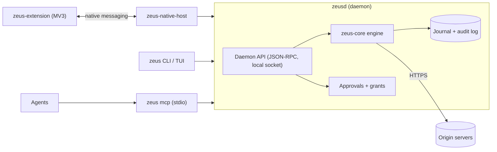

# Zeus

**The session-aware download and file layer for AI agents.**

Your agents can find it. Zeus makes sure they actually get it: verified, filed and accounted for. It works with your real browser, never reads your cookie database, and keeps a tamper-evident record of what it did.

> **Status: pre-alpha.** This repository currently holds the architecture, the normative specifications and the compiling skeleton of the application. The transfer engine lives in the sibling [`zeus-core`](https://github.com/ArefinAlter/zeus-core) repository and is being implemented in parallel. Most methods return a typed `NotImplemented` error. Nothing here is ready to use, and there is no release. Expect breaking changes everywhere.

Zeus is **not** an IDM clone. It is a local daemon with a small, strict API that an agent, a terminal or a browser extension can call to download files reliably, resume them after failures, use the user's own logged-in session **only with a human's consent**, and leave a verifiable trail.

## What it is for

| Problem | What Zeus does |
|---|---|
| The browser dropped a big download | The extension offers it to Zeus, which resumes it with validators (`If-Range`), segments, retries and a durable journal. |
| An agent's browser tool cannot save files | The agent calls `zeus_enqueue` and `zeus_wait` over MCP and gets a verified file with a SHA-256. |
| The file is behind a login | A human approves a scoped session grant in the browser extension or the terminal. Cookies are handed over for one origin, for minutes, held in memory, never stored. |
| The server blocks non-browser clients | Zeus asks the user's own browser to fetch the bytes. It never evades, spoofs or solves captchas. |
| "Where did this file come from?" | Hash-chained audit log, per-file provenance manifest, OS provenance marks. |

## Architecture



One daemon owns all state; everything else is a client of its local JSON-RPC API. Agents cannot approve anything: approvals are decided only by a human on a trust surface (terminal prompt, extension popup). More in [`docs/ARCHITECTURE.md`](docs/ARCHITECTURE.md) and the decision records in [`docs/adr/`](docs/adr/).

## Repositories

| Repository | Role |
|---|---|
| **zeus** (this one) | Daemon `zeusd`, CLI `zeus` with TUI, MCP server, native-messaging host, workflow engine, LLM provider ladder, A2A types, specs. |
| [zeus-core](https://github.com/ArefinAlter/zeus-core) | The embeddable engine library (`zeus-types`, `zeus-control`, `zeus-fs`, `zeus-verify`, `zeus-journal`, `zeus-session`, `zeus-http`, `zeus-engine`). |
| [zeus-extension](https://github.com/ArefinAlter/zeus-extension) | Manifest V3 browser extension (Chrome and Edge first, Firefox build target). |

Clone them **side by side**: this workspace refers to `../zeus-core`.

```
zeus-workspace/
  zeus/            <- this repository
  zeus-core/
  zeus-extension/
```

## Crates

| Crate | What it is |
|---|---|
| `zeus-api` | Daemon API: JSON-RPC types, client kinds and permissions, IPC transport, client and server frameworks. |
| `zeus-daemon` | The `zeusd` binary and its library. |
| `zeus-mcp` | MCP server library (`zeus_<verb>` tools). |
| `zeus-cli` | The `zeus` binary, including the TUI. |
| `zeus-native-host` | The `zeus-native-host` binary and host-manifest installation. |
| `zeus-workflow` | Plan IR, validator, dry-run planner. |
| `zeus-llm` | Provider ladder, policy manifest, spend accounting. |
| `zeus-a2a` | A2A Agent Card and task mapping types. |

## Quickstart (developers)

Requirements: a recent stable Rust toolchain (MSRV 1.90), the three repositories side by side.

```sh
git clone https://github.com/ArefinAlter/zeus.git
git clone https://github.com/ArefinAlter/zeus-core.git
cd zeus
cargo check --workspace
cargo test --workspace
cargo run -p zeus-cli -- --help
```

On a small machine set `CARGO_BUILD_JOBS=3` and a shared `CARGO_TARGET_DIR`, and run one cargo command at a time. Windows without the MSVC build tools: see [CONTRIBUTING.md](CONTRIBUTING.md).

Validate the specification examples (they are tests):

```sh
cd docs/spec/tools
npm ci
npm run validate
```

## Privacy and safety

- No telemetry. The only network traffic is what a download, a workflow or a configured model provider explicitly causes.
- Session cookies are never persisted or logged. Zeus never reads a browser cookie database.
- Models see metadata only by default, with secrets redacted at every level.
- Downloaded files are never auto-opened and carry the OS's mark-of-the-web.

## Documentation

- [`docs/spec`](docs/spec/README.md): normative specifications and JSON Schemas.
- [`docs/ARCHITECTURE.md`](docs/ARCHITECTURE.md), [`docs/adr`](docs/adr): design and decisions.
- [`docs/research`](docs/research): the research corpus behind the design (unverified drafts until marked verified).
- [`ROADMAP.md`](ROADMAP.md), [`CONTRIBUTING.md`](CONTRIBUTING.md), [`SECURITY.md`](SECURITY.md).

## Licence

Apache-2.0. Copyright 2026 Zeus contributors. See [LICENSE](LICENSE) and [NOTICE](NOTICE).
