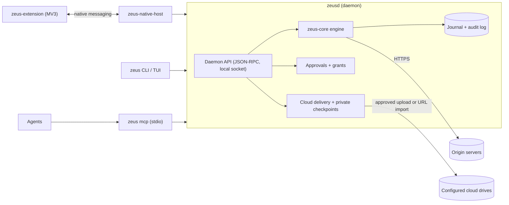

# Zeus

**The session-aware download and file layer for AI agents.**

Your agents can find it. Zeus makes sure they actually get it: verified, filed and accounted for. It works with your real browser, never reads your cookie database, and keeps a tamper-evident record of what it did.

> **Status: pre-alpha, implementation in progress.** The daemon, transfer engine, native relay, MCP stdio server, terminal interfaces, restricted desktop client, public-page workflow runner and model adapters have executable implementations and hermetic tests. Real browser/GUI acceptance, cross-platform release validation and several roadmap capabilities remain unfinished. There is no frozen API. A first pre-alpha, [release 0.0.1a](https://github.com/ArefinAlter/zeus/releases/tag/v0.0.1a) (unsigned builds for Windows x64 and Linux x64), can be tried in the browser at <https://zeus.103.191.50.32.sslip.io> or downloaded from the [Zeus website](https://zeus-site-bay.vercel.app/get-started/). See the [implementation and remaining-work ledger](docs/IMPLEMENTATION_STATUS.md).

Zeus combines familiar download queues, resumable transfers and a link inbox with explicit agent plans, human approvals and per-run budgets. The [download workspace design](docs/design/download-workspace.md) includes a runnable visual prototype; its queue and agent controls are simulations until connected to the daemon.

## What it is for

| Problem | What Zeus does |
|---|---|
| The browser dropped a big download | The extension offers it to Zeus, which resumes it with validators (`If-Range`), segments, retries and a durable journal. |
| An agent's browser tool cannot save files | The agent calls `zeus_enqueue` and `zeus_wait` over MCP and gets a verified file with a SHA-256. |
| The file is behind a login | A human approves a scoped session grant in the browser extension or the terminal. Cookies are handed over for one origin, for minutes, held in memory, never stored. |
| The server blocks non-browser clients | Zeus asks the user's own browser to fetch the bytes. It never evades, spoofs or solves captchas. |
| "Where did this file come from?" | Hash-chained audit log, per-file provenance manifest, OS provenance marks. |
| The agent should save into cloud storage | An explicit cloud delivery plan chooses verified staged upload, bounded streaming, or a supported provider URL fetch. Human approval binds the source, account revision, destination and limits. |

## Architecture



One daemon owns all state; everything else is a client of its local JSON-RPC API. Agents cannot approve anything: approvals are decided only by a human on a trust surface (terminal prompt, extension popup). More in [`docs/ARCHITECTURE.md`](docs/ARCHITECTURE.md) and the decision records in [`docs/adr/`](docs/adr/).

## Repositories

| Repository | Role |
|---|---|
| **zeus** (this one) | Daemon `zeusd`, CLI `zeus` with TUI, MCP server, native-messaging host, workflow engine, LLM provider ladder, optional A2A bridge, specs. |
| [zeus-core](https://github.com/ArefinAlter/zeus-core) | The embeddable engine library (`zeus-types`, `zeus-control`, `zeus-fs`, `zeus-verify`, `zeus-journal`, `zeus-session`, `zeus-http`, `zeus-engine`, `zeus-artifact`). |
| [zeus-extension](https://github.com/ArefinAlter/zeus-extension) | Manifest V3 browser extension (Chrome and Edge first, Firefox build target). |
| zeus-site (private repository) | Static marketing site, live at <https://zeus-site-bay.vercel.app>, with a clearly labeled interactive product preview using sample state. |

Clone them **side by side**: this workspace refers to `../zeus-core`.

The optional [Tauri desktop client](apps/desktop/README.md) lives in its own Cargo workspace under `apps/desktop`. It uses the real daemon for download pages, reviewed link intake, job controls and run/file/artifact inspection; its Rust bridge owns the restricted credential. Follow its README for provisioning and launch instructions.

```
zeus-workspace/
  zeus/            <- this repository
  zeus-core/
  zeus-extension/
  zeus-site/      <- website and preview; optional for runtime development
```

## Crates

| Crate | What it is |
|---|---|
| `zeus-api` | Daemon API: JSON-RPC types, client kinds and permissions, IPC transport, client and server frameworks. |
| `zeus-cloud` | Native Google Drive, Yandex Disk and Baidu Netdisk adapters; explicit rclone remotes; bounded streams, capabilities and reconciliation. |
| `zeus-daemon` | The `zeusd` binary and its library. |
| `zeus-mcp` | MCP server library (`zeus_<verb>` tools). |
| `zeus-cli` | The `zeus` binary, including the TUI. |
| `zeus-native-host` | The `zeus-native-host` binary and host-manifest installation. |
| `zeus-workflow` | Strict plan IR, validator, extraction, pagination, dry-run planner and checkpointed execution. |
| `zeus-llm` | HTTP and OAuth adapters, OS keyring integration, signed-policy validation and durable spend reservations. |
| `zeus-a2a` | A2A Agent Card and task mapping types. |
| `zeus-a2a-bridge` | Optional loopback bridge with dedicated agent credentials, task ownership and restart recovery. |

## Quickstart (developers)

Requirements: a recent stable Rust toolchain (MSRV 1.90), the three repositories side by side.

Building needs a checkout of the public `zeus-core` repository next to this one. When reviewing coordinated changes, check out the companion core revision identified in the pull request; this workspace uses sibling path dependencies, including `zeus-artifact`.

```sh
git clone https://github.com/ArefinAlter/zeus.git
git clone https://github.com/ArefinAlter/zeus-core.git
cd zeus
cargo build --workspace --bins
cargo test --workspace
cargo run -p zeus-cli -- --help
# With all sibling binaries built, provision credentials and register their executable pins:
cargo run -p zeus-daemon -- init
# Run in a separate terminal, then use zeus get/status/tui/mcp:
cargo run -p zeus-daemon -- run
```

On a small machine set `CARGO_BUILD_JOBS=3` and a shared `CARGO_TARGET_DIR`, and run one cargo command at a time. Windows without the MSVC build tools: see [CONTRIBUTING.md](CONTRIBUTING.md).

Validate the specification examples (they are tests):

```sh
cd docs/spec/tools
npm ci
npm run validate
```

## Privacy and safety

- No telemetry. The only network traffic is what a download, a workflow or a configured model provider explicitly causes.
- Session cookies are never persisted or logged. Zeus never reads a browser cookie database.
- Models see metadata only by default, with secrets redacted at every level.
- Downloaded files are never auto-opened. Supported OS provenance marks are applied and the attributes actually written are recorded.

## Documentation

- [End-to-end roadmap](ROADMAP.md): all planned phases, completed implementation, remaining work and release gates across the four repositories.
- [Project handoff](docs/PROJECT_HANDOFF.md): companion revisions and PRs, setup, operating procedures, recorded validation and known gaps.
- [`docs/IMPLEMENTATION_STATUS.md`](docs/IMPLEMENTATION_STATUS.md): implemented paths, verification evidence and remaining release blockers.
- [`docs/design/download-workspace.md`](docs/design/download-workspace.md): interaction design and visual prototype.
- [`docs/spec`](docs/spec/README.md): normative specifications and JSON Schemas.
- [`docs/ARCHITECTURE.md`](docs/ARCHITECTURE.md), [`docs/adr`](docs/adr): design and decisions.
- [`docs/research`](docs/research): the research corpus behind the design (unverified drafts until marked verified).
- [`ROADMAP.md`](ROADMAP.md), [`CONTRIBUTING.md`](CONTRIBUTING.md), [`SECURITY.md`](SECURITY.md).

## Licence

Apache-2.0. Copyright 2026 Zeus contributors. See [LICENSE](LICENSE) and [NOTICE](NOTICE).
