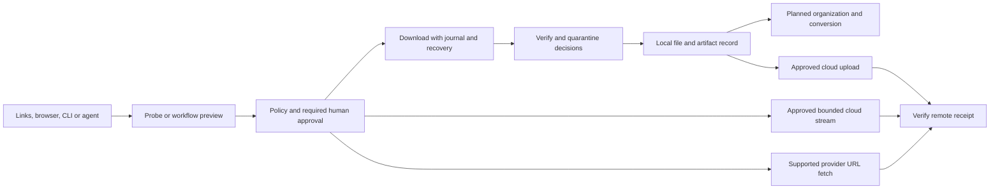

# Zeus end to end product roadmap

Reviewed **2026-10-21**. The [parallel continuation](docs/IMPLEMENTATION_STATUS.md#2026-10-21-parallel-continuation) adds approval lifecycle, artifact lifecycle, versioned reports and a restricted desktop client; final validation and publication records are pending. Earlier implementation baseline: the coordinated draft PRs in the [project handoff](docs/PROJECT_HANDOFF.md#repository-and-review-snapshot), plus the uncommitted continuation work of 2026-10-18 recorded in the [implementation ledger](docs/IMPLEMENTATION_STATUS.md#2026-10-18-continuation). Zeus is **pre-alpha**: working downloads, a persistent daemon, agent interfaces, public-page workflows and cloud adapters exist, but no phase has a recorded release sign-off. API v1 is not frozen.

This roadmap covers `zeus-core`, `zeus`, `zeus-extension` and `zeus-site`, from finding a link to obtaining a verified local or cloud artifact. The [implementation ledger](docs/IMPLEMENTATION_STATUS.md) holds detailed results; the [handoff](docs/PROJECT_HANDOFF.md) records revisions, setup, operational caveats and validation commands.

## Product outcome and scope

A person or agent should be able to supply or discover links, preview work, obtain required human permission, download with recovery, verify the result, organize or convert it safely, deliver it to a destination and inspect its provenance. Every step must remain controllable without a model. Models propose work; they never grant permission.

Approval-bound organization and undo are implemented; sandboxed conversion remains planned. Streaming cannot provide complete local verification before upload; receipts must describe the evidence actually obtained. Provider fetch is a separate approved disclosure and exists only where supported by the provider.

Zeus remains a consumer download and file manager. Ogun is a separate developer/data platform sharing `zeus-core`; its pipelines, arbitrary-code operators and workbench are outside this roadmap. Shared engine contracts and Zeus service-client integration remain in scope. See [ADR 0011](docs/adr/0011-ogun-built-on-zeus-core.md).

## Status and phase overview

**Implemented and tested** means executable behavior with recorded tests, not live-service or platform acceptance. **Partial** means a useful subset works. **Prototype** means sample state/design without production authority. **Planned** means the complete executable path remains to be built. A **release gate** is evidence or an operational input needed before advertising support. No percentage-complete estimate is assigned.

The original month ranges are planning horizons from the start of public development, **not delivery dates or a new schedule starting today**. Assign dates after staffing and release scope are agreed.

| Phase | Original horizon | Current position | Exit outcome |
| --- | --- | --- | --- |
| 0 Contracts and skeleton | Before alpha | Specs 00–14, schemas, fixtures and repositories exist; reconciliation remains. | Reviewed contracts and reproducible development baseline. |
| 1 Working MVP and public alpha | Months 0–3 | Engine, daemon, browser relay, CLI/TUI and MCP execute; acceptance remains. | Installable, measured, session-aware downloader with verified recovery. |
| 2 Workflows, models and cloud delivery | Months 3–6 | Public-page workflow runtime, model adapters and three cloud modes have implementation coverage. | Supported file operations and provider lifecycle; Firefox acceptance and API v1 freeze. |
| 3 Interoperability and GUI | Months 6–9 | Local A2A download profile and restricted Tauri daemon client execute; installed GUI acceptance remains. Site/design previews use sample state. | Production Tauri workspace and validated agent interoperability. |
| 4 Version 1.0 and distribution | Months 9–18 | Planning and prerequisites; no 1.0 release. | Hardened, signed, maintainable releases and a published support matrix. |

Later-phase implementation does not close earlier release gates.

## Phase 0 Contracts and development baseline

**Present:** specs 00–08 and 13, new drafts 09–12 and cloud spec 14; approval hashes/revisions, decision evidence, grants, job/event fields, artifact identities and cloud contracts; synchronized core fixtures and extension schema/type copies.

| ID | Remaining work | Completion evidence |
| --- | --- | --- |
| C01 | Reconcile normative prose, schemas, handlers and frontend behavior, especially specs 05/07/08; review drafts 09–12/14. | Resolved discrepancy register, positive/negative contract tests and explicit unsupported-capability errors. |
| C02 | Complete service credentials/root registration, visibility, idempotency semantics, approval batching/amendment/renewal/cooldowns and workflow reports. **Done 2026-10-18:** service kind, `clients.*`, `files.roots.register`, 05 section 7.5 visibility, 13.2 rate buckets, pending caps, denial back-off (cooldown), `session_grant` batching, capability gating (`api.capability_missing`) and configurable `api.rate_limits.*`. **Done 2026-10-21:** enqueue handoff batching, atomic cancellation leaving/amendment with revision rollover, a narrowed native-host credential and versioned workflow reports. **Open:** non-enqueue joining, other need-disappearance paths and workflow grant renewal. | Cross-client isolation, changed-payload retry, restart and stale-approval tests against agreed wire forms. |
| C03 | Correct stale architecture/open-issue text, including executable A2A, app-owned redb stores, model integration and scheduler behavior. **Done 2026-10-18:** ARCHITECTURE crate map and rules, spec 10, ADR 0012 (Proposed) for app-owned stores. | Design and implementation agree; intentional boundary changes receive ADRs. |
| C04 | Establish required CI, actual MSRV testing and reproducible cross-repository schema/fixture checks. **Done 2026-10-18:** workflows for app, core and extension; MSRV 1.90 check passed locally. **Open:** the `ZEUS_CORE_TOKEN` secret, a first green run and marking the checks required. | Clean generation on fresh companion checkouts and required checks visible on PRs. |
| C05 | Verify the remaining research corpus and resolve release-relevant spec open issues. | Dated primary evidence or explicit unresolved research; no inference that draft research is verified. |

Every specification's open-issue list remains part of the backlog. Some entries describe work that now exists and need reconciliation, not another implementation. See the [handoff discrepancy register](docs/PROJECT_HANDOFF.md#known-gaps-and-documentation-discrepancies).

**Exit:** alpha contracts are reviewed, generated copies agree, coordinated checkouts build, required CI runs and deferred items have explicit scope. API freeze belongs to phase 2.

## Phase 1 Working MVP and public alpha

| Area | Implemented and tested | Remaining product work |
| --- | --- | --- |
| HTTP engine | Working builder and enqueue/probe/control/wait/verify/events; bounded ranges, validator checks, retries, pause/resume/cancel and recovery. | URL/authentication refresh integration, authenticated standalone probing, broader origin behavior and failure acceptance. |
| Scheduling | Bounded concurrency, segment planning and reusable rate/fairness/AIMD helpers. 2026-10-18: the estimator, mirror-selection, hedging, reliability and CUSUM algorithms are implemented and tested in `zeus-control`. | Real per-host scheduling, adaptive concurrency, rate ceilings and fairness in execution; wiring estimators, mirrors and hedging into the engine; honouring `segment_size_mib`. |
| Filesystem | Positional writes, allowed-root checks, safe names, finalization, trash and OS provenance writes. | Handle-relative containment under directory/symlink/reparse replacement; platform/filesystem and weak-durability behavior. |
| Journal and integrity | redb transactions, commit records/CRC, recovery, SHA-256/BLAKE3 verification, audit and provenance. | Every fault point, corruption/migration handling, disk-full behavior, audit retention/repair and keyed/external anchoring policy. |
| Artifact library | Content/record-only ingest, metadata, deduplication, materialization, import/export, retention/GC and scrub/repair. | Daemon/CLI preview and apply now cover tombstones, retention and verified copy materialization. Import/export/events, collection administration, migrations and platform acceptance remain. Completed downloads use record-only ingest. |
| Daemon and IPC | Local listener, authentication/owner checks, durable state/events/idempotency, bounded connections and shutdown. | Contract gaps, installation/upgrade acceptance, service provisioning and retention operations. |
| Approvals and global stop | Durable hash/revision binding, grants, terminal/browser evidence and persisted stop latch; stop revokes grants and pauses work. 2026-10-18: retained and replayed emergency-stop audit, configured caps, approve-only rate, denial back-off, `session_grant` batching. | Enqueue handoffs and cancellation leaving/amendment now work, including stale-review rejection and revision rollover. Non-enqueue joining, other disappearance paths, renewal and real trust-channel/OS acceptance remain. |
| Browser path | Native relay, handoff, scoped session release, refresh messages and bounded browser-fetch streams. | Installed Chrome/Edge acceptance, suspension/reconnect/expiry/revocation/backpressure, refresh integration and approved proxy-redirect behavior. |
| Agent and terminal interfaces | MCP stdio, CLI download/lifecycle/approval flows and live TUI. | Host interoperability, long verification behavior, client credentials and remaining frontend contracts. MCP HTTP is unavailable. |

The current MCP catalogue has **thirteen tools**: the nine original download/session/file-list tools, `zeus_cloud`, `zeus_workflow`, `zeus_files` and `zeus_artifacts`. The generated normative catalogue is embedded by the server: 31,473 of 40,960 bytes, with each tool below 4,096 bytes ([ADR 0013](docs/adr/0013-bounded-workspace-mcp-tools.md)). Agent tools cannot decide approvals.

**Alpha acceptance gates:**

- Real browser → host → daemon → engine flows on Chrome and Edge, including denial, stale approval, expired grant, disconnect and suspension.
- At least **85% handoff success on a documented 200-URL failure corpus**, with failures and environment recorded.
- Correct bytes/SHA-256 after abrupt stop and restart, plus the broader journal/finalization fault matrix. The Windows 8 MiB smoke test is one passing case.
- Published idle memory, memory with **ten jobs**, and throughput at **1, 4 and 16 segments**, with hardware, network conditions and baselines. Numerical budgets/speed claims require measurement and review. Windows loopback figures (NVMe and HDD) were recorded on 2026-10-18 with `tools/bench-daemon.mjs`; other platforms and real networks remain.
- Path/IPC/approval threat-model review and dependency/license/advisory checks; unsupported platforms remain explicit. The dependency/license/advisory check passed on 2026-10-18.
- Installable alpha package, exact extension identities/allowlists, provenance/quarantine acceptance, release notes and recovery instructions. Signing/distribution follows the release process.

Advanced performance features may be explicitly deferred if measured alpha requirements pass. Helper code alone is not an integrated scheduler.

## Phase 2 Workflows and file operations

**Present:** bounded public HTTP pages; CSS/JSON/regex extraction; numeric/cursor/next/date pagination; filtering, naming/routing and deduplication; dry-run plans, approval, budgets, checkpoints/job intents and audit receipts. The runtime executes a caller-supplied plan. Terminal-requested selector drafting is connected; model output is a proposal and never authority.

| ID | Remaining work | Dependencies and acceptance |
| --- | --- | --- |
| W01 | Authenticated document/page access and `session.page` / `page_render`. | Browser/grant contract first; installed-browser tests for origin, profile, content and expiry boundaries. |
| W02 | Remaining pagination/extraction, sitemap/scroll, item sinks, drift and estimator calibration. **Done 2026-10-21:** versioned reports with durable discovery counters, actual engine job counts, active elapsed time, pause/error/incompleteness fields and explicit legacy unknowns. | Advertise capabilities only when validation, execution and restart behavior work. |
| W03 | Revised-plan continuation, incremental deduplication, multi-origin sessions and explicit site-policy exceptions. | New effects require new review; no silent reuse of old authority; robots/site constraints remain enforceable. |
| W04 | Sandboxed conversion and derived-artifact lineage. | Fixed tools/arguments, confined I/O, resource bounds, cancellation and platform sandbox tests. |
| W05 | Organizer/rules, before/after preview, collisions, destructive approval, trash/undo and model-assisted classification. **Done 2026-10-18** except model-assisted classification and manifest records for moved files. | Protect concurrent file changes and completed files; durable operation/recovery receipts. |
| W06 | Full artifact lifecycle through daemon/CLI/MCP and dedicated workflow frontends. **Done 2026-10-18:** `zeus workflow` and `zeus files` commands; daemon methods `artifacts.get`, `.list`, `.lineage` and `.ingest` (capability `artifacts`). **Done 2026-10-21:** CLI artifact list/get/lineage/ingest and grouped MCP workflow/file/artifact tools; catalogue budget resolved by ADR 0013. The parallel continuation adds `artifacts.lifecycle.preview/apply` and CLI `delete`, `retention`, `materialize`, `apply`: exact saved plans, terminal approval for deletion/protection weakening and durable retries. **Open:** import/export/events, collection administration and lifecycle MCP mutations. | Retention, quotas, GC, repair, import/export and lineage integrated with authority/events; real workflow plan/run commands or tools. |

Authenticated rendering, conversion, destructive replacement and item-sink operations currently fail before execution. CLI workflow, organize and artifact commands and their grouped MCP tools exist. Conversion remains unavailable.

## Phase 2 Models and authentication

**Present:** explicitly configured OpenAI Responses/compatible, Anthropic and local adapters; model OAuth flows including OpenRouter and ChatGPT sign-in; OS keyring integration; signed-policy verification/antirollback; durable spend reservations; human auth UI. Download-only is the default. Sign-in alone does not select a model or enable inference. The daemon model wrapper has a workflow-selector caller; file classification remains open.

| ID | Remaining work | Completion evidence |
| --- | --- | --- |
| M01 | Connect model runtime to bounded drafting/classification; complete account/model selection UX. **Done 2026-10-18:** workflow selector drafting (structure-only prompt, extract-only schema, terminal-only, per-request ceiling). **Open:** classification and account/model selection UX. | Structured model output becomes a validated proposal, with content consent and spend accounting; human authority remains separate. |
| M02 | Live sign-in/refresh/sign-out, OS keyring and browser acceptance. | Explicit test accounts/spend; expiry, rotation, revocation and failure behavior on supported platforms. |
| M03 | Host/sampling integration and constrained CLI delegation. | Negotiation, bounded execution, output validation and privacy/spend enforcement. Ordinary host-agent use through MCP already works. |
| M04 | Production policy distribution and signing-key provisioning/custody/rotation. | Verified keys plus offline expiry/rollback/rollover drills; missing trust material cannot enable policy-dependent rungs. |
| M05 | Explicit encrypted fallback where keyrings are unavailable and spend reconciliation UX. | No plaintext downgrade; uncertain charges retain reservations; local estimates do not guarantee third-party invoices. |

Recheck provider eligibility, endpoints and terms during live acceptance. Protocol fixtures do not establish a production vendor relationship.

## Phase 2 Cloud destinations

All three modes are in scope: **download, verify, upload** (`staged_upload`), **stream through Zeus** (`stream_upload`) and **provider fetches URL** (`remote_import`). Plans choose one explicitly; unsupported modes fail without fallback.

| Destination | Staged upload | Streaming | Provider fetch | Current limitation |
| --- | --- | --- | --- | --- |
| Google Drive | Native resumable | Exact length | Unavailable | Resume needs verified retained source and confirmed offset. |
| Yandex Disk | Native upload | Exact length | Native asynchronous import | No guaranteed remote cancellation or hard remote byte cap; explicit weaker-limit consent. |
| Baidu Netdisk | Native multipart; block hashing | Exact length and precomputed 4 MiB block-MD5 manifest | Unavailable | Registered-app/account-tier limits; SHA-256 remains the integrity digest. |
| MEGA and other explicit rclone remotes | Backend-dependent | Known-size `rcat` where supported | Unavailable | Trusted helper/config; generic atomic no-overwrite and automatic replay cannot be promised. |

Implemented: immutable plans, account revisions, terminal-only cloud approvals, keyring storage, source network policy, private checkpoints, reconciliation and completion evidence. **Live acceptance remains open.** See the [provider guide](crates/zeus-cloud/README.md) and [daemon guide](crates/zeus-daemon/src/cloud/README.md).

| ID | Remaining work | Completion evidence |
| --- | --- | --- |
| D01 | Native cloud OAuth onboarding, registrations/scopes, refresh and account lifecycle. | Real account setup, scope denial, expiry/rotation/revocation without credential exposure. |
| D02 | Live provider/mode/tier acceptance and rclone installation/config lifecycle. | Upload/import, interruption, quota/size limits, credential changes, restart and duplicate prevention recorded separately. |
| D03 | Broader safe resume, remote cancellation, checksums/readback and cleanup where official APIs permit. | Accurate capabilities; ambiguous dispatch never produces automatic duplicate imports; uncertainty stays visible. |
| D04 | Ranged recovery of partial URL staging and richer progress/recovery controls. | Source/upload/verification are accurate; verified staging survives expired URLs. Completed-job sources already benefit from engine recovery. |
| D05 | Cloud history/checkpoint/idempotency archival and retention management. **Done 2026-10-18:** automatic, audited retention that never removes uncertain operations or their receipts. | Bounded growth without losing active receipts or enabling duplicate writes. |
| D06 | Production cloud account/plan/status UI. | Show URL disclosure, traffic path, verification level, provider limits and changed revisions before review. |

Local forwarding must never be called provider fetch. Native **cloud** OAuth is separate from implemented **model** authentication. Object byte caps are not total traffic/billing caps. Stopping Zeus cannot guarantee cancellation of an accepted remote fetch.

**Phase 2 exit:** supported workflows survive interruption/drift; file operations are confined and recoverable; provider/model credential lifecycles and Firefox pass acceptance; artifact migrations and contracts agree; API v1 is deliberately frozen with compatibility fixtures and versioning rules.

## Phase 3 Human workspace and interoperability

The executable [Tauri client](apps/desktop/README.md) now uses a restricted authenticated daemon bridge for downloads, URL preview/enqueue, run reports, default-root files and artifact facts. It uses real state and has no approval-decision authority. The [workspace design](docs/design/download-workspace.md) and [prototype](docs/design/console/index.html) provide the broader design baseline. `zeus-site` has a labeled `/preview/` page and `/preview/console/`. Both previews use sample state and illustrative approvals; neither is a trusted client.

| Surface | Intended experience | Remaining production work |
| --- | --- | --- |
| Downloads | IDM-style dense queue with file/site/requester/bytes/speed/state/ETA/queue and inspector. | Typed paged snapshots, stable selection, inspectors, current-page search and eligible batch controls exist. Durable event replay/lag recovery, virtualization and installed accessibility acceptance remain. |
| Link inbox | JDownloader-style deduplication, packages and destination/collision preview before enqueue. | Real bounded URL preview/enqueue and retry keys exist. Persistent inbox/package model and rules remain. |
| Queues and schedules | Named queues, priorities, speed ceilings, file concurrency distinct from connections, timezone-aware windows. | Daemon scheduler, restart/missed-window behavior, overnight/DST and metered-network policy. |
| Agent runs | Plan/revision, planned versus actual usage, stage progress, exceptions and recovery actions. | Versioned daemon reports are connected. Rich stage actions, revision-aware continuation and complete provenance inspection remain. |
| Approvals | Neutral daemon-derived facts, separate untrusted text, fresh review after changes. | Desktop lists only its agent-visible requests; decisions remain in the verified CLI. A trusted GUI channel, focus/input and installed hostile-content acceptance remain. Cloud stays terminal-only. |
| Files and destinations | Local/cloud outcomes, hashes, lineage, quarantine, retention and cleanup uncertainty. | Default-root files and artifact facts are connected read-only in the desktop; artifact lifecycle RPC/CLI exists. Desktop mutations, conversion, organizer/cloud controls and detailed progress remain. |
| CLI automation | Wget-like explicit URL intake, lists, include/exclude rules and bounded traversal with dry run. | `get -i/--input-file` now accepts bounded UTF-8 URL lists with exact deduplication and whole-batch validation. Remaining: stdin, persistent inbox, larger batch recovery and traversal parity; full wget compatibility is not promised. |

The current client uses **Tauri 2 and dependency-free JavaScript ES modules**, following [ADR 0009](docs/adr/0009-tauri-gui-later.md). The Rust shell holds a dedicated Agent/Gui credential with seven explicit permissions and five typed webview commands. The webview receives redacted projections; it cannot decide approvals, reveal original job URLs, issue arbitrary RPC or launch processes. Snapshots poll every two seconds, at most 100 records per page. Packages group files, queues schedule them, and runs carry execution/provenance; keep those concepts separate. Preserve keyboard access, focus, 200% zoom, reduced motion, responsive layouts and readable failure states. Global stop remains distinct from pause/scheduling.

The **A2A bridge already runs** as an opt-in local authenticated file-download profile with owner isolation and durable task recovery. Remaining: external SDK conformance, additional skills after their underlying operations exist, and separately designed authenticated artifact delivery. Remote deployment, streaming/push and broad protocol compatibility are not current capabilities. **MCP App views** remain planned and read-only. Optional MCP HTTP needs a separate transport/security implementation.

**Exit:** the installed GUI performs real queue/run/cloud work and authorized decisions; accessibility/reconnect/lag checks pass; advertised A2A/MCP host profiles pass interoperability acceptance. The marketing preview remains explicitly a simulation.

### Expanded file-workspace and platform scope (2026-10-21)

The [primary-source workflow research and implementation map](docs/design/client-workflows-and-platforms.md) covers IDM, JDownloader, Wget, aria2, ed2k/torrent clients, Everything, WizTree, native/dual-pane/terminal file managers and remote synchronization. It specifies the scoped metadata index, disk-allocation accounting, desktop frontend boundaries and Android/iPhone execution models. It also gives concrete designs and acceptance cases for every previously design-blocked item. The map now records implemented subsets for approval/native-host authority, artifact lifecycle, reports and the desktop bridge; other designs remain proposals where stated.

The live TUI now filters loaded jobs with `/`, preserves selected job/approval identity across refresh, and scrolls the queue to its selected row. These remain loaded-job filters; the new desktop also searches only its current page. Neither is a filesystem index. Informational CI now names native Windows/Linux ARM64 and both Intel/Apple Silicon macOS targets; no run or compatibility result is implied by configuring them. Android and iOS applications, native background/storage adapters and device acceptance are explicit workstreams. No mobile build exists yet.

## Phase 4 Version 1.0 and maintenance

| ID | Work | Release outcome |
| --- | --- | --- |
| R01 | Supported OS/filesystem/browser hardening, migrations, backup/restore and upgrade/rollback. | Published support matrix and repeatable clean-install/upgrade/recovery acceptance. |
| R02 | Signed binaries/installers/browser packages, reproducible builds, SBOM and attestations. | Verifiable versioned artifacts and dependency/license/advisory gates. |
| R03 | winget/Homebrew/Scoop, real autostart integration, extension IDs/disclosures/screenshots/publication. | Install/update/uninstall without silently changing pins or exposing credentials. |
| R04 | Documentation, local diagnostics, security response, benchmarks and compatibility policy. | Users can install/recover/report redacted diagnostics; support commitments are explicit. |
| R05 | Feature-gated S3, Hugging Face-native and torrent sources. | Separate source adapters with provenance, budgets, permissions and acceptance. Rclone destinations do not implement source adapters. |
| R06 | Evaluate optional sync/team policy, signed provenance and commercial layers. | Separate product/threat-model decision; services stay outside browser/credential paths. No sync/team/SSO service exists today. |

Research also mentions yt-dlp/media handling, FTP/SFTP, GCS/Azure, Git LFS, chunked storage, encryption/keyed exports, scanning hooks and richer provenance. These are **uncommitted candidates or spec open issues**, not completed capabilities or new alpha promises. Promote each through scoped design and acceptance. Safari and a general data-engineering workbench are not silently included.

Historical adoption/revenue targets and launch channels in [research section 5.8](research.md#58-mvp-roadmap-metrics-go-to-market-monetization) remain hypotheses, not achieved metrics or commercial commitments. Product telemetry is not planned.

## Recommended execution order

Owners are **roles to assign**, not staffed commitments. Work can overlap once prerequisites are satisfied.

| Order | Work package | Lead role | Depends on | Reviewable result |
| --- | --- | --- | --- | --- |
| 1 | Review coordinated PRs, C01–C04 and required CI | Maintainer and contract/security reviewers | Matched revisions | Reviewed baseline, discrepancy register and real checks |
| 2 | Containment/IPC/trust, browser acceptance and refresh/recovery integration | Core, daemon and extension maintainers | Authority contracts | Supported combinations and recorded results; explicit macOS gaps |
| 3 | Alpha fault matrix, rescue corpus, benchmarks and packaging | QA and release maintainer | Steps 1–2 | Measured alpha candidate and release decision |
| 4 | Cloud auth/live providers/recovery/retention | Cloud and daemon maintainers | Account/delivery contracts | Provider-by-provider support evidence |
| 5 | Workflows, model invocation, converters/organizer and artifacts | Workflow, model and filesystem maintainers | Containment and contracts | Recoverable acquisition/file operations with bounded model use |
| 6 | Policy distribution/live auth, Firefox and API freeze | Model, extension and API maintainers | Supported phase 2 behavior | Versioned stable contracts and compatible fixtures |
| 7 | Tauri, scheduling and interoperability | Desktop and integration maintainers | Stable capabilities/API | Installed workspace and tested agent profiles |
| 8 | 1.0 hardening/distribution and optional-source/service decisions | Release maintainer and product owner | Selected 1.0 gates | Signed supported release |

Cloud/model acceptance can proceed alongside alpha validation. GUI development may use an experimental capability map, but cannot manufacture missing backend behavior or approval authority. Every phase ends with benchmark evidence and a written threat-model review.

## Definition of done and exclusions

A capability is complete when its contract, executable path, durable state, recovery behavior, permission boundary, user outcome, tests and documentation agree. A release additionally requires installed-platform acceptance and operational inputs. Store identities, OAuth registrations, signing keys and release ownership must come from their human-controlled processes.

Excluded: captcha solving, TLS fingerprint spoofing, browser cookie-database access, DRM circumvention, telemetry, agent self-approval and extracting other applications' credentials. Same-user malware remains a documented residual threat; prompts and executable pins are not a complete sandbox against it.

Update this roadmap when scope/exit criteria change, [IMPLEMENTATION_STATUS.md](docs/IMPLEMENTATION_STATUS.md) when behavior/evidence changes, and the [handoff](docs/PROJECT_HANDOFF.md) when revisions, setup or operating procedures change.
