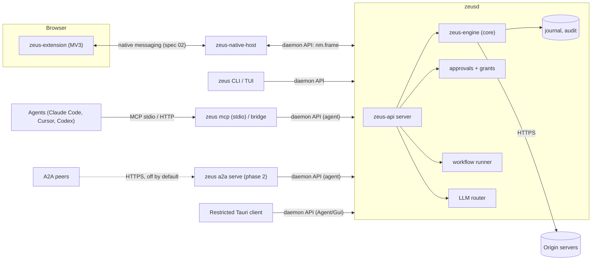
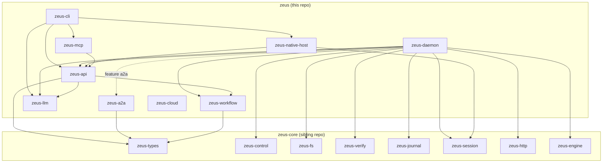
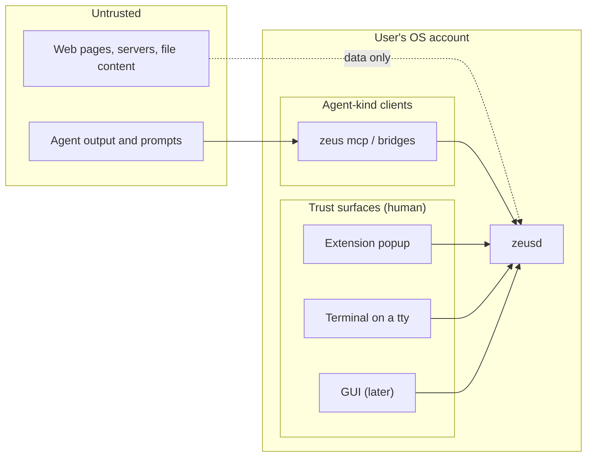
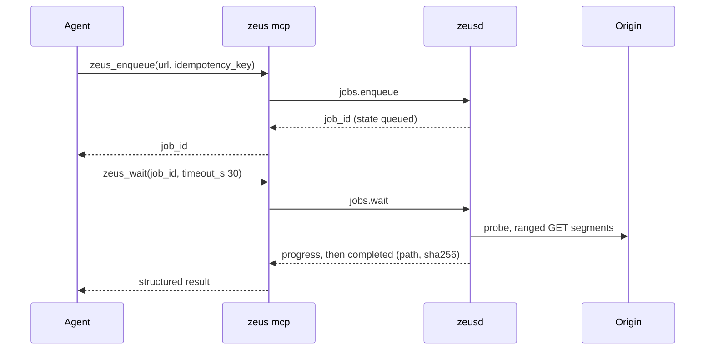
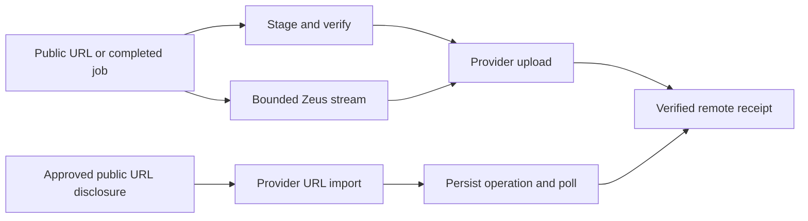
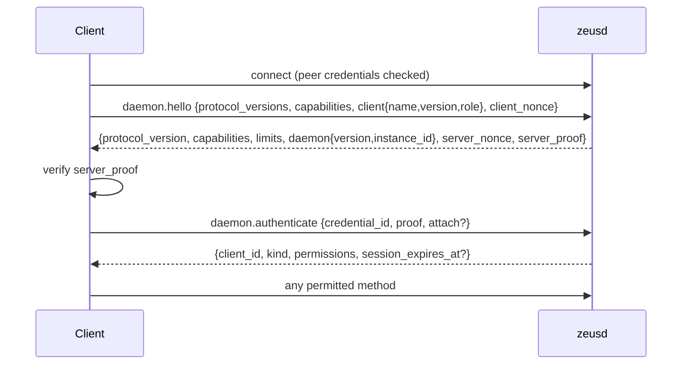

# Zeus architecture

Status: pre-alpha, updated 2026-10-21. This document describes how the `zeus` app is put together; the published draft specs govern details where they differ. The parallel continuation adds restricted desktop IPC, artifact lifecycle RPC, versioned workflow reports and approval/native-host authority changes. Final full-suite and publication evidence is pending in [the implementation ledger](IMPLEMENTATION_STATUS.md#2026-10-21-parallel-continuation). Rationale for the big choices is in [`docs/adr/`](adr/).

Contents: 1 Repositories and processes, 2 Crate map, 3 Trust boundaries, 4 Data flows, 5 Design for spec 05 (daemon API), 6 Spec 06 (MCP), 7 Spec 07 (approvals), 8 Spec 08 (workflow plans), 9 Spec 09 (LLM providers), 10 Spec 10 (A2A), 11 Spec 11 (CLI and TUI), 12 Spec 12 (security invariants), 13 Spec deltas for 00 to 04, 14 Build notes.

## 1. Repositories and processes

| Repository | Contents |
|---|---|
| `zeus` (this one) | Daemon `zeusd`, CLI `zeus` with TUI, MCP server, native-messaging host `zeus-native-host`, workflow engine, LLM provider ladder, A2A types, and the normative specs in `docs/spec`. |
| `zeus-core` | The embeddable engine library: `zeus-types`, `zeus-control`, `zeus-fs`, `zeus-verify`, `zeus-journal`, `zeus-session`, `zeus-http`, `zeus-engine`. No daemon, no MCP, no UI. Cloned next to this repository and used by path dependency. It has a second first-party consumer, Ogun (ADR 0011), so its public API is a contract. |
| `zeus-extension` | The Manifest V3 browser extension: trust-surface popup, download rescue, session oracle, in-browser fetch fallback. Keeps copies of the schemas it needs. |
| `ogun` | A separate product: developer platform for data mining, data engineering and agent benchmarks. Embeds the `zeus-core` engine without sessions; reaches browser-session sources only as a `service` client of `zeusd` (ADR 0011). |

Process rules:

1. `zeusd` is the only process of Zeus or Ogun that holds session material, and the only owner of the transfer journal. It has **one** listener, the local IPC endpoint (ADR 0002, ADR 0010). Its app services keep their own stores beside the journal (ADR 0012). The optional A2A bridge is the one other process with durable state, its task index.
2. Everything else is a client of the daemon API: `zeus` (CLI, TUI, `zeus mcp`), `zeus-native-host`, the restricted Tauri client and bridge processes.
3. The daemon workspace binaries are `zeus`, `zeusd` and `zeus-native-host`; `apps/desktop` independently builds the Tauri client. `zeus daemon start` launches `zeusd`. Per-user autostart registration by an installer is a release task (roadmap R03); nothing registers it today.

## 2. Crate map

| Crate | Kind | Responsibility | Heavy dependencies |
|---|---|---|---|
| `zeus-api` | lib | JSON-RPC 2.0 envelope, NDJSON codec, method catalogue with typed params and results, client kinds and permissions, error mapping to the 00 envelope, endpoint naming and discovery, challenge-response authentication, `Client` and `Server` frameworks, state and config path resolution. | interprocess, tokio |
| `zeus-daemon` | lib + `zeusd` | The `Backend` trait and its routing onto a `zeus_api::Router`; the runtime backend over the engine and journal with startup recovery; human-decision rules and the durable consent store; executable trust and terminal evidence; provisioning and the credential index (`clients.*`, service roots); visibility scoping; the browser broker for `nm.frame`; the workflow runner and model drafting; the model service; cloud orchestration; the file organiser with undo; the audit and provenance outbox. OS service installation is a release task. | core crates, redb (ADR 0012), reqwest via zeus-llm |
| `zeus-cloud` | lib | Explicit cloud delivery adapters (Google Drive, Yandex Disk, Baidu Netdisk, configured rclone remotes), provider capabilities, private checkpoints and the keyring credential port. The daemon owns approvals, account revisions and orchestration (14). | reqwest, keyring (feature) |
| `zeus-mcp` | lib | The `zeus_<verb>` tools, resources and prompts (rmcp). A daemon client with an agent credential. Streamable HTTP behind feature `http`. | rmcp |
| `zeus-cli` | lib + `zeus` | clap command tree, output rendering (human, JSON, NDJSON), exit codes, trust prompt on the controlling terminal, the ratatui TUI (`tui` module), `zeus mcp`, `zeus native-host`. | clap, ratatui |
| `zeus-native-host` | lib + `zeus-native-host` | Native-messaging relay: verifies which extension launched it from `argv`, enforces frame limits, relays frames to the daemon; install and uninstall of host manifests (registry on Windows, files elsewhere). | winreg (Windows) |
| `apps/desktop` | independent workspace | Tauri 2 Rust-owned IPC bridge and bundled local ES-module UI: redacted downloads, URL review/enqueue, reports/files/artifacts and restricted approval listing; no approval decisions or generic RPC. | tauri |
| `zeus-workflow` | lib | Plan IR v0, expression language, validator, dry-run planner, versioned durable run reports and estimators. Heavy extraction engines behind feature `runtime`. | scraper, jsonpath-rust, regex (feature `runtime`) |
| `zeus-llm` | lib | Provider ladder, `LlmProvider` trait, privacy tiers and redaction, spend ledger, signed policy manifest verification, OpenRouter PKCE helper, keyring abstraction. Network and OS keyring behind features `http` and `os-keyring`. | reqwest, keyring (features) |
| `zeus-a2a` | lib | Agent Card types, job to A2A task mapping. Types only. | none |
| `zeus-a2a-bridge` | lib | The opt-in loopback A2A bridge (`zeus a2a`): a separate process with its own agent credential, per-peer bearer tokens and a durable task index; submit, get, list and cancel for file downloads (10). | axum, redb (ADR 0012) |

Layering rules (enforced by review and by `cargo tree` checks in CI):

- Wire-type crates (`zeus-workflow`, `zeus-llm`, `zeus-a2a`) never depend on `zeus-api`. `zeus-api` depends on the first two with their heavy features **disabled**, so a thin client does not link scraping or HTTP stacks.
- Only `zeus-daemon` depends on `zeus-engine`, `zeus-journal`, `zeus-fs`, `zeus-verify`, `zeus-http` and `zeus-control`. Clients never link the engine.
- Only `zeus-daemon`, `zeus-llm` and `zeus-a2a-bridge` depend on `redb`, each for its own store; none opens the engine journal (ADR 0005, ADR 0012).
- `zeus-core` has no dependency on this repository.

## 3. Trust boundaries

1. Remote content is data, never instructions (01 section 12).
2. Agent-kind clients can enqueue, observe and control jobs; they cannot decide approvals, change grants, read cookies or alter policy.
3. Human-kind clients can decide approvals, but only with channel evidence the daemon can check (ADR 0007).
4. Session material exists only inside the daemon, for at most one lease, and never leaves it except toward the origin server.
5. The same-OS-user attacker with shell access is a documented residual risk (ADR 0007, spec 12).

## 4. Data flows

### 4.1 Agent download without a session

### 4.2 Browser handoff with session

The extension offers the failed download over native messaging (spec 02). `zeus-native-host` relays the frame to the daemon as `nm.frame`. The daemon creates the job (S01 or S02), raises an approval if needed, and the human decides in the popup or terminal. The daemon then asks the extension for session material through the same relay; the extension releases cookies for one origin after its own consent check. The daemon probes, downloads, verifies and finalizes. Details: 01 section 11.1 and 02 sections 7 to 10.

### 4.3 Approved cloud delivery

The desktop adds file-management grants independently from search inclusion, and local-file uploads bounded by included read roots. Local upload plans bind the exact file digest; execution stages a separate copy and verifies it before provider disclosure. Native UI routes never decide cloud-delivery approvals. See ADR 0014 and spec 14.

Cloud delivery is a distinct durable operation (spec 14), separate from local job completion. `zeus_cloud` or the CLI creates an immutable plan, then submits its ID/hash for a terminal-only `cloud_delivery` approval. The daemon binds account revision, source identity, data path, destination, byte/time limits and provider limitations. It owns the private checkpoint store and cancellation; provider adapters never decide authority.

Google Drive and Baidu support native resumable staged upload; Yandex supports native upload and asynchronous URL import. Explicit rclone remotes extend upload coverage, including MEGA, without claiming provider URL fetch. The selected mode never silently changes. Credentials stay in the OS keyring or explicitly protected rclone configuration; upload-session URLs remain private. Remote cancellation and byte limits are reported as actual capabilities. See [the provider implementation guide](../crates/zeus-cloud/README.md) for protocol and acceptance limits.

## 5. Design for spec 05: daemon API

This section is the input for `05-daemon-api-v1.md` and for `schema/daemon-api.v1.schema.json`. Spec 05 (Draft 1, 2026-10-06) is now normative and supersedes this section where they differ; its section 18 lists every difference from this design and from the draft Rust types in `crates/zeus-api` (for example `clients.*` and `files.roots.register` are MVP, list parameters are flat, mutating results carry `replayed`, and the Windows endpoint is derived from the user's SID).

### 5.1 Transport, framing, versions

See ADR 0002. In short: JSON-RPC 2.0, one message per line, local socket only. Protocol version `1`; the registry in 00 section 4.2 already reserves "daemon api 1". Limits: request line 1 MiB, response line 16 MiB (00 section 10), 5 MiB for `native_host` role connections.

### 5.2 Connection lifecycle

Before `daemon.authenticate` succeeds every other method fails with `api.not_authenticated` (class `unauthenticated`). `daemon.hello` follows 00 section 4: the first message uses the lowest protocol version, the daemon answers with the highest common one and the intersection of capabilities, or `api.version_unsupported` with `details.supported`. A gated method or parameter outside the negotiated set fails with `api.capability_missing` (05 section 8.2). One connection serves one authenticated principal; there is no re-authentication.

### 5.3 Client kinds, roles, permissions

| Kind | Who | Ceiling |
|---|---|---|
| `agent` | `zeus mcp`, `zeus a2a serve`, any bridge, scripts given the agent credential | Observe and control jobs, enqueue, request sessions (creates an approval), read files list, audit and config (redacted), plan workflows. |
| `human` | `zeus` on a tty, TUI, GUI, `zeus-native-host` relaying the extension popup | Everything an agent can do plus `approvals.decide`, `sessions.revoke`, `config.set`, `daemon.kill_switch`, LLM configuration. |
| `admin` | `zeus` on a tty with the admin credential | Everything plus `daemon.shutdown` and credential management. |
| `service` | First-party programs that use `zeusd` unattended; today only Ogun's `ogund` (ADR 0011) | The agent ceiling plus `files.roots.register`. Never human: everything human-only is refused exactly as for `agent`. |

Roles describe the concrete client: `cli`, `tui`, `gui`, `native_host`, `mcp`, `a2a`, `service`, `embedded`, `test`. A credential fixes `(kind, role, permissions)`; the client cannot claim more in `daemon.hello` (the claimed role must equal the credential's, else the single authentication attempt fails). The daemon never infers kind from the claimed name. A role fixes the kinds a credential may hold (05 section 7.2): `mcp` and `a2a` only `agent`; `service` only `service`; `tui` and `gui` `agent` or `human`; `native_host` only `human`; `cli` and `embedded` `agent`, `human` or `admin`; `test` any. Kinds are not ordered: human-only checks test for a human-capable kind (`human`, `admin`), never compare kinds. A credential may narrow its permissions within its kind. The native-host role instead has the explicit ceiling `daemon.read` and `nm.relay`; creation, legacy-store migration, authentication and policy all enforce it. Human kind remains necessary for independently attested extension decisions inside native frames, and grants no general API decision/configuration authority to the relay.

`zeusd init` (and `zeus daemon install`) provisions six owner-only files in `<state>/credentials/`: `cli.token` (Admin/Cli), `agent.token` (Agent/Mcp), `a2a.token` (Agent/A2a), `host.token` (Human/NativeHost, only `daemon.read`/`nm.relay`), `gui.token` (Agent/Gui, seven explicit read/download-control/plan permissions) and `app.token` (Agent/Gui, the standalone desktop app: the gui permissions plus events, sessions, configuration and audit reads; no decisions, no configuration or file writes, no admin), plus `<state>/ipc.secret`. The desktop never falls back to another role's token. Legacy host narrowing preserves the credential ID, token and verifier. The daemon stores only a verifier derived from each token (`BLAKE3 derive_key`), never the token. No `service` credential exists by default: a human creates one with `zeus clients add --kind service --name <name>` (admin credential, tty), which writes `<state>/credentials/<name>.token` and prints where to point the service. Session use by a service client is bounded by grants that a human created on a trust surface. Every use is audited with the service's client id, and service clients have their own rate limits. These files are readable by any process of the same OS user: kinds separate *kinds of client*, they do not defend against same-user code, which is why a decision also needs channel evidence (ADR 0007).

Permissions (`Permission`, dotted lowercase): `jobs.read`, `jobs.write`, `jobs.control`, `events.read`, `sessions.read`, `sessions.request`, `sessions.revoke`, `approvals.read`, `approvals.decide`, `files.read`, `files.write`, `workflows.plan`, `workflows.run`, `audit.read`, `config.read`, `config.write`, `llm.read`, `llm.configure`, `daemon.read`, `daemon.admin`, `kill_switch`, `nm.relay`, `files.roots.register`. Each kind has a default set (`ClientKind::default_permissions`); a credential may be narrowed, never widened beyond its kind. The method policy table in `zeus_api::policy` is the single source for which method needs which permission, whether it mutates, whether it is human-only and whether it is MVP or later.

Agent and service visibility is scoped (05 section 7.5): such a client sees only the approvals it caused (`requested_by` equals its client id) and never another client's idempotency keys. A service additionally sees only its own jobs, files under its registered roots, grants its approvals created or that are bound to its jobs, and audit records it caused; jobs it enqueues land in its roots. An entity outside the view answers `api.not_found`.

### 5.4 Method catalogue

MVP unless marked later.

| Namespace | Methods |
|---|---|
| `daemon` | `hello`, `authenticate`, `ping`, `status`, `shutdown` (admin), `kill_switch` (human) |
| `jobs` | `probe`, `enqueue` (batch up to 100, `dry_run`), `list`, `get`, `wait` (timeout at most 60 s), `control` (`pause`, `resume`, `cancel`, `retry`, `reprioritize`), `verify` |
| `queues` | `list`, `put`, `delete`, `control` (`start`, `stop`, `assign`, `unassign`, `move`, `ack_finish`), `configure` (speed limiter and scheduler defaults); queues hold downloads (label `zeus.queue`), run on a schedule, release up to `max_concurrent` and pace them at the queue's and the global limit; spec 05 section 9.14 |
| `cloud` | `accounts.list`, `accounts.configure` and `accounts.revoke` (verified physical terminal), `plan`, `submit`, `list`, `get`, `control`; approval-bound delivery contracts in spec 14 |
| `events` | `subscribe` (since_seq, type filter, job filter, progress interval), `unsubscribe` |
| `sessions` | `list` (grants and lease counts, never material), `request` (raises an approval, never blocks on it), `revoke` (human) |
| `approvals` | `list`, `get`, `decide` (human, channel evidence, request hash) |
| `files` | `list`, `roots.register` (service: register a write root it owns, inside the user's allowed roots, so jobs it enqueues land there), `organize` (dry run default; applying raises a `destructive_op` approval and runs only the approved operation list), `undo` (the inverse, behind its own approval); later `convert` |
| `audit` | `tail`, `verify` |
| `config` | `get`, `set` (human) |
| `doctor` | `run` |
| `nm` | `frame` (notification both ways, role `native_host` only) |
| `workflows` | later: `plan`, `validate`, `dry_run`, `run`, `get`, `list`, `control`, `manifest` |
| `llm` | later: `status`, `configure` (human) |
| `clients` | `list`, `add` (admin; the only way to create a `service` credential), `revoke` (admin; closes the credential's connections and withdraws its pending approvals) |
| `artifacts` | `get`, `list`, `lineage`, `ingest`, `lifecycle.preview`, `lifecycle.apply`; private export projection, exact record/plan binding and durable retry keys. Delete is a tombstone; retention weakening needs terminal approval; materialization is a verified new copy inside a permitted root. Import/export and GC administration remain open. |

Server-to-client notifications: `events.event` (`{subscription_id, event}`), `events.lagged` (`{subscription_id, dropped, resume_from_seq}`), `daemon.stopping`, `nm.frame`.

### 5.5 Shared conventions

- **Errors.** `error.data` carries the 00 section 9 envelope. JSON-RPC numeric codes (`zeus_api::error::rpc_code`): by code first, `-32700` `api.parse_error`, `-32600` `api.invalid_request` (not a JSON-RPC message, batches included), `-32601` `api.method_not_found`, `-32002` `api.permission_denied` and `api.human_required`; then by class, `-32602` `invalid_request` (invalid params), `-32603` `internal`, `-32001` `unauthenticated`, `-32003` `not_found`, `-32004` `conflict`, `-32005` `unavailable` (includes rate limited), `-32006` `timeout`, `-32007` `unsupported`, `-32000` everything else (job-class errors raised as call errors, rare). The envelope's `class` is authoritative; the numeric code exists for generic JSON-RPC tooling. This resolves 00 open issue O5. New `api.*` codes defined by the draft (`api.not_authenticated`, `api.bad_credential`, `api.permission_denied`, `api.human_required`, `api.server_proof_invalid`, `api.already_authenticated`, `api.version_unsupported`, `api.parse_error`, `api.invalid_request`, `api.invalid_params`, `api.method_not_found`, `api.not_implemented`, `api.payload_too_large`, `api.rate_limited`, `api.unavailable`, `api.timeout`, `api.slow_consumer`) and `policy.request_hash_mismatch` and `policy.scope_not_allowed` must be registered in `zeus-types` (a test in `zeus-api` checks that registered codes agree with the table). Parameter values are never echoed in `invalid_params` messages (a value can be a secret); only missing or unknown field names are.
- **Idempotency.** `idempotency_key` on every mutating call, semantics per 00 section 5.4.
- **Pagination.** `limit` (default 50, maximum 100) and an opaque `cursor`; results are `{items, next_cursor}`.
- **Waiting.** `jobs.wait` returns when any watched job reaches a terminal state or `awaiting_*` state, or progress passes a threshold, or the timeout (at most 60 000 ms) expires; it never blocks the connection's other requests (requests are processed concurrently; responses may be reordered, matched by `id`).
- **Event streams.** One subscription per connection per filter set, durable events replayed from `since_seq` before live ones, ephemeral `job.progress` coalesced per job, per-subscription buffer of 1 024 events; overflow produces `events.lagged` and the subscription continues from `resume_from_seq` (the subscriber re-reads state if needed). The daemon never blocks the engine on a subscriber.
- **No secrets.** Nothing returns cookies, tokens or session material, and the API never returns a raw `Job` (it carries the full URL): it returns `JobView` (`zeus_api::view`), whose URLs are redacted (00 section 8.2, mode `log`) and whose extra headers are names only. The raw URLs are available only through `jobs.get` with `reveal_urls: true`, which the method table makes human-only (`human_param`) and which the daemon audits. Parameters that carry secrets (`llm.configure` `api_key`) use `SecretString` (no `Debug`, no accidental `Serialize`).
- **Source from the connection, never from the request.** `NewJob` has no `source`: the daemon derives it from the authenticated credential (`ClientRole::job_source`), so an agent cannot claim to be a browser handoff or a human.
- **Connection rules.** One authentication attempt per connection (a failed proof closes it); a line over the limit closes it after `api.payload_too_large`; requests are processed concurrently up to `max_in_flight_requests` (32); at most 4 subscriptions; notifications use a bounded queue and never block the daemon.
- **Discovery.** The daemon holds `<state>/zeusd.lock` (03) and writes `<state>/zeusd.json` after the listener is up: `{pid, instance_id, version, protocol_versions, endpoint, started_at}`; the file is removed on clean exit. A client that finds the file but no live lock treats it as stale.

## 6. Design for spec 06: MCP tools

Spec 06 ([`spec/06-mcp-tools-v1.md`](spec/06-mcp-tools-v1.md), Draft 1, 2026-10-06) is now normative and supersedes this section where they differ.

Thirteen implemented tools, each a thin projection of daemon methods (ADR 0003 and ADR 0013).

**Protocol revision (finding of research doc 10, 2026-10-05).** MCP 2026-07-28 is final and stateless. It removes `initialize`, `Mcp-Session-Id`, the GET stream and SSE resumability. It carries the protocol version and client capabilities in every request's `_meta`, adds `server/discover`, and deprecates Sampling, Roots and Logging. `rmcp` 3.5.1 implements it and stays compatible with 2025-11-25. Spec 06 targets 2026-07-28 and decides how far 2025-11-25 clients are still served. Statements below that cite 2025-11-25 must be re-verified against 2026-07-28.

Names, daemon methods and annotations:

| Tool | Daemon method | Mutates | Annotations (read-only, destructive, idempotent, open-world) |
|---|---|---|---|
| `zeus_probe` | `jobs.probe` | no (network read) | true, false, true, true |
| `zeus_enqueue` | `jobs.enqueue` | yes | false, false, true (with key), true |
| `zeus_status` | `jobs.get` or `jobs.list` | no | true, false, true, false |
| `zeus_wait` | `jobs.wait` | no | true, false, true, false |
| `zeus_control` | `jobs.control` | yes | false, true (cancel deletes partial data), true, true |
| `zeus_verify` | `jobs.verify` | no | true, false, true, false |
| `zeus_session_list` | `sessions.list` | no | true, false, true, false |
| `zeus_session_request` | `sessions.request` | yes (raises an approval) | false, false, true, false |
| `zeus_files_list` | `files.list` | no | true, false, true, false |
| `zeus_cloud` | Constrained cloud methods | yes | false, true, true, true |
| `zeus_workflow` | Plan, preview, run, get/list, control, manifest | yes | false, true, true, true |
| `zeus_files` | Organize/undo with human review | yes | false, true, true, false |
| `zeus_artifacts` | Get/list/lineage/ingest | ingest | false, false, true, false |

Later: `zeus_convert`. Resources include `zeus://jobs/{id}`, `zeus://runs/{id}/manifest`, `zeus://audit/today` and the on-demand `zeus://workflow/plan-schema`; prompt `rescue-failed-download`. Tool-name charset: `[a-z0-9_]`, at most 64 characters (00 section 3).

Conventions fixed by the draft in `crates/zeus-mcp`:

- **Small outputs.** Job briefs and bounded public receipts; lists are capped (`zeus_status` 10 by default, 50 at most; `zeus_files_list` 50, at most 100; `zeus_wait` takes at most 20 job ids and 60 seconds). The complete wire catalogue is tested at ≤40,960 bytes, each tool ≤4,096 bytes. It is generated from spec 06 and embedded in Rust, with wire equality checked. Output schemas omit repeated field descriptions. Workspace replies are capped at 32 KiB; large plan schemas are read on demand.
- **Untrusted labelling by field name.** Every string that comes from a remote server, page or file is in a field whose name starts with `untrusted_` (`untrusted_filename`, `untrusted_path`, `untrusted_content_type`, ...); the server `instructions` and the relevant descriptions say such fields are data and never instructions (01 section 12.1).
- **Errors.** Bad arguments and every daemon error are tool execution errors (`isError: true`, the 00 envelope plus a `next` hint in `structuredContent`, text `"<code>: <message>"`), so the model can correct itself; only an unknown tool name is a protocol error. This follows MCP 2025-11-25 (input validation errors as tool execution errors, SEP-1303, to be re-verified in spec 06) and refines 00 section 9.1, which listed malformed arguments as protocol errors.
- **Idempotency.** `zeus_enqueue`, `zeus_control` and `zeus_session_request` require an `idempotency_key` (1 to 128 characters); `zeus_enqueue` has `dry_run`.
- **Workspace intent keys.** Cloud/workflow/file/artifact groups require a key even for reads; mutations forward it to the daemon idempotency layer, reads do not. These tools have closed action sets and cannot decide approvals or invoke arbitrary daemon methods.
- **Recovery hints** (`next.action`, `next.tool`) are derived from the error class: `transient_network` and `integrity` retry through `zeus_control`, `throttled` waits, `auth_expired` requests a session, `blocked` is `open_in_browser` (never evasion), `policy_denied` is `ask_user`.
- **Consent.** `zeus_session_request` can suggest `once`, `site` or `workflow` but not `never`; it returns `pending_user_approval` immediately and its note tells the agent that only a person can approve. No tool input mentions cookies, tokens or approvals (tested).

## 7. Design for spec 07: approvals

Spec 07 ([`spec/07-approvals-trust-surface-and-consent.md`](spec/07-approvals-trust-surface-and-consent.md), Draft 1, 2026-10-06) is now normative and supersedes this section where they differ.

See ADR 0007 for the model. API consequences:

- `Approval` (01 section 5.3) gains daemon-computed `request_hash` (hex BLAKE3 over the JCS facts), `requested_by` (client id) and `facts` (the exact structure hashed). The human interface renders from `facts` only.
- `approvals.decide` params: `{approval_id, request_hash, outcome (approve|deny), scope?, channel}` where `channel` is a `Surface` of 01 (`cli_interactive`, `tui`, `extension_popup`, `extension_options`, `extension_sidepanel`, `extension_notification`; `mcp`, `a2a` and `jsonrpc` are not trust surfaces and are refused with `api.human_required`; a `gui` surface and an `os_notification` convenience channel are to be added to 01 when spec 07 is written). Validation order (`zeus_daemon::approvals::validate_decision`): human-kind client on a trust surface; approval still `pending` and unexpired; `request_hash` equals the current one (`policy.request_hash_mismatch`, class `conflict`); scope allowed (`policy.scope_not_allowed`: `approve` needs a scope from `allowed_scopes` other than `never`, or no scope when none is allowed; `deny` may add `never` only when allowed). A decided approval is immutable; a decision is single-use; decisions are limited to 10 per minute (`api.rate_limited`).
- `approvals.list` and `approvals.get` return `ApprovalView`: the 01 `Approval` plus `request_hash`, the exact `facts` it covers, and the requester's `agent_says` text (untrusted, displayed separately).
- Terminal channel: the CLI opens `CONIN$` or `/dev/tty` and prints the facts, the `agent says:` text in a visually separate block, and the question; `--yes` is ignored for approvals. With no tty the approval stays pending.
- Extension channel: decisions arrive only inside `nm.frame` from a connection whose attested extension passed pinning, with `user_gesture: true` (02 section 10.1).
- Anti-fatigue: configured pending caps, per-requester caps and approve-only decision rate; denial back-off; enqueue session/handoff batches of at most 50 jobs. Handoffs require the same requester, origin and browser context. S32 cancellation atomically shrinks facts, changes revision/hash and cancels the final-member request; revision exhaustion creates a fresh binding at the unchanged deadline. Withdrawal uses the consent gate. Non-enqueue joining, non-cancel need disappearance and workflow renewal remain open.
- Kill switch: `daemon.kill_switch` revokes all grants and pauses all jobs in one transaction, emits `grant.revoked` events and a `daemon.kill_switch` audit record.

## 8. Design for spec 08: workflow plan IR

Spec 08 ([`spec/08-workflow-plan-v0.md`](spec/08-workflow-plan-v0.md), Draft 1, 2026-10-06) is now normative and supersedes this section where they differ.

Crate `zeus-workflow`. Plans are JSON documents (`plan_version: 0`), identified by `plan_` ids (a new 00 section 5.1 prefix) and hashed with JCS+BLAKE3 for approval, so they contain **no floating-point numbers**: rates are minimum intervals in milliseconds.

- **Structure.** `allowed_domains` (required, non-empty), `session` (origin and scope), `sources` (start URLs, sitemaps, API endpoints), `pagination`, `extract` (item selector and named fields), `filters`, `fetch` (politeness: robots on by default, minimum interval, per-host concurrency), mandatory `budgets` (pages, files, bytes, duration, depth), `post` (rename template, convert target), `sinks`, `stop` rules.
- **Pagination strategies.** `rel_next` (Link header or rel=next), `page_param` with bounds, `offset_limit`, `cursor` from a JSON path, `next_selector`, `infinite_scroll` (browser only), `date_range`.
- **Selectors.** `css`, `json_path`, `regex`, later `xpath`; attribute or text extraction; URL resolution against the page URL.
- **Expressions are not code.** The only expression form is a template: literals and `{field}` or `{field|filter|filter:arg}` with a closed filter set (`lower`, `upper`, `trim`, `slug`, `truncate:N`, `default:TEXT`, `strip_ext`). No loops, no conditionals, no calls, no I/O; length and filter-count limits are enforced by the validator.
- **Lifecycle.** `workflows.plan` returns page samples plus the plan JSON Schema (the host agent writes the selectors); the candidate plan is **validated against the samples** (a selector matching zero or too many nodes is rejected) before any approval; `workflows.dry_run` produces the sample, collisions, estimates with uncertainty bands and robots or terms-of-service warnings; `workflows.run` needs an approval of kind `workflow_plan` bound to the plan hash; runs checkpoint and resume, with drift detection hooks. A person at a verified terminal may instead ask the configured model to draft the selectors (`draft`): the model sees text-free page outlines and proposes only the `extract` member, the daemon fixes domains, budgets, pace and destination and validates the result like any candidate (09).

- **Reports.** Version 1 carries plan/approval/grant links, created/started/updated/finished times, active elapsed time, pause reason, safe error and incompleteness fields. Discovery counters commit with checkpoints; API job counts derive from actual admitted jobs rather than pending intents. Legacy checkpoints remain version 0 with unknown detailed counters, retaining the older flat compatibility fields. This does not enable session-backed workflow execution or conversion.

## 9. Design for spec 09: LLM provider ladder

See ADR 0008. Crate `zeus-llm`:

| Rung | `ProviderKind` | Status in the skeleton |
|---|---|---|
| 1 | `host_agent` | Contract only (the agent answers through MCP). |
| 2 | `mcp_sampling` | Contract only. Sampling is deprecated in MCP 2026-07-28 (section 6), so this rung cannot serve background work; spec 09 decides whether it survives at all. |
| 3 | `chatgpt_oauth` | Declared; facts to verify in spec 09. |
| 4 | `cli_delegate` | Declared. |
| 5 | `openrouter_oauth` | PKCE helper implemented (RFC 7636 test vector); endpoints to verify in spec 09. |
| 6 | `api_key` (OpenAI-compatible, Anthropic) and `local` (Ollama, llama.cpp, LM Studio) | Declared. |

Privacy tiers: `metadata_only` (default once any provider is enabled), `local_only`, `content` (explicit opt-in). Cookies, tokens, signed-URL queries are redacted at every tier. Spend is counted in integer micro-USD with hard daily and monthly caps (`SpendLedger`). The policy manifest is a DSSE envelope (`payloadType = application/vnd.zeus.policy+json;version=1`), signed with ed25519 over the DSSE pre-authentication encoding; a set of public keys is pinned in the binary (`PINNED_KEYS`, empty in the skeleton) so keys can rotate through releases; rollback is blocked by a monotonic `sequence`; `expires_at` bounds how long an offline manifest applies.

## 10. Design for spec 10: A2A

Verified 2026-10-05 against the A2A specification page: the latest released version is 1.0.0; task states are `TASK_STATE_SUBMITTED`, `WORKING`, `COMPLETED`, `FAILED`, `CANCELED`, `INPUT_REQUIRED`, `REJECTED`, `AUTH_REQUIRED` (plus `UNSPECIFIED`); AgentCard fields `name`, `description`, `supported_interfaces[{url, protocol_binding, protocol_version, tenant?}]`, `provider`, `version`, `documentation_url`, `capabilities{streaming, push_notifications, extensions, extended_agent_card}`, `security_schemes`, `security_requirements`, `default_input_modes`, `default_output_modes`, `skills[{id, name, description, tags, examples, input_modes, output_modes}]`, `signatures`, `icon_url`; bindings JSON-RPC, gRPC and HTTP+JSON. The wire JSON naming (camelCase per the protobuf JSON mapping) and the well-known path `/.well-known/agent-card.json` are still to be confirmed in spec 10.

| Zeus `JobState` | A2A task state |
|---|---|
| `queued`, `probing` | `TASK_STATE_SUBMITTED` |
| `downloading`, `verifying`, `finalizing`, `retry_scheduled`, `paused` | `TASK_STATE_WORKING` (paused carries a status message) |
| `awaiting_approval` | `TASK_STATE_INPUT_REQUIRED` |
| `awaiting_session` | `TASK_STATE_AUTH_REQUIRED` |
| `completed` | `TASK_STATE_COMPLETED` (artifact: file URI part with sha256 metadata, never inline bytes) |
| `failed` | `TASK_STATE_FAILED`, or `TASK_STATE_REJECTED` when the class is `policy_denied` |
| `canceled` | `TASK_STATE_CANCELED` |

Skills: `fetch_file`, `rescue_download`, `organize_files`, `convert_files`. A2A callers are always `agent` clients; the endpoint is a bridge process, off by default, localhost plus token; remote use needs explicit opt-in with mTLS or OAuth; unknown peers may only read.

## 11. Design for spec 11: CLI and TUI

Command tree (`zeus`): `get`, `probe`, `ls`, `status`, `wait`, `pause`, `resume`, `cancel`, `verify`, `approvals {list,approve,deny}`, `sessions {list,revoke}`, `audit {tail,verify}`, `daemon {start,stop,status,install}`, `mcp` (stdio server), `native-host {install,uninstall,status}`, `config {get,set,path}`, `auth` (provider wizard), `workflow`, `files`, `clients`, `artifacts {ls,get,lineage,ingest,delete,retention,materialize,apply}`, `cloud`, `doctor`, `tui`, `completions`. Artifact lifecycle commands preview exact plans; applying a saved JSON preview uses a durable key and may wait for human approval.

Global flags: `--json`, `--ndjson`, `--quiet`, `--no-color`, `--dry-run`, `--yes` (never applies to approvals), `--profile`. Data on stdout, diagnostics and progress on stderr; `NO_COLOR` honoured; colour and progress only on a tty.

Exit codes (stable, `zeus_cli::exit`): `0` success; `1` internal error; `2` usage; `3` daemon unavailable; `4` unauthenticated, permission denied or a human is required (for example an approval with no terminal); `5` not found; `6` conflict (also a canceled job when waiting); `7` timeout or not finished (the job keeps running, or waits for a person); `8` unsupported; `10` to `18` a job ended `failed` (or a call failed) with class `transient_network`, `throttled`, `auth_expired`, `url_expired`, `blocked`, `permanent`, `disk`, `integrity`, `policy_denied`; `20` completed but quarantined; `130` interrupted. Every error class has exactly one code (tested).

Draft behaviour fixed by `crates/zeus-cli`: `zeus get` derives a stable idempotency key from its URLs (the same command is the same intent), allows only the headers Accept, Accept-Language, If-Modified-Since and X-Requested-With with `-H` and refuses Cookie and Authorization, and `--cookie-from-extension` requests a session grant for the URLs' one origin (it never reads a cookie file); `zeus approvals approve|deny` open `CONIN$` or `/dev/tty` only, show the daemon-computed facts and the requester's text in separate blocks, ignore `--yes`, and decide with the `request_hash` they displayed; text from servers is stripped of control characters, bidirectional overrides and path separators before it reaches a terminal; `--dry-run` on `native-host install` prints the planned file and registry writes.

Configuration precedence: flags, then environment (`ZEUS_*`), then the TOML file. Paths: config `%APPDATA%\Zeus\config.toml` (Windows), `~/Library/Application Support/Zeus/config.toml` (macOS), `$XDG_CONFIG_HOME/zeus/config.toml` (Linux); state per 03 section 3.1; overridable by `ZEUS_CONFIG_DIR` and `ZEUS_STATE_DIR`.

TUI: jobs table, segment bitmap bar, throughput sparkline, approvals pane (a trust surface), 10 frames per second render budget, a no-animation mode, key bindings shown in the footer. Modules: `tui::{app, state, view, input}`; state transitions are pure functions so they are unit-testable without a terminal.

The [desktop workspace](../apps/desktop/README.md) is a Tauri 2 application outside the daemon Cargo workspace. Its Rust shell owns `IpcClient` and the dedicated Agent/Gui credential. Five typed commands expose redacted paged snapshots, URL preview/review/enqueue and job controls to bundled local content. There is no generic RPC, shell/filesystem/HTTP/opener plugin, original URL revelation or GUI decision channel. Capability/connection freshness gates mutations; reconnect invalidates link reviews. Current-page search and stable selection operate on at most 100 rows, refreshed every two seconds. Event replay, persistent inbox/packages, scheduler, filesystem index and native mobile adapters remain open. A successful source build does not establish installed webview, accessibility or platform acceptance.

## 12. Design for spec 12: security invariants this repository must enforce

Numbering is provisional; spec 12 assigns final SI ids.

| Area | Invariant | Enforced in |
|---|---|---|
| Sessions | Session material never persisted, logged, evented or returned by any API; zeroized. | `zeus-daemon`, `zeus-api` types (no `Serialize` on secrets) |
| Sessions | No code path reads a browser cookie store (ADR 0004). | CI grep, review |
| Approvals | No agent-kind method can decide an approval or create a grant. | `zeus_api::policy` table plus daemon tests |
| Approvals | Decisions are bound to `request_hash`, single-use, expire. | `zeus-daemon` |
| Transport | Endpoint created first-instance, current-user only, remote clients rejected; peer user checked. | `zeus-api::transport` |
| Transport | Server proves possession of `ipc_secret` before any credential proof is sent. | `zeus-api::auth` |
| Native host | Host verifies `argv` identity against its own allow-list; frames over limit close the connection. | `zeus-native-host` |
| MCP | HTTP transport off by default, loopback only, token plus Origin and Host validation. | `zeus-mcp` |
| MCP | Untrusted strings are labelled in every tool result; no tool returns secrets. | `zeus-mcp` |
| Files | Every destination canonicalized inside write roots; deletes go to the app trash; dry run default. | `zeus-daemon` using `zeus-fs` |
| Workflow | No arbitrary code in plans; budgets mandatory; robots on by default; allowed domains enforced. | `zeus-workflow` |
| LLM | No consumer-subscription tokens; secrets redacted at every privacy tier; spend caps; manifest signature, sequence and expiry verified. | `zeus-llm` |
| Logging | URLs pass `redact_url(log)`; canary test (`ZEUS-CANARY-`) over logs, events, audit. | all crates |
| Supply chain | `cargo deny`, locked builds, no `openssl`, no telemetry crates. | CI, `deny.toml` |

## 13. Spec deltas for documents 00 to 04

These documents are owned by other work streams. They need small follow-ups, listed here so nothing is lost:

1. **02 section 3.4**: the host-to-daemon leg is the daemon API with role `native_host` and `nm.frame` notifications (ADR 0002), not a separate length-prefixed channel. The attach preamble becomes the `attach` object of `daemon.authenticate`.
2. **00 section 5.1**: add prefix `plan_` (workflow plan) and fix `cli_` (client credential id) as used.
3. **00 section 4.2 and 14 (O5)**: the JSON-RPC code table of section 5.5 above.
4. **01 section 5.3**: `Approval` gains `request_hash`, `requested_by` and `facts`.
5. **01 section 9**: add `daemon.kill_switch` to the event catalogue if it is to be an event (currently an audit record only).
6. **00 section 10**: state the 5 MiB line limit for `native_host` connections.
7. **00 section 9.1**: MCP tool input validation errors are tool execution errors, not protocol errors (see section 6).
8. **00 section 9.3 and `zeus-types`**: register the new `api.*` and `policy.*` codes listed in section 5.5.
9. **01 section 3.3 and the `Surface` enum**: a `gui` surface (and the explicit non-trust `os_notification`) for decisions taken in the future GUI.
10. **02 section 3.2**: the host reports Chromium-family browsers as `chrome` (argv cannot tell them apart); the installer registers one manifest per browser, so a finer `browser` value in `attach` is possible later.

## 14. Build notes

- Rust edition 2024, MSRV 1.90 (set by `redb` 4.x in `zeus-core`; this workspace follows). The resolver is `3`, so dependencies are chosen compatible with the MSRV.
- Windows without the MSVC build tools: see "Windows without MSVC" in `CONTRIBUTING.md`.
- TLS is rustls only (`openssl` and `native-tls` are denied in `deny.toml`). `reqwest` uses its default `rustls` provider in this workspace; if `aws-lc-sys` cannot be built on a target (for example `windows-gnu` without a C toolchain), switch the `reqwest` feature to `rustls-no-provider` and install the `ring` provider at startup. This is recorded here so the choice is deliberate rather than accidental.
- Sibling checkout: `zeus`, `zeus-core` and `zeus-extension` live side by side; `Cargo.toml` refers to `../zeus-core/crates/...`.
- Local builds on a small machine: `CARGO_BUILD_JOBS=3`, a shared `CARGO_TARGET_DIR`, one cargo process at a time.
