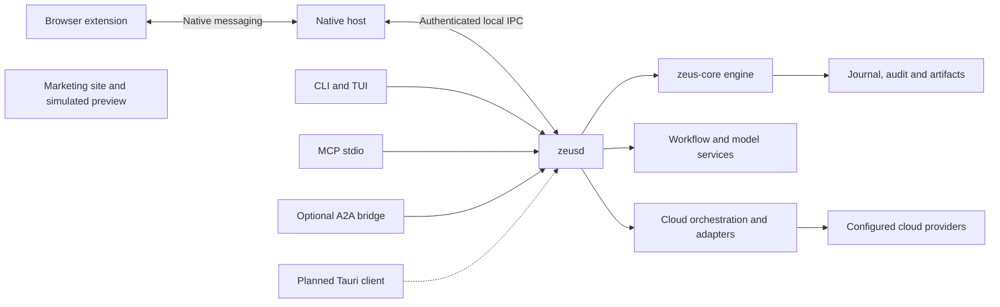

# Zeus project handoff

Snapshot reviewed **2026-10-18**. Runtime/test baseline recorded **2026-10-16**. Audience: the maintainer and developers taking over implementation, integration and release work across the four Zeus repositories.

Zeus has an executable pre-alpha download engine, persistent daemon, CLI/TUI, MCP stdio, browser relay, public-page workflow runtime, model adapters and cloud delivery. It is **not a released product**. Installed browser/provider acceptance, important contract/security gaps, model-to-product integration, conversion/organization and the production GUI remain unfinished. Start with the [end-to-end roadmap](../ROADMAP.md), then use the commands and discrepancy register below.

## Repository and review snapshot

These are the implementation revisions reviewed for this handoff. Later documentation-only commits can advance the PR head without changing this baseline. All four PRs were **open drafts against main** when checked on October 18; none had been merged. All source worktrees were clean before this documentation update.

| Repository and original directory | Branch | Implementation revision | Draft PR |
| --- | --- | --- | --- |
| `zeus` — `A:\zeus` / `/mnt/a/zeus` | `codex/prealpha-runtime-20261016` | `762fced6b68dae70ee2f7de208e4ee7bce26d5aa` | [zeus PR 3](https://github.com/ArefinAlter/zeus/pull/3) |
| `zeus-core` — `A:\zeus-core` / `/mnt/a/zeus-core` | `codex/prealpha-engine-20261016` | `ab77d6d20c92c56278fb78b3b755724d0057ecd1` | [core PR 1](https://github.com/ArefinAlter/zeus-core/pull/1) |
| `zeus-extension` — `A:\zeus-extension` / `/mnt/a/zeus-extension` | `codex/browser-contracts-20261016` | `b0491c2b7027c91102294dfba273ce73816d3928` | [extension PR 1](https://github.com/ArefinAlter/zeus-extension/pull/1) |
| `zeus-site` — `A:\zeus-site` / `/mnt/a/zeus-site` | `codex/download-workspace-preview-20261016` | `74bdcca5e21bc6ff11b05ea2821c9bdbb8b5f750` | [site PR 1](https://github.com/ArefinAlter/zeus-site/pull/1) |

The app depends on nine `zeus-core` crates through sibling paths. Do not combine app changes with an old core checkout. The extension has generated/copied contracts from the app specs. Keep exact companion revisions in PR descriptions and release records. These draft branches contain the new runtime; checking out `main` alone does not reproduce it.

GitHub showed successful CodeRabbit statuses on all four PRs and successful Vercel preview checks on the site PR. Those statuses **do not establish Rust or browser test CI**. No tracked GitHub Actions workflows were found in the app/core baseline despite older prose claiming CI coverage. Required test/MSRV/security CI is an open task.

All product source is in these original repositories. `.implementation/` is ignored local build/review/log material, not a fifth product repository or an installable source tree. Historical temporary copies there must not become a source of truth. No release/store submission was performed as part of the implementation work; a Vercel preview check is not production release acceptance.

## Architecture and ownership



The daemon has one local IPC listener; HTTP bridges are separate optional processes. Browser sessions stay inside the extension-mediated daemon path and are memory-only. The A2A bridge has a separate durable peer/task index; the daemon is not literally the only process with any durable state.

| Location | Responsibility and current implementation |
| --- | --- |
| `zeus-core/crates/zeus-types` and `zeus-session` | Domain/state/error/redaction contracts, approval facts, session framing/negotiation/correlation and consent abstractions. |
| `zeus-core/crates/zeus-control` and `zeus-http` | Transfer helpers and HTTP execution/parsers. Advanced control algorithms and full scheduling integration remain partial. |
| `zeus-core/crates/zeus-fs`, `zeus-journal`, `zeus-verify` | File operations, redb commits/recovery, file hashes, audit and provenance. |
| `zeus-core/crates/zeus-engine` and `zeus-artifact` | Executable download lifecycle and content-addressed/record-only artifact library. Product policy remains in the embedding app. |
| [zeus-api](../crates/zeus-api) | Wire types, permissions, authentication, client/server transport and generated API schema. A policy/type declaration is not proof a handler exists. |
| [zeus-daemon](../crates/zeus-daemon) | IPC ownership, engine adapter, durable approval/grant/stop state, browser broker, workflows, models, cloud orchestration and receipt stores. |
| [zeus-cloud](../crates/zeus-cloud/README.md) | Explicit provider capabilities, native Drive/Yandex/Baidu, configured rclone, private checkpoints and credential-store port. |
| [zeus-cli](../crates/zeus-cli) and [zeus-mcp](../crates/zeus-mcp/README.md) | Human CLI/TUI/auth/cloud review and constrained agent tools/resources. MCP has no decision/account-configuration authority. |
| [zeus-native-host](../crates/zeus-native-host) | Native framing, browser-parent verification, registration and bidirectional relay. |
| [zeus-workflow](../crates/zeus-workflow) and [zeus-llm](../crates/zeus-llm) | Plan validation/extraction/runtime and model/provider/privacy/spend mechanisms; daemon owns persistence/policy. |
| [zeus-a2a](../crates/zeus-a2a) and [zeus-a2a-bridge](../crates/zeus-a2a-bridge/README.md) | Task/card mapping and opt-in loopback four-method download profile. |
| `zeus-extension` | Browser consent, rescue, session release, fetch fallback, popup/options and generated protocol contracts. |
| `zeus-site` | Static marketing/docs site and disclosed sample-only preview; no daemon connection. |

Ogun's architecture embeds `zeus-core` while keeping its own product state, policy and interfaces. Its intended browser-download path is through Zeus's service boundary; service-client provisioning/integration remains unfinished. Review shared API changes with both consumers; do not move product configuration or credentials into core. [ADR 0011](adr/0011-ogun-built-on-zeus-core.md) defines this boundary.

## What works and what is still partial

| End-to-end path | Current result | Boundary still open |
| --- | --- | --- |
| Public URL → local file | Daemon/CLI and API execute download, verification, provenance and recovery. Windows actual-process smoke passed. | Broad platform/origin/fault acceptance and advanced scheduling. |
| Browser failure → rescued file | Extension, native host and daemon/core pieces execute under fixtures. | No installed Chrome/Edge/Firefox end-to-end acceptance recorded. Refresh/redirect integration is incomplete. |
| Agent → daemon | Ten MCP tools over stdio; API events/wait and constrained cloud tool. | Host compatibility and dedicated workflow tools; optional MCP HTTP. |
| Workflow → files | Caller-supplied plans can be sampled, validated, approved and run through the daemon API with budgets/checkpoints. | Goal-to-plan model invocation, authenticated rendering, remaining strategies and CLI/MCP workflow commands. |
| Model configuration/auth | Provider adapters, auth flows, keyring port, policy verification and spend ledger exist. | Production caller integration, actual account/keyring validation and production policy distribution. |
| Cloud destination | Staged/streaming/native URL-import modes with durable approvals/reconciliation and provider fixtures. | Native cloud OAuth/refresh, live providers, richer recovery/progress and archival. |
| Files → organization/conversion | Contracts, plans and artifact primitives exist. | Actual organizer/converter/undo handlers and confined process execution. |
| Human desktop workspace | Live Rust TUI plus interactive HTML design/site previews. | Production Tauri client, scheduler, persistent inbox and trusted GUI decisions. |
| Other agents → Zeus | Authenticated local A2A submit/get/list/cancel with restart recovery. | External SDK conformance and any additional/remote profile. |

This inventory supersedes the old assessment that `EngineBuilder::build()`, daemon startup, MCP stdio and native relay are still stubs. It does not mean every declared interface now works.

## Get a matching development checkout

Clone all four repositories side by side. Core/extension access may require the maintainer's repository permissions.

```text
workspace/
  zeus/
  zeus-core/
  zeus-extension/
  zeus-site/
```

Use the branches/revisions above for reproduction. Before changing branches, inspect and preserve local work. In a fresh clone, fetch the named branch and use `git switch --detach <implementation-revision>` for an exact baseline; create a task branch before editing. `git rev-parse HEAD` should match the table. The site's app-preview content is copied, not a runtime dependency of the Rust workspace.

Requirements: Rust stable with rustfmt/Clippy, declared MSRV **1.90**, Node **22.12+** and npm for extension/spec tooling. The recorded Rust run used **Windows MSVC Rust 1.99**; that is not proof of the minimum-version or Linux/macOS build. Windows MSVC needs Visual Studio Build Tools and a Windows SDK. [CONTRIBUTING.md](../CONTRIBUTING.md) describes a GNU fallback, which still needs target-specific validation.

Run one Cargo process at a time on constrained machines; use `CARGO_BUILD_JOBS=3` or another measured limit. Shared build caches are optional, but the Windows smoke harness requires the actual package in `zeus/target/debug`. In WSL, do not mix Linux and Windows executables/build outputs without choosing the target deliberately.

## Build and operate the developer package

From the app repository, in PowerShell on Windows:

```powershell
$env:CARGO_BUILD_JOBS = '3'
cargo build -p zeus-cli -p zeus-daemon -p zeus-native-host --bins --all-features --target-dir target
.\target\debug\zeusd.exe init
.\target\debug\zeusd.exe run
```

Keep the daemon running in that terminal. In a second terminal using the same configuration/state environment:

```powershell
.\target\debug\zeus.exe daemon status
.\target\debug\zeus.exe status --json
.\target\debug\zeus.exe tui
.\target\debug\zeus.exe approvals list
.\target\debug\zeus.exe audit verify
```

On Unix, the corresponding executables are `./target/debug/zeusd` and `./target/debug/zeus`. These commands describe the interface, not completed Unix acceptance. For a deliberate real download, `zeus get URL --wait --sha256 EXPECTED_HASH` uses your reviewed URL/hash. `zeus get -o` takes a destination **directory**, not a filename. Use allowed roots; the default is `<Downloads>/Zeus` with the documented home-relative fallback.

`zeus daemon install` is the CLI provisioning path; it creates state/credentials and pins sibling executables. It **does not install an automatic OS service**. `zeus daemon start` launches a background process. Build the complete sibling package before provisioning, and do not change executable files under a running acceptance test.

For an intentional binary upgrade, stop the daemon, install/build the reviewed sibling package, and run `zeusd trust-clients` from a physical terminal. Review paths/digests and complete its fresh typed confirmation, then restart. Startup does not silently accept changed pins. Persisted-format rollback/migration is not yet a supported release procedure; preserve a consistent backup before testing an upgrade.

### Human authority and global stop

- `zeus approvals approve ap_...` and `deny` require a verified human terminal. Pipes, `--yes`, model output and agent tool calls cannot approve.
- Browser approvals independently bind extension/profile, surface, gesture and current facts. Cloud approvals are terminal-only.
- `zeus daemon kill-switch` persists the stop latch, removes active grant authority and pauses work. `zeus daemon release` restores **neither** revoked grants nor paused work.
- OS-authenticator confirmation is unavailable and fails closed. Same-user malicious software remains a residual trust risk.

### Agent and browser entry points

Run `zeus mcp` as the MCP host's stdio command. Its credential has agent authority. Processes sharing the same agent credential share its ownership/idempotency namespace; this is not isolation between individual assistants.

The optional A2A entry point is `zeus a2a --token-file /absolute/private/a2a-peers.json --port 4750`. Follow the [bridge guide](../crates/zeus-a2a-bridge/README.md) for peer tokens and protocol headers. It initiates real downloads and returns metadata-only artifacts. It is local-only and does not expose the daemon as a general HTTP service.

Use `zeus native-host install --help` and the extension's [identity guide](https://github.com/ArefinAlter/zeus-extension/blob/codex/browser-contracts-20261016/docs/EXTENSION_ID.md) before browser registration. Pin actual development or production extension IDs. Current parent verification recognizes machine-installed Windows browsers under HKLM and known root-owned Linux paths. Per-user/portable Windows, unsupported Linux packaging and macOS fail closed; do not label them supported on the strength of a successful bundle.

## Cloud operation handoff

| Provider | Staged upload | Stream | Provider URL import |
| --- | --- | --- | --- |
| Google Drive | Native resumable | Known exact size | Unavailable |
| Yandex Disk | Native upload | Known exact size | Native, asynchronous, with explicit weaker limits |
| Baidu Netdisk | Native multipart | Exact size and precomputed block manifest | Unavailable |
| MEGA/other configured rclone remotes | Backend-dependent | Known-size backend support | Unavailable |

The [CLI guide](../crates/zeus-cli/README.md) contains full syntax. Operational sequence:

1. A person runs `zeus cloud accounts configure` at a verified terminal. Native access credentials go into the OS keyring with hidden input; there are no secret flags/stdin credential inputs. Existing credentials must be obtained separately until native OAuth onboarding is implemented.
2. `zeus cloud plan` binds the account revision, source, explicit mode, unique destination, exact size, optional hash and time/byte limits. Public URL sources require an exact length; a completed, owned, nonquarantined job supports staged upload only.
3. `zeus cloud submit` uses the returned plan ID/hash and creates a human approval request. It does not approve or immediately authorize the transfer.
4. Review through `zeus approvals`; observe with `zeus cloud list`, `get` or `status`; use `control ... pause|resume|cancel` for the delivery.
5. Preserve the private checkpoint if dispatch/completion is uncertain. Reconcile provider evidence rather than submitting another upload under a fresh key.

Only Yandex currently imports URLs remotely. An accepted/pending provider operation is not completion. Local cancellation/stop cannot guarantee remote termination or a hard remote byte cap. Public source URLs are disclosed to the provider only through the reviewed mode; browser-session cookies are never forwarded to clouds.

Rclone requires a trusted executable and dedicated protected config. Their SHA-256 pins are checked per launch. Legitimate OAuth config rewrites or executable upgrades require human reconfiguration, a new account revision and new reviewed plans. Native credential replacement also changes reviewed configuration. No automatic native token refresh exists.

Verified Zeus-owned staging survives restart without re-fetching an expired source. Drive/Baidu can resume supported staged checkpoints; Yandex/rclone reconcile the existing target and return `cloud.resume_unavailable` when replay is unsupported. Partially downloaded URL staging does not have engine-style ranged recovery. Existing downloaded user files are never deleted by cloud cleanup. `cleanup_pending` preserves remote success while reporting failed local staging removal. Without sufficient remote identity/hash evidence, cleanup is refused rather than risking a different object.

`max_bytes` bounds object size on each local transfer leg, not total traffic/billing. Remote receipts distinguish local SHA-256, actual provider hash and size-only evidence. Status has provider-confirmed bytes; the preview's separate source/upload meters are not wired.

Current cloud capacity limits include 64 accounts, 128 nonterminal deliveries, 128 unexpired plans per requester, 1,024 plans total and 4,096 private records. Serialized state is bounded to 256 MiB with a 64 MiB update reserve and 2 MiB per record; these are not physical redb/disk-size limits. There is no archival/GC command yet. **Do not delete `cloud.redb` to clear a limit or an uncertain operation.** Preserve receipts and implement/use reviewed retention/reconciliation. See the [daemon guide](../crates/zeus-daemon/src/cloud/README.md).

## State and recovery

[ZeusPaths](../crates/zeus-api/src/endpoint.rs) resolves platform paths. Explicit overrides are `ZEUS_STATE_DIR`, `ZEUS_CONFIG_DIR` and `ZEUS_RUNTIME_DIR`; keep them consistent across daemon/clients. `--profile` / `ZEUS_PROFILE` is parsed but does not currently select separate storage. Windows named pipes remain per-user even with separate state paths.

| State | Purpose and handling |
| --- | --- |
| `config.toml` in the config directory | Write roots and settings. `config.set` persists restart-only settings; `config.get` reports the startup snapshot. Some settings are not wired yet; see below. |
| `credentials.json`, `credentials/`, `ipc.secret`, `trusted-programs.json` | Private credential/verifier material and executable pins. Never include these in public diagnostics or commits. |
| `zeusd.lock`, `zeusd.json` | Process ownership/discovery. Do not delete a live owner's lock/discovery to force another instance. |
| `journal.redb`, `api-receipts.redb` | Download/consent/stop state and durable mutation bindings. Preserve together with related files and audit data. |
| `audit/`, destination manifests, `artifacts/` | Audit chain, per-file provenance and artifact metadata/content. Record-only artifacts do not imply a second copy of a downloaded file. |
| `workflows.redb` | Plans, checkpoints and job/audit intents. Preserve to avoid replaying work as a new run. |
| `models.redb`, `chatgpt.redb` and OS keyring | Model configuration/spend/account metadata and separate secrets. Copying the database alone does not restore keyring credentials. |
| `cloud.redb`, `cloud-staging/` | Private source/provider checkpoints, idempotency and retained staging; protect like credentials. |
| `a2a-index.redb` and explicit peer token file | Bridge task ownership/retry binding and separate peer authentication. Stop the bridge before any offline state operation. |

For developer backup, stop the daemon and bridge, wait for process/lock release, and preserve the consistent state/config plus destination files/manifests with private permissions. Keyring backup/recovery is platform-specific and still requires acceptance. Do not promise a portable backup/migration command that does not exist. Shutdown may retain the lock beyond its requested grace period while synchronization finishes; do not force-close it merely because that period elapsed.

After a crash, restart with the same reviewed binaries, configuration and state, inspect status and verify audit/files. Recovery must validate file identity and origin validators. A changed or missing verified staging file fails closed. Signed URLs/private upload URLs can exist in protected persistent state; local ACLs are not encryption at rest. Spec 03's journal URL encryption remains an open design/implementation item.

## Recorded validation evidence

The following are the **October 16 implementation results**, reviewed for this handoff, not a claim that the suites were rerun on October 18. Synthetic credentials and loopback fixtures were used; live browser/cloud/model accounts were not exercised.

| Check | Result and scope |
| --- | --- |
| App workspace, all features | **400 passed**, zero failed. Includes cloud tests below; do not add them again to the total. |
| Cloud provider library | **25 tests**, including native HTTP and real child-process fixtures; no live providers. |
| Daemon cloud service | **13 regressions**, including authorization, recovery, cancellation, staging, retention and cleanup. |
| Core full runtime baseline | **273 passed**, one intentionally ignored documentation example; includes 20 engine integration tests. This predates the cloud contract change. |
| Core cloud-related types/session/conformance | **123 passed**; generated schema and 195 fixture files synchronized. This is the focused rerun, not another full core baseline. |
| Rust style/static checks | App all-target/all-feature strict Clippy and format passed; preceding core runtime strict checks passed, with current core formatting/conformance checked. |
| Extension | **321 passed across 22 files**; TypeScript, lint/format, Chrome/Firefox development/store bundles and repository checks passed. |
| Contracts | 244 JSON documents checked, four partial fragments skipped, 15 specs scanned; cloud drift check passed; ten-tool MCP catalogue checked at 23,991 bytes. |
| Windows actual processes | **14 smoke checkpoints passed**, including real download, verification, idempotency, audit, restart and abrupt owned-child recovery. |
| Site and UI | Recorded 25-page site build and 21 browser interaction groups; desktop/390px mobile, no external requests/CSP errors in that run. Preview behavior only. |
| Dependency/license/advisory gate | `cargo deny` **not run** in the recorded environment because it was not installed. |

The crash smoke interrupted an 8,388,608-byte file after 4,194,304 committed bytes, resumed from that offset with the original validator, and matched the final SHA-256. It does not prove every power-loss point or filesystem.

Local evidence includes `.implementation/cloud-workspace-tests.log`, `.implementation/cloud-workspace-clippy.log`, `.implementation/cloud-smoke.log`, `target/smoke-runs/daemon-b81f8143-b30e-442e-8802-298d1769f40c/report.json`, and `.implementation/site-preview-9a74d40f-5829-4f18-bafb-05fc77d80371/report.json`. These are ignored machine-local artifacts, **not guaranteed to be present in a fresh clone**. The permanent [smoke harness and guide](../tools/README.md) are committed. Preserve redacted evidence as CI/release artifacts when establishing the release pipeline.

## Reproduce validation

From each Rust workspace, sequentially:

```sh
cargo fmt --all --check
cargo clippy --workspace --all-targets --all-features -- -D warnings
cargo test --workspace --all-features
cargo deny check
```

Install `cargo-deny` before treating the last check as a release gate. The existing check scripts skip it if absent; a skipped gate is not a pass. Recorded builds used `--offline` after dependencies were cached; fresh machines need an initial dependency fetch.

From `zeus`:

```sh
cd docs/spec/tools
npm ci
npm run validate
cd ../../..
cargo test -p zeus-api schema
node docs/spec/tools/sync-cloud-schema.mjs --check
node docs/spec/tools/mcp-catalogue.mjs --check
```

From `zeus-core`:

```sh
cargo run -p zeus-types --example gen_schemas
git diff --exit-code -- schemas
node scripts/sync-spec-fixtures.mjs --check ../zeus
```

Generation commands can change tracked files; inspect drift rather than automatically accepting it. Change normative prose/contracts first, regenerate Rust/spec/core/extension copies, then run validators in normal check mode. `UPDATE_SCHEMAS=1` is for intentional API regeneration, not proving a clean check.

From `zeus-extension`:

```sh
npm ci
npm run typecheck
npm run lint
npm test
npm run build
npm run build:store
npm run check
```

From `zeus-site`, use `node build.mjs`, then `node serve.mjs 4321` for local review. Visit `/preview/` and `/preview/console/`; sample actions reset on reload. Site build success is separate from interactive/accessibility acceptance.

For actual daemon processes, from `zeus` with Windows Node 22+:

```powershell
cargo build -p zeus-cli -p zeus-daemon -p zeus-native-host --bins --all-features --target-dir target
node tools/smoke-daemon.mjs
```

The harness requires all three binaries in `target/debug`, accepts no state/binary overrides, and refuses a competing per-user daemon. It creates isolated synthetic state and kills only its own child for crash testing. Do not rebuild during the run. It does not configure providers, register a browser, approve anything, or test a real keyring/physical terminal.

## Known gaps and documentation discrepancies

Treat these as explicit follow-up work. Normative prose still governs contracts; this register describes differences that need review, not permission to silently redefine behavior.

| Priority | Finding | Source and next action |
| --- | --- | --- |
| Before alpha | Emergency stop removes authority even if audit append fails, but deferred persistence/replay of the failed audit record was not found. | [lifecycle.rs](../crates/zeus-daemon/src/lifecycle.rs), [spec 12](spec/12-security-invariants.md). Complete retained emergency audit evidence and failure/restart tests. |
| Before alpha | Parent-directory/symlink/reparse races and platform trust/IPC/keyring acceptance remain. | [security invariants](spec/12-security-invariants.md). Publish supported combinations only after adversarial and installed-platform tests. |
| Before alpha | Real browser rescue, full fault matrix, rescue corpus, performance and cargo-deny gates remain unrecorded. | [roadmap phase 1](../ROADMAP.md#phase-1-working-mvp-and-public-alpha). Unit tests cannot replace these results. |
| Contract review | Some configuration is parsed but ineffective: `scheduler.segment_size_mib`, `approvals.max_pending`, `approvals.decisions_per_minute`, `log_filter`; `--profile` is unused. | [config.rs](../crates/zeus-daemon/src/config.rs), [runtime.rs](../crates/zeus-daemon/src/runtime.rs), [CLI](../crates/zeus-cli/src/cli.rs). Wire and test or reject/document the settings. Current logging uses `ZEUS_LOG`. |
| Contract review | The engine's nominal per-host connection bound uses a shared semaphore; concurrency is static and commit units are submitted individually. Authenticated standalone probe and URL/auth refresh integration remain incomplete. | Core `crates/zeus-engine/src/engine.rs`. Do not present daemon-wide batching, true host fairness or authenticated probes as complete. |
| Contract review | 17 active `NotImplemented` functions remain in advanced core control modules; unused error variants elsewhere are not executable stubs. | Core `estimate.rs`, `mirror.rs`, `hedge.rs`, `math.rs`, `cusum.rs`. Implement or explicitly defer advanced algorithms; Linux reflink exists, other platforms/acceptance remain partial. |
| Contract review | Spec 10 still lists bridge/CLI/pin/index implementation as missing; architecture says no app redb dependencies and only daemon durable state. | [spec 10](spec/10-a2a.md), [architecture](ARCHITECTURE.md), [actual bridge guide](../crates/zeus-a2a-bridge/README.md). Reconcile historical prose with the bounded local implementation. |
| Phase 2 | `ModelService::complete` has no production caller; planning validates a supplied candidate, not an autonomous model-generated goal. | [models.rs](../crates/zeus-daemon/src/models.rs), [workflows.rs](../crates/zeus-daemon/src/workflows.rs). Wire bounded model requests into product flows with consent/accounting. |
| Phase 2 | Workflow CLI/MCP operations, organizer/convert/undo and client-administration routes remain absent despite some schemas/policy declarations. | [routes](../crates/zeus-daemon/src/routes.rs), [MCP catalogue](../crates/zeus-mcp/src/catalogue.rs), [CLI tree](../crates/zeus-cli/src/cli.rs). Follow roadmap C02/W01–W06. |
| Phase 2 | Native cloud OAuth, live provider validation, policy-signing distribution and comprehensive artifact/cloud retention UX remain. | [cloud guide](../crates/zeus-daemon/src/cloud/README.md), [model spec](spec/09-llm-provider.md). Obtain real operational inputs and record acceptance separately from fixtures. |
| Phase 3 | Web preview simulates inbox/packages/schedules/approvals/cloud; no production Tauri, GUI trust channel or MCP App views. | [design](design/download-workspace.md). Connect actual capabilities before changing simulation labels. |

Other spec open issues include journal URL encryption, audit anchoring/signatures, per-client visibility/credentials, large-file verification timeouts, requester-scoped grants, revised-plan continuation, artifact events/exports/privacy and cross-product integration. Use [the spec index](spec/README.md) and each document's open issues alongside the roadmap; stale entries require explicit resolution.

## Release inputs and next handoff

The maintainer must assign owners for API/security review, platform QA, provider registrations, signing-key custody and releases. No people or delivery dates are assigned by this document. Required external inputs include production Chrome/Edge identities and allowlists, Firefox publication details, cloud OAuth registrations/test accounts, model policy keys, code-signing/distribution credentials and verified website/contact/legal facts.

Recommended review order: core first, app with matching core, extension with matching app contracts; site preview can be reviewed independently. Merge only after review and relevant checks; do not deploy a preview as a supported product or merge just because a draft has a green bot status. Commits require DCO sign-off; irreversible contract/persistence/trust changes require the repository's ADR process.

The next implementation batch should close contract/CI and urgent safety gaps, reproduce the matched baseline, then run installed browser and alpha acceptance. Cloud/model live acceptance can proceed in parallel with their assigned human-controlled inputs. The roadmap identifies later workflow, GUI and distribution work without treating it as already delivered.

When handing off again, record exact companion SHAs, clean/dirty state, PR/check status, commands/toolchains/results, unexecuted gates, schema migrations, credentials needed by role (never secret values), and the next reviewable work package. Update this file and the [implementation ledger](IMPLEMENTATION_STATUS.md) together when claims change.
