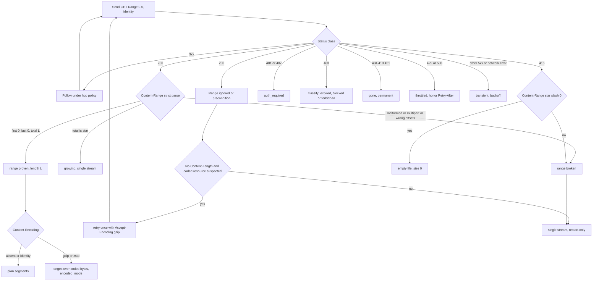
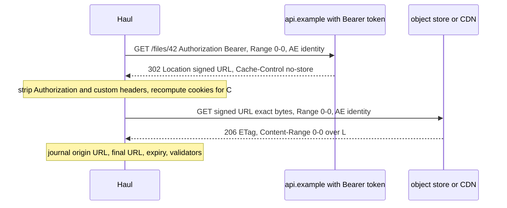
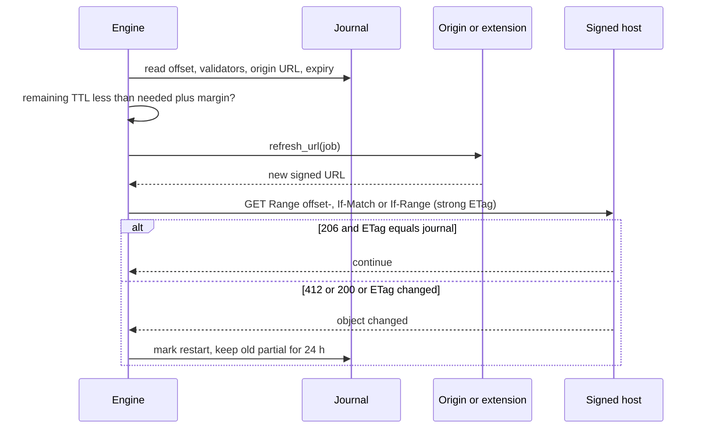

# HTTP semantics for reliable downloads

This document is the protocol contract for the Haul transfer engine: what the HTTP specifications guarantee about ranges, validators, encodings, redirects and errors; what real servers and CDNs actually do; and the exact request/response behaviour Haul should implement. Spec statements are High confidence (taken from the RFC texts fetched on 2026-10-05). Vendor behaviour comes from vendor documentation fetched the same day. Where documentation is silent, behaviour was either measured locally (tagged `[Local]`) or is marked `[unverified]` or *Inference*.

## TL;DR

- **Probe with one ranged GET, not HEAD.** Send `GET` with `Range: bytes=0-0` and `Accept-Encoding: identity`; only a self-consistent `206` proves range support, because `Accept-Ranges` is advice [RFC 9110]. HEAD plus Range is undefined by RFC 9110 yet drew a `206` from Go 1.24.5, nginx 1.31.6 and Express 5.2.1 in local tests, and a presigned URL is created for one HTTP method [AWS: presigned URLs], so HEAD on a GET URL is not authorised (*Inference*).
- **Resume only on strong validators, and verify them on every `206`.** Use a strong ETag, else a Last-Modified that is strong by the RFC rule, never a weak ETag. S3's GetObject reference lists `If-Match` but not `If-Range`; Express, Cloudflare and nginx-with-gzip emit or leave weak ETags; Chromium requires a strong validator (a feature flag can relax that). Send `If-Range` (`If-Match` on S3-class hosts) and still compare the ETag in each response.
- **Identity coding is the default, with one escape hatch.** Chromium sets it for ranged requests, but GCS ignores `Range` for gzip-stored objects unless `Accept-Encoding: gzip` is sent. Turn off HTTP-client auto-decompression (reqwest drops `Content-Length` when it decodes).
- **Parse `Content-Range` strictly.** Go 1.24.5 emitted `bytes 1000000-999999/1000000` and `bytes 0--1/0` in local tests, and curl's source documents legacy forms. Accept a `206` only if first equals the requested start, last does not exceed the requested end, and the total equals the probed total.
- **A `416` on resume has four meanings** (already complete, shrank, server bug, no range support); section 7.4 gives the table and copies curl's rule that an offset equal to the remote size means done.
- **Signed URLs are checked per request.** S3 and CloudFront let in-flight transfers finish after expiry but fail any new request after it, so segments consume TTL: 50 GB in 64 MiB segments with 8 workers at 5 MB/s each starts its last segment about 1,248 s in. Plan against remaining TTL, refresh early, and redact signature parameters from logs, manifests and MCP output.
- **Redirects: allowlist headers and strip credentials stickily.** Fetch deletes only `Authorization` on a cross-origin hop; reqwest strips five headers and keeps custom ones such as `X-Api-Key`; three 2026 advisories (curl, libcurl, PHP) show the failure mode. Re-probe at the final hop. Limits in use: 20 (Fetch), 50 (curl tool), 10 (reqwest).
- **Name files from the first full response.** RFC 8187 `filename*` first; a `206` answering `If-Range` may omit `Content-Disposition`; implementations disagree on continuations and percent-decoding; 2026 advisories (LXD, amazon-ssm-agent) show traversal through server-supplied names and S3 object keys.
- **ETag is not a hash.** Use a ladder: RFC 9530 `Repr-Digest` (rarely deployed; Caddy's PR was still open in October 2026), provider checksums (`x-amz-checksum-*`, `x-goog-hash`, Azure `Content-MD5`), S3 multipart ETag by part-size inference, a caller hash, then a self-computed SHA-256 recorded as provenance.
- **Retry-After is a hint with two syntaxes, and problem-detail text is hostile.** Compute HTTP-date delays against the response `Date`, apply them host-wide, and never pass RFC 9457 `detail` to an LLM unfiltered. Metalink/HTTP is not worth building on (curl removed Metalink in 2021 after security problems).

## 1. Evidence conventions

| Tag | Meaning |
|---|---|
| `[Spec]` | RFC, WHATWG or IETF draft text fetched 2026-10-05 |
| `[Vendor]` | Vendor documentation fetched 2026-10-05 (date in References) |
| `[Source]` | Source code read from the project's main branch on 2026-10-05 |
| `[Local]` | Measured here: loopback, Windows 11, curl 8.21.0, 1,000,000-byte file, HTTP/1.1; servers were Go 1.24.5 `net/http` `ServeContent`, nginx 1.31.6 (static, Windows build), Express 5.2.1 with send 1.2.1, CPython 3.11.0 `http.server` |
| *Inference* | Reasoned from the above; not directly sourced |

Local tests probe implementations; they are not endorsements and cover only default configurations.

Confidence of the load-bearing claims:

| Claim | Confidence | Basis |
|---|---|---|
| Range, validator, `416` and multipart rules | High | RFC 9110 text |
| S3 GetObject does not list `If-Range` | High | API reference |
| S3 honours `If-Range` in practice | Medium | One user report plus the presign FAQ, no AWS statement |
| S3 and CloudFront validate expiry per request and let in-flight transfers finish | High | Vendor documentation |
| GCS and Azure in-flight behaviour after expiry | Low | Undocumented |
| GCS transcoding ignores `Range` | High | Vendor documentation updated 2026-09-30 |
| Cloudflare range and ETag rules | High | Vendor documentation updated September 2026 |
| Table 3A results | High for the listed versions and defaults, Low as generalisation | Local measurement |
| Chromium behaviour | High for main-branch source, Medium for any shipped release | Source |
| Firefox behaviour | Medium | Source read, not executed |
| Metalink adoption is low | Medium | curl's removal and survey figure |
| RFC 9530 server deployment is thin | Medium | Absence of evidence plus one open PR |
| RFC 6265bis is not yet an RFC | High | Datatracker and RFC index on 2026-10-05 |

## 2. The contract: RFC 9110, 9111, 9112

### 2.1 Where the 2014 RFCs went

| Old document | Current home | Notes relevant to downloads |
|---|---|---|
| RFC 7230 (message syntax, routing) | RFC 9112 (HTTP/1.1 framing, connections) and RFC 9110 (architecture, fields, URIs) | Message-body length rules now in RFC 9112 section 6.3 |
| RFC 7231 (semantics, status codes) | RFC 9110 | Retry-After, redirects, 3xx handling in section 15.4 |
| RFC 7232 (conditional requests) | RFC 9110 sections 8.8 and 13 | The 60-second Last-Modified strength rule was relaxed to "reasonable discretion" (appendix B.4) |
| RFC 7233 (range requests) | RFC 9110 section 14 | Range-unit grammar refactored; partial PUT described (appendix B.5) |
| RFC 7234 (caching) | RFC 9111 | |
| RFC 7235 (authentication) | RFC 9110 section 11 | RFC 2617 itself split into RFC 7616 (Digest) and RFC 7617 (Basic) |
| RFC 7538 (308) | RFC 9110 section 15.4.9 | |
| RFC 3230 (Digest) | RFC 9530 | Content-Digest and Repr-Digest replace Digest |
| RFC 5987 (ext-value) | RFC 8187 | UTF-8 mandatory; ISO-8859-1 requirement dropped |
| RFC 5988 (Link) | RFC 8288 | |
| RFC 7807 (problem details) | RFC 9457 | |
| RFC 8941 (structured fields) | RFC 9651 | Needed to parse digest fields |
| RFC 6265 (cookies) | Still current; draft-ietf-httpbis-rfc6265bis-22 is in the RFC Editor queue (2026-10-05) | Not yet published as an RFC |

Source: [RFC 9110] header and appendix B; [RFC 9530]; [RFC 8187]; datatracker for 6265bis [IETF: rfc6265bis]; RFC Editor metadata (see References).

### 2.2 Range request grammar and satisfiability [RFC 9110 sections 14.1 to 14.2]

Byte offsets are zero-based and inclusive. For a representation of length $L$ a satisfiable request has a first position $a < L$.

| Form | Meaning | Rules | Haul sends it? |
|---|---|---|---|
| `bytes=a-b` | bytes $a..b$ inclusive | Invalid if $b < a$. If $b \ge L$ the server treats it as $L-1$ | Yes (segments) |
| `bytes=a-` | from $a$ to the end | Satisfiable if $a < L$ | Yes (resume, open-ended probe) |
| `bytes=-n` | the last $n$ bytes | Satisfiable if $n > 0$; if $n > L$ the whole representation | No |
| `bytes=a-b,c-d` | several ranges | Server may coalesce, send fewer, ignore, or reject (`200` or `416`) | No |
| unit other than `bytes` | extension | Origin MUST ignore an unknown unit | No |

Points that matter for implementation:

- **Range is advisory for the server.** A server MAY ignore `Range`, and MAY ignore or reject invalid, overlapping or many small ranges as a likely attack (section 14.2). `Range` is evaluated after preconditions and only if the unconditional result would be `200`.
- **Only GET.** A server MUST ignore `Range` on methods for which range handling is undefined, and GET is the only one defined (section 14.2). Real servers disagree (section 3.4).
- **Empty representation.** Only a suffix range with $n>0$ is satisfiable, and a server MAY ignore `Range` for a zero-length representation. Observed: Go and nginx answer `200`, Express answers `416`, Go answers a suffix range with a malformed `206` (section 3.4).
- **Overflow.** Recipients MUST expect very large decimal numerals and not overflow (section 14.1.2). Parse offsets as `u64` with checked arithmetic; reject rather than clamp.
- **Whitespace.** RFC 9110 errata 7306 (verified 2023-10-23) fixes the ABNF so that `bytes= 0-999` is valid [RFC Errata 7306]. All three range-capable local servers accepted `bytes= 0-0`; Haul should still never send whitespace.

### 2.3 Responses: 200, 206, 416 and multipart [RFC 9110 sections 14.4, 14.6, 15.3.7, 15.5.17]

- **206 single part.** MUST carry `Content-Range`. `Content-Length`, if present, is the length of this part, not of the representation. A server MAY send less than requested; a client MUST read `Content-Range` to learn what arrived (section 15.3.7).
- **206 must repeat validators.** A server generating a `206` MUST send `Date`, `Cache-Control`, `ETag`, `Expires`, `Content-Location` and `Vary` if a `200` would have. This is why Haul can compare the ETag on every `206`.
- **206 after If-Range may omit other representation headers.** The text says a sender SHOULD NOT generate representation fields beyond those required "because the client already has a prior response" (section 15.3.7). `Content-Disposition` and `Content-Type` can therefore be absent on resumed segments.
- **Content-Range grammar.** `bytes first-last/complete-length` or `bytes first-last/*`, and `bytes */complete-length` on `416`. A value is invalid if $last < first$ or if the complete length is $\le last$. A recipient of an invalid `Content-Range` MUST NOT recombine the content with stored data (section 14.4).
- **Unknown length.** `/*` is legal on a `206`; RFC 8673 builds growing-content reads on it (section 11.2).
- **416.** SHOULD carry `Content-Range: bytes */L`. The text itself warns that many implementations answer `200` instead, so clients cannot depend on `416` (section 15.5.17).
- **Multipart.** A server MUST NOT answer a single-range request with `multipart/byteranges`, MUST NOT put `Content-Range` in the outer header of a multipart response, and a client that cannot parse multipart MUST NOT ask for multiple ranges. Every part carries its own `Content-Range` and the parts may arrive reordered or coalesced (section 15.3.7.2).
- **Combining.** Parts may be combined only if they share the same strong validator (section 15.3.7.3).

### 2.4 Validators and conditional requests [RFC 9110 sections 8.8, 13.1.1, 13.1.5, 13.2.2]

Strong versus weak comparison of ETags (RFC table 3, re-computed here):

| ETag 1 | ETag 2 | Strong comparison | Weak comparison |
|---|---|---|---|
| `W/"1"` | `W/"1"` | no match | match |
| `W/"1"` | `W/"2"` | no match | no match |
| `W/"1"` | `"1"` | no match | match |
| `"1"` | `"1"` | match | match |

- **If-Range** carries an entity-tag or an HTTP-date, never both. A client MUST NOT send a weak ETag, and MUST NOT send a date unless it has no ETag and the date is a strong validator. Server evaluation: an ETag must match the current ETag by strong comparison; a date must equal Last-Modified exactly (not "earlier or equal"). If the condition is false the server ignores `Range` and answers `200` with the whole current representation (section 13.1.5).
- **Last-Modified is weak by default.** Client-side it is strong only if the cached response's `Date` is at least one second later than `Last-Modified` and the clocks plausibly agree (section 8.8.2.2). *Inference*: a Haul default of 60 s is conservative where a CDN and an origin may supply the two values.
- **If-Match** uses strong comparison; on mismatch the answer is `412` rather than a silent `200` (section 13.1.1). Use it where you want a hard stop.
- **Precedence** (section 13.2.2): If-Match, then If-Unmodified-Since, then If-None-Match, then If-Modified-Since, then If-Range. Consequence: if Haul ever adds `If-None-Match` to a ranged request the server may answer `304` and no body at all. Download requests carry no other conditionals.
- **When 206 pieces may be joined.** Only with the same strong validator (section 15.3.7.3). Weak validators "are only usable when the client does not require exact equality" (section 8.8.1). Resuming a byte-exact file is the opposite case, which is why weak validators are unsafe for ranges at any time, not merely "across sessions" as research.md puts it.

### 2.5 Representation versus transfer: encodings, lengths, framing

- **Ranges apply to the encoded representation.** "If the representation data has a content coding applied, each byte range is calculated with respect to the encoded sequence of bytes" (RFC 9110 section 14.1.2). A `Range` against a gzip representation addresses compressed bytes. This is why `Accept-Encoding: identity` is the default for segmented downloads: it keeps offsets equal to file offsets and keeps `Content-Length` equal to the file size.
- **Content-Encoding versus Transfer-Encoding.** Content codings are a property of the representation and are normally decoded only at the end; transfer codings (chunked) belong to HTTP/1.1 framing [RFC 9110 section 8.4], [RFC 9112 section 7]. A chunked response has no length up front, so it cannot be segmented by size.
- **Message body length** (RFC 9112 section 6.3, in precedence order): responses to HEAD and all `1xx`, `204`, `304` have no body; `Transfer-Encoding` overrides `Content-Length` and the combination "ought to be handled as an error" (smuggling indicator); chunked is read to the terminating zero chunk; an invalid `Content-Length` is unrecoverable (a user agent MUST close the connection and discard the response); a valid `Content-Length` defines the length and a short read means the message is incomplete; otherwise the body is delimited by connection close.
- **Close-delimited bodies cannot prove completeness.** RFC 9112 section 6.3 says there is no way to tell a finished close-delimited body from a truncated one; section 8 adds that a missing TLS `close_notify` leaves such a response incomplete. Haul must treat a length-less, non-chunked, close-delimited download as `unverifiable_length` and require another integrity signal.
- **HTTP/2.** A response is malformed if `content-length` differs from the sum of DATA frame lengths, and clients MUST NOT accept it [RFC 9113 section 8.1.1]. Without `content-length`, an early clean END_STREAM is indistinguishable from completion (*Inference*), so the same integrity ladder applies.
- **New content codings.** RFC 9842 (September 2025) adds dictionary-compressed codings `dcb` and `dcz`; its examples show the client advertising them in `Accept-Encoding` and sending an `Available-Dictionary` header. Haul sends neither, which is one more reason to state `Accept-Encoding` explicitly [RFC 9842].
- **Trailers.** A trailer section is possible with chunked (HTTP/1.1) or HTTP/2; senders SHOULD NOT rely on trailers being delivered, and `ETag`, `Accept-Ranges`, `Content-Digest` and `Repr-Digest` may appear there [RFC 9110 section 6.5], [RFC 9530]. Treat trailer digests as a bonus.

## 3. Probing

### 3.1 HEAD versus ranged GET

| Question | HEAD | `GET` with `Range: bytes=0-0` |
|---|---|---|
| Spec-defined for ranges? | No: `Range` is ignored outside GET [RFC 9110 section 14.2] | Yes |
| Proves range support? | No. `Accept-Ranges: bytes` is advice; a client "MUST NOT assume" it means future ranges work (section 14.3) | Yes, if the `206` is consistent |
| Gives total length? | Via `Content-Length` of the full representation | Via `Content-Range: bytes 0-0/L` |
| Works with method-bound signed URLs? | Often not: an S3 URL is presigned for one HTTP method [AWS: presigned URLs] | Yes (the URL was signed for GET) |
| Cost | No body | One byte of body; connection can be reused |
| Observed | Go, nginx, Express answered HEAD plus Range with `206`; CPython ignores Range [Local]; Cloudflare documents HEAD plus Range answers [Cloudflare: range requests] | Same engines answered `206`; CPython `200` [Local] |

Conclusion: use the ranged GET as the one authoritative probe. Use HEAD only as an optimisation on public, non-signed URLs when a body must not be touched.

### 3.2 Probe algorithm

1. Validate the URL: scheme `http` or `https`; reject userinfo in agent-supplied URLs (RFC 9110 section 4.2.4: treat as a likely phishing signal); apply IP-range policy before and after DNS.
2. Build the request: `GET`, `Range: bytes=0-0`, `Accept-Encoding: identity`, `Accept: */*`, honest `User-Agent`, session headers per policy, no `If-*` headers. Optionally `Want-Repr-Digest: sha-256=10` (costs about 30 bytes; ignored by almost all servers).
3. Follow redirects under the per-hop policy of section 5. The probe result describes the **final** hop; record the chain (signature parameters redacted).
4. On any final response snapshot the representation headers: `ETag`, `Last-Modified`, `Date`, `Content-Type`, `Content-Disposition`, `Content-Encoding`, `Cache-Control` (`immutable`, `no-transform`), `Accept-Ranges`, `Repr-Digest`/`Content-Digest`/`Digest`, provider checksum headers, `Link`, `Server`, `Proxy-Status`.
5. Classify by status using the state machine below. For `206`, parse `Content-Range` strictly (section 3.5). Read the single body byte so the connection can be reused [RFC 9112 section 9.3].
6. If the answer is `200`, close the connection unless the job is going to download this resource anyway; then keep streaming it as the single-stream download ("probe is the first segment"). This also avoids burning single-use URLs.
7. If length is unknown or the answer was `200`/`ignored` and the response had no `Content-Length` (for example GCS transcoding), retry the probe once with `Accept-Encoding: gzip` and record `encoded_mode`.
8. Choose the validator: strong ETag, else strong Last-Modified (section 2.4), else `none`.
9. Record the filename candidate from this response (section 4).
10. Persist the probe record: redacted URLs, hop list, hosts, validators and their strength, `range_state`, `length_state`, `Content-Encoding`, quirks observed, timing.

### 3.3 Why 200 to a Range request is not "no range support"

research.md treats any `200` as lack of range support. A `200` can also mean a changed `If-Range` validator (the body is the new representation), forced decompression (GCS, Cloudflare), a chunked origin (CloudFront returns the whole object), a range that broke an abuse rule (CloudFront, Cloudflare), or an empty representation. Haul classifies by cause and varies `Accept-Encoding` and `If-Range` separately when it re-tests.

### 3.4 Observed behaviour

**Table 3A: first-hand battery** `[Local]` (1,000,000-byte file `L=1000000`; "CR" is `Content-Range`).

| Request | Go 1.24.5 | nginx 1.31.6 | Express 5.2.1 (send 1.2.1) | CPython 3.11.0 |
|---|---|---|---|---|
| `bytes=0-0` | 206, CR `0-0/L`, Accept-Ranges | 206, CR `0-0/L`, **no Accept-Ranges on the 206** | 206, CR `0-0/L` | 200 whole body, HTTP/1.0, no Accept-Ranges |
| HEAD plus `bytes=0-0` | 206 | 206 | 206 | not tested (no Range code in source) |
| `bytes=-5` | 206 `999995-999999` | 206 same | 206 same | 200 |
| `bytes=0-` | 206 `0-999999/L` | 206 same | 206 same | 200 |
| `bytes=999990-5000000` (end past L) | 206 clamped | 206 clamped | 206 clamped | 200 |
| `bytes=2000000-` (start past L) | 416, CR `*/L` | 416, CR `*/L` | 416, CR `*/L` | 200 |
| `bytes=5-2` (inverted) | 416, no CR | 416, CR `*/L` | 416, CR `*/L` | 200 |
| `bytes=abc` | 416 | 416, CR `*/L` | 200 (ignored) | 200 |
| `items=0-1` (other unit) | 416 | 200 | 200 | 200 |
| `bytes=0-99999999999999999999999` | 416 | 416, CR `*/L` | 206 `0-999999/L` | 200 |
| `bytes=-0` | **206, `Content-Length: 0`, CR `1000000-999999/L` (invalid)** | 416 | not tested | 200 |
| `bytes=0-0,2-2` | 206 multipart | 206 multipart | 200 whole | 200 |
| empty file, `bytes=0-0` | 200 | 200 | 416, CR `*/0` | not tested |
| empty file, `bytes=-1` | **206, CR `0--1/0` (invalid)** | 200 | 416, CR `*/0` | not tested |
| `If-Range` with the server's weak ETag | 200 (strong comparison) | 200 (string mismatch because of `W/`) | **206 (weak accepted)** | 200 |
| `If-Range` equal to Last-Modified | 206 | 206 | 206 | not applicable |
| `If-Range` later than Last-Modified | 200 | 200 | **206 (compares "less or equal")** | not applicable |
| ETag form | as set by handler | `"<mtime hex>-<size hex>"`, strong | `W/"<size hex>-<mtime hex>"`, weak | none |
| gzip on-the-fly, `Accept-Encoding: gzip` plus Range | not tested | 200, chunked, weak ETag, no Accept-Ranges, Range ignored | not tested | not applicable |
| same, `Accept-Encoding: identity` plus Range | not tested | 206, strong ETag | not tested | not applicable |

Notes on the table. CPython was individually tested only for `bytes=0-0`, `bytes=-5`, `bytes=2000000-` and an `If-Range` header (all `200`); its remaining cells follow from the absence of any Range handling in its source. The "`If-Range` later than Last-Modified" row used `Last-Modified` plus one second for Go and the year 2100 for nginx and Express. Not-tested cells are marked as such, not guessed.

Reading the table: nginx's range logic is visible in its source (range filter runs only for `200` responses with known length and `max_ranges` not zero; the 206 path does not add `Accept-Ranges`; If-Range compares header text exactly) [nginx: range filter]. The gzip filter clears `Content-Length`, clears `Accept-Ranges` and weakens the ETag [nginx: gzip filter]. Go checks If-Range with strong ETag comparison or exact second equality, ignores a range set whose total exceeds the file size, and deliberately answers `200` for an empty file because "some clients add a Range header to all requests" [Go: fs.go]. send's `isRangeFresh` uses substring ETag matching and a `<=` date comparison, which matches the local result [pillarjs: send]. The Express default of weak ETags for `fs.Stats` comes from the `etag` module [jshttp: etag] and is also the application default `etag: weak` [Express: application.js]. CPython's `http.server` source contains no Range handling [CPython: http.server].

**Table 3B: clouds, CDNs and frameworks (documentation and source).**

| Service | Range facts | Validator and conditional facts | Encoding and other interplay | Source |
|---|---|---|---|---|
| Amazon S3 GetObject | Single range only; "doesn't support retrieving multiple ranges" | Request headers listed: `If-Match`, `If-None-Match`, `If-Modified-Since`, `If-Unmodified-Since`, `Range`; `If-Range` is not listed (one user reports it works; that SDK issue was open on 2026-10-05) | Returns the stored `Content-Encoding` metadata; no transcoding is documented; checksum headers returned only with `x-amz-checksum-mode: ENABLED` and only if uploaded with a checksum | [AWS: GetObject], [aws-sdk-kotlin #1645] |
| S3 presigned | `Range` not signed by default; if `range` is in `X-Amz-SignedHeaders`, an `If-Range` sent must be signed too (`AccessDenied` with `HeadersNotSigned: if-range`) | Method-bound | Expiry checked at request time | [AWS: presigned URLs] |
| Google Cloud Storage | Ranges supported on normal objects | `x-goog-hash` carries `crc32c` and `md5` (base64) | **Decompressive transcoding silently ignores Range** and serves the whole decompressed object with no `Content-Length`; `Accept-Encoding: gzip` or `Cache-Control: no-transform` avoids it; hashes then describe the compressed form | [GCS: transcoding], [GCS: hashes and etags] |
| Azure Blob Get Blob | Only `bytes=start-` and `bytes=start-end`; `x-ms-range` wins over `Range`; 416 when start exceeds length | `If-Range` not listed; ETag quoted; `Last-Modified` changes on metadata edits | `Content-MD5` for a whole blob, or for a range of at most 4 MiB only with `x-ms-range-get-content-md5: true` (or CRC64 header); service allows two minutes per MiB | [Azure: Get Blob], [Azure: Range header] |
| Amazon CloudFront | Serves from cache or fetches larger ranges from origin; origin chunked response makes CloudFront return the whole object; non-ascending, overlapping or invalid ranges get `200` | Not stated on the Range page | Range on a compressed object is over compressed bytes | [CloudFront: Range GETs] |
| Cloudflare | `200`, `206`, `304`, `416` possible even for HEAD plus Range; suffix larger than file returns whole file as `206`; more than 300 ranges ignored; fetches 1 MiB-aligned ranges from origin | Strong ETags may be converted to weak or removed when Cloudflare transforms content; `If-Range` exact match required | If Cloudflare must decompress a full encoded response it ignores Range and sends `200`; adds `Accept-Encoding: identity` to origin range fetches | [Cloudflare: range requests], [Cloudflare: ETag headers] |
| Google Drive API | `Range` supported on `files.get` with `alt=media` and on revisions; not for Workspace exports (exports are capped at 10 MB) | Not documented | Files flagged as abusive need `acknowledgeAbuse=true`; for the consumer download endpoint, gdown's parser handles an HTML interstitial with a download form instead of the file | [Drive: downloads], [gdown: download.py] |
| Hugging Face Hub (client behaviour) | On a `200` to a Range request the client truncates the partial file and restarts; retries on 408 and 429 | `X-Linked-ETag`, `X-Linked-Size`, `X-Repo-Commit` returned on the redirecting HEAD; client prefers `X-Linked-ETag` over `ETag` | Client forces `Accept-Encoding: identity` on HEAD; a code comment records that CloudFront with gzip answered `200` to a Range | [HF: file_download.py] |
| Apache httpd | `MaxRanges` default 200, above it the whole resource is returned (history: CVE-2011-3192, a Range-header memory and CPU DoS) | `FileETag` default `MTime Size`; the default through 2.3.14 also included the inode (*Inference*: that differs across servers in a farm) | `mod_deflate` default `DeflateAlterETag AddSuffix` | [Apache: core], [Apache: mod_deflate] |
| IIS, ASP.NET Core | IIS `noCompressionForRange` default true; ASP.NET Core file results serve ranges only when `enableRangeProcessing` is set (default false) | | | [Microsoft: httpCompression], [Microsoft: Results.File] |
| Pingora-based proxies | | | Compression removed `Content-Length` but left `Accept-Ranges: bytes` (issue accepted, fix internal) | [Pingora #229] |

### 3.5 Malformed and surprising responses

| Pattern | Example | Where seen | Haul handling |
|---|---|---|---|
| Last before first | `bytes 1000000-999999/1000000` | Go 1.24.5 for `bytes=-0` `[Local]` | Invalid per RFC 9110 section 14.4: treat as `range_broken`, never append |
| Negative last | `bytes 0--1/0` | Go 1.24.5, empty file with suffix range `[Local]` | Same |
| Missing unit or colon | `bytes: 100-`, `100-`, `bytes 100-` | Old servers incl. Sun JavaWebServer 1.1.1, per a comment in [curl: lib/http.c] `[Source]` | Strict parse fails: `range_broken`. Log the host quirk; do not guess |
| `206` for the whole file | `bytes 0-999999/1000000` | All three range servers for `bytes=0-` `[Local]` | Valid; accept |
| `206` with `/*` | `bytes 0-1234567/*` | RFC-legal; used for growing content [RFC 8673] | `length_state=unknown`, single stream, verify at end |
| Start differs from request | request `bytes=8388608-`, CR starts elsewhere | Chromium maps this to `SERVER_NO_RANGE` [Chromium: download_utils.cc] | `range_broken` |
| Multipart for a single range | | Forbidden by RFC 9110 section 15.3.7.2 | `range_broken` |
| Last beyond what was requested | | Server bug | Reject; the body would overlap the next segment |
| Last before what was requested | `bytes 0-4194303` for a request to `8388607` | Allowed: server may send less | Accept, re-queue the remainder |
| `Content-Length` not equal to `last-first+1` | | Lying or truncated | Treat as error; do not trust the length |
| `200` HTML for a binary | Login page, Drive virus-scan interstitial | gdown [gdown: download.py] | `suspected_interstitial` (section 7.4); do not write to the destination |
| `Accept-Ranges: bytes` with a transformed body | | Pingora #229, nginx gzip clears it | Rely on the `206`, not the header |
| `416` without `Content-Range` | | Go `[Local]` | Treat as "no length information"; restart with a fresh probe |
| `Accept-Ranges` missing on the `206` | | nginx `[Local]` | Ignore; a `206` is proof |

Strict `Content-Range` grammar for Haul: `^bytes (\d+)-(\d+)/(\d+|\*)$` with the unit compared case-insensitively, plus `^bytes \*/(\d+)$` for `416`. After parsing, require $first \le last$ and, when the total is numeric, $last < total$.

### 3.6 Off-by-one worked example

Worked example with $L = 10{,}000{,}000{,}007$ bytes (deliberately not a multiple of the segment size) and $S = 16\,\mathrm{MiB} = 16{,}777{,}216$ bytes.

$$K=\lceil L/S\rceil,\quad a_i = iS,\quad b_i=\min\big((i+1)S-1,\;L-1\big),\quad \text{length}_i = b_i-a_i+1$$

Computed (node): $K = 597$; segment 0 is `bytes=0-16777215`; segment 1 is `bytes=16777216-33554431`; the last segment is `bytes=9999220736-10000000006` with length 779,271 bytes. A resume at offset $N = 3{,}221{,}225{,}472$ sends `Range: bytes=3221225472-` and must receive `Content-Range: bytes 3221225472-10000000006/10000000007` with `Content-Length: 6778774535`. In words: the last byte index is $L-1$, the length of an inclusive range is $b-a+1$, and a resumed request must be answered starting at exactly the offset asked for.

## 4. Filenames: Content-Disposition

### 4.1 Standards

RFC 6266 defines `Content-Disposition` with disposition type `inline` or `attachment` (unknown types are handled as attachment) and the parameters `filename` and `filename*`. When both are present recipients SHOULD pick `filename*`. Duplicate parameters make the value invalid. The filename is "advisory only": recipients must not write outside their entitled location (strip folder components split on `/` and `\`), must make the extension safe, SHOULD strip control characters and leading and trailing whitespace, and should replace names with special meaning such as `.`, `..`, `~`, `|` and device names [RFC 6266 section 4.3]. `filename*` uses the RFC 8187 `ext-value` syntax `charset'language'percent-encoded`; recipients MUST support UTF-8, and the former ISO-8859-1 requirement was dropped [RFC 8187 sections 3.2, appendix A]. RFC 6266 itself still cites the older RFC 5987, and its appendix D advice to generators says it is based on 2011 user-agent behaviour and "might be superseded".

### 4.2 Where implementations diverge

Sources: [Chromium: http_content_disposition.cc], [Firefox: nsMIMEHeaderParamImpl], [curl: remote-header-name]; Chromium and Firefox columns are read from source, the curl column from its option documentation.

| Behaviour | Standard | Chromium `[Source]` | Firefox `[Source]` | curl `-J` `[Vendor]` | Haul rule |
|---|---|---|---|---|---|
| `filename*` over `filename` | SHOULD | Yes; `filename*` wins if it decodes to non-empty | Yes (prefers 5987/2231 forms) | Ignores `filename*` entirely | Standard |
| RFC 2231 continuations (`filename*0*=`) | Dropped by RFC 8187 | Not supported (only first `filename` and first `filename*`) | Supported with segment limits | Not supported | Not supported by default; log and fall through |
| RFC 2047 encoded words in `filename=` | Not valid in HTTP | Decoded | Decoded | Not decoded | Decode only when the whole value is one encoded word; flag it |
| `%XX` in plain `filename=` | RFC 6266 appendix D says avoid | Decoded ("what IE6/7 does"), flag recorded | Not verified | Not decoded ("rather unexpected filenames") | Decode only if the value is ASCII, contains `%XX` and decodes to valid UTF-8; record `percent_decoded` |
| Raw non-ASCII bytes | Unspecified | UTF-8 if valid, else referrer charset, else OS code page | Charset heuristics | Raw | UTF-8 if valid, else ISO-8859-1 |
| Several comma-separated or repeated values | Invalid | Only the first value is parsed | Not verified | Not verified | First header line, first value |
| Path components | Strip to last segment | Replaces `/` and `\` with `_` | Not verified | Strips the path | Strip to basename; keep raw value in provenance |
| Windows reserved names | SHOULD substitute | Prefix `_` | Not verified | Not addressed in the option text | Prefix `_` |
| Shell-integrated extensions | MUST ensure safe extension | `.local`, `.lnk`, `.scf`, `.url`, `{CLSID}` replaced with `download` | Not verified | Warns that a rogue server could send the name of a DLL | Same list, extension replaced with `.download` |

Further Chromium details (filename_util_internal.cc): trailing dots and spaces are converted to underscores on Windows (the code cites KB 115827), leading and trailing dots are trimmed, a name consisting only of `-` and `_` falls back to the default name, and an extension is added from the MIME type only for names that did **not** come from `Content-Disposition`. URL-derived names fail on `%2F` and `%00` (and `%5C` on Windows) rather than decoding them. Fallback chain: Content-Disposition, suggested name (for example the `download` attribute), URL last segment, URL host, the literal `download` [Chromium: filename_util_internal.cc].

WHATWG HTML "get the suggested filename": a `Content-Disposition` of type attachment with filename wins; for a trusted (same-origin or no-interface-origin) operation any header filename wins, then the `download` attribute, then a URL-derived name; a cross-origin `download` attribute without an attachment header is ignored; then the filename is sanitised and its extension is aligned with the claimed MIME type, with a known-dangerous extension optionally given a safe suffix [WHATWG: HTML downloading].

curl 8.19.0 and later falls back to "the filename extracted from the last redirect header" when no `Content-Disposition` names one (curl's wording; presumably the `Location` URL) [curl: remote-header-name].

### 4.3 Haul filename priority

1. Explicit `filename` argument from the user or agent (sanitised; still logged as `filename_source=caller`).
2. `Content-Disposition` `filename*`, then `filename`, from the **first full response** after redirects. Persist it in the job journal. A resume `206` answering `If-Range` may omit the header (section 2.3) and must not change the name.
3. A name supplied by the browser extension for a handed-off download. *Inference*: the browser already applied its own Content-Disposition and sanitising rules, so this beats URL parsing but not the daemon's own header.
4. Last non-empty path segment of the final URL, percent-decoded once; reject `%2F`, `%5C` and `%00`.
5. Last path segment of the original request URL if the final segment looks opaque (UUID or 20 or more hex characters, no extension). *Inference*; mirrors curl's redirect fallback in spirit.
6. `<host>` plus an extension derived from the sniffed type, then `download`.

Record in provenance: `filename_raw`, `filename_source`, `filename_sanitized`, flags (`percent_decoded`, `rfc2047`, `charset_guess`), `declared_type`, `sniffed_type`.

### 4.4 Sanitisation inputs

Inputs the sanitiser must take: the candidate string and its source; target OS and filesystem; destination directory; existing names (for collision policy); the declared `Content-Type` and sniffed type; a configurable allow-list of extensions. Checks, with their sources: strip folder components on `/` and `\` [RFC 6266]; remove control characters and NUL; trim leading and trailing whitespace and dots [RFC 6266, Chromium]; reject `.` and `..`; Windows device names (`CON`, `PRN`, `AUX`, `NUL`, `COM1` to `COM9`, `LPT1` to `LPT9`, with or without extension) [Chromium names the check; the list is the Windows convention]; trailing dot or space [Chromium]; shell-integrated extensions [Chromium]; maximum component length and total path length (Chromium has a `FILE_NAME_TOO_LONG` interrupt reason); Unicode normalisation and bidirectional-override characters (*Inference*; not in the sources above); double extensions such as `invoice.pdf.exe` (*Inference*). The same sanitiser must run on any other externally supplied name: object keys and listing entries (see CVE-2026-81849 in section 5.4), archive member names and manifest entries. Quarantine marking is a separate concern for the filesystem-safety document.

## 5. Redirects and credentials

### 5.1 Semantics

301 and 302 historically allowed a POST to become GET; 303 always means GET; 307 and 308 preserve method and body [RFC 9110 section 15.4]. For GET downloads all five are equivalent; they matter only for download-by-POST flows, where 307 or 308 requires replaying the body. Fetch returns a network error if a body whose source cannot be replayed meets a non-303 redirect [WHATWG: Fetch]. A `Retry-After` on a `3xx` is the minimum wait before the redirected request [RFC 9110 section 10.2.3].

| Limit | Value | Source |
|---|---|---|
| Fetch spec | 20 redirects, then network error | [WHATWG: Fetch] |
| curl tool | default 50 | [curl: max-redirs] |
| reqwest | default policy `limited(10)` | [reqwest: redirect.rs] |
| RFC 9110 | SHOULD detect loops; old guidance of 5 is cited as a limit some clients impose | [RFC 9110] |

Haul default: 10 hops, per-job override up to 20, plus a visited-URL set for loop detection.

### 5.2 What to send on each hop

| Header | RFC 9110 section 15.4 | Fetch | reqwest | Haul rule |
|---|---|---|---|---|
| `Authorization` | Resource-specific; remove automatically generated, consider removing caller-added | Deleted when the origin changes | Removed when host, port or scheme differs | Same origin only |
| `Cookie`, `Cookie2` | Same | Cookie jar is re-evaluated per request | Removed on cross-host | Recompute from the jar for each hop; never forward a literal header |
| `Proxy-Authorization`, `WWW-Authenticate` | Proxy-Authorization removed | | Removed on cross-host | Removed |
| `Referer`, `Origin` | Removed (resource-specific) | Referrer policy applies | Optional `Referer` regenerated | Recompute under policy |
| Custom credentials (`X-Api-Key` etc.) | "Consider removing" | Only `Authorization` is deleted | **Kept** | Drop everything outside the allowlist |
| `Range`, `If-Range`, `If-Match` | Not addressed | Not addressed | Kept | Keep within the same job; do not carry a validator from one host to another during a resume (re-probe) |

Allowlist for cross-origin hops: `Accept`, `Accept-Encoding`, `Accept-Language`, `User-Agent`, `Range`, and `If-Range` or `If-Match` only when the new host is the host that issued the validator. Fetch's own rule: a redirect that changes origin removes the CORS non-wildcard request-header names, which is the single name `Authorization` [WHATWG: Fetch].

### 5.3 Redirect chains that end in a signed URL

Rules: keep the Location bytes exactly as received (SigV4 and GCS signatures cover the canonical path and query, so re-encoding, dot-segment removal or default-port normalisation by a URL library can break them; test this with the Rust `url` crate round trip); never apply validators from a `3xx` (the redirect is not the representation); store both the origin URL (re-walkable for a fresh signature) and the final URL; parse the expiry from known parameters (section 6). Hugging Face is the reference case: its client follows redirects manually, drops the `Authorization` header when an LFS target is on a different domain, sends `Accept-Encoding: identity` on the HEAD, and trusts `X-Linked-ETag` and `X-Linked-Size` over the redirect's own headers [HF: file_download.py]. Refuse any `Location` whose scheme is not HTTP(S) (Fetch returns a network error for them) and apply the same private-address policy to every hop *(Inference: SSRF hygiene for agent-driven downloads)*.

### 5.4 Recent evidence that this is still hard (2026 advisories)

- **CVE-2026-3783** (curl 7.33.0 to 8.18.0, fixed in 8.19.0 on 2026-03-11, Medium): a bearer token set for the first host was passed to the redirect target when that target's credentials came from `.netrc` [curl CVE-2026-3783].
- **CVE-2026-6429** (libcurl 7.14.0 to 8.19.0, fixed in 8.20.0 on 2026-04-29, Medium): `.netrc` credentials of the first host could reach the redirect target over plain HTTP through the same proxy on a reused connection [curl CVE-2026-6429].
- **CVE-2026-91766** (PHP's `http://` stream wrapper, fixed 2026-09-24 in 8.2.34, 8.3.35, 8.4.26 and 8.5.11): `Authorization`, `Cookie` and `Proxy-Authorization` were forwarded to any redirect target, including on HTTPS to HTTP downgrades. The fix compares scheme, host and port and keeps a persistent flag so credentials are not re-sent if a later hop returns to the original origin [Daubois: CVE-2026-91766].
- **Download-side path traversal:** CVE-2026-86334 (Canonical LXD client, disclosed 2026-09-28) lets a malicious image server write arbitrary local files through a crafted `Content-Disposition` filename [CVE-2026-86334]; CVE-2026-81849 (amazon-ssm-agent `aws:downloadContent`, disclosed 2026-08-28) wrote files outside the download directory with root privileges, with S3 object keys as the attacker-controlled names [AWS bulletin 2026-091].

Lessons encoded in the checklist: an origin is scheme plus host plus port; credential stripping is sticky for the rest of the chain; netrc-style ambient credentials are never used for download jobs; and every externally supplied name, including object keys and listing entries, goes through the same filename sanitiser as `Content-Disposition`.

## 6. Signed and expiring URLs

### 6.1 Comparison

| Aspect | S3 SigV4 presign | GCS V4 signed URL | Azure SAS | CloudFront signed URL or cookie |
|---|---|---|---|---|
| Expiry fields | `X-Amz-Date` plus `X-Amz-Expires` (1 to 604,800 s) | `X-Goog-Date` plus `X-Goog-Expires` (max 604,800 s) | `st` (start) and `se` (expiry) | Canned policy `Expires`, or custom policy with start, expiry and IP range; cookies use `CloudFront-Expires` |
| Maximum | 7 days for an IAM user; shorter with temporary credentials, expiring with the session | 7 days | Set by signer; user-delegation SAS is bounded by key lifetime *[unverified]* | Set by signer |
| Checked when | At request time | Not documented | Not documented; guidance warns of 15 minutes of clock skew either way | At request time |
| In-flight download after expiry | Continues | Not documented | Not documented | Continues; "should complete" |
| New request after expiry (retry, next segment) | Fails | Fails | Fails | Fails; "any GET request that occurs after the expiration time passes will fail" for Range GETs |
| Method binding | Yes (GET, HEAD, PUT are signed separately) | Yes (method is part of the signed request) *[Inference]* | Permission letters (`r`), not method | n/a |
| Range and conditional headers | `Range` unsigned by default; if signed, must match; signed `range` requires signed `If-Range` | Headers listed in `X-Goog-SignedHeaders` must be sent | Standard | Standard |
| Credential-driven early expiry | Role or STS session end expires the URL; so does revoking or deactivating the key | Key rotation invalidates | A stored access policy can revoke a service SAS | Trusted key groups verify signatures (*Inference*: removing the key invalidates URLs) |
| Failure shape | `403` with "Request has expired" in the body | Not documented in the pages read | `403` (authentication failure) | `403` is documented for a tampered URL; expiry status not stated |
| Validator across re-signing | The object's ETag does not depend on the signature (*Inference*) | Same (*Inference*) | `Last-Modified` changes on any property or metadata update (documented), so a changed validator means "changed", not "corrupt" | Not stated in the pages read (*Inference*: origin's validator is passed through) |

Sources: [AWS: presigned URLs], [AWS: SigV4 query auth], [GCS: signed URLs], [Azure: SAS overview], [Azure: Get Blob], [CloudFront: signed URLs], [CloudFront: signed cookies], [AWS re:Post: Request has expired]. Gaps are stated rather than assumed: neither the GCS nor the Azure documentation fetched states whether an in-flight response survives expiry; treat it as "may not" and test.

### 6.2 What this means for segmented resume

Each ranged request is a new request and is authenticated on its own. With $K$ segments, $W$ workers, segment size $S$ and per-worker rate $r$, the last segment starts at roughly

$$t_{\text{last}} \approx \Big\lfloor \frac{K-1}{W} \Big\rfloor \cdot \frac{S}{r}$$

and every request must start before expiry minus a safety margin $\delta$ (clock skew; Azure's own guidance is up to 15 minutes). Computed example: $L = 50\times10^{9}$ bytes, $S=64\,\mathrm{MiB}$, $W=8$, $r=5\,\mathrm{MB/s}$ gives $K=746$ and $t_{\text{last}}\approx 1{,}248$ s (total time $L/(Wr)=1{,}250$ s). A 900-second URL would let 544 of the 746 segment starts (about 73%) through and then fail. If instead the plan is $W$ segments of $L/W$ bytes, all start at $t=0$ and survive expiry on S3 or CloudFront, but a dropped connection then needs a new request after expiry and fails. In words: a few long streams survive expiry, many short requests do not, so the engine must choose the plan per URL lifetime.

Policy: read the expiry from the URL (S3 and GCS: date plus duration; Azure: `se`; CloudFront: `Expires` or policy) when available. If `remaining < projected_remaining_time + margin`, switch to a plan with at most $W$ requests, or refresh through the origin URL or the extension before it expires.

## 7. Throttling and errors

### 7.1 Retry-After and rate-limit signals

`Retry-After` is either HTTP-date or `delay-seconds`, and a user agent "ought to" wait; with `503` it says how long the service is expected to be unavailable, with `3xx` the minimum wait before the redirected request [RFC 9110 section 10.2.3]. The `429` status may carry it, and its responses MUST NOT be cached [RFC 6585 section 4]. Recipients MUST accept all three HTTP-date forms [RFC 9110 section 5.6.7].

- **Date form.** Compute the delay from the response's own `Date`: with `Retry-After: Fri, 31 Dec 1999 23:59:59 GMT` and `Date: Fri, 31 Dec 1999 23:58:00 GMT` the delay is 119 s (computed). This cancels local clock error (*Inference*; the RFC does not say).
- **Merge rule.** $d = \min\big(D_{\max},\ \max(h,\ J_n)\big)$ with $J_n=\mathrm{Uniform}(0,\min(\text{cap},\text{base}\cdot 2^n))$ and $h$ the header value (0 if absent). If $h>D_{\max}$ park the job with `throttled_until` instead of sleeping.
- **Scope.** A `429` or `503` is evidence about the host (or tenant), not the segment. Apply it host-wide: halve the concurrency (research.md section 8.4) and pause new requests until the header time.
- **S3 SlowDown** is a `503`; AWS guidance is retry with exponential backoff and spread across prefixes [AWS re:Post: 503 Slow Down]. Do not assume a `Retry-After` is present.
- **RateLimit fields.** draft-ietf-httpapi-ratelimit-headers-11 (23 May 2026, still an Internet-Draft) defines `RateLimit-Policy` (`"name";q=100;w=60`, with quota units `requests`, `content-bytes`, `concurrent-requests`) and `RateLimit` (`r` remaining, `t` seconds to reset); clients MUST NOT treat positive remaining quota as a guarantee, and `Retry-After` SHOULD NOT point earlier than the window end [IETF: ratelimit-headers]. Use it as a soft input to the scheduler only.

### 7.2 Problem details

`application/problem+json` carries `type`, `title`, `status`, `detail`, `instance` [RFC 9457]. `status` is advisory, consumers SHOULD NOT parse `detail` for information, and SHOULD NOT dereference `type` automatically. For Haul: classify from the HTTP status and from `type` URIs on a local allowlist; surface `title` and `detail` only as quoted, length-capped, untrusted text (prompt-injection hygiene).

### 7.3 Status to retry class (normative table)

| Condition | Class | Retry? | Action |
|---|---|---|---|
| 200 to a Range request without `If-Range` | `range_ignored` | No (same request) | Fall back to single stream; if it was a resume, restart from 0 and truncate (Chromium resets the partial on this case) |
| 200 to a Range request with `If-Range` | `validator_changed_or_ignored` | Once | Treat as new representation; compare ETag and length; restart or re-probe |
| 206 passing all checks | success | | |
| 206 failing checks | `range_broken` | No | Mark host quirk; single stream or fail |
| 301, 302, 303, 307, 308 | redirect | | Follow under hop policy; stop at limit |
| 300 | `ambiguous` | No | Surface to the caller; do not auto-pick |
| 304 without a conditional sent | `unexpected_304` | No | Error (only valid in update-check mode) |
| 400, 405, 411, 413, 414, 431, 505 | `permanent` | No | Our request is wrong or too large |
| 401 | `auth_required` | After the configured auth step | Parse `WWW-Authenticate`; Bearer `invalid_token` means refresh the token [RFC 6750]; otherwise ask the session layer; one retry only |
| 403 | `forbidden_ambiguous` | Conditional | Inspect a bounded (at most 64 KiB) body: S3 "Request has expired" or Azure `AuthenticationFailed` means `url_expired` (refresh up to N times); bot or WAF challenge means `blocked`; else `forbidden` |
| 404 | `not_found` | Once after 2 s if bytes were already transferred in this job | Otherwise permanent |
| 408 | `transient` | Yes | Idempotent GET; backoff |
| 410, 451 | `permanent` | No | |
| 412 (to `If-Match`) | `validator_changed` | No | Re-probe; restart if the ETag differs; cap restarts at 3 per job |
| 416 | `resume_unsatisfiable` | See 7.4 | |
| 429 | `throttled` | Yes | Section 7.1 |
| 500, 502, 504 | `transient` | Yes | Full-jitter backoff; budget 8 attempts per segment |
| 503 | `throttled_or_transient` | Yes | Honor `Retry-After`; host-wide |
| Connect timeout, reset, TLS reset mid-body | `transient` | Yes | Resume from last committed offset with the same validators |
| TLS certificate error | `tls_failure` | No | Ask the user; never downgrade silently |
| Body shorter than `Content-Length` | `truncated` | Yes | Commit what arrived, resume |
| Body longer than promised | `overrun` | No | Error; the server or a proxy is faulty |
| Close-delimited body ended | `unverifiable_length` | Policy | Require digest or accept with a flagged record |

Idempotency: GET is idempotent, and retries after connection loss are allowed; do not retry a failed automatic retry in a tight loop [RFC 9110 section 9.2.2]. Treat "stale idle connection closed as the request was sent" (RFC 9112 section 9.5) as a free retry that does not consume the budget.

### 7.4 Resume decision table for 416, 412 and friends

| Response to `Range: bytes=N-` with validator | Meaning | Action |
|---|---|---|
| 416, `Content-Range: bytes */M` with $M = N$ | The file is already complete (curl treats a resume point equal to the size as done: "The entire document is already downloaded" [curl: lib/http.c]) | Verify size and hash, finalise |
| 416, $M < N$ | Remote shrank or changed | Re-probe; if validators differ, restart; if validators are identical, treat as server bug and restart |
| 416, $M > N$ | Server inconsistent (offset below length yet unsatisfiable) | Re-probe once; then restart |
| 416 without `Content-Range` | No range information (Chromium treats 416 as `SERVER_NO_RANGE`) | Restart from 0 with a fresh probe |
| 200 | Range or validator not honored | Restart from 0; optionally verify-while-resuming: stream the body and compare the first $N$ bytes against the local file instead of discarding them, if $N$ is small relative to the file *(optimisation, Inference)* |
| 206, first byte not $N$ | Wrong window | `range_broken` |
| 206, ETag differs from journal | Changed object | Restart |
| 412 | `If-Match` failed | Restart as above |
| `suspected_interstitial` (200, `text/html`, no `Content-Disposition`, URL or job expects binary) | Login page or confirmation page | Do not write to the destination; hand to the session layer (gdown shows the Drive pattern of an HTML confirmation page with a download form) |

## 8. Caching relevance and integrity metadata

### 8.1 Caching

Haul does not run a shared cache, but the cache RFCs still matter in three places. First, update checks (is my local copy current?) use `If-None-Match` or `If-Modified-Since` and expect `304` [RFC 9111]. Second, `Cache-Control: immutable` says the representation will not change during its freshness lifetime [RFC 8246]; for a content-addressed or versioned URL it is a good hint that resume without validators is lower risk, though not a licence to skip final verification. Third, `Cache-Control: no-transform` forbids intermediaries from changing the representation [RFC 9111 section 5.2.2.6]; GCS uses the same metadata value to switch off its decompressive transcoding, which is why it matters for ranged reads. Diagnostics: log `Cache-Status` and `Proxy-Status` (for example `error=http_response_incomplete` or `connection_timeout`) to tell origin failures from proxy failures [RFC 9209].

### 8.2 Digest fields

| Field | Covers | Notes |
|---|---|---|
| `Content-Digest` | The message content bytes (so a `206` digest covers only the part) | RFC 9530 section 2 |
| `Repr-Digest` | The whole selected representation, independent of ranges and transfer coding | Designed for "a resource that was reconstructed from parts retrieved using multiple requests" [RFC 9530] |
| `Want-Content-Digest`, `Want-Repr-Digest` | Preferences, weight 0 to 10, 0 means "not acceptable" | Only a hint; ignoring it is not an error |
| `Digest` (RFC 3230) | Ambiguous "instance"; implementations often hashed content, not the representation | Obsoleted by RFC 9530; the `Digest` IANA registry is deprecated |

Algorithms registered by RFC 9530: `sha-512` and `sha-256` Active; `md5`, `sha`, `unixsum`, `unixcksum`, `adler`, `crc32c` Deprecated (usable against corruption, never against an adversary). Values are structured-field byte sequences (`sha-256=:base64:`). Worked example (computed): for the 12-byte body `hello world\n`, `Repr-Digest: sha-256=:qUiQTy8PR5uPgZdpSzAYSw0u0cHNKh7A+4XSmaGSpEc=:`; a `206` for bytes 0-4 (`hello`) would carry `Content-Digest: sha-256=:LPJNul+wow4m6DsqxbninhsWHlwfp0JecwQzYpOLmCQ=:` and the same `Repr-Digest`. The legacy RFC 3230 value is the bare base64 without colons. Integrity fields are tied to `Content-Encoding`, and variation inside a coding (for example gzip level) means a digest proves integrity "at rest" only if the exact bytes are persisted (RFC 9530 section 6.5).

Deployment reality: server support is thin. Caddy's file server PR adding `Content-Digest` (opened 11 Aug 2026) was still open on 2026-10-05 [Caddy PR 7937]. Treat digest fields as an opportunistic input, not as a dependency.

### 8.3 Provider checksums and what an ETag means

| Provider | Hash signals | Gotchas |
|---|---|---|
| S3 | `x-amz-checksum-crc32`, `-crc32c`, `-crc64nvme`, `-sha1`, `-sha256`, `-sha512`, `-md5`, `-xxhash64`, `-xxhash3`, `-xxhash128`, plus `x-amz-checksum-type` (`COMPOSITE` or `FULL_OBJECT`); returned only with `x-amz-checksum-mode: ENABLED` and only if uploaded with a checksum | The algorithm list was longer than the CRC32/CRC32C/SHA-1/SHA-256 set many sources still describe (docs fetched 2026-10-05); copying a multipart object changes its composite checksum; ETag is an MD5 only for single-part PUT or copy with SSE-S3 or plaintext |
| GCS | `x-goog-hash: crc32c=...,md5=...` (base64; CRC32C is recommended; composite objects have no MD5) | Hashes describe the stored (possibly gzip) bytes, not the transcoded stream |
| Azure | `Content-MD5` for whole blobs; for ranges only with the request header and at most 4 MiB; `x-ms-blob-content-md5` carries the whole-blob MD5 on ranged responses; `x-ms-content-crc64` | Range hashes are for that range only |
| Hugging Face | `X-Linked-ETag` (the ETag of the linked resource; the client prefers it over `ETag`) | The redirecting response's own ETag is not the file's identity |
| Cloudflare | ETag may be weakened or removed when content is transformed | Do not treat as a hash |

**S3 multipart ETag, computed.** $\text{ETag}=\mathrm{hex}\big(\mathrm{MD5}(\mathrm{MD5}(p_1)\,\Vert\cdots\Vert\,\mathrm{MD5}(p_N))\big)\text{-}N$, concatenating the 16-byte binary digests. Check (computed): three parts of 5 MiB, 5 MiB and 1 MiB filled with bytes `01`, `02`, `03` give `9874e3d5b93e67a3c90859515d6035a1-3`. So a client that knows $N$ (from the suffix) and the object size $S$ can try candidate part sizes $P$ with $\lceil S/P\rceil=N$, i.e.

$$P\in\Big[\lceil S/N\rceil,\ \lceil S/(N-1)\rceil-1\Big]\quad(N>1).$$

For $S=1{,}073{,}741{,}824$ and $N=128$ the interval is $[8{,}388{,}608,\ 8{,}454{,}660]$, which contains exactly one MiB multiple (8 MiB). For $S=10{,}000{,}000{,}007$ and $N=1193$ (8 MiB parts) it is $[8{,}382{,}230,\ 8{,}389{,}261]$, again only 8 MiB. This allows an ETag-based check after download for AWS CLI-style uploads, at the cost of one extra pass over the file. In plain words: divide the file into equal parts of a plausible size, MD5 each, MD5 the concatenation, append `-N`, compare. It is not a security check and fails for SSE-KMS or SSE-C objects whose ETags are not MD5-derived [AWS: Object ETag].

### 8.4 Verification ladder

1. `Repr-Digest` or `Content-Digest` (sha-256/512) if present.
2. Provider checksum matching a supported algorithm (CRC32C or SHA-256 preferred; use `x-goog-hash` crc32c on non-transcoded bytes).
3. S3-style multipart ETag by part-size inference when the object is plain or SSE-S3.
4. Caller-supplied expected hash.
5. Otherwise compute SHA-256 and record it as `integrity=self_computed` (provenance, not verification).

## 9. Link headers and pagination

`Link: <https://api.example/items?page=2>; rel="next"` [RFC 8288]. Parsing rules that matter: values are `<URI-reference>` plus parameters; relative references resolve against the request target and ignore any base in the body; the context defaults to the representation's URL and the `anchor` parameter overrides it (a link with an `anchor` may be ignored entirely); `rel` MUST appear and only its first occurrence counts, and it may hold several space-separated relation types; extension relation types must be absolute URIs; `token` and quoted-string parameter values are equivalent. Registered pagination relations include `next`, `prev`, `first`, `last` (IANA link relations registry; not re-fetched). Haul treats `next` URLs as untrusted input: same-origin check (or explicit allowlist), the same redirect and private-address policy, the same credential policy, a page limit, and loop detection by URL and by content hash of the page. Cursor-style `next` links often embed opaque tokens that must be kept byte-exact.

## 10. Authentication and cookies in downloads

### 10.1 Schemes

| Scheme | Facts | Haul rule |
|---|---|---|
| Basic (RFC 7617) | `userid:password`, base64; successor of RFC 2617's Basic | Only over TLS, same origin, never from URL userinfo |
| Bearer (RFC 6750) | Header form is standard; query parameter `access_token` "SHOULD NOT be used" because URLs get logged; `invalid_token` error value signals expiry | Header only; on `invalid_token` refresh via the session layer |
| Digest (RFC 7616) | SHA-256 and SHA-512/256 added to MD5; `nc` nonce count MUST be sent and increments per use of a nonce; `nextnonce` and request-specific nonces break pipelining and parallel use | Run the handshake per connection or serialise nonce use; low priority; implement last |
| URL userinfo | Deprecated by RFC 3986 and RFC 9110 section 4.2.4 (a recipient SHOULD treat it as an error when the URI comes from an untrusted source) | Reject from agents; accept credentials only as a structured, scoped field; redact in logs |

### 10.2 Cookies when a non-browser client replays them

RFC 6265 is still the published standard; draft-ietf-httpbis-rfc6265bis-22 (1 December 2025) is "RFC Ed Queue" and "Obsoletes: 6265 (if approved)" [IETF: rfc6265bis]. What matters for replay:

- **Select per request URL, per hop.** Host-only cookies match only the exact host; domain cookies use domain matching and exclude public suffixes; path-match; `Secure` cookies are sent only on secure connections; the draft's sort order is longer paths first, then earlier creation time, and some servers depend on it [IETF: rfc6265bis section 5.8.3].
- **Never reuse a literal header across hosts.** Recompute from the jar (and, in the handoff case, from the extension) at each redirect.
- **`__Host-` and `__Secure-` prefixes** are storage-time requirements on how the cookie was *set* (`Secure`; for `__Host-` also no `Domain` and `Path=/`), and the draft says user agents MUST match the prefix case-insensitively (section 5.4); they are not request-side filters, but a jar must not store a violating cookie. If Haul keeps its own jar, enforce them on `Set-Cookie`.
- **SameSite** governs whether a *browser* attaches a cookie in a cross-site context; replaying from a non-browser client bypasses the browser's decision, which makes the extension's consent and scope rules (not SameSite) the control. The origin may still reject a request that lacks a browser's context headers.
- **Partitioned cookies (CHIPS).** A cookie with `Partitioned` is keyed by the top-level site in which it was set and is sent only in that context [CHIPS]. `chrome.cookies` methods operate on unpartitioned cookies by default; pass `partitionKey` (with `topLevelSite`) to read partitioned ones, and the API's `getPartitionKey()` gives a frame's key [Chrome: cookies API]. A handoff for an embedded download must carry the top-level site.
- **HttpOnly** cookies are visible to the extension API but not to page scripts; they must still never reach model context.
- **Limits** worth mirroring in any Haul-side jar: the draft ignores a `Set-Cookie` whose name plus value exceeds 4096 octets, caps expiry at 400 days, and expects a general user agent to store at least 50 cookies per domain and 3,000 in total.
- **Rotation.** `Set-Cookie` on download responses (session refresh) should update the job's session and, with consent, flow back to the extension. DBSC-bound cookies are covered in the session-handoff document.

### 10.3 Constraints of the in-browser fetch fallback

From an extension's service worker with `host_permissions`, cross-origin `fetch` is allowed; content scripts are always treated as cross-origin even with host permissions [Chrome: network requests]. Fetch forbids setting `Accept-Encoding`, `Cookie`, `Referer`, `Origin`, `Host`, `Connection`, `TE`, `Transfer-Encoding`, `Via` and others [WHATWG: Fetch], so the fallback cannot force identity coding. Chromium's network stack adds `Accept-Encoding: identity` itself when a `Range` header is present [Chromium: http_request_headers.cc], so ranged fallback requests get identity coding in Chromium-based browsers; the first, unranged request may be compressed. Page-context (CORS) responses expose only `Cache-Control`, `Content-Language`, `Content-Length`, `Content-Type`, `Expires`, `Last-Modified`, `Pragma` unless the server sends `Access-Control-Expose-Headers`, so `Content-Range` and `ETag` are invisible there. A single `bytes=a-` or `bytes=a-b` `Range` is CORS-safelisted (no preflight); suffix ranges are not [WHATWG: Fetch]. Run the fallback in the service worker or an offscreen document, not a content script. This corrects the "yes, always" cell in research.md section 4.2.

`chrome.downloads.DownloadItem` exposes `canResume`, `finalUrl`, `referrer` and an error enum that includes `SERVER_NO_RANGE`, `SERVER_BAD_CONTENT` and `SERVER_CROSS_ORIGIN_REDIRECT`, but no ETag or Last-Modified [Chrome: downloads API]. The daemon must re-probe; it cannot rely on `bytes_received` mapping to identity offsets if the original response was content-encoded (*Inference*).

## 11. Metalink, growing content, resumable uploads

### 11.1 Metalink

RFC 5854 is Metalink/XML 4.0 (`application/metalink4+xml`): per-file `size`, `hash` elements, `pieces` (fixed-length piece hashes, last piece shorter), `url` and `metaurl` with `priority`. RFC 6249 is Metalink/HTTP: mirrors as `Link: <...>; rel=duplicate` (with `pri` 1 to 999999 where lower is better, `geo`), a whole-file `Digest` (RFC 3230, SHA-256 MUST), an ETag policy shared across the Metalink server and "preferred" mirrors, `rel=describedby` for `.meta4`, torrent and signatures, and a client flow that does ranged requests against mirrors with `If-Match` so stale mirrors are detected early [RFC 5854], [RFC 6249]. Reality check: curl removed Metalink in 7.78.0 (June 2021) after several security problems, one of which (CVE-2021-22923, affected 7.27.0 to 7.77.0) sent credentials to every server involved; the maintainer cited design, the RFC and an unmaintained library, and 1.2% of survey respondents using it [curl CVE-2021-22923], [Stenberg: bye bye metalink]. aria2 (latest release 1.37.0, 2023-11-15) still consumes `.meta4` files [aria2 releases]. Recommendation: do not build mirror failover on Metalink/HTTP headers now; if mirrors are needed, accept `.meta4` documents as an *input format* with the cross-host credential rule of section 5 enforced.

### 11.2 RFC 8673: random access to growing content (Experimental)

A client learns a resource is growing from `Content-Range: bytes 0-1234567/*` and can then ask for a huge end position to stream new bytes; a server that does this echoes the requested end and uses chunked coding without `Content-Length`. It also relies on HEAD plus Range, which RFC 9110 leaves undefined [RFC 8673]. For Haul the lesson is defensive: `/*` totals and responses whose `last` equals a huge requested end mean "growing"; never preallocate from them and never segment them.

### 11.3 Resumable uploads (IETF draft) as a design mirror

draft-ietf-httpbis-resumable-upload-12 (6 July 2026, WG document, expires 7 January 2027; Transloadit, Apple, Cloudflare editors) defines an upload resource with `Upload-Offset`, `Upload-Complete`, `Upload-Length`, offset retrieval by HEAD, append by PATCH with `application/partial-upload`, a `104` interim response advertising support, and RFC 9457 problem types for "mismatching offset" and "inconsistent length" [IETF: resumable-upload]. The symmetry: in uploads the *server* holds authoritative state and reports the offset, so the client cannot silently resume at the wrong place. In downloads the *client* holds the state (the journal), and the server is stateless, which is why validators (`If-Range`, `If-Match`) and per-response checks must play the role of the server's offset. Haul's journal fields should therefore mirror the draft's three facts: offset, completeness and length, plus the validator that binds them to one representation.

## 12. Connection reuse, pipelining, trailers, versions

- **Persistence.** HTTP/1.1 connections persist by default; a client MUST read the whole response body before reusing the connection [RFC 9112 section 9.3]. Aborting a segment mid-body (hedging, work stealing) therefore costs a connection unless the remainder is drained. Drain only if $R \le r\cdot c$ where $R$ is remaining bytes, $r$ the stream rate and $c$ the cost of a new connection (about $2\,\mathrm{RTT}$ for TCP plus TLS 1.3). Example: $r=12.5\,\mathrm{MB/s}$, $\mathrm{RTT}=50\,\mathrm{ms}$ gives $R \le 1.25\,\mathrm{MB}$ (computed). *Inference*: this ignores slow-start restart, which favours reuse slightly.
- **Pipelining.** Allowed (RFC 9112 section 9.3.2) but dead in practice: Firefox removed HTTP/1 pipelining in version 54 (June 2017) [MDN: Firefox 54], and hyper's HTTP/1 client does not appear to pipeline (issue 2596 requested it and is closed; *Medium confidence*, the discussion text was not retrievable) [hyper #2596]. Haul uses multiple connections on HTTP/1.1 and streams on HTTP/2, never pipelines.
- **Concurrency.** A client "ought to limit" simultaneous connections per server and be conservative [RFC 9112 section 9.4]; this is the protocol hook for per-host budgets.
- **Races.** A server may close an idle connection as the client sends; retry safe requests once without charging the budget [RFC 9112 section 9.5]. Keep the pool's idle timeout below typical server timeouts.
- **Trailers.** Accept them where the stack exposes them. hyper's body frames can carry trailers; reqwest's high-level `Response` showed no trailer API in the main branch read on 2026-10-05, so a trailer-aware path needs hyper directly *(Medium confidence)*.
- **HTTP/2 and HTTP/3.** Range, validators and `Content-Range` semantics are version-independent [RFC 9110]; HTTP/2's strict `content-length` rule helps detect truncation [RFC 9113].
- **CDN abuse economics.** Range handling is a known amplification vector (RangeAmp, DSN 2020: all CDNs examined were vulnerable, with amplification up to 43,000-fold, per the indexed abstract; the paper itself was not fetched) [RangeAmp DSN 2020]. Cloudflare's 1 MiB alignment and CloudFront's rules about invalid ranges are partly responses to this. Haul sends one ascending range per request and avoids many tiny ranges. Prior art for multi-source ranged downloading: mHTTP [arXiv:1310.2748]; for offset-addressed parallel writes with bounded memory: DBPP [arXiv:2607.05596].

## 13. Haul HTTP engine behaviour checklist (normative)

The words MUST, MUST NOT, SHOULD and MAY are used as in RFC 2119. IDs are stable so tests can refer to them.

### A. Request construction

| ID | Requirement |
|---|---|
| HX-A1 | MUST send `Accept-Encoding: identity` on every ranged request and on every request whose body is journaled, and MUST disable automatic decompression in the HTTP client (reqwest `gzip`, `brotli`, `zstd`, `deflate` features off). Exception: encoded mode (HX-B8). |
| HX-A2 | MUST send at most one range per request, in the form `bytes=a-b` or `bytes=a-`; MUST NOT send suffix or multi-range forms. |
| HX-A3 | Range values MUST be decimal, parsed and generated as `u64`, with $a \le b < L$ when $L$ is known, and no whitespace after `=`. |
| HX-A4 | When resuming: MUST send `If-Range` with the strong ETag if one is journaled; else with a Last-Modified that satisfied the strength rule; MUST NOT send a weak ETag. For hosts in class `ifrange_undocumented` (S3 family) MUST send `If-Match` with the strong ETag instead. If neither validator exists, MUST restart unless an expected hash was supplied (then resume is allowed and the final hash decides). |
| HX-A5 | MUST NOT send `If-None-Match` or `If-Modified-Since` on download requests (update-check mode excepted). |
| HX-A6 | MUST send an honest `User-Agent`; MUST NOT send `Origin`; `Referer` only per policy. |
| HX-A7 | SHOULD send `Want-Repr-Digest: sha-256=10` on the probe only. |
| HX-A8 | MUST preserve signed URLs byte-for-byte and MUST NOT percent-decode or normalise them. MUST reject `user:pass@` in agent-supplied URLs. |
| HX-A9 | MUST use only `http` and `https`; MUST apply the private-address policy to every hop and after DNS resolution. |

### B. Response acceptance

| ID | Requirement |
|---|---|
| HX-B1 | A `206` is acceptable only if `Content-Range` parses strictly (section 3.5), first equals the requested start, last is at most the requested end, total equals the probed total, and the body is not multipart. |
| HX-B2 | MUST compare ETag (or strong Last-Modified) of every `206` and every `200` with the journal; mismatch means restart, not append. |
| HX-B3 | Body byte count MUST equal $last-first+1$; fewer is `truncated` (resume), more is `overrun` (error). |
| HX-B4 | `Content-Length`, when present, MUST equal the part length; a mismatch is an error. |
| HX-B5 | A response with both `Transfer-Encoding` and `Content-Length`, or an invalid `Content-Length`, MUST be rejected [RFC 9112 section 6.3]. |
| HX-B6 | A `200` to a Range request MUST NOT be appended to a partial file. |
| HX-B7 | A `206` or `200` with `Content-Encoding` other than identity MUST be refused in normal mode. |
| HX-B8 | Encoded mode MAY be entered once per job when a probe returns `200` without `Content-Length` and a gzip-stored resource is suspected: send `Accept-Encoding: gzip`, accept `Content-Encoding: gzip` only, range over coded bytes, store the coded bytes, verify provider hashes against coded bytes, decode at finalisation under policy. |
| HX-B9 | Representation headers (`Content-Type`, `Content-Disposition`, filename) MUST be taken from the first full response and persisted. |
| HX-B10 | `text/html` answers to a binary job without `Content-Disposition: attachment` MUST be classified `suspected_interstitial` and not written to the destination. |
| HX-B11 | A `Content-Range` total of `*` MUST disable segmentation and preallocation. |

### C. Fatal conditions (no automatic retry)

Invalid or inconsistent framing (HX-B5); `range_broken` after one confirmation probe; validator change after 3 restarts; TLS certificate failure; 400, 405, 411, 413, 414, 431, 505; 410, 451; `overrun`; 403 classified `forbidden`; exhausted refresh budget for `url_expired`; policy violations (scheme, private address, userinfo, redirect limit).

### D. Retry classes

Use the table in section 7.3. Defaults: transient budget 8 attempts per segment, full-jitter backoff with base 1 s and cap 900 s; `Retry-After` is a floor with a ceiling of 1 hour before the job is parked; refresh budget 3 per job; restart budget 3 per job; the stale-idle-connection retry is free once per request.

### E. Redirects

| ID | Requirement |
|---|---|
| HX-E1 | Default limit 10, maximum 20, visited-set loop detection. |
| HX-E2 | Cross-origin hops MUST forward only the allowlist of section 5.2; `Cookie` MUST be recomputed from the jar; `Authorization` MUST NOT cross origins, where an origin is scheme plus host plus port, and once stripped MUST NOT be re-added if a later hop returns to the original origin. Ambient credentials (netrc, environment) MUST NOT be used for download jobs. |
| HX-E3 | Validators from a `3xx` MUST NOT be used; probe the final hop. |
| HX-E4 | HTTPS to HTTP downgrade MUST be refused unless the job opts in. |
| HX-E5 | Both the origin URL and the final URL MUST be journaled (redacted for display and manifests). |

### F. Resume and finalisation

| ID | Requirement |
|---|---|
| HX-F1 | A resume MUST re-run the strict checks HX-B1 to HX-B4 and the decision table in section 7.4. |
| HX-F2 | On `416` with `*/M` and $M$ equal to the local length the file MUST be verified and finalised, not re-downloaded. |
| HX-F3 | Final size MUST equal the probed total; a mismatch is an integrity failure, retried once from scratch. |
| HX-F4 | Verification follows the ladder in section 8.4; the method used MUST be recorded as `integrity=...` in provenance. |
| HX-F5 | Provenance and logs MUST store URLs with signature-bearing parameters removed: `X-Amz-Signature`, `X-Amz-Credential`, `X-Amz-Security-Token`, `X-Goog-Signature`, `X-Goog-Credential`, Azure `sig`, CloudFront `Signature`, `Policy`, `Key-Pair-Id`, and generic `token`, `access_token`, `key`. *(Parameter names for CloudFront are Medium confidence.)* |

### G. Connections

MUST read or close a response before reusing a connection; MUST NOT pipeline; SHOULD keep idle timeouts below 30 s; SHOULD use the drain-versus-close threshold of section 12.

## Implications for Haul

Each item names the evidence it rests on and a validating test.

1. **Make the ranged-GET probe the only probe, and fold it into the download.** *Evidence:* RFC 9110 sections 14.2 and 14.3; HEAD plus Range diverges across Go, nginx, Express and CPython (Table 3A); presigned URLs are method-bound; single-use URLs can be burned by a probe. *Do:* HX-A2, algorithm 3.2 steps 6 and 7. *Do not:* HEAD signed URLs. *Test T1:* run the probe against the Table 3A servers plus a Rust adversarial server and assert the same `range_state` as the table.
2. **Journal validators with their strength, and verify them on every response.** *Evidence:* S3 lists `If-Match` only; Express weak ETags; Cloudflare weakening; Chromium's strong-validator requirement (relaxable by a feature flag) and its `If-Range` versus `If-Match`/`If-Unmodified-Since` split [Chromium: download_utils.cc]; RFC 9110 section 8.8. *Do:* HX-A4, HX-B2; default resume only with strong validators or an expected hash. *Test T2:* a mutation server that changes the file between segments and ignores `If-Range`; every run must end in an identical file or an explicit restart, never a spliced file (property test).
3. **Treat identity coding as a default with one documented escape hatch.** *Evidence:* Chromium adds identity for Range; GCS transcoding ignores Range; nginx gzip drops ranges and weakens ETags; Cloudflare ignores Range when it must decompress; reqwest strips `Content-Length` when decoding. *Do:* HX-A1, HX-B7, HX-B8. *Test T3:* nginx with `gzip on`, a GCS-like emulator that transcodes, and a reqwest build with decompression features on (to prove the failure the rule prevents).
4. **Write a strict, fuzzed `Content-Range` parser.** *Evidence:* Go 1.24.5 invalid values; curl's legacy forms; Chromium's offset check. *Do:* section 3.5 regex and HX-B1. *Test T4:* fuzz corpus including every row of section 3.5, plus 23-digit numbers and `u64::MAX`; assert no panic and no append.
5. **Make signed-URL TTL a scheduling input.** *Evidence:* S3 and CloudFront per-request checks; CloudFront's Range GET sentence; the 1,248 s example. *Do:* parse expiry, compute feasibility, reduce segment count or refresh early; keep the origin URL. *Test T5:* a signing proxy that rejects requests that start after $T$ seconds but lets earlier streams finish; sweep $T$, $S$, $W$ and assert completion or a clean `url_expired` refresh.
6. **Adopt allowlist redirects, sticky stripping and per-hop cookies.** *Evidence:* Fetch, reqwest source, RFC 9110 section 15.4, and the 2026 advisories in section 5.4. *Do:* HX-E2. *Test T6:* redirect chain across two origins with a custom `X-Api-Key`, `Authorization` and a cookie; assert only allowlisted headers reach the second origin (this fails with stock reqwest).
7. **Filename pipeline as specified in section 4.** *Evidence:* RFC 6266, RFC 8187, Chromium, Firefox, curl, HTML spec. *Do:* priority list, persistence from first response, provenance fields. *Test T7:* port the greenbytes Content-Disposition cases as fixtures, plus Chromium's reserved-name and shell-extension cases, plus `filename*0*` continuation negative tests.
8. **Integrity ladder with S3 multipart verification.** *Evidence:* RFC 9530; S3 integrity docs; GCS and Azure docs; the computed examples. *Do:* implement steps 1 to 5 of section 8.4; make `integrity` a required provenance field. *Test T8:* S3-compatible emulator with multipart objects, assert the part-size inference recovers the ETag for 5 MiB to 64 MiB part sizes.
9. **Throttle on host evidence.** *Evidence:* RFC 9110 section 10.2.3, RFC 6585, RateLimit draft. *Do:* the section D defaults of the checklist; compute date delays from `Date`. *Test T9:* a server that alternates `Retry-After` as seconds and as HTTP-date with skewed `Date`; assert delays within 1 s of intent.
10. **Do not invest in Metalink/HTTP now; do keep RFC 9530 and RFC 8673 awareness.** *Evidence:* curl's removal and CVE-2021-22923; Caddy PR still open; aria2 release cadence. *Do:* `.meta4` import only, behind the cross-host credential rule.
11. **Benchmarks to publish:** (a) probe latency and bytes for ranged-GET versus HEAD on 1,000 mixed public URLs; (b) resume success after random connection kills on the Table 3A servers; (c) wasted bytes on forced `200` fallbacks; (d) fraction of real URLs with strong validators, weak validators and none (a measurement the project can collect from consenting users to calibrate defaults).

## Corrections to research.md

| research.md location | Statement | Correction | Evidence |
|---|---|---|---|
| Section 4.1, `Range: bytes=a-b` row | "A `200` response means no range support" | A `200` also arises from a changed `If-Range` validator, forced decompression, chunked origins, abuse limits and empty files. Classify by cause; do not cache "no range support" per host from one `200` | RFC 9110 section 13.1.5; GCS transcoding; CloudFront Range GETs; Cloudflare range behaviour |
| Section 4.1, Weak ETags row | "Not safe for byte-range validation across sessions" | Unsafe for range joins at any time: a client MUST NOT send a weak ETag in `If-Range`, and parts may be combined only under the same strong validator | RFC 9110 sections 13.1.5 and 15.3.7.3 |
| Section 4.1, If-Range row | "`If-Range` ... A changed validator returns a full `200`" | Correct per spec, but not every host honours it: S3's GetObject reference lists `If-Match`, not `If-Range`. Compare validators in every response; use `If-Match` where `If-Range` is undocumented | AWS GetObject; Table 3A (Express accepts weak and later-date `If-Range`) |
| Section 4.1, Compression row | "Send `Accept-Encoding: identity` for segmented downloads" | Right default (Chromium does it for Range), but GCS decompressive transcoding ignores Range when identity is implied, so a gzip fallback is needed; and the HTTP client must not auto-decompress | GCS transcoding; Chromium; reqwest docs |
| Section 4.1, Content-Disposition row | "Parse RFC 6266 `filename*`" | RFC 8187 (which obsoleted RFC 5987) defines the ext-value syntax and UTF-8 MUST; implementations diverge; and a `206` after `If-Range` may omit the header, so the name must be persisted from the first response | RFC 8187; RFC 9110 section 15.3.7; Table in section 4.2 |
| Section 4.1, Signed URLs row | "request a fresh one and resume against the same ETag" | Incomplete: expiry is checked per request (so each segment is a new check), HEAD is not authorised by a GET presign, `Range` may be a signed header, and ETag stability should be verified rather than assumed | AWS and CloudFront docs |
| Section 4.1, Politeness bullets | "Treat `429`/`503` with `Retry-After` as orders" | `Retry-After` is "ought to" guidance, may be absent (S3 SlowDown), has two syntaxes, and a `3xx` can carry it too | RFC 9110 section 10.2.3 |
| Section 4.1, Metalink row | "Metalink (RFC 5854): Mirrors plus chunk hashes; choose mirrors with a bandit" | RFC 5854 is the XML format; the header form is RFC 6249 and depends on the obsolete RFC 3230 `Digest`. Adoption is low and curl removed support in 7.78.0 after security problems, including cross-host credential sending | curl CVE-2021-22923; Stenberg post |
| Section 4.2, in-browser fetch row | "Yes, always" | Restricted: forbidden request headers (`Accept-Encoding`, `Cookie`, `Referer`), CORS hides `Content-Range` and `ETag` in page context, content scripts remain cross-origin; run it in the service worker or an offscreen document | WHATWG Fetch; Chrome extension docs |
| Section 5.4, retry table | `permanent` includes "size mismatch" | A size mismatch during resume is a change or truncation (restart or resume); only a size mismatch after a clean full re-download is an integrity failure | HX-F3 |
| Section 4.4, crate table | "`hyper` for precise control over ranges" | Both work for ranges; reqwest's defaults need care (redirect header stripping, decompression features, no trailers API) | reqwest source |

## Open questions

1. Does S3 honour `If-Range` consistently (the API reference omits it; one SDK issue says it works, and the presign FAQ mentions `If-Range` signing)? Needs a live matrix across S3, R2, MinIO, GCS XML API and Backblaze.
2. Do GCS and Azure complete an in-flight response after the signature expires? Neither document fetched says so.
3. How do Google Drive's consumer endpoints treat `Range` and `If-Range` in 2026, and how stable is the interstitial structure that gdown parses?
4. Is a DBSC-bound cookie required per ranged request, and does it expire within a long segmented download? (Session-handoff document.)
5. Are `SameSite=Lax` and `Strict` cookies attached to extension service-worker fetches with host permissions? Needs a browser test matrix.
6. Can the extension capture `ETag`, `Last-Modified` and `Content-Disposition` at the moment the browser download fails (observational response-header APIs) so the daemon need not re-probe? What permission cost does that add?
7. What is the right policy for `Content-Encoding: gzip` on objects that are really `.tar.gz` (store coded bytes, decode, or keep both)? Needs a decision with provenance consequences.
8. When will RFC 6265bis publish, and will it change `Partitioned`, prefixes or cookie size limits? Re-check monthly.
9. Does `Want-Repr-Digest` on the probe trigger any WAF or bot rules, and how many hosts answer it a year from now?
10. Should Haul implement verify-while-resuming on `200` fallbacks, trading bandwidth for avoiding a restart from zero?
11. What fraction of real download URLs lack any strong validator? This sets how often resume must be refused.

## References

RFCs (all fetched from rfc-editor.org on 2026-10-05; status and obsolescence from the RFC Editor JSON metadata):

- [RFC 9110] Fielding, Nottingham, Reschke (eds.), "HTTP Semantics", STD 97, June 2022. https://www.rfc-editor.org/rfc/rfc9110
- [RFC 9111] Fielding, Nottingham, Reschke (eds.), "HTTP Caching", STD 98, June 2022. https://www.rfc-editor.org/rfc/rfc9111
- [RFC 9112] Fielding, Nottingham, Reschke (eds.), "HTTP/1.1", STD 99, June 2022. https://www.rfc-editor.org/rfc/rfc9112
- [RFC 9113] Thomson, Benfield (eds.), "HTTP/2", June 2022. https://www.rfc-editor.org/rfc/rfc9113
- [RFC 9209] Nottingham, Sikora, "The Proxy-Status HTTP Response Header Field", June 2022. https://www.rfc-editor.org/rfc/rfc9209
- [RFC 9457] Nottingham, Wilde, Dalal, "Problem Details for HTTP APIs", 2023. https://www.rfc-editor.org/rfc/rfc9457
- [RFC 9530] Polli, Pardue, "Digest Fields", February 2024. https://www.rfc-editor.org/rfc/rfc9530
- [RFC 9651] Nottingham, Kamp, "Structured Field Values for HTTP", September 2024. https://www.rfc-editor.org/rfc/rfc9651
- [RFC 9842] Meenan, Weiss (eds.), "Compression Dictionary Transport", September 2025. https://www.rfc-editor.org/rfc/rfc9842
- [RFC 6585] Nottingham, Fielding, "Additional HTTP Status Codes", April 2012. https://www.rfc-editor.org/rfc/rfc6585
- [RFC 6266] Reschke, "Use of the Content-Disposition Header Field in the Hypertext Transfer Protocol (HTTP)", June 2011. https://www.rfc-editor.org/rfc/rfc6266
- [RFC 8187] Reschke, "Indicating Character Encoding and Language for HTTP Header Field Parameters", September 2017. https://www.rfc-editor.org/rfc/rfc8187
- [RFC 8246] McManus, "HTTP Immutable Responses", September 2017. https://www.rfc-editor.org/rfc/rfc8246
- [RFC 8288] Nottingham, "Web Linking", October 2017. https://www.rfc-editor.org/rfc/rfc8288
- [RFC 7616] Shekh-Yusef, Ahrens, Bremer, "HTTP Digest Access Authentication", September 2015. https://www.rfc-editor.org/rfc/rfc7616
- [RFC 7617] Reschke, "The 'Basic' HTTP Authentication Scheme", September 2015. https://www.rfc-editor.org/rfc/rfc7617
- [RFC 6750] Jones, Hardt, "The OAuth 2.0 Authorization Framework: Bearer Token Usage", October 2012. https://www.rfc-editor.org/rfc/rfc6750
- [RFC 3986] Berners-Lee, Fielding, Masinter, "Uniform Resource Identifier (URI): Generic Syntax", January 2005. https://www.rfc-editor.org/rfc/rfc3986
- [RFC 6265] Barth, "HTTP State Management Mechanism", April 2011. https://www.rfc-editor.org/rfc/rfc6265
- [RFC 5854] Bryan, Tsujikawa, McNab, Poeml, "The Metalink Download Description Format", June 2010. https://www.rfc-editor.org/rfc/rfc5854
- [RFC 6249] Bryan, McNab, Tsujikawa, Poeml, Nordstrom, "Metalink/HTTP: Mirrors and Hashes", June 2011. https://www.rfc-editor.org/rfc/rfc6249
- [RFC 8673] Pratt, Thakore, Stark, "HTTP Random Access and Live Content", November 2019 (Experimental). https://www.rfc-editor.org/rfc/rfc8673
- Other RFCs named in passing: RFC 2119 (BCP 14, requirement keywords); RFC 2231, "MIME Parameter Value and Encoded Word Extensions: Character Sets, Languages, and Continuations", 1997; RFC 2047, "MIME Part Three: Message Header Extensions for Non-ASCII Text", 1996.
- Obsoleted documents mentioned only for mapping: RFC 7230, RFC 7231, RFC 7232, RFC 7233, RFC 7234, RFC 7235 (HTTP/1.1 set, June 2014); RFC 7538 (308); RFC 3230 (Instance Digests in HTTP); RFC 5987; RFC 5988; RFC 7807; RFC 2617; RFC 8941. https://www.rfc-editor.org/ (each by number)
- [RFC Errata 7306] RFC 9110 erratum 7306, ranges-specifier whitespace, verified 2023-10-23. https://www.rfc-editor.org/errata/rfc9110

IETF drafts (datatracker, 2026-10-05):

- [IETF: resumable-upload] Kleidl, Zhang, Pardue (eds.), "Resumable Uploads for HTTP", draft-ietf-httpbis-resumable-upload-12, 6 July 2026. https://datatracker.ietf.org/doc/draft-ietf-httpbis-resumable-upload/
- [IETF: rfc6265bis] Bingler, West, Wilander (eds.), "Cookies: HTTP State Management Mechanism", draft-ietf-httpbis-rfc6265bis-22, 1 December 2025; state "RFC Ed Queue". https://datatracker.ietf.org/doc/draft-ietf-httpbis-rfc6265bis/
- [IETF: ratelimit-headers] Polli, Martinez, Miller, "RateLimit header fields for HTTP", draft-ietf-httpapi-ratelimit-headers-11, 23 May 2026. https://datatracker.ietf.org/doc/draft-ietf-httpapi-ratelimit-headers/

Web standards:

- [WHATWG: Fetch] "Fetch Standard", Living Standard, last updated 21 September 2026 (HTTP-redirect fetch, forbidden request-header names, CORS-safelisted headers, range header parsing). https://fetch.spec.whatwg.org/
- [WHATWG: HTML downloading] "HTML Standard, section 4.6.6 Downloading resources" (get the suggested filename). https://html.spec.whatwg.org/multipage/links.html#downloading-resources
- [CHIPS] Privacy CG, "CHIPS (Cookies Having Independent Partitioned State)". https://github.com/privacycg/CHIPS

Browser and tool source code (main branches, read 2026-10-05):

- [Chromium: http_content_disposition.cc] https://chromium.googlesource.com/chromium/src/+/refs/heads/main/net/http/http_content_disposition.cc
- [Chromium: filename_util_internal.cc] https://chromium.googlesource.com/chromium/src/+/refs/heads/main/net/base/filename_util_internal.cc
- [Chromium: download_utils.cc] https://chromium.googlesource.com/chromium/src/+/refs/heads/main/components/download/internal/common/download_utils.cc (with download_interrupt_reason_values.h)
- [Chromium: http_request_headers.cc] https://chromium.googlesource.com/chromium/src/+/refs/heads/main/net/http/http_request_headers.cc
- [Firefox: nsMIMEHeaderParamImpl] https://github.com/mozilla-firefox/firefox/blob/main/netwerk/mime/nsMIMEHeaderParamImpl.cpp
- [nginx: range filter] https://github.com/nginx/nginx/blob/master/src/http/modules/ngx_http_range_filter_module.c; [nginx: gzip filter] .../ngx_http_gzip_filter_module.c; ETag generation in src/http/ngx_http_core_module.c; directives at https://nginx.org/en/docs/http/ngx_http_core_module.html (latest release observed: 1.31.6, 2026-09-15)
- [Go: fs.go] https://github.com/golang/go/blob/master/src/net/http/fs.go
- [pillarjs: send] https://github.com/pillarjs/send/blob/master/index.js; [jshttp: etag] https://github.com/jshttp/etag/blob/master/index.js; [Express: application.js] https://github.com/expressjs/express/blob/master/lib/application.js
- [CPython: http.server] https://github.com/python/cpython/blob/main/Lib/http/server.py
- [curl: lib/http.c] https://github.com/curl/curl/blob/master/lib/http.c; curl option docs [curl: remote-header-name], [curl: continue-at], [curl: max-redirs] under https://github.com/curl/curl/tree/master/docs/cmdline-opts
- [reqwest: redirect.rs], [reqwest: client.rs] https://github.com/seanmonstar/reqwest (crate 0.13.5, 2026-09-08; hyper 1.11.1, 2026-08-28)
- [gdown: download.py] https://github.com/wkentaro/gdown/blob/main/gdown/download.py (release v6.4.1)
- [HF: file_download.py] https://github.com/huggingface/huggingface_hub/blob/main/src/huggingface_hub/file_download.py
- [Apache: core] https://httpd.apache.org/docs/2.4/mod/core.html (MaxRanges, FileETag); [Apache: mod_deflate] https://httpd.apache.org/docs/2.4/mod/mod_deflate.html; Apache advisory CVE-2011-3192 (Range header DoS) https://httpd.apache.org/security/vulnerabilities_22.html
- [aria2 releases] https://github.com/aria2/aria2/releases (1.37.0, 2023-11-15)

Vendor documentation (fetched 2026-10-05):

- [AWS: GetObject] "GetObject", Amazon S3 API Reference. https://docs.aws.amazon.com/AmazonS3/latest/API/API_GetObject.html
- [AWS: presigned URLs] "Download and upload objects with presigned URLs", Amazon S3 User Guide. https://docs.aws.amazon.com/AmazonS3/latest/userguide/using-presigned-url.html
- [AWS: SigV4 query auth] "Authenticating Requests: Using Query Parameters (AWS Signature Version 4)". https://docs.aws.amazon.com/AmazonS3/latest/API/sigv4-query-string-auth.html (script-rendered page; the 1 to 604,800 second `X-Amz-Expires` range was taken from a search summary of it, Medium confidence)
- [AWS: Object ETag] "Object", Amazon S3 API Reference (ETag semantics). https://docs.aws.amazon.com/AmazonS3/latest/API/API_Object.html
- [AWS: integrity] "Checking object integrity in Amazon S3". https://docs.aws.amazon.com/AmazonS3/latest/userguide/checking-object-integrity.html and .../checking-object-integrity-upload.html
- [AWS re:Post: Request has expired] https://repost.aws/knowledge-center/request-has-expired-s3-object; [AWS re:Post: 503 Slow Down] https://repost.aws/knowledge-center/http-5xx-errors-s3 (both known from search summaries; Medium confidence)
- [CloudFront: signed URLs] https://docs.aws.amazon.com/AmazonCloudFront/latest/DeveloperGuide/private-content-signed-urls.html; [CloudFront: signed cookies] .../private-content-signed-cookies.html; [CloudFront: Range GETs] .../RangeGETs.html
- [GCS: signed URLs] https://docs.cloud.google.com/storage/docs/access-control/signed-urls; [GCS: transcoding] https://docs.cloud.google.com/storage/docs/transcoding (updated 2026-09-30); [GCS: hashes and etags] https://docs.cloud.google.com/storage/docs/hashes-etags; data validation https://docs.cloud.google.com/storage/docs/data-validation
- [Azure: Get Blob] https://learn.microsoft.com/en-us/rest/api/storageservices/get-blob (updated 2026-07-23); [Azure: Range header] https://learn.microsoft.com/en-us/rest/api/storageservices/specifying-the-range-header-for-blob-service-operations; [Azure: SAS overview] https://learn.microsoft.com/en-us/azure/storage/common/storage-sas-overview (updated 2026-02-27)
- [Cloudflare: range requests] "Range request behavior" (updated 14 Sep 2026). https://developers.cloudflare.com/cache/reference/range-requests/; [Cloudflare: ETag headers] (updated 30 Sep 2026). https://developers.cloudflare.com/cache/reference/etag-headers/
- [Drive: downloads] "Download and export files", Google Drive API. https://developers.google.com/workspace/drive/api/guides/manage-downloads
- [Microsoft: httpCompression] https://learn.microsoft.com/en-us/iis/configuration/system.webserver/httpcompression/; [Microsoft: Results.File] https://learn.microsoft.com/en-us/dotnet/api/microsoft.aspnetcore.http.results.file (enableRangeProcessing; Medium confidence, from search summary)
- [Chrome: downloads API] (updated 2026-10-04) https://developer.chrome.com/docs/extensions/reference/api/downloads; [Chrome: cookies API] (updated 2026-09-11) https://developer.chrome.com/docs/extensions/reference/api/cookies; [Chrome: network requests] https://developer.chrome.com/docs/extensions/develop/concepts/network-requests

Issues, advisories and articles:

- [aws-sdk-kotlin #1645] "S3: GetObjectRequest: Support for If-Range header", opened 2025-07-12. https://github.com/aws/aws-sdk-kotlin/issues/1645
- [Pingora #229] palant, "Set Accept-Ranges: none when compressing responses", 2024-05-06. https://github.com/cloudflare/pingora/issues/229
- [hyper #2596] "About client side pipelining", opened 2021-07-12. https://github.com/hyperium/hyper/issues/2596
- [Caddy PR 7937] "feat(fileserver): add Content-Digest header support (RFC 9530)", opened 2026-08-11, open. https://github.com/caddyserver/caddy/pull/7937
- [curl CVE-2021-22923] "Metalink download sends credentials". https://curl.se/docs/CVE-2021-22923.html
- [curl CVE-2026-3783] curl advisory on a bearer-token leak across redirects with `.netrc`, 2026-03-11. https://curl.se/docs/CVE-2026-3783.html
- [curl CVE-2026-6429] curl advisory on `.netrc` credentials and redirects (libcurl), 2026-04-29. https://curl.se/docs/CVE-2026-6429.html
- [Daubois: CVE-2026-91766] Alexandre Daubois, "PHP had the redirect credential leak curl fixed in 2018", 2026. https://daubois.dev/blog/cve-2026-91766-php-http-redirect-credential-leak/
- [CVE-2026-86334] Canonical LXD client path traversal via Content-Disposition (record aggregated at https://cve.threatint.com/CVE/CVE-2026-86334; the CNA advisory itself was not fetched, Medium confidence).
- [AWS bulletin 2026-091] "CVE-2026-81849 - Path traversal in the aws:downloadContent plugin in amazon-ssm-agent", AWS Security Bulletin, disclosed 2026-08-28, updated 2026-09-30. https://aws.amazon.com/security/security-bulletins/2026-091-aws/
- [Stenberg: bye bye metalink] Daniel Stenberg, "Bye bye metalink in curl", 2021-06-07. https://daniel.haxx.se/blog/2021/06/07/bye-bye-metalink-in-curl/
- [MDN: Firefox 54] "Firefox 54 release notes for developers" (HTTP/1 pipelining removed, bug 1340655; known from a search summary, Medium confidence). https://developer.mozilla.org/en-US/docs/Mozilla/Firefox/Releases/54
- [RangeAmp DSN 2020] W. Li et al., "CDN Backfired: Amplification Attacks Based on HTTP Range Requests", DSN 2020. https://dblp.org/rec/conf/dsn/LiSGLZDHCW20.html
- [arXiv:1310.2748] Kim, Khalili, Feldmann, Chen, "Multi-Source Multi-Path HTTP (mHTTP): A Proposal", 2013.
- [arXiv:2607.05596] Rajakumar, Wang, Singh, Thompson, "Bounded-Memory Parallel Image Pulling for Large Container Images", 2026.

Local experiments (2026-10-05, Windows 11, loopback): [Local] Go 1.24.5 `net/http` `ServeContent`; nginx 1.31.6 (Windows build, static root, `gzip on`, `max_ranges` variants); Express 5.2.1 with send 1.2.1; CPython 3.11.0 `http.server`; client curl 8.21.0; 1,000,000-byte random file and an empty file. Scripts were kept in the session scratchpad and are not part of the repository.
