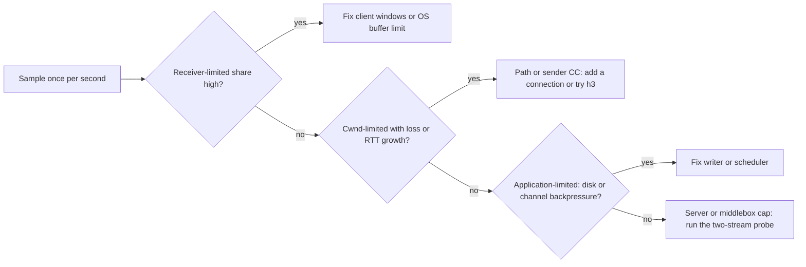
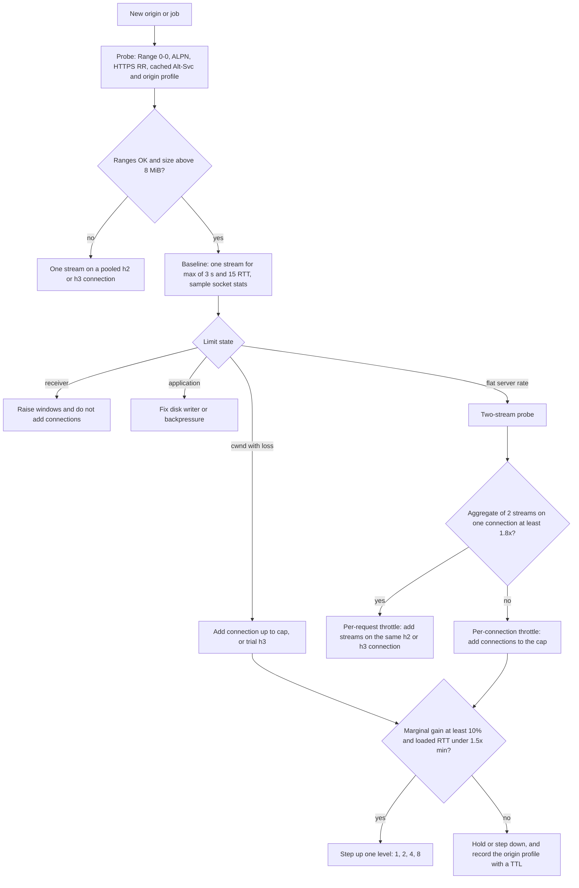

# Transport for bulk transfer: HTTP/2, HTTP/3, QUIC and congestion control

Scope: what the wire protocols and congestion controllers do to a segmented, resumable downloader that talks to arbitrary third-party hosts from a desktop or server, and what Haul should therefore configure, measure and refuse to do. Numeric throughput models live in the maths docs; here the focus is mechanisms, defaults, and evidence. Everything dated 2025-2026 was re-checked on 2026-10-05 (sources in References). Claims marked *Inference* are my reasoning from the evidence, not something a source states.

## TL;DR

- **Transport ladder.** Default to HTTP/2 over TCP with rustls; keep HTTP/1.1 as the ALPN fallback and as the vehicle for "N connections" tricks; treat HTTP/3 as opportunistic and gated behind a feature flag and a per-origin trial. For large objects, HTTP/3 only equals HTTP/2 when the path is clean [WWW21: Production QUIC], it costs more CPU on fast links (up to 45.2% lower data rate than TCP+TLS+HTTP/2 in one study [arXiv:2310.09423]; 2.4 to 8.22 Gbit/s versus 9.54 Gbit/s TCP on 10G links [LCN23: QUIC(k)]), and the Rust HTTP/3 stack is the least mature layer (h3 0.0.8 last released 2025-05-06, README "still very experimental" [h3: README]; reqwest HTTP/3 still needs `--cfg reqwest_unstable` [reqwest: changelog]).
- **Most "per-connection speed limits" are client-side windows.** HTTP/2's spec default is 65,535 B per stream and per connection [RFC 9113], which caps one stream at 10.5 Mbit/s at 50 ms RTT. hyper's client defaults are 2 MiB per stream and 5 MiB per connection [hyper: h2 client.rs], i.e. a 335 Mbit/s single-stream ceiling at 50 ms and 168 Mbit/s at 100 ms. Quinn's default stream window is 1.25 MB, i.e. 100 Mbit/s at 100 ms [Quinn: transport.rs]. macOS caps TCP receive buffers at 4 MiB on Macs with at least 4 GiB RAM (2 MiB otherwise) [XNU: tcp_subr.c]. Set windows explicitly and attribute bottlenecks with per-socket statistics before concluding the server throttles you.
- **Congestion control is the sender's, not yours.** For a download the server's CUBIC/BBR decides the ramp and the loss response. The client's levers are: receive window, number of connections, protocol choice, ECN willingness, and receiver-side pacing. CUBIC (RFC 9438) is the default on the OSes I checked (Windows 11 build 26200 locally, XNU, upstream Linux Kconfig `default DEFAULT_CUBIC` [Linux: net/ipv4/Kconfig]; distributions may change it). BBR is still an Internet-Draft (draft-ietf-ccwg-bbr rev 06, 2026-07-06, specifying BBRv3), and mainline Linux `tcp_bbr.c` is still BBRv1 as of v7.3-rc6 [draft-ietf-ccwg-bbr] [Linux: tcp_bbr.c].
- **N parallel connections still help, for four distinct reasons, and the standards still say be conservative.** Reasons: server or CDN per-connection throttles; the sum of congestion windows under random loss (per-flow throughput scales as $1/\sqrt{p}$ for Reno, and one measured H2 page load went from 12 s to about 8.5 s with several connections at 2% loss [IFIP18: Parallel connections]); faster start (N times IW10); and window caps. RFC 9113 says clients SHOULD NOT open more than one HTTP/2 connection to a host:port, RFC 9114 says SHOULD NOT open more than one HTTP/3 connection to an IP:UDP port, RFC 9112 says be conservative with HTTP/1.1 [RFC 9113] [RFC 9114] [RFC 9112]. Haul should escalate 1, 2, 4, 8 only on measured need (policy in R4).
- **Per-request throttles scale with HTTP/2 streams; per-connection throttles do not.** nginx's `limit_rate` is per request, so range streams multiplexed on one h2 connection each get their own allowance [nginx: core]; a per-flow rate limit (for example `fq maxrate`) is shared by all streams in a connection [man: tc-fq]. A two-stream probe distinguishes them in seconds (Section 5).
- **UDP is a deployment risk, not just a performance question.** Google data reported in 2016 showed about 5% of clients with UDP impairment (0.3% rate-limited, 0.2% blocked at the access-network border, 4.5% blocked near the user) [arXiv:1612.07816]; some enterprise policies block UDP/443 deliberately to force TCP (Medium; vendor advice seen in search results, not cited). Race QUIC against TCP, remember failures per network with Chromium-style exponential backoff (300 s base) [Chromium: broken alt-svc], and size UDP buffers (quic-go recommends about 7.5 MB on Linux [quic-go: UDP buffers]).
- **Rust stack verdict (verified 2026-10-05).** hyper 1.11.1, hyper-util 0.1.21, h2 0.4.19, rustls 0.23.45, quinn 0.11.12, reqwest 0.13.5 are current and active. h2 had five releases between 2026-06-15 and 2026-08-24 including a DoS fix (RUSTSEC-2026-0258) and an open regression in 0.4.19 (issue 964, 2026-10-03). hyper-util's pool deliberately keeps a single HTTP/2 connection per host key, so multi-connection HTTP/2 needs explicit client or pool instances. reqwest never reads Alt-Svc or HTTPS records and does not fall back from HTTP/3 to TCP [reqwest: client.rs].
- **DNS and setup.** Happy Eyeballs v3 is still a working-group draft (rev 04, 2026-07-02); hyper-util implements only a two-family race with a 300 ms delay and no HTTPS-record or QUIC awareness [draft-ietf-happy-happyeyeballs-v3] [hyper-util: connect/http.rs]. Plan a custom connector. TLS 1.3 was re-issued as RFC 9846 (July 2026, obsoletes RFC 8446); ECH is RFC 9849 (March 2026). Never send 0-RTT early data for tokenised or one-time URLs.
- **Measure, then decide.** Emulate with netem at the receiver's ingress (TSQ distorts egress emulation [man: tc-netem]), raise the netem queue limit above the delay-line size (1000 packets default; 4,281 needed at 1 Gbit/s x 50 ms), and read `TCP_INFO` (Linux, Windows build 20348+) or Quinn `PathStats` to classify each interval as receiver-limited, congestion-limited, application-limited or server-limited. Candidate tests T1-T16 are in the Implications section.

## 1. Evidence conventions

Confidence tags: High means a primary source I read (RFC, source code, vendor docs, the paper itself); Medium means a secondary summary or a primary source that is dated; Low means inference or a single unverified report. Version numbers and dates for crates come from the crates.io API and GitHub on 2026-10-05; kernel facts come from the Linux source tree (tags v5.15 to v7.3-rc6) and its in-tree documentation; Apple facts come from the open-source XNU tree (open-source XNU may lag shipping macOS).

## 2. HTTP/1.1, HTTP/2 and HTTP/3 for bulk downloads

### 2.1 Side-by-side

| Property | HTTP/1.1 [RFC 9112] | HTTP/2 [RFC 9113] | HTTP/3 [RFC 9114] over QUIC [RFC 9000] |
|---|---|---|---|
| Transport | TCP (+TLS) | One TCP connection (+TLS), ALPN `h2` | QUIC over UDP; TLS 1.3 integrated [RFC 9001] |
| Time to first response byte, cold | 3 RTT with TLS 1.3 (TCP 1, TLS 1, request 1); 4 with TLS 1.2 | Same as HTTP/1.1 | 2 RTT (1-RTT handshake, then request) |
| Time to first byte, resumed with early data | 2 RTT (TCP, then request carried in the first TLS flight) | Same | 1 RTT with 0-RTT |
| Concurrency inside one connection | None (one in-flight response); parallelism needs more connections | Streams multiplexed; `SETTINGS_MAX_CONCURRENT_STREAMS` (RFC recommends at least 100) | Streams multiplexed; stream limits via QUIC transport parameters |
| Loss impact | Only that connection stalls | Every stream stalls (TCP in-order delivery) | Only the affected stream stalls |
| Flow control | TCP receive window only | Per-stream and per-connection credit (WINDOW_UPDATE) on top of TCP; default 65,535 B each | Per-stream and per-connection credit (MAX_STREAM_DATA, MAX_DATA); absent transport-parameter limits default to 0, so every stack chooses its own values |
| Congestion control and loss recovery | Kernel TCP (CUBIC/BBR/Reno, RACK-TLP) | Kernel TCP | User-space; RFC 9002 NewReno baseline, CUBIC/BBR in practice |
| Spec guidance on connection count | "ought to limit" simultaneous connections, be conservative (RFC 9112 section 9.4) | SHOULD NOT open more than one per host:port (RFC 9113 section 9.1) | SHOULD NOT open more than one per IP:UDP port (RFC 9114 section 3.3) |
| Hazards | Many connections: server abuse limits, congestion side effects | Single-flow loss sensitivity; small default windows; DoS surface in the library | UDP blocked or rate-limited; higher receive CPU; immature Rust stack |

Time-to-first-byte multiples are computed from handshake round trips and ignore server think time: at 100 ms RTT that is 300 ms (TCP+TLS 1.3 cold), 200 ms (QUIC cold or TCP resumed with early data), 100 ms (QUIC 0-RTT), 400 ms (TCP+TLS 1.2 cold). For multi-GB downloads this is noise; for many small files it is the dominant cost and is why connection reuse matters (Section 8.5). Yu and Benson measured exactly this: QUIC's one-RTT handshake advantage mattered for payloads under about 1 MB at 10 Mbit/s and was negligible above that [WWW21: Production QUIC] (High, 2021, production endpoints).

### 2.2 Head-of-line blocking: what it does and does not buy a downloader

```mermaid
sequenceDiagram
  participant S as Server
  participant K as Client kernel TCP
  participant A as App with h2 streams A and B
  S->>K: seg1 (A), seg2 (B), seg3 (A) lost, seg4 (B), seg5 (A)
  K->>A: deliver seg1 and seg2 in order
  Note over K: seg4 and seg5 buffered out of order, nothing delivered
  S->>K: retransmit seg3 after fast retransmit (about 1 RTT) or after RTO
  K->>A: deliver seg3, seg4, seg5
  Note over S,A: QUIC would deliver seg4 (stream B) immediately; stream A still waits
```

Two mechanism points matter for Haul and are easy to miss:

1. For one big file fetched as one stream, QUIC removes nothing: the stream is in-order inside QUIC too. HOL removal helps only when the application consumes several independent byte ranges (multi-range segments or many files) and wants the unaffected ones to progress.
2. Even then, the sender's congestion window is per connection, so one loss event still halves (Reno) or cuts to 0.7 (CUBIC) the rate of every stream. The aggregate-window gain of parallel TCP connections under random loss comes from having many independent windows, which a single QUIC connection does not give you (and RFC 9114 discourages opening several). *Inference*, consistent with the measured pattern that one H2 connection suffers severely under 2% random loss while HTTP/1.1 with several connections and a two-connection H2 variant do much better [IFIP18: Parallel connections].

Yu and Benson also report that QUIC's HOL removal had little effect on web-page performance in production [WWW21: Production QUIC] (High for their setup).

### 2.3 What HTTP/3 deployment looks like (2026)

- Cloudflare's 2025 Year in Review: 50% of requests over HTTP/2, 29% HTTP/1.x, 21% HTTP/3, largely unchanged from 2024 [Cloudflare: Radar 2025] (High).
- W3Techs, October 2026: HTTP/3 used by 40.8% of all websites [W3Techs: HTTP/3] (Medium; site-level, CDN-skewed).
- APNet 2026 active measurement of 1,953 non-Chinese and 1,572 Chinese sites: HTTP/3 support 35.0% and 5.7%; transfer time down 17.06% in Chinese long-tail networks, up 0.79% (a regression) at optimised low-latency CDN edges [APNet26: QUIC in the wild] (Medium; abstract seen via search, publisher page returned 403).
- An earlier measurement found HTTP/3 gives sizable benefits only with high latency or very poor bandwidth and none under high loss, partly because many HTTP/3 sites load third-party content over older protocols [arXiv:2102.12358] (Medium, 2021).
- The Great Firewall has blocked QUIC Initial packets by SNI since 2024-04-07, so "UDP works" is not a safe assumption in some regions [USENIX25: QUIC censorship] (High).

Implication: HTTP/3 is available on many CDN-fronted hosts, but object stores and origin download servers are the long tail where Haul spends its time; the h2/h1.1 path must be excellent regardless.

## 3. Congestion control, loss recovery and ECN

### 3.1 Baselines: Reno, IW10, RTO, loss recovery

- Reno slow start, congestion avoidance and fast recovery are specified in [RFC 5681]; NewReno recovery in [RFC 6582]. Initial window 10 segments is [RFC 6928] (Experimental, universally deployed); HyStart++ is [RFC 9406].
- TCP's retransmission timer [RFC 6298]: $SRTT \leftarrow (1-\alpha)SRTT + \alpha R'$ with $\alpha=1/8$; $RTTVAR \leftarrow (1-\beta)RTTVAR + \beta|SRTT-R'|$ with $\beta=1/4$; $RTO = SRTT + \max(G, 4\cdot RTTVAR)$; the RFC floors RTO at 1 s. Linux uses a 200 ms floor (`tcp_rto_min_us` default 200000) [Linux: ip-sysctl]; this Windows 11 machine reports Min RTO 300 ms, Initial RTO 1000 ms [Local: Windows netsh].
- Worked example (computed): RTT samples 100, 110, 95, 300, 105 ms give after the first sample SRTT 100 ms, RTTVAR 50 ms, raw RTO 300 ms; after the 300 ms outlier SRTT 125.4 ms, RTTVAR 73.6 ms, raw RTO 419.6 ms; the RFC floor turns every value into 1.0 s, Linux's floor leaves 420 ms, which is why a lost tail packet on a quiet connection costs 0.4 to 1 s unless a tail-loss probe fires. Linux enables TLP by default (`tcp_early_retrans=3`, requires RACK) [RFC 8985] [Linux: ip-sysctl]; this Windows host shows RACK and TLP enabled.
- QUIC loss recovery [RFC 9002]: initial RTT 333 ms, packet threshold 3, time threshold 9/8 RTT, $PTO = SRTT + \max(4\cdot RTTVAR, 1\,\text{ms}) + max\_ack\_delay$, persistent congestion after 3 PTOs; initial window 10 datagrams; senders MUST pace or limit bursts (section 7.7); NewReno-like baseline, other controllers allowed.

### 3.2 CUBIC (RFC 9438): formulas, worked examples, what it means for parallelism

CUBIC [RFC 9438] (obsoletes RFC 8312) grows the window as a cubic function of time since the last congestion event:

$$W_{cubic}(t)=C\,(t-K)^3+W_{max},\qquad K=\sqrt[3]{\frac{W_{max}-cwnd_{epoch}}{C}}$$

with $C=0.4$ and multiplicative decrease $\beta_{cubic}=0.7$ (Reno uses 0.5). In the "Reno-friendly region" the window is raised to at least $W_{est}$, which grows by $\alpha_{cubic}=3(1-\beta)/(1+\beta)=0.5294$ segments per RTT so that CUBIC is never slower than Reno. Plain-text restatement: after a loss, CUBIC returns to the old window in $K$ seconds, where $K$ grows with the cube root of the window and does not depend on RTT; Reno needs $W_{max}/2$ round trips.

Computed recovery after one loss event at 50 ms RTT (segments of 1460 B; CUBIC curve is the larger of $W_{cubic}$ and $W_{est}$, integrated numerically):

| $W_{max}$ (segments) | Approx. bytes | CUBIC: time to regain $W_{max}$ | Reno: halve, +1 per RTT | Capacity lost, CUBIC | Capacity lost, Reno |
|---|---|---|---|---|---|
| 100 | 0.15 MB | 2.83 s (Reno-friendly region governs; $K$ = 4.22 s) | 2.5 s | 624 segments (0.9 MB) | 1,250 segments (1.8 MB) |
| 1,000 | 1.46 MB | 9.09 s | 25 s | 13,630 segments (19.9 MB) | 125,000 segments (182.5 MB) |
| 4,280 | 6.25 MB (1 Gbit/s x 50 ms) | 14.75 s | 107 s | 94,711 segments (138 MB) | 2.29 M segments (3.3 GB) |
| 10,000 | 14.6 MB | 19.57 s | 250 s | 293,630 segments (429 MB) | 12.5 M segments (18.3 GB) |

At small windows CUBIC can take slightly longer in wall time to return to $W_{max}$ than Reno, but it restarts from 0.7 rather than 0.5 of the window, so it still loses less capacity. Two corollaries (both computed and checked numerically):

- With the cubic profile and a fixed capacity, the average window over one epoch is $1-(1-\beta)/4 = 92.5\%$ of $W_{max}$ for CUBIC versus 75% for Reno on a zero-buffer path (with a buffer of one BDP Reno also approaches full utilisation). Per loss event on a 1 Gbit/s x 50 ms path CUBIC forfeits about 24 times less capacity than Reno (table above). *Inference*: on a clean, congestion-loss-only path one CUBIC flow already fills the pipe, so extra connections buy little there; the gains from parallelism come from random loss, per-connection throttles and window caps.
- Under random (non-congestive) loss the window never reaches capacity, and the relevant steady-state formulas are the Mathis/Padhye family [Mathis97] [Padhye98] for Reno and RFC 9438's Figure 6 for CUBIC under a deterministic loss model:

$$AVG\_W_{cubic}=\left(\frac{C(3+\beta)}{4(1-\beta)}\right)^{1/4}\left(\frac{RTT^{3}}{p^{3}}\right)^{1/4},\qquad AVG\_W_{reno}=\sqrt{3/2}\,/\sqrt{p}$$

Computed at RTT 80 ms, MSS 1460 B (effective rate is the larger of the two, because of the Reno-friendly region):

| Loss rate p | Reno window (segments) | Reno rate | CUBIC formula | Effective |
|---|---|---|---|---|
| 1e-2 | 12.2 | 1.79 Mbit/s | 0.73 Mbit/s | 1.79 Mbit/s |
| 1e-3 | 38.7 | 5.65 Mbit/s | 4.12 Mbit/s | 5.65 Mbit/s |
| 1e-4 | 122.5 | 17.88 Mbit/s | 23.14 Mbit/s | 23.14 Mbit/s |
| 1e-5 | 387.3 | 56.55 Mbit/s | 130.15 Mbit/s | 130.15 Mbit/s |
| 1e-6 | 1,224.7 | 178.81 Mbit/s | 731.88 Mbit/s | 731.88 Mbit/s |

Reading: at p=1e-4 and 80 ms, one CUBIC flow tops out near 23 Mbit/s; with independent losses and an uncongested link, filling a 100 Mbit/s access link takes $\lceil 100/23.14\rceil = 5$ connections. At 1e-2 and 1e-3, CUBIC is effectively Reno. (Briscoe and Albisser give the grounding for the Reno-friendly constant [arXiv:2305.10581].) Both formulas assume deterministic loss spacing and ignore retransmission timeouts, which Padhye et al. add to the Reno model [Padhye98]; treat the table as optimistic estimates for moderate loss (Medium).

### 3.3 BBR: status as of 2026-10-05

| Item | Status | Source |
|---|---|---|
| Spec | `draft-ietf-ccwg-bbr` rev 06, 2026-07-06, a CCWG working-group document; abstract specifies BBRv3; milestone "submit for publication as Experimental"; authors Cardwell, Swett (Google), Beshay (Meta) | [draft-ietf-ccwg-bbr] |
| Linux mainline | `net/ipv4/tcp_bbr.c` still describes BBRv1 (model: windowed max bandwidth over 10 round trips, min RTT over 10 s, with policer detection) and contains no BBRv3 references at v7.0, v7.1, v7.2 or v7.3-rc6; 2026 commits touch SPDX tags and generic hooks only | [Linux: tcp_bbr.c] |
| Versions | BBRv1 (ACM Queue 2016, cited in the `tcp_bbr.c` header) is what mainline ships; BBRv2 and BBRv3 are successor revisions kept out of tree, BBRv3 introduced to the public in July 2023; fluid-model studies exist for v1 and v2 | [Linux: tcp_bbr.c] [PAM24: BBRv3] [arXiv:2208.10103] |
| Out-of-tree | BBRv3 available in Google's tree (not re-verified here) | Low |
| Windows | Netsh exposes provider `cubic` on this host; a BBR2 option is reported by community sources for Windows 11 22H2+ and not documented by Microsoft in the pages I read | [Local: Windows netsh] (BBR2 claim: Low, unverified) |
| QUIC libraries | Quinn: Cubic default, NewReno, and Bbr marked "Experimental! Use at your own risk"; reqwest exposes `http3_congestion_bbr()` since 0.12.16 | [Quinn: transport.rs] [reqwest: changelog] |
| Fairness | BBRv3 improves on BBRv1 but still struggles to share equitably with CUBIC in many conditions (PAM 2024); a 2025 FABRIC-testbed study found existing steady-state and fluid models fit BBRv1 (and the fluid model BBRv2) but clearly mispredict BBRv3, so there is no trusted model of BBRv3 coexistence yet; 2025 Wi-Fi 6 tests find AQM (FQ-CoDel, CAKE) restores fairness and FIFO lets CUBIC dominate | [PAM24: BBRv3] [arXiv:2505.07741] [arXiv:2509.06245] |
| Process | RFC 9743 (BCP 133) governs how new congestion controllers are specified and evaluated | [RFC 9743] |

For Haul the practical reading is: you cannot assume BBR behaviour from a Linux server you do not control, and you cannot select a client-side algorithm that changes a download (next subsection). A 2024 proxy study found a BBR-enabled proxy improved HTTP/2 single-stream downloads by 90% under severe impairment while HTTP/3 was insensitive to the proxy, which is consistent with the sender's algorithm doing the work [arXiv:2409.16267] (Medium).

### 3.4 Who controls what in a download

| Lever | Controlled by | Haul can influence it? |
|---|---|---|
| Slow-start ramp, loss response, pacing | Sender (server TCP stack or its QUIC library) | No |
| Receive window (TCP), h2 and QUIC credit | Receiver | Yes (Section 4) |
| Number of connections and streams | Receiver | Yes (Section 7) |
| Protocol version | Mostly receiver (with server support) | Yes |
| ECN capability and echo | Both; receiver must negotiate | Partly (OS setting) |
| ACK frequency (QUIC) | Receiver, if peer honours `ACK_FREQUENCY` | Draft only [draft-ietf-quic-ack-frequency] |
| Receiver-paced rate | Receiver | Yes (windows or read pacing) |

Client-side CC choice (CUBIC versus BBR on your socket) mostly affects uploads and request bursts, not the download ramp. For HTTP/3 the same holds: Quinn's `congestion_controller_factory` matters for what Haul sends, not for the server's data flow. *Inference* from the sender-based design of TCP and QUIC congestion control (High confidence in the mechanism; Haul-specific impact untested, see T6).

### 3.5 ECN and L4S

- ECN [RFC 3168] lets a router mark instead of drop. L4S is specified by [RFC 9330] (architecture, Informational), [RFC 9331] (ECN protocol, Experimental) and [RFC 9332] (Dual-Queue Coupled AQM, Experimental), January 2023.
- Linux: `sch_dualpi2.c` exists from v6.17 and Accurate ECN is documented in `tcp_ecn` values 3 to 5 from v6.18; default `tcp_ecn=2` (answer ECN requests, do not initiate) [Linux: ip-sysctl]. Mainline `net/ipv4/Kconfig` at v7.3-rc6 lists no TCP Prague congestion module [Linux: net/ipv4/Kconfig], so L4S-capable TCP on Linux still needs an out-of-tree module.
- Apple: iOS 17 and macOS 14 added L4S for HTTP/2 and TCP downloads and automatic L4S inside URLSession and Network.framework for QUIC/HTTP/3 [Apple: WWDC23 L4S] (Medium; from the session summary); XNU main selects a Prague congestion controller when L4S is enabled on the interface, else CUBIC [XNU: tcp_subr.c] (High for source, open-source XNU may lag shipping builds).
- Windows: ECN capability is Disabled in all default templates on this Windows 11 host [Local: Windows netsh].
- Deployment is thin: Comcast began a DOCSIS L4S rollout in early 2025 [Comcast L4S] (Medium). For QUIC, a 2023 scan of 180M domains found only about 20% of QUIC hosts mirror client ECN codepoints and under 2% pass QUIC's ECN validation [arXiv:2309.14273] (Medium, dated).

Implication: enable ECN where the OS and library do it for free (quinn-udp exposes ECN codepoints; Quinn validates), but there is no application-level L4S work worth doing in Haul now.

### 3.6 Background and polite transfer

- LEDBAT [RFC 6817] is sender-side; rLEDBAT [RFC 9840] (Experimental, September 2025) moves a delay-based less-than-best-effort algorithm to the receiver, which advertises a constrained TCP receive window so that no sender change is needed. A Haul download client is exactly a receiver, so the principle applies directly: the receiver can set the rate to window/RTT.
- XNU carries a LEDBAT-based background congestion controller (`TCP_CC_ALGO_BACKGROUND_INDEX`) selected for background-class sockets [XNU: tcp_subr.c].
- RFC 9218 reserves urgency 7 for background work such as software updates; servers may ignore priority signals [RFC 9218] (Section 5.2).
- `draft-ietf-ccwg-ratelimited-increase` (rev 11, in the RFC Editor queue since September 2026) standardises how a sender grows its window when rate-limited, relevant to throttled downloads on the sender side [draft-ietf-ccwg-ratelimited-increase].

## 4. Receive windows and buffers: the client-side ceilings

### 4.1 TCP: window scaling and autotuning per OS

[RFC 7323] limits the window-scale shift to 14, so the maximum window is $2^{30}$ B = 1 GiB. Autotuning decides how much of that a connection may use:

| OS | Behaviour (verified) | Ceiling at 50 / 100 / 200 ms RTT (upper bound, window at most equal to the buffer) |
|---|---|---|
| Linux, kernels up to 6.15 | `tcp_moderate_rcvbuf=1`; `tcp_rmem` max default "between 131072 and 6MB depending on RAM" | 6 MiB: 1007 / 503 / 252 Mbit/s |
| Linux, 6.16 and later (checked through v7.2) | Same, but max default "between 131072 and 32MB"; code uses `min(32 MiB, 1/128 of the TCP memory pressure threshold)` | 32 MiB: 5369 / 2684 / 1342 Mbit/s |
| Windows 11 (build 26200, local) | Receive Window Auto-Tuning Level normal; CUBIC; RSC enabled; ECN disabled; timestamps allowed; IW 10 MSS; Min RTO 300 ms; pacing profile off; Fast Open, HyStart, PRR, RACK, TLP enabled | Microsoft's 2007 Vista-era documentation says auto-tuning allows "up to a 16MB maximum receive window"; current cmdlet pages give no per-level figures (Medium): 2684 / 1342 / 671 Mbit/s |
| macOS (XNU source through xnu-12377.41.6) | `net.inet.tcp.autorcvbufmax` and `autosndbufmax` default 2 MiB, raised in `tcp_init` to 4 MiB when RAM is at least 4 GiB (8 MiB in server-performance mode); ESnet independently lists 4 MB | 4 MiB: 671 / 336 / 168 Mbit/s (2 MiB: 336 / 168 / 84) |

Sources: [Linux: ip-sysctl], [XNU: tcp_subr.c], [XNU: tcp_input.c], [ESnet: macOS tuning], [Local: Windows netsh], [MS: Set-NetTCPSetting], [MS: Cable Guy autotuning]. Notes:

- Calling `setsockopt(SO_RCVBUF)` on Linux disables autotuning for that socket, and then `tcp_rmem[2]` is ignored [Linux: ip-sysctl]. Hence Haul must not "help" by setting receive buffers on download sockets (hyper-util exposes `set_recv_buffer_size` [hyper-util: connect/http.rs]). Whether the same holds on Windows and macOS is not verified here; check with `TCP_INFO`/`RcvBuf`.
- `tcp_slow_start_after_idle` defaults to 1, so a pooled connection idle for more than one RTO restarts from the initial window [Linux: ip-sysctl]; Windows shows "congestion window restart" disabled on this host. Warm pools help handshakes more than they help rate.
- Microsoft's `Set-NetTCPSetting` documentation still lists only Default, CTCP and DCTCP providers and says clients default to NewReno, while the running system reports CUBIC; the page is stale, trust runtime output [MS: Set-NetTCPSetting] [Local: Windows netsh]. Microsoft's networking blog announced CUBIC as the default for Windows 10 (1709) and Windows Server 2019 [MS: CUBIC default blog] (Medium; the page body did not render for me, content known from search summaries).
- Mac and old-Linux ceilings are real: at 100 ms RTT a single TCP connection on a Mac with default sysctls tops out near 336 Mbit/s, on a Linux 6.14 host near 503 Mbit/s before overhead. This is a client-side reason that N connections help, and it also means a goodput ceiling that does not move with N=1 versus N=2 streams on the same connection is a window problem, not a server throttle.

### 4.2 HTTP/2 flow control

HTTP/2 flow control is credit-based, hop-by-hop, applied only to DATA frames, with a 65,535 B initial window for each new stream and for the connection; `SETTINGS_INITIAL_WINDOW_SIZE` changes only stream windows, and the connection window can only be raised with WINDOW_UPDATE on stream 0. If a receiver cannot keep the peer's available window above the bandwidth-delay product, throughput is limited by flow control (RFC 9113 sections 5.2, 6.9.2) [RFC 9113]. `SETTINGS_MAX_CONCURRENT_STREAMS` starts unlimited and "should be no smaller than 100". Priority signalling from RFC 7540 is deprecated (Section 5.2 below).

Defaults in the stacks Haul will meet (verified from source), with the window-limited ceiling $W/RTT$ computed:

| Stack | Stream window | Connection window | Ceiling at 20 / 50 / 100 / 200 ms (stream) |
|---|---|---|---|
| RFC 9113 and h2 crate default (`DEFAULT_INITIAL_WINDOW_SIZE`) | 65,535 B | 65,535 B | 26 / 10.5 / 5.2 / 2.6 Mbit/s |
| hyper client (master) | 2 MiB | 5 MiB (max frame 16 KiB, initial max send streams assumed 100) | 839 / 336 / 168 / 84 Mbit/s |
| hyper server (master) | 1 MiB | 1 MiB (`max_concurrent_streams` 200) | 419 / 168 / 84 / 42 Mbit/s |
| Chromium HTTP/2 session | 6 MiB (sent as INITIAL_WINDOW_SIZE) | 15 MiB | 2517 / 1007 / 503 / 252 Mbit/s |
| nginx server | not documented in the module pages I read; `http2_max_concurrent_streams` default 128, `http2_idle_timeout` 3 m | n/a | n/a |

Sources: [h2: settings.rs], [hyper: h2 client.rs], [hyper: h2 server.rs], [Chromium: HTTP/2 session settings], [nginx: v2]. Two details matter:

- hyper's adaptive window (`adaptive_window(true)`, exposed in reqwest as `http2_adaptive_window`) estimates BDP from PING round trips: it records bytes received between a BDP ping and its ack, and when the estimate reaches two thirds of the current maximum it doubles the window, capped at 16 MiB (`BDP_LIMIT`), and it overrides the explicit window options [hyper: ping.rs] [hyper: h2 client.rs]. A 16 MiB cap equals 1.34 Gbit/s at 100 ms, adequate for most desktops, but the ramp costs several RTTs.
- The `h2` crate itself starts at the spec default; hyper overrides it to the 2/5 MiB values above. A client built directly on `h2` without those overrides is capped at 65,535 B per RTT per stream.

### 4.3 QUIC flow control and Quinn defaults

QUIC uses MAX_DATA and MAX_STREAM_DATA with limits communicated as transport parameters (RFC 9000 section 4; `ack_delay_exponent` and `max_ack_delay` defaults 3 and 25 ms) [RFC 9000]. A receiver SHOULD send an ACK after at least two ack-eliciting packets [RFC 9000]. Quinn's `TransportConfig::default()` [Quinn: transport.rs]:

| Setting | Default | Consequence |
|---|---|---|
| `stream_receive_window` | 1.25 MB (12.5 MB/s x 100 ms) | Single-stream ceiling 100 Mbit/s at 100 ms, 50 Mbit/s at 200 ms, 200 Mbit/s at 50 ms |
| `receive_window` (connection) | unlimited (`VarInt::MAX`) | No connection-level memory bound; set one |
| `send_window` | 10 MB (8 x stream window) | Irrelevant for downloads |
| `initial_rtt` | 333 ms (RFC 9002) | Slow first-RTT estimates on fast paths |
| `initial_mtu` and `min_mtu` | 1200 B; MTU discovery enabled | 104 kpps at 1 Gbit/s until discovery raises it |
| congestion controller | Cubic (NewReno and experimental Bbr available) | Matters for what Haul sends |
| `enable_segmentation_offload` | true (GSO) | Needs OS support |
| `ack_frequency_config` | None (peer ack behaviour untouched) | `ACK_FREQUENCY` is an unfinished draft |
| `max_concurrent_bidi_streams` | 100 | Fine |

Chrome's QUIC flow-control defaults are 15 MiB per connection and 6 MiB per stream [WWW21: Production QUIC]. Quinn's `Connection` exposes `rtt()`, `min_rtt()`, `stats()` with `PathStats` (`rtt`, `min_rtt`, `cwnd`, `congestion_events`, `lost_packets`, `lost_bytes`, `current_mtu`) and `set_receive_window()` at runtime [Quinn: PathStats] (High). A qlog sink is part of `TransportConfig`.

### 4.4 UDP buffers, segmentation offload and receive CPU

| Platform | Send-side batching | Receive-side coalescing | Notes |
|---|---|---|---|
| Linux | `UDP_SEGMENT` (GSO); kernel constant `UDP_MAX_SEGMENTS` is 128 on master | `UDP_GRO`; quinn-udp sets 64 segments | Cloudflare's 2020 same-host test (laptop, Linux 5.3): plain `sendmsg` topped out around 80-90 MB/s, `sendmmsg` and GSO each improved on it (charts only) [Cloudflare: UDP GSO] |
| Windows | USO via `UDP_SEND_MSG_SIZE` on `WSASendMsg` | URO via `UDP_RECV_MAX_COALESCED_SIZE`; documented from Windows 11 24H2; this host reports Receive Offload and Send Offload enabled | [MS: MsQuic blog] [MS: URO] [Local: Windows netsh]; quinn-udp implements both [Quinn: quinn-udp] |
| macOS | Private `sendmsg_x` and `recvmsg_x`; Quinn merged support behind the non-default `fast-apple-datapath` feature on 2024-10-25, microbenchmark 171 to 788-856 MiB/s | same | Private syscalls: stability and policy risk [Quinn: PR 1993] |

CPU evidence, all from user-space QUIC stacks on Linux unless noted:

- 10G testbed, six implementations: 2.4 to 8.22 Gbit/s versus 9.54 Gbit/s for TCP (netperf); Quinn was fastest at 8.22 Gbit/s (8.82 without encryption, a 7.3% gain; msquic gained 22%) and was pinned to one core at 100%, so per-packet protection under [RFC 9001] is a minor share of the cost compared with packet I/O and ACK handling [LCN23: QUIC(k)].
- Offload and packet size: ngtcp2 3.7 to 4.94 Gbit/s with GSO/GRO and 9.97 Gbit/s with a 9000 B MTU; quiche 3.5 to 4.16 Gbit/s; HTTP/3 instead of HTTP/0.9 cost up to 27%; multiple QUIC streams could double throughput in some implementations [IFIP25: QUIC landscape].
- Operating-system buffer defaults are too small by at least an order of magnitude for QUIC; QUIC benefits less from NIC offloads than TCP; client-server implementation pairs span 90 to 4900 Mbit/s [arXiv:2309.16395].
- Receive-side processing is the bottleneck over fast Internet paths: excessive packets and user-space ACKs; recommendations are UDP GRO, QUIC-friendly offloads, delayed ACKs, multi-threaded receive and `recvmmsg` [arXiv:2310.09423]. The paper reports roughly 744K UDP packets against 58K TCP packets in one trace, because TCP coalesces (High for direction, Medium for the exact counts).
- picoquic found 70 to 80% of CPU in the socket layer and 1.5 to 2 Gbit/s [Web: picoquic perf]; Firefox's quinn-udp work saw "< 1 Gbit/s to 4 Gbit/s" on CPU-bound Linux benchmarks and noted Windows USO/URO and macOS `sendmsg_x` had been rolled back at the time for bugs [Web: Firefox UDP I/O]; curl's maintainer: HTTP/3 "is slow in terms of transfer performance when you are CPU bound" [Web: curl HTTP/3 2024].
- Pacing is hard in user space: coarse timers and syscalls; the fq qdisc suits quiche pacing, picoquic's user-space timers work with BBR [arXiv:2505.09222].
- In-kernel QUIC for Linux (Xin Long) was at patch series v14 in July 2026 and the tree has no `net/quic` through v7.3-rc6, so do not plan around it [Linux: QUIC patches] (Medium).

Packet-rate arithmetic (computed): 1 Gbit/s with 1200 B datagrams is 104.2 kpps (28,800 cycles per packet at 3 GHz on one core); 10 Gbit/s with 1200 B is 1.04 Mpps (2,880 cycles per packet); 10 Gbit/s with 8900 B is 140 kpps. TCP with 64 KiB GRO aggregates at 10 Gbit/s is 19.1 k segments/s. This explains the size of the CPU gap.

UDP socket buffers: quic-go recommends `net.core.rmem_max` and `wmem_max` of about 7.5 MB on Linux and `kern.ipc.maxsockbuf` 8441037 on BSD/macOS [quic-go: UDP buffers] (Medium; vendor wiki). An unprivileged Linux process cannot exceed `rmem_max` with `SO_RCVBUF`, so Haul must detect the effective size with `getsockopt` and degrade gracefully (R8).

## 5. Multiplexing, throttles and priorities

### 5.1 What a throttle does to multiplexed streams

| Throttle location | HTTP/1.1, N connections | HTTP/2, N streams, 1 connection | HTTP/3, N streams, 1 connection | Signature |
|---|---|---|---|---|
| Per request (for example nginx `limit_rate`) | Adds N-fold | Adds N-fold (each stream is a request) | Adds N-fold | Aggregate scales with streams on one connection |
| Per connection or per flow (for example `fq maxrate`, per-socket pacing) | Adds N-fold | Does not add; all streams share it | Does not add (QUIC flow identified by 5-tuple) | Aggregate flat when adding streams; rises with connections |
| Per client IP or account | Does not add | Does not add | Does not add | Aggregate flat in both tests; 429/503 or resets at some N |
| Client window or OS buffer (self-inflicted) | Fix windows | Fix windows | Fix windows | Rate scales as 1/RTT; `rwnd_limited` time dominates |
| Loss and congestion window | Adds roughly N-fold if losses independent | Does not add (one window) | Does not add | Sawtooth; retransmissions track throughput |

nginx documents `limit_rate` as "set per a request", so two connections double the allowance [nginx: core]; applying that to HTTP/2 streams is my *Inference* from "per request" (verify with T4). `fq`'s `maxrate` is "maximum sending rate of a flow" and is a good per-connection throttle fixture [man: tc-fq]. Other operators (CDNs, object stores) publish little about this, and S3 explicitly asks clients to "spread these requests over separate connections" and to retry the slowest 5% of large requests on a new connection after a fresh DNS lookup [AWS: S3 guidelines] [AWS: S3 patterns]. Do not assume; classify per origin and cache the result with a TTL.

Two-stream probe (algorithm):

1. Start one range stream on a warm connection and measure goodput $g_1$ for $\max(3\,\text{s}, 15\,RTT)$ (long enough for about 9 RTTs of slow start to a 6.25 MB BDP plus steady state).
2. Add a second range stream on the same connection and measure aggregate $g_{2s}$ for the same interval.
3. If $g_{2s}\ge 1.8\,g_1$: per-request or window-bounded; keep adding streams on the same connection.
4. Else open a second connection and measure $g_{2c}$. If $g_{2c}\ge 1.8\,g_1$: per-connection throttle or cwnd/loss limited; use connections.
5. Else per-IP/account/link-limited: stay at the best count; stop.
6. Distinguish "loss-limited" from "throttled" with limit-state counters and loss (`TCP_INFO` or `PathStats`): a throttled flow shows a flat rate with low retransmissions; a loss-limited flow shows sawtooth cwnd.

### 5.2 Priorities (RFC 9218)

RFC 9218 replaces RFC 7540's tree with two parameters in the `Priority` header (and HTTP/3 PRIORITY_UPDATE): urgency `u` 0 to 7 (default 3; lower is higher priority) and incremental `i` (default false). Urgency 7 "is reserved for background tasks such as delivery of software updates" and must not be used for anything affecting user interaction; non-incremental responses at equal urgency are best served one by one. Servers "can ignore client priority signals" [RFC 9218]. RFC 9113 deprecates the RFC 7540 priority scheme and PRIORITY frames [RFC 9113]. For Haul: foreground user-initiated jobs use `u=2` (or default), background crawls `u=6` or `u=7`, always `i=0` for files; treat it as a hint, never rely on it (server support is uneven and I did not verify specific servers).

### 5.3 Concurrency limits and pools

- RFC recommends advertising at least 100 concurrent streams; observed: nginx `http2_max_concurrent_streams` 128, hyper server 200; hyper's client assumes 100 until it sees the server's SETTINGS [RFC 9113] [nginx: v2] [hyper: h2 server.rs] [hyper: h2 client.rs].
- hyper-util's legacy pool keeps one HTTP/2 connection per `(scheme, authority)` key: a `connecting` set guarantees "only ever 1 connecting task for HTTP/2 connections", with comment "This prevents making multiple HTTP/2 connections to the same host" [hyper-util: pool.rs]. Extra h2 connections therefore need separate `Client` instances (separate pools) or a custom connection manager (R4).
- Connection recycling: nginx closes a keep-alive connection after 1000 requests (`keepalive_requests` default), 75 s idle (`keepalive_timeout`), 1 h total (`keepalive_time`); hyper's pool idles at 90 s by default in reqwest (`pool_idle_timeout`, unlimited `pool_max_idle_per_host`) [nginx: core] [reqwest: client.rs]. A client idle timeout longer than the server's invites a race on reused connections; Haul needs retry-on-reused-connection-closed logic and should set pool idle slightly below common server values (for example 60 s). *Inference*.

## 6. Empirical literature on multi-connection, multiplexing and QUIC

| Study | Setup and date | Finding relevant to bulk | Caveat |
|---|---|---|---|
| [IMC17: Long Look at QUIC] (Kakhki, Jero, Choffnes, Nita-Rotaru, Mislove; IMC 2017) | Chrome and Google servers plus testbed; gQUIC v34/37 | QUIC beat TCP/HTTP/2 in most settings, but a small maximum congestion window made large downloads take twice as long, reordering caused false losses, mobile devices were CPU-limited, and QUIC took more than twice its fair share against TCP (over 50% even against 2 or 4 TCP flows) | gQUIC, not IETF QUIC |
| [WWW21: Production QUIC] (Yu, Benson; WWW 2021) | Google, Facebook, Cloudflare endpoints; several clients; netem | One-RTT handshake helps only small payloads; for larger payloads the server's congestion controller dominates (Cloudflare QUIC used Cubic while its TCP used BBR at the time); client flow-control tuning matters; HOL removal had little page-level effect; implementation bugs (a Proxygen BBR ACK bug) | 2021 deployments |
| [arXiv:2310.09423] (Zhang et al.; WWW 2024) | 50 Mbit/s to 1 Gbit/s, Chrome, Edge, Firefox, Opera, desktop and Pixel 5 | UDP+QUIC+HTTP/3 up to 45.2% lower data rate than TCP+TLS+HTTP/2; cause is receive-side processing and user-space ACKs | Fixes proposed but not quantified |
| [LCN23: QUIC(k)] (König, Waldhorst, Zitterbart; IEEE LCN 2023) | 10 Gbit/s, six implementations | 2.4 to 8.22 Gbit/s versus TCP 9.54; Quinn fastest; single-core bound | Lab, Linux |
| [IFIP25: QUIC landscape] (König, Rust, Zitterbart, Scheuermann; IFIP Networking 2025) | 10 Gbit/s, multiple HTTP versions, multiple streams | HTTP/3 up to 27% below HTTP/0.9; more streams can double throughput; GSO/GRO and MTU 9000 matter | Lab |
| [arXiv:2309.16395] (Jaeger, Zirngibl, Kempf, Ploch, Carle) | QUIC Interop Runner benchmark extension, 10G | Buffers too small; weak NIC-offload benefit; implementation spread 90 to 4900 Mbit/s | Lab |
| [arXiv:2505.09222] (Kempf et al., 2025) | Pacing in quiche, picoquic, ngtcp2 | User-space pacing works with picoquic and BBR; fq suits quiche; GSO complicates pacing | Lab |
| [IFIP18: Parallel connections] (Manzoor, Sadre, Drago, Cerdà-Alabern; IFIP Networking 2018) | Mininet, 7 Mbit/s, 50 ms RTT, 45 kB buffer, 2% random loss; Chromium | One H2 connection degrades badly (Facebook page about 12 s versus about 8.5 s for H1 with several connections); a two-connection H2 variant matched H1 and cut page-load time 53% on average | Page loads, not bulk; 2018 |
| [arXiv:2409.16267] (Liu, Farkiani, Dehart, Parwatikar, Crowley; 2024) | Proxies, lossy and migrating paths | H3 more robust under loss and latency; BBR proxy improves H2 downloads by 90% | Implementation-specific |
| [arXiv:2102.12358] (Trevisan, Giordano, Drago, Safari Khatouni; 2021) | Large-scale HTTP/3 measurement | Sizable benefit only with high latency or very poor bandwidth; none under high loss | 2021 |
| [arXiv:2410.06066] (Buchet, Pelsser; CCR 2025) | Internet-wide scan | Some of the most popular destinations do not support QUIC connection migration | Support only |

What the literature does not give Haul: a head-to-head of range-parallel HTTP/1.1, multiplexed HTTP/2 and HTTP/3 downloaders against third-party hosts with real per-connection throttles. Most studies measure page loads or lab servers. Haul needs its own benchmark (T4, T6, T9).

## 7. Parallel connections: fairness, etiquette, multipath

### 7.1 Standards and prior art

- RFC 2914 (BCP 41) defines a "TCP-compatible" flow as one that responds to congestion like a conformant TCP flow, which is the origin of "TCP-friendliness" (and of CUBIC's Reno-friendly region). It also states the "spiral" problem: instead of more aggressive protocols you get more aggressive applications by opening multiple connections to the same place, and notes RFC 2616 once said a single-user client should not maintain more than 2 connections to a server [RFC 2914]. It points to Endpoint Congestion Management (sharing congestion state across connections to one destination); the standardised form is the Congestion Manager [RFC 3124], which general-purpose stacks never adopted for web traffic (*Inference*: no mainstream OS exposes it), so Haul must police its own connection count.
- Current HTTP text: "A client ought to limit the number of simultaneous open connections", with the warning that larger numbers can cause congestion "that would not have been present if fewer parallel connections had been used", and that servers may reject abusive traffic [RFC 9112]; HTTP/2 and HTTP/3 SHOULD NOT exceed one connection to a host:port or IP:UDP port [RFC 9113] [RFC 9114].
- Briscoe argues flow-rate fairness has no basis as a fairness concept and fairness should be judged by cost imposed on others [Briscoe07]. Practical reading: N connections are "unfair" under flow-rate accounting, but the stronger argument against greed is cost: induced loss and queueing for the user's own other traffic (video calls) and for the server.
- Hacker, Noble and Athey: parallel TCP boosts throughput but takes bandwidth unfairly from competing flows; they propose long virtual RTT to stay fair [Hacker04] (Medium; abstract-level read).
- Flow-rate share arithmetic (computed): with $M$ competing long-lived flows, $N$ connections get $N/(N+M)$ of a shared bottleneck: 4 vs 1 competitor = 80%; 8 vs 1 = 88.9%; 8 vs 3 = 72.7%; 16 vs 3 = 84.2%. Kakhki et al. measured a QUIC flow taking over 50% against 2 and 4 TCP flows [IMC17: Long Look at QUIC].

### 7.2 What real clients do

| Client | Behaviour | Source |
|---|---|---|
| Chromium | 6 connections per host (kNormal), 256-socket soft cap per pool; parallel downloading (3 requests, minimum slice 1,365,333 B) is enabled by default only on Android in source, disabled elsewhere unless a field trial turns it on | [Chromium: socket pool] [Chromium: parallel download] |
| Firefox | `max-persistent-connections-per-server` 6, `max-connections` 128 or 900, 3 extra urgent-start connections per host, HTTP/3 enabled | [Firefox: prefs] |
| aria2 | `--max-connection-per-server` default 1 (range 1-16), `--split` default 5, `--min-split-size` default 20M; docs do not mention HTTP/2 or HTTP/3 | [aria2: manual] |
| S3 SDKs and guidance | Encourages many parallel connections and ranged GETs; retry the slowest 5% of large requests; fresh DNS lookup and new connection on retry | [AWS: S3 guidelines] [AWS: S3 patterns] |
| curl | Happy Eyeballs timeout default 200 ms; `--parallel` for multiple transfers | [curl: manpage] |

So the norm is 1 to 6 connections per host; 16 is a power-user setting. Chromium's source comment even warns that too many connections can make "home routers" block them.

### 7.3 Multipath and coupled congestion control

- MPTCP [RFC 8684] (obsoletes RFC 6824) with the coupled "LIA" controller of [RFC 6356] (Experimental) gives multiple subflows a combined fair share. Linux has had upstream MPTCP since 5.6 (socket protocol `IPPROTO_MPTCP` = 262; in-kernel and userspace path managers) [Linux: MPTCP]. It needs server support, which generic download hosts lack. A Haul "bonding" feature should do application-level range splitting across local interfaces (reqwest has `local_address` and `interface` options [reqwest: client.rs]).
- QUIC multipath: `draft-ietf-quic-multipath` rev 21 is in the RFC Editor queue ("awaiting second editor") [draft-ietf-quic-multipath]; the `noq` crate (n0's fork of Quinn) implements an IETF multipath draft [noq: README]; Quinn's README and `quinn-proto` lib.rs do not mention multipath (checked 2026-10-05). Not a Haul v1 feature.
- IFIP 2018 compared two application-level HTTP/2 connections with HTTP/2 over MPTCP: MPTCP did best where traffic could be steered away from a congested path (their ECMP scenario), while two plain connections already matched HTTP/1.1 under 2% random loss without kernel or server support [IFIP18: Parallel connections].

## 8. DNS and connection setup

### 8.1 Resolution

hyper-util's default resolver is `GaiResolver`, blocking `getaddrinfo` on Tokio's blocking pool, with no cache of its own (OS caches may exist) [hyper-util: dns.rs]. reqwest's optional `hickory-dns` feature uses hickory-resolver 0.26 (timeout 5 s, 2 attempts, 2 concurrent requests, case randomisation; 0.13.5 switched strategy to prefer IPv6) [hickory: ResolverOpts] [reqwest: changelog]. DoH [RFC 8484], DoQ [RFC 9250] and designated-resolver discovery [RFC 9462] belong behind an explicit user choice; *Inference*: a browser using DoH or ECH may reach different CDN edges than the daemon's system resolver, which matters for signed URLs bound to the issuing client IP; resolve once and reuse the same IP for all connections of a job when the origin is IP-bound.

### 8.2 Happy Eyeballs

- RFC 8305 (v2) uses a 50 ms Resolution Delay for AAAA and a 250 ms Connection Attempt Delay to stagger attempts. `draft-ietf-happy-happyeyeballs-v3` rev 04 (WG document, 2026-07-02; authors Pauly, Schinazi, Jaju, Ishibashi) adds SVCB/HTTPS queries issued alongside A/AAAA, groups endpoints by ALPN with a QUIC-over-TCP preference, uses Resolution Delay 50 ms, Connection Attempt Delay 250 ms (min 100 ms, max 2 s), and requires waiting for SVCB when ECH is in use [RFC 8305] [draft-ietf-happy-happyeyeballs-v3].
- hyper-util: splits resolved addresses into a preferred and a fallback family, starts the fallback after a 300 ms delay, tries each family's addresses sequentially; no SVCB, no QUIC, no resolution delay [hyper-util: connect/http.rs]. reqwest 0.13.4 and 0.13.3 contain HTTP/3-specific fixes for happy-eyeballs and IPv4/IPv6 selection [reqwest: changelog].
- Chrome races QUIC and TCP and uses whichever connects first [IMC17: Long Look at QUIC] (footnote, 2017).

### 8.3 HTTPS records, Alt-Svc, ECH

An HTTPS/SVCB record [RFC 9460] can advertise `alpn=h3` before the first connection, whereas Alt-Svc [RFC 7838] is learned only after a response. RFC 9114 describes discovery via Alt-Svc. ECH is [RFC 9849] (March 2026) with DNS bootstrapping [RFC 9848]; rustls' `ClientConfig::with_ech` exists [rustls: ClientConfig]. reqwest's source contains no Alt-Svc handling, uses HTTP/3 only when a request's version is HTTP/3 (set by `http3_prior_knowledge`), and has no fallback [reqwest: client.rs] (checked on master 2026-10-05).

Because Haul downloads are range segments, a protocol switch at segment boundaries is natural: learn `h3` from HTTPS RR or Alt-Svc, then run later segments over h3 if a trial wins (R7). Persist failures per (network, origin): Chromium marks an alternative service broken for 300 s with base-2 exponential backoff capped by a shift of 18 (about two days) [Chromium: broken alt-svc]. *Inference*: key the cache by network identity so moving from an enterprise Wi-Fi that blocks UDP to a home network resets it.

### 8.4 TLS, resumption and 0-RTT

- TLS 1.3 is now [RFC 9846] (July 2026), which obsoletes RFC 8446 and tightens requirements (no KeyShare reuse, mandatory KeyUpdate limits); resumption is PSK-based. SSLKEYLOGFILE has its own RFC [RFC 9850] and reqwest 0.13.4 added `tls_sslkeylogfile(bool)` [reqwest: changelog].
- rustls client defaults: resumption store for 256 server names with up to eight tickets each; `enable_early_data` false; no ALPN unless set [rustls: ClientConfig]. reqwest 0.13 uses rustls with aws-lc and rustls-platform-verifier by default [reqwest: changelog].
- Early data is replayable. HTTP guidance [RFC 8470] adds the `Early-Data: 1` request header and the 425 Too Early status. A ranged GET is idempotent, but a one-time or tokenised download URL is not safe to replay: an attacker (or a retrying middlebox) could consume the token. Rule: no 0-RTT for any URL with a signature, token or session cookie; allow only for public, cacheable objects, if at all (R11).

### 8.5 Pools and many small files

By Little's law the number of files in flight needed to fill a path is BDP / file size. At 100 Mbit/s and 80 ms the BDP is 1.0 MB: 100 files in flight for 10 KB files, 5 for 200 KB, 0.5 for 2 MB. A browser-style limit of 6 HTTP/1.1 connections caps 10 KB files at $6\times10\,\text{KB}/0.08\,\text{s}=6$ Mbit/s (latency-bound, computed), while one HTTP/2 connection with 100 streams reaches 100 Mbit/s. So many-small-files jobs should use one multiplexed connection (h2 or h3) with concurrency just under the server's advertised `MAX_CONCURRENT_STREAMS`, plus connection recycling logic for nginx's 1000-request default.

## 9. Rust stack maturity (verified 2026-10-05)

| Crate | Latest (date) | Repo signal | Role | Assessment |
|---|---|---|---|---|
| hyper | 1.11.1 (2026-08-28) | 16.3k stars, pushed 2026-10-03 | HTTP/1.1 and HTTP/2 client and server | Production; use directly for range control |
| hyper-util | 0.1.21 (2026-09-24) | active | Legacy client, pool, connectors | Production; one h2 connection per key; simplified happy eyeballs; no resolver cache |
| h2 | 0.4.19 (2026-08-24) | 1.55k stars | HTTP/2 framing | Production; five releases since 2026-06-15; RUSTSEC-2026-0258 (low-severity DoS: unbounded empty DATA frames; fixed 0.4.16); regression issue 964 open (2026-10-03) against 0.4.19: legitimate long-lived streams with interleaved empty DATA frames are killed with ENHANCE_YOUR_CALM after about 101 round trips; 0.4.16 and 0.4.18 reported working |
| reqwest | 0.13.5 (2026-09-08) | 11.9k stars | High-level client | Production for h1/h2; HTTP/3 behind `http3` + `--cfg reqwest_unstable`; no Alt-Svc/HTTPS RR/TCP fallback; stabilisation issue 2303 open since 2024-06-04 (blockers: streaming requests, hide h3 types, `Sync` change) |
| rustls | 0.23.45 (2026-09-14); 0.24.0-dev.1 (2026-07-23) | 7.7k stars | TLS | Production; ECH client support; aws-lc-rs 1.18.1 default provider in reqwest 0.13 |
| rustls-platform-verifier | 0.7.1 (2026-09-24) | active | OS trust stores | Production |
| quinn / quinn-proto / quinn-udp | 0.11.12 (2026-09-14) / 0.11.19 (2026-09-30) / 0.6.3 and 0.5.16 (2026-09-30) | 5.3k stars, 183 open issues | QUIC | Usable; fastest in the 2023 10G study; per-connection single-core ceiling; BBR experimental; GSO/GRO/USO/URO; qlog |
| h3 / h3-quinn | 0.0.8 / 0.0.10 (both 2025-05-06) | 895 stars; master pushed 2026-09-24 | HTTP/3 | Experimental: "still very experimental", API may change; no crates.io release for 17 months; interop runner participant; duvet compliance checks |
| noq | 1.3.0 (2026-09-09; crate created 2026-02-24) | 420 stars | Quinn fork with multipath and NAT traversal | Maintained by n0; no HTTP/3 in README |
| quiche / tokio-quiche | 0.30.0 / 0.20.0 (2026-09-17) | 12.7k stars | Cloudflare's QUIC and HTTP/3 (repository description) with a Tokio wrapper | Actively released; includes HTTP/3, unlike Quinn; TLS dependency and production claims not re-verified here |
| s2n-quic | 1.90.0 (2026-10-02) | 1.4k stars | AWS QUIC | Active; one of the h3 crate's supported transports |
| hickory-resolver | 0.26.3 (2026-09-10) | 5.4k stars | DNS client and resolver | Active; candidate for HTTPS RR lookups and DoH (record-type and DoH feature support not re-verified here) |
| tokio | 1.53.2 (2026-10-03) | n/a | Runtime | Production |

Sources: [crates.io API] [GitHub API] [h3: README] [reqwest: changelog] [reqwest: issue 2303] [RustSec: RUSTSEC-2026-0258] [h2: issue 964] [h2: releases] [noq: README] [hyper: issue 1818]. hyper's own HTTP/3 roadmap (strengthen h3, propose a `hyper::rt::quic` interface, then `hyper::proto::http3`) is still listed as work in progress on an issue opened in 2019. HTTP/2 DoS history on the server side (CONTINUATION flood fixed in h2 0.4.4 and 0.3.26, April 2024; MadeYouReset CVE-2025-8671 disclosed 2025-08-13 affecting several servers) is less relevant to a client but a downloader that follows redirects to arbitrary hosts is a client of untrusted servers, so RUSTSEC-2026-0258 applies [Web: h2 CONTINUATION flood] (High for the 2024 post; the MadeYouReset facts are Medium and come from search summaries).

## 10. Measurement methodology

### 10.1 Principles

- Report goodput at the application (bytes durably written per second), plus where time went: receiver-limited, congestion-limited, sender- or application-limited, or server-limited.
- Hold everything but one variable; at least 10 runs per cell; report median and 5th percentile; randomise order of protocols; warm and cold connections separately.
- Never test TCP through netem on the sender's egress: TCP Small Queues distorts results; netem must sit on the ingress of the receiver, or on a separate router hop [man: tc-netem].

### 10.2 Emulation recipes (Linux)

Use a three-node topology (client, router, server) or network namespaces. On the router, disable offloads for emulation fidelity (`ethtool -K IF gso off tso off gro off`; *Inference*: so loss and delay apply per wire packet), then:

```sh
# impair client-bound traffic: delay + loss, then a rate limit via tbf as a child
tc qdisc add dev ethR root handle 1:0 netem delay 50ms loss 0.1% limit 20000
tc qdisc add dev ethR parent 1:1 handle 10: tbf rate 1gbit burst 1mb latency 400ms
# per-connection throttle fixture on the server host (shared by all streams of a flow)
tc qdisc add dev ethS root fq maxrate 20mbit
# alternative: receiver-ingress impairment through an ifb device
ip link add ifb0 type ifb; ip link set ifb0 up
tc qdisc add dev eth0 handle ffff: ingress
tc filter add dev eth0 parent ffff: protocol all u32 match u32 0 0 action mirred egress redirect dev ifb0
tc qdisc add dev ifb0 root netem delay 50ms loss 0.1% limit 20000
```

The netem default queue limit is 1000 packets (iproute2 `q_netem.c`) [iproute2: q_netem.c]. Packets held in the delay line need $\text{rate}\times\text{delay}/\text{size}$ slots: 428 packets at 100 Mbit/s x 50 ms, 4,281 at 1 Gbit/s x 50 ms, 8,562 at 1 Gbit/s x 100 ms, 42,808 at 10 Gbit/s x 50 ms (1460 B packets, computed). With the default 1000, drops at high rates are queue overflow that looks like congestion loss. netem supports random, Markov and Gilbert-Elliott loss, jitter distributions, rate with per-packet overhead, and `slot` for bursty MACs [man: tc-netem]. The baseline recipe deliberately has no jitter: per the same manual, reordering appears when the delay variation exceeds the inter-packet gap, and reordering is itself a stressor for QUIC loss detection [IMC17: Long Look at QUIC], so add jitter only as a separate test cell. `fq` pacing and `maxrate` are per-flow [man: tc-fq].

### 10.3 Windows and macOS

Windows has no built-in ingress netem. Options: route the Windows client through a Linux router (a VM or a second box); or use `clumsy` (WinDivert-based lag/drop injector, MIT licence; coarse, good for functional tests, not for precise measurement) [GitHub: clumsy]. Built-in observability: `netsh int tcp show global`, `netsh int tcp show supplemental`, `netsh int udp show global` (URO/USO state), `Get-NetTCPSetting`, `pktmon` (in-box capture and drop counters, `etl2pcap` conversion) [MS: pktmon], and Microsoft's `ctsTraffic` (Windows-only TCP/UDP goodput tool with per-connection logs) [GitHub: ctsTraffic]. macOS: use a Linux router as well; I did not verify Apple's Network Link Conditioner here.

### 10.4 Per-socket instrumentation (what Haul should sample at 1 Hz)

- Linux `TCP_INFO`: `tcpi_snd_cwnd`, `tcpi_min_rtt`, `tcpi_delivery_rate` (+ app-limited bit), `tcpi_rcv_space`, `tcpi_total_retrans`, `tcpi_bytes_retrans`, `tcpi_reord_seen`, `tcpi_rcv_ooopack`, `tcpi_snd_wnd`, `tcpi_rcv_wnd`, and the limit-state timers `tcpi_busy_time`, `tcpi_rwnd_limited`, `tcpi_sndbuf_limited` [Linux: tcp.h].
- Windows `SIO_TCP_INFO` with `TCP_INFO_v1` (min Windows 10 build 20348): `RttUs`, `MinRttUs`, `BytesInFlight`, `Cwnd`, `SndWnd`, `RcvWnd`, `RcvBuf` (changes with autotuning), `BytesRetrans`, `TimeoutEpisodes`, and `SndLim*` counters for receiver-, congestion- and sender-limited time and bytes [MS: TCP_INFO_v1].
- QUIC: Quinn `PathStats` and qlog; for h2 count WINDOW_UPDATE stalls (time a stream had zero send window).
- Decrypt captures with the key-log format of [RFC 9850] in debug builds only; never ship key logging enabled.
- Classification (flowchart):



### 10.5 Test matrix

RTT {10, 50, 100, 200 ms} x loss {0, 0.01%, 0.1%, 1%} x rate {100 Mbit/s, 1 Gbit/s} x client {h1 x1, h1 x4, h2 one stream, h2 four streams, h2 four connections, h3 one connection} x server {no throttle, `limit_rate` per request, `fq maxrate` per flow} x competitor {none, one CUBIC flow}. Metrics: goodput, CPU-seconds per GB, peak RSS, retransmissions, loaded RTT inflation, share against the competitor. For QUIC add the Interop Runner benchmark extension [arXiv:2309.16395].

## 11. Decision procedure: N x HTTP/1.1, HTTP/2 multiplexing, or HTTP/3



| Situation | Best choice | Mechanism | Evidence |
|---|---|---|---|
| Large file, per-request throttle (nginx-style) | Many streams on one h2 connection | Allowance is per request | [nginx: core] (inference for h2) |
| Large file, per-connection or per-flow throttle | 2-4 connections (h1.1 or h2), up to cap | Allowance is per connection | [man: tc-fq] |
| Large file, long fat path, client window-limited | One connection, bigger windows | Rate is W/RTT | Section 4 |
| Large file, random loss at or above 1e-3 (Wi-Fi, cellular) | 2-4 connections; h3 if the server stack tolerates loss | Sum of windows; Mathis scaling | [IFIP18: Parallel connections] [arXiv:2409.16267] |
| Large file, clean path, server CUBIC/BBR | One connection (h2); extra connections give little | Window already fills pipe; CUBIC recovers fast | Section 3.2 (inference, T6) |
| Many small files, one origin | One h2 or h3 connection, streams just below server limit | Little's law | Section 8.5 |
| Many origins (crawl) | Per-origin pools, 1-2 connections each, shared DNS cache | Politeness and handshake cost | [RFC 9112] |
| Multi-Gbit/s LAN or datacentre | TCP, multiple connections for core scaling | QUIC CPU-bound | [LCN23: QUIC(k)] |
| UDP blocked or rate-limited | TCP with fast fallback | Impairment 1-5% of networks historically | [arXiv:1612.07816] |
| Handover-prone mobile | h3 helps in principle; do not count on migration | Server migration support limited | [arXiv:2410.06066] |
| Background or polite | h2 or h3, `u=7`, receiver-paced, at most 2 connections | rLEDBAT principle | [RFC 9840] [RFC 9218] |

## Implications for Haul

Each item states the decision, defaults, evidence, and the test that validates it (test table follows).

**R1. Transport ladder.** Default per origin: HTTP/2 over TCP+rustls; HTTP/1.1 only if ALPN does not offer h2 or the origin profile says h1.1 gives more (Section 5 probe); HTTP/3 opt-in per origin through R7. Ship the `h3` feature off by default until T7 and T8 pass. Evidence: [WWW21: Production QUIC], [arXiv:2310.09423], [LCN23: QUIC(k)], Section 9. Tests: T7, T8.

**R2. Set windows explicitly; never trust defaults.** For hyper: `initial_stream_window_size` 8 MiB and `initial_connection_window_size` 32 MiB (ceilings 671 and 2684 Mbit/s at 100 ms), `adaptive_window` off at first (it overrides explicit sizes and caps at 16 MiB), then evolve to $window=\mathrm{clamp}(2\times BDP_{est},\,1\,\text{MiB},\,32\,\text{MiB})$ using measured RTT and delivery rate. For Quinn: `stream_receive_window` 8 MiB, `receive_window` 32 MiB (do not leave it unlimited), keep Cubic; use `Connection::set_receive_window` for runtime adjustment. Memory worst case is bounded by the connection window (credit is not allocation; buffering happens only if the disk writer stalls). Evidence: Sections 4.2 and 4.3. Tests: T1, T2.

**R3. TCP socket hygiene.** Do not call `SO_RCVBUF` on download sockets (Linux disables autotuning); set `TCP_NODELAY` (reqwest does; hyper-util's default is false); no TCP buffer tuning in the daemon; surface OS ceilings: if `rwnd_limited` dominates and the OS cap explains the rate (for example macOS 4 MiB), report "OS receive buffer limit" and use a second connection or advise the sysctl. Evidence: [Linux: ip-sysctl], [XNU: tcp_subr.c]. Tests: T3, T15.

**R4. Parallelism policy.** Per-origin ladder 1, 2, 4, 8 connections; step up only if aggregate goodput gains at least 10% over a window of $\max(3\,\text{s},15\,RTT)$ and loaded RTT stays under 1.5x min RTT; step down on 429/503, resets, or RTT inflation above 2x min RTT for 2 s. Defaults: HTTP/2 and HTTP/3 origins capped at 4 connections unless the probe shows a per-connection throttle (then 8); HTTP/1.1 capped at 8; explicit user or policy override to 16 or 32 for hosts they own or trust (object stores, mirrors); global cap 64 connections; per-origin token bucket and `Retry-After` handling from the scheduler (`Retry-After` is defined in [RFC 9110]). Streams per h2 connection: min(server limit minus 8, 32). Implement extra h2 connections by owning the connection manager (one `Client` per slot) since hyper-util shares one h2 connection per key. Evidence: [RFC 9112] [RFC 9113] [RFC 9114], browser and aria2 defaults, [AWS: S3 patterns], [hyper-util: pool.rs]. Tests: T4, T5, T6.

**R5. Classify throttles and cache the result.** Run the two-stream probe on first contact with a large object; store `{per_request, per_connection, per_ip, window_limited, loss_limited}` with a 24 h TTL and invalidate on network change. Expose `bottleneck` in job progress events (`rwnd`, `cwnd`, `app`, `origin_throttle`). Evidence: Section 5. Tests: T4.

**R6. Custom connector (HEv3-lite).** Resolve A, AAAA and HTTPS RR concurrently; wait up to 50 ms for the preferred family; connection-attempt delay 250 ms (min 100 ms, max 2 s); race QUIC against TCP only when HTTPS RR or cached Alt-Svc advertises h3; key a "broken QUIC" cache by (network id, origin) with 300 s base and exponential backoff; reuse the resolved IP across a job's connections when URLs are IP-bound. Do not rely on hyper-util's connector for this. Evidence: [draft-ietf-happy-happyeyeballs-v3], [hyper-util: connect/http.rs], [Chromium: broken alt-svc]. Tests: T13.

**R7. HTTP/3 admission and CPU guard.** Admit h3 for an origin only if (a) HTTPS RR or Alt-Svc advertises it, (b) one connection per IP:UDP port (RFC 9114), and (c) a segment-level trial against h2 shows at least 10% better goodput or the path is lossy (loss at or above 1e-3) and h2 is loss-limited. Fall back to TCP when the QUIC receive path pins a core above 90% while goodput is below 80% of the best h2 result. Protocol switches happen at segment boundaries only. Evidence: [arXiv:2310.09423], [LCN23: QUIC(k)], [arXiv:2409.16267], [arXiv:2102.12358]. Tests: T7, T9.

**R8. UDP buffers and offloads.** At QUIC endpoint creation request an 8 MiB receive buffer, read back the effective size, log a warning below 4 MiB and refuse h3 on paths above about 500 Mbit/s if it is smaller; keep GSO/GRO on; keep macOS `fast-apple-datapath` off by default (private syscalls) with an opt-in feature; on Windows rely on quinn-udp's USO/URO when the OS reports them enabled. Evidence: [quic-go: UDP buffers], [arXiv:2309.16395], [Quinn: PR 1993], [Quinn: quinn-udp]. Tests: T7, T8.

**R9. Priorities.** Send `Priority: u=...` on h2 and h3: foreground `u=2`, default jobs `u=3`, background `u=7`, `i=0` (files are not incremental); never depend on it. Evidence: [RFC 9218]. Test: T9 (observe with a server that implements RFC 9218).

**R10. Polite mode by receiver pacing.** To cap a job at rate $R$, bound credit instead of dropping connections: stream window $W=R\times RTT_{min}$ (for h2 and QUIC) or a token bucket on reads (TCP); add a loaded-latency guard (reduce when loaded RTT exceeds 2x min for 2 s); background jobs use at most 2 connections. This is the rLEDBAT idea applied in user space. Evidence: [RFC 9840], [RFC 9218]. Test: T16.

**R11. TLS and early data.** Resume TLS sessions (rustls default store); no 0-RTT for any URL containing a token, signature or cookie-bearing session; add `Early-Data` handling and treat 425 as retry-without-early-data if 0-RTT is ever enabled; support ECH only when the HTTPS RR carries it; gate `SSLKEYLOGFILE` behind a debug flag and a loud notice. Evidence: [RFC 8470], [RFC 9846], [RFC 9849], [rustls: ClientConfig]. Test: T12.

**R12. Dependency and DoS hygiene.** Pin h2 to 0.4.18 (reported working in issue 964; 0.4.16 also reported working) and do not take 0.4.19 until issue 964 is fixed and T14 passes (re-check weekly); run `cargo audit`; cap header list size and response sizes; treat servers as hostile (a malicious server can send unbounded small DATA frames); add soak tests with long-lived streams. Evidence: [RustSec: RUSTSEC-2026-0258], [h2: issue 964]. Test: T14.

**R13. Telemetry contract.** One `transport_stats` record per connection per second: protocol, RTT, min RTT, cwnd, bytes in flight, retransmit bytes, limit-state shares, window stalls, CPU share of the I/O task; roll up to a job-level `bottleneck` label. Evidence: Section 10.4. Tests: T1-T3, T15.

**R14. Platform notes.** Windows: trust defaults (autotuning normal, CUBIC); only warn if autotuning is disabled. Linux: warn if `tcp_rmem[2]` is below the BDP target (kernels before 6.16 default to at most 6 MiB). macOS: warn if the autotune cap is the limiter. Never modify system TCP settings from the daemon. Evidence: Section 4.1. Test: T15.

**R15. Multi-interface bonding (later).** If requested, split ranges across local addresses (`local_address` or `interface` binding) rather than depend on MPTCP or QUIC multipath; revisit when `draft-ietf-quic-multipath` is an RFC and a Rust stack ships it. Evidence: [Linux: MPTCP], [draft-ietf-quic-multipath], [noq: README].

**R16. Do not.** Do not tune client-side congestion control to speed downloads; do not open more than one HTTP/3 connection per IP:UDP port by default; do not enable 0-RTT for tokenised URLs; do not set `SO_RCVBUF` on TCP download sockets; do not leave the QUIC connection window unlimited; do not claim "faster" for h3 without T7 on the target path; do not hide throttle detection behind retries (record it).

### Candidate tests and benchmarks

| ID | Test | Pass criterion |
|---|---|---|
| T1 | netem 100 ms RTT, 1 Gbit/s, hyper client defaults versus R2 windows versus adaptive | Defaults near 168 Mbit/s single stream; R2 at least 90% of line rate; adaptive converges within 10 RTT |
| T2 | Same with Quinn defaults versus R2 | Defaults near 100 Mbit/s; R2 at least 90% of line rate |
| T3 | Linux: `SO_RCVBUF` 256 KiB versus autotuned, 100 ms RTT | Fixed buffer caps near 20 Mbit/s; autotuned near line rate (confirms R3) |
| T4 | nginx `limit_rate` (per request) versus `fq maxrate` (per flow): two-stream probe classification | Correct label in at least 95% of 100 trials per mode; confirms or refutes the h2 per-request inference |
| T5 | Haul with a competing CUBIC flow on a shared 100 Mbit/s bottleneck | Haul's share at most N/(N+1) at its chosen N, RTT guard triggers, no sustained loaded RTT above 1.5x |
| T6 | Loss sweep p in {0, 1e-4, 1e-3, 1e-2} x RTT {20, 80, 200 ms}: h2 x1, h2 x N connections, h3 | Measured N to reach 100 Mbit/s within 25% of the Section 3.2 table (for example 5 at p=1e-4, 80 ms) |
| T7 | h3 versus h2 CPU-seconds per GB at 1 and 10 Gbit/s, with and without GSO/GRO, Linux and Windows | CPU guard triggers fallback before goodput falls below 70% of h2; documents the break-even rate |
| T8 | Silent and rejecting UDP/443 block; network change | Fallback adds at most 250 ms plus one RTT; backoff persists per network; resets on change |
| T9 | HOL: eight range streams over one h2 connection, 1% loss, versus h3 and four h2 connections | Reports per-range completion variance and total time; informs R7 |
| T10 | 10,000 files of 10 to 200 KB: h1 x6, h2 (100 streams), h3 at 80 ms | h2 about 16x the h1 x6 rate for 10 KB files (link-limited 100 Mbit/s versus latency-bound 6 Mbit/s), as Little's law predicts |
| T11 | Pool idle 90 s versus nginx 75 s keepalive; slow-start-after-idle effect | No failed requests; documented rate loss after idle |
| T12 | Replay test for one-time URLs | Zero early-data requests for tokenised origins |
| T13 | Dual-stack with broken IPv6, broken UDP, slow A; HTTPS RR advertising h3 with UDP blocked | Time-to-connect distribution at or below Chrome and curl |
| T14 | Soak: 1,000 round trips with interleaved empty DATA frames; h2 0.4.16, 0.4.18, 0.4.19 | Pinned version survives; guard test fails on 0.4.19 until fixed upstream |
| T15 | Same path from Windows 11, macOS, Linux below and above 6.16 | Per-OS ceilings match Section 4.1; limit-state attribution says receiver-limited where expected |
| T16 | Receiver-paced job at 50% of link, FIFO versus FQ-CoDel/CAKE bottleneck | Loaded RTT inflation at most half of the unpaced case |

## Corrections to research.md

1. **Section 4.1 says an HTTP/2 per-connection throttle "covers all of them" and that multiple HTTP/2 streams "usually don't add up".** True for per-connection or per-flow limits, false for per-request limits: nginx documents `limit_rate` as per request [nginx: core]. Replace the generalisation with the throttle taxonomy and the two-stream probe (Section 5). Confidence: High for the nginx text, Medium for the h2 consequence (T4 pending).
2. **Section 4.1 presents HTTP/3 as surviving network changes.** Connection migration support is limited among popular destinations [arXiv:2410.06066]; do not count on it as a differentiator.
3. **Section 4.4 pairs `quinn` with `h3` as the HTTP/3 path.** `h3` 0.0.8 (2025-05-06) is self-described as "very experimental" and has had no crates.io release for 17 months; reqwest's HTTP/3 is unstable, ignores Alt-Svc and HTTPS records, and cannot fall back to TCP [h3: README] [reqwest: client.rs]. Alternatives: `quiche`/`tokio-quiche`, `s2n-quic`, and `noq` (Quinn fork with multipath). The research.md instruction to keep HTTP/3 behind a feature flag is confirmed.
4. **Section 4.1 recommends "TTL-respecting DNS caches" and pooling as if defaults provide them.** hyper-util's default resolver is uncached `getaddrinfo` on the blocking pool, its Happy Eyeballs is a two-family race with a 300 ms delay, and its pool keeps exactly one HTTP/2 connection per host key [hyper-util: dns.rs] [hyper-util: connect/http.rs] [hyper-util: pool.rs]. These are Haul-side work items.
5. **Section 4.1 attributes slow single connections to servers ("Many hosts throttle per connection, which is why segmenting helps") and omits client-side ceilings.** A single stream is also limited by the client's own windows (hyper client 2 MiB stream and 5 MiB connection, Quinn 1.25 MB stream, macOS 4 MiB TCP buffers, Linux 6 MiB before 6.16), each of which produces a rate that scales as 1/RTT and looks like a throttle. Add receiver-limited attribution (Section 10.4) before escalating connection counts. Segmenting advice itself stands.
6. **Section 8.1 to 8.2 formulas stand**, with one refinement: the Mathis bound is a lower bound for CUBIC (the Reno-friendly region guarantees it) but CUBIC exceeds it only when $p$ is small relative to RTT (about p below 1e-3 at 80 ms); at p of 1e-3 or worse CUBIC is effectively Reno (Section 3.2 table).

## Open questions

1. Do the major download hosts Haul will meet (object stores, CDNs, Hugging Face, GitHub releases) enforce per-connection, per-request or per-IP limits, and does the answer differ between h1.1 and h2? Needs a survey with the two-stream probe.
2. How common is HTTP/3 on origin download hosts as opposed to CDN-fronted web sites (W3Techs says 40.8% of sites; that is not the long tail of file hosts)?
3. Does Windows document or ship a BBR-family provider on 11 25H2/Server 2025? I could not verify Microsoft documentation; the local `netsh` output offered only `cubic`.
4. Is the Windows "normal" autotune ceiling still 16 MiB on Windows 11 build 26200 (older Microsoft documentation says so; no current page found)?
5. What is the single-connection CPU ceiling of Quinn 0.11.12 on current hardware, and does `noq` 1.x change it (the 8.22 Gbit/s result is from 2023)?
6. Does Chrome's extension `fetch()` use HTTP/3 and how many connections per host does it open for ranged fetches (the browser-fallback path inherits the six-connection norm)?
7. When will the `h3` crate release again, and will hyper adopt a QUIC abstraction (hyper issue 1818 roadmap)?
8. Which servers honour RFC 9218 priorities for download traffic? Unverified.
9. Should Haul mark background traffic with the lower-effort DSCP of [RFC 8622]? Whether networks honour it end to end is unknown.
10. How does QUIC ECN behave in 2026 (the 2023 scan found under 2% validation)? Re-run the measurement before building anything on L4S.
11. Will the QUIC ACK-frequency draft (WG state "Waiting for Write-Up", rev 14 expired 2026-08-09) be revived, since it is the standard remedy for QUIC receive-side ACK cost?

## References

Standards and drafts

- [RFC 9110]: HTTP Semantics. Fielding, Nottingham, Reschke. 2022. https://www.rfc-editor.org/rfc/rfc9110
- [RFC 9112]: HTTP/1.1. Fielding, Nottingham, Reschke. 2022. https://www.rfc-editor.org/rfc/rfc9112
- [RFC 9113]: HTTP/2. Thomson, Benfield. 2022. https://www.rfc-editor.org/rfc/rfc9113
- [RFC 9114]: HTTP/3. Bishop. 2022. https://www.rfc-editor.org/rfc/rfc9114
- [RFC 9000]: QUIC: A UDP-Based Multiplexed and Secure Transport. Iyengar, Thomson. 2021. https://www.rfc-editor.org/rfc/rfc9000
- [RFC 9001]: Using TLS to Secure QUIC. Thomson, Turner. 2021. https://www.rfc-editor.org/rfc/rfc9001
- [RFC 9002]: QUIC Loss Detection and Congestion Control. Iyengar, Swett. 2021. https://www.rfc-editor.org/rfc/rfc9002
- [RFC 9218]: Extensible Prioritization Scheme for HTTP. Oku, Pardue. 2022. https://www.rfc-editor.org/rfc/rfc9218
- [RFC 5681]: TCP Congestion Control. Allman, Paxson, Blanton. 2009. https://www.rfc-editor.org/rfc/rfc5681
- [RFC 6582]: The NewReno Modification to TCP's Fast Recovery Algorithm. IETF. 2012. https://www.rfc-editor.org/rfc/rfc6582
- [RFC 6928]: Increasing TCP's Initial Window. IETF. 2013. https://www.rfc-editor.org/rfc/rfc6928
- [RFC 9406]: HyStart++: Modified Slow Start for TCP. Balasubramanian, Huang, Olson. 2023. https://www.rfc-editor.org/rfc/rfc9406
- [RFC 9438]: CUBIC for Fast and Long-Distance Networks. Xu, Ha, Rhee, Goel, Eggert. 2023 (obsoletes RFC 8312). https://www.rfc-editor.org/rfc/rfc9438
- [RFC 6298]: Computing TCP's Retransmission Timer. Paxson et al. 2011. https://www.rfc-editor.org/rfc/rfc6298
- [RFC 8985]: The RACK-TLP Loss Detection Algorithm for TCP. IETF. 2021. https://www.rfc-editor.org/rfc/rfc8985
- [RFC 7323]: TCP Extensions for High Performance. Borman, Braden, Jacobson, Scheffenegger. 2014. https://www.rfc-editor.org/rfc/rfc7323
- [RFC 2914]: Congestion Control Principles. Floyd. 2000 (BCP 41). https://www.rfc-editor.org/rfc/rfc2914
- [RFC 3124]: The Congestion Manager. Balakrishnan, Seshan. 2001. https://www.rfc-editor.org/rfc/rfc3124
- [RFC 8684]: TCP Extensions for Multipath Operation with Multiple Addresses. IETF. 2020. https://www.rfc-editor.org/rfc/rfc8684
- [RFC 6356]: Coupled Congestion Control for Multipath Transport Protocols. IETF. 2011. https://www.rfc-editor.org/rfc/rfc6356
- [RFC 3168]: The Addition of Explicit Congestion Notification (ECN) to IP. IETF. 2001. https://www.rfc-editor.org/rfc/rfc3168
- [RFC 9330]: L4S Internet Service: Architecture. IETF. 2023. https://www.rfc-editor.org/rfc/rfc9330
- [RFC 9331]: The ECN Protocol for L4S. IETF. 2023. https://www.rfc-editor.org/rfc/rfc9331
- [RFC 9332]: Dual-Queue Coupled AQM for L4S. IETF. 2023. https://www.rfc-editor.org/rfc/rfc9332
- [RFC 9743]: Specifying New Congestion Control Algorithms. IETF. 2025 (BCP 133). https://www.rfc-editor.org/rfc/rfc9743
- [RFC 6817]: Low Extra Delay Background Transport (LEDBAT). IETF. 2012. https://www.rfc-editor.org/rfc/rfc6817
- [RFC 9840]: rLEDBAT: Receiver-Driven Low Extra Delay Background Transport for TCP. IETF. 2025. https://www.rfc-editor.org/rfc/rfc9840
- [RFC 8622]: A Lower-Effort Per-Hop Behavior (LE PHB) for Differentiated Services. IETF. 2019. https://www.rfc-editor.org/rfc/rfc8622
- [RFC 8305]: Happy Eyeballs Version 2. Schinazi, Pauly. 2017. https://www.rfc-editor.org/rfc/rfc8305
- [RFC 9460]: SVCB and HTTPS Resource Records. Schwartz, Bishop, Nygren. 2023. https://www.rfc-editor.org/rfc/rfc9460
- [RFC 7838]: HTTP Alternative Services. IETF. 2016. https://www.rfc-editor.org/rfc/rfc7838
- [RFC 8484]: DNS Queries over HTTPS (DoH). IETF. 2018. https://www.rfc-editor.org/rfc/rfc8484
- [RFC 9250]: DNS over Dedicated QUIC Connections. IETF. 2022. https://www.rfc-editor.org/rfc/rfc9250
- [RFC 9462]: Discovery of Designated Resolvers. IETF. 2023. https://www.rfc-editor.org/rfc/rfc9462
- [RFC 9846]: The Transport Layer Security (TLS) Protocol Version 1.3. IETF. July 2026 (obsoletes RFC 8446). https://www.rfc-editor.org/rfc/rfc9846
- [RFC 9849]: TLS Encrypted Client Hello. IETF. March 2026. https://www.rfc-editor.org/rfc/rfc9849
- [RFC 9848]: Bootstrapping TLS Encrypted ClientHello with DNS Service Bindings. IETF. March 2026. https://www.rfc-editor.org/rfc/rfc9848
- [RFC 9850]: The SSLKEYLOGFILE Format for TLS. IETF. July 2026. https://www.rfc-editor.org/rfc/rfc9850
- [RFC 8470]: Using Early Data in HTTP. Thomson, Nottingham, Tiesel. 2018. https://www.rfc-editor.org/rfc/rfc8470
- [draft-ietf-ccwg-bbr]: BBR Congestion Control, rev 06, 2026-07-06. Cardwell, Swett, Beshay. https://datatracker.ietf.org/doc/draft-ietf-ccwg-bbr/
- [draft-ietf-ccwg-ratelimited-increase]: Increase of the Congestion Window when the Sender Is Rate-Limited, rev 11, 2026-09. https://datatracker.ietf.org/doc/draft-ietf-ccwg-ratelimited-increase/
- [draft-ietf-happy-happyeyeballs-v3]: Happy Eyeballs Version 3, rev 04, 2026-07-02. Pauly, Schinazi, Jaju, Ishibashi. https://datatracker.ietf.org/doc/draft-ietf-happy-happyeyeballs-v3/
- [draft-ietf-quic-multipath]: Managing multiple paths for a QUIC connection, rev 21 (RFC Editor queue). https://datatracker.ietf.org/doc/draft-ietf-quic-multipath/
- [draft-ietf-quic-ack-frequency]: QUIC Acknowledgment Frequency, rev 14 (expired 2026-08-09). https://datatracker.ietf.org/doc/draft-ietf-quic-ack-frequency/

Papers and measurements

- [IMC17: Long Look at QUIC]: Kakhki, Jero, Choffnes, Nita-Rotaru, Mislove. Taking a Long Look at QUIC. IMC 2017. https://mislove.org/publications/QUIC-IMC.pdf
- [WWW21: Production QUIC]: Yu, Benson. Dissecting Performance of Production QUIC. WWW 2021. https://dl.acm.org/doi/10.1145/3442381.3450103 (PDF https://cs.brown.edu/people/tab/papers/QUIC_WWW21.pdf)
- [arXiv:2310.09423]: Zhang, Jin, He, Hassan et al. QUIC is not Quick Enough over Fast Internet. WWW 2024. https://arxiv.org/abs/2310.09423
- [LCN23: QUIC(k)]: König, Waldhorst, Zitterbart. QUIC(k) Enough in the Long Run? Sustained Throughput Performance of QUIC Implementations. IEEE LCN 2023, DOI 10.1109/LCN58197.2023.10223395. https://publikationen.bibliothek.kit.edu/1000161904
- [IFIP25: QUIC landscape]: König, Rust, Zitterbart, Scheuermann. Examining the Heterogeneous Throughput Performance Landscape of QUIC Implementations. IFIP Networking 2025. https://doc.tm.kit.edu/2025-Examining-the-Heterogeneous-Throughput-Performance-Landscape-of-QUIC-Implementations-Koenig-et-al.pdf
- [arXiv:2309.16395]: Jaeger, Zirngibl, Kempf, Ploch, Carle. QUIC on the Highway: Evaluating Performance on High-rate Links. 2023. https://arxiv.org/abs/2309.16395
- [arXiv:2505.09222]: Kempf, Tietz, Jaeger, Späth, Carle, Zirngibl. QUIC Steps: Evaluating Pacing Strategies in QUIC Implementations. 2025. https://arxiv.org/abs/2505.09222
- [arXiv:2309.14273]: Sander, Kunze, Blöcher, Kosek, Wehrle. ECN with QUIC: Challenges in the Wild. 2023. https://arxiv.org/abs/2309.14273
- [arXiv:2410.06066]: Buchet, Pelsser. An Analysis of QUIC Connection Migration in the Wild. ACM CCR 55(1), 2025. https://arxiv.org/abs/2410.06066
- [arXiv:2102.12358]: Trevisan, Giordano, Drago, Safari Khatouni. Measuring HTTP/3: Adoption and Performance. MedComNet 2021. https://arxiv.org/abs/2102.12358
- [arXiv:2409.16267]: Liu, Farkiani, Dehart, Parwatikar, Crowley. Performance Comparison of HTTP/3 and HTTP/2 with Proxy Integration. 2024. https://arxiv.org/abs/2409.16267
- [arXiv:1612.07816]: Edeline, Kühlewind, Trammell, Aben, Donnet. Using UDP for Internet Transport Evolution (reports Google UDP-impairment figures). 2016. https://arxiv.org/abs/1612.07816
- [IFIP18: Parallel connections]: Manzoor, Sadre, Drago, Cerdà-Alabern. Is There a Case for Parallel Connections with Modern Web Protocols? IFIP Networking 2018. https://dl.ifip.org/db/conf/networking/networking2018/8B3-1570422313.pdf
- [APNet26: QUIC in the wild]: Wang, Li, Yan, Zhu, Wu, Yao, Zhu. A Measurement Study on QUIC Deployment and Performance in the Wild. APNet 2026. https://dl.acm.org/doi/10.1145/3820441.3821230
- [USENIX25: QUIC censorship]: Zohaib et al. Exposing and Circumventing SNI-based QUIC Censorship of the Great Firewall of China. USENIX Security 2025. https://gfw.report/publications/usenixsecurity25/en/
- [Briscoe07]: Briscoe. Flow Rate Fairness: Dismantling a Religion. ACM CCR 37(2), 2007. https://dl.acm.org/doi/10.1145/1232919.1232926
- [Hacker04]: Hacker, Noble, Athey. Improving Throughput and Maintaining Fairness Using Parallel TCP. IEEE INFOCOM 2004. https://www.researchgate.net/publication/2937924_Improving_Throughput_and_Maintaining_Fairness_Using_Parallel_Tcp
- [Mathis97]: Mathis, Semke, Mahdavi, Ott. The Macroscopic Behavior of the TCP Congestion Avoidance Algorithm. ACM CCR 27(3), 1997. https://dl.acm.org/doi/10.1145/263932.264023
- [Padhye98]: Padhye, Firoiu, Towsley, Kurose. Modeling TCP Throughput: A Simple Model and its Empirical Validation. SIGCOMM 1998 / ACM CCR 28(4). https://dl.acm.org/doi/10.1145/285243.285291
- [PAM24: BBRv3]: Zeynali, Weyulu, Fathalli, Chandrasekaran, Feldmann. Promises and Potential of BBRv3. PAM 2024. https://link.springer.com/chapter/10.1007/978-3-031-56252-5_12
- [arXiv:2505.07741]: Sarpkaya, Srivastava, Fund, Panwar. BBR's Sharing Behavior with CUBIC and Reno. 2025. https://arxiv.org/abs/2505.07741
- [arXiv:2208.10103]: Scherrer, Legner, Perrig, Schmid. Model-Based Insights on the Performance, Fairness, and Stability of BBR. 2022. https://arxiv.org/abs/2208.10103
- [arXiv:2509.06245]: Shrestha, Kua, Pokhrel. Understanding BBRv3 Performance in AQM-Enabled WiFi Networks. IEEE LCN 2025. https://arxiv.org/abs/2509.06245
- [arXiv:2305.10581]: Briscoe, Albisser. Friendliness between AIMD Algorithms. 2023. https://arxiv.org/abs/2305.10581

Source code, vendor documentation and web sources

- [Linux: ip-sysctl]: Documentation/networking/ip-sysctl.rst, tags v5.15 to v7.2 and master. https://github.com/torvalds/linux/blob/master/Documentation/networking/ip-sysctl.rst
- [Linux: tcp.h]: include/uapi/linux/tcp.h (`struct tcp_info`). https://github.com/torvalds/linux/blob/master/include/uapi/linux/tcp.h
- [Linux: tcp_bbr.c]: net/ipv4/tcp_bbr.c at v7.0, v7.1, v7.2, v7.3-rc6. https://github.com/torvalds/linux/blob/master/net/ipv4/tcp_bbr.c
- [Linux: net/ipv4/Kconfig]: TCP congestion-control Kconfig entries at v7.3-rc6 (no Prague). https://github.com/torvalds/linux/blob/master/net/ipv4/Kconfig
- [Linux: MPTCP]: Multipath TCP: Linux kernel documentation. https://docs.kernel.org/networking/mptcp.html
- [Linux: QUIC patches]: Xin Long, net: introduce QUIC infrastructure, net-next v13 and v14 (June, July 2026). https://ratatoskr.run/linux-cifs/2026/07/17265232/t
- [man: tc-netem]: tc-netem(8). https://man7.org/linux/man-pages/man8/tc-netem.8.html
- [man: tc-fq]: tc-fq(8). https://man7.org/linux/man-pages/man8/tc-fq.8.html
- [iproute2: q_netem.c]: default netem limit 1000. https://github.com/shemminger/iproute2/blob/main/tc/q_netem.c
- [XNU: tcp_subr.c]: Apple open-source XNU, bsd/netinet/tcp_subr.c (xnu-12377.41.6). https://github.com/apple-oss-distributions/xnu/blob/xnu-12377.41.6/bsd/netinet/tcp_subr.c
- [XNU: tcp_input.c]: bsd/netinet/tcp_input.c (`autorcvbufmax` default 2 MiB). https://github.com/apple-oss-distributions/xnu/blob/xnu-12377.41.6/bsd/netinet/tcp_input.c
- [ESnet: macOS tuning]: Mac OSX Tuning, ESnet fasterdata. https://fasterdata.es.net/host-tuning/osx/
- [Apple: WWDC23 L4S]: Reduce network delays with L4S. https://developer.apple.com/videos/play/wwdc2023/10004/
- [MS: Set-NetTCPSetting]: Set-NetTCPSetting, Microsoft Learn. https://learn.microsoft.com/en-us/powershell/module/nettcpip/set-nettcpsetting
- [MS: TCP_INFO_v1]: TCP_INFO_v1 structure, Microsoft Learn. https://learn.microsoft.com/en-us/windows/win32/api/mstcpip/ns-mstcpip-tcp_info_v1
- [MS: pktmon]: pktmon, Microsoft Learn. https://learn.microsoft.com/en-us/windows-server/administration/windows-commands/pktmon
- [MS: URO]: UDP Receive Segment Coalescing Offload (URO), Microsoft Learn. https://learn.microsoft.com/en-us/windows-hardware/drivers/network/udp-rsc-offload
- [MS: MsQuic blog]: Making MsQuic Blazing Fast, Microsoft Tech Community. https://techcommunity.microsoft.com/blog/networkingblog/making-msquic-blazing-fast/2268963
- [MS: Cable Guy autotuning]: The Cable Guy: TCP Receive Window Auto-Tuning, TechNet Magazine. https://learn.microsoft.com/en-us/previous-versions/technet-magazine/cc162519(v=msdn.10)
- [MS: CUBIC default blog]: Windows Transport converges on two Congestion Providers: Cubic and LEDBAT, Microsoft Tech Community. https://techcommunity.microsoft.com/t5/networking-blog/windows-transport-converges-on-two-congestion-providers-cubic/ba-p/339819
- [Local: Windows netsh]: output of `Get-NetTCPSetting`, `netsh int tcp show global`, `netsh int tcp show supplemental`, `netsh int udp show global` on Windows 11 Pro 10.0.26200, run by the author 2026-10-05.
- [GitHub: ctsTraffic]: Microsoft ctsTraffic. https://github.com/microsoft/ctsTraffic
- [GitHub: clumsy]: jagt/clumsy. https://github.com/jagt/clumsy
- [Chromium: parallel download]: components/download/internal/common/parallel_download_utils.cc and download_features.cc. https://chromium.googlesource.com/chromium/src/+/refs/heads/main/components/download/internal/common/parallel_download_utils.cc
- [Chromium: socket pool]: net/socket/client_socket_pool_manager.cc. https://chromium.googlesource.com/chromium/src/+/refs/heads/main/net/socket/client_socket_pool_manager.cc
- [Chromium: HTTP/2 session settings]: net/http/http_network_session.cc. https://chromium.googlesource.com/chromium/src/+/refs/heads/main/net/http/http_network_session.cc
- [Chromium: broken alt-svc]: net/http/broken_alternative_services.cc. https://chromium.googlesource.com/chromium/src/+/refs/heads/main/net/http/broken_alternative_services.cc
- [Firefox: prefs]: modules/libpref/init/all.js and StaticPrefList.yaml. https://github.com/mozilla-firefox/firefox/blob/main/modules/libpref/init/all.js
- [nginx: core]: ngx_http_core_module (limit_rate, keepalive_*). https://nginx.org/en/docs/http/ngx_http_core_module.html
- [nginx: v2]: ngx_http_v2_module. https://nginx.org/en/docs/http/ngx_http_v2_module.html
- [AWS: S3 guidelines]: Performance guidelines for Amazon S3. https://docs.aws.amazon.com/AmazonS3/latest/userguide/optimizing-performance-guidelines.html
- [AWS: S3 patterns]: Performance design patterns for Amazon S3. https://docs.aws.amazon.com/AmazonS3/latest/userguide/optimizing-performance-design-patterns.html
- [aria2: manual]: aria2c manual. https://aria2.github.io/manual/en/html/aria2c.html
- [curl: manpage]: curl manpage. https://curl.se/docs/manpage.html
- [quic-go: UDP buffers]: quic-go wiki, UDP Buffer Sizes. https://github.com/quic-go/quic-go/wiki/UDP-Buffer-Sizes
- [Cloudflare: UDP GSO]: Accelerating UDP packet transmission for QUIC, Cloudflare blog, 2020-01-08. https://blog.cloudflare.com/accelerating-udp-packet-transmission-for-quic/
- [Cloudflare: Radar 2025]: The 2025 Cloudflare Radar Year in Review. https://blog.cloudflare.com/radar-2025-year-in-review/
- [W3Techs: HTTP/3]: Usage statistics of HTTP/3, October 2026. https://w3techs.com/technologies/details/ce-http3
- [Web: Firefox UDP I/O]: Max Inden, Fast UDP I/O for Firefox in Rust. https://max-inden.de/post/fast-udp-io-in-firefox/
- [Web: picoquic perf]: Private Octopus, Optimizing QUIC performance, 2023-12-12. https://www.privateoctopus.com/2023/12/12/quic-performance.html
- [Web: curl HTTP/3 2024]: Daniel Stenberg, HTTP/3 in curl mid 2024. https://daniel.haxx.se/blog/2024/06/10/http-3-in-curl-mid-2024/
- [Web: h2 CONTINUATION flood]: Sean McArthur, hyper HTTP/2 Continuation Flood, 2024-04-03. https://seanmonstar.com/blog/hyper-http2-continuation-flood/
- [Comcast L4S]: RCR Wireless, Comcast touts ultra-low lag (L4S), 2025-01-29. https://www.rcrwireless.com/20250129/uncategorized/comcast-l4s
- [Quinn: transport.rs]: quinn-proto/src/config/transport.rs (defaults). https://github.com/quinn-rs/quinn/blob/main/quinn-proto/src/config/transport.rs
- [Quinn: quinn-udp]: quinn-udp source (unix.rs, windows.rs, lib.rs). https://github.com/quinn-rs/quinn/tree/main/quinn-udp
- [Quinn: PR 1993]: Faster UDP/IO on Apple platforms, merged 2024-10-25. https://github.com/quinn-rs/quinn/pull/1993
- [Quinn: PathStats]: quinn-proto PathStats docs. https://docs.rs/quinn-proto/latest/quinn_proto/struct.PathStats.html
- [h2: settings.rs]: src/frame/settings.rs (`DEFAULT_INITIAL_WINDOW_SIZE` = 65,535). https://github.com/hyperium/h2/blob/master/src/frame/settings.rs
- [hyper: h2 client.rs]: src/proto/h2/client.rs (window defaults). https://github.com/hyperium/hyper/blob/master/src/proto/h2/client.rs
- [hyper: h2 server.rs]: src/proto/h2/server.rs. https://github.com/hyperium/hyper/blob/master/src/proto/h2/server.rs
- [hyper: ping.rs]: src/proto/h2/ping.rs (BDP estimator, 16 MiB limit). https://github.com/hyperium/hyper/blob/master/src/proto/h2/ping.rs
- [hyper-util: pool.rs]: src/client/legacy/pool.rs. https://github.com/hyperium/hyper-util/blob/master/src/client/legacy/pool.rs
- [hyper-util: connect/http.rs]: src/client/legacy/connect/http.rs. https://github.com/hyperium/hyper-util/blob/master/src/client/legacy/connect/http.rs
- [hyper-util: dns.rs]: src/client/legacy/connect/dns.rs. https://github.com/hyperium/hyper-util/blob/master/src/client/legacy/connect/dns.rs
- [hyper: issue 1818]: HTTP/3 Support. https://github.com/hyperium/hyper/issues/1818
- [reqwest: changelog]: reqwest CHANGELOG.md (0.11.15 to 0.13.5). https://github.com/seanmonstar/reqwest/blob/master/CHANGELOG.md
- [reqwest: client.rs]: src/async_impl/client.rs (HTTP/3 selection, pool defaults). https://github.com/seanmonstar/reqwest/blob/master/src/async_impl/client.rs
- [reqwest: issue 2303]: Stabilize HTTP/3 feature. https://github.com/seanmonstar/reqwest/issues/2303
- [h3: README]: hyperium/h3. https://github.com/hyperium/h3
- [RustSec: RUSTSEC-2026-0258]: h2 unbounded empty DATA frames, 2026-08-17. https://osv.dev/vulnerability/RUSTSEC-2026-0258
- [h2: issue 964]: Interleaved non-final empty DATA frames exhaust the lifetime counter in 0.4.19, opened 2026-10-03. https://github.com/hyperium/h2/issues/964
- [h2: releases]: hyperium/h2 releases 0.4.12 to 0.4.19. https://github.com/hyperium/h2/releases
- [noq: README]: n0-computer/noq. https://github.com/n0-computer/noq
- [rustls: ClientConfig]: rustls::ClientConfig docs. https://docs.rs/rustls/latest/rustls/client/struct.ClientConfig.html
- [hickory: ResolverOpts]: hickory-resolver ResolverOpts docs. https://docs.rs/hickory-resolver/latest/hickory_resolver/config/struct.ResolverOpts.html
- [crates.io API]: crate metadata via https://crates.io/api/v1/crates/{name}, queried 2026-10-05.
- [GitHub API]: repository metadata (stars, pushed_at) via https://api.github.com/repos/{owner}/{repo}, queried 2026-10-05.
