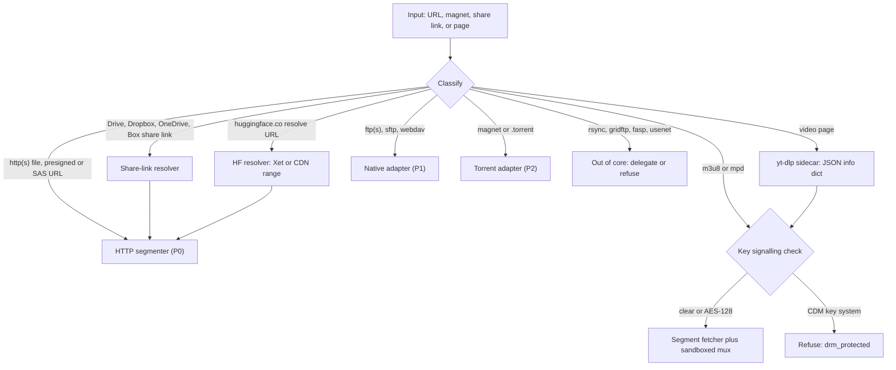
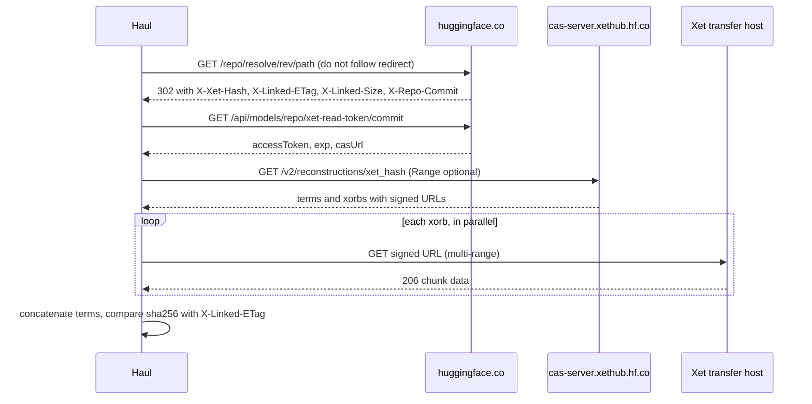
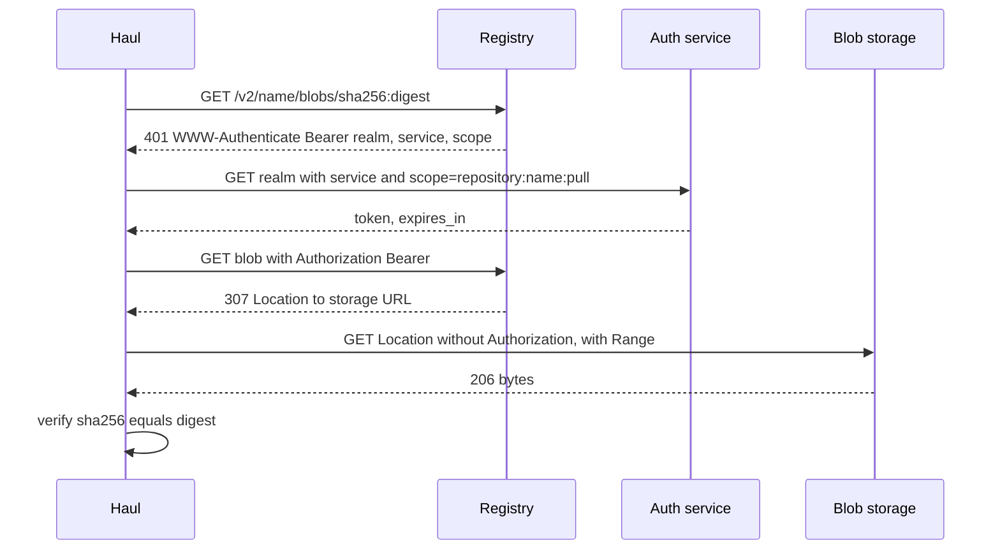
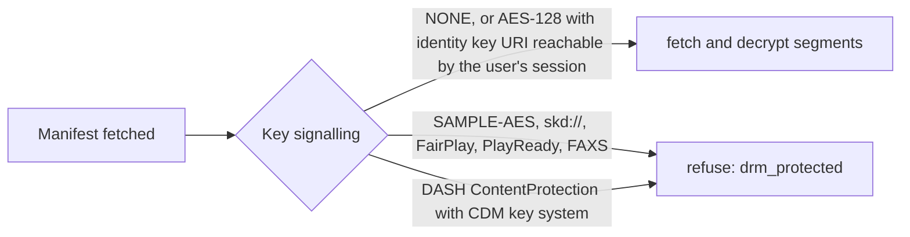

# Other transfer protocols and content sources

Scope: everything Haul may have to fetch that is not a plain `https://host/file` request, plus the plain-HTTP variants (object stores, share links, registries) whose quirks decide whether the segmented engine works. For each source I give resume, parallelism, integrity, auth model, verified Rust support and a Haul priority. Facts dated 2025 or 2026 were re-fetched on 2026-10-05; where a claim comes from memory or a search snippet it is tagged. Confidence tags: High, Medium, Low.

## TL;DR

- **Most sources reduce to "resolver, then HTTP Range".** S3, GCS, Azure, R2, B2, Drive, Dropbox, OneDrive, Box, Git LFS, OCI registries and Hugging Face all end in a signed or token-bearing HTTP GET that honours `Range` (with exceptions below). Build one segmenter plus a resolver/refresh layer. Native protocol adapters are justified only for FTP(S), SFTP, WebDAV listing, and later BitTorrent.
- **ETag is not an integrity hash.** S3 multipart ETags are not MD5 of the object [AWS: integrity upload]. Server-attested hashes differ per source: S3 full-object CRC64NVME, GCS CRC32C/MD5, Azure per-range MD5/CRC64 only up to 4 MiB, B2 SHA-1, Dropbox 4 MiB-block SHA-256, OneDrive quickXorHash, OCI/LFS SHA-256 digests. For LFS/Xet-backed Hugging Face files, `X-Linked-ETag` equalled the SHA-256 of the downloaded file in a live check on 2026-10-05; for small non-LFS files it is a 40-hex value. Haul should record who attested each hash.
- **Range handling has real traps.** GCS decompressive transcoding silently ignores `Range` and drops `Content-Length` [GCS: transcoding]; B2's native API answers `bytes=0-` with 200, not 206 [B2: download by id]; S3 refuses multi-range [AWS: GetObject]; OneDrive may ignore Range and return 200 [Graph: driveItem content]. A probe must record "200 to a Range request" as data. The blanket rule "send `Accept-Encoding: identity`" in research.md is wrong for GCS gzip-at-rest objects.
- **Vendor defaults converge on large ranges.** aws-c-s3 floors parts at 8 MiB, derives about 27 MiB at its default 10 Gbps target, assumes 0.4 Gbps (50 MB/s) per connection, keeps at least 10 connections and allows 4 requests in flight per connection [aws-c-s3: client source][aws-c-s3: util source]. Hugging Face's hf_xet ramps 1 to 64 streams [HF: Hub downloading]. Haul default: 16 MiB ranges, AIMD from 4 up to 64 connections for object stores, 2 to 4 for consumer clouds.
- **BitTorrent is a later, narrow add-on.** v1 is easy; BEP 52 (still "Draft", last modified 2017) and BEP 19 web seeds are where Rust lags: librqbit 9.0.1 has an open BEP 52 design issue (opened 2026-02-02) and I found no BEP 19 code upstream. aria2 mixes HTTP/FTP/SFTP and BitTorrent in one download but its last release is 1.37.0 (2023-11-15). Cohen's piece-selection ideas (strict priority, random first piece, endgame, anti-snubbing) map directly onto the HTTP segmenter.
- **Do not implement rsync, SCP, FASP, UDT, GridFTP, Usenet or DRM paths.** rsync 3.5.0 (2026-08-13) fixed 33 security issues and 3.5.1 (2026-09-21) bumped the wire protocol to 33 [rsync NEWS]; OpenSSH made scp speak SFTP in 9.0 (2022-04-08) [OpenSSH 9.0 notes]. FASP is proprietary and UDT's site shows no news after 2011.
- **Hugging Face: use the maintained Rust client.** The Xet protocol is publicly specified (v1.1.0: 64 KiB gearhash CDC, 64 MiB xorbs, `/v2/reconstructions`), `hf-hub` 1.0.0 ships Xet support, and `hf_transfer` was removed in huggingface_hub 1.0 [HF: Xet spec][HF: env vars]. xet-core's own README says the library is not meant to be used directly [xet-core README].
- **Streaming: native only for clear and AES-128 HLS; delegate the rest.** yt-dlp's native HLS downloader handles only `METHOD=NONE` or `AES-128` itself, delegates other playlists to ffmpeg, and refuses outright when regexes detect FairPlay, PlayReady or Adobe Access key signalling [yt-dlp: hls.py]. Haul's rule should be stricter than yt-dlp's. FFmpeg's HLS demuxer defaults `seg_max_retry` to 0 [FFmpeg: formats], so it must not be Haul's fetcher. The DRM boundary should be defined by key-delivery mechanism, not by cipher.
- **Delegate extraction to yt-dlp, never re-implement it.** 1,731 supported-site entries, a mandatory JS runtime for full YouTube support, PO tokens and TLS impersonation make it a moving target [yt-dlp: README][yt-dlp: PO token guide]. Treat it as a user-installed sidecar; a German appeal court upheld liability of a youtube-dl host for circumventing YouTube's "rolling cipher" in November 2024 [heise: OLG Hamburg].
- **Secrets live in URLs.** Presigned S3 queries, SAS tokens, Xet CDN `Policy`/`Signature`, Dropbox `rlkey`, Box `access_token` must be redacted from logs, manifests and MCP output.

## 1. Framing: what each source asks of the engine

### 1.1 Transfer units

| Class | Sources | Unit the engine schedules | Resume primitive | Verification unit |
|---|---|---|---|---|
| Byte-addressable object | HTTP, S3, GCS, Azure, R2, B2, WebDAV, SFTP, OCI blobs, LFS objects, HF CDN, Drive, Dropbox, OneDrive, Box | Byte range | Re-request range with validator | Whole file, per-part checksum |
| Restart-only stream | FTP | Offset to EOF (no end offset) | `REST` offset | Whole file |
| Content-addressed pieces | BitTorrent, IPFS, Xet | Piece, block, chunk-term | Bitfield of verified units | Per unit hash |
| Article or message | NNTP/Usenet | Article by message-id | Re-fetch article | yEnc CRC32, PAR2 |
| Segment list | HLS, DASH | Segment URL (sometimes byte range) | Re-fetch segment | Usually none |
| Delta | rsync | Block diff against a basis file | Re-run with `--partial` | Rolling plus strong checksum |

### 1.2 The contract every adapter must satisfy

*Inference.* The engine in research.md section 4 needs only the following from a source; everything else is adapter-private.

```rust
pub struct SourceCaps {
    pub size: Option<u64>,
    pub unit: Unit,                      // ByteRange, RestartOnly, Piece{len}, Segment, Article
    pub validator: Validator,            // strong ETag, generation, versionId, commit+oid, or None
    pub attested: Vec<AttestedHash>,     // (alg, value, scope Whole/Part/Range, trust ServerHeader/Manifest)
    pub parallel: ParallelHint,          // from vendor defaults and server limits
    pub url_lifetime: Option<Duration>,  // presign, SAS, CDN, pre-auth expiry
    pub refresh: Option<ResolverRef>,    // consent-gated way to mint a fresh URL or token
    pub drm: DrmStatus,                  // Clear, AesClearKey, CdmRequired(KeySystem)
}
```



### 1.3 Concurrency and chunk defaults in the field

| Tool | Default concurrency | Default chunk or range | Source |
|---|---|---|---|
| AWS CLI classic transfer | 10 requests, queue 1000 | 8 MB threshold and chunk | [AWS: CLI S3 config] |
| aws-c-s3 (CRT) | at least 10 connections; 0.4 Gbps per connection; 4 requests per connection | 8 MiB floor; about 27 MiB at default target | [aws-c-s3: client source] |
| gsutil sliced download | at most 4 components | 150M threshold, 200M component | [gsutil: command.py] |
| AzCopy | 16 times CPUs (32 if under 5 CPUs; default cap 300) | auto from file size | [Azure: AzCopy optimize][AzCopy copy ref] |
| rclone | transfers 4, checkers 8, multi-thread streams 4 | cutoff 256Mi, chunk 64Mi | [rclone: flags] |
| git-lfs | 8 concurrent objects | whole-object GET (Range only to resume) | [Git LFS: config][Git LFS: basic_download.go] |
| hf_xet | adaptive, 1 to 64 streams | 64 KiB chunks, 64 MiB xorbs | [HF: Hub downloading][HF: Xet spec] |
| yt-dlp | `-N` 1 fragment | `--http-chunk-size` disabled | [yt-dlp: README] |
| aria2 | `-x` 1 per server, `-s` 5 | `-k` 20M minimum split | [aria2: manual] |
| OpenSSH sftp | 64 outstanding requests | 32 KiB buffer | [OpenSSH: sftp.1] |

## 2. Classic file-transfer protocols

### 2.1 FTP and FTPS

**Standards.** RFC 959 (October 1985, Internet Standard) is the base, updated by RFC 2228, 2640, 2773, 3659, 5797 and 7151 [RFC 959]. RFC 3659 adds `MDTM`, `SIZE`, machine-readable listing (`MLST`/`MLSD`) and redefines `REST` for stream mode [RFC 3659]. RFC 2428 adds `EPSV`/`EPRT` for IPv6 and NAT [RFC 2428]. FTPS is RFC 4217 (`AUTH TLS`, `PBSZ`, `PROT`), updated by RFC 8996 which deprecates TLS 1.0 and 1.1 [RFC 4217][RFC 8996].

| Aspect | Facts | Confidence |
|---|---|---|
| Resume | `REST <offset>` immediately before `RETR`; servers advertise `REST STREAM` in `FEAT`; RFC 3659 recommends comparing `MDTM` and `SIZE` before restarting because the file may have changed [RFC 3659 sections 3 to 5] | High |
| Ranges | `REST` has a start but no end. A bounded range means closing the data connection (or `ABOR`) after N bytes. *Inference* from the command set. | Medium |
| Parallelism | One data connection per transfer; parallel segments need several control connections, each with its own `REST`. Per-IP connection limits are common (not measured here). | Medium |
| Integrity | None in the base protocol. A `HASH` command exists only as an expired draft (draft-bryan-ftpext-hash-02, 2013) [draft-bryan-ftpext-hash]. Use out-of-band hashes (Metalink, `.sha256`). | High |
| Auth | `USER`/`PASS` in clear on plain FTP; FTPS wraps control (and data with `PROT P`) in TLS. | High |
| Browser relevance | Firefox 90 removed FTP, following Chrome [Feisty Duck: FTP]. Browsers no longer fetch `ftp://` links, which is a handoff opportunity. | Medium |

**Rust.** `suppaftp` 12.1.1 (updated 2026-09-28, 4.7M downloads) offers FTPS via rustls or native-tls, tokio and smol async, and covers `ABOR`, `APPE`, `REST`, `EPSV`, `EPRT` [suppaftp README][crates.io probe]. `libunftp` 0.23.1 is a server library, useful for test fixtures.

**Haul: P1.** Refuse plain-FTP passwords unless the user opts in; treat `ftp://` anonymous mirrors as the main use. Test fixtures: libunftp with injected `REST` failure and a server that omits `REST STREAM`.

### 2.2 SFTP and SCP

**Protocol status.** SFTP never became an RFC. The last IETF draft, draft-ietf-secsh-filexfer-13 (protocol version 6), expired 2007-01-11 [draft-ietf-secsh-filexfer-13]. Everything deployed speaks version 3 (draft-02): OpenSSH defines `SSH2_FILEXFER_VERSION 3` [OpenSSH: sftp.h], and russh-sftp and openssh-sftp-client both implement v3 [russh-sftp README][openssh-sftp-client README]. The extensions draft (00, 2006) defines `check-file-handle`/`check-file-name` with md5, sha1, sha256, sha512 and crc32 [draft-ietf-secsh-filexfer-extensions-00], but OpenSSH's own list of extensions (`limits@openssh.com`, `fsync@openssh.com`, `copy-data`, `expand-path@openssh.com` and others) does not include it [OpenSSH: PROTOCOL]. So there is usually no server-side hash to compare against (Medium).

**Resume and parallelism.** `SSH_FXP_READ` carries an explicit offset and length, so ranged parallel reads are native; requests carry IDs and may be pipelined. The OpenSSH client defaults to a 32 KiB buffer and 64 outstanding requests [OpenSSH: sftp.1][OpenSSH: sftp-client.c]. The `limits@openssh.com` extension reports `max-packet-length`, `max-read-length`, `max-write-length` and `max-open-handles`; servers should allow at least 34,000-byte packets and 32,768-byte reads, so 32 KiB is the portable request size [OpenSSH: PROTOCOL].

Throughput ceiling of a pipelined reader:

$$T_{\max} \approx \frac{R \cdot S}{\mathrm{RTT}}$$

where $R$ is outstanding requests and $S$ the request size. Plain text: throughput cannot exceed the bytes in flight divided by round-trip time. Worked values (computed): OpenSSH defaults give $R S = 64 \times 32768 = 2$ MiB in flight.

| RTT | Ceiling (MiB/s) | Ceiling (Mbit/s) |
|---|---|---|
| 5 ms | 400.0 | 3,355 |
| 20 ms | 100.0 | 839 |
| 50 ms | 40.0 | 336 |
| 100 ms | 20.0 | 168 |
| 200 ms | 10.0 | 84 |

To fill 1 Gbit/s at 80 ms RTT the bandwidth-delay product is 10,000,000 bytes, i.e. 306 outstanding 32 KiB requests, well above the default 64. *Inference:* an engine that wants WAN speed must raise outstanding requests, open several SFTP channels, or use several SSH connections, subject to the SSH channel window (RFC 4254) and per-user session limits [RFC 4254].

**Implementations.** `russh` 0.64.0 (updated 2026-10-04, 7.8M downloads) with `russh-sftp` 3.0.1 is pure Rust; the README reports 203 MiB/s download and 257 MiB/s upload against OpenSSH in Docker on tmpfs with 16 concurrent requests, a vendor benchmark, not independent [russh-sftp README]. `openssh-sftp-client` 0.15.10 drives the system `ssh` binary and supports `limits`, `fsync`, `hardlink`, `copy-data` [openssh-sftp-client README]. `ssh2` 0.9.6 wraps libssh2. OpenDAL's SFTP service sits on `openssh` plus `openssh-sftp-client` and refuses password login [OpenDAL: services Cargo][OpenDAL: sftp docs].

**SCP.** OpenSSH 9.0 (released 2022-04-08) switched `scp` from the legacy scp/rcp protocol to SFTP by default; `-O` forces legacy. The stated reason is remote wildcard expansion through the shell [OpenSSH 9.0 notes]. The latest OpenSSH release is 10.5 (2026-08-11) [OpenSSH: release notes]. **Haul: never implement SCP**; map `scp://` to the SFTP adapter.

**Auth.** Keys, passwords or agent; host key verification is the real trust anchor. Store pinned host keys in Haul's config, never in model context.

**Haul: P1** (russh + russh-sftp default; openssh-sftp-client when the user wants OpenSSH config, ProxyJump and agent semantics).

### 2.3 WebDAV

RFC 4918 (June 2007), updated by RFC 5689, defines `PROPFIND`, `PROPPATCH`, `MKCOL`, `COPY`, `MOVE`, `LOCK` over HTTP [RFC 4918]. Reads are ordinary HTTP `GET`, so `Range`, `If-Range` and ETags work as on any HTTP server. The standard has no checksum property. Nextcloud adds `oc:checksums` (MD5, SHA1, SHA256, SHA3-256, Adler32 stored in its database) and an `OC-Checksum` upload header [Nextcloud: WebDAV basic]; its chunked-upload API (v1, v2) concerns uploads only [Nextcloud: WebDAV chunking]. Auth is Basic, Digest or Bearer, plus app passwords or browser cookies.

**Rust.** `reqwest_dav` 0.3.3 (client), `dav-server` 0.11.0 (server, useful for fixtures). `object_store`'s HTTP store does basic GET against any HTTP server and uses WebDAV `PROPFIND` for listing (its source cites the superseded RFC 2518; the current text is RFC 4918) [object_store: http module]. OpenDAL has a `webdav` service.

**Haul: P1.** The segmenter already handles `GET`; add `PROPFIND` listing and an optional `oc:checksums` read. Test against Nextcloud and a vanilla Apache `mod_dav`.

### 2.4 rsync

**Algorithm.** Tridgell and Mackerras (Australian National University technical report; the page shows no date, commonly cited as 1996 [unverified]): the receiver splits its basis file into blocks and sends, per block, a cheap rolling checksum and a strong checksum; the sender slides a window across its file, looks up the rolling value, confirms with the strong hash, and emits literals plus block references [Tridgell and Mackerras]. The rolling checksum is

$$a(k,l)=\Big(\sum_{i=k}^{l}X_i\Big)\bmod M,\quad b(k,l)=\Big(\sum_{i=k}^{l}(l-i+1)X_i\Big)\bmod M,\quad s=a+2^{16}b,$$

with $M = 2^{16}$, and slides in $O(1)$:

$$a_{k+1}=a_k-X_k+X_{l+1},\qquad b_{k+1}=b_k-(l-k+1)X_k+a_{k+1}\pmod M.$$

Plain text: add the new byte, subtract the old, and update the weighted sum with the window length. I verified the update against recomputation over 4,300 slides of a 700-byte window (computed in this session). With a 32-bit weak checksum, a 1 TiB file in 700-byte blocks produces about 0.37 spurious weak matches per candidate block lookup in expectation (computed: $2^{40}/700/2^{32}$), which is why the strong hash confirms every hit.

**Protocol state (time-sensitive, High).** rsync 3.4.0 (2025-01-15) set protocol 32; 3.5.0 (2026-08-13) fixed 33 security issues found in path handling and the daemon protocol; 3.5.1 (2026-09-21) changed the protocol number to 33. The 3.5.0 NEWS lists CVE-2026-53791 as CRITICAL (with `proxy protocol = true`, a directly connecting client could spoof its source address and bypass host-based access control) and many HIGH issues (symlink traversal, chroot escapes, argument injection, memory corruption in the daemon protocol) [rsync NEWS].

**Resume.** `--partial`/`--append-verify` style reuse of an existing basis; delta needs an old copy on the receiver. For first-time downloads rsync degenerates to a single stream. **Parallelism:** none within one file. **Integrity:** rolling plus strong checksums per block, whole-file checksum at the end. **Auth:** SSH or the `rsync://` daemon.

**Rust.** `fast_rsync` 0.2.0 (Dropbox; last updated 2023-03-31) is a librsync-style delta engine, not the rsync wire protocol; `librsync` 0.2.6 binds the C library.

**Haul: never implement natively.** The attack surface moved fast in 2026 and a client that skips deltas gains nothing over HTTP for a "download layer". If ever needed, spawn the system `rsync` with a minimum version of 3.5.1 inside a path-confined sandbox. For mutable-file deltas over HTTP, the modern equivalent is content-defined chunking (Xet, section 4.2).

## 3. BitTorrent and Metalink

### 3.1 Specification landscape

Statuses and dates are from the BEP pages themselves (fetched 2026-10-05).

| BEP | Title | Status | Last modified | Role for Haul |
|---|---|---|---|---|
| 3 | Core protocol | Final | 2017-02-04 | 16 KiB requests, SHA-1 per piece, choke rules [BEP 3] |
| 5 | DHT | Accepted | 2020-01-21 | Kademlia over UDP, K=8 buckets, 15-minute node freshness [BEP 5] |
| 9 | Metadata exchange, magnet | Accepted | 2017-03-26 | Magnet URI fetch via `ut_metadata` in 16 KiB blocks [BEP 9] |
| 10 | Extension protocol | Accepted | 2017-01-12 | Reserved bit 20, message id 20 [BEP 10] |
| 11 | Peer exchange | Accepted | 2017-09-26 | `ut_pex`, at most 50 added entries after the first message [BEP 11] |
| 14 | Local service discovery | Accepted | 2017-01-12 | Multicast 239.192.152.143:6771 [BEP 14] |
| 19 | Web seeds (GetRight style) | Accepted | 2017-01-12 | HTTP/FTP as permanently unchoked seeds [BEP 19] |
| 29 | uTP | Accepted | 2017-01-12 | LEDBAT, 100 ms target delay [BEP 29][RFC 6817] |
| 52 | Protocol v2 | Draft | 2017-08-31 | SHA-256 Merkle trees, hybrid torrents [BEP 52] |

*Observation (High):* BEP 52, the only spec that changes hashing, has been "Draft" since 2017, yet libtorrent's changelog handles v2 and hybrid torrents extensively [libtorrent: ChangeLog]. Status labels lag reality, so read client behavior, not just BEP status.

### 3.2 Piece selection and choking

Cohen's 2003 paper defines the four piece-selection rules and the choke design [Cohen 2003]:

1. **Strict priority:** once a sub-piece is requested, finish that piece's remaining sub-pieces first.
2. **Rarest first:** among pieces peers have, take those the fewest peers hold; rare pieces get replicated before sources vanish.
3. **Random first piece:** at start, pick randomly until one piece completes, because rare pieces come from one peer and are slow.
4. **Endgame:** when every missing sub-piece is already requested, request all from all peers and cancel duplicates as pieces arrive.

Choking: each peer unchokes a fixed four (BEP 3 text: rechoke every 10 seconds), ranks by recent download rate, adds one **optimistic unchoke** rotated every 30 seconds (every third rechoke), and applies **anti-snubbing** when over a minute passes without receiving a piece from a peer [Cohen 2003][BEP 3]. Choking exists because TCP congestion control degrades with many concurrent senders and because tit-for-tat needs stable rates.

Empirical and analytic follow-ups:

- Legout, Urvoy-Keller and Michiardi argue from real-torrent experiments that rarest first and choke should not be replaced [arXiv:cs/0609026] (IMC 2006).
- Legout, Liogkas, Kohler and Zhang observe more than 40 nodes in an instrumented private torrent and validate three properties of BitTorrent's peer-selection strategy [arXiv:cs/0611105]. I read only the abstract.
- Qiu and Srikant give an analytic fluid model of BitTorrent-like networks (SIGCOMM 2004) [Qiu 2004]; I verified the citation, not its derivations.

**Mapping onto Haul's HTTP segmenter (Inference).**

| BitTorrent idea | Equivalent in the segmenter |
|---|---|
| Strict priority | Finish in-flight segments before opening new ones; bound open segments |
| Random first piece | Probe with a small first segment to validate range support and speed |
| Endgame plus cancel | Hedge the last segments (research.md 8.7) and cancel the loser |
| Anti-snubbing (60 s without a piece) | Stall detector: no bytes for N seconds, drop connection and re-request |
| Rarest first | Only meaningful with several mirrors or peers holding different coverage |

### 3.3 Magnet URIs, metadata size, BEP 52 sizing

A v1 magnet is `magnet:?xt=urn:btih:<40 hex or 32 base32>&dn=&tr=&x.pe=`; v2 uses `xt=urn:btmh:<multihash>`; both can coexist for hybrids; with no tracker, use the DHT [BEP 9]. File selection (`so=`) is BEP 53, listed in libtorrent's features [libtorrent: features]. The info dictionary is fetched in 16,384-byte blocks and must hash to the info-hash [BEP 9].

Worked sizes (computed):

- 100 GiB torrent with 4 MiB pieces: 25,600 pieces, a 512,000-byte v1 `pieces` string (500 KiB), so at least 32 `ut_metadata` blocks before a magnet can start. The v2 piece layers for the same torrent are 800 KiB.
- BEP 52 file leaf size is 16 KiB with SHA-256; a 1 GiB file has 65,536 leaves (tree depth 16) and, at 1 MiB pieces, 1,024 piece hashes = 32 KiB in `piece layers` versus 20 KiB of SHA-1 in v1 [BEP 52].

### 3.4 Hybrid HTTP plus P2P: BEP 19, aria2, request granularity

BEP 19 adds a `url-list` key outside `info`; the HTTP server acts as a permanently unchoked seed; URLs ending in `/` get the torrent name appended; clients should ignore protocols they do not know; a piece that fails its hash causes that URL to be discarded [BEP 19]. The BEP's author recommends against one HTTP request per piece (server logs look like a DoS) and suggests requesting blocks of roughly 5% of the file, using `MaxPieces/20` pieces per block; it also modifies rarest-first to prefer pieces with the largest gap to a completed piece, with slack $X=\sqrt{P}-1$ for $P$ peers [BEP 19].

Worked example (computed): a 4 GiB file with 4 MiB pieces has 1,024 pieces. Per-piece requests mean 1,024 HTTP requests; the 5% block rule means about 51 pieces (204 MiB) per request, about 20 requests. A second BEP, 17 (Hoffman-style HTTP seeds), is also supported by libtorrent [libtorrent: features].

aria2 is the only mainstream client that fuses these: its manual says it can download one file from HTTP(S)/FTP/SFTP and BitTorrent at once and upload HTTP-sourced data to the swarm, and validates chunks using Metalink chunk checksums [aria2: manual]. Defaults: `-x` 1 per server, `-s` 5, `-k` 20M; `--uri-selector` supports `inorder`, `feedback` and `adaptive` [aria2: manual]. The last release is 1.37.0 on 2023-11-15; the repository still receives commits (pushed 2026-06-25) [GitHub API probe].

### 3.5 Implementations

| Project | Status (2026-10-05) | BEP coverage relevant to Haul |
|---|---|---|
| librqbit / rqbit | crate 9.0.1 (2026-08-20), 1,921 stars, Apache-2.0 in `Cargo.toml` | magnet parsing for btih and btmh; `ut_metadata`, `ut_pex`; LSD crate; DHT; pluggable `TorrentStorage` (pread/pwrite per file); rate limits; HTTP API with Range streaming. BEP 52 transfer: open design issue #546 (2026-02-02). BEP 19: not found upstream [rqbit README][rqbit issue 546] |
| libtorrent-rasterbar | GitHub release v2.1.2 (2026-09-25), C++ | BEP 17 and 19 web seeds, uTP, rarest-first picker with sequential mode, v2/hybrid per changelog [libtorrent: features][libtorrent: ChangeLog] |
| aria2 | 1.37.0 (2023-11-15) | Hybrid HTTP/FTP/SFTP plus BT; Metalink; JSON-RPC [aria2: manual] |

Design notes read from the source tree: librqbit is a workspace of small crates (`bencode`, `dht`, `peer_binary_protocol`, `tracker_comms`, `librqbit_lsd`, `upnp`, `sha1w`, `buffers`) under a `librqbit` crate with `chunk_tracker`, `piece_tracker`, `session_persistence`, `limits` and `storage` modules; the storage layer writes straight from the peer socket buffer into files and reads straight into the socket buffer on upload [rqbit README][librqbit source]. *Inference (Medium):* the `TorrentStorage` trait is the integration seam: Haul can supply a storage backend that writes into its journaled `.part` file. A Rust crate probe for `libtorrent-rasterbar` returned 404; I did not look for other binding names, so "no maintained Rust binding" is not established. Other crates: `bendy` 0.6.1, `bt_bencode` 0.8.2, `lava_torrent` 0.11.1, `cratetorrent` 0.1.0 (abandoned since 2020).

**Haul: P2.** Privacy and legal exposure (IP visible to the swarm, upload obligations) make this opt-in with its own consent grant. Prefer a sidecar (librqbit behind a feature flag) and implement BEP 19 on Haul's own HTTP segmenter rather than waiting for upstream.

### 3.6 Metalink

RFC 5854 defines the XML format (`<file>` with `<size>`, `<hash>`, `<url location= priority=>`, `<metaurl mediatype="torrent">`, `<pieces>` chunk hashes, signatures) [RFC 5854]. RFC 6249 carries the same information in HTTP headers: `Link: <url>; rel=duplicate; pri=N; geo=xx`, `rel=describedby` pointing at `.meta4` or `.torrent`, and an instance digest header [RFC 6249]. The digest header cited there is RFC 3230's `Digest`, now obsoleted by RFC 9530 (`Content-Digest`, `Repr-Digest`) [RFC 3230][RFC 9530]. Lower `pri` means higher priority (RFC 6249). The Rust crate `metalink` 0.1.0 (parser, 2021) is stale.

**Haul: P1.** Cheap, and it feeds the mirror-selection bandit with priorities and per-piece hashes for repair. Accept both `Digest` and `Repr-Digest`.

## 4. Content-addressed sources

### 4.1 IPFS

- **Identity:** a CID wraps a multihash and codec. Rust: `cid` 0.11.3 (18M downloads).
- **Bitswap:** protocol IDs `/ipfs/bitswap/1.0.0`, `1.1.0` (CIDv1), `1.2.0` (want-have and have/don't-have); blocks are expected to be at most 2 MiB [IPFS: Bitswap].
- **HTTP path gateway:** gateways SHOULD support single-range requests and give strong ETags for range responses [IPFS: path gateway].
- **Trustless gateway:** `Accept: application/vnd.ipld.raw` returns one verifiable block; `application/vnd.ipld.car` returns a verifiable CAR stream; `dag-scope=block/entity/all` and `entity-bytes=from:to` (a trustless equivalent of an HTTP Range request) bound what the gateway returns, and the client verifies every block against its CID [IPFS: trustless gateway].
- **Research:** Trautwein et al. describe and measure the deployed system (DHT content routing, Bitswap) [arXiv:2208.05877]; Bitswap privacy work exists [arXiv:2307.03480 (not summarized)]. I did not cite findings I did not read.
- **Rust:** `iroh-car` 0.5.1; `iroh-blobs` 0.103.0 uses BLAKE3 verified streaming but its README says it is not production quality and recommends 0.35 for production [iroh-blobs README].

**Haul: P2.** Resolve `ipfs://` through a user-configured trustless gateway using CAR plus `entity-bytes`, verify locally, and flag unverified path-gateway responses as such in the manifest.

### 4.2 Xet and Hugging Face storage

The Xet protocol (specification v1.1.0) is public [HF: Xet spec]:

- **Chunking:** gearhash CDC, target 64 KiB, minimum 8 KiB, maximum 128 KiB, boundary when `(h & 0xFFFF000000000000) == 0` after the minimum size [HF: Xet chunking].
- **Hashing:** BLAKE3 keyed hashes per chunk; xorb and file hashes are Merkle roots with keyed BLAKE3 [HF: Xet hashing].
- **Xorbs:** up to 64 MiB serialized, about 1,024 chunks; per-chunk compression `None`, `LZ4`, or `ByteGrouping4LZ4` [HF: Xet xorb].
- **Download:** `GET /v2/reconstructions/{file_id}` (optional `Range`) returns `terms` (xorb hash, chunk range, unpacked length) and `xorbs` with short-lived signed URLs whose `X-Xet-Signed-Range` authorizes exact byte ranges; clients should fetch all ranges of one entry in a single multi-range request (response `multipart/byteranges`). Clients should fall back to deprecated `/v1/reconstructions` on 404 or 501 [HF: Xet API][HF: Xet download].
- **Auth:** a Hub-issued token from `GET /api/{models|datasets|spaces}/{repo}/xet-read-token/{rev}` returning `accessToken`, `exp` and `casUrl` [HF: Xet auth].
- **File ID:** from the `X-Xet-Hash` header of the resolve response; do not follow the 302 or you fall back to the LFS-compatible route [HF: Xet file id].



**Live probe, 2026-10-05 (High).** For `Qwen/Qwen-Image-Edit/.../diffusion_pytorch_model-00001-of-00009.safetensors`: the resolve URL answered 302 with `X-Xet-Hash`, `X-Linked-Size: 4989364312`, `X-Linked-ETag` carrying a 64-hex value, `X-Repo-Commit`, `Accept-Ranges: bytes`, and a `Link` header with `rel="xet-auth"` and `rel="xet-reconstruction-info"` whose reconstruction URL was the v1 path. Following the redirect to the CDN with `Range: bytes=0-1` returned `206`, `Content-Range: bytes 0-1/4989364312`, and an `ETag` equal to the Xet hash (not the SHA-256). The xet-read-token endpoint answered 200 without credentials for a public repo, and the reconstruction URL answered 401 without that token. Unauthenticated responses carried `RateLimit-Policy: "fixed window";"resolvers";q=3000;w=300` (the header family is the IETF httpapi RateLimit draft, revision 11 dated 2026-05-23 [draft-ietf-httpapi-ratelimit-headers]) and a warning that a token yields higher limits and faster downloads. A small non-LFS file (`openai-community/gpt2` `config.json`) answered 307 to an `/api/resolve-cache/` path on the Hub itself, with `X-Repo-Commit` and an `X-Linked-ETag` of 40 hex digits (SHA-1 length, consistent with a git blob id, *Inference*) rather than a 64-hex SHA-256; so the "ETag equals SHA-256" shortcut holds only for LFS/Xet-backed files. For the LFS/Xet case I confirmed it directly: `prajjwal1/bert-tiny` `pytorch_model.bin` (17,756,393 bytes) advertised `X-Linked-ETag` `dab2c2bd...0a66`, and `sha256sum` of the downloaded file matched it exactly. For the 5 GB Qwen file I did not hash the download, so the 64-hex value there is consistent with, but not independently confirmed as, a SHA-256.

**Client state (High).** `hf-xet` 1.6.0 (crate and release 2026-08-03; first crate publish 2026-03-31); `hf-hub` 1.0.0 (2026-07-10) lists "Xet high-performance transfers" among its features [hf-hub README][crates.io probe]. huggingface_hub 1.0 removed `hf_transfer`; `HF_HUB_ENABLE_HF_TRANSFER` is ignored and `HF_XET_HIGH_PERFORMANCE` replaces it; hf_xet concurrency has been adaptive since 1.3.0, starting at 1 stream and scaling to 64; the environment page says `HF_XET_NUM_CONCURRENT_RANGE_GETS` no longer applies and the local chunk cache for downloads was removed [HF: env vars][HF: Hub downloading]. xet-core's README says the library "is not meant to be used directly" [xet-core README] and lists crates `hf-xet`, `xet-client`, `xet-data`, `xet-core-structures`, `xet-runtime`.

*Worked numbers (computed).* 20 GB (decimal) at a nominal 64 KiB is 305,176 chunks; with the spec's 8 KiB minimum and 128 KiB maximum the expected chunk size is about $m + (1-(1-p)^{M-m})/p \approx 63.7$ KB ($p=2^{-16}$, $m=8192$, $M=131072$; *Inference*, assumes independent per-byte boundaries), which gives about 314,000 chunks and implies roughly 15% of chunks hit the 128 KiB cap. The Hub's "312,500 chunks" figure in research.md is within 0.5% of that. About 298 xorbs of 64 MiB would hold 20 GB.

*Security note (Medium).* Some backup services keep CDC parameters per user as a secrecy defense; Alexeev, Percival and Zhang show attacks that extract such parameters [arXiv:2504.02095] (abstract read only). Xet's parameters are fixed and public in the spec, so there is no secret to extract, but the spec also defines a global chunk-deduplication query endpoint [HF: Xet API], and any such endpoint can reveal whether a chunk already exists (*Inference*). CDC algorithms are surveyed and compared in [arXiv:2409.06066].

**Haul: P1.** Use `hf-hub` 1.0.0 where Xet is available and fall back to plain resolve plus Range through the generic segmenter; verify against `X-Linked-ETag` (sha256) when present; record `X-Repo-Commit`.

### 4.3 BLAKE3 and Bao for verified ranges

research.md suggests an optional Merkle tree for re-fetching a bad chunk. Bao is exactly that for BLAKE3: a pre-order encoding of the BLAKE3 tree supporting slice extraction with verification [Bao spec]; the `bao` crate is 0.13.1 and `blake3` 1.8.7. iroh-blobs builds a request/response protocol on it. Use this only for Haul's own content store, not for third-party sources, none of which publish Bao outboards.

## 5. Cloud object stores

### 5.1 Amazon S3

| Feature | Facts (from the API and user-guide pages, fetched 2026-10-05) |
|---|---|
| Range | Single `Range` header only; multiple ranges per GET are unsupported [AWS: GetObject] |
| Part reads | `partNumber` on GET performs a ranged GET of that part; `x-amz-mp-parts-count` returned for multipart objects [AWS: GetObject] |
| Preconditions | `If-Match`, `If-None-Match` (plus unmodified/modified variants) on GET; `versionId` pins a version |
| Multipart limits | Parts 5 MiB to 5 GiB, 1 to 10,000 parts, maximum object 48.8 TiB (5 GiB times 10,000 is 48.83 TiB, computed) [AWS: multipart limits] |
| Checksums | Algorithms listed include CRC64NVME (default), CRC32, CRC32C, SHA1, SHA256, MD5, XXHash64, XXHash3, XXHash128, SHA512; GET returns them only with `x-amz-checksum-mode: ENABLED` [AWS: integrity][AWS: GetObject] |
| Multipart ETag | Not an MD5 of the object: MD5 of the concatenated part MD5s [AWS: integrity upload] |
| Full-object vs composite | Full-object checksums for multipart exist only for CRC-based algorithms because they can be linearized; SHA and MD5 give composite (per-part) checksums only [AWS: integrity upload] |
| SDK defaults | `request_checksum_calculation` and `response_checksum_validation` default to `WHEN_SUPPORTED` [AWS: SDK data integrity] |
| Requester pays | Send `x-amz-request-payer: requester`; anonymous access to such buckets is not allowed [AWS: requester pays] |
| Presigned URLs | IAM user up to 7 days; role or STS credentials cap the URL at credential expiry; if `Range` is in `X-Amz-SignedHeaders`, `If-Range` must also be signed when present [AWS: presigned] |
| Request rates | 3,500 write and 5,500 read requests per second per prefix before scaling; retry the slowest 5% of large requests; use a new connection and fresh DNS on retry [AWS: S3 performance] |

AWS's own guidance: align parallel GETs to the original multipart part boundaries and measure CPU to choose concurrency [AWS: S3 performance]. *Inference:* a probe that reads `partNumber=1` yields the stored part layout.

**S3-compatible stores.**

| Store | Differences (docs fetched 2026-10-05) |
|---|---|
| Cloudflare R2 | GetObject supports `Range` and `PartNumber`; `x-amz-request-payer` and `x-amz-expected-bucket-owner` are not implemented; multipart parts must all be the same size except the last; CRC64NVME is full-object only, CRC32/CRC32C/SHA1/SHA256 composite only [R2: S3 API][R2: upload objects] |
| Backblaze B2 native | Single-range only; `bytes=0-` returns 200 without `Content-Range` (use the S3-compatible API for 206); an invalid or whole-file range returns the whole file; `X-Bz-Content-Sha1` is the whole-file SHA-1 and cannot verify a range; auth token in `Authorization` for private buckets [B2: download by id] |

### 5.2 AWS CRT and s3transfer: part-size heuristics, from source

Read from aws-c-s3 `main` on 2026-10-05 (Medium-High: code can change, comments are the authors' own) [aws-c-s3: client source][aws-c-s3: util source]:

- Per-connection throughput constant: $100/250 = 0.4$ Gbps (50 MB/s), documented as "magic value" matching the previous algorithm.
- Connections: $N=\min\big(10000,\max\big(10,\lceil G/0.4\rceil\big)\big)$ for target throughput $G$ Gbps; maximum in-flight requests $=4N$; default $G=10$.
- Part size fallback 8 MiB; client "optimal range size":

$$r_{\text{client}}=\mathrm{clamp}\Big(\frac{M}{3N},\;8\text{ MiB},\;r_{\max}\Big),\qquad r_{\text{request}}=\min\big(r_{\text{client}},\ \text{stored part size}\big)\ \text{(floor 8 MiB; cap 2 GiB general, 128 MiB Express)}.$$

- Memory default tiers: 2 GiB at 10 Gbps and above, 4 GiB at 25, 8 GiB at 75, 16 GiB at 100, 24 GiB at 200, 512 MiB at 5, 256 MiB for any positive lower value, 2 GiB if throughput is not detected.
- AWS CLI: `preferred_transfer_client=auto` picks CRT only on suitable instance types and otherwise uses `classic`. With `crt` set explicitly, `target_bandwidth` is the greater of the detected network bandwidth and 10 Gbps; when CRT is reached through `auto` it is the detected bandwidth, or 4 Gbps if detection fails, to bound buffer memory. Classic mode uses 10 concurrent requests and 8 MB chunks [AWS: CLI S3 config]. boto3's `TransferConfig` (the Python managed-transfer layer) exposes `multipart_threshold`, `max_concurrency`, `multipart_chunksize`, `num_download_attempts` (default 5, retrying failures that occur while streaming after an OK response), `max_io_queue`, `io_chunksize` and `preferred_transfer_client`; several of these are ignored when the CRT manager is selected [boto3: TransferConfig].

Worked examples (computed): default $G=10$ gives $N=25$, 100 requests in flight, and $r = 2\,\mathrm{GiB}/(25\cdot3) = 27.31$ MiB. For $G=25$ and 4 GiB: $N=63$, 252 in flight, $r=21.7$ MiB. For $G=100$ and 16 GiB: $N=250$, 1,000 in flight, $r=21.8$ MiB.

**Request-size efficiency model.** With per-connection throughput $B$ and per-request latency $L$ (time to first byte plus setup), a range of $c$ bytes has efficiency

$$E=\frac{c/B}{c/B+L},\qquad c_E=\frac{E}{1-E}\,B\,L.$$

Plain text: you need ranges large enough that transfer time dominates latency. Using $B=50$ MB/s from the CRT constant and an *assumed* $L=30$ ms: $E(8\text{ MiB})=0.848$, $E(16\text{ MiB})=0.918$, $E(27.3\text{ MiB})=0.950$, $E(64\text{ MiB})=0.978$; for $E=0.95$, $c=28.5$ MB (27.2 MiB). That is close to CRT's derived 27.3 MiB, which suggests (Inference) the heuristics encode a similar trade-off, but $L$ is my assumption, not an AWS figure. Request-rate sanity: 100 Gbit/s at 8 MiB ranges is 1,490 requests per second, below the 5,500 per prefix read limit.

**Rust.** `aws-sdk-s3` 1.152.0 (2026-10-01); `aws-sdk-s3-transfer-manager` 0.3.0 (2026-10-01), whose README says developer preview and not for production [aws-s3-transfer-manager-rs README]. `object_store` 0.14.2 (2026-09-15, 92M downloads): `GetOptions` with range, `if_match`, `if_none_match`; `get_ranges` coalesces gaps up to 1 MiB and runs 10 in parallel; S3 builder has `request_payer`, checksum and SSE settings [object_store: util][object_store: lib][object_store: aws builder]. It is a read/write abstraction, not a parallel single-object transfer manager, and has no journal.

### 5.3 Google Cloud Storage

- **Sliced downloads:** parallel ranged GETs into a pre-allocated temp file renamed on completion; CRC32C verification is required for slices (gcloud needs compiled crcmod, else falls back to non-sliced); slices should carry the object generation so a changing object is detected [GCS: sliced downloads]. gsutil defaults: threshold 150M, component 200M, max 4 components [gsutil: command.py]; gcloud exposes `storage/sliced_object_download_threshold`, `_max_components`, `_component_size`.
- **Hashes:** CRC32C is the recommended check; MD5 is not available for all objects (composite objects have none) [GCS: data validation]; `x-goog-hash: crc32c=...,md5=...`, `x-goog-generation`, `x-goog-stored-content-length`, `x-goog-stored-content-encoding` are response headers [GCS: XML headers].
- **Decompressive transcoding trap:** an object stored gzip with `Content-Encoding: gzip` is served decompressed (no `Content-Encoding`, no `Content-Length`) and **`Range` is silently ignored**, returning the whole object; checksums then do not match the stored bytes. Sending `Accept-Encoding: gzip` or `Cache-Control: no-transform` on the object serves stored bytes [GCS: transcoding]. Haul must therefore request stored bytes and decompress locally; disable HTTP-level auto-decompression (for example reqwest's `gzip` feature) on segmented jobs.
- **Rust:** official `google-cloud-storage` 1.20.0 (2026-09-30, repository googleapis/google-cloud-rust). The older community crate `cloud-storage` 0.11.1 last updated 2022-05-07.

### 5.4 Azure Blob Storage

`Range` and `x-ms-range` are both accepted, with `x-ms-range` winning; `x-ms-range-get-content-md5` or `-crc64` returns a per-range hash only for ranges up to 4 MiB, otherwise 400 [Azure: Get Blob]. Whole-blob `Content-MD5` is returned on full-blob reads when the blob has an MD5 (Put Blob has set one automatically since service version 2012-02-12); otherwise no value comes back [Azure: Get Blob]. AzCopy: concurrency 16 times CPUs (32 if fewer than 5 CPUs; default cap 300), `AZCOPY_BUFFER_GB`, `--block-size-mb` auto-derived, `--check-md5` default `FailIfDifferent` on download [Azure: AzCopy optimize][AzCopy copy ref]; v10.32.8 released 2026-08-27. Rust: official `azure_storage_blob` 1.1.0 (2026-09-08); the older `azure_storage_blobs` 0.21.0 was last updated 2024-10-15 and `azure_core` has a 1.2.0 beta.

*Design consequence (Inference):* to keep end-to-end verification cheap on Azure, issue 4 MiB ranges with per-range MD5 only when integrity matters more than request count; otherwise rely on whole-blob MD5.

### 5.5 Rust abstraction layers

| Layer | Version (2026-10-05) | Good for | Not good for |
|---|---|---|---|
| `object_store` | 0.14.2 | Uniform S3/GCS/Azure/HTTP/local reads and writes, conditional GETs | Single-object parallel transfer, journaled resume |
| OpenDAL | 0.59.3 (Apache-2.0, 5,402 stars); reader supports `.concurrent(n).chunk(bytes)` | One API over about 70 service features (S3, GCS, Azure, FTP, SFTP, WebDAV, Drive, Dropbox, OneDrive, B2, HF, IPFS, HTTP) | FTP service pins `suppaftp` 10.0.2; SFTP needs system OpenSSH and key auth [OpenDAL: services Cargo][OpenDAL: reader] |
| Vendor SDKs | see 5.2 to 5.4 | Credentials, signing, listing | Transfer policy |

**Haul (P0/P1):** the segmenter handles presigned, SAS and signed URLs as plain HTTP (P0). Native credentialed access uses `object_store` or OpenDAL behind cargo features for listing and `HEAD`, with the segmenter doing the reads (P1).

### 5.6 A cross-cloud segmented-download algorithm

1. Probe (`HEAD`, or `GET` with `Range: bytes=0-0`): size, strong validator (ETag strength, `x-goog-generation`, S3 `versionId`, Azure ETag), attested hashes, `Accept-Ranges`, stored content encoding, expiry.
2. Choose segment size: at least 8 MiB, default 16 MiB, aligned to the provider unit (S3 part boundaries, Dropbox 4 MiB blocks, Azure 4 MiB if per-range MD5 is wanted).
3. Pin every range request with `If-Match` (or generation/version) so a mid-download change fails fast instead of splicing versions.
4. Treat `200` to a Range request, a missing `Content-Range`, or a `Content-Length` mismatch as "range unsupported on this URL": fall back to single stream, never splice.
5. `pwrite` each segment to the preallocated `.part` file; compute CRC32 (or CRC64NVME for S3) per segment as bytes arrive.
6. After all segments finish, combine per-segment CRCs and compare with the server-attested full-object value (CRC combination works for CRC-based algorithms because they are linear). *Verified in this session:* combining three out-of-order segment CRC32s of a 5 MiB random buffer reproduced `crc32(whole) = 9cb66982`. Rust: `crc32fast` 1.5.2, `crc64fast-nvme` 1.2.1 (for S3's default), `crc-fast` 1.10.0.
7. Independently compute SHA-256 or BLAKE3 for the manifest (this is Haul's own hash, labeled as such), then atomic rename.
8. On 403/410 or expiry, call the resolver's `refresh` rather than retrying the dead URL.

## 6. Consumer clouds

| Provider | Routes and auth | Resume and ranges | Integrity | Quirks |
|---|---|---|---|---|
| Google Drive | API `files.get?alt=media` with OAuth; `files.export` capped at 10 MB; malware-flagged files need `acknowledgeAbuse=true` and are downloadable only by the owner [Drive API: downloads]. Anonymous share links use `drive.google.com/uc?id=` | API supports `Range`; the `uc` route supports `Range` plus `If-Range` with ETag or Last-Modified (gdown resumes this way) [gdown source] | API metadata hashes (not verified here) | Large or unscannable files return an HTML interstitial (`text/html`) containing a `#download-form` with hidden inputs that must be replayed; Docs, Sheets and Slides need `/export?format=`; failure text mentions permissions or "many accesses" [gdown source]. The exact size threshold for the interstitial is not documented in what I read; one secondary source says files under 25 MB can be scanned (Low) |
| Dropbox | Shared link `?dl=1` (or `&dl=1` after `rlkey=` on `/scl/fi/` links); `raw=1` redirects; API `/2/files/download` (args in `Dropbox-API-Arg`) and `/2/files/get_temporary_link` (link expires in four hours, then 410 Gone) [Dropbox help: dl=1][Dropbox: get_temporary_link] | Range behavior on these routes: not found in the pages I fetched [unverified] | `content_hash`: SHA-256 of the concatenated SHA-256 digests of 4 MiB blocks [Dropbox: content hash] | The 4 MiB block structure makes parallel verification trivial if ranges are multiples of 4 MiB |
| OneDrive and SharePoint | Graph `GET /drives/{id}/items/{id}/content` returns 302 to a pre-authenticated URL (the `@microsoft.graph.downloadUrl`), valid for a short time (may expire within minutes), no `Authorization` header needed there [Graph: driveItem content]. Sharing URLs are encoded as `u!` plus unpadded base64url and read via `/shares/{id}` with `Prefer: redeemSharingLink` [Graph: shares] | Apply `Range` to the downloadUrl, not to `/content`; the service may ignore Range and return 200 [Graph: driveItem content] | `quickXorHash` is the only hash guaranteed for both business and personal; `sha1Hash`, `sha256Hash`, `crc32Hash` when available [Graph: hashes] | Never forward the Graph bearer token to the pre-auth host |
| Box | `GET /files/{id}/content` returns 302 to a download URL; `range` header supported; `version` query; `boxapi: shared_link=URL&shared_link_password=...` for shared items; optional `access_token` query for a scoped pre-authenticated link [Box: download file] | Range supported | Not verified here | A scoped token in a URL is a secret; redact |

**Delegation.** For OAuth-backed access to all four, rclone (`rclone rcd`, `serve http`, 70-plus backends, MIT, v1.75.1 on 2026-09-04, 60,108 stars) is the reference multi-backend tool: `--transfers` 4, `--checkers` 8, `--multi-thread-streams` 4 above a 256Mi cutoff, `--low-level-retries` 10, `--retries` 3, `--tpslimit` [rclone: home][rclone: flags]. Note rclone's multi-thread mode requires a capable destination, mostly local files [rclone: docs]. Haul should not store these OAuth tokens; for session-based downloads of the same providers the browser extension handoff in research.md already covers the case without OAuth.

**Haul: P0** for share links that resolve to plain HTTP with the user's session; **P1** for the four resolvers above (Drive interstitial replay, Dropbox `dl=1`, Graph downloadUrl, Box redirect); **P2** for native API access via rclone sidecar.

## 7. Developer and ML artifact sources

### 7.1 Git LFS

The pointer file is a small UTF-8 text file (under 1024 bytes) with `version https://git-lfs.github.com/spec/v1`, `oid sha256:<hex>` and `size` [Git LFS: spec]. The Batch API is `POST {lfs-url}/objects/batch` with `Accept` and `Content-Type: application/vnd.git-lfs+json`; the request lists `operation` (`download` or `upload`), `transfers`, optional `ref`, `objects[{oid,size}]`, `hash_algo` (default sha256). The response returns per-object `actions.download.{href, header, expires_in or expires_at}` and per-object `error` codes (404, 409, 410, 422), always HTTP 200 for per-object problems [Git LFS: batch]. Discovery appends `.git/info/lfs` to the Git remote; SSH remotes run `git-lfs-authenticate` [Git LFS: server discovery]. Only the `basic` transfer adapter is current (tus.io upload-only and custom adapters are experimental) [Git LFS: API README]. Basic download is a single GET on `href` with the supplied headers; the git-lfs client resumes with `Range: bytes=from-(size-1)` into a `<oid>.part` file and verifies a 206 with a matching `Content-Range` start [Git LFS: basic_download.go]. Default concurrency 8 [Git LFS: config]; git-lfs 3.8.0 was released 2026-08-28.

Rust: `lfspull` 0.4.3 (pull only), `rudolfs` (server). **Haul: P2**; the protocol is trivial (one JSON POST plus ordinary GETs) so implement it directly on the segmenter, honoring `expires_in` by re-batching. Segment a single LFS object across ranges only if the `href` target is an object store (it usually is).

### 7.2 OCI Distribution (container registries)

Spec v1.1.1 (released 2025-01-29; no 1.2 release exists) [OCI distribution spec]. Blob pull is `GET /v2/<name>/blobs/<digest>`; clients SHOULD verify the body against the digest; registries SHOULD support `Range` (RFC 9110 section 14) [RFC 9110]; registries MAY answer any request with a redirect, and clients MUST NOT forward `Authorization` across host boundaries unless configured to. A "Resumable Pull" use case explicitly keeps partial data and uses `Range`. The spec leaves authentication out of scope; the de facto bearer flow is documented by Docker's token spec: an unauthenticated request gets `401` with `WWW-Authenticate: Bearer realm=...,service=...,scope="repository:name:pull"`, the client fetches a token from `realm` with `service` and `scope`, then retries with `Authorization: Bearer` (RFC 6750 header format) [Docker: token auth][RFC 6750].



Rust: `oci-client` 0.18.0 (2026-09-18; successor of `oci-distribution` 0.11.0, frozen 2024-03). **Haul: P1** because model weights and datasets increasingly ship as OCI artifacts (*Inference*; I did not survey registries). Digest verification gives Haul a free integrity anchor.

### 7.3 Hugging Face Hub

See section 4.2 for Xet. Other facts: files resolve at `https://huggingface.co/{repo}/resolve/{rev}/{path}`; the Hub answers `Accept-Ranges: bytes`, `X-Repo-Commit`, `X-Linked-ETag`, `X-Linked-Size`; the Hub-wide rate limit for unauthenticated resolvers was 3,000 requests per 300 seconds in the probe. Download docs list Xet and CDN hostnames to allowlist behind proxies (`cas-server.xethub.hf.co`, `transfer.xethub.hf.co`, EU equivalents, `us.aws.cdn.hf.co`), noting wildcard-matching pitfalls [HF: Hub downloading]. HF reports that all repositories are now Xet-backed.

## 8. Usenet, rclone and high-speed science transfer

### 8.1 Usenet (NNTP, yEnc, NZB, PAR2)

- **NNTP:** RFC 3977 (2006; updated by RFC 6048) defines article retrieval by message-id or by group and number; clients MAY pipeline commands and servers MUST allow it [RFC 3977]. Auth is RFC 4643 `AUTHINFO`; TLS is RFC 8143; compression is RFC 8054 [RFC 4643][RFC 8143][RFC 8054]. Streaming feeds (RFC 4644) are for server-to-server transfer and not relevant to a reader [RFC 4644].
- **yEnc:** an unofficial 2002 draft (v1.3, Juergen Helbing) by byte offset +42 with escapes for four critical bytes and `=ybegin`/`=ypart`/`=yend` lines with optional `crc32` [yEnc draft]. Overhead arithmetic (computed): escapes cost 4/256 = 1.56% on uniform data; line breaks add 2/128 = 1.56% at 128 columns or 0.78% at 256, so 3.1% or 2.3% total, above the draft's "1 to 2%" headline.
- **NZB:** an XML list of segments by message-id, with per-segment byte counts [SABnzbd: NZB spec]. **PAR2:** 16-bit Reed-Solomon recovery blocks, up to 32,768 blocks, MD5-identified files [PAR2 spec].
- **Model:** each article is an independent unit; parallelism is the number of provider connections (account-limited); resume is re-fetching missing articles; integrity is yEnc CRC32 per part plus PAR2 repair.
- **Rust:** `nntp-rs` 0.3.0 (434 downloads), `yenc` 0.2.2 (2020), `nzb-rs` 0.6.0: immature.

**Haul: never in core.** The content is dominated by infringing use, the stack is a specialist domain (SABnzbd, NZBGet), and there is no agent-demand evidence. Offer at most a documented sidecar hook.

### 8.2 rclone as multi-backend reference

See section 6. Its design shows the right defaults for a generic tool: small file concurrency (4), many cheap checkers (8), multi-thread only above 256 MiB, global `--tpslimit` for API politeness [rclone: flags]. rclone is Go; consume it as a subprocess or via its `rcd` HTTP API, never by linking.

### 8.3 GridFTP, Globus, Aspera FASP, UDT

| Technology | What it is (verified source) | Haul |
|---|---|---|
| GridFTP and Globus | FTP extended with Mode E (extended block mode) over many parallel TCP streams, third-party transfer between two servers, and delegated credentials; Globus is an orchestration layer on top of GridFTP; support for the open-source Globus Toolkit ended in January 2018 (per the title of Globus's announcement) [Globus: GridFTP history][Globus: toolkit end of support] | Never native. Delegate to the Globus CLI/SDK when a user provides a collection URL |
| Aspera FASP | Proprietary, patented (US 8,085,781 per Wikipedia), UDP data on port 33001 default, negotiated over an SSH session; rate control reacts to delay changes, not drops [IBM: Aspera firewall][Wikipedia: FASP] | Never. No open implementation; license-bound |
| UDT | Application-level UDP transport (Gu and Grossman, Computer Networks 2007) with pluggable congestion control [Gu 2007]; the project site's latest news item is v4.10 on 2011-12-29 [UDT site] | Never. QUIC and parallel TCP cover the same ground for Haul |

*Takeaway:* these tools all attack the same problem as Haul's parallel segments (TCP window and loss limits on long fat networks). Mathis-style ceilings in research.md 8.2 explain why; parallel streams (Mode E) are the portable answer, UDP schemes are for dedicated science networks.

## 9. Streaming: HLS, DASH, CMAF, encryption, DRM

### 9.1 Specifications and status

| Spec | Status (2026-10-05) |
|---|---|
| HLS, RFC 8216 | Informational RFC, August 2017, protocol version 7 [RFC 8216] |
| HLS 2nd edition (draft-pantos-hls-rfc8216bis) | revision 22, ISE stream, intended Informational, obsoletes RFC 8216; RFC Editor queue "Awaiting First editor"; adds the Low-Latency HLS tags (`EXT-X-PART`, `EXT-X-PART-INF`, `EXT-X-SERVER-CONTROL`, `EXT-X-SKIP`, `EXT-X-PRELOAD-HINT`, `EXT-X-RENDITION-REPORT`) plus `EXT-X-DEFINE` and content steering [draft-pantos-hls-rfc8216bis] |
| MPEG-DASH, ISO/IEC 23009-1 | Edition 5 published 2022-08-02; ISO's search listing shows an edition 6 (2026) replacing it (Medium, I could not open the ISO page) [ISO: DASH 2022][DASH-IF: 5th edition] |
| CMAF, ISO/IEC 23000-19 | Third edition, February 2024 [ISO: CMAF] |
| Common Encryption, ISO/IEC 23001-7 | 2023 edition; schemes `cenc` (CTR) and `cbcs` (CBC with 1:9 pattern) dominate (Medium) [ISO: CENC listing] |

### 9.2 Mechanics and parallelism

An HLS media playlist lists segments; VOD playlists are static and every segment is an independent HTTP resource (optionally `EXT-X-BYTERANGE`, optionally an `EXT-X-MAP` init segment). Parallelism is then just a bounded window of segment fetches, reassembled in order. Worked example (computed): 2 hours at 5 Mbit/s is 4.5 GB in 1,200 six-second segments of 3.75 MB; if a CDN throttles each connection to 2 MB/s, one connection takes 2,250 s, 8 take 281 s, 16 take 141 s. yt-dlp's default is one fragment at a time; `-N` raises it, and `--fragment-retries` defaults to 10 [yt-dlp: README].

Low-Latency HLS (partial segments, blocking playlist reload, preload hints, specified in the 8216bis draft) targets live latency; for VOD capture the finished playlist carries full segments, so Haul can ignore the partial-segment machinery (*Inference*). Muxing: stream copy into MP4 or MKV with ffmpeg (research.md). Two FFmpeg facts from its documentation: the HLS demuxer's `seg_max_retry` defaults to 0 ("useful when segment skip on network error is not desired"), which implies (Inference from the option text) that a segment that fails is skipped by default, silently truncating the output; and `allowed_extensions`, `extension_picky` and `protocol_whitelist` exist because a playlist can point a demuxer at other protocols [FFmpeg: formats][FFmpeg: protocols]. Haul should fetch segments itself and give ffmpeg only local files, with `-protocol_whitelist file` and a no-network sandbox.

### 9.3 Encryption classes

RFC 8216 defines `EXT-X-KEY` methods NONE, AES-128 and SAMPLE-AES. AES-128 encrypts whole segments with AES-128 CBC and PKCS7 padding, restarting CBC at each segment boundary using the `IV` attribute or, if absent, the media sequence number as a big-endian 128-bit value [RFC 8216 sections 4.3.2.4 and 5.2]. Because CBC restarts per segment, segments decrypt independently and in parallel. SAMPLE-AES encrypts media samples; fMP4 uses the `cbcs` scheme of Common Encryption. `KEYFORMAT="identity"` (default) means the key is a plain key file at a URI; other formats signal key-system-specific delivery. Apple's FairPlay Streaming uses `METHOD=SAMPLE-AES` with `KEYFORMAT="com.apple.streamingkeydelivery"` and an `skd://` URI [Apple: FPS].

### 9.4 The DRM boundary



Reference implementation of the line: yt-dlp's native HLS downloader supports only `NONE` and `AES-128` itself and flags DRM by regex on `#EXT-X-KEY` with `URI="skd://"`, `KEYFORMAT="com.apple.streamingkeydelivery"`, `KEYFORMAT="com.microsoft.playready"` and `#EXT-X-FAXS-CM:`, refusing with an error unless the debug option `--allow-unplayable-formats` is set; other unsupported-but-not-flagged playlists (for example other `METHOD` values) are delegated to ffmpeg with a warning [yt-dlp: hls.py][yt-dlp: README]. Its pattern list has no Widevine entry, which is one reason Haul's rule should be stricter: refuse any `METHOD` other than NONE or AES-128 and any `KEYFORMAT` other than `identity`, with no override.

What the key systems are (Medium; these three points come from search-result extracts of the vendors' own documentation, not from full page reads): Widevine L1 performs cryptography and content processing inside a trusted execution environment and L3 is software [Widevine overview]; PlayReady SL2000 is called "software DRM" and SL3000 requires hardware (TEE) protection of secrets [PlayReady: security level]; FairPlay Streaming delivers keys to Apple platforms [Apple: FPS]. In browsers these are reached through Encrypted Media Extensions, a W3C Recommendation since 2017-09-18 (a v2 Working Draft is dated 2026-07-07). Clear Key is the required common baseline key system [W3C: EME]; *Inference:* it involves no hardware-backed CDM path, so a Clear Key manifest is technically different from Widevine or PlayReady, but Haul should still treat any EME `ContentProtection` entry as out of scope until a separate legal review says otherwise.

*Why the cipher is the wrong test (Inference, contested, Medium):* research.md says AES-128 HLS "is fine when the session can reach the key". That is right for `identity` keys that any authorized HTTP client can GET, but the same cipher can sit behind license servers and tokens, and the same user-session logic does not make SAMPLE-AES/FairPlay or CENC acceptable. Defining the boundary by key delivery (HTTP-fetchable key with the user's own session versus CDM or license-server mediated) is both simpler and safer.

**Legal pointers (not legal advice).** US: 17 U.S.C. section 1201(a)(1)(A) bars circumventing a measure that effectively controls access, and (a)(3) defines that as one that, in the ordinary course, requires "the application of information, or a process or a treatment, with the authority of the copyright owner" to gain access [17 USC 1201]; the ninth triennial rulemaking took effect 2024-10-28 [Copyright Office: 1201]. Whether a freely served AES-128 key file counts as such a measure is contestable (Inference; no case found). EU/Germany: the Hamburg Regional Court (March 2023) and Higher Regional Court (appeal dismissed, announced November 2024) held the hosting provider of youtube-dl liable for aiding circumvention of YouTube's "rolling cipher" [heise: OLG Hamburg][IFPI: Hamburg appeal]. That concerned a host, not end users, and not Haul, but it argues for shipping yt-dlp integration as user-installed rather than bundled.

### 9.5 Rust crates

`m3u8-rs` 6.0.1, `hls_m3u8` 0.7.0 for playlist parsing; `dash-mpd` 0.21.0 downloads from MPDs with an external muxer (ffmpeg, mkvmerge, VLC, MP4Box) but also decrypts `cenc` content when the caller supplies keys through `add_decryption_key` and an external decryptor [dash-mpd-rs README]. **Do not enable or expose that decryption path in Haul.** `ffmpeg-sidecar` 2.6.0 wraps the ffmpeg binary.

## 10. yt-dlp and gallery-dl: architecture and the delegation line

### 10.1 yt-dlp (Unlicense, 195,617 stars, release 2026.08.19, last push 2026-09-27)

Architecture (from source, 2026-10-05):

- **Extractors:** one class per site, `supportedsites.md` lists 1,731 entries (my count of list lines) and a generic extractor handles embeds [yt-dlp: README]. They return an `info_dict` with formats, `url`, `http_headers`, `protocol`, `fragments`, and metadata.
- **Core:** `YoutubeDL` class: `process_ie_result`, `process_video_result` (format selection with `-f`/`-S` expressions via `build_format_selector`), `process_info` (download plus post-processing).
- **Downloaders:** `get_suitable_downloader` maps `protocol` to a class: `m3u8_native` to `HlsFD`, `m3u8` to `FFmpegFD`, `http_dash_segments` to `DashSegmentsFD`, plain HTTP to `HttpFD`, plus `ism`, `f4m`, websocket, live-chat and site-specific; `--downloader` can choose `native, aria2c, axel, curl, ffmpeg, httpie, wget` per protocol; live HLS goes to ffmpeg [yt-dlp: downloader init][yt-dlp: README]. Native HLS (`HlsFD`) decrypts AES-128 itself with pycryptodomex; if that library is missing it hands the stream to ffmpeg when ffmpeg can cope, and otherwise decrypts natively with a warning that this will be "extremely slow". Playlists it cannot handle (live, unsupported `METHOD` values) are delegated to ffmpeg with a warning, but DRM-flagged playlists are refused with an error instead [yt-dlp: hls.py]; `--hls-prefer-native` and `--hls-prefer-ffmpeg` are aliases for `--downloader m3u8:native` and `m3u8:ffmpeg`, and `--hls-use-mpegts` is on by default for live streams [yt-dlp: README].
- **Fragments:** `FragmentFD` downloads fragments with a thread pool (`-N`, default 1), per-fragment retries (default 10), resumable state in a `.ytdl` file, and optional `--keep-fragments` [yt-dlp: fragment.py][yt-dlp: README].
- **Network:** pluggable request handlers (urllib, requests, websockets, curl_cffi); `--impersonate` uses curl_cffi (curl-impersonate) for Chrome, Edge and Safari TLS fingerprints, with a warning that forcing it everywhere may hurt speed and stability [yt-dlp: README].
- **Auth and anti-bot:** `--cookies-from-browser` (brave, chrome, chromium, edge, firefox, opera, safari, vivaldi, whale); PO tokens for YouTube clients (GVS, player, subs contexts); the PO-token guide says some clients offer "only SABR formats" and recommends a PO Token provider plugin for `mweb` [yt-dlp: README][yt-dlp: PO token guide]. Full YouTube support requires `yt-dlp-ejs` and a JavaScript runtime (deno is the default; node, bun, quickjs optional), and `--remote-components` is off by default [yt-dlp: README].
- **Throttling heuristics:** `--throttled-rate` re-extracts when speed falls below a floor; `--http-chunk-size` (off by default) works around per-connection throttles [yt-dlp: README].

### 10.2 gallery-dl (GPL-2.0, 19,947 stars, v1.32.15 on 2026-10-03)

Extractors for image galleries and social sites; `-g` prints URLs, `-G` resolves them, `-j` dumps JSON, `-s` simulates; `--cookies-from-browser`, `--sleep-429`, `--retries`; optional yt-dlp integration for HLS/DASH [gallery-dl: options][gallery-dl: README].

### 10.3 Where Haul should delegate and where it should implement

| Concern | Delegate to yt-dlp or gallery-dl | Implement in Haul |
|---|---|---|
| Site-specific URL resolution, signature/JS challenges, PO tokens, TLS impersonation | Yes | No |
| Format selection | Yes (`-f`, `-S`) and ask for the JSON via `-J` | Only the agent-facing summary |
| Byte movement for plain HTTP formats and clear/AES-128 HLS | Optional: hand `url` plus `http_headers` plus cookie references to Haul's engine | Yes (journal, hedging, verification, provenance) |
| DRM-flagged formats | Refuse; do not pass `--allow-unplayable-formats` | Error class `drm_protected` |
| Muxing, subtitles, thumbnails | Yes (yt-dlp post-processors, sandboxed ffmpeg) | Sandbox wrapper only |
| Cookie access | Never via `--cookies-from-browser` (research.md) | Extension handoff supplies a per-job cookie file |
| Updates | User-controlled; pin minimum version and check on launch | Surface the version in the manifest |

Rust wrappers exist (`youtube_dl` 0.10.0, stale since 2024-04; `yt-dlp` 2.8.3 that auto-installs dependencies; `rusty_ytdl` 0.7.4, YouTube-only, stale since 2024-08): none is worth depending on; spawn the binary and parse JSON.

## 11. Final matrix

Priority legend, aligned with the research.md roadmap: P0 = MVP (weeks 0 to 8); P1 = months 3 to 9; P2 = later and opt-in; never = outside Haul core (delegate or refuse). Rust column versions were read from crates.io on 2026-10-05.

| Protocol or source | Resume | Parallelism | Integrity | Auth or session | Rust crates | Priority |
|---|---|---|---|---|---|---|
| HTTP(S) baseline | Range with strong validator | Ranged segments | Digest fields if sent | Cookies, bearer, signed URLs | reqwest 0.13.5, hyper 1.11.1 | P0 |
| FTP | `REST` offset, no end | Several control connections | None (MDTM, SIZE only) | USER/PASS clear | suppaftp 12.1.1 | P1 |
| FTPS | Same | Same | TLS only | AUTH TLS, PROT P | suppaftp with rustls or native-tls | P1 |
| SFTP | Offset reads | Pipelined requests (64 by 32 KiB default), more channels | None in OpenSSH; check-file draft ext | SSH keys, agent, host keys | russh 0.64.0, russh-sftp 3.0.1, openssh-sftp-client 0.15.10, ssh2 0.9.6 | P1 |
| SCP | None | None | None | SSH | none needed | never |
| WebDAV | HTTP Range | HTTP segments | ETag; server ext (oc:checksums) | Basic, Digest, Bearer, cookies | reqwest_dav 0.3.3, dav-server 0.11.0 | P1 |
| rsync | Delta against basis | Single stream | Rolling plus strong | SSH or daemon | fast_rsync 0.2.0 (not wire protocol) | never native |
| BitTorrent v1 | Verified-piece bitfield | Swarm | SHA-1 per piece | None; private flag | librqbit 9.0.1 | P2 |
| BitTorrent v2 and hybrid | Same | Same | SHA-256 Merkle | None | none mature in Rust | P2 |
| Web seeds (BEP 19) | Piece re-fetch | HTTP blocks of about 5% | Piece hash | None | none upstream; build on segmenter | P2 |
| Metalink | Per-piece repair | Mirrors | Hash plus chunk hashes | None | metalink 0.1.0 (stale) | P1 |
| IPFS gateway | Per-block verify | Blocks or CAR entities | CID | None | cid 0.11.3, iroh-car 0.5.1 | P2 |
| S3 and compatibles | Range, partNumber, If-Match | Ranged parts | CRC64NVME and others; multipart ETag unusable | SigV4, presign, STS | aws-sdk-s3 1.152.0, aws-sdk-s3-transfer-manager 0.3.0 (preview), object_store 0.14.2, opendal 0.59.3 | P0 (presigned), P1 (credentials) |
| GCS | Range with generation | Slices | CRC32C, MD5 | OAuth, signed URL, HMAC | google-cloud-storage 1.20.0, object_store | P0 / P1 |
| Azure Blob | Range or x-ms-range | Ranges | Content-MD5; range hash up to 4 MiB | SAS, Entra, key | azure_storage_blob 1.1.0, object_store | P0 / P1 |
| Cloudflare R2 | S3-like | Ranges | CRC64NVME full-object | Keys, presigned | via S3 crates | P0 / P1 |
| Backblaze B2 | Native: single range, 200 on `bytes=0-`; S3 API for 206 | Ranges | SHA-1 header | Auth token or S3 keys | opendal b2 service | P1 |
| Google Drive | Range on API and `uc` | Few connections | Not verified here | OAuth or browser session | opendal gdrive | P1 resolver |
| Dropbox | Not verified | Few connections | content_hash (4 MiB blocks) | OAuth, `rlkey` links | opendal dropbox | P1 resolver |
| OneDrive and SharePoint | Range on downloadUrl | Modest | quickXorHash, sha1, sha256 | Graph OAuth, pre-auth URL | opendal onedrive | P1 resolver |
| Box | `range` header | Modest | Not verified here | OAuth, shared-link header | none | P2 |
| Git LFS | Range on `.part` | 8 objects | sha256 oid | Basic, per-action headers | lfspull 0.4.3 (pull only) | P2 |
| OCI blobs | Range SHOULD | Layers and ranges | sha256 digest | Bearer challenge | oci-client 0.18.0 | P1 |
| Hugging Face Hub and Xet | CDN Range; Xet reconstruction | 1 to 64 adaptive | X-Linked-ETag sha256; BLAKE3 Merkle | HF token, xet token | hf-hub 1.0.0, hf-xet 1.6.0 | P1 |
| NNTP and Usenet | Per-article | Provider connections | yEnc CRC32, PAR2 | AUTHINFO, TLS | nntp-rs 0.3.0, yenc 0.2.2, nzb-rs 0.6.0 | never (core) |
| GridFTP and Globus | Service-managed | Mode E parallel streams | Service-managed | Globus Auth | none | never |
| Aspera FASP | Proprietary | UDP rate-based | Proprietary | SSH plus UDP | none | never |
| UDT | n/a | UDP | n/a | n/a | none verified | never |
| HLS (clear, AES-128) | Per-segment | Window of segments | None or key-based | Key URI with user session | m3u8-rs 6.0.1, hls_m3u8 0.7.0 | P1 |
| DASH (clear) | Per-segment | Window of segments | None | Session cookies | dash-mpd 0.21.0 (no decrypt path) | P1 / P2 |
| DRM (Widevine, PlayReady, FairPlay, cenc/cbcs) | n/a | n/a | n/a | CDM, license server | none | never |
| yt-dlp | Per extractor | `-N` fragments | None | Cookies, PO token, impersonation | spawn binary | P0 sidecar |
| gallery-dl | Per extractor | Per site | None | Cookies, OAuth | spawn binary | P1 sidecar |
| rclone | Per backend | transfers 4, streams 4 | Backend hashes | Backend OAuth | none (Go); use `rcd` | P1 sidecar |

## Implications for Haul

Each recommendation names the evidence it rests on and a validating test or benchmark.

1. **One segmenter, many resolvers.** Model every source as `Resolver -> SourceCaps -> Segmenter` with a `refresh` hook (section 1.2). *Evidence:* URL lifetimes range from minutes (Graph downloadUrl) to four hours (Dropbox temporary link) to credential expiry (S3 presign) to short-lived signed Xet URLs that must not be cached or rewritten. *Test:* an expiry-injection harness where the mock URL dies every 30 s; the job must finish with the same validator and zero duplicate bytes beyond the in-flight segments.
2. **Probe contract.** Send `Range: bytes=0-0`; record status, `Content-Range` total, strength of ETag, provider generation/version headers, stored content encoding, any hash headers, `Accept-Ranges`, and expiry hints. Treat 200-to-Range, missing `Content-Range` and `Content-Length` mismatch as `range_unsupported_on_url`. Do not send `Accept-Encoding: identity` on object-store hosts; instead request stored bytes (`gzip` accepted) and decompress locally, with HTTP auto-decompression off. *Evidence:* GCS transcoding ignores Range; B2 returns 200 for `bytes=0-`; OneDrive may return 200. *Test:* a 12-behavior conformance fixture (GCS gzip-at-rest, B2 native, OneDrive 200, S3 multi-range refusal, weak ETag, no `Accept-Ranges`, redirect to a different host, 416 on tail, and so on); every fixture must end bit-exact or fail cleanly.
3. **Segment size and concurrency defaults.** Default 16 MiB segments (floor 8 MiB; objects under 16 MiB use one request); align to provider units (S3 stored part size via `partNumber`, Dropbox multiples of 4 MiB). Object stores: AIMD from 4 to 64 connections with hedging of the slowest 5% of large requests; consumer clouds: cap 4; FTP: cap 4; SFTP: one connection with 64 outstanding 32 KiB requests, raising outstanding requests or channels when RTT times bandwidth demands it. *Evidence:* CRT 8 MiB floor and about 27 MiB derived size; E-model (0.918 at 16 MiB, assumed 30 ms latency); hf_xet 1 to 64; S3's own advice to retry the slowest 5%; OpenSSH defaults. *Benchmark:* sweep segment size {4, 8, 16, 32, 64} MiB by connections {4, 8, 16, 32, 64} against S3, R2, GCS, B2 and HF; pass if the default lands within 10% of the best cell on each.
4. **Integrity ladder and attestation labels.** Order of verification: (a) server-attested strong hash when it covers the whole file (S3 full-object CRC64NVME, GCS CRC32C or MD5, Azure `Content-MD5`, B2 SHA-1, HF `X-Linked-ETag`, LFS and OCI SHA-256 digests, Dropbox `content_hash`, OneDrive quickXorHash or SHA); (b) always compute Haul's own SHA-256 (or BLAKE3) for the manifest; (c) per-segment CRCs combined out of order. The manifest stores `{algorithm, value, attested_by: server_header, manifest, or local_only}`; ETag is never recorded as a hash except where documented to be one. *Evidence:* S3 multipart ETag is not an MD5 of the object; composite checksums are per-part; CRC32 combination verified in this session. *Tests:* golden vectors per provider; flip one byte in segment 3 and assert only that segment is re-fetched; assert multipart-ETag objects do not produce a false "verified".
5. **Redact URL secrets everywhere.** Keep a redaction list covering S3 SigV4 query parameters (`X-Amz-Signature`, `X-Amz-Security-Token`, `X-Amz-Credential`), Azure SAS `sig`, GCS `X-Goog-Signature`, the Xet CDN URL parameters (`Policy`, `Signature`, `Key-Pair-Id`, `Expires`, `X-Xet-Signed-Range`), Dropbox `rlkey`, Box `access_token`, and LFS per-action `header` values. The manifest stores origin, path and validator, not the query. *Evidence:* the Xet spec says signed URLs are short-lived and must not be cached or rewritten; Box documents an `access_token` query; Dropbox links carry `rlkey`. *Test:* canary tokens in presigned URLs must never appear in logs, MCP responses, audit entries or crash dumps.
6. **Streaming: native only for clear and AES-128 VOD HLS.** Fetch segments in Haul; give ffmpeg local files only (`-protocol_whitelist file`, no network, no explicit key injection); retry segments rather than skip them. Detect key systems by `EXT-X-KEY` attributes (`METHOD` other than NONE or AES-128, `skd://`, `KEYFORMAT` other than identity) and by DASH `ContentProtection`; return `drm_protected` with no override. Never expose a "supply a decryption key" parameter (compare `dash-mpd` `add_decryption_key`). *Evidence:* yt-dlp native HLS rules; FFmpeg `seg_max_retry` default 0; section 9.4. *Test:* a 30-manifest corpus (clear, AES-128, SAMPLE-AES, FairPlay, PlayReady, Widevine DASH, cbcs); expect exactly the first two to proceed.
7. **yt-dlp as a pinned, sandboxed sidecar.** Spawn with `-J`/`--dump-single-json`, consume `url`, `http_headers`, `protocol`, `fragments`, `has_drm`-like signals; hand plain-HTTP and clear HLS to Haul's engine; otherwise let yt-dlp download itself with `--cookies` supplied by the extension handoff, never `--cookies-from-browser`. Require a JS runtime (deno) only when the user enables YouTube. Do not bundle it in installers. *Evidence:* extractor churn, JS runtime requirement, PO tokens, and the OLG Hamburg decision. *Test:* nightly canary job that runs five popular extractors and alerts when `-J` output shape changes.
8. **FTP, SFTP, WebDAV (P1).** Use `suppaftp`, `russh-sftp` and `reqwest` with the segmenter; refuse plain-FTP passwords by default; pin SSH host keys; keep credentials in the keyring. *Evidence:* RFC 3659 `REST` semantics, OpenSSH defaults, no hashes in these protocols. *Tests:* libunftp fixtures with and without `REST STREAM`; an OpenSSH container with injected latency to validate the T = R*S/RTT model within 15%.
9. **Hugging Face via `hf-hub` 1.0.0 (P1).** Fall back to plain resolve plus Range through the generic engine; verify against `X-Linked-ETag`; record `X-Repo-Commit`; honor the `RateLimit` header; support `HF_TOKEN`. Do not build on xet-core crates directly. *Evidence:* live probe; xet-core README; hf_transfer removal. *Test:* download a 5 GB Xet-backed file through both paths and compare hashes, throughput and request counts.
10. **OCI blobs (P1).** Implement the 401 Bearer challenge flow; strip `Authorization` on cross-host redirects; verify the digest. *Evidence:* spec text and Docker token spec. *Test:* a local registry with token auth and S3 redirects.
11. **Metalink (P1).** Parse `.meta4` and `Link: rel=duplicate` headers; feed priorities into the mirror bandit; verify `<pieces>` chunk hashes and repair single chunks. Accept `Digest` and `Repr-Digest`. *Test:* a three-mirror fixture with one corrupt mirror; only the bad chunks are re-fetched from another mirror.
12. **BitTorrent as an optional crate (P2).** Wrap librqbit behind a feature; supply a `TorrentStorage` that writes through Haul's journal; v1 only until BEP 52 lands; implement BEP 19 on the segmenter with 5% blocks and discard-on-hash-failure; default off with a separate consent grant, an upload cap and clear IP-exposure warnings. *Evidence:* BEP 19 text; rqbit issue 546; Cohen's design. *Test:* a web-seed-only swarm and a hybrid swarm with a poisoned web seed.
13. **Never list.** SCP, native rsync, FASP, UDT, GridFTP and DRM paths stay out; Usenet only as a documented external hook. *Evidence:* sections 2.2, 2.4, 8.3, 9.4. Revisit rsync only for an explicit mutable-dataset sync feature, and then through the external binary at 3.5.1 or newer.
14. **S3-compatible endpoints.** When using `aws-sdk-s3` against non-AWS endpoints, expose request and response checksum behavior as configuration (`WHEN_REQUIRED` versus the SDK default `WHEN_SUPPORTED`). R2 supports CRC64NVME only as a full-object checksum and the others only as composite. *Evidence:* AWS SDK integrity defaults; R2 checksum table. *Test:* the same download against AWS, R2 and a MinIO container with each setting.
15. **Per-source provenance fields.** Record source protocol, redacted URL, validator, attested hash with its authority, `X-Repo-Commit` or LFS oid or OCI digest where present, tool versions (yt-dlp, ffmpeg), and for streaming the manifest and key-signalling classification. *Evidence:* the differences above; research.md manifest goals.

## Corrections to research.md

1. **Section 4.1, compression row ("Send `Accept-Encoding: identity` for segmented downloads").** Correct for plain web servers, wrong as a blanket rule: for GCS objects stored gzip, identity triggers decompressive transcoding, which ignores `Range` and drops `Content-Length`. Request stored bytes (`Accept-Encoding: gzip`, or object `Cache-Control: no-transform`) and decompress locally [GCS: transcoding].
2. **Section 4.1, streaming bullet ("AES-128 HLS is fine when the session can reach the key").** Too coarse. The test should be the key-delivery mechanism (identity key URI fetchable with the user's session versus SAMPLE-AES, FairPlay, PlayReady, CDM-mediated or license-server-gated keys). yt-dlp's own refusal list is a ready template.
3. **Section 4.1 and 4.4 (use the `hf-xet` crate for Hub sources).** xet-core's README says it is not meant to be used directly; the Rust client with Xet support is `hf-hub` 1.0.0. Also `hf_transfer` was removed in huggingface_hub 1.0, so any older advice to enable it no longer applies.
4. **Section 4.1 (Metalink, RFC 5854).** RFC 5854 is the XML format; header-based mirrors are RFC 6249; the `Digest` header it cites (RFC 3230) is obsoleted by RFC 9530.
5. **Section 4.1 and 4.4 (BitTorrent through `librqbit`, "later").** Fine as scope, but librqbit 9.0.1 does not deliver two things the plan implies: BEP 52 transfer (issue 546 open) and BEP 19 web seeds (not found upstream). Hybrid HTTP plus P2P must be built on Haul's segmenter or taken from aria2/libtorrent.
6. **Section 2.1 (aria2 row) and section 3.1 (Theme C).** Add that the last aria2 release is 1.37.0 (2023-11-15) and its defaults are `-x` 1 and `-s` 5, relevant to the HF-forum advice "aria2c -x16".
7. **Section 2.1 (yt-dlp "more than a thousand site extractors").** `supportedsites.md` lists 1,731 entries as of 2026-10-05 (list-line count).
8. **Section 8.11 (chunk size, default 8 to 32 MB).** Corroborated: aws-c-s3 floors at 8 MiB and derives about 27 MiB at default settings. No change; cite it.
9. **Section 4.1 (Xet "20GB file has 312,500 chunks").** Not wrong (within 0.5% of an expected-size calculation of about 314,000 using the spec's min/max), but the spec's target is 64 KiB with an 8 KiB to 128 KiB bound, so the count is approximate.
10. **Risk register gap.** Risk 7 covers user scraping. Add the project-side exposure from shipping circumvention-adjacent tooling: the OLG Hamburg decision (appeal dismissed, November 2024) on youtube-dl hosting under German and EU rules [heise: OLG Hamburg].

## Open questions

1. What is the actual size and file-type threshold that triggers Google Drive's virus-scan interstitial, and is its form stable? I found only one secondary source (25 MB) and no first-party figure. Needs a measured probe with public files.
2. Do Dropbox `get_temporary_link` URLs and `/2/files/download` honor `Range` and `If-Range`? Not documented in the pages I fetched.
3. How long do OneDrive downloadUrl values live in practice, and does SharePoint honor Range reliably? The docs say "might expire within minutes" and "may ignore" respectively.
4. Will Hugging Face switch the `Link: rel="xet-reconstruction-info"` header to `/v2/`? On 2026-10-05 it still pointed at the v1 path while the spec calls v1 deprecated. Haul needs both with fallback.
5. Does `aws-sdk-s3` validate checksums on ranged GETs (it cannot for full-object values)? Confirm in SDK source before relying on SDK-side verification.
6. Is the 0.4 Gbps per-connection constant true on non-AWS endpoints (R2, GCS, B2)? Needs the benchmark in recommendation 3.
7. Will librqbit land BEP 52 and web seeds, and on what timeline? Track issue 546; decide whether to fund or fork.
8. ISO/IEC 23009-1 sixth edition: was it published 2026-05-05 as the listing suggests, and what changed for MPD segment addressing?
9. Is the RFC 8216bis queue state "Awaiting First editor" stable, and will LL-HLS tags ever need native support in Haul (live capture is out of scope today)?
10. Legal posture for bundling or recommending yt-dlp in the EU and in the other jurisdictions research.md lists (including Bangladesh): needs qualified legal review.
11. Which Rust FTPS/SFTP stack is fastest in practice for WAN transfers: russh-sftp with 16 versus 64 requests, openssh-sftp-client, or multi-channel? Needs the RTT-injected benchmark.

## References

- **[RFC 959]** Postel, J., Reynolds, J. *File Transfer Protocol (FTP)*. RFC 959, 1985. https://www.rfc-editor.org/rfc/rfc959
- **[RFC 2228]** Horowitz, M., Lunt, S. *FTP Security Extensions*. RFC 2228, 1997. https://www.rfc-editor.org/rfc/rfc2228
- **[RFC 2428]** Allman, M., Ostermann, S., Metz, C. *FTP Extensions for IPv6 and NATs*. RFC 2428, 1998. https://www.rfc-editor.org/rfc/rfc2428
- **[RFC 3659]** Hethmon, P. *Extensions to FTP*. RFC 3659, 2007. https://www.rfc-editor.org/rfc/rfc3659
- **[RFC 4217]** Ford-Hutchinson, P. *Securing FTP with TLS*. RFC 4217, 2005. https://www.rfc-editor.org/rfc/rfc4217
- **[RFC 8996]** Moriarty, K., Farrell, S. *Deprecating TLS 1.0 and TLS 1.1*. RFC 8996, 2021. https://www.rfc-editor.org/rfc/rfc8996
- **[RFC 4254]** Ylonen, T., Lonvick, C. *The Secure Shell (SSH) Connection Protocol*. RFC 4254, 2006. https://www.rfc-editor.org/rfc/rfc4254
- **[RFC 4918]** Dusseault, L. (ed.). *HTTP Extensions for Web Distributed Authoring and Versioning (WebDAV)*. RFC 4918, 2007. https://www.rfc-editor.org/rfc/rfc4918
- **[RFC 5854]** Bryan, A., Tsujikawa, T., McNab, N., Poeml, P. *The Metalink Download Description Format*. RFC 5854, 2010. https://www.rfc-editor.org/rfc/rfc5854
- **[RFC 6249]** Bryan, A., McNab, N., Tsujikawa, T., Poeml, P., Nordstrom, H. *Metalink/HTTP: Mirrors and Hashes*. RFC 6249, 2011. https://www.rfc-editor.org/rfc/rfc6249
- **[RFC 3230]** Mogul, J., Van Hoff, A. *Instance Digests in HTTP*. RFC 3230, 2002 (obsoleted by RFC 9530). https://www.rfc-editor.org/rfc/rfc3230
- **[RFC 9530]** Polli, R., Pardue, L. *Digest Fields*. RFC 9530, 2024. https://www.rfc-editor.org/rfc/rfc9530
- **[RFC 3977]** Feather, C. *Network News Transfer Protocol (NNTP)*. RFC 3977, 2006. https://www.rfc-editor.org/rfc/rfc3977
- **[RFC 4643]** Vinocur, J., Murchison, K. *NNTP Extension for Authentication*. RFC 4643, 2006. https://www.rfc-editor.org/rfc/rfc4643
- **[RFC 8143]** Elie, J. *Using TLS with NNTP*. RFC 8143, 2017. https://www.rfc-editor.org/rfc/rfc8143
- **[RFC 8054]** Murchison, K., Elie, J. *NNTP Extension for Compression*. RFC 8054, 2017. https://www.rfc-editor.org/rfc/rfc8054
- **[RFC 4644]** Vinocur, J., Murchison, K. *NNTP Extension for Streaming Feeds*. RFC 4644, 2006. https://www.rfc-editor.org/rfc/rfc4644
- **[RFC 8216]** Pantos, R., May, W. *HTTP Live Streaming*. RFC 8216, 2017. https://www.rfc-editor.org/rfc/rfc8216
- **[RFC 9110]** Fielding, R., Nottingham, M., Reschke, J. (eds.). *HTTP Semantics*. RFC 9110, 2022 (range requests, section 14). https://www.rfc-editor.org/rfc/rfc9110
- **[RFC 6817]** Shalunov, S., Hazel, G., Iyengar, J., Kuehlewind, M. *Low Extra Delay Background Transport (LEDBAT)*. RFC 6817, 2012. https://www.rfc-editor.org/rfc/rfc6817
- **[RFC 6750]** Jones, M., Hardt, D. *The OAuth 2.0 Authorization Framework: Bearer Token Usage*. RFC 6750, 2012. https://www.rfc-editor.org/rfc/rfc6750
- **[BEP 3]** Cohen, B. *The BitTorrent Protocol Specification*. BEP 3 (Final). https://www.bittorrent.org/beps/bep_0003.html
- **[BEP 5]** Loewenstern, A., Norberg, A. *DHT Protocol*. BEP 5. https://www.bittorrent.org/beps/bep_0005.html
- **[BEP 9]** Hazel, G., Norberg, A. *Extension for Peers to Send Metadata Files*. BEP 9. https://www.bittorrent.org/beps/bep_0009.html
- **[BEP 10]** Norberg, A., Strigeus, L., Hazel, G. *Extension Protocol*. BEP 10. https://www.bittorrent.org/beps/bep_0010.html
- **[BEP 11]** The 8472. *Peer Exchange (PEX)*. BEP 11. https://www.bittorrent.org/beps/bep_0011.html
- **[BEP 14]** The 8472. *Local Service Discovery*. BEP 14. https://www.bittorrent.org/beps/bep_0014.html
- **[BEP 19]** Burford, M. *WebSeed - HTTP/FTP Seeding (GetRight style)*. BEP 19. https://www.bittorrent.org/beps/bep_0019.html
- **[BEP 29]** Norberg, A. *uTorrent transport protocol*. BEP 29. https://www.bittorrent.org/beps/bep_0029.html
- **[BEP 52]** Cohen, B. *The BitTorrent Protocol Specification v2*. BEP 52 (Draft). https://www.bittorrent.org/beps/bep_0052.html
- **[Cohen 2003]** Cohen, B. *Incentives Build Robustness in BitTorrent*. May 22, 2003. https://www.bittorrent.org/bittorrentecon.pdf
- **[arXiv:cs/0609026]** Legout, A., Urvoy-Keller, G., Michiardi, P. *Rarest First and Choke Algorithms Are Enough*. 2006 (ACM IMC 2006, DOI 10.1145/1177080.1177106). https://arxiv.org/abs/cs/0609026
- **[arXiv:cs/0611105]** Legout, A., Liogkas, N., Kohler, E., Zhang, L. *Clustering and Sharing Incentives in BitTorrent Systems*. 2006. https://arxiv.org/abs/cs/0611105
- **[Qiu 2004]** Qiu, D., Srikant, R. *Modeling and performance analysis of BitTorrent-like peer-to-peer networks*. ACM SIGCOMM 2004, DOI 10.1145/1015467.1015508. https://doi.org/10.1145/1015467.1015508
- **[arXiv:2208.05877]** Trautwein, D., Raman, A., Tyson, G., et al. *Design and Evaluation of IPFS: A Storage Layer for the Decentralized Web*. 2022. https://arxiv.org/abs/2208.05877
- **[arXiv:2307.03480]** Daniel, E., Ebert, M., Tschorsch, F. *Improving Bitswap Privacy with Forwarding and Source Obfuscation*. 2023 (title verified, not summarized). https://arxiv.org/abs/2307.03480
- **[arXiv:2504.02095]** Alexeev, B., Percival, C., Zhang, Y. X. *Chunking Attacks on File Backup Services using Content-Defined Chunking*. 2025. https://arxiv.org/abs/2504.02095
- **[arXiv:2409.06066]** Gregoriadis, M., Balduf, L., Scheuermann, B., Pouwelse, J. *A Thorough Investigation of Content-Defined Chunking Algorithms for Data Deduplication*. 2024. https://arxiv.org/abs/2409.06066
- **[arXiv:1311.2851]** Shah, N. B., Lee, K., Ramchandran, K. *When Do Redundant Requests Reduce Latency?* 2013 (hedging background). https://arxiv.org/abs/1311.2851
- **[Gu 2007]** Gu, Y., Grossman, R. L. *UDT: UDP-based data transfer for high-speed wide area networks*. Computer Networks 51(7), 2007, DOI 10.1016/j.comnet.2006.11.009. https://doi.org/10.1016/j.comnet.2006.11.009
- **[Tridgell and Mackerras]** Tridgell, A., Mackerras, P. *The rsync algorithm*. Australian National University technical report (undated web edition). https://rsync.samba.org/tech_report/tech_report.html
- **[rsync NEWS]** RsyncProject. *NEWS for rsync 3.5.1 (21 Sep 2026), 3.5.0, 3.4.x*. https://raw.githubusercontent.com/RsyncProject/rsync/master/NEWS.md
- **[draft-ietf-secsh-filexfer-13]** Galbraith, J., Saarenmaa, O. *SSH File Transfer Protocol*, draft 13, expired 2007-01-11. https://www.ietf.org/archive/id/draft-ietf-secsh-filexfer-13.txt
- **[draft-ietf-secsh-filexfer-extensions-00]** IETF secsh working group. *SSH File Transfer Protocol* (extensions draft, revision 00), 2006. https://www.ietf.org/archive/id/draft-ietf-secsh-filexfer-extensions-00.txt
- **[draft-bryan-ftpext-hash]** Bryan, A., Kosse, T., Stenberg, D. *File Transfer Protocol HASH Command for Cryptographic Hashes*, draft 02, 2013. https://datatracker.ietf.org/doc/draft-bryan-ftpext-hash/
- **[draft-ietf-httpapi-ratelimit-headers]** IETF httpapi working group. *RateLimit header fields for HTTP*, revision 11, 2026-05-23. https://datatracker.ietf.org/doc/draft-ietf-httpapi-ratelimit-headers/
- **[draft-pantos-hls-rfc8216bis]** Pantos, R. *HTTP Live Streaming 2nd Edition*, revision 22. https://datatracker.ietf.org/doc/draft-pantos-hls-rfc8216bis/
- **[OpenSSH 9.0 notes]** OpenSSH. *Release notes 9.0 (2022-04-08)*. https://www.openssh.com/txt/release-9.0
- **[OpenSSH: release notes]** OpenSSH. *Release notes index (10.5, 2026-08-11)*. https://www.openssh.com/releasenotes.html
- **[OpenSSH: sftp.1]** openssh-portable. *sftp(1) man page*. https://github.com/openssh/openssh-portable/blob/master/sftp.1
- **[OpenSSH: sftp.h]** openssh-portable. `sftp.h`. https://github.com/openssh/openssh-portable/blob/master/sftp.h
- **[OpenSSH: sftp-client.c]** openssh-portable. `sftp-client.c`. https://github.com/openssh/openssh-portable/blob/master/sftp-client.c
- **[OpenSSH: PROTOCOL]** openssh-portable. *PROTOCOL* (SFTP extensions section 4). https://github.com/openssh/openssh-portable/blob/master/PROTOCOL
- **[russh-sftp README]** AspectUnk. *russh-sftp*. https://github.com/AspectUnk/russh-sftp
- **[openssh-sftp-client README]** openssh-rust. *openssh-sftp-client*. https://github.com/openssh-rust/openssh-sftp-client
- **[suppaftp README]** veeso. *suppaftp*. https://github.com/veeso/suppaftp
- **[crates.io probe]** crates.io API queries for crate versions, dates and download counts, 2026-10-05. https://crates.io/
- **[GitHub API probe]** GitHub REST API repository and release queries, 2026-10-05. https://api.github.com/
- **[Feisty Duck: FTP]** Feisty Duck. *The end of FTP in browsers*. Newsletter 79. https://www.feistyduck.com/newsletter/issue_79_the_end_of_ftp_in_browsers
- **[Nextcloud: WebDAV basic]** Nextcloud. *Developer manual, WebDAV basic APIs*. https://docs.nextcloud.com/server/latest/developer_manual/client_apis/WebDAV/basic.html
- **[Nextcloud: WebDAV chunking]** Nextcloud. *Chunked file upload*. https://docs.nextcloud.com/server/latest/developer_manual/client_apis/WebDAV/chunking.html
- **[object_store: http module]** apache/arrow-rs-object-store. `src/http/mod.rs`. https://github.com/apache/arrow-rs-object-store
- **[object_store: util]** apache/arrow-rs-object-store. `src/util.rs` (coalescing constants). https://github.com/apache/arrow-rs-object-store/blob/main/src/util.rs
- **[object_store: lib]** apache/arrow-rs-object-store. `src/lib.rs` (`GetOptions`, `get_ranges`). https://github.com/apache/arrow-rs-object-store/blob/main/src/lib.rs
- **[object_store: aws builder]** apache/arrow-rs-object-store. `src/aws/builder.rs`. https://github.com/apache/arrow-rs-object-store/blob/main/src/aws/builder.rs
- **[OpenDAL: services Cargo]** Apache OpenDAL. `core/Cargo.toml` and service crates. https://github.com/apache/opendal
- **[OpenDAL: sftp docs]** Apache OpenDAL. SFTP service documentation. https://github.com/apache/opendal/tree/main/core/services/sftp
- **[OpenDAL: reader]** Apache OpenDAL. `core/core/src/types/read/reader.rs`. https://github.com/apache/opendal
- **[libtorrent: features]** libtorrent project. *libtorrent features*. https://www.libtorrent.org/features.html
- **[libtorrent: ChangeLog]** arvidn/libtorrent. `ChangeLog` (RC_2_0). https://github.com/arvidn/libtorrent/blob/RC_2_0/ChangeLog
- **[librqbit source]** ikatson. `crates/librqbit/src/lib.rs`, `storage/mod.rs`, `Cargo.toml`. https://github.com/ikatson/rqbit/tree/main/crates/librqbit
- **[rqbit README]** ikatson. *rqbit and librqbit*. https://github.com/ikatson/rqbit
- **[rqbit issue 546]** meatsquirk. *BEP 52 (BitTorrent v2) support, implementation design*. Issue 546, opened 2026-02-02. https://github.com/ikatson/rqbit/issues/546
- **[aria2: manual]** aria2 project. *aria2c manual*. https://aria2.github.io/manual/en/html/aria2c.html
- **[IPFS: Bitswap]** IPFS Specs. *Bitswap Protocol*. https://specs.ipfs.tech/bitswap-protocol/
- **[IPFS: path gateway]** IPFS Specs. *Path Gateway*. https://specs.ipfs.tech/http-gateways/path-gateway/
- **[IPFS: trustless gateway]** IPFS Specs. *Trustless Gateway*. https://specs.ipfs.tech/http-gateways/trustless-gateway/
- **[iroh-blobs README]** n0-computer. *iroh-blobs*. https://github.com/n0-computer/iroh-blobs
- **[Bao spec]** O'Connor, J. *Bao: BLAKE3 verified streaming*. https://github.com/oconnor663/bao/blob/master/docs/spec.md
- **[HF: Xet spec]** Hugging Face. *Xet Protocol Specification, version 1.1.0*. https://huggingface.co/docs/xet/index
- **[HF: Xet chunking]** Hugging Face. *Content-defined chunking*. https://huggingface.co/docs/xet/chunking
- **[HF: Xet hashing]** Hugging Face. *Hashing methods*. https://huggingface.co/docs/xet/hashing
- **[HF: Xet xorb]** Hugging Face. *Xorb format*. https://huggingface.co/docs/xet/xorb
- **[HF: Xet API]** Hugging Face. *CAS API*. https://huggingface.co/docs/xet/api
- **[HF: Xet download]** Hugging Face. *Download protocol*. https://huggingface.co/docs/xet/download-protocol
- **[HF: Xet auth]** Hugging Face. *Authentication and authorization*. https://huggingface.co/docs/xet/auth
- **[HF: Xet file id]** Hugging Face. *Getting a Xet file ID from the Hub*. https://huggingface.co/docs/xet/file-id
- **[HF: Hub downloading]** Hugging Face. *Downloading models* (adaptive concurrency, hostnames). https://huggingface.co/docs/hub/en/models-downloading
- **[HF: env vars]** Hugging Face. *huggingface_hub environment variables*. https://huggingface.co/docs/huggingface_hub/package_reference/environment_variables
- **[xet-core README]** huggingface. *xet-core*. https://github.com/huggingface/xet-core
- **[hf-hub README]** huggingface. *hf-hub (Rust client), version 1.0.0*. https://github.com/huggingface/hf-hub
- **[AWS: S3 performance]** Amazon. *Performance design patterns for Amazon S3*. https://docs.aws.amazon.com/AmazonS3/latest/userguide/optimizing-performance-design-patterns.html
- **[AWS: multipart limits]** Amazon. *Amazon S3 multipart upload limits*. https://docs.aws.amazon.com/AmazonS3/latest/userguide/qfacts.html
- **[AWS: GetObject]** Amazon. *GetObject API reference*. https://docs.aws.amazon.com/AmazonS3/latest/API/API_GetObject.html
- **[AWS: integrity]** Amazon. *Checking object integrity in Amazon S3*. https://docs.aws.amazon.com/AmazonS3/latest/userguide/checking-object-integrity.html
- **[AWS: integrity upload]** Amazon. *Checking object integrity for data uploads*. https://docs.aws.amazon.com/AmazonS3/latest/userguide/checking-object-integrity-upload.html
- **[AWS: presigned]** Amazon. *Sharing objects with presigned URLs*. https://docs.aws.amazon.com/AmazonS3/latest/userguide/using-presigned-url.html
- **[AWS: requester pays]** Amazon. *Requester Pays buckets*. https://docs.aws.amazon.com/AmazonS3/latest/userguide/RequesterPaysBuckets.html
- **[AWS: CLI S3 config]** Amazon. *AWS CLI S3 configuration*. https://docs.aws.amazon.com/cli/latest/topic/s3-config.html
- **[boto3: TransferConfig]** Amazon. *boto3 S3 customizations: TransferConfig*. https://docs.aws.amazon.com/boto3/latest/reference/customizations/s3.html
- **[AWS: SDK data integrity]** Amazon. *AWS SDKs and Tools data integrity protections*. https://docs.aws.amazon.com/sdkref/latest/guide/feature-dataintegrity.html
- **[aws-c-s3: client source]** awslabs. `source/s3_client.c` on main, read 2026-10-05. https://github.com/awslabs/aws-c-s3/blob/main/source/s3_client.c
- **[aws-c-s3: util source]** awslabs. `source/s3_util.c` on main, read 2026-10-05. https://github.com/awslabs/aws-c-s3/blob/main/source/s3_util.c
- **[aws-s3-transfer-manager-rs README]** awslabs. *AWS S3 Transfer Manager for Rust (developer preview)*. https://github.com/awslabs/aws-s3-transfer-manager-rs
- **[GCS: sliced downloads]** Google Cloud. *Sliced object downloads*. https://cloud.google.com/storage/docs/sliced-object-downloads
- **[GCS: transcoding]** Google Cloud. *Transcoding of gzip-compressed files*. https://cloud.google.com/storage/docs/transcoding
- **[GCS: data validation]** Google Cloud. *Data validation and change detection*. https://cloud.google.com/storage/docs/data-validation
- **[GCS: XML headers]** Google Cloud. *XML API reference headers*. https://cloud.google.com/storage/docs/xml-api/reference-headers
- **[gsutil: command.py]** GoogleCloudPlatform. `gslib/command.py` (sliced download defaults). https://github.com/GoogleCloudPlatform/gsutil/blob/master/gslib/command.py
- **[Azure: Get Blob]** Microsoft. *Get Blob*. https://learn.microsoft.com/en-us/rest/api/storageservices/get-blob
- **[Azure: AzCopy optimize]** Microsoft. *Optimize AzCopy performance*. https://learn.microsoft.com/en-us/azure/storage/common/storage-use-azcopy-optimize
- **[AzCopy copy ref]** Azure. *azcopy copy reference*. https://github.com/Azure/azure-storage-azcopy/wiki/azcopy_copy
- **[R2: S3 API]** Cloudflare. *R2 S3 API compatibility*. https://developers.cloudflare.com/r2/api/s3/api/
- **[R2: upload objects]** Cloudflare. *Upload objects (multipart part-size rules)*. https://developers.cloudflare.com/r2/objects/upload-objects/
- **[B2: download by id]** Backblaze. *b2_download_file_by_id*. https://www.backblaze.com/apidocs/b2-download-file-by-id
- **[Drive API: downloads]** Google. *Download and export files (Drive API)*. https://developers.google.com/workspace/drive/api/guides/manage-downloads
- **[gdown source]** wkentaro. `gdown/download.py`. https://github.com/wkentaro/gdown/blob/main/gdown/download.py
- **[Dropbox help: dl=1]** Dropbox. *How to force a Dropbox link to download*. https://help.dropbox.com/share/force-download
- **[Dropbox: get_temporary_link]** Dropbox. *files/get_temporary_link*. https://docs.dropboxapi.com/dropbox-api/api-reference/user-endpoints/files/get-temporary-link
- **[Dropbox: content hash]** Dropbox. *Content hash*. https://docs.dropboxapi.com/dropbox-api/docs/technical-reference/content-hash
- **[Graph: driveItem content]** Microsoft. *Download driveItem content*. https://learn.microsoft.com/en-us/graph/api/driveitem-get-content
- **[Graph: shares]** Microsoft. *Access shared DriveItems*. https://learn.microsoft.com/en-us/graph/api/shares-get
- **[Graph: hashes]** Microsoft. *hashes resource type*. https://learn.microsoft.com/en-us/graph/api/resources/hashes
- **[Box: download file]** Box. *Download file*. https://developer.box.com/reference/get-files-id-content/
- **[rclone: home]** rclone. *rclone.org*. https://rclone.org/
- **[rclone: flags]** rclone. *Global flags*. https://rclone.org/flags/
- **[rclone: docs]** rclone. *Documentation (multi-thread options)*. https://rclone.org/docs/
- **[Git LFS: spec]** git-lfs. *Specification (pointer format)*. https://github.com/git-lfs/git-lfs/blob/main/docs/spec.md
- **[Git LFS: batch]** git-lfs. *Batch API*. https://github.com/git-lfs/git-lfs/blob/main/docs/api/batch.md
- **[Git LFS: API README]** git-lfs. *API overview and transfer adapters*. https://github.com/git-lfs/git-lfs/blob/main/docs/api/README.md
- **[Git LFS: server discovery]** git-lfs. *Server discovery*. https://github.com/git-lfs/git-lfs/blob/main/docs/api/server-discovery.md
- **[Git LFS: basic_download.go]** git-lfs. `tq/basic_download.go`. https://github.com/git-lfs/git-lfs/blob/main/tq/basic_download.go
- **[Git LFS: config]** git-lfs. *git-lfs-config(5)*. https://github.com/git-lfs/git-lfs/blob/main/docs/man/git-lfs-config.adoc
- **[OCI distribution spec]** Open Container Initiative. *Distribution Specification v1.1.1*. https://github.com/opencontainers/distribution-spec/blob/main/spec.md
- **[Docker: token auth]** Docker/CNCF Distribution. *Token authentication specification*. https://distribution.github.io/distribution/spec/auth/token/
- **[yEnc draft]** Helbing, J. *yEncode: a quick and dirty encoding for binaries*, v1.3, 2002. http://www.yenc.org/yenc-draft.1.3.txt
- **[SABnzbd: NZB spec]** SABnzbd. *NZB format specification*. https://sabnzbd.org/wiki/extra/nzb-spec
- **[PAR2 spec]** Nahas, M., Clements, P., Nettle, P., Gallagher, R. *Parity Volume Set Specification 2.0*, 2003. https://parchive.github.io/doc/Parity%20Volume%20Set%20Specification%20v2.0.html
- **[Globus: GridFTP history]** Globus. *GridFTP: A Brief History of Fast File Transfer*. https://www.globus.org/blog/gridftp-a-brief-history-of-fast-file-transfer
- **[Globus: toolkit end of support]** Globus. *Support for Open Source Globus Toolkit Ends January 2018*. https://www.globus.org/blog/support-open-source-globus-toolkit-ends-january-2018
- **[IBM: Aspera firewall]** IBM. *Aspera HSTS 4.2.0, configuring the firewall*. https://www.ibm.com/docs/en/ahts/4.2.0?topic=iu-configuring-firewall-1
- **[Wikipedia: FASP]** Wikipedia. *Fast and Secure Protocol* (patent attribution, secondary). https://en.wikipedia.org/wiki/Fast_and_Secure_Protocol
- **[UDT site]** UDT project. *UDT: Breaking the Data Transfer Bottleneck*. https://udt.sourceforge.io/
- **[ISO: DASH 2022]** ISO/IEC. *23009-1:2022 DASH Part 1*. https://www.iso.org/standard/83314.html
- **[DASH-IF: 5th edition]** DASH Industry Forum. *MPEG-DASH 5th edition is a Publicly Available Standard*. https://dashif.org/news/5th-edition/
- **[ISO: CMAF]** ISO/IEC. *23000-19:2024 CMAF*, edition 3, 2024-02. https://www.iso.org/standard/85623.html
- **[ISO: CENC listing]** ISO/IEC. *23001-7:2023 Common encryption* (catalogue listing; page not openable in this session). https://www.iso.org/standard/84637.html
- **[W3C: EME]** W3C. *Encrypted Media Extensions* (Recommendation 2017-09-18; Working Draft 2026-07-07). https://www.w3.org/TR/encrypted-media/
- **[Widevine overview]** Google. *Widevine DRM overview*. https://developers.google.com/widevine/drm/overview
- **[PlayReady: security level]** Microsoft. *PlayReady security levels*. https://learn.microsoft.com/en-us/playready/overview/security-level
- **[Apple: FPS]** Apple. *FairPlay Streaming overview*. https://developer.apple.com/streaming/fps/FairPlayStreamingOverview.pdf
- **[17 USC 1201]** Cornell LII. *17 U.S.C. section 1201*. https://www.law.cornell.edu/uscode/text/17/1201
- **[Copyright Office: 1201]** US Copyright Office. *Ninth Triennial Section 1201 Proceeding, final rule 2024-10-28*. https://www.copyright.gov/1201/2024/
- **[heise: OLG Hamburg]** heise online. *OLG Hamburg: Uberspace liable for hosting Youtube-DL*, 2024-11-27. https://www.heise.de/en/news/OLG-Hamburg-Uberspace-liable-for-hosting-Youtube-DL-10179284.html
- **[IFPI: Hamburg appeal]** IFPI. *Comment on the Hamburg Appeal Court decision*, 2024-11-25. https://www.ifpi.org/comment-from-ifpi-on-the-hamburg-appeal-courts-decision-to-uphold-its-order-against-hosting-provider-of-youtube-dl/
- **[FFmpeg: formats]** FFmpeg. *Format options, HLS demuxer*. https://ffmpeg.org/ffmpeg-formats.html
- **[FFmpeg: protocols]** FFmpeg. *Protocol options*. https://ffmpeg.org/ffmpeg-protocols.html
- **[dash-mpd-rs README]** emarsden. *dash-mpd*. https://github.com/emarsden/dash-mpd-rs
- **[yt-dlp: README]** yt-dlp. *README (options, dependencies)*. https://github.com/yt-dlp/yt-dlp
- **[yt-dlp: downloader init]** yt-dlp. `yt_dlp/downloader/__init__.py`. https://github.com/yt-dlp/yt-dlp/blob/master/yt_dlp/downloader/__init__.py
- **[yt-dlp: hls.py]** yt-dlp. `yt_dlp/downloader/hls.py`. https://github.com/yt-dlp/yt-dlp/blob/master/yt_dlp/downloader/hls.py
- **[yt-dlp: fragment.py]** yt-dlp. `yt_dlp/downloader/fragment.py`. https://github.com/yt-dlp/yt-dlp/blob/master/yt_dlp/downloader/fragment.py
- **[yt-dlp: PO token guide]** yt-dlp. *PO Token Guide* (wiki). https://github.com/yt-dlp/yt-dlp/wiki/PO-Token-Guide
- **[gallery-dl: options]** gdl-org. *Command-line options*. https://gdl-org.github.io/docs/options.html
- **[gallery-dl: README]** mikf. *gallery-dl*. https://github.com/mikf/gallery-dl
