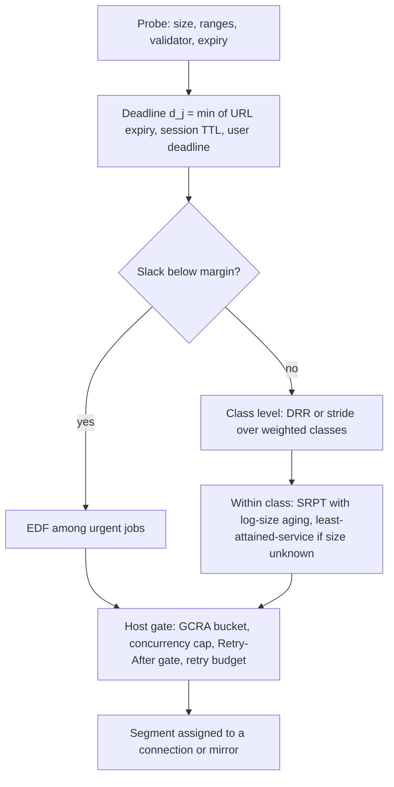
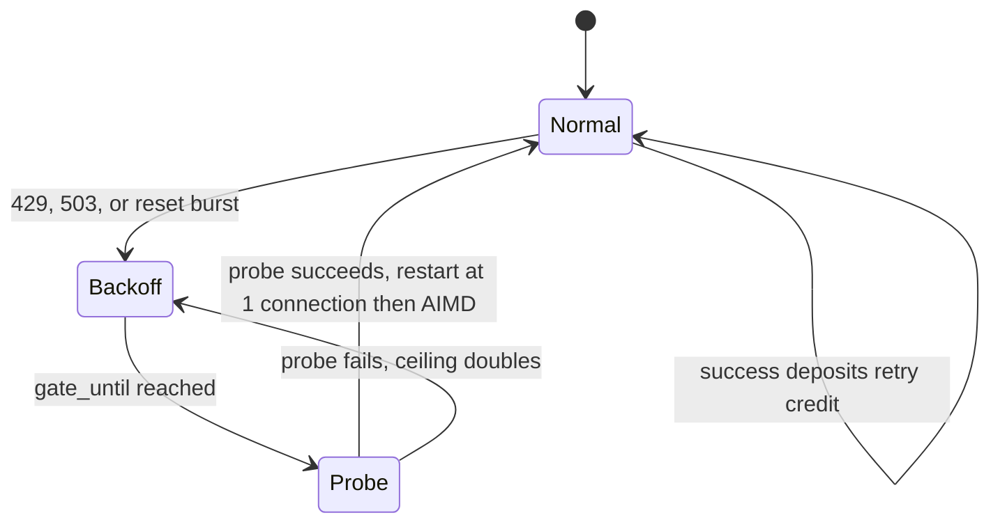

# Mathematics of scheduling, reliability, bandits and estimation

This document derives, checks and applies the mathematics behind four Haul components: the **scheduler** (which job and which segment gets the next connection), the **retry policy**, the **mirror selector**, and the **ETA and plan estimator**. Every formula states its validity conditions. Every worked example was computed in this session; examples tagged `[Calc]` are closed-form or numerical evaluations and examples tagged `[Sim]` are my own Monte Carlo or discrete-event simulations (method and seeds described; the scratch scripts are not in the repo, so the benchmarks in "Implications for Haul" are the way to make them permanent). Quotations are short and attributed. Claims about 2025-2026 products and papers were fetched on 2026-10-05.

## TL;DR

- **The big reliability lever is exact-offset Range resume, not fine-grained chunk journaling.** Under Poisson failures, re-deriving research.md section 8.10 confirms its numbers (6.39 h for a 2 h non-resumable transfer at one failure per hour, 2.10 h with 0.1 h commit chunks) but also shows they overstate what journaling buys: with exact-offset resume and realistic reconnect cost the expected time is about 2.0017 h (+6 s) [Calc]. Journaling matters for *host crashes*, where the Young/Daly interval comes out at 6 to 80 s and the optimum is flat: any commit interval within 2x of optimal costs at most 25% more waste, and for sync costs of 5 to 50 ms the waste at the optimum stays below 0.2% [Calc].
- **Scheduler: two levels plus a deadline override.** Weighted max-min (progressive filling) across classes and hosts, SRPT with log-size aging inside a class, EDF for jobs whose signed URL or session grant is about to expire, DRR or stride to hand out connection slots. With sizes known after the probe, SRPT cuts mean response time 1.8x to 3.8x versus processor sharing on bounded-Pareto sizes at load 0.7 to 0.9, but at load 0.95 or above (or already at 0.9 with a light tail) the largest jobs lose, so aging is mandatory [Calc]. WFQ's packetization penalty is one chunk time (about 0.17 s for 16 MiB at 100 MB/s), which sets the scheduling quantum.
- **Politeness is a GCRA per host plus a concurrency cap, sized with Little's Law and Erlang C.** GCRA and a token bucket are the same limiter (verified by running both on one trace). Heavy-tailed service times inflate waits (squared coefficient of variation 4 gives 2.5x the M/M/c wait). RFC 9309 has no `Crawl-delay`, and a 5xx on `robots.txt` means "assume complete disallow" [RFC 9309].
- **Retries: full jitter, shared per-host state, a 10% retry budget, and `Retry-After` as a floor with added jitter.** In my queue simulation, 3 retries per request with no budget turns a 30 s capacity dip into a collapse that never recovers (4x load amplification), while a 10% budget recovers about 110 s after the dip ends [Sim]. This matches the field data: retry policy was the most common sustaining effect, in about half or more of 22 studied metastable incidents [Huang 2022]. AWS changed its SDK retry quota costs in May 2026 (transient retries now cost 14 tokens instead of 5) [AWS SDK retry].
- **Mirror selection: the textbook regret bounds are vacuous at download horizons.** The UCB1 bound exceeds the trivial bound until roughly 6,000 pulls, and in stationary runs of 50 to 1,000 chunks UCB1 with the stock constant loses 15% to 27% of throughput versus 1% to 9% for Thompson sampling [Sim]. Use Thompson sampling on log-throughput with a sliding or discounted window plus a CUSUM reset; use EXP3 only as an adversarial fallback.
- **Estimation: sketches, Wilson intervals and robust detectors.** DDSketch with 2% relative error needs about 400 buckets for 1 ms to 1 h; use it for per-host, per-size-class p95 hedge triggers. Wald intervals for a 3% failure rate with 40 trials cover only 70% (Wilson: 97%); t-intervals on heavy-tailed throughput cover 71% to 85%; CUSUM on log-throughput with k = 0.69 sigma and h = 4 gives a false-alarm run length near 1,300 chunks and detects a 2x drop in about 6.5 chunks [Calc/Sim].
- **LLM cost math must use effective, cache-adjusted prices.** With Anthropic prices fetched on 2026-10-05, 40,000 classifications cost USD 104 on Haiku 4.5 (its minimum cacheable prompt is 4,096 tokens, so a 1,500-token prefix is not cacheable) but USD 100 on Sonnet 5.5 with a cached prefix (minimum 512 tokens). A Haiku-first cascade then loses money at any acceptance rate [Calc]. Cascade only when the effective cost ratio is below the acceptance rate; recompute when prices change.
- **Plan previews: the arithmetic is request-rate bound and the uncertainty is in the parameters.** research.md's "1,240 files, about 45 minutes at 1 request per 2 s" checks out (43.4 min lower bound; Monte Carlo median 48.3 min). The honest band is wide only because of parameter uncertainty: item count off by 25% gives 35 to 66 min; a 3% rate of 429s with 60 s `Retry-After` gives 75 to 91 min. PERT ignores merge bias (+2.8 min for two parallel branches) [Calc/Sim].
- **"Stop when no new items" is a weak completeness signal on randomized listings, and capture-recapture across correlated sort orders is badly biased.** With random pages of 20 items from 1,240, stopping at the first all-duplicate page leaves 14% of items unseen; K = 3 consecutive empty pages still leaves 5%. Chapman estimates fall to 632 (true 1,240) when item popularity varies with log-standard-deviation 1 [Sim]. Prefer explicit end signals (`Link: rel="next"`, cursors, counts), wrap-around detection, and partitioned queries around depth caps.

## 0. Conventions and scope

| Tag | Meaning |
|---|---|
| `[Spec]` | Standards text fetched 2026-10-05 (RFC Editor, IETF datatracker) |
| `[Paper]` | Statement checked against the paper text, abstract or a fetched source (DOI or arXiv ID in References) |
| `[Vendor]` | Vendor documentation fetched 2026-10-05 |
| `[Calc]` | Closed-form or numerical result computed in this session |
| `[Sim]` | My own simulation; parameters stated, 300 to 1,000,000 replications as stated |
| *Inference* | Reasoned from the above, not directly sourced |

Notation: $\lambda$ arrival or failure rate, $\mu$ service rate, $c$ servers or connections, $r$ link or host rate, $T$ transfer time, $M = 1/\lambda$ mean time between failures.

## 1. Job scheduling

### 1.1 What is being scheduled

Haul schedules **jobs** (a file, a batch, a workflow run) made of **segments** (byte ranges or requests) over three scarce resources: aggregate bandwidth $B$, per-host budgets (request rate $R_h$, concurrency $c_h$), and secondary resources (file descriptors, disk write rate, LLM tokens per minute). Sizes are usually known after the probe (`Content-Length`, `Content-Range`) and often unknown for chunked or streamed sources (HLS manifests, generated archives). Jobs carry **deadlines** that are not user-visible: signed URLs expire, session grants lapse (Once, Site 24 h, Workflow 7 d), and DBSC-bound cookies are short-lived. The objectives are mean response time for interactive work, batch completion time for agent workflows, and no starvation.

### 1.2 SRPT and SJF: what is optimal, and when

**SRPT.** For a single server, preemptive-resume service, sizes known on arrival and negligible switching cost, Shortest Remaining Processing Time minimizes the number of jobs in the system at every instant on every sample path [Schrage 1968], and therefore mean response time. Its M/G/1 analysis is classical [Schrage & Miller 1966]. For a job of size $x$ in an M/G/1 queue with load $\rho$:

$$E[T_{\text{SRPT}}(x)] = \frac{\lambda \int_0^x t^2 \, dF(t) + \lambda x^2 (1-F(x))}{2\,(1-\rho(x))^2} + \int_0^x \frac{dt}{1-\rho(t)}, \qquad \rho(x) = \lambda \int_0^x t \, dF(t),$$

while processor sharing (PS, the fluid model of "all jobs share equally") has $E[T_{\text{PS}}(x)] = x/(1-\rho)$ for every size distribution. Plain restatement: SRPT's delay for a job of size $x$ depends only on the load of jobs no larger than $x$ (larger jobs enter only as jobs of size $x$), and PS's delay is proportional to size.

**Validity conditions and where it breaks.**

- Single server. On $m$ machines SRPT is not optimal but is $O(\log \min\{n/m, P\})$-competitive for total flow time, where $P$ is the max/min size ratio, and this is optimal up to a constant for online algorithms [Leonardi & Raz 2007]. For average stretch (response time divided by size), SRPT is 2-competitive on one machine and at most $9+2\sqrt{6}$ on several [Muthukrishnan 2005]. Haul's per-host caps make it a multi-server system, so SRPT is a heuristic here (High confidence).
- Weighted objectives need Smith's rule (order by size over weight) in the batch case [Smith 1956]; SRPT with weights is not optimal in general.
- Preemption must be cheap. In Haul a preemption is a segment boundary (a new Range request, or pausing socket reads and risking server idle timeouts), so preemption is coarse. The scheduling quantum is the chunk time.
- Sizes must be known. When they are not, the size-blind counterpart is least-attained-service (foreground-background); it is the classical choice when the size distribution has a decreasing hazard rate, which is the heavy-tailed regime [Nuyens & Wierman 2008] (Medium confidence on the exact optimality condition; I did not re-derive it). Gittins-index policies generalize this and are near-optimal in M/G/k under general conditions [Scully 2020]; the SOAP framework analyses all age-based policies in one formula [Scully 2018].

**Worked example, static batch** [Calc]. Four files of 1, 2, 4, 8 GB, all at $t=0$, one 100 MB/s bottleneck. SJF/SRPT order completes them at 10, 30, 70, 150 s (mean 65 s). The worst order (largest first) gives 80, 120, 140, 150 s (mean 122.5 s). PS gives 40, 70, 110, 150 s (mean 92.5 s). The makespan (150 s) is identical in all three: scheduling order changes who waits, not total time.

**Worked example, heavy tails** [Calc, Schrage-Miller formula integrated numerically]. Bounded Pareto sizes, $k=1$, $p=10^5$:

| Tail index $\alpha$ | Load $\rho$ | $E[T]$ PS | $E[T]$ SRPT | PS / SRPT | Mean slowdown PS | Mean slowdown SRPT |
|---|---|---|---|---|---|---|
| 1.1 | 0.7 | 25.07 | 13.05 | 1.92 | 3.33 | 1.13 |
| 1.1 | 0.9 | 75.22 | 19.99 | 3.76 | 10.0 | 1.18 |
| 2.5 | 0.7 | 5.56 | 3.14 | 1.77 | 3.33 | 1.62 |
| 2.5 | 0.9 | 16.67 | 5.65 | 2.95 | 10.0 | 2.33 |

A million-job simulation [Sim] reproduces the SRPT mean slowdown (1.13 at $\rho=0.7$, $\alpha=1.1$); its PS mean response times were 12% to 42% below theory because heavy-tailed samples converge slowly, which is itself a lesson for benchmarking (use the closed form, or many replications).

**Is SRPT unfair to large jobs?** The unfairness question is studied in [Bansal & Harchol-Balter 2001] and [Harchol-Balter 2003] (web-server implementation). My own check [Calc]: the maximum over sizes of $E[T_{\text{SRPT}}(x)] / E[T_{\text{PS}}(x)]$ is below 1 (every size is better off) for $\alpha=1.1$ up to $\rho=0.9$ (worst ratio 0.97), but becomes 1.10 at $\rho=0.95$ and 2.85 at $\rho=0.99$; for the lighter tail $\alpha=2.5$ it is already 1.14 at $\rho=0.9$ and 2.11 at $\rho=0.99$. Conclusion (High confidence for this model, Medium for Haul's workloads): SRPT is safe at moderate load with heavy tails, and not safe near saturation or with light tails. Haul runs near saturation whenever a batch is queued, so the aging rule below is required.

### 1.3 Fluid fairness: GPS, weighted max-min and progressive filling

**Generalized processor sharing (GPS).** In the fluid model each backlogged job $i$ with weight $\phi_i$ is served at rate $r \phi_i / \sum_{j \in \text{backlogged}} \phi_j$. A job with guaranteed rate $g_i = r\phi_i/\sum_{\text{all}}\phi_j$ gets at least $g_i$ whenever backlogged [Parekh & Gallager 1993]. The common slip is applying $r w_j / \sum w$ over *all* jobs: it holds only over the currently backlogged, uncapped jobs.

**Weighted max-min by progressive filling** (the right primitive when jobs have caps, such as per-host budgets):

1. Start with all unfrozen jobs at rate 0 and remaining capacity $C$.
2. Raise a common *per-weight level* $L$ until some job hits its cap $u_i$ (rate $= \phi_i L$) or capacity is exhausted. The next saturation level is $L = (C - \sum_{\text{frozen}} u_j)/\sum_{\text{unfrozen}}\phi_i$.
3. Freeze every job whose cap is at or below $\phi_i L$ at its cap; subtract its cap from $C$; repeat on the rest.

It terminates in at most $n$ rounds ($O(n \log n)$ with sorted caps). This is the algorithm in [Bertsekas & Gallager, Data Networks] (textbook reference, not re-fetched) and it has the same structure as the optimal crawl-rate allocation under host politeness in section 3 [Kolobov 2019].

**Worked example** [Calc]. Link 120 Mbps; jobs A (weight 4, uncapped), B (weight 1, cap 10), C (weight 1, uncapped), D (weight 2, cap 24). Round 1: level $120/8 = 15$ per unit weight, so B (would get 15 > 10) and D (would get 30 > 24) saturate at 10 and 24. Round 2: the remaining 86 Mbps goes to A and C at level $86/5 = 17.2$: A gets 68.8, C gets 17.2. Result: A 68.8, B 10, C 17.2, D 24 (sum 120).

**GPS finish times** [Calc]. 15 MB/s link, A (weight 4, 500 MB), B (weight 1, 150 MB), C (weight 1, 450 MB): rates are 10, 2.5, 2.5 MB/s. A finishes at 50.00 s; B (25 MB left, now sharing 7.5 MB/s with C) at 53.33 s; C at 73.33 s.

### 1.4 Proportional fairness and network utility maximization

Kelly's framework picks rates $x$ to maximize $\sum_i U_i(x_i)$ subject to link capacities; $U_i = w_i \log x_i$ gives weighted proportional fairness, and the dual variables of the capacity constraints are per-link "shadow prices" that a decentralized controller can follow [Kelly 1998]. The $\alpha$-fair family $U(x) = x^{1-\alpha}/(1-\alpha)$ interpolates: $\alpha \to 0$ maximizes total throughput, $\alpha = 1$ is proportional fairness, $\alpha = 2$ is minimum potential delay, $\alpha \to \infty$ is max-min [Mo & Walrand 2000].

**Haul-specific result (derived here).** If every job traverses exactly one host and the global link, the constraint family is laminar (host sets are nested inside the global set). The KKT conditions then give $x_i = (w_i/(\lambda + \mu_{h(i)}))^{1/\alpha}$, with $\mu_h = 0$ for unsaturated hosts, and the max-min allocation with weights $w_i^{1/\alpha}$ satisfies them. So for single-host jobs *every* $\alpha$-fair allocation is a weighted max-min allocation and the choice of fairness criterion is moot; progressive filling is exact. The criteria diverge only when one job spans several shared bottlenecks. **Multi-mirror striping creates exactly that.** Parking-lot toy [Calc]: two links of capacity 10, a "long" flow using both and one short flow on each link:

| $\alpha$ | Long flow | Each short flow | Total |
|---|---|---|---|
| 0 (max throughput) | 0.00 | 10.00 | 20.00 |
| 1 (proportional) | 3.33 | 6.67 | 16.67 |
| 2 | 4.14 | 5.86 | 15.86 |
| 50 (about max-min) | 4.96 | 5.04 | 15.04 |
| max-min | 5.00 | 5.00 | 15.00 |

A job striped across two hosts gets 3.33 under proportional fairness against 5.00 under max-min. Recommendation: use weighted max-min and treat each (job, host) pair as a flow whose weight is the job's weight divided by its number of active hosts, so striping does not buy extra share.

### 1.5 Packetized approximations: WFQ, DRR, stride

| Scheduler | Mechanism | Cost per decision | Guarantee | Fit for Haul |
|---|---|---|---|---|
| GPS | Fluid ideal | n/a | Rate $\ge g_i$ | Implement directly as per-job rate limits (token buckets) |
| WFQ / PGPS | Serve in order of GPS finish time | $O(\log n)$ | A packet finishes within $L_{\max}/r$ of its GPS finish [Parekh & Gallager 1993]; fair-queueing origin in [Demers 1989] | Overkill; "packet" is a chunk |
| DRR | Round robin with a per-queue byte deficit; quantum at least the max item size | $O(1)$ | Deficit stays below the max item size [Shreedhar & Varghese 1996] | Slot assignment across jobs |
| Stride | Deterministic lottery: stride $= L/\text{tickets}$, serve minimum pass value | $O(\log n)$ or $O(1)$ | Lower allocation error and response-time variance than lottery scheduling [Waldspurger & Weihl 1995] | Slot assignment across classes |

**Parekh-Gallager delay bound** [Parekh & Gallager 1993]: if a session's arrivals are $(\sigma, \rho)$ leaky-bucket constrained with $\rho \le g$, then GPS delay is at most $\sigma/g$ and backlog at most $\sigma$ (High confidence; classical). Example [Calc]: burst $\sigma = 10$ MB, guaranteed rate $g = 20$ Mbps (weight 1 of 6 on a 120 Mbps link): delay $\le 80\,\text{Mb} / 20\,\text{Mbps} = 4.00$ s. In Haul "packets" are chunks, so the WFQ penalty $L_{\max}/r$ is a chunk time: 16 MiB at 100 MB/s is 0.168 s [Calc]. *Inference*: cap the scheduling quantum at about 0.2 to 0.5 s of aggregate bandwidth, so latency-sensitive classes see at most that extra delay.

**DRR and stride worked examples** [Calc]. Stride with tickets 3:2:1 and stride $= 2^{20}/\text{tickets}$ produces the repeating sequence A B A A B C (so exactly 6:4:2 over 12 allocations, with no run of more than two consecutive picks for A). DRR with quanta 8, 4, 4 MB and item sizes 5, 3, 12 MB: after 6 rounds the served totals are 40, 24, 24 MB; the 12 MB items of job C wait until their deficit reaches 12 (round 3), the usual DRR behavior when quantum is below item size, which is why the quantum should be at least the chunk size.

### 1.6 Deadlines: EDF, feasibility, aging and priority inversion

**EDF.** Periodic preemptible tasks with implicit deadlines on one processor are schedulable by earliest-deadline-first iff utilization is at most 1 [Liu & Layland 1973]; the general statement that EDF schedules any preemptible one-processor job set that any algorithm can is classical textbook material that I did not re-verify here. For Haul's one-shot jobs with remaining bytes $q_i$, deadline $d_i$ and a resource of rate $r$, the demand-bound condition (derived by an exchange argument) is: feasible iff for every deadline $d_k$,

$$\sum_{i:\, d_i \le d_k} q_i \;\le\; r\,(d_k - t_{\text{now}}).$$

**Worked example, signed-URL expiries** [Calc]. $r = 10$ MB/s; jobs J1 (600 MB, expires in 100 s), J2 (900 MB, 200 s), J3 (300 MB, 60 s), J4 (500 MB, 130 s). EDF order J3, J1, J4, J2; cumulative demand 300, 900, 1,400, 2,300 MB against capacity 600, 1,000, 1,300, 2,000 MB. Slack is +300, +100, -100, -300 MB: the set is **infeasible from J4 onward**, so Haul should immediately request fresh URLs for J4 and J2 (or ask the user) rather than discover the failure when the signature expires. This generalizes the segment-start arithmetic in [Doc: http-download-semantics] (a 15-minute URL breaking a 50 GB job).

**Aging.** Pure SRPT starves large jobs under sustained small-job load. Define the priority key inside a class as

$$\kappa_j(t) = \log_2(\text{remaining}_j) - \frac{\text{wait}_j(t)}{\tau_w},$$

serve the smallest key, and set $\text{wait}$ to time since last service. A job of size $s_j$ beats a fresh arrival of size $s'$ once $\text{wait} > \tau_w \log_2(s_j/s')$, so the maximum wait behind a stream of arrivals is at most $\tau_w \log_2(s_{\max}/s_{\min})$, independent of load [Calc]: with $\tau_w = 30$ s and a size ratio of $10^6$ (1 MB to 1 TB), at most 600 s. (A multiplicative key $s/(1+\text{wait}/\tau)$ does not bound the wait for wide size ranges: it needs $\text{wait} > \tau(s_j/s' - 1)$.) Unknown sizes use $\log_2(\text{attained} + s_0)$ in place of $\log_2(\text{remaining})$.

**Priority inversion.** The real-world archetype is the Mars Pathfinder resets of July 1997: a high-priority task blocked on a mutex held by a low-priority task while a medium-priority task preempted the holder; the fix was enabling priority inheritance [Reeves 1997]; the protocols are defined in [Sha 1990]. Haul's analogues are a low-priority job holding (a) one of $c_h$ per-host slots, (b) the native-messaging session channel, or (c) a disk-write lane that a high-priority job needs. Three mitigations, in order of preference: bounded non-preemptible units (chunk time $\le 2$ to 5 s bounds inversion to one chunk), a **reserved slot** for the interactive class on each host (reserve 1 of $c_h$), and priority inheritance on shared locks.

### 1.7 Putting it together



*Multi-resource note.* When the binding resource differs by job (bandwidth for big files, request rate for many small files, LLM tokens for classification), dominant resource fairness equalizes each job's largest resource share [Ghodsi 2011]; Haul needs it only if LLM tokens per minute and bandwidth are scheduled jointly (open question).

## 2. Per-host politeness and capacity

### 2.1 Token bucket and GCRA

A token bucket with rate $r$ and depth $b$ admits at most $b + r\,t$ requests in any window of length $t$. The Generic Cell Rate Algorithm, GCRA$(T, \tau)$ with emission interval $T = 1/r$ and tolerance $\tau$, keeps one number per key, the theoretical arrival time TAT: a request at time $t$ conforms iff $t \ge \text{TAT} - \tau$, and then $\text{TAT} \leftarrow \max(t, \text{TAT}) + T$ [Web: GCRA] (which summarizes ITU-T I.371). The two are the same limiter with $b = \lfloor \tau/T \rfloor + 1$. **Check** [Calc]: $r = 0.5$/s, $b = 5$ ($T = 2$ s, $\tau = 8$ s): on the arrival trace 0,0,0,0,0,0,1,2,2.5,4,4,4,10,10,10 both implementations make identical decisions (accept five at $t=0$, deny the sixth and the one at 1, accept at 2, deny at 2.5, accept at 4, deny two at 4, accept three at 10), and over 60 s at most $5 + 0.5 \times 60 = 35$ requests pass. GCRA needs one timestamp of state per key and no refill timer; the Rust `governor` crate (0.10.4, updated 2025-12-16, 81.8M downloads) implements it with keyed limiters and optional jitter [Web: governor docs; crates.io]. The Mercator crawler's per-host heap keyed by "time this host may be contacted again" is the same TAT idea [Najork & Heydon 2001].

**Choosing $r$ and $b$ (Haul defaults).** Page fetches in crawl workflows: $r = 0.5$/s, $b = 1$ to 2 (one request per 2 s, as in research.md section 5.6), or the Mercator rule of waiting 10 times the last download time from that host before the next request [Najork & Heydon 2001] (the floor of 1 s and cap of 30 s are my additions). File downloads: $b$ equal to the segment concurrency. If the server publishes `RateLimit-Policy: "default";q=100;w=10` and `RateLimit: "default";r=50;t=30`, set $r = q/w$ and $b = q$ from the policy and treat the dynamic `r` as a cap on tokens; when `Retry-After` and `RateLimit` conflict, `Retry-After` wins [IETF: RateLimit headers, draft-11, 2026-05-23; still an Internet-Draft, so treat as optional input].

**Standards facts that matter** [Spec]. (1) RFC 9112 section 9.4: a client "ought to limit" simultaneous connections to a server; older RFCs' fixed numbers were dropped as impractical [RFC 9112]. (2) RFC 9309 (Robots Exclusion Protocol, September 2022) does not define `Crawl-delay`; if `robots.txt` is unreachable (5xx or network error) the crawler MUST assume complete disallow, 4xx means unavailable (access allowed), cached copies SHOULD NOT be reused beyond 24 h unless unreachable, and parsers must accept at least 500 KiB [RFC 9309]. (3) A 429 MAY carry `Retry-After`; servers need not use 429 at all [RFC 6585]. (4) `Retry-After` is either seconds or an HTTP-date [RFC 9110].

### 2.2 Little's Law, Erlang C and concurrency sizing

**Little's Law.** In a stable system the long-run mean number in system $L$ equals arrival rate times mean time in system: $L = \lambda W$, with no distributional assumptions [Little 1961]. Stability requires $\lambda E[S] < c$.

**Erlang C (M/M/c).** With offered load $a = \lambda/\mu$ and $\rho = a/c < 1$, the probability an arrival must wait is

$$C(c, a) = \frac{\dfrac{a^c}{c!}\dfrac{1}{1-\rho}}{\sum_{k=0}^{c-1}\dfrac{a^k}{k!} + \dfrac{a^c}{c!}\dfrac{1}{1-\rho}}, \qquad E[W_q] = \frac{C(c,a)}{c\mu - \lambda}, \qquad P(W_q > t) = C(c,a)\, e^{-(c\mu - \lambda)t}.$$

Downloads are not exponential. The standard heavy-tail correction is $E[W_q^{M/G/c}] \approx \tfrac{1 + c_s^2}{2} E[W_q^{M/M/c}]$ (exact for $c=1$; an approximation for $c>1$) [Whitt 1993]; the tail formula above is M/M/c only.

**Worked sizing example** [Calc]: $\lambda = 1.5$ files/s to one host, mean service time 2 s ($\mu = 0.5$), squared coefficient of variation $c_s^2 = 4$:

| $c$ | $\rho$ | $P(\text{wait})$ | $E[W_q]$ M/M/c | $E[W_q]$ with $c_s^2=4$ | $P(W_q > 5\,\text{s})$ M/M/c |
|---|---|---|---|---|---|
| 4 | 0.750 | 0.509 | 1.02 s | 2.55 s | 4.2% |
| 5 | 0.600 | 0.236 | 0.24 s | 0.59 s | 0.16% |
| 6 | 0.500 | 0.099 | 0.07 s | 0.17 s | 0.01% |

Little's Law gives 4.53 jobs in the system at $c=4$ ($1.5 \times (1.02 + 2)$). The default per-host cap of 4 to 8 connections is therefore adequate only if the host tolerates it; **the host budget, not the Erlang result, is the binding constraint**, and the useful use of Erlang C is to detect when a host cap makes the queue unstable ($\lambda E[S] \ge c_h$) and to set queue-depth alarms.

**Pipeline depth under a request budget** [Calc]. With request gap $g = 2$ s and file transfer time $d = 10$ s, saturating the request budget needs $d/g = 5$ transfers in flight (Little). With $c = 4$ slots, throughput is $\min(1/g, c/d) = 0.4$ files/s, so 1,240 files take 51.7 min instead of 41.3 min. The plan estimator in section 9 uses this.

### 2.3 Global versus per-host budgets

Allocate a global request or bandwidth budget $R_g$ across hosts by progressive filling with caps $R_h$ (section 1.3). Example [Calc]: $R_g = 10$/s, hosts with caps 2, 5, 20, all backlogged: equal share 3.33, host A saturates at 2, the remaining 8 splits 4 and 4 (B's cap of 5 does not bind): final 2, 4, 4. For *recrawl* workloads the optimal allocation under per-host caps has the same iterate-and-saturate structure (section 3.2). Practical rules: one limiter per **host** (not per URL), plus a per-IP concurrency cap when several hostnames share one address (Inference), plus a global cap and quiet hours at the top level.

## 3. Crawl scheduling theory

### 3.1 Freshness and age under Poisson change

Model page $i$ as changing at Poisson rate $\lambda_i$ and being refreshed every $I_i = 1/f_i$ (periodic). Freshness $F$ is the probability the copy is current; age $A$ is how long it has been stale. Over one interval:

$$\bar F(\lambda, f) = \frac{f}{\lambda}\left(1 - e^{-\lambda/f}\right), \qquad \bar A(\lambda, f) = \frac{I}{2} - \frac{1}{\lambda} + \frac{1 - e^{-\lambda I}}{\lambda^2 I}.$$

(Derivation: freshness $t$ after a refresh is $e^{-\lambda t}$ and mean age is $t - (1-e^{-\lambda t})/\lambda$; average over $[0, I]$.) These are the definitions of Cho and Garcia-Molina [Cho 2003 TODS]. Maximizing $\sum_i \bar F(\lambda_i, f_i)$ subject to $\sum_i f_i = B$ gives the stationarity condition

$$\frac{\partial \bar F}{\partial f} = \frac{1}{\lambda}\left(1 - (1+x)e^{-x}\right) = \nu, \quad x = \lambda/f,$$

whose left side never exceeds $1/\lambda$: a page with $\lambda_i \ge 1/\nu$ gets $f_i = 0$. **Fast-changing pages should be abandoned for freshness**, as Cho and Garcia-Molina report, along with the result that uniform refresh beats proportional refresh [Cho 2003 TODS; summary of the finding per the secondary source retrieved] (Medium confidence on attribution details; the numbers below confirm the claims).

**Worked example** [Calc]: five pages with change rates 1, 2, 3, 4, 5 per day and a budget of 5 refreshes per day.

| Policy | Refresh rates per day | Mean freshness |
|---|---|---|
| Uniform | 1, 1, 1, 1, 1 | 0.3651 |
| Proportional to change rate | 0.33, 0.67, 1.00, 1.33, 1.67 | 0.3167 |
| Optimal periodic | 1.150, 1.358, 1.354, 1.138, **0** | 0.3739 |

Proportional is 13% worse than uniform; the optimum gives up on the fastest page entirely. For *age* the optimum is the opposite shape: monotone, sublinear frequency in $\lambda$, never zero (per the same secondary summary; Medium).

**Estimating $\lambda$ from irregular visits.** If you revisit every $I$ and only record "changed or not", the naive rate (changes seen divided by elapsed time) is biased low whenever changes can happen more than once per interval. With true $\lambda = 3$/day and daily visits, 95.0% of visits see a change, so the naive estimate is 0.95/day; the maximum-likelihood estimate $-\ln(1-\hat p)/I$ recovers 3.00/day [Calc]. Cho and Garcia-Molina develop estimators for exactly these access patterns [Cho 2003 TOIT]. Haul's use: monitoring workflows ("tell me when this page changes") with conditional GET (`If-None-Match`, `If-Modified-Since` [RFC 9110]).

### 3.2 Optimal crawl under politeness (current state of the art)

Azar et al. show that for a randomized (Poisson) crawl schedule the optimal rates can be found exactly (the algorithm is sorting-dominated, $O(n \log n)$ [Kolobov 2019]), and a deterministic schedule built from them attains about 99% of the optimum in experiments [Azar 2018]. With importance $\mu_i$ and Poisson crawl rate $\rho_i$, the objective is $\sum_i \mu_i \rho_i/(\rho_i + \lambda_i)$ and the Lagrangian solution is

$$\rho_i = \max\!\left(0,\; \sqrt{\mu_i \lambda_i/\nu} - \lambda_i\right), \qquad \nu \text{ chosen so that } \sum_i \rho_i = R,$$

so pages with $\mu_i/\lambda_i \le \nu$ are dropped [Kolobov 2019]. **Per-host politeness caps** $\sum_{i \in h}\rho_i \le R_h$ are handled by PoliteBinaryLambdaCrawl: solve ignoring politeness, find hosts whose cap is violated, re-solve those hosts with their cap as an equality, remove them and subtract their rate from $R$, repeat; the algorithm is optimal and runs in $O(n \log n + mn)$ for $n$ pages and $m$ hosts [Kolobov 2019]. Worked example [Calc] with the same five pages and Poisson-random refresh: the optimal Poisson rates are 1.386, 1.374, 1.133, 0.772, 0.335 (mean freshness 0.2974 versus 0.2900 uniform): under random rather than periodic scheduling nothing is abandoned.

Recent work (2025): Busa-Fekete et al. give a scalable crawling algorithm that uses noisy change-indicating signals (side information that a page may have changed) optimally under mild assumptions and adapts to bandwidth changes without central recomputation [arXiv:2502.02430]; Pezzuti et al. study neural prioritisation for crawling [arXiv:2506.16146]. *Inference* for Haul: its recrawl workloads are small (tens to thousands of URLs on a few hosts), so the exact solution above is cheap; learn $\lambda_i$ online from conditional-GET outcomes with the MLE.

### 3.3 Frontier ordering and Mercator

A crawl frontier needs two things: priorities (what to fetch first) and politeness (when a host may be contacted). Mercator separates them: front-end FIFO queues by priority, a back-end of per-host FIFO queues, and a heap keyed by the next permitted contact time; in production it used about 3 times as many back-end queues as threads and waited 10 times the last download duration before re-contacting a host [Najork & Heydon 2001]; the architecture is in [Heydon & Najork 1999]. Breadth-first ordering finds high-quality pages early [Najork & Wiener 2001]; URL ordering by importance metrics is compared in [Cho 1998]. For Haul's workflow runner (listing pages, detail pages, files), the frontier rule (Inference, derived from Little's Law in section 2.2) is: always finish started items before discovering more, except when the ready queue falls below a low-water mark of about $d/g$ ready transfers (5 in the example of section 2.2, with transfer time $d$ and request gap $g$), so the request budget never idles; and fetch the first listing pages early so the plan estimator can size the job.

## 4. Retry, backoff and budgets

### 4.1 Backoff formulas and what jitter does

With base $b$, cap $K$ and attempt number $n$, the four variants analysed by Brooker [Brooker 2015] (simulator: optimistic-concurrency contention against a remote database, up to 100 clients) are:

| Variant | Sleep | Expected sleep for attempt $n$ (uncapped) |
|---|---|---|
| No jitter | $\min(K, b2^n)$ | $b2^n$ |
| Full jitter | $\text{rand}(0, \min(K, b2^n))$ | $b2^{n-1}$ |
| Equal jitter | $\tfrac{1}{2}\min(K, b2^n) + \text{rand}(0, \tfrac{1}{2}\min(K, b2^n))$ | $0.75\,b2^n$ |
| Decorrelated | $\min(K, \text{rand}(b, 3 s_{\text{prev}}))$ | $E_{n+1} = (b + 3E_n)/2$, growth factor 1.5 |

Brooker's reported conclusions: full jitter cut the number of calls by more than half versus no-jitter exponential backoff at 100 clients, no-jitter was the worst, and full jitter used less work for slightly more time than decorrelated [Brooker 2015]. The AWS SDKs' new retry behavior (opt-in at the time of fetch) uses full jitter with a 20 s cap [AWS SDK retry].

**Expected cumulative sleep** after $n$ consecutive failures [Sim, 200,000 replications, $b = 1$ s, $K = 900$ s]:

| $n$ | 3 | 6 | 10 | 15 | 20 |
|---|---|---|---|---|---|
| No jitter | 14 | 126 | 1,922 | 6,422 | 10,922 |
| Full | 7.0 | 63 | 963 | 3,214 | 5,466 |
| Equal | 10.5 | 94.5 | 1,442 | 4,818 | 8,193 |
| Decorrelated | 11.3 | 56.6 | 306 | 1,151 | 2,468 |

Decorrelated jitter climbs slowly (factor 1.5): by the tenth failure it has slept 3.1x less in total than full jitter (306 s versus 963 s), so during a long outage it retries more often. That is the opposite of what a struggling server needs, but it recovers sooner after a short blip. For persistent downloads (hours or days) the outage case dominates, so full jitter is the default; the choice is an engineering preference, and both are defensible (Medium confidence).

**Contention simulation** [Sim; my own slotted model, not Brooker's]: $N$ clients each need one success; per slot the server accepts at most 1 request (random among arrivals), rejected clients pay a call and back off; base 2 slots, cap 1,024 slots, 300 runs.

| $N$ | Policy | Calls per client | Makespan (slots; ideal $N$) |
|---|---|---|---|
| 100 | No jitter | 50.5 | 94,303 |
| 100 | Equal | 5.6 | 458 |
| 100 | Full | 5.4 | 330 |
| 100 | Decorrelated | 5.6 | 237 |
| 400 | No jitter | 200.5 | 401,803 |
| 400 | Equal | 7.4 | 1,901 |
| 400 | Full | 7.4 | 1,492 |
| 400 | Decorrelated | 9.4 | 1,145 |

Same qualitative ordering as Brooker: jitter is mandatory (synchronized retries cost $O(N)$ calls per client), full jitter is least work, decorrelated is fastest to finish.

### 4.2 Ethernet BEB and why exponential backoff alone is not enough

Truncated binary exponential backoff (Ethernet): after the $n$-th collision wait a uniform number of slot times in $[0, 2^{\min(n,10)} - 1]$ [Metcalfe & Boggs 1976; rule as stated in [Web: exponential backoff], IEEE 802.3 text not fetched]. Two theory facts matter for Haul. First, BEB is *unstable* under an infinite-population acknowledgement-based model: Aldous proved ultimate instability [Aldous 1987]. Second, for a batch of $n$ stations starting together the makespan of BEB is $\Theta(n \log n)$, suboptimal against the achievable $\Theta(n)$ [arXiv:2403.03876, citing Bender et al.]; later work achieves constant throughput with a polylogarithmic number of channel accesses [arXiv:2302.07751, as characterized by the same survey]. Translation: backoff gets *a few* clients through quickly, but a population needs either a rate limit or a budget to avoid persistent overload. Haul's population is its own segments and workers, which it controls, so the right tool is a shared per-host gate, not per-segment independent backoff.

### 4.3 Retry amplification, budgets, circuit breakers and metastability

**Amplification.** With $k$ retries per layer and $L$ layers a single user action causes up to $(k+1)^L$ attempts; the SRE book's example is 64 attempts (4^3) from three layers retrying three times [Google SRE: cascading failures]. Haul's layers: agent retries a tool call, the daemon retries a job, the job retries a segment, the segment retries a connection. **Retry once, at one layer** (the daemon), and make every other layer fail fast.

**Budgets.**

| System | Rule | Value |
|---|---|---|
| Google SRE | Per-request attempts; per-client retry ratio | Up to 3 attempts; retries allowed only while retries are below 10% of requests; backend can return "overloaded; don't retry" [Google SRE: handling overload] |
| Google SRE | Per-process budget | Example: 60 retries per minute [Google SRE: cascading failures] |
| Finagle | RetryBudget default | About 20% of requests plus 10 retries per second [Finagle docs] |
| Tower (Rust) | `TpsBudget`: deposit on success, withdraw on retry | Retry storm prevention by an overall limit rather than a per-request count [docs.rs tower] |
| AWS SDKs, standard mode (new behavior, opt-in `AWS_NEW_RETRIES_2026=true`) | Token bucket of 500; a transient retry costs 14 (was 5), a throttling retry 5; success after retry refunds that cost, a first-try success refunds 1; delay full jitter, base 50 ms transient and 1 s throttling, cap 20 s; max attempts 3 (DynamoDB 4) | Announced 2026-05-20 [AWS SDK retry; AWS SDK retry announcement] |

Brooker's argument for token-bucket retry limiting over circuit breakers: a bucket that deposits a fraction of a token per success and spends one per retry behaves like a fixed retry count when healthy and throttles retries proportionally as failures rise, while a breaker is binary [Brooker 2022]. A budget with ratio $b$ bounds long-run amplification at $1 + b$; at $b = 0.1$ that is 1.1x, versus 4x for 3 unbudgeted retries [Calc].

**Metastable failures.** A trigger pushes the system into a degraded state that persists after the trigger is gone because a sustaining feedback loop amplifies load [Bronson 2021]. Of 22 incidents from 11 organizations (including at least 4 of 15 major AWS outages), retry policy was "by far the most common sustaining effect", in more than half; outages lasted 1.5 to 73.53 h [Huang 2022]. A policy with at most 2 retries cannot amplify work more than 3x, while an uncapped policy has no stable region [Huang 2022]. Newer work formalizes this with continuous-time Markov chains to predict whether a system is metastable and for how long [arXiv:2510.03551] and characterizes "metastable faults" (destabilizing interaction cycles) to design tolerant systems [arXiv:2606.00942]. The stability condition in the simplest model: fresh load times amplification must stay below capacity, $\lambda_0 (1 + b) < C$.

**Retry-storm simulation** [Sim, 20 runs]: one FIFO server (100 req/s, deterministic service), Poisson fresh load 80 req/s, capacity drops to 40 req/s during $t \in [30, 60)$, client timeout 2 s, up to 3 retries with full jitter (base 0.5 s), and the server keeps processing abandoned requests (the common case).

| Client policy | Attempts per second at $t = 100$ | Goodput at $t$ = 100, 150, 200 | Outcome |
|---|---|---|---|
| No retries | 80 | 1, 80, 80 | Recovers about $t = 115$ (queue drains) |
| 3 retries, full jitter, no budget | 321 | 0, 0, 0 | Never recovers (4x amplification above capacity) |
| 3 retries plus 10% retry budget | 88 | 0, 17, 79 | Recovers about $t = 170$ |
| 3 retries, server drops timed-out work | 311 | 5, 5, 5 | Stuck at 6% of normal (FIFO under overload) |

The budgeted client recovers more slowly than the retry-free client (it drains the queue at 12/s instead of 20/s) but it is the only retrying design that is stable, since $80 \times 1.1 = 88 < 100$. A third mitigation, not simulated here, is server-side admission control and LIFO under overload.

### 4.4 Honouring Retry-After

`Retry-After` carries seconds or an HTTP-date; for 503 it says how long the service is expected to be unavailable, for 3xx the minimum wait [RFC 9110]; a 429 may include it [RFC 6585]. Rules for Haul:

1. Parse both syntaxes; for HTTP-date compute the delta against the response `Date` header, not the local clock [Doc: http-download-semantics].
2. Apply it **host-wide** (a gate on the host limiter), not per segment.
3. Treat it as a **floor**: $\text{sleep} = \max(\text{backoff draw}, RA) + U(0, 0.25\, RA)$. Without added jitter, $N$ clients told 30 s all return in the same second [Calc]: with 1,000 clients and a server capacity of 50 req/s the peak is 1,000 req/s (20x capacity); spreading over $W$ seconds gives $N/W$, so you need $W \ge N/\text{capacity} = 20$ s; adding $U(0, 15\,\text{s})$ gives a peak of 66.7 req/s. AWS's SDK does *not* jitter server-directed delays because "the service is expected to jitter it", and clamps them to between the computed backoff and backoff plus 5 s [AWS SDK retry]. A single client cannot know the population size, so a client-side proportional jitter of 25% of $RA$ is a cheap insurance (Inference).
4. Clamp: if $RA$ exceeds the job's patience (default 1 h), park the job with state `scheduled` and a wake-up time rather than sleeping a worker.
5. Distinguish **terminal 429s**: Anthropic's API returns a 429 with no `retry-after` header when a monthly spend cap is reached (`error_code: enforced_spend_limit_reached`), and retries fail until access resumes; ordinary rate-limit 429s carry `retry-after`; rate limiting is a token bucket with continuous replenishment, and sharp traffic ramps can trigger "acceleration limits" [Vendor: Anthropic rate limits; Vendor: Anthropic errors]. A 429 without `Retry-After` on an LLM endpoint is therefore a budget event, not a transient.

### 4.5 Haul retry policy (algorithm and defaults)



```text
on_failure(seg, host, err):
  cls = classify(err)            # transient_network | throttled | auth_expired | url_expired | blocked | permanent
  if cls == permanent: fail(seg); return
  if cls in {auth_expired, url_expired}: refresh(seg, max=3) or park(needs_user); return
  if cls == blocked: fallback_to_browser_proxy(seg) or park(needs_user); return   # never escalate to evasion
  # transient or throttled
  if seg.bytes_since_last_failure >= 64 KiB or seg.uptime >= 5 s: seg.streak = 0   # progress resets backoff
  seg.streak += 1
  base  = 1 s (transient) | 5 s (throttled, no Retry-After)
  ceil  = min(CAP, base * 2^seg.streak)          # CAP = 300 s per segment; 900 s after 10 min without progress
  sleep = uniform(0, ceil)                       # full jitter
  if retry_after present:
      ra = min(parse(RA, response.Date), 3600 s)
      host.gate_until = max(host.gate_until, now + ra)          # host-wide
      sleep = max(sleep, ra) + uniform(0, 0.25 * ra)
  if cls == throttled or status in {429, 503}:
      host.conc_cap = max(1, floor(host.conc_cap / 2))          # multiplicative decrease
  if not host.retry_budget.withdraw(1):                         # empty: slow to a probe rate, never abandon
      sleep = max(sleep, PROBE_INTERVAL)                        # 30 to 60 s, one probe per host
  schedule(seg, now + sleep)

on_success(seg, host): host.retry_budget.deposit(0.1, cap=20); host.conc_cap = min(host.conc_max, host.conc_cap + 1/host.conc_cap)
```

Defaults and why: budget ratio 0.1 (SRE per-client ratio, amplification bound 1.1x); depth 20 (a burst of 20 retries); floor of one probe per 30 to 60 s so a persistent job never deadlocks; sustained failure rate tolerated by a 0.1 budget is $p/(1-p) \le 0.1$, i.e. $p \le 9.1\%$ [Calc]; cap 300 s per segment (research.md's 900 s applies to job-level persistence across reboots; request-level libraries use 20 s [AWS SDK retry]); progress-based reset because a connection that moved data is evidence the host works. A circuit breaker (trip on at least 3 consecutive 5xx/429 or more than 50% failures over 10 or more requests) is the `Backoff` state above; use half-open probes of one request.

## 5. Failure models and checkpoint intervals

### 5.1 Expected completion time under Poisson failures (re-derivation)

Let failures arrive as a Poisson process of rate $\lambda$ while transferring. A task of useful duration $W$ that restarts from its beginning after each failure, with restart cost $R$ (which can itself fail) and failure-free downtime $D$ (backoff sleep), has expected wall time

$$E(W) = \left(\frac{1}{\lambda} + D\right) e^{\lambda R}\left(e^{\lambda W} - 1\right),$$

which reduces to $(e^{\lambda W} - 1)/\lambda$ when $R = D = 0$ (derivation: $E[\min(X, W)]/P(X \ge W)$ with $X \sim \text{Exp}(\lambda)$) [Benoit RR-9465, Lemma 1 with $C = 0$]. If the task is split into $T/c$ segments that each restart independently (commit interval $c$):

$$E = \frac{T}{c}\left(\frac{1}{\lambda} + D\right)e^{\lambda R}\left(e^{\lambda c} - 1\right) \approx T\left[1 + \lambda\left(D + R + \tfrac{c}{2}\right)\right] \quad (\lambda c \ll 1).$$

Plain restatement: each failure costs the downtime, the reconnect, and on average half a commit interval of rework.

**Check of research.md section 8.10** [Calc]: $\lambda = 1$/h, $T = 2$ h: non-resumable $(e^2 - 1)/1 = 6.3891$ h; resumable with $c = 0.1$ h: $20 \times 0.10517 = 2.1034$ h. Both numbers are correct under the stated model. Commit-interval sweep (hours, $T = 2$ h): $c = 1$: 3.4366; 0.5: 2.5949; 0.1: 2.1034; 1 min: 2.0168; 10 s: 2.0028; 1 s: 2.0003.

**What the example leaves out.** (1) Reconnect and backoff: with $R = 1$ s, $D = 2$ s and exact-offset resume (loss per failure equal to the in-flight bytes, effectively $c \approx 0.1$ s) the expected time is 2.0017 h, only 6.1 s above the failure-free 2 h; the non-resumable case with the same overheads is 6.3944 h (overheads barely matter there; $e^{\lambda T}$ dominates). (2) A commit interval of 6 minutes at 12.5 MB/s is 4.5 GB, whereas section 8.11 of research.md chooses 8 to 32 MB chunks; the two sections use incompatible granularities. (3) **Which failures lose data?** A dropped connection loses nothing already received: the bytes sit in the process and page cache and the daemon resumes from the exact next offset. Only host crashes (process kill, power loss, OS crash) lose uncommitted bytes. The Poisson rate in $c/2$ rework is therefore the *crash* rate, not the connection-failure rate; connection failures cost only $D + R$.

| Per-failure overhead $D + R$ | Commit interval | Expected $E$ for $T = 2$ h, $\lambda = 1$/h | Extra over 2 h |
|---|---|---|---|
| 3 s | 0.1 s | 2.00169 h | +6.1 s |
| 3 s | 1 s | 2.00195 h | +7.0 s |
| 3 s | 10 s | 2.00445 h | +16.0 s |
| 3 s | 60 s | 2.01844 h | +66.4 s |
| 3 s | 600 s | 2.17814 h | +641 s |
| (non-resumable) | whole file | 6.3944 h | +4.39 h |

*Conclusion*: the product-defining capability is **Range support with a strong validator plus exact-offset resume** [Doc: http-download-semantics]. Journaling at 8 to 32 MB granularity is a crash-safety feature, not what makes a 2 h download finish in 2 h. When the server lacks Range (the non-resumable branch), the expected time explodes: use the multi-attempt strategy of racing a second mirror or the browser fallback instead of repeating from zero.

### 5.2 Young and Daly applied to the commit interval

Young's first-order optimum for the compute interval between checkpoints of cost $\delta$ with mean time to interrupt $M$ is $\tau^* = \sqrt{2\delta M}$ [Young 1974]. Daly's higher-order estimate [Daly 2006] adds the restart time at first order, $\tau^* = \sqrt{2\delta(M + R)} - \delta$, valid when $\tau^* + \delta \ll M$, and at higher order (restart drops out):

$$\tau_{\text{opt}} = \sqrt{2\delta M}\left[1 + \frac{1}{3}\sqrt{\frac{\delta}{2M}} + \frac{1}{9}\,\frac{\delta}{2M}\right] - \delta \quad (\delta < 2M), \qquad \tau_{\text{opt}} = M \quad (\delta \ge 2M).$$

Daly reports the three-term form has relative error in wall-clock time below 0.2% of the exact optimum [Daly 2006]. The exact optimum minimizes the slowdown $s(W) = \frac{1}{\lambda}\frac{e^{\lambda(W + \delta)} - 1}{W}$ and satisfies $(\lambda W - 1)e^{\lambda(W+\delta)} = -1$, a Lambert-W equation independent of $R$ [Benoit RR-9465]. Derivation of Young's result: for $\lambda(\tau+\delta) \ll 1$, $s \approx 1 + \delta/\tau + \lambda\tau/2$, minimized at $\tau^* = \sqrt{2\delta/\lambda}$ with waste $\sqrt{2\delta\lambda}$.

**Mapping to Haul.** $\delta$ is the cost of one durable commit (data `fsync` plus journal commit, two syncs); $M$ is the mean time between events that destroy uncommitted bytes. Computed [Calc, waste = $1 - 1/s$]:

| Scenario | Young | Daly | Exact | Waste at optimum |
|---|---|---|---|---|
| $\delta$ = 5 ms, $M$ = 7 days | 77.8 s | 77.8 s | 77.8 s | 0.013% |
| $\delta$ = 5 ms, $M$ = 24 h | 29.4 s | 29.4 s | 29.4 s | 0.034% |
| $\delta$ = 50 ms (slow disk), $M$ = 24 h | 92.9 s | 92.9 s | 92.9 s | 0.108% |
| $\delta$ = 5 ms, $M$ = 1 h (flaky laptop) | 6.0 s | 6.0 s | 6.0 s | 0.167% |
| $\delta$ = 1 s, $M$ = 1 h | 84.9 s | 84.2 s | 84.2 s | 2.34% |

**The optimum is flat.** With $\delta$ = 5 ms, $M$ = 24 h [Calc]: halving or doubling $\tau^*$ costs 25% more waste (0.0425% vs 0.034%), a factor 4 costs 2.1x, a factor 10 costs 5.0x. Committing every 1 s wastes 0.498%; every 5 s 0.103%; every 10 s 0.056%; every 30 s 0.034%; every 60 s 0.043%. Since all of those are below 0.5%, *rework in bytes after a crash* should drive the choice, not the optimum. **Default (Inference grounded in the table): commit when 10 s or 256 MiB have accumulated since the last commit, whichever comes first**; at 12.5 MB/s that bounds rework to 125 MB, at 125 MB/s to 256 MiB (waste about 0.25%).

**Per-request overhead as a "checkpoint cost".** If a failed chunk were discarded, per-request overhead $\delta_{req}$ (TLS, request, ramp-up) and per-connection MTBF $M_c$ would give $\sqrt{2\delta_{req}M_c}$ [Calc]: with $\delta_{req}$ = 0.15 s and $M_c$ = 1,800 s, 23.2 s of transfer, 290 MB at 12.5 MB/s. With exact-offset resume nothing is discarded, so this term vanishes and chunk size is set by the efficiency bound in research.md section 8.11 and by end-of-file imbalance, not by failures.

### 5.3 Non-exponential failures (Weibull)

Field studies find time between failures better fit by Weibull or gamma laws, often with a decreasing hazard rate: for disk replacements the hazard was decreasing, equivalent to Weibull shape below 1 [Schroeder & Gibson 2007; HPC systems: Schroeder & Gibson 2010]. For checkpointed parallel jobs, Weibull with shape below 1 makes periodic checkpointing suboptimal and non-periodic strategies gain a factor of 1.9 on average at shape 0.5 or log-normal 2.51 [Benoit RR-9465; published as ACM TOPC 2024]. For Haul that finding matters only for the non-resumable branch. Restart-from-zero with fresh lifetime $X \sim \text{Weibull}(k, \eta)$ has

$$E[\text{total}] = \frac{\int_0^T S(x)\,dx}{S(T)}, \qquad S(x) = e^{-(x/\eta)^k},$$

computed here for mean lifetime 1 h [Calc, Monte Carlo cross-check: 5.023 vs 5.029 h at $k = 0.7$, $T = 2$ h]:

| $T$ | $k = 0.5$ | $k = 0.7$ | $k = 1$ (exponential) | $k = 1.5$ |
|---|---|---|---|---|
| 1 h | 1.70 h | 1.71 h | 1.72 h | 1.73 h |
| 2 h | 4.39 h | 5.03 h | 6.39 h | 10.82 h |
| 4 h | 13.09 h | 20.42 h | 53.60 h | 954.7 h |

Reading: at the same mean, the exponential model is *pessimistic* when hazard decreases ($k < 1$: some connections live long) and *optimistic* when it increases ($k > 1$: servers that cap connection lifetime). For a hard cap (shape tending to infinity) a transfer longer than the cap never completes without resume. Two consequences: (1) use the exponential figure only as an order-of-magnitude guide; (2) with decreasing hazard, a *fresh* connection is the most fragile, which supports backoff after reconnect failures and progress-based resets (section 4.5). No public dataset of download-connection lifetimes was found; measure it (open question).

### 5.4 Availability of multi-mirror downloads

With $n$ independent mirrors each unavailable with probability $q$, a transfer that can use any one has unavailability $q^n$. $q = 0.01$ [Calc]: $n = 1, 2, 3$ give 99%, 99.99%, 99.9999%. Real mirrors share failure modes (the same CDN, ISP, DNS, your own uplink). A beta-factor model, with fraction $\beta$ of failures common to all, gives $Q \approx \beta q + ((1-\beta) q)^n$. For $n = 3$: $\beta$ = 0.01, 0.05, 0.1, 0.2 give availability 99.990%, 99.950%, 99.900%, 99.800% [Calc]. Common-cause failures dominate after the second mirror, so adding a third mirror on the same CDN buys almost nothing; diversify by *operator* (Metalink listings with distinct hosts [RFC 5854, via research.md]), and treat a validator or hash mismatch as an immediate mirror quarantine for the job.

## 6. Mirror selection as a bandit problem

### 6.1 Why the textbook problem does not fit

A mirror choice looks like a multi-armed bandit (arms = mirrors, reward = throughput). The deviations that matter:

1. **Short, finite horizon.** A 2 GB file in 16 MiB chunks is about 120 pulls; asymptotic $\ln n$ regret is irrelevant.
2. **Concurrent pulls and delayed feedback.** Several segments are in flight; rewards arrive late. Delay increases regret additively in stochastic problems (and multiplicatively in adversarial ones) [arXiv:1306.0686]. Thompson sampling is reported to behave well under delayed feedback [arXiv:1111.1797].
3. **Shared bottleneck.** Two mirrors do not add bandwidth if your own link is the limit; the "reward" of an arm depends on the others.
4. **Non-stationarity.** CDN node changes, throttling after a quota, time of day.
5. **Heavy-tailed, unbounded rewards.** UCB1 needs rewards in $[0,1]$ [Auer 2002 UCB1]. Under finite $(1+\epsilon)$ moments regret of the same order is achievable only with robust estimators (truncated mean, Catoni, median of means) [arXiv:1209.1727].
6. **Switching costs** (new connection, TLS, ramp-up) and per-host politeness budgets.

### 6.2 Algorithms and stated bounds

| Algorithm | Stated bound | Conditions | Source |
|---|---|---|---|
| Lower bound | Regret $\gtrsim \sum_{i} \Delta_i \ln n / \text{kl}(\mu_i, \mu^*)$ | Consistent policies, Bernoulli rewards | [Lai & Robbins 1985]; restated in [arXiv:1204.5721] |
| UCB1 | $\le 8\sum_{i: \mu_i < \mu^*} \frac{\ln n}{\Delta_i} + (1 + \pi^2/3)\sum_j \Delta_j$ | Rewards in $[0,1]$, all $n$ | [Auer 2002 UCB1], Theorem 1 |
| KL-UCB | Asymptotically optimal | Bounded rewards | [Cappe 2013] |
| Thompson sampling | $(1+\epsilon)\sum_a \frac{\Delta_a(\ln T + \ln\ln T)}{\text{KL}(\mu_a,\mu^*)} + C(\epsilon,\mu)$ | Bernoulli, Beta prior | [arXiv:1205.4217]; first log bound in [arXiv:1111.1797]; JACM version [Agrawal & Goyal 2017] |
| EXP3 | $R_n \le \sqrt{2nK\ln K}$ (tuned rate); minimax lower bound of order $\sqrt{nK}$ (constant 1/20) | Adversarial rewards in $[0,1]$ | [arXiv:1204.5721] Theorems 3.1, 3.4; original [Auer 2003 EXP3] |
| Discounted UCB | $O(\sqrt{\Upsilon_T T}\log T)$ | $\Upsilon_T$ abrupt breakpoints, with tuned discount | [arXiv:0805.3415] |
| Sliding-window UCB | $O(\sqrt{\Upsilon_T T \log T})$ | Same; lower bound $\Omega(\sqrt{T})$ | [arXiv:0805.3415] |
| Sliding-window TS | Unified bound matching abrupt and smooth-change results | Bernoulli or sub-Gaussian | [arXiv:2409.05181] |
| Variation-budget bandits | Minimax regret of order $(KV_T)^{1/3}T^{2/3}$ | Total variation $V_T$ of means | [arXiv:1405.3316] |
| Change-detection bandits | Detector-based restarts | Piecewise-stationary | [arXiv:1902.01575]; [Liu 2018] |
| LinTS | $\tilde O(d^{3/2}\sqrt{T})$ | Linear payoffs, adaptive-adversary contexts | [arXiv:1209.3352] |
| LinUCB | Introduced with an offline evaluation on news recommendation; regret analyses appear in later work (not verified here) | Linear payoffs | [arXiv:1003.0146] |

Related surveys and tutorials: [arXiv:1204.5721] (stochastic and adversarial bandits) and [arXiv:1707.02038] (Thompson sampling tutorial); Thompson sampling originates in [Thompson 1933], and the empirical case for it in [Chapelle & Li 2011].

**The UCB1 bound for a download-sized problem** [Calc]. Four mirrors at 12, 10, 6, 3 MB/s, per-chunk throughput lognormal with log-standard-deviation 0.5, normalized by a 30 MB/s cap (expected normalized rewards 0.3959, 0.3319, 0.2000, 0.1000; gaps 0, 0.064, 0.196, 0.296). Theorem 1 gives bounds of 757 at $n = 50$, 1,025 at 200, 1,335 at 1,000 and 1,645 at 5,000 against the trivial bound $n\Delta_{\max}$ of 14.8, 59, 296 and 1,480: the bound is **vacuous below roughly 6,000 pulls** and informative only beyond that.

### 6.3 Simulation: what wins on short horizons

[Sim] Same four mirrors, per-chunk normalized reward $\min(\text{throughput}/30, 1)$, 300 runs per cell, entries are throughput lost versus an oracle that always uses the best mirror. "Change" means the best mirror drops from 12 to 2 MB/s at $T/2$. Thompson variants assume Gaussian noise with $\sigma = 0.12$ (misspecified: the true standard deviation of the best arm is about 0.21); UCB-c0.25 scales the exploration term by 0.25; window and discount parameters were not tuned.

| Policy | Stationary $T$=50 | Stationary $T$=200 | Stationary $T$=1,000 | Change $T$=200 | Change $T$=1,000 | Change $T$=5,000 |
|---|---|---|---|---|---|---|
| Greedy after one pull each | 10.0% | 8.4% | 7.9% | 22.6% | 22.3% | 22.3% |
| Epsilon-greedy (0.1) | 10.9% | 7.6% | 5.0% | 20.1% | 16.2% | 13.8% |
| UCB1 (stock constant) | 27.1% | 22.7% | 15.1% | 29.6% | 22.1% | 14.3% |
| UCB (0.25 scale) | 14.0% | 8.0% | 3.2% | 15.1% | 10.5% | 8.9% |
| Thompson (Gaussian) | 8.7% | 4.2% | 1.2% | 18.7% | 14.7% | 12.1% |
| EXP3 | 24.4% | 19.3% | 12.1% | 30.3% | 22.8% | 16.3% |
| Sliding-window UCB (window 100) | 14.0% | 11.2% | 11.2% | 14.6% | 13.0% | 12.4% |
| Discounted Thompson (0.98) | 9.6% | 6.4% | 5.3% | 12.8% | 7.0% | 5.6% |
| Sliding-window Thompson (window 100) | 8.7% | 5.4% | 4.0% | 14.3% | 6.1% | 4.1% |

Takeaways. (1) Textbook UCB1 is the wrong default: its confidence term is calibrated to rewards spread over the whole $[0,1]$ range, so it over-explores when the actual standard deviations are small (0.03 to 0.21 here). (2) Thompson sampling is best when nothing changes and degrades after a change because its posterior is over-confident. (3) Windowed or discounted Thompson sampling costs 1 to 3 points relative to plain Thompson when nothing changes (4.0% versus 1.2% at $T = 1{,}000$) and is about 3x better after a change (4.1% versus 12.1% at $T = 5{,}000$). (4) EXP3's adversarial guarantee costs 11 to 16 points in the stationary runs; reserve it for hostile mirrors (Medium confidence; one parameterization).

### 6.4 Recommended selector

```text
state per (host, mirror m): window of last W = 32 chunk observations y = ln(throughput MB/s) (chunks >= 1 MiB or >= 1 s),
                            discounted counts with gamma = 0.97, failures tracked separately
prior: mean mu0 and pseudo-count kappa0 = 2 from host history (24 h decay, like aria2's server-stat timeout), sigma floor 0.15
posterior_speed(m) = Normal(mean = (kappa0*mu0 + sum gamma^i y_i)/(kappa0 + N_eff), sd = sigma_hat/sqrt(kappa0 + N_eff))   # sigma_hat from MAD
posterior_ok(m)    = Beta(a0 + successes_eff, b0 + failures_eff)
on assign_segment():
    for each eligible m (politeness gate open, not quarantined):
        v[m] = exp(sample(posterior_speed(m))) * sample(posterior_ok(m))        # Thompson draw
    pick argmax v[m]    # n parallel slots: independent draws (probability matching), then cap by per-host c_h
on observation(m, y): update; CUSUM_m on standardized y with k = 0.69, h = 4 (section 7.4);
    on alarm: keep last 5 observations, kappa -> 1 (re-explore)
on hash/size/ETag mismatch: quarantine m for this job
```

Cold start: with $K \le 4$ mirrors, send the first $K$ segments to distinct mirrors (this is also the Happy Eyeballs idea of staggered racing, with a default 250 ms connection-attempt delay in [RFC 8305]). Reference point: aria2's `--uri-selector` offers `inorder`, `feedback` (fastest in previous downloads, the default) and `adaptive`, with `--server-stat-timeout` 24 h [Vendor: aria2 manual]; the selector above replaces `feedback` with a posterior that carries uncertainty. *Inference*: contextual bandits (LinTS, LinUCB) become worthwhile only when many sessions share a model across contexts such as time of day, region, protocol, and file size; with 10 to 100 pulls per file, the hierarchical prior above captures most of the benefit.

## 7. Estimation

### 7.1 Confidence intervals and heavy tails

**Proportions (success or failure rates).** Wald intervals are unreliable at small $n$ or extreme $p$ [Brown 2001]. Exact coverage [Calc], $n = 40$:

| True $p$ | Wald | Wilson | Clopper-Pearson |
|---|---|---|---|
| 0.03 | 70.3% | 96.9% | 99.3% |
| 0.10 | 91.4% | 94.3% | 97.0% |

For 3 failures in 40: Wilson [2.6%, 19.9%], Clopper-Pearson [1.6%, 20.4%], Wald [-0.7%, 15.7%] (an impossible negative lower bound). For zero failures the rule of three gives an upper 95% bound near $3/n$ [Hanley & Lippman-Hand 1983]: $n = 40$ gives 7.5% (exact 8.8%); $n = 200$ gives 1.5% (exact 1.8%). Wilson's original is [Wilson 1927]. *Default*: report Wilson intervals; use a Beta posterior when feeding a bandit.

**Means of heavy-tailed quantities.** For lognormal data with log-standard-deviation $\sigma$ the coefficient of variation is $\sqrt{e^{\sigma^2} - 1}$ and the sample size for a $\pm 10\%$ relative error at 95% is about $(1.96\,\text{CV}/0.1)^2$ [Calc]: $\sigma$ = 0.5, 1.0, 1.5, 2.0 need 110, 661, 3,261, 20,591 samples. Coverage of the nominal 95% $t$-interval for the mean at $n = 100$ [Sim, 4,000 reps]: lognormal $\sigma = 1.5$: 85.4% ($n = 1,000$: 92.2%); Pareto $\alpha = 1.5$: 71.1%; Pareto $\alpha = 2.5$: 88.9%. A distribution-free order-statistic interval for the median (ranks 40 and 61 of 100) covered 96.8% on Pareto 1.5. Heavy tails in web workloads are documented [Crovella & Bestavros 1997] and fitting them is error-prone [Clauset 2009]. *Rule*: estimate **quantiles and medians with order-statistic intervals** (or bootstrap), and estimate totals by stratified or ratio estimators using an auxiliary size from listings, not by $t$-intervals.

**Quantile confidence intervals.** The number of order statistics below the true $p$-quantile is Binomial$(n, p)$, giving distribution-free intervals [Calc]: for $p = 0.95$ the 95% two-sided interval is ranks [90, 100] at $n = 100$, [184, 197] at $n = 200$, [936, 964] at $n = 1000$; the two-sided upper bound does not exist until $n \ge 72$ ($0.95^{72} \approx 0.025$), and even the one-sided statement "the true p95 lies below the sample maximum" needs $n \ge 59$ ($0.95^{59} \approx 0.049$). *Rule*: do not publish a p95 hedge threshold from fewer than about 100 samples; use a conservative prior until then.

### 7.2 Streaming quantile sketches

| Sketch | Guarantee | Size | Mergeable | Notes |
|---|---|---|---|---|
| DDSketch | Relative error $\alpha$ on any quantile, buckets at powers of $\gamma = (1+\alpha)/(1-\alpha)$ | 2,048 buckets cover 80 microseconds to 1 year at $\alpha = 0.01$ [Masson 2019] | Yes | Best fit for latency or rate data spanning decades (Inference from the guarantee) |
| t-digest | Rank accuracy relative to the distance from the extremes (error shrinks toward $q \to 0, 1$); constant memory | Compression-parameter centroids | Yes, "with no loss in accuracy" per its authors [arXiv:1902.04023]; only one-way mergeable per [Masson 2019] | Contested: [Masson 2019] reports high relative value error on heavy-tailed data |
| HdrHistogram | Configurable significant digits (typically 3) | Fixed footprint, e.g. about 185 KB for microseconds to hours | Yes (fully, though slow per [Masson 2019]) | Fixed range required [Web: HdrHistogram] |
| KLL | Rank error $\epsilon n$ w.p. $1-\delta$ | $O(\epsilon^{-1}\log\log(1/\delta))$, optimal | Yes | Additive rank error; uniform-rank sketches can show large relative value error at extreme quantiles of heavy-tailed data [arXiv:1603.05346; Masson 2019] |
| Relative-error compactors (REQ) | $(1\pm\epsilon)$ relative rank error at the tails | $O(\log^{1.5}(\epsilon n)/\epsilon)$ items | Yes | [arXiv:2004.01668]; improvements in [arXiv:2511.17396] |
| Greenwald-Khanna | Deterministic $\epsilon n$ rank error | Slowest to insert in the comparison of [Masson 2019] | One-way only | [Greenwald & Khanna 2001] |

**Sizing** [Calc]: bucket count is $\lceil \ln(x_{\max}/x_{\min}) / \ln \gamma \rceil$.

| $\alpha$ | $\gamma$ | Buckets, 1 ms to 1 h | Buckets, 1 KB/s to 10 GB/s |
|---|---|---|---|
| 0.01 | 1.02020 | 755 | 806 |
| 0.02 | 1.04082 | 378 | 403 |
| 0.05 | 1.10526 | 151 | 162 |

*Recommendation*: DDSketch at $\alpha = 0.02$ (about 400 counters, a few KB) per (host, size class, direction), with two rotating sketches (current and previous 15 min) to forget old regimes. Rust: `sketches-ddsketch` 0.4.1 (updated 2026-08-03, 92M downloads), `hdrhistogram` 7.6.0 (updated 2026-07-18, 118M), `tdigest` 1.0.1 (updated 2026-09-07, 1.0M), Apache `datasketches` 0.5.0 (updated 2026-09-04, 4.1M; which sketches it implements was not checked) [Web: governor docs; crates.io].

### 7.3 Hedging triggers

Hedge a straggling segment by duplicating its **remaining** range on a new connection (or another mirror) and keeping the first finisher. Google's rule: send the second request after the first has been outstanding longer than the 95th-percentile expected latency, which limits additional load to about 5% while shortening the tail; in a BigTable benchmark of reading 1,000 keys, this cut the 99.9th percentile from 1,800 ms to 74 ms with 2% more requests [Dean & Barroso 2013]. Redundancy as a general latency tool, and when it hurts, is analysed in [arXiv:1306.3707], which finds a server-side threshold load below which replicating always helps, between 25% and 50% utilization (33% for exponential service) for the model studied. Queueing analysis of redundancy: [Joshi 2017].

**Haul's conditions (Inference).**

1. The trigger is on **size-normalized duration** (seconds per MiB) against the p95 for the same (host, size class), not raw time, so large segments do not trigger by size alone.
2. Hedge only if the aggregate rate is below about 0.8 of the estimated link or host cap; when the limit is a per-IP or per-account cap, a duplicate steals bandwidth from siblings, so hedging is net negative (the redundancy-threshold result above, mapped to your own uplink as the shared resource).
3. Extra bytes are at most $0.05 \times \phi$ of the segment, where $\phi \le 1$ is the remaining fraction at trigger time; enforce a hedge **token bucket** refilled at 5% of the byte rate so the bound holds in aggregate.
4. Stagger mirror attempts by 250 ms or more, as [RFC 8305] does for connection attempts.

### 7.4 Change and anomaly detection

| Detector | Idea | Parameters | Strength | Weakness |
|---|---|---|---|---|
| CUSUM [Page 1954] | $S_t = \max(0, S_{t-1} + z_t - k)$, alarm at $S_t > h$; optimal for known pre/post distributions [Lorden 1971; Moustakides 1986] | Reference value $k \approx \delta/2$ for a target shift $\delta$ (in sigmas), threshold $h$ | Fast, $O(1)$ | Needs the shift size |
| Page-Hinkley [Hinkley 1971] | CUSUM against a running mean | Tolerance, threshold | No known baseline needed | Sensitive to the tolerance setting |
| EWMA chart [Roberts 1959] | Smoothed statistic with control limits | Smoothing weight | Small drifts | Slower on step changes |
| ADWIN [Bifet & Gavalda 2007] | Adaptive window with split test | Confidence | Automatic window | More state |
| BOCPD [arXiv:0710.3742] | Posterior over run length with hazard $H$ | Hazard, predictive model | Probabilities, unknown shift size | $O(r_{\max})$ per step |

(The strength and weakness columns are general characterizations, Inference, not results of this document.)

**CUSUM design** [Calc plus Sim]. Standardized one-sided CUSUM, shift $\delta = 2$ sigma, $k = 1$: Siegmund's approximation $\text{ARL}_0 \approx (e^{2k(h+1.166)} - 2k(h+1.166) - 1)/(2k^2)$ gave 277, 2,073, 15,344 for $h$ = 2, 3, 4 against simulated 268, 1,890, 14,903 (within 10%); detection delays were 2.8, 3.8, 4.7 samples. For Haul's use case, "this mirror's throughput dropped by 2x" on log-throughput with per-chunk log-standard-deviation 0.5: $\delta = \ln 2/0.5 = 1.386$ sigma, $k = 0.693$; $h = 3, 4, 5$ gives $\text{ARL}_0 \approx$ 328, 1,333, 5,356 chunks (Siegmund approximation) and a simulated mean detection delay of 5.0, 6.5, 8.0 chunks. **Default $k = 0.69$, $h = 4$** (false alarm about once per 1,300 chunks, detection in about 6.5 chunks); smaller shifts (1 sigma, $k = 0.5$) need $h = 6$ for $\text{ARL}_0 \approx 2,500$ at a delay of 12 chunks. BOCPD with hazard 1/250 on the same 2-sigma step [Sim]: with alarm threshold 0.5 on the probability of a change in the last 10 samples, mean delay 3.7 samples and 14 false-alarm episodes in 20,000 in-control samples ($\text{ARL}_0 \approx 1,400$), comparable to CUSUM at $h = 3$; higher thresholds missed 14% to 35% of shifts in my implementation (an artifact of the 10-sample window). CUSUM is the default; BOCPD is for per-host regimes where the shift size is unknown and a probability is wanted. Evaluations of many detectors on real series are in [arXiv:2003.06222]; a review of offline methods in [arXiv:1801.00718]. The Rust `changepoint` crate (0.15.0, 2025-10-20) exists but has 178K downloads (Low maturity).

### 7.5 ETA estimation

**Bias.** Per-second rate samples are time-uniform, so their arithmetic mean estimates bytes per second and $\text{ETA} = \text{remaining}/\hat r$ is right on average. Per-**chunk** rate samples are byte-uniform, so the arithmetic mean overstates throughput (Jensen); the right estimator is total bytes over total time (the harmonic mean of chunk rates) [Calc]: chunks alternating 5 and 20 MB/s have arithmetic mean 12.5 but true rate 8.0 MB/s, so ETA for 600 MB is 75.0 s, not 48.0 s. *Rule*: keep exponentially weighted **bytes** and **time** separately, $\hat r = \bar B/\bar T$ (ratio of EWMAs), with half-life about 10 s.

**Spread.** For a stationary rate process with mean $\mu$ and long-run variance rate $\sigma_\infty^2$, completion time for $B$ bytes has mean $B/\mu$ and variance approximately $\sigma_\infty^2 B/\mu^3$. For AR(1) per-second rates, $\sigma_\infty^2 = \sigma^2(1+\varphi)/(1-\varphi)$. Example [Calc and Sim]: $\mu = 12$ MB/s, $\sigma = 4$, $\varphi = 0.7$, $B = 600$ MB: mean 50 s, sd 5.6 s (simulation: 50.9 and 5.4), 90% band $\pm 9.2$ s. Display P10 to P90 from the windowed rate quantiles, and widen on a CUSUM alarm.

**Unknown size.** With heavy-tailed sizes the expected remaining size *grows* with age. For Pareto($\alpha$), $E[\text{remaining} \mid \text{age } a] = a/(\alpha - 1)$ [Calc]: $\alpha = 1.5$ gives 2x the current age, $\alpha = 1.2$ gives 5x. Do not show a numeric ETA for chunked transfers without a length; show rate and elapsed time (the Pareto form is only a prior).

**Rate-limited jobs.** $\text{ETA} = \max(\text{bytes}/\hat r, \text{requests left} \times T_h)$ where $T_h$ is the host's GCRA emission interval.

## 8. LLM cost math

### 8.1 Cost model and prices (fetched 2026-10-05)

Per-call cost is $c = p_{in}n_{in} + p_{out}n_{out}$; with prompt caching, $c = p_{in}(n_{new} + m_w n_{write} + m_r n_{read}) + p_{out}n_{out}$ where $m_w$ is the write multiplier and $m_r$ the read multiplier [Vendor: Anthropic pricing; prompt caching]. Anthropic list prices per million tokens (USD): Haiku 4.5 input 1 / output 5; Sonnet 5.5 2 / 10; Opus 5.5 4 / 20; cache writes 1.25x (5 min) or 2x (1 h) of input; cache reads 0.1x (0.05x on Opus 5.5, 0.025x on Fable 5.1 and Mythos 5.1); Batch API 50% off; Sonnet 5's introductory 2/10 price became permanent after the scheduled September 2026 increase was cancelled; models from Claude 4.7 on use a tokenizer producing about 30% more tokens for the same text [Vendor: Anthropic pricing]. **Minimum cacheable prompt** differs by model: 512 tokens for Sonnet 5.5, Sonnet 5, Opus 5.5, Opus 5 and the Fable/Mythos families; 1,024 for Opus 4.8 and Sonnet 4.5/4.6; 2,048 for Opus 4.7; 4,096 for Haiku 4.5 and Opus 4.5/4.6; shorter prompts are silently not cached [Vendor: Anthropic prompt caching]. A cache hit refreshes the entry at no extra cost, the lifetime is measured from the start of the request, and at most 4 explicit breakpoints are allowed. Rate limits count only uncached input tokens toward ITPM for most models, and `max_tokens` does not count toward OTPM [Vendor: Anthropic rate limits]. Prices and cache rules drift; treat these as inputs of the date above.

**Cache break-even** [Calc]: a 5-minute write costs $1.25$ and each read $0.1$ against $1$ uncached, so caching pays after $0.25/0.9 = 0.28$ reads (one read suffices); a 1-hour write ($2\times$) pays after $1/0.9 = 1.11$ reads (two reads); with a 0.05x read price and 1-hour write, after 1.05 reads (two).

### 8.2 Worked examples for Haul workloads [Calc]

| Workload | Calculation | Cost |
|---|---|---|
| Draft a workflow plan: 2 cleaned pages (12k tokens each) plus 3k prompt, 2k output, Sonnet 5.5 | $27{,}000 \times 2 + 2{,}000 \times 10$ per million | USD 0.074 (worst case at `max_tokens` 4,096: USD 0.095) |
| LLM extraction on all 62 listing pages (12k tokens each, 300 output) | Sonnet 5.5: $62 \times (24{,}000 + 3{,}000)$ per million; Haiku 4.5 similar | USD 1.67 (Sonnet), USD 0.84 (Haiku) |
| LLM extraction on all 1,240 detail pages (25k tokens each, Anthropic's estimate for a 100 kB page, 300 output) | Sonnet 5.5 | USD 65.72 |
| Classify 40,000 files: 1,500-token instruction prefix, 800-token item, 60 output | see next table | USD 50 to 416 |

Why Haul's design (LLM drafts selectors once; a deterministic runner executes them) matters: 62 listing pages cost USD 0.84 to 1.67, the 1,240 detail pages USD 65.72, and plan drafting USD 0.07; the LLM should see 1 to 2 pages, not the whole listing.

| Model | No cache | Cached prefix | Batch, no cache | Batch plus cache |
|---|---|---|---|---|
| Haiku 4.5 (prefix 1,500 below 4,096 minimum) | 104.00 | 104.00 (not cacheable) | 52.00 | 52.00 |
| Sonnet 5.5 | 208.00 | 100.00 | 104.00 | 50.00 |
| Opus 5.5 | 416.00 | 188.00 | 208.00 | 94.00 |

(USD for 40,000 items; cache writes add about USD 0.03; the pricing page says Batch and caching multipliers stack.) **Effective prices flip the naive ordering**: Sonnet 5.5 with a cached prefix (USD 2.50 per 1,000 items) is cheaper than uncached Haiku 4.5 (USD 2.60).

### 8.3 Admission control and expected spend

- **Worst-case admission**: before each call compute $c_{\max} = p_{in} n_{in}^{est} + p_{out}\,\text{max\_tokens}$ (count tokens with the provider's counting endpoint, not character heuristics; the Anthropic doc's rule of thumb is about 2,500 tokens per 10 kB page) and refuse if spent plus in-flight $c_{\max}$ exceeds the run cap. Overshoot is bounded by one in-flight call per concurrent worker.
- **Expected spend with repair retries**: if a response fails validation (invalid JSON) with probability $\rho$ and each repair is a fresh call, expected calls are $1/(1-\rho)$ [Calc]: $\rho$ = 0.02, 0.1, 0.3 give +2.0%, +11.1%, +42.9% spend. Prefer structured output modes over retry loops where the provider offers them.
- **Retries are spend too**: the provider-side token bucket and the tier's monthly spend cap (Start 500 USD, Build 1,000 USD, Scale 200,000 USD per month at the time of fetch) are hard budgets; a spend-cap 429 is terminal (section 4.4) [Vendor: Anthropic rate limits].
- **Subscription or flat-rate providers** (Inference): marginal cost is zero but quota is windowed; model quota as a token bucket in "request or token units" and schedule it with the same admission control.

### 8.4 Routing and cascade cost models

A **cascade** runs a cheap model first and escalates when its confidence is low. With acceptance probability $a$ (the fraction the cheap model answers), per-item costs $c_1$ (cheap) and $c_2$ (strong), where escalated items pay both:

$$E[\text{cost}] = c_1 + (1 - a)\,c_2, \qquad \text{cheaper than always-strong iff } a > c_1/c_2.$$

For $k$ stages $E[\text{cost}] = \sum_{i=1}^{k} c_i \prod_{j<i}(1 - a_j)$. Expected accuracy is $a\,p_1^{acc} + (1-a)\,p_2$ where $p_1^{acc}$ is the cheap model's accuracy *on the accepted items* (not overall), so quality depends on the confidence estimator, which is the critical component [arXiv:2410.10347]. A **router** picks one model per query up front: cost $= c_{model(x)}$ plus router cost, with no double-payment but no second chance.

Evidence base [Paper]: FrugalGPT (LLM cascade, prompt adaptation, LLM approximation) reports matching the best single LLM with up to 98% cost reduction or improving accuracy by 4% at equal cost, using 2023-era GPT-4-class pricing that differed by up to two orders of magnitude between models [arXiv:2305.05176]. RouteLLM trains routers from preference data and reports more than 2x cost reduction without quality loss on public benchmarks (ICLR 2025 version, arXiv v4) [arXiv:2406.18665]; quote version-specific figures only against that version. Dekoninck et al. derive optimal routing and cascading strategies and a unified "cascade routing", and identify quality estimators as the critical factor [arXiv:2410.10347]. 2026 work: a decision-theoretic characterization of two-model cascades (piecewise-concave cost-quality frontier with shadow prices) [arXiv:2605.06350]; a survey of dynamic routing and cascading [arXiv:2603.04445]; calibrated uncertainty for cascade thresholds [arXiv:2605.18796]; reinforcement-learned cascade routing without an explicit quality estimator [arXiv:2608.15817].

**Worked cascade example with effective prices** [Calc]. Haiku 4.5 uncached at USD 2.60 per 1,000 items ($c_1$) and Sonnet 5.5 *cached* at USD 2.50 ($c_2$): $c_1/c_2 = 1.04$, so the condition $a > 1.04$ is never satisfied; every Haiku-first cascade costs more than Sonnet-only (for acceptance 0.6, 0.8, 0.9: USD 3.60, 3.10, 2.85 per 1,000 vs 2.50). Against *uncached* Sonnet (USD 5.20): break-even $a > 0.50$, and at $a$ = 0.7 the cascade saves 20%, at 0.9 saves 40%. Lessons: (1) compute with cache-adjusted effective prices, (2) the list-price ratio between Haiku 4.5 and Sonnet 5.5 is only 2x in the 2026 table, whereas RouteLLM's introduction cites savings of more than 50x between Claude 3 Haiku and Opus, so cascade savings are smaller than the older literature suggests, (3) the local-model rung of the provider ladder (zero marginal dollar cost, nonzero latency) is where cascades still pay: $c_1 \approx 0$ gives break-even at any $a > 0$ for cost, with the quality-precision of accepted items as the constraint.

## 9. Workflow time and size estimation

### 9.1 Bounds, PERT and Monte Carlo

**Work-span-rate bounds.** For a workflow DAG with total work $W$ (sum of service times), critical path $S$, $p$ parallel slots, and request-rate limit $R$ over $N_{req}$ requests, completion time satisfies $T \ge \max(S, W/p, N_{req}/R, B_{tot}/BW)$. List scheduling gives an upper bound $T \le W/p + S(1 - 1/p)$ without rate limits [Graham 1969; the parallel-evaluation form in Brent 1974]. With a rate limit, the request-rate bound usually dominates, and all other terms only matter if they exceed it.

**Check of research.md section 5.6** [Calc]: 1,240 file requests plus 62 listing pages ($1{,}240/20$) at one request per 2 s: $1{,}302 \times 2 = 2{,}604$ s = 43.4 min. Mean file size under my lognormal assumption (median 1.5 MB, log-sd 1.2) is 3.08 MB, total 3.73 GB, so bandwidth is irrelevant at either that figure or research.md's 3.1 GB. research.md's 45 minutes is consistent with this bound.

**PERT** estimates a task time from optimistic $a$, most likely $m$, pessimistic $b$: mean $(a + 4m + b)/6$ and standard deviation $(b-a)/6$ [Malcolm 1959]. Known weakness: it sums means along one critical path and ignores that the maximum of several parallel branches has a larger mean than any branch [MacCrimmon & Ryavec 1964]; Clark gives exact moments of the maximum of normals [Clark 1961]. Examples [Calc]: three-stage chain (plan 1/2/5 min, run 30/45/90, convert 2/5/20): mean 59.3 min, sd 10.46, normal P90 72.7; Monte Carlo with beta-PERT: mean 59.3, P50 58.2, P90 74.8, P95 79.3 (right-skew, so normal intervals are too narrow on the high side). Parallel merge: two iid $N(30, 5^2)$ branches have $E[\max] = 30 + 5/\sqrt{\pi} = 32.82$, not 30; with 8 branches 37.12 (Monte Carlo).

**Monte Carlo plan preview** [Sim, 3,000 draws per row]. Model: GCRA dispatch (gap $g$), 4 download slots, 62 sequential listing pages, per-file size lognormal (median 1.5 MB, log-sd 1.2), per-connection rate lognormal (median 5 MB/s, log-sd 0.6), 3% request failures with full-jitter retry, 0.5% of requests trigger a 429 with `Retry-After` 30 s, $N = 1{,}240$:

| Scenario | P10 | P50 | P90 | P99 (min) |
|---|---|---|---|---|
| $N$ known, 2 s gap | 46.8 | 48.3 | 50.1 | 51.7 |
| $N$ uncertain (lognormal, log-sd 0.25) | 35.1 | 48.0 | 66.1 | 85.3 |
| $N$ known, 1 s gap | 25.0 | 26.5 | 28.3 | 29.9 |
| 3% of requests throttled, `Retry-After` 60 s | 75.5 | 82.9 | 90.8 | 97.4 |
| Bandwidth-bound variant (0.3 MB/s per connection, 0.2 s gap) | 63.6 | 68.7 | 74.7 | 82.8 |

Key point: **with about 1,300 requests, per-request noise averages out** (band 46.8 to 50.1 min, a ±3.5% spread), so a naive i.i.d. Monte Carlo yields a falsely confident preview. The real uncertainty is in *parameters*: item count, the throttling regime, and the rate. The preview must sample parameters from priors (item count from the estimators below, throttle probability from the host's history) and report that band, and it should say which assumption dominates. Present it as "estimate, not a promise".

### 9.2 Estimating total items in a paginated listing

**Cheapest first: read the answer.** Header counts ("1-20 of 1,240"), `Link: rel="last"` [RFC 8288], API `total` fields, and sitemaps. Next: **galloping search** for the last page when out-of-range pages return 404 or empty (not "repeat the last page"): probe pages 1, 2, 4, ..., until empty, then bisect, about $2\log_2 P$ probes: for 62 pages, 7 probes up to 64 plus 5 bisection steps = about 12 requests instead of 62. Mind depth caps: Elasticsearch's default `index.max_result_window` is 10,000 (from + size), recommending search-after or scroll beyond it [Vendor: Elasticsearch docs]; other APIs impose similar caps, so "last page" can mean "cap reached". Beyond a cap, partition the query (date ranges, facets) if the user approves.

**Capture-recapture.** Draw two samples of sizes $n_1, n_2$ with $m$ items in common. Lincoln-Petersen $\hat N = n_1 n_2/m$; Chapman's bias-corrected form $\hat N_C = (n_1+1)(n_2+1)/(m+1) - 1$, with variance $\frac{(n_1+1)(n_2+1)(n_1-m)(n_2-m)}{(m+1)^2(m+2)}$ [Web: mark and recapture] (citing Chapman 1951 and Seber 1982; I did not fetch those two). Assumptions: closed population, equal catchability (every item equally likely to appear in each sample), independent samples. Worked example [Calc]: $n_1 = n_2 = 100$, $m = 8$: Lincoln-Petersen 1,250, Chapman 1,132.4, standard error 326.5, 95% interval [493, 1,772]. Rule of thumb: relative standard error $\approx 1/\sqrt{m}$, so $m \approx 100$ recaptures give about 10% relative standard error (a 95% interval of about $\pm 20\%$) [Calc approximation].

**The independence assumption fails for listings.** Two sort orders or two query formulations both favor popular or recent items. Simulation [Sim, $N = 1{,}240$, $n_1 = n_2 = 150$ drawn proportional to lognormal item popularity, 1,000 reps]:

| Popularity heterogeneity (log-sd) | Mean Chapman estimate (true 1,240) | 95% interval coverage |
|---|---|---|
| 0 (homogeneous) | 1,220 | 91.3% |
| 0.5 | 1,008 | 62.8% |
| 1.0 | 632 | 0.4% |
| 1.5 | 425 | 0.0% |

So capture-recapture across correlated lists gives a confidently wrong *lower* estimate; treat it as a lower bound and a sanity check, never as the plan's $N$.

**Good-Turing and Chao.** When pages sample items at random (feeds, shuffled results), the probability that the next draw is a never-seen item is estimated by $N_1/n$, with $N_1$ the number of items seen exactly once and $n$ the draws so far [Good 1953]; this estimates **unseen probability mass** (sample coverage $\hat C = 1 - N_1/n$) and works well [Sim, true unseen mass vs Good-Turing]: 0.552 vs 0.565 at 400 draws, 0.196 vs 0.196 at 1,600, 0.0295 vs 0.0295 at 6,400. The Chao1 estimator $\hat N = S_{obs} + f_1^2/(2f_2)$ is a lower bound [Chao 1984; sample-coverage versions in Chao & Lee 1992]: 733, 890, 978, 1,084, 1,169 at 400, 800, 1,600, 3,200, 6,400 draws against a true 1,240 (still 6% low at 5x oversampling). Foundational context: [Efron & Thisted 1976] and optimal unseen-species prediction in [Orlitsky 2016].

### 9.3 False-stop probability of "stop when no new items"

Suppose a page returns $m$ distinct items sampled at random from a population of $N$, of which $s$ have been seen. The probability the page has **no new item** is hypergeometric:

$$P(\text{empty page}) = \frac{\binom{s}{m}}{\binom{N}{m}} = \prod_{i=0}^{m-1}\frac{s-i}{N-i} \;\le\; \left(\frac{s}{N}\right)^m.$$

[Calc, $N = 1{,}240$]:

| Page size $m$ | Coverage 0.5 | 0.8 | 0.9 | 0.95 | 0.99 |
|---|---|---|---|---|---|
| 10 | 9.4e-4 | 0.106 | 0.347 | 0.598 | 0.907 |
| 20 | 8.2e-7 | 0.0111 | 0.120 | 0.356 | 0.822 |
| 50 | 3.2e-16 | 1.1e-5 | 0.0046 | 0.0729 | 0.609 |

Stopping after $K$ consecutive empty pages [Sim, iid random pages of 20 from 1,240, 300 reps]:

| $K$ | Coverage at stop | Pages fetched | Chance of complete |
|---|---|---|---|
| 1 | 85.7% | 121 | 0 |
| 2 | 92.5% | 162 | 0 |
| 3 | 95.2% | 190 | 0 |
| 5 | 97.2% | 225 | 0 |

(A perfectly ordered listing needs 62 pages.) In the random-page model "no new items" is a **weak** completeness signal: it stops at 86% to 97% coverage, never at 100%. For *deterministic* offset pagination the failure modes differ: all-duplicate pages arise from **wrap-around** (the server repeats the last page for out-of-range requests), where "no new items" is the correct terminator, and from **drift** (items inserted at the head shift later pages: normally partial overlap, but a fully duplicate page mid-listing if at least a page's worth of items arrives between two fetches), where it is a false stop; that is why the fallback rule below requires $K = 3$ plus a short page or a repeat.

**Recommended stop rule (Inference built on the above).**
1. Prefer explicit end signals: no `rel="next"` link [RFC 8288], null or absent cursor, `has_more = false`, a 404 or empty page, or reaching a declared total.
2. Detect wrap-around by page-set equality (hash of item IDs), and stop on it.
3. Use "no new items" only as a fallback: $K = 3$ consecutive pages without new items **and** at least one short page or a repeat; otherwise report "possibly incomplete" with the Good-Turing unseen-mass estimate for random-order listings.
4. Detect caps (known `max_result_window`, last page index at a round number such as 100 or 1,000) and offer partitioned queries.
5. After stopping, spot-check: probe the next 1 to 3 pages and 2 random deep offsets; reverse the sort and compare tails as a sanity check (not as an estimate).

## 10. Algorithms and defaults (consolidated)

| Component | Algorithm | Defaults |
|---|---|---|
| Scheduler | Class-level weighted max-min/DRR; within class SRPT with log-size aging; EDF for jobs with slack below margin; reserve 1 slot per host for interactive | Class weights 8 (interactive), 4 (agent foreground), 1 (background) (tunable); $\tau_w = 30$ s; slack margin $= 2\times$ chunk time $+ 10$ s; quantum $\le 0.5$ s of aggregate bandwidth |
| Host gate | GCRA keyed by host; concurrency cap; shared `Retry-After` gate; AIMD on cap | Crawl: $r$ = 0.5/s, $b$ = 1 to 2; files: 4 to 8 connections per host (16 with explicit opt-in); Mercator delay of 10x last fetch time, floor 1 s, cap 30 s |
| Retry | Full jitter, per-host budget, progress reset, host-wide gate | base 1 s (transient) / 5 s (throttled); cap 300 s; budget 0.1 per success, depth 20, probe floor 30 to 60 s; `Retry-After` clamp 3,600 s with +25% jitter |
| Commit | Data fsync then journal commit | At 10 s or 256 MiB, whichever first |
| Mirror selection | Windowed or discounted Thompson sampling on log-throughput times Beta reliability; CUSUM reset | $W$ = 32, $\gamma$ = 0.97, $\kappa_0$ = 2, CUSUM $k$ = 0.69, $h$ = 4 |
| Hedging | Duplicate remaining range after size-normalized p95; hedge byte token bucket at 5% | DDSketch $\alpha$ = 0.02; need $\ge 100$ samples; only below 0.8 of estimated cap |
| ETA | Ratio of EWMAs; P10 to P90 from windowed rate quantiles; no ETA for unknown size | Half-life 10 s |
| Plan preview | Max of rate, bandwidth, concurrency, span bounds; Monte Carlo over parameter priors | 2,000 draws; report P10, P50, P90; state dominant assumption |
| LLM budget | Worst-case admission, effective-price cascade test, terminal handling of spend-cap 429 | Run cap set by user; plan-draft cap USD 0.25 |

### 10.1 Scheduler pseudocode

```text
every 1 s: shares = weighted_max_min(link_capacity, jobs, caps = per-host budgets)     # section 1.3
           for each job j: rate_hat[j] = shares[j]                                   # also drives per-job token buckets

on_event(slot_free | token_available | job_arrival | gate_open):
  F = [seg in ready_segments
       if host(seg).gate_open(now) and host(seg).gcra.conforms(now)
          and host(seg).inflight < host(seg).conc_cap and global_slots_free > 0]
  if F is empty: arm timer at min(min over hosts of (TAT - tau), min over hosts of gate_until); return
  # 1. deadline rule (EDF)
  urgent = [j in jobs_of(F) if (d[j] - now - remaining[j] / rate_hat[j]) < margin]    # margin = 2 x chunk time + 10 s
  if urgent: j = argmin over urgent of d[j]; goto assign
  # 2. class level: DRR over classes with byte deficits and quanta Q_k = w_k * Q0
  k = next class in round robin whose deficit[k] >= bytes(head_segment(class k)); on each pass deficit[k] += Q_k
  # 3. within class: SRPT with log-size aging (least attained service if the size is unknown)
  j = argmin over jobs in class k with segments in F of
        log2(remaining[j]  or  attained[j] + s0) - (now - last_service[j]) / tau_w          # tau_w = 30 s
  assign:
  seg = next_unassigned_segment(j); host(seg).gcra.admit(now); host(seg).inflight += 1
  conn = choose_connection_or_mirror(seg)                                                # section 6.4
  deficit[class(j)] -= seg.bytes; last_service[j] = now
```

### 10.2 ETA and plan-estimator pseudocode

```text
eta(job), once per second:
  Bbar = a*bytes_this_second + (1-a)*Bbar ; Tbar = a*1 + (1-a)*Tbar ; r_hat = Bbar / Tbar        # a = 1 - 2^(-1/10)
  q10, q90 = rate quantiles of the last 60 s (DDSketch, alpha = 0.02)
  if size unknown: return {rate: r_hat, elapsed}                                                # no numeric ETA
  floor = requests_left * T_h                                                                   # GCRA emission interval
  return {p50: max(remaining / r_hat, floor), p10: max(remaining / q90, floor), p90: max(remaining / q10, floor)}

plan(workflow):
  N_posterior = exact count if a header, cursor total or galloping search gives one
                else lognormal around max(Chao1, Chapman lower bound, items seen so far) with log-sd 0.25   # widen if uncorrelated evidence is missing
  size_dist   = bootstrap over >= 30 probed sizes plus listing metadata
  host_prior  = {R_h, c_h from policy or defaults; p_429 ~ Beta from host history; Retry-After from history; rate quantiles from sketches}
  bounds      = max(N_req / R_h, total_bytes / BW, sum(size_i) / (c * rate), critical_path)      # section 9.1
  repeat 2000 times: draw N, sizes, p_429, rate; simulate GCRA dispatch with c slots and retries; record T
  report: P10, P50, P90, "floor" = bounds, and the parameter whose rank correlation with T is largest ("dominant assumption")
```

## Implications for Haul

Each item gives the decision, the evidence it rests on, and a validating test.

1. **Make exact-offset Range resume the reliability core; set the crash-commit interval at 10 s or 256 MiB.** *Evidence*: expected time 2.0017 h versus 6.39 h in section 5.1; waste below 0.5% for any commit interval from 1 s to 60 s in section 5.2; connection failures lose no bytes. *Do not* tune chunk journaling to reduce network-failure cost; do tune reconnect time $R$ and backoff $D$. *Test*: failure-injection harness that kills the process at random times (rate $\lambda_{crash}$) and resets TCP at a separate rate; assert redownloaded bytes after a crash are at most commit-interval times rate and total time within 1% of $T(1 + \lambda(D+R))$ plus the crash term.

2. **Implement the scheduler as weighted max-min across classes and hosts, SRPT with log-size aging inside a class, EDF override, and a reserved interactive slot.** *Evidence*: sections 1.2 to 1.6: SRPT cuts mean response 1.8x to 3.8x on heavy tails but harms large jobs near saturation; aging bounds waits at $\tau_w \log_2(s_{max}/s_{min})$; laminar constraints make all $\alpha$-fair allocations equal max-min. *Do not* adopt WFQ at packet granularity; do not use plain SRPT. *Test*: discrete-event simulator replaying heavy-tailed batches; assert mean slowdown within 20% of SRPT, max wait under 600 s for the 30 s aging setting, and zero deadline misses when the feasibility test says feasible.

3. **Run the EDF feasibility test continuously on signed-URL and session expiries, and refresh URLs early when slack goes negative.** *Evidence*: the 4-job example is infeasible from the third deadline; [Doc: http-download-semantics] shows 15-minute URLs breaking 50 GB jobs. *Test*: synthetic signed-URL server with 60 s to 900 s TTL; assert no job fails because of expiry when refresh is available.

4. **Per-host GCRA plus concurrency cap plus shared gate; derive $r$ and $b$ from `RateLimit-Policy` if present; honor robots.txt per RFC 9309 (5xx means disallow).** *Evidence*: section 2.1 equivalence check; draft-11 field semantics; RFC 9309 rules. *Test*: property test that GCRA and a token bucket make identical decisions on random traces and that any window obeys $A(t) \le b + rt$.

5. **Retry: full jitter, one retrying layer, a 0.1 retry budget with probe floor, `Retry-After` as a host-wide floor plus 25% jitter, 429 without `Retry-After` on LLM endpoints treated as terminal.** *Evidence*: sections 4.1 to 4.4; the retry-storm simulation (never recovers without a budget); Huang et al.; AWS 2026 changes. *Test*: a mock origin with a scripted capacity dip; assert goodput recovery within 150 s after the dip with the budget, and that peak request rate after a `Retry-After: 30` herd stays under 1.5x the origin's capacity for 1,000 simulated clients.

6. **Mirror selection by windowed or discounted Thompson sampling on log-throughput with CUSUM resets; do not ship stock UCB1.** *Evidence*: section 6.3 (stationary runs: UCB1 loses 15% to 27%, windowed Thompson 4% to 9%; after a switch at $T = 1{,}000$, 6% to 7% for windowed or discounted Thompson versus 22% for UCB1) and the vacuous bound for horizons under about 6,000 pulls. *Test*: bandit benchmark with stationary, abrupt-switch and drifting scenarios and heavy-tailed noise; target throughput loss below 6% at $T = 1{,}000$ under a switch, and a detection delay below 10 chunks for 2x drops.

7. **Hedge on the size-normalized p95 from a DDSketch ($\alpha$ = 0.02) per (host, size class), only when below 80% of the estimated cap and with a 5% byte token bucket; require at least 100 samples.** *Evidence*: [Dean & Barroso 2013] 5% and 2% overheads; the 25% to 50% redundancy threshold; quantile-CI table. *Test*: replay recorded segment durations; assert hedge overhead at or below 5% of bytes and p99 completion improvement, and no regression when the link is saturated.

8. **Estimate with the right tools**: Wilson intervals for rates; order-statistic intervals for quantiles; ratio-of-EWMA ETA with P10 to P90 band; no numeric ETA for unknown-size streams. *Evidence*: coverage tables in 7.1; Jensen bias example in 7.5. *Test*: coverage tests on synthetic lognormal and Pareto throughput (nominal 95% interval must cover within 93% to 97%); ETA calibration (80% of actual completions fall inside the P10 to P90 band).

9. **Compute LLM spend from effective, cache-adjusted prices; enforce worst-case admission; cascade only if $a > c_1/c_2$ with effective costs; recompute whenever pricing is re-fetched.** *Evidence*: section 8.2 (Sonnet 5.5 cached beats uncached Haiku 4.5) and break-evens in 8.1. *Test*: cost model versus provider-reported usage within 5% on a 1,000-call replay; a unit test that spend never exceeds cap plus one in-flight call per worker.

10. **Plan preview: report P10, P50, P90 from a parameter-uncertain Monte Carlo and name the dominant assumption; show the analytic lower bound as the "floor".** *Evidence*: 9.1 (iid noise band of ±3.5% versus 35 to 66 min when $N$ is uncertain). *Test*: calibration on recorded runs: the realized duration should fall inside P10 to P90 about 80% of the time.

11. **Pagination: explicit end signals first; wrap-around detection; K = 3 with a short-page or repeat condition as fallback; never use capture-recapture across correlated sorts as the plan's $N$; handle depth caps by partitioning.** *Evidence*: 9.2 and 9.3 tables. *Test*: a pagination fuzzer with synthetic servers (stable offset, drifting offset, random order, wrap-around, deep-page cap, cursor) and known $N$; report completeness and false-stop rate; target 100% completeness on deterministic modes and a correct "possibly incomplete" flag on random modes.

## Corrections to research.md

1. **Section 8.10 (expected completion under failure).** The formulas and numbers (6.39 h and 2.10 h) are correct under their model, but they should not be read as the benefit of segment journaling. With exact-offset resume and realistic overheads the resumable time is about 2.0017 h; a 0.1 h (6 min) commit chunk is orders of magnitude larger than the 8 to 32 MB chunks of section 8.11; the model omits reconnect time $R$ and backoff $D$; and the rework term is driven by *crash* rate, not connection-failure rate. Restate: resumability (Range plus a strong validator) is the key capability; the journal's commit interval is a crash-safety knob with Young/Daly optimum 6 to 80 s.
2. **Section 8.5 (UCB1).** The index $\bar x_i + \sqrt{2\ln n/n_i}$ is stated for rewards in $[0, 1]$; throughput must be normalized, and with a small normalized range the stock constant over-explores (15% to 27% throughput loss in stationary runs of 50 to 1,000 chunks in my simulation versus 1% to 9% for Thompson sampling). Its logarithmic regret bound is vacuous for horizons below about 6,000 pulls, longer than a typical file. "Thompson sampling is a good alternative" should become the default.
3. **Section 8.6 (fairness).** "Job $j$ gets $B w_j/\sum w$" holds for GPS only over the currently backlogged, uncapped jobs; with per-host caps use progressive filling. WFQ is a packet-system approximation to GPS whose penalty is one chunk time; for host-plus-global constraints all $\alpha$-fair criteria collapse to weighted max-min, which should be stated as the design choice (section 1.4).
4. **Section 8.7 (hedging).** "The p95 trigger keeps the extra bytes under about 5%" originates in Google's statement that p95 hedging adds about 5% additional load [Dean & Barroso 2013]. For Haul it holds as a bound on duplicated *remaining* bytes only if the trigger is on size-normalized duration for the right class and the system is not capacity-limited; redundancy hurts above a 25% to 50% server utilization threshold in the model studied in [arXiv:1306.3707], so add a spare-capacity condition and a hedge token bucket.
5. **Section 8.8 (ETA).** The EWMA example is arithmetically right (17.6 MB/s, 34.1 s) for per-second samples; for per-chunk samples the arithmetic mean overstates throughput (8.0 versus 12.5 MB/s in the section 7.5 example), so use total bytes over total time. An ETA should come with an interval (P10 to P90) and should not be shown for unknown-size transfers.
6. **Section 8.9 (backoff).** "Expected attempts $1/q$" assumes $q$ is independent of the retry load; under overload retries lower $q$ (see the retry-storm simulation). Add the per-host shared state, retry budget and `Retry-After` jitter. The 15-minute cap in section 5.4 suits job-level persistence; per-request libraries use about 20 s.
7. **Section 5.3 table (Scheduler row).** "WFQ across jobs" should read: two-level scheduler (class weights, SRPT with aging within class, EDF override for expiring URLs and sessions).
8. **Section 5.6 (workflow estimate, "about 45 minutes").** Consistent with the request-rate bound (43.4 min), but the preview must carry parameter uncertainty (35 to 66 min if the item count is 25% uncertain; 75 to 91 min if 3% of requests are throttled with a 60 s `Retry-After`), and `until no new items` should be replaced by the layered stop rule in section 9.3.
9. **Section 4.1 (politeness).** "Treat 429/503 with Retry-After as orders": RFC 9110 defines `Retry-After` as how long the client "ought to wait"; implement as a host-wide floor, with jitter, relative to the response `Date`, clamped to the job's patience, and treat a 429 without `Retry-After` from an LLM API as a possible terminal spend-cap event.
10. **Section 8.12 (Little's Law).** Add the stability condition: with a per-host cap $c_h$, the queue is unstable if $\lambda E[S] \ge c_h$ regardless of the 30-job average.

## Open questions

- **Rate-limit discovery.** How should Haul learn a host's $R_h$ online (AIMD on request rate driven by 429s versus a bandit over rates)? `RateLimit` headers are still an Internet-Draft (draft-11, 2026-05-23) with uncertain deployment.
- **Batch objectives.** An agent usually waits for a whole batch; coflow-style scheduling optimizes batch completion rather than per-job response [Chowdhury 2014]. Whether it beats SRPT-with-aging for Haul workloads is untested.
- **Joint multi-resource scheduling** of bandwidth, connection slots, disk writes and LLM tokens per minute (dominant resource fairness) was not evaluated.
- **Connection-lifetime distribution.** No public dataset of download-connection lifetimes or per-host mirror throughput traces was found; the Weibull shapes in section 5.3 are illustrative. Opt-in telemetry is needed.
- **Hierarchical priors for mirrors** across users: privacy and benefit are unquantified.
- **Quality estimators for local-model cascades** on file classification (calibration of local model confidence) and the effect of the 30% tokenizer inflation on effective prices.
- **Correlated listings.** Capture-recapture models allowing heterogeneity (Chao-type estimators) may rescue a count estimate from two sort orders; not studied here.
- **Cost-aware hedging** on metered links.
- **Kalman versus ratio-of-EWMA** for ETA: no empirical comparison was run.
- **The M/G/c correction** is an approximation; validity under rate limits plus heavy tails needs replay benchmarks.
- **CUSUM assumptions**: the ARL-based design assumes roughly Gaussian, independent log-throughput; real per-chunk noise is autocorrelated, which would inflate false alarms (not measured).

## References

**Standards and drafts**

- [RFC 9110] R. Fielding, M. Nottingham, J. Reschke, "HTTP Semantics", STD 97, June 2022. https://www.rfc-editor.org/rfc/rfc9110
- [RFC 9112] R. Fielding, M. Nottingham, J. Reschke, "HTTP/1.1", STD 99, June 2022. https://www.rfc-editor.org/rfc/rfc9112
- [RFC 6585] M. Nottingham, R. Fielding, "Additional HTTP Status Codes", April 2012. https://www.rfc-editor.org/rfc/rfc6585
- [RFC 9309] M. Koster, G. Illyes, H. Zeller, L. Sassman, "Robots Exclusion Protocol", September 2022. https://www.rfc-editor.org/rfc/rfc9309
- [RFC 8305] D. Schinazi, T. Pauly, "Happy Eyeballs Version 2: Better Connectivity Using Concurrency", December 2017. https://www.rfc-editor.org/rfc/rfc8305
- [RFC 8288] M. Nottingham, "Web Linking", October 2017. https://www.rfc-editor.org/rfc/rfc8288
- [RFC 5854] "The Metalink Download Description Format", June 2010 (cited via research.md; not re-fetched). https://www.rfc-editor.org/rfc/rfc5854
- [IETF: RateLimit headers] "RateLimit header fields for HTTP", draft-ietf-httpapi-ratelimit-headers-11, IETF HTTPAPI WG, 2026-05-23 (Internet-Draft, expires 2026-11-24). https://datatracker.ietf.org/doc/draft-ietf-httpapi-ratelimit-headers/

**arXiv**

- [arXiv:0710.3742] R. P. Adams, D. J. C. MacKay, "Bayesian Online Changepoint Detection", 2007.
- [arXiv:0805.3415] A. Garivier, E. Moulines, "On Upper-Confidence Bound Policies for Non-Stationary Bandit Problems" (ALT 2011 title: "On upper-confidence bound policies for switching bandit problems"), 2008.
- [arXiv:1003.0146] L. Li, W. Chu, J. Langford, R. E. Schapire, "A Contextual-Bandit Approach to Personalized News Article Recommendation", WWW 2010.
- [arXiv:1111.1797] S. Agrawal, N. Goyal, "Analysis of Thompson Sampling for the multi-armed bandit problem", COLT 2012.
- [arXiv:1204.5721] S. Bubeck, N. Cesa-Bianchi, "Regret Analysis of Stochastic and Nonstochastic Multi-armed Bandit Problems", Foundations and Trends in Machine Learning, 2012.
- [arXiv:1205.4217] E. Kaufmann, N. Korda, R. Munos, "Thompson Sampling: An Asymptotically Optimal Finite Time Analysis", ALT 2012.
- [arXiv:1209.1727] S. Bubeck, N. Cesa-Bianchi, G. Lugosi, "Bandits with heavy tail", IEEE Trans. Inf. Theory 2013.
- [arXiv:1209.3352] S. Agrawal, N. Goyal, "Thompson Sampling for Contextual Bandits with Linear Payoffs", ICML 2013.
- [arXiv:1306.0686] P. Joulani, A. Gyorgy, C. Szepesvari, "Online Learning under Delayed Feedback", ICML 2013.
- [arXiv:1306.3707] A. Vulimiri, P. B. Godfrey, R. Mittal, J. Sherry, S. Ratnasamy, S. Shenker, "Low latency via redundancy", CoNEXT 2013.
- [arXiv:1405.3316] O. Besbes, Y. Gur, A. Zeevi, "Optimal Exploration-Exploitation in a Multi-Armed-Bandit Problem with Non-stationary Rewards", Stochastic Systems 9(4), 2019 (NeurIPS 2014 version: stochastic MAB with non-stationary rewards).
- [arXiv:1603.05346] Z. Karnin, K. Lang, E. Liberty, "Optimal Quantile Approximation in Streams", FOCS 2016.
- [arXiv:1707.02038] D. Russo, B. Van Roy, A. Kazerouni, I. Osband, "A Tutorial on Thompson Sampling", 2017.
- [arXiv:1801.00718] C. Truong, L. Oudre, N. Vayatis, "Selective review of offline change point detection methods", 2018.
- [arXiv:1902.01575] L. Besson, E. Kaufmann, O.-A. Maillard, J. Seznec, "Efficient Change-Point Detection for Tackling Piecewise-Stationary Bandits", 2019.
- [arXiv:1902.04023] T. Dunning, O. Ertl, "Computing Extremely Accurate Quantiles Using t-Digests", 2019.
- [arXiv:2003.06222] G. J. J. van den Burg, C. K. I. Williams, "An Evaluation of Change Point Detection Algorithms", 2020.
- [arXiv:2004.01668] G. Cormode, Z. Karnin, E. Liberty, J. Thaler, P. Vesely, "Relative Error Streaming Quantiles", PODS 2021.
- [arXiv:2302.07751] M. A. Bender, J. T. Fineman, S. Gilbert, J. Kuszmaul, M. Young, "Fully Energy-Efficient Randomized Backoff: Slow Feedback Loops Yield Fast Contention Resolution", 2023.
- [arXiv:2305.05176] L. Chen, M. Zaharia, J. Zou, "FrugalGPT: How to Use Large Language Models While Reducing Cost and Improving Performance", 2023.
- [arXiv:2403.03876] I. Banicescu, T. Chakraborty, S. Gilbert, M. Young, "A Survey on Adversarial Contention Resolution", v4 April 2025.
- [arXiv:2406.18665] I. Ong et al., "RouteLLM: Learning to Route LLMs with Preference Data", ICLR 2025 (v4).
- [arXiv:2409.05181] M. Fiandri, A. M. Metelli, F. Trovo, "Sliding-Window Thompson Sampling for Non-Stationary Settings", v3 June 2025.
- [arXiv:2410.10347] J. Dekoninck, M. Baader, M. Vechev, "A Unified Approach to Routing and Cascading for LLMs", v3 May 2025.
- [arXiv:2502.02430] R. Busa-Fekete, J. Zimmert, A. Gyorgy, L. Qiu, "A Scalable Crawling Algorithm Utilizing Noisy Change-Indicating Signals", February 2025.
- [arXiv:2506.16146] F. Pezzuti, S. MacAvaney, N. Tonellotto, "Neural Prioritisation for Web Crawling", June 2025.
- [arXiv:2510.03551] P. Alvaro, R. Isaacs, R. Majumdar, K.-K. Muniswamy-Reddy, M. Salamati, S. Soudjani, "Formal Analysis of Metastable Failures in Software Systems", October 2025.
- [arXiv:2511.17396] T. Domes, P. Vesely, "Relative Error Streaming Quantiles with Seamless Mergeability via Adaptive Compactors", November 2025 (cited by title only).
- [arXiv:2603.04445] Y. Moslem, J. D. Kelleher, "Dynamic Model Routing and Cascading for Efficient LLM Inference: A Survey", 2026.
- [arXiv:2605.06350] D. Bouchard, "Is Escalation Worth It? A Decision-Theoretic Characterization of LLM Cascades", May 2026.
- [arXiv:2605.18796] V. Kotte, "UCCI: Calibrated Uncertainty for Cost-Optimal LLM Cascade Routing", May 2026.
- [arXiv:2606.00942] A. Farahbakhsh, Q. Lu, L. Alvisi, A. Haeberlen, R. Van Renesse, "Characterizing Metastable Faults and Failures", May 2026.
- [arXiv:2608.15817] S. Huang, S. Wang, H. Ma, Z. Xu, "RLCascadeRouter: Quality-Estimator-Free Cascade Routing via Reinforcement Learning", August 2026.

**Journals, conferences, reports**

- [Schrage 1968] L. Schrage, "A Proof of the Optimality of the Shortest Remaining Processing Time Discipline", Operations Research 16(3):687-690. doi:10.1287/opre.16.3.687
- [Schrage & Miller 1966] L. E. Schrage, L. W. Miller, "The Queue M/G/1 with the Shortest Remaining Processing Time Discipline", Operations Research 14(4):670-684. doi:10.1287/opre.14.4.670
- [Smith 1956] W. E. Smith, "Various optimizers for single-stage production", Naval Research Logistics Quarterly 3(1-2):59-66. doi:10.1002/nav.3800030106
- [Leonardi & Raz 2007] S. Leonardi, D. Raz, "Approximating total flow time on parallel machines", J. Computer and System Sciences 73(6):875-891. doi:10.1016/j.jcss.2006.10.018
- [Muthukrishnan 2005] S. Muthukrishnan, R. Rajaraman, A. Shaheen, J. Gehrke, "Online Scheduling to Minimize Average Stretch", SIAM J. Computing 34(2):433-452. doi:10.1137/S0097539701387544
- [Bansal & Harchol-Balter 2001] N. Bansal, M. Harchol-Balter, "Analysis of SRPT scheduling: investigating unfairness", ACM SIGMETRICS 2001, pp. 279-290. doi:10.1145/378420.378792
- [Harchol-Balter 2003] M. Harchol-Balter, B. Schroeder, N. Bansal, M. Agrawal, "Size-based scheduling to improve web performance", ACM TOCS 21(2):207-233. doi:10.1145/762483.762486
- [Nuyens & Wierman 2008] M. Nuyens, A. Wierman, "The Foreground-Background queue: A survey", Performance Evaluation 65(3-4):286-307. doi:10.1016/j.peva.2007.06.028
- [Scully 2018] Z. Scully, M. Harchol-Balter, A. Scheller-Wolf, "SOAP: One Clean Analysis of All Age-Based Scheduling Policies", POMACS 2(1). doi:10.1145/3179419
- [Scully 2020] Z. Scully, I. Grosof, M. Harchol-Balter, "The Gittins Policy is Nearly Optimal in the M/G/k under Extremely General Conditions", POMACS 4(3). doi:10.1145/3428328
- [Parekh & Gallager 1993] A. K. Parekh, R. G. Gallager, "A generalized processor sharing approach to flow control in integrated services networks: the single-node case", IEEE/ACM Trans. Networking 1(3):344-357. doi:10.1109/90.234856
- [Demers 1989] A. Demers, S. Keshav, S. Shenker, "Analysis and simulation of a fair queueing algorithm", ACM SIGCOMM 1989. doi:10.1145/75246.75248
- [Shreedhar & Varghese 1996] M. Shreedhar, G. Varghese, "Efficient fair queuing using deficit round-robin", IEEE/ACM Trans. Networking 4(3):375-385. doi:10.1109/90.502236 (SIGCOMM 1995 version read: https://www.cs.bu.edu/fac/matta/Teaching/cs655-papers/DRR.pdf)
- [Waldspurger & Weihl 1995] C. A. Waldspurger, W. E. Weihl, "Stride Scheduling: Deterministic Proportional-Share Resource Management", MIT/LCS/TM-528, June 1995. https://dspace.mit.edu/entities/publication/8c904d2a-0875-4130-8cc1-a56c4bbf1b75
- [Kelly 1998] F. P. Kelly, A. K. Maulloo, D. K. H. Tan, "Rate control for communication networks: shadow prices, proportional fairness and stability", J. Operational Research Society 49(3):237-252. doi:10.1057/palgrave.jors.2600523
- [Mo & Walrand 2000] J. Mo, J. Walrand, "Fair end-to-end window-based congestion control", IEEE/ACM Trans. Networking 8(5):556-567. doi:10.1109/90.879343
- [Bertsekas & Gallager, Data Networks] D. Bertsekas, R. Gallager, "Data Networks", 2nd ed., Prentice Hall, 1992 (textbook; progressive-filling algorithm; not re-fetched).
- [Ghodsi 2011] A. Ghodsi, M. Zaharia, B. Hindman, A. Konwinski, S. Shenker, I. Stoica, "Dominant Resource Fairness: Fair Allocation of Multiple Resource Types", USENIX NSDI 2011. https://www.usenix.org/conference/nsdi11/dominant-resource-fairness-fair-allocation-multiple-resource-types
- [Chowdhury 2014] M. Chowdhury, Y. Zhong, I. Stoica, "Efficient coflow scheduling with Varys", ACM SIGCOMM 2014. doi:10.1145/2619239.2626315
- [Liu & Layland 1973] C. L. Liu, J. W. Layland, "Scheduling Algorithms for Multiprogramming in a Hard-Real-Time Environment", J. ACM 20(1):46-61. doi:10.1145/321738.321743
- [Sha 1990] L. Sha, R. Rajkumar, J. P. Lehoczky, "Priority inheritance protocols: an approach to real-time synchronization", IEEE Trans. Computers 39(9):1175-1185. doi:10.1109/12.57058
- [Reeves 1997] G. E. Reeves, "What really happened on Mars?", message of 15 December 1997 (account of the July 1997 Mars Pathfinder resets, as reproduced on course pages; details cross-checked only against search-result summaries). https://www.cs.cornell.edu/courses/cs614/1999sp/papers/pathfinder.html
- [Little 1961] J. D. C. Little, "A Proof for the Queuing Formula: L = lambda W", Operations Research 9(3):383-387. doi:10.1287/opre.9.3.383
- [Whitt 1993] W. Whitt, "Approximations for the GI/G/m queue", Production and Operations Management 2(2):114-161. doi:10.1111/j.1937-5956.1993.tb00094.x
- [Web: GCRA] "Generic cell rate algorithm", Wikipedia (summarizing ITU-T Recommendation I.371). https://en.wikipedia.org/wiki/Generic_cell_rate_algorithm
- [Web: governor docs; crates.io] governor 0.10.4 documentation https://docs.rs/governor/latest/governor/ ; crates.io API queries for governor, hdrhistogram, tdigest, sketches-ddsketch, datasketches, changepoint on 2026-10-05.
- [Heydon & Najork 1999] A. Heydon, M. Najork, "Mercator: A scalable, extensible Web crawler", World Wide Web 2(4):219-229. doi:10.1023/A:1019213109274
- [Najork & Heydon 2001] M. Najork, A. Heydon, "High-Performance Web Crawling", Compaq SRC Research Report 173, 26 September 2001 (frontier with back queues; waits 10 times the last download time). http://www.cs.cornell.edu/courses/cs685/2002fa/mercator.pdf
- [Najork & Wiener 2001] M. Najork, J. L. Wiener, "Breadth-first crawling yields high-quality pages", WWW 2001, pp. 114-118. doi:10.1145/371920.371965
- [Cho 1998] J. Cho, H. Garcia-Molina, L. Page, "Efficient crawling through URL ordering", Computer Networks and ISDN Systems 30(1-7):161-172. doi:10.1016/S0169-7552(98)00108-1
- [Cho 2003 TODS] J. Cho, H. Garcia-Molina, "Effective page refresh policies for Web crawlers", ACM TODS 28(4):390-426. doi:10.1145/958942.958945
- [Cho 2003 TOIT] J. Cho, H. Garcia-Molina, "Estimating frequency of change", ACM TOIT 3(3):256-290. doi:10.1145/857166.857170
- [Azar 2018] Y. Azar, E. Horvitz, E. Lubetzky, Y. Peres, D. Shahaf, "Tractable near-optimal policies for crawling", PNAS 115(32):8099-8103. doi:10.1073/pnas.1801519115
- [Kolobov 2019] A. Kolobov, Y. Peres, E. Lubetzky, E. Horvitz, "Optimal Freshness Crawl Under Politeness Constraints", ACM SIGIR 2019. doi:10.1145/3331184.3331241
- [Brooker 2015] M. Brooker, "Exponential Backoff And Jitter", AWS Architecture Blog, 4 March 2015. https://aws.amazon.com/blogs/architecture/exponential-backoff-and-jitter/
- [Brooker 2022] M. Brooker, "Fixing retries with token buckets and circuit breakers" (blog, URL dated 2022-02-28). https://brooker.co.za/blog/2022/02/28/retries.html
- [Metcalfe & Boggs 1976] R. M. Metcalfe, D. R. Boggs, "Ethernet: Distributed packet switching for local computer networks", CACM 19(7):395-404. doi:10.1145/360248.360253
- [Aldous 1987] D. J. Aldous, "Ultimate instability of exponential back-off protocol for acknowledgment-based transmission control of random access communication channels", IEEE Trans. Inf. Theory 33(2):219-223. doi:10.1109/TIT.1987.1057295
- [Web: exponential backoff] "Exponential backoff", Wikipedia (IEEE 802.3 truncated BEB rule). https://en.wikipedia.org/wiki/Exponential_backoff
- [Google SRE: cascading failures] "Addressing Cascading Failures", Site Reliability Engineering, Google. https://sre.google/sre-book/addressing-cascading-failures/
- [Google SRE: handling overload] "Handling Overload", Site Reliability Engineering, Google. https://sre.google/sre-book/handling-overload/
- [Finagle docs] Twitter Finagle, "Clients: RetryBudget". https://twitter.github.io/finagle/guide/Clients.html
- [docs.rs tower] tower::retry::budget. https://docs.rs/tower/latest/tower/retry/budget/index.html
- [AWS SDK retry] "Retry behavior", AWS SDKs and Tools Reference Guide (fetched 2026-10-05). https://docs.aws.amazon.com/sdkref/latest/guide/feature-retry-behavior.html
- [AWS SDK retry announcement] "Announcing updated retry behavior for AWS SDKs and tools", AWS Developer Blog, 20 May 2026. https://aws.amazon.com/blogs/developer/announcing-updated-retry-behavior-for-aws-sdks-and-tools/
- [Bronson 2021] N. Bronson, A. Aghayev, A. Charapko, T. Zhu, "Metastable failures in distributed systems", HotOS 2021, pp. 221-227. doi:10.1145/3458336.3465286
- [Huang 2022] L. Huang et al., "Metastable Failures in the Wild", USENIX OSDI 2022. https://www.usenix.org/conference/osdi22/presentation/huang-lexiang
- [Young 1974] J. W. Young, "A first order approximation to the optimum checkpoint interval", CACM 17(9):530-531. doi:10.1145/361147.361115
- [Daly 2006] J. T. Daly, "A higher order estimate of the optimum checkpoint interval for restart dumps", Future Generation Computer Systems 22(3):303-312. doi:10.1016/j.future.2004.11.016 (text read: https://graal.ens-lyon.fr/~lmarchal/scheduling/articles/daly_checkpoint.pdf)
- [Benoit RR-9465] A. Benoit, L. Perotin, Y. Robert, F. Vivien, "Checkpointing strategies to protect parallel jobs from non-memoryless fail-stop errors", INRIA Research Report 9465, March 2022 (published as "Checkpointing Strategies to Tolerate Non-Memoryless Failures on HPC Platforms", ACM TOPC 11(1), 2024, doi:10.1145/3624560). https://graal.ens-lyon.fr/~abenoit/papers/RR-9465.pdf
- [Schroeder & Gibson 2007] B. Schroeder, G. A. Gibson, "Disk failures in the real world: What does an MTTF of 1,000,000 hours mean to you?", USENIX FAST 2007. https://www.usenix.org/conference/fast-07/disk-failures-real-world-what-does-mttf-1000000-hours-mean-you
- [Schroeder & Gibson 2010] B. Schroeder, G. A. Gibson, "A Large-Scale Study of Failures in High-Performance Computing Systems", IEEE Trans. Dependable and Secure Computing 7(4):337-350. doi:10.1109/TDSC.2009.4
- [Auer 2002 UCB1] P. Auer, N. Cesa-Bianchi, P. Fischer, "Finite-time Analysis of the Multiarmed Bandit Problem", Machine Learning 47(2-3):235-256. doi:10.1023/A:1013689704352
- [Auer 2003 EXP3] P. Auer, N. Cesa-Bianchi, Y. Freund, R. E. Schapire, "The Nonstochastic Multiarmed Bandit Problem", SIAM J. Computing 32(1):48-77 (published 2002). doi:10.1137/S0097539701398375
- [Lai & Robbins 1985] T. L. Lai, H. Robbins, "Asymptotically efficient adaptive allocation rules", Advances in Applied Mathematics 6(1):4-22. doi:10.1016/0196-8858(85)90002-8
- [Cappe 2013] O. Cappe, A. Garivier, O.-A. Maillard, R. Munos, G. Stoltz, "Kullback-Leibler upper confidence bounds for optimal sequential allocation", Annals of Statistics 41(3). doi:10.1214/13-AOS1119
- [Thompson 1933] W. R. Thompson, "On the likelihood that one unknown probability exceeds another in view of the evidence of two samples", Biometrika 25(3-4):285-294. doi:10.1093/biomet/25.3-4.285
- [Chapelle & Li 2011] O. Chapelle, L. Li, "An Empirical Evaluation of Thompson Sampling", NIPS 2011. https://papers.nips.cc/paper/4321-an-empirical-evaluation-of-thompson-sampling
- [Agrawal & Goyal 2017] S. Agrawal, N. Goyal, "Near-Optimal Regret Bounds for Thompson Sampling", J. ACM 64(5). doi:10.1145/3088510
- [Liu 2018] F. Liu, J. Lee, N. Shroff, "A Change-Detection Based Framework for Piecewise-Stationary Multi-Armed Bandit Problem", AAAI 2018. doi:10.1609/aaai.v32i1.11746
- [Brown 2001] L. D. Brown, T. T. Cai, A. DasGupta, "Interval Estimation for a Binomial Proportion", Statistical Science 16(2). doi:10.1214/ss/1009213286
- [Wilson 1927] E. B. Wilson, "Probable inference, the law of succession, and statistical inference", JASA 22(158):209-212. doi:10.1080/01621459.1927.10502953
- [Hanley & Lippman-Hand 1983] J. A. Hanley, A. Lippman-Hand, "If nothing goes wrong, is everything all right? Interpreting zero numerators", JAMA 249(13):1743-1745. doi:10.1001/jama.1983.03330370053031
- [Crovella & Bestavros 1997] M. E. Crovella, A. Bestavros, "Self-similarity in World Wide Web traffic: evidence and possible causes", IEEE/ACM Trans. Networking 5(6):835-846. doi:10.1109/90.650143
- [Clauset 2009] A. Clauset, C. R. Shalizi, M. E. J. Newman, "Power-law distributions in empirical data", SIAM Review 51(4):661-703. doi:10.1137/070710111
- [Masson 2019] C. Masson, J. E. Rim, H. K. Lee, "DDSketch: A fast and fully-mergeable quantile sketch with relative-error guarantees", PVLDB 12(12):2195-2205. doi:10.14778/3352063.3352135
- [Greenwald & Khanna 2001] M. Greenwald, S. Khanna, "Space-efficient online computation of quantile summaries", ACM SIGMOD 2001, pp. 58-66. doi:10.1145/375663.375670
- [Web: HdrHistogram] HdrHistogram project README. https://github.com/HdrHistogram/HdrHistogram
- [Dean & Barroso 2013] J. Dean, L. A. Barroso, "The tail at scale", CACM 56(2):74-80. doi:10.1145/2408776.2408794
- [Joshi 2017] G. Joshi, E. Soljanin, G. Wornell, "Efficient Redundancy Techniques for Latency Reduction in Cloud Systems", ACM TOMPECS 2(2). doi:10.1145/3055281
- [Page 1954] E. S. Page, "Continuous inspection schemes", Biometrika 41(1-2):100-115. doi:10.1093/biomet/41.1-2.100
- [Hinkley 1971] D. V. Hinkley, "Inference about the change-point from cumulative sum tests", Biometrika 58(3):509-523. doi:10.1093/biomet/58.3.509
- [Lorden 1971] G. Lorden, "Procedures for Reacting to a Change in Distribution", Annals of Mathematical Statistics 42(6):1897-1908. doi:10.1214/aoms/1177693055
- [Moustakides 1986] G. V. Moustakides, "Optimal Stopping Times for Detecting Changes in Distributions", Annals of Statistics 14(4). doi:10.1214/aos/1176350164
- [Roberts 1959] S. W. Roberts, "Control Chart Tests Based on Geometric Moving Averages", Technometrics 1(3):239-250. doi:10.1080/00401706.1959.10489860
- [Bifet & Gavalda 2007] A. Bifet, R. Gavalda, "Learning from Time-Changing Data with Adaptive Windowing", SIAM SDM 2007, pp. 443-448. doi:10.1137/1.9781611972771.42
- [Malcolm 1959] D. G. Malcolm, J. H. Roseboom, C. E. Clark, W. Fazar, "Application of a Technique for Research and Development Program Evaluation", Operations Research 7(5):646-669. doi:10.1287/opre.7.5.646
- [MacCrimmon & Ryavec 1964] K. R. MacCrimmon, C. A. Ryavec, "An Analytical Study of the PERT Assumptions", Operations Research 12(1):16-37. doi:10.1287/opre.12.1.16
- [Clark 1961] C. E. Clark, "The Greatest of a Finite Set of Random Variables", Operations Research 9(2):145-162. doi:10.1287/opre.9.2.145
- [Graham 1969] R. L. Graham, "Bounds on Multiprocessing Timing Anomalies", SIAM J. Applied Mathematics 17(2):416-429. doi:10.1137/0117039
- [Brent 1974] R. P. Brent, "The Parallel Evaluation of General Arithmetic Expressions", J. ACM 21(2):201-206. doi:10.1145/321812.321815
- [Good 1953] I. J. Good, "The population frequencies of species and the estimation of population parameters", Biometrika 40(3-4):237-264. doi:10.1093/biomet/40.3-4.237
- [Chao 1984] A. Chao, "Nonparametric estimation of the number of classes in a population", Scandinavian J. Statistics 11:265-270 (bibliographic details confirmed from a secondary source, paper not fetched).
- [Chao & Lee 1992] A. Chao, S.-M. Lee, "Estimating the Number of Classes via Sample Coverage", JASA 87(417):210-217. doi:10.1080/01621459.1992.10475194
- [Efron & Thisted 1976] B. Efron, R. Thisted, "Estimating the number of unseen species: How many words did Shakespeare know?", Biometrika 63(3):435-447. doi:10.1093/biomet/63.3.435
- [Orlitsky 2016] A. Orlitsky, A. T. Suresh, Y. Wu, "Optimal prediction of the number of unseen species", PNAS 113(47):13283-13288. doi:10.1073/pnas.1607774113
- [Web: mark and recapture] "Mark and recapture", Wikipedia (Lincoln-Petersen and Chapman estimators; cites D. G. Chapman 1951 and G. A. F. Seber 1982). https://en.wikipedia.org/wiki/Mark_and_recapture

**Vendor documentation (fetched 2026-10-05)**

- [Vendor: Anthropic pricing] "Pricing", Claude Platform docs. https://platform.claude.com/docs/en/about-claude/pricing
- [Vendor: Anthropic prompt caching] "Prompt caching", Claude Platform docs. https://platform.claude.com/docs/en/build-with-claude/prompt-caching
- [Vendor: Anthropic rate limits] "Rate limits", Claude Platform docs. https://platform.claude.com/docs/en/api/rate-limits
- [Vendor: Anthropic errors] "Claude API errors", Claude Platform docs. https://platform.claude.com/docs/en/api/errors
- [Vendor: aria2 manual] aria2c(1) manual (`--uri-selector`, `--split`, `--min-split-size`, `--max-tries`, `--server-stat-timeout`). https://aria2.github.io/manual/en/html/aria2c.html
- [Vendor: Elasticsearch docs] "Index modules" (`index.max_result_window`, default 10,000). https://www.elastic.co/docs/reference/elasticsearch/index-settings/index-modules

**Internal documents**

- [Doc: http-download-semantics] `F:\zeus\docs\research\01-http-download-semantics.md` (signed-URL expiry arithmetic, Retry-After parsing, strong-validator resume).
- research.md, `F:\zeus\research.md`, sections 4, 5, 8.
