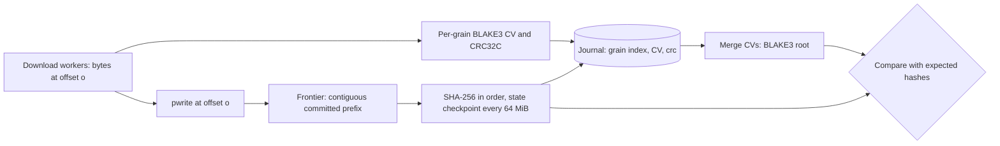
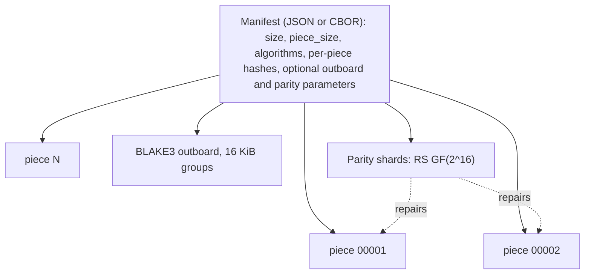

# Integrity, chunking, deduplication, delta encoding, erasure coding and file splitting

This document goes deeper than `research.md` sections 4.1, 4.3, 8.13 and 8.14. It covers how Haul should verify bytes, identify content, avoid re-transferring or re-storing it, and split or protect large files. Everything dated 2025 or 2026 was checked on 2026-10-05 against a primary source where one was reachable (secondary sources are labelled as such); items I could not verify are tagged **[unverified]**. Numbers marked "local" were measured or simulated for this document on one laptop (Intel Core i5-10300H, AVX2, no AVX-512, no SHA-NI, 7.8 GB RAM, other processes running, so expect roughly ±30% noise); the method notes are in the last section before the references.

## TL;DR

- **Hash roles.** Use BLAKE3 as Haul's internal content identity and per-grain verifier, and treat SHA-256 as an interoperability hash computed on demand. Local medians on a CPU without SHA-NI: SHA-256 0.31 GB/s, BLAKE3 2.58 GB/s on one thread (8.3x) and 7.37 GB/s multithreaded (24x). A single SHA-256 thread cannot keep up with a 2.5 Gbps link on that class of CPU; BLAKE3 keeps up with about 20 Gbps.
- **Parallel segments break streaming SHA-256.** Chromium's own downloader drops its incremental SHA-256 the moment a write creates a hole and re-reads the file at the end [Chromium: base_file.cc]. BLAKE3 solves this with subtree chaining values: hash power-of-two-aligned "grains" in any order, store each 32-byte value in the journal, merge at the end. I validated the merge rule against a pure-Python reference in 188 shuffled cases (0 failures) and confirmed that non-power-of-two segments fail.
- **Verified streaming** exists in BitTorrent v2 (SHA-256, 16 KiB leaves), Bao/iroh (BLAKE3, 1 KiB chunks or 16 KiB groups) and Xet (keyed BLAKE3 over chunk lists). A single-leaf Merkle proof is under 1 KB even for a 1 TiB file (832 B for BEP 52, 960 B for 1 KiB BLAKE3 leaves). Plain HTTP has no Merkle coding (the MICE draft expired in 2018); piece lists come from Metalink, Xet, or cloud part checksums, and `Content-Digest` covers a 206 body [RFC 9530].
- **Collision math.** SHA-256 over 10^12 items gives about 4.3e-54, not the 4e-51 in `research.md` 8.14 (a 1000x slip). Collisions are not a practical risk for 256-bit hashes; the real risks are 64-bit hashes (1e-6 at only 6.1 million items), adversarial MD5/SHA-1 collisions, and silent hardware errors. Decision hashes must be cryptographic; xxh3/CRC are prefilters only. Full SHA-256 is unbroken; the best practical collision attack reaches 35 of 64 steps (May 2026) [ePrint 2026/1080].
- **Chunking.** Gear hashing with normalized chunking is the best-supported default; differences between Rabin, Buzhash and Gear dedupe ratios are below 0.01 in a 2024 comparison [arXiv:2409.06066]. The Xet parameters (8 KiB / 64 KiB / 128 KiB, one 16-bit mask) give an exact mean of 63,677 B and force 15.3% of chunks at the 128 KiB cap (analytic, matched by simulation). Dedupe depends on edit locality: scattered 4 KiB edits touching 10% of a file leave only 13.6% of bytes reusable (local simulation), so "90% overlap means 2 GB moved" is wrong for dispersed edits.
- **Do not trust secret chunker parameters.** Key-recovery attacks work against the keyed CDC in Borg, Bupstash, Duplicacy, restic and Tarsnap [ePrint 2025/558]. Haul's planned encrypted sync must not rely on a secret polynomial or seed.
- **Delta.** The rsync algorithm needs a cooperating peer. For plain HTTP only zsync-style control files or RFC 9842 dictionaries work, and the latter cap the useful dictionary near 100 MB. Skip delta in the MVP. rsync's own security record (33 fixes in 3.5.0, August 2026, including a rolling-match bug) argues against shelling out to it on untrusted peers [rsync NEWS].
- **Dedupe ladder.** Size, then prefix/suffix, then BLAKE3, then reflink or kernel-verified `FIDEDUPERANGE`; no hardlinks by default. Near-duplicate methods (MinHash, SimHash, PDQ, dHash, embeddings) are advisory only and never trigger deletion.
- **Parity and fountain codes do not belong in the HTTP transfer path.** A retry costs `p` of the bytes while parity always costs `m/k`. Use Reed-Solomon (GF(2^16), Leopard-style FFT) for cold-storage splits, PAR2 for Usenet interop (PAR3 is still an alpha draft dated 2022-01-28), RaptorQ only for one-way or multi-source distribution. The exact RS(10,2) loss at p=0.02 is 0.1537%, so `research.md` 8.13's "0.15%" is right as a rounding but is the leading term only.
- **File splitting.** Ship cat-compatible pieces plus a manifest whose BLAKE3 root is computed from per-piece chaining values, so reassembly verifies without a second pass. Reassemble with offset writes (or reflinks); use independently decodable compression (seekable zstd frames) and always request `Accept-Encoding: identity` for ranged transfers.

## 1. Scope, threat model and trust ladder

Terminology used below (the corpus uses several overlapping words for "chunk"):

| Term | Meaning in this document | Typical size |
|---|---|---|
| Segment | Unit a download worker fetches with one Range request | 8-32 MiB (`research.md` 8.11) |
| Grain | Unit of hashing and journaling; a power-of-two multiple of 1 KiB; segments are unions of grains | 1 MiB (proposed) |
| BLAKE3 chunk | The 1 KiB leaf of the BLAKE3 tree [BLAKE3 paper] | 1 KiB |
| CDC chunk | Variable-size unit cut by a rolling hash for dedupe | 8 KiB-8 MiB |
| Piece | Unit of a split set, independently verifiable | 16-256 MiB |
| Shard or slice | Unit of an erasure code | 64 KiB-64 MiB |

What an integrity check defends against, and what it does not:

| Threat | Caught by | Not caught by |
|---|---|---|
| Bit flips or truncation on plain HTTP | End-to-end hash; the TCP checksum alone is weak: traces showed 1 in 1,100 to 1 in 32,000 packets failing it even where link CRCs should miss only 1 in 4 billion errors [Stone & Partridge 2000] | Nothing if no hash is compared |
| In-flight modification over HTTPS | TLS record integrity (general TLS property, not researched here) | A hash obtained over the same channel adds nothing beyond TLS |
| Server-side corruption or bit rot | Hash from an independent or earlier source | A hash the same server computes after the damage |
| Segmenting or offset bugs in the engine | Whole-file hash plus per-grain re-verification | A CRC taken from the same buffer that was written to the wrong offset |
| Disk or RAM faults, silent CPU errors | Re-read after fsync; fleet studies show wrong results without any error signal [arXiv:2102.11245] [Hochschild 2021] | A hash computed on the same faulty core |
| Malicious tampering | Publisher signature or out-of-band hash | A same-origin digest header |
| Dedupe-collision attacks | Cryptographic hash or byte comparison | Non-cryptographic prefilters used alone |

**Trust ladder** (what an "expected hash" is worth):

1. Supplied by the user out of band, or inside a signed manifest: protects against tampering and corruption.
2. Supplied by the same origin (an `Repr-Digest` header, an S3 checksum header, a Metalink file): protects against accidental corruption only.
3. Computed by Haul itself: gives identity and provenance ("these are the bytes I received"), not correctness.

Haul's manifest should record which rung each hash came from (`hash_source: user | origin | self`). This is an *Inference* from the threat table, not something an existing tool does uniformly.

## 2. Hash functions

### 2.1 Candidates, measured locally

Throughput is the median of eight single-call runs over a 128 MiB random buffer, one thread unless noted (Python 3.11 `hashlib` with its OpenSSL backend, `blake3` 1.0.10, `xxhash` 4.0.1, `google-crc32c` 1.9.0). The CPU has no SHA-NI, so the SHA-2 rows describe software implementations. Two earlier runs under heavier background load gave SHA-256 between 0.21 and 0.40 GB/s; treat all values as ±30%.

| Algorithm | Median GB/s | Security status (Oct 2026) | Parallelism and notes |
|---|---|---|---|
| MD5 | 0.55 | Broken; "Deprecated" in the RFC 9530 registry [RFC 9530] | Sequential |
| SHA-1 | 0.54 | Chosen-prefix collisions at 2^63.4 [SHA-1 Shambles]; NIST retires it by 2030-12-31 [NIST: hash policy] | Sequential |
| SHA-256 | 0.31 | No practical break; best practical collision 35/64 steps [ePrint 2026/1080] | Sequential (Merkle-Damgard); SHA-NI speeds it up where present |
| SHA-512 | 0.47 | Same family | Sequential; faster than SHA-256 on 64-bit CPUs without SHA-NI |
| SHA3-256 | 0.25 | Approved; NIST sees no need to move from SHA-2 to SHA-3 [NIST: hash policy] | Sequential sponge |
| BLAKE2b | 0.39 | RFC 7693 [RFC 7693] | CPython's bundled code, not an optimized AVX2 build; BLAKE2bp/sp are faster but rarely supported [BLAKE3 paper] |
| BLAKE3, 1 thread | 2.58 | 128-bit security, 7 rounds, 256-bit output [BLAKE3 paper] | SIMD across 1 KiB chunks |
| BLAKE3, 8 logical threads | 7.37 | Same | Tree gives unbounded parallelism; Rust `update_rayon`, `update_mmap_rayon` [blake3 docs] |
| xxh3-128 | 8.68 | Non-cryptographic | Prefilter only |
| CRC32C (hardware) | 11.0 | Error detection only | Combinable (section 2.3) |
| CRC32 (zlib) | 1.03 | Error detection only | Software table; the CRC32C instruction path is about 10x faster |

Reading the table: BLAKE3 is 8.3x SHA-256 on one thread and 23.8x with threads on this machine. Hashing a 20 GB file takes 64.5 s with SHA-256, 7.8 s with BLAKE3 on one thread, and 2.7 s with eight threads (local arithmetic from the medians). One SHA-256 thread keeps up with at most about 2.5 Gbps of network input here; one BLAKE3 thread keeps up with about 20 Gbps. *Inference:* on CPUs with SHA-NI (AMD Zen, Intel from Ice Lake client onward) SHA-256 is several times faster, so the policy below checks for the feature at run time; I did not measure that case.

### 2.2 Security status

- **SHA-2.** NIST states there is currently no need to transition from SHA-2 to SHA-3 and that SHA-1 usage should end by 2030-12-31 [NIST: hash policy]. The best published collision results on reduced SHA-256 are: a SAT-plus-CAS 38-step collision with a modified IV [arXiv:2406.20072], and, in May 2026, the first practical collisions on 35 steps of SHA-256 and SHA-512 with theoretical results to 36/37 steps [ePrint 2026/1080]. The full function has 64 steps.
- **SHA-1.** SHAttered (2017) needed about 2^63.1 compression-function calls, roughly 6,500 CPU-years plus 100 GPU-years [SHAttered]. The chosen-prefix attack costs 2^63.4 [SHA-1 Shambles]. Never use SHA-1 or MD5 as a trust anchor; accept them as legacy expected hashes with a visible warning.
- **BLAKE3.** The designers claim 128-bit security for the default 256-bit output and justify seven rounds from a decade of BLAKE/BLAKE2 cryptanalysis [BLAKE3 paper]. A search for 2025-2026 cryptanalysis found nothing specific to BLAKE3 (absence of evidence from one search, not a proof). Confidence that BLAKE3 is safe as a dedupe identity: Medium-High.
- **Features that matter to Haul.** BLAKE3 offers keyed hashing and key derivation (Xet uses keyed BLAKE3 for domain separation [Xet: hashing]), a tree structure that supports verified streaming, and an extendable output [BLAKE3 paper].
- **Web platform.** `SubtleCrypto.digest()` supports only SHA-1/256/384/512 and takes the whole input as one buffer; there is no streaming interface [MDN: SubtleCrypto.digest]. Subresource Integrity likewise requires only SHA-256/384/512 [W3C SRI]. So the in-browser fetch fallback should stream bytes to the daemon and hash there, not hash in the page.

### 2.3 Non-cryptographic checksums

- **CRC32C** (Castagnoli) is implemented in hardware on modern x86 and ARM and hit 11.0 GB/s here. **CRC-64/NVME** is the default S3 checksum [AWS: S3 integrity]. CRCs are *linear*, so the CRC of a concatenation can be computed from the CRCs and lengths of the parts. `crc32fast::Hasher::combine` does this for CRC-32 [crc32fast docs]; `crc-fast` 1.10.0 offers `checksum_combine` for CRC-32/ISCSI (CRC32C), CRC-32/ISO-HDLC and CRC-64/NVME and advertises more than 100 GiB/s for CRC-32 on modern systems [crc-fast docs] (vendor claim, not reproduced; its minimum Rust version is 1.89 per crates.io). S3 relies on exactly this property to offer full-object CRC checksums for multipart uploads [AWS: S3 upload integrity].
- **Strength.** A random corruption slips past a 32-bit CRC with probability 2^-32 = 2.3e-10, which is 0.23 expected misses per billion corruption events. That is fine to detect transport noise and wrong offsets, and not fine as the only check on an archive.
- **xxHash** (xxh3-64/128) ran at 8.7 GB/s locally. S3 now accepts XXHASH64, XXHASH3 and XXHASH128 as object checksum algorithms [AWS: S3 integrity]. Use it as a prefilter in duplicate detection (section 7), never as the decision.

### 2.4 Incremental versus after-the-fact hashing

Chromium's downloader is the best primary-source evidence of what a mature client does [Chromium: base_file.cc]:

- It keeps a SHA-256 state and updates it on every append.
- If a write arrives at an offset other than `bytes_so_far_`, it declares a hole, marks the file sparse and discards the hash state; a sparse (parallel) file does not hash incrementally.
- For a sparse file, `Finish()` rebuilds the hash by re-reading the file from the start (`CalculatePartialHash`) and truncates anything past the expected size.
- On resume of a non-sparse file it likewise re-reads the whole partial file from disk to rebuild the hash, optionally checking it against a stored prefix hash.

aria2 takes a different route: `--check-integrity` is off by default; with piece hashes it re-downloads only damaged pieces, with only a whole-file hash a mismatch means re-downloading from scratch, and `--realtime-chunk-checksum` (default on) validates chunks while downloading when chunk checksums are provided [aria2 manual].

The costs, using the local medians: hashing inline overlaps with network wait and adds no wall-clock time as long as hash throughput exceeds link rate. Hashing afterwards must re-read the file; a 20 GB file will not fit in the page cache of a 7.8 GB machine, so the re-read comes from disk and adds I/O on top of 64.5 s (SHA-256) or 7.8 s (BLAKE3) of compute. Inline BLAKE3 costs 4.8% of one core at 1 Gbps and 48% at 10 Gbps; inline SHA-256 costs 40% of one core at 1 Gbps and exceeds one core above 2.5 Gbps.

### 2.5 Out-of-order segments: the hash frontier and BLAKE3 subtree merging

Parallel segmented downloads finish out of order, which defeats any sequential hash. There are two complementary answers.

**A. A tree hash that composes: BLAKE3 grain chaining values.** BLAKE3 splits input into 1 KiB chunks; every left subtree is a full power-of-two-sized subtree and is at least as large as its right sibling [BLAKE3 paper]. Therefore any aligned, power-of-two-sized run of chunks that lies fully inside the input is a node of the final tree, and its chaining value (CV) can be computed independently, as long as the chunk counter starts at the run's global chunk index. The Rust crate exposes this in `blake3::hazmat`: `HasherExt::set_input_offset`, `finalize_non_root`, `merge_subtrees_non_root` and `merge_subtrees_root`, with a warning that wrong tree shapes produce garbage and break security properties [blake3 hazmat docs]. The 1.8.7 docs also state the constraints that shape Haul's design: the offset must be a multiple of the 1 KiB chunk length; a subtree's starting offset implies a maximum possible length; only subtrees on the right edge of the whole tree may be shorter than that maximum; and a non-zero offset must be paired with `finalize_non_root`, never `finalize` [blake3 hazmat docs]. (Signatures confirmed: `set_input_offset(&mut self, u64) -> &mut Self`, `finalize_non_root(&self) -> ChainingValue`, `merge_subtrees_non_root(&ChainingValue, &ChainingValue, Mode) -> ChainingValue`, `merge_subtrees_root(...) -> Hash`.)

I validated the *algorithm* with a pure-Python BLAKE3 written from the spec (it matched `blake3` 1.0.10 on 15 test lengths from 0 to 100,000 bytes). Then, for 188 combinations of segment size (1 to 64 KiB) and total length (including partial last segments), I hashed each segment independently in shuffled order, merged the CVs with the "largest power of two below n" rule, and compared with the one-shot hash: 188 of 188 equal. Using 3 KiB segments (not a power of two) gave a different hash, as predicted. The Rust snippet below uses the verified signatures but was not compiled here (no MSVC linker in the sandbox).

```rust
// Illustrative. grain = 1 MiB (power-of-two multiple of 1024).
fn grain_cv(bytes: &[u8], grain_index: u64, grain: u64) -> ChainingValue {
    let mut h = blake3::Hasher::new();
    h.set_input_offset(grain_index * grain);
    h.update(bytes);
    h.finalize_non_root()                // 32-byte CV, stored in the journal
}
// root = recursive merge: split the CV list at the largest power of two < n,
// merge_subtrees_non_root for inner nodes, merge_subtrees_root at the top.
// A file of one grain or less must be finalized as root directly.
```

Properties: grains can be hashed by whichever worker fetched them; the journal stores 32 B per grain (3.1 MB per 100 GiB at 1 MiB grains); on resume nothing is re-hashed; a flipped bit is localized to one grain; and the final root needs no re-read. Dynamic work stealing (`research.md` 8.7) must split at grain boundaries. *Inference:* a 1 MiB grain keeps enough parallelism inside the hasher (1,024 BLAKE3 chunks) to stay SIMD-efficient.

**B. A sequential hash for interoperability: the frontier.** Published checksums are mostly SHA-256 (or SHA-512, MD5, SHA-1). A frontier task hashes the contiguous prefix of committed grains in order, reading recent grains back from the page cache (they were just written) rather than holding them in a reorder buffer. With N workers on S-MiB segments the frontier lags at most N x S MiB behind (128 MiB for 8 x 16 MiB; 512 MiB for 16 x 32 MiB). Because `sha2` 0.11.0 implements `SerializableState` for `Sha256` (confirmed in its docs.rs page), the daemon can persist the hash state with its offset every, say, 64 MiB and avoid Chromium's rehash-on-resume. For a 20 GB file at 80% done, Chromium's approach would re-hash 16 GB, about 52 s at 0.31 GB/s.



**C. Combine CRCs too.** Per-grain CRC32C values can be combined to check an object-level CRC32C (GCS) or CRC-32/CRC-64-NVME (S3 full-object type) without a sequential pass (section 3.4).

## 3. Verified streaming

### 3.1 Structures compared

| System | Leaf and hash | Tree | Range and proof support | Notes |
|---|---|---|---|---|
| BitTorrent v2, BEP 52 | 16 KiB blocks, SHA-256 | Binary Merkle tree per file; missing leaves are zero hashes; pieces root per file; "piece layers" hold one hash per piece; piece length is a power of two at least 16 KiB | Hash request/response messages carry uncle hashes; request length is a power of two from 2 to 512 [BEP 52] | Identical files have identical roots, enabling cross-torrent dedupe |
| Bao / BLAKE3 | 1 KiB chunk, 64-byte parent nodes holding both child CVs | The BLAKE3 tree | Combined encoding is an 8-byte length header plus chunks and parents in pre-order; outboard omits the chunks; slices include only the nodes on the path [Bao spec] | Sibling-only proofs would be 32 B per level; Bao ships whole 64 B parents |
| iroh-blobs | BLAKE3, 16 KiB chunk groups | Bao tree with groups (`BlockSize::from_chunk_log(4)`) | Ranges are requested by hash and byte range; minimum granularity 16 KiB; worst-case range overhead about two chunk groups; both sides validate [iroh-blobs protocol] [bao-tree docs] | Outboard shrinks 16x versus 1 KiB leaves |
| Xet | Keyed BLAKE3 over each chunk | Xorb hash = keyed BLAKE3 over a text list of child hashes and sizes; file hash = keyed hash of the root with an all-zero key | Reconstruction terms carry range verification hashes [Xet: hashing] | Domain separation by fixed keys: chunk, internal node, term verification, and an all-zero key for the file hash |
| Certificate Transparency | Any hash, leaf prefix 0x00, node prefix 0x01 | Split at the largest power of two below n | Inclusion proof is the shortest list of missing sibling nodes, about log2 n hashes [RFC 9162] | Reference for domain separation |
| Metalink 4 | Per-piece hash list, declared `type` and `length` | Flat list, not a tree | Whole-file hashes plus piece lists [RFC 5854] | Mirrors via [RFC 6249] |
| MICE (expired draft) | Records of 4096 B by default, SHA-256 | Hash chain from the end | Progressive verification of a single body [IETF draft MICE] | Last revision 2018-08-13; not an RFC |

### 3.2 Proof sizes and overheads (computed)

A single-leaf inclusion proof has depth $\lceil \log_2 L \rceil$ for $L$ leaves, so $32 \lceil \log_2 L \rceil$ bytes of sibling hashes. Bao ships 64-byte parents, so on the wire its path costs up to twice that. The outboard size is $8 + 64(\lceil F/g \rceil - 1)$ bytes for file size $F$ and group size $g$.

| File size | BEP 52 leaves / depth / proof | BLAKE3 1 KiB leaves / depth / proof |
|---|---|---|
| 1 MiB | 64 / 6 / 192 B | 1,024 / 10 / 320 B |
| 1 GiB | 65,536 / 16 / 512 B | 1,048,576 / 20 / 640 B |
| 20 GiB | 1,310,720 / 21 / 672 B | 20,971,520 / 25 / 800 B |
| 100 GiB | 6,553,600 / 23 / 736 B | 104,857,600 / 27 / 864 B |
| 1 TiB | 67,108,864 / 26 / 832 B | 1,073,741,824 / 30 / 960 B |

Other overheads (all computed):

- Bao outboard: 6.25% of the data with 1 KiB leaves (64 MiB for a 1 GiB file), 0.39% with 16 KiB groups (4 MiB per GiB).
- BEP 52 piece layer for 20 GiB: 2.5 MiB at 256 KiB pieces, 0.156 MiB at 4 MiB pieces, 0.039 MiB at 16 MiB pieces.
- Xet-style flat chunk list: 312,500 chunks for 20 GB at 64 KB, 32 B each is 10 MB, 0.05%. Cross-check: 45 PB over 690 billion chunks (both from Hugging Face's February 2025 post) is 65.2 KB per chunk [HF blog: chunks to blocks].
- Segment-level: 100 GiB in 8 MiB segments is 12,800 segments; a flat list is 400 KiB, while a path proof for one segment against the BLAKE3 root is 14 CVs = 448 B.

*Takeaway:* proofs are tiny; the cost of a Merkle design is the stored tree (outboard) and the extra protocol, not the proof bytes. For Haul's own downloads the journal's per-grain CV list is the tree.

### 3.3 What HTTP gives you

- **Digest fields.** RFC 9530 defines `Content-Digest` (the message content as sent, so it changes with range requests and content codings) and `Repr-Digest` (the selected representation), with `Want-*` negotiation. Active algorithms are `sha-256` and `sha-512`; `md5`, `sha`, `unixsum`, `unixcksum`, `adler` and `crc32c` are "Deprecated". It obsoletes RFC 3230 [RFC 9530]. In a 206 response `Content-Digest` covers just the returned range, which allows a per-segment check when a server sends it; `Repr-Digest` applies once the whole object is assembled. Server support is thin in practice (*Inference*; not surveyed), so Haul should parse them opportunistically.
- **Range semantics.** Ranges address the representation's octets after content coding (section 14.1 of [RFC 9110]). For segmented transfers send `Accept-Encoding: identity` (already in `research.md`), and never let a client library transparently decode, or the hash will not match the published one. GCS shows the trap: with decompressive transcoding the stored checksum describes the compressed object, so the served bytes cannot be validated against it [GCS: data validation].
- **Metalink.** `metalink:pieces` carries a `type` and a `length` and a list of piece hashes [RFC 5854]. aria2 uses piece hashes to repair only damaged pieces [aria2 manual].
- **zsync.** The server-side checksum control file plus HTTP range requests lets a client reuse old local data without special server software [zsync].

### 3.4 Cloud object stores

| Store | What the API gives | Traps |
|---|---|---|
| Amazon S3 | Algorithms: CRC64NVME (default), CRC32, CRC32C, SHA1, SHA256, MD5, XXHASH64, XXHASH3, XXHASH128, SHA512 (list as published on 2026-10-05). Multipart objects carry either a full-object checksum (CRC types only, because CRCs combine) or a composite checksum over part checksums. A GET naming a part number or a part-aligned byte range returns that part's checksum; `GetObjectAttributes` returns per-part checksums [AWS: S3 upload integrity] | The ETag is an MD5 only for single-part, non-KMS, non-SSE-C objects; a multipart ETag is the MD5 of the concatenated part MD5s plus `-N`; copying a multipart object changes a composite checksum even though the data is unchanged [AWS: S3 upload integrity]. SDKs now compute a checksum by default [AWS: S3 upload integrity] |
| Google Cloud Storage | CRC32C (recommended) and MD5 via `X-Goog-Hash` or `x-goog-hash`; composite objects have CRC32C only [GCS: data validation] | Decompressive transcoding invalidates checksum validation (above) |
| Azure Blob | `Content-MD5` on full reads when stored; `x-ms-range-get-content-md5` or `x-ms-range-get-content-crc64` return a range hash only for ranges up to 4 MiB; `x-ms-blob-content-md5` carries the whole-blob MD5; version 2025-01-05 adds a structured body (`XSM/1.0; properties=crc64`) with CRC64 segments [Azure: Get Blob] | A ranged GET's `Content-MD5` describes only the range |

Design consequence: when the source is an object store and part boundaries are known, choose grain and segment boundaries that nest inside parts, and verify with a combined CRC where a full-object CRC exists. S3's own `x-amz-checksum-*` trailers apply to uploads, not to Haul's downloads.

### 3.5 Mismatch triage (proposed)

When the final hash disagrees and only a whole-file hash exists, aria2 re-downloads everything [aria2 manual]. A cheaper deterministic procedure:

1. Re-fetch every grain once over a *fresh* connection (preferably a different mirror) and compute CVs again.
2. Grains whose CVs differ between attempt 1 and attempt 2 are transport corruption; keep the version that makes the whole-file hash match.
3. If all grains are stable but the whole-file hash still fails, the source is serving consistent wrong bytes (or the expected hash is wrong): stop with `integrity_mismatch/source`.
4. Cost: 2x bytes only on failure, and 0 extra on success.

## 4. Collision and birthday bounds

For $n$ items and a $b$-bit hash, the probability that some pair collides is

$$P \approx 1 - e^{-n(n-1)/2^{b+1}} \approx \frac{n^2}{2^{b+1}} \quad (\text{when } P \ll 1).$$

In words: the collision chance grows with the square of the number of items and shrinks by half for every extra bit. A 50% chance needs about $1.1774 \cdot 2^{b/2}$ items.

| b | n = 1e6 | n = 1e9 | n = 1e12 | n = 1e15 |
|---|---|---|---|---|
| 64 | 2.7e-8 | 0.027 | about 1 | about 1 |
| 128 | 1.5e-27 | 1.5e-21 | 1.5e-15 | 1.5e-9 |
| 160 | 3.4e-37 | 3.4e-31 | 3.4e-25 | 3.4e-19 |
| 256 | 4.3e-66 | 4.3e-60 | 4.3e-54 | 4.3e-48 |

Checks and consequences:

- **`research.md` 8.14 is off by 1000x.** With SHA-256 and $10^{12}$ chunks, $n^2/2^{257} = 10^{24}/2.31 \times 10^{77} = 4.3 \times 10^{-54}$, not $4 \times 10^{-51}$. The conclusion (negligible) is unchanged.
- **Compare with hardware.** $10^{12}$ chunks of 64 KB is 64 PB. At a spec-sheet unrecoverable error rate of 1 per $10^{15}$ bits (the rating of newer large IronWolf Pro drives; older and smaller models are rated 1 per $10^{14}$ [Seagate IronWolf datasheets]) reading it would see about 512 read errors. Disk errors beat SHA-256 collisions by roughly 56 orders of magnitude.
- **64-bit hashes are not safe at scale.** $P = 10^{-6}$ arrives at only $6.1 \times 10^{6}$ items and 50% at $5.1 \times 10^{9}$. For 128-bit non-cryptographic hashes $P=10^{-6}$ needs $2.6 \times 10^{16}$ items, far beyond any single user.
- **Adversaries change the math.** The formula is for non-adversarial inputs. MD5 collisions are cheap and SHA-1 chosen-prefix collisions cost 2^63.4 [SHA-1 Shambles], so an attacker-supplied file could be crafted to collide with a victim file in an MD5/SHA-1/xxHash/CRC index. Agents download untrusted files, so this is in scope.
- **Safety rule for dedupe.** The decision to treat two files as identical requires (a) equal size, and (b) either equal BLAKE3-256 or SHA-256 *or* a byte comparison. On Linux, `FIDEDUPERANGE` makes the kernel compare the data before sharing extents, which removes hash trust entirely [FIDEDUPERANGE]. *Inference:* for single-user local dedupe that is a belt-and-braces choice, cheap relative to the I/O.
- **CDC chunk identity** (section 5) is a separate use of the same bound: chunk ids are compared across a store, so they must be 256-bit cryptographic hashes; Xet uses 32-byte keyed BLAKE3 [Xet: hashing].

## 5. Content-defined chunking

### 5.1 Mechanism and algorithm families

CDC declares a cut where a rolling function of the last few bytes satisfies a condition, so boundaries move with the data and an insertion disturbs only nearby chunks. With a mask of $k$ one-bits the cut probability per byte is $2^{-k}$.

| Family | Representative | Rolling state and per-byte work | Evidence and caveats |
|---|---|---|---|
| Rabin fingerprint | LBFS: 48-byte window, probability 2^-13 per byte, 2 KiB minimum and 64 KiB maximum [LBFS]; restic: 64-byte window, per-repository random polynomial [restic design] | Polynomial arithmetic with tables; slowest | 202 MB/s in a 2024 comparison versus 941 MB/s for SIMD Gear, on their testbed [arXiv:2409.06066] |
| Buzhash | Borg (window 4095 B), casync | Cyclic-polynomial rotate and XOR | Dedupe within 0.01 of Rabin and Gear [arXiv:2409.06066] |
| Gear | FastCDC, Xet | $h \leftarrow (h \ll 1) + T[b]$; one shift, one add, one lookup; the old bytes fall out of a 64-bit state, so the effective window is 64 bytes [Xet: chunking] | About 10x faster than Rabin CDC and 3x faster than Gear- and AE-based CDC in the FastCDC paper [FastCDC ATC16]; 3-12x in the journal version [FastCDC TPDS 2020] |
| Extremum / maximum | AE (INFOCOM 2015, about 3x throughput claim [AE INFOCOM15]); RAM [RAM FGCS17] | Hashless; compare byte values inside an asymmetric window | Competitive across metrics in the 2024 comparison, though AE may degrade at larger target sizes [arXiv:2409.06066] |
| Vectorized hashless | SeqCDC (about 15x over unaccelerated, 1.2-1.35x over vector-accelerated [arXiv:2505.21194]); VectorCDC (21-46x over prior vector acceleration [FAST25 VectorCDC]) | SSE/AVX | Evaluate once chunking, not hashing or I/O, is the bottleneck |
| Two thresholds, two divisors | TTTD (HP Labs 2005 [TTTD HP]) | A backup divisor when the max is near | Precursor of normalization |
| Provable bounds | Chonkers (2025): strict guarantees on chunk size and edit locality [arXiv:2509.11121] | Not rolling-hash based | Too new to rely on; track |
| UltraCDC | Zhou, Wang, Xia, Zhang, 2022 [UltraCDC 2022] | Not reviewed in detail | **[unverified]** beyond bibliographic data |

### 5.2 Gear, FastCDC and normalized chunking

FastCDC combines five techniques: the Gear rolling hash, a cheaper hash-judgment test, skipping cut-points below the minimum size, normalized chunking, and rolling two bytes per step [FastCDC TPDS 2020]. Two facts matter for sizing:

- **Skipping the minimum shifts the mean.** The paper states that after cut-point skipping the average chunk size exceeds the nominal expected size by the minimum chunk size [FastCDC ATC16].
- **Normalized chunking (NC)** uses a harder mask ($k+N$ one-bits) before a "normal size" and an easier mask ($k-N$) after it, tightening the size distribution so a larger minimum can be used without hurting dedupe. For 8 KiB the paper's level 2 uses 15 and 11 bits; the highest level degenerates to fixed-size chunking [FastCDC ATC16].

Rust options: the `fastcdc` crate 5.0.0 (MIT) offers `ronomon`, `v2016` and `v2020` modules, recommends `v2020` for new code, and `new()` defaults to normalization level 1 [fastcdc docs]; Xet's reference Gear implementation is the `gearhash` crate (0.1.4, MIT or Apache-2.0), whose SIMD paths produce the same boundaries as the scalar path [Xet: chunking] [crates.io API]. *Inference:* `fastcdc`'s constants and two-mask scheme differ from the Xet spec, so it will not reproduce Xet chunk boundaries; test against the Xet reference files before assuming compatibility.

The 2024 comparison of many CDC algorithms on four 10 GiB datasets found differences below 0.01 in dedupe ratio among Rabin, Buzhash and Gear variants, and named Gear with normalized chunking the best overall choice on throughput, size consistency and dedupe together [arXiv:2409.06066]. Confidence: Medium (one study, specific datasets).

### 5.3 Expected chunk size: formula, Xet parameters, simulation

For a single mask with cut probability $p = 2^{-k}$, a minimum $m$ (a cut is tested once size reaches $m$) and a maximum $M$, let $L = M - m$. The chunk size is $S = \min(m + J, M)$ with $J$ geometric, so

$$E[S] = m + \frac{(1-p)\left(1-(1-p)^{L}\right)}{p}, \qquad P(\text{forced at } M) = (1-p)^{L} \approx e^{-Lp}.$$

In words: the mean is the minimum plus a geometric wait of about $2^k$ bytes, truncated at the maximum, and the share of chunks cut by the cap is $e^{-L/2^k}$.

**Xet's parameters** [Xet: chunking] are minimum 8 KiB, maximum 128 KiB, mask `0xFFFF000000000000` (16 bits), $h$ reset to 0 at each cut, target "64 KiB". Plugging in: $E[S] = 8192 + (1-p)(1-0.1534)\cdot 65536 = 63{,}677$ B (62.2 KiB), and $P(\text{forced}) = e^{-122880/65536} = 15.3\%$. So the "64 KiB" target is really 62.2 KiB, and about one chunk in six is cut by the size cap, not by content, which weakens boundary stability for those chunks.

I verified the formula and the NC variants with a C simulation (xorshift random data, 256 MiB, fixed seed; Gear table of random 64-bit words; my own FastCDC-style implementation with the minimum skipped, two masks, switch at the "normal" size). Analytic and simulated values:

| Configuration | Mean (analytic / simulated) | Std dev | Forced at max |
|---|---|---|---|
| Xet spec 8K / 64K / 128K, single 16-bit mask | 63,677 / 64,005 | 41,521 / 41,538 | 15.3% / 15.7% |
| 16K / 64K / 256K, 16 bits, NC level 0 | 80,379 / 80,346 | 59,456 / 59,678 | 2.4% / 2.5% |
| same, NC level 1 (17/15 bits) | 79,837 / 80,660 | 39,006 / 39,262 | 0.2% / 0.1% |
| same, NC level 2 (18/14 bits) | 74,786 / 75,108 | 22,442 / 21,807 | 0.0% / 0.0% |
| 2K / 8K / 64K, 13 bits, NC level 0 | 10,236 / 10,179 | 8,164 / 8,176 | 0.0% / 0.1% |
| same, NC level 2 (15/11 bits) | 9,348 / 9,351 | 2,805 / 2,798 | 0.0% / 0.0% |

*Takeaway.* The nominal "average" parameter is not the mean (the 64 KiB-labelled FastCDC-style configuration averages about 80 KB). NC level 2 cuts the standard deviation by 63% (59.7k to 21.8k) and eliminates forced cuts. Real data is not uniform random, so skewed or low-entropy files shift these numbers; the formulas are the planning tool and the tests in "Implications" re-measure on real corpora.

### 5.4 Hugging Face Xet in numbers

- **Spec.** Gear chunking as above; chunk hash = BLAKE3 keyed with a fixed `DATA_KEY`; xorbs aggregate chunks up to 64 MB and 8,192 chunks; shards list xorbs for dedupe [Xet: chunking] [Xet: deduplication] [Xet: hashing].
- **Global dedupe is sampled.** Only the first chunk of each file and chunks whose last 8 hash bytes (little-endian) are divisible by 1024 may query the global index; clients are advised to query about once per 4 MB. Chunk hashes in responses are HMAC-protected so the server never reveals raw hashes to non-owners [Xet: deduplication]. For a 20 GB file that is about 305 eligible chunks plus the first (computed from 312,500 / 1024).
- **Fragmentation control.** Prefer runs of at least 8 chunks (or at least 1 MB average contiguous) over dedupe of every chunk [Xet: deduplication].
- **Measured results published by Hugging Face.**
  - November 2024: fine-tuned models and checkpoints dedupe by 30-85%; a GPT-2 pair went from 1.2 GB to 645 MB stored (46% saved); CORD-19 storage 8.9 GB to 3.52 GB [HF blog: files to chunks].
  - February 2025: Hub at about 45 PB; a Gemma-2-9b-it GGUF repository of 191 GB stored as about 97 GB (49% saved) in 1,515 blocks; uploads at 50 MB/s fell from 509 to 258 minutes (1.97x); blocks cut CAS entries about 1,000x; only about 0.1% of chunks serve as global-dedupe keys [HF blog: chunks to blocks].
  - October 2024, Parquet: for a 2 GB, 1,092,000-row FineWeb file, appending 10,000 rows deduped 99.1% (20 MB new); changing one row deduped 89% (230 MB new, because column headers hold absolute offsets); deleting a row re-aligns row groups and dedupes poorly [HF blog: Parquet dedupe].
  - July 2025: PyArrow 21.0.0 can write Parquet with content-defined page boundaries (`use_content_defined_chunking=True`). Inserting or deleting rows transferred 78-90% of the file without it and about 6-8% with it (insert 6.0 of 99.3 MB, delete 7.57 of 92.4 MB, append 10.3 of 106 MB) [HF blog: Parquet CDC].
- **Libraries.** crates.io lists `hf-xet` 1.6.0, `xet-data` ("chunking, deduplication, and file reconstruction"), `xet-client` and `xet-core-structures` (MerkleHash, shards, xorbs), all from `huggingface/xet-core` at version 1.6.0 (2026-08-03); `hf-xet` is Apache-2.0 [crates.io API].

### 5.5 Backup and container tools

| Tool | Chunker and parameters | Chunk identity | Secrecy | Source |
|---|---|---|---|---|
| restic | Rabin, 64-byte window; files under 512 KiB unsplit; blobs 512 KiB-8 MiB, 1 MiB average | SHA-256 | Random irreducible polynomial stored in the repo `config`, meant to make watermark attacks harder | [restic design] |
| Borg 1.4.5 | Buzhash; defaults min 2^19 (512 KiB), max 2^23 (8 MiB), mask 21 bits (about 2 MiB target), window 4095 B; also a fixed-block chunker | Not the buzhash (buzhash only picks cuts) | Buzhash table XORed with a per-repo seed stored encrypted | [borg internals] |
| casync | Buzhash | SHA-512/256 (or SHA-256); chunks zstd-compressed in `.castr` stores; `.caibx`/`.caidx` index files | None | [casync] |
| zstd:chunked | Not rolling-hash CDC: each file in its own zstd frame; skippable frames hold a table of contents with SHA-256 of files and chunks; partial pulls fetch missing ranges; matching local files are hardlinked or reflinked | SHA-256 | None | [zstd:chunked] |
| Xet | Gear, 8K/64K/128K | Keyed BLAKE3 | HMAC on global dedupe responses | [Xet: chunking] |

zstd:chunked is described by its own documentation as "not officially standardized" beyond the reference implementation [zstd:chunked].

### 5.6 The security of CDC parameters

Two 2025 papers break the idea that secret chunker parameters hide data. Alexeev, Percival and Zhang present attacks that extract per-user chunking parameters and describe the loss of security afterwards [arXiv:2504.02095]. Truong, Merz, Scarlata, Günther and Paterson mount key recovery against five keyed CDC implementations (Borg, Bupstash, Duplicacy, restic, Tarsnap) and propose the first formal treatment plus a provably secure construction [ePrint 2025/558]. Confidence: High that current keyed-CDC schemes are unsafe as deployed. For Haul: a locally stored dedupe index leaks nothing new, but the planned Pro sync (`research.md` roadmap) must not market chunk-level dedupe on end-to-end-encrypted data unless it adopts a vetted design; fixed-size chunking against a keyed hash is the conservative fallback (a cost in dedupe, not in safety).

### 5.7 Edit locality: when CDC does not help

`research.md` 8.14 says a 20 GB checkpoint with 90% overlap moves about 2 GB. That holds only when the changed 10% is contiguous. I simulated the Xet-spec chunker on 64 MiB (random data):

| Edit pattern | Bytes in unchanged chunks | Naive model $(1-d)^{c/e}$ | Byte overlap $1-d$ |
|---|---|---|---|
| 1-byte insertion at 10 MiB | 99.89% (about 1 of 1,067 chunks changed); fixed 64 KiB blocks: 15.6% | n/a | n/a |
| 4 KiB regions edited, density 1% | 77.5% | 85.5% | 99% |
| 4 KiB regions edited, density 5% | 34.4% | 45.1% | 95% |
| 4 KiB regions edited, density 10% | 13.6% | 19.4% | 90% |

For a 20 GB file the scattered 10% case re-sends 17.3 GB, not 2 GB (4.5 GB at 1%, 13.1 GB at 5%). The naive model is optimistic because larger chunks are more likely to contain an edit. Fine-tuned checkpoints, which touch every tensor a little, therefore dedupe poorly, which is consistent with Hugging Face's wide 30-85% range [HF blog: files to chunks]. *Inference:* choose chunk size to the edit granularity of the data, and use format-aware boundaries when available (Parquet pages above).

### 5.8 Recent research (2024-2026)

Gregoriadis et al., a rigorous comparison of CDC algorithms (arXiv:2409.06066, submitted September 2024) [arXiv:2409.06066]; SeqCDC (arXiv:2505.21194, May 2025) [arXiv:2505.21194]; VectorCDC at FAST 2025 and its extended arXiv version [FAST25 VectorCDC] [arXiv:2508.05797]; Chonkers (arXiv:2509.11121, September 2025) [arXiv:2509.11121]; the two chunking-attack papers above. No paper I found changes the Gear-plus-NC recommendation.

## 6. rsync, delta encodings and HTTP-level delta

### 6.1 The rsync algorithm

The receiver splits its old file $B$ into fixed blocks of $S$ bytes and sends a weak 32-bit rolling checksum and a strong 128-bit MD4 checksum per block; the sender scans its new file $A$ at every byte offset, sending block references for matches and literal bytes otherwise [rsync tech report]. The weak checksum over bytes $X_k \ldots X_l$ with $M = 2^{16}$ is

$$a(k,l) = \Big(\sum_{i=k}^{l} X_i\Big) \bmod M, \quad b(k,l) = \Big(\sum_{i=k}^{l} (l-i+1)X_i\Big) \bmod M, \quad s(k,l) = a + 2^{16} b,$$

and it rolls forward in constant time: $a(k{+}1,l{+}1) = a(k,l) - X_k + X_{l+1}$ and $b(k{+}1,l{+}1) = b(k,l) - (l-k+1)X_k + a(k{+}1,l{+}1)$, all mod $M$ [rsync tech report]. Modern rsync negotiates stronger per-file checksums: 3.2.0 (2020) added xxHash and a negotiation heuristic, and 3.3.0 added SHA-1 at the lowest priority [rsync NEWS].

**A derived scaling limit (Inference, Medium confidence).** A weak-checksum hit forces a strong hash over $S$ bytes. If weak sums were uniform, a random offset hits one of $n = F/S$ stored sums with probability $n/2^{32}$, so false-alarm hashing costs $nS/2^{32} = F/2^{32}$ strong-hashed bytes per scanned byte, independent of block size. That is 0.23 for 1 GB, 1.0 at 4.29 GB, 4.7 for 20 GB and 23 for 100 GB. Real weak sums are not uniform (low-entropy data collides more), so the true cost is higher. The signature itself is small: 20 GB at 128 KiB blocks is 152,588 blocks times 20 B, 3.05 MB. The lesson is architectural: a 32-bit weak hash saturates beyond a few GiB, which is one reason CDC with 256-bit chunk ids (no per-byte strong hashing) scales better for big files.

### 6.2 rsync's security record

rsync 3.4.0 (2025-01-15) fixed six CVEs, including a heap overflow in checksum handling (CVE-2024-12084) and an information leak during checksum comparison (CVE-2024-12085) [rsync security page]. rsync 3.5.0 (2026-08-13) fixed 33 issues from a focused audit of path handling and the daemon protocol; 3.5.1 followed on 2026-09-21 [rsync NEWS]. Two entries concern checksum machinery directly: a receiver-supplied checksum header with block count above zero and block length zero drove the sender's rolling-match arithmetic negative (CVE-2026-53792), and a zero `--max-alloc` disabled the allocation cap that was the defense behind CVE-2024-12084 (CVE-2026-53794); the AVX2 rolling-checksum assembly also read up to 64 bytes past its buffer [rsync NEWS]. *Inference:* checksum-header parsing and hand-tuned rolling-hash code are recurring bug sources; fuzz Haul's own parsers and avoid delegating to a C rsync binary against untrusted servers without a sandbox.

### 6.3 Delta formats

| Method | Where the work happens | Needs | Notes |
|---|---|---|---|
| VCDIFF, RFC 3284 | Encoder compares source and target | Both versions at the encoder | Generic format; xdelta3 implements it [RFC 3284] [xdelta3] |
| bsdiff | Suffix sorting, then bzip2 | Both versions | Memory $\max(17n, 9n+m)$ for old size $n$, new size $m$ (17 GiB for a 1 GiB old file); patching needs $n+m$ [bsdiff]. Rust: `qbsdiff` 1.4.4 [crates.io API] |
| zstd `--patch-from` | Old file acts as a dictionary with window larger than the source | Both versions | Window above $2^{27}$ needs `--long`/`--memory` on the decoder; the man page says single-thread mode above level 15 gives lower ratios [zstd man page]; v1.5.7 is the latest tagged release at the time of writing [zstd releases] |
| rsync | Receiver sends signatures, sender computes the delta | A cooperating peer | Section 6.1 |
| zsync | Client computes the delta using a server-prepared control file and HTTP ranges | A `.zsync` file next to the artifact | Compressed files need a `zsyncmake` recompression trick [zsync] |
| HTTP dictionary transport, RFC 9842 (September 2025) | Server compresses against a prior response the client already has | Server support; `Use-As-Dictionary`, `Available-Dictionary`, `Dictionary-ID`; encodings `dcb` and `dcz` | `dcb` uses a 36-byte header (magic plus SHA-256 of the dictionary) and a window up to 16 MB; `dcz` a 40-byte skippable-frame header with a window of at least max(8 MB, 1.25 x dictionary) up to 128 MB; secure contexts only [RFC 9842] |
| RFC 3229 delta encoding | `A-IM` negotiation | Server and proxy support | Old proposed standard [RFC 3229]; I found no evidence of broad use (*Inference*) |
| Ddelta (Gear chunking plus fingerprints to find duplicate strings) | Encoder | Both versions | Reported 2.5-8x faster encoding and 2-20x faster decoding than xdelta and zdelta at comparable ratio [Ddelta] |
| CDC chunk reuse | Client skips chunks already stored | A chunk-addressed store | Xet; casync; zstd:chunked |

The `dcz` window cap means a delta against a dictionary of about 102 MB at most (128 MB / 1.25), so RFC 9842 targets web assets and small artifacts, not multi-gigabyte model files. Plain `zstd` as an HTTP content coding is limited to an 8 MB window [RFC 9659].

### 6.4 What this means for HTTP downloads

Without server cooperation a client cannot know which parts of a changed remote file match its old copy, so it must download the new bytes. Delta wins therefore come from: Xet-backed Hub repositories, OCI layers using zstd:chunked, Metalink or torrent piece lists (skip unchanged pieces), cloud-object per-part checksums (skip identical parts), and local-to-local copies (reflinks, rsync). A generic delta engine is not an MVP feature.

## 7. Duplicate detection

### 7.1 The ladder

Distinguish four levels of "same", because the right action differs:

| Level | Definition | Method | Action allowed |
|---|---|---|---|
| Byte-identical | Same bytes | Size, prefix/suffix, BLAKE3 or SHA-256, or kernel byte compare | Link, reflink, or trash one copy after dry run |
| Canonically identical | Same content, different container metadata (a re-saved PDF, a retagged audio file, a re-zipped Office file) | Format-specific normalization (*Inference*) | Report; ask |
| Near-duplicate | Small edits | MinHash, SimHash, perceptual hashes | Report with a score; never delete |
| Semantic duplicate | Different bytes, same meaning or scene | Embeddings | Report only |

### 7.2 Exact duplicates

`fclones` documents a seven-stage pipeline: scan and filter, group by size, drop identical inodes, prefix hash, suffix hash, full hash (skipped when a file was already fully hashed), report; every stage but the last is parallel; the default hash is metro (128-bit, non-cryptographic) with xxh3, blake3, sha256, sha512 and sha3 as options; thread counts are tuned per device type (HDD `8,1`, SSD `4,1`); hard and symbolic links are not treated as duplicates unless asked; the `dedupe` command uses reflinks, which are unavailable on Windows [fclones]. Its README benchmark (version 0.12.1, a 316 GB SSD set) reports 34.6 s versus 5:02 for jdupes and 5:46 for fdupes; the numbers are old and from the author, so use them only as an order of magnitude. `fclones` 0.35.0 (March 2025) is MIT licensed.

For Haul the decision hash should be BLAKE3 (already computed during download), an inventory table keyed by `(device, inode, size, mtime_ns)` avoids rehashing unchanged files, and an xxh3 or CRC prefilter on the first and last 4 KiB removes most non-matches before any full read. *Inference:* with BLAKE3 at 2.58 GB/s locally the full hash is rarely the bottleneck; disk reads are.

### 7.3 MinHash and LSH

Broder's resemblance work reduces document similarity to set intersection estimated by min-wise sampling [Broder 1997]; min-wise independent permutations followed at STOC 1998 [Broder et al. 1998], and locality-sensitive hashing was formalized by Indyk and Motwani [Indyk & Motwani 1998]. With $k$ MinHash values the Jaccard estimate has standard error $\sqrt{s(1-s)/k}$ (0.041 for $k=112$, $s=0.75$). Banding $b$ bands of $r$ rows makes two documents with Jaccard similarity $s$ candidates with probability

$$P(s) = 1-(1-s^{r})^{b}, \qquad \text{threshold} \approx (1/b)^{1/r}.$$

FineWeb deduplicated with 5-gram shingles and 112 hashes in 14 buckets of 8, targeting at least 75% similarity [FineWeb arXiv:2406.17557]. Computed candidate probabilities:

| Banding | s = 0.5 | 0.6 | 0.7 | 0.75 | 0.8 | 0.9 | Threshold |
|---|---|---|---|---|---|---|---|
| 14 x 8 (FineWeb, 112) | 0.053 | 0.211 | 0.565 | 0.772 | 0.924 | 0.9996 | 0.719 |
| 20 x 5 (100) | 0.470 | 0.802 | 0.975 | 0.996 | 0.9996 | 1.000 | 0.549 |
| 16 x 8 (128) | 0.061 | 0.237 | 0.613 | 0.815 | 0.947 | 0.9999 | 0.707 |
| 9 x 13 (117) | 0.001 | 0.012 | 0.084 | 0.195 | 0.399 | 0.929 | 0.844 |
| 8 x 16 (128) | 0.0001 | 0.002 | 0.026 | 0.077 | 0.204 | 0.806 | 0.878 |

Observations: at s = 0.75 FineWeb's banding catches 77%, so "75% similar" is the threshold's neighborhood, not a guarantee; and a search over at most 128 hashes shows that to catch 99% of s = 0.9 pairs while minimizing candidates at s = 0.6 one picks 11 x 10 (6.5% false candidates at s = 0.6). Lee et al. showed why this matters at scale: near-duplicates are abundant in language-model corpora, a single 61-word sentence appears over 60,000 times in C4, and deduplication cut emitted memorized text by about 10x [arXiv:2107.06499]. For files Haul manages, tokenizing text into 5-gram shingles and using about 128 hashes (a 16 x 8 or 20 x 5 banding, then verifying candidates with the exact estimate) is a reasonable default; the choice between them is a recall/precision call to calibrate on real data.

### 7.4 SimHash

Charikar's STOC 2002 paper introduced random-hyperplane fingerprints whose Hamming distance reflects cosine similarity [Charikar 2002]. Manku, Jain and Das Sarma validated 64-bit fingerprints with $k=3$ for 8 billion web pages and give table-split designs for finding all fingerprints within Hamming distance 3 at $2^{34}$ stored items: 20 tables (about 8 candidates per probe), 16 tables (64), 10 tables (512), or 4 tables (256K) [Manku 2007]. A Hamming ball of radius 3 over 64 bits contains 43,745 fingerprints (computed), which is why probing every neighbor is not an option and permuted tables are used. *Inference:* SimHash suits many short documents and cosine-style similarity; MinHash suits set overlap (shingles) and longer documents.

### 7.5 Perceptual image hashes

| Hash | Construction | Match rule | Notes |
|---|---|---|---|
| dHash | Resize to 9x8 grayscale, compare adjacent pixels, 64 bits [dHash] | Hamming distance; in the author's small test, true matches scored 0 and false positives 8-10 | Anecdotal calibration |
| pHash | DCT-based; benchmarked in Zauner's 2010 thesis against Marr-Hildreth, radial variance and block-mean hashes [pHash thesis] | Hamming distance | Slower than dHash |
| PDQ (Meta) | 64x64 DCT, 16x16 low-frequency coefficients, median threshold, 256 bits; eight dihedral variants [PDQ] | Recommended distance at most 31; quality at most 49 to discard weak hashes | For random bits P(HD at most 31 of 256) is 8.3e-38 (computed), but real images cluster |

Perceptual hashes are differentiable and not collision resistant: targeted second-preimage and adversarial-collision attacks work against them, including PDQ and PhotoDNA [arXiv:2011.09473] [Prokos 2023]. Use them to group likely duplicates for a human or agent to judge, not to authenticate.

### 7.6 Audio and video

Chromaprint resamples to 11,025 Hz, uses 4096-sample frames (0.371 s) with 2/3 overlap, maps energy to 12 chroma bins, applies 16 filters to sliding windows, quantizes each to 2 bits, and emits one 32-bit integer per window; fingerprints are compared by bit error rate [Chromaprint]. It is robust to codec changes (FLAC versus 32 kbps MP3 stay close). Matching two local files needs no network; AcoustID lookup does (not reviewed here). Video fingerprints: not covered in this document.

### 7.7 Embedding-based deduplication

SemDeDup uses pretrained-model embeddings to remove semantically similar items and removed 50% of LAION with minimal performance loss [arXiv:2303.09540]; D4 combines it with diversification and reports 20% training-efficiency gains at 6.7B parameters [arXiv:2308.12284]. These are dataset-curation techniques; for an agent file layer they require an embedding model and a vector index, so keep them optional and advisory.

### 7.8 Suggested defaults (to calibrate)

| Content | Candidate generation | Verify | Default threshold | Action |
|---|---|---|---|---|
| Any file | Size, then prefix/suffix xxh3 | BLAKE3 or byte compare | Equal | Offer link or reflink |
| Text | 5-gram MinHash, 16 x 8 banding | Estimated Jaccard from 128 values | At least 0.8 | Report group |
| Images | dHash 64-bit or PDQ | Hamming distance | At most 10 of 64 (dHash, calibrate); at most 31 of 256 (PDQ) | Report group |
| Audio | Chromaprint | Bit error rate | Calibrate | Report group |

## 8. Erasure and fountain codes

### 8.1 Reed-Solomon

An $(k, m)$ MDS code turns $k$ data shards into $k+m$ shards so that any $k$ rebuild the data; overhead is $m/k$. With independent shard loss probability $p$ and $n = k+m$,

$$P_{\text{fail}} = \sum_{i=m+1}^{n} \binom{n}{i} p^{i} (1-p)^{n-i}.$$

In words: the data is lost only if more than $m$ of the $n$ shards fail.

**Recomputation of `research.md` 8.13 (k = 10, m = 2, p = 0.02):** the three-failure leading term is $\binom{12}{3}p^3(1-p)^9 = 1.467 \times 10^{-3}$; the exact sum over three or more failures is $1.537 \times 10^{-3}$ (0.1537%). The stated 0.15% is therefore a fair rounding, but the formula shown omits the four-or-more terms (about 5% of the total). The no-parity figure $1-0.98^{10} = 18.29\%$ is correct.

Exact values (computed):

| Code | Overhead | p = 0.001 | p = 0.01 | p = 0.02 | p = 0.05 |
|---|---|---|---|---|---|
| (10, 0) | 0% | 9.96e-3 | 9.56e-2 | 0.183 | 0.401 |
| (10, 2) | 20% | 2.19e-7 | 2.06e-4 | 1.54e-3 | 1.96e-2 |
| (10, 4) | 40% | 2.0e-12 | 1.86e-7 | 5.5e-6 | 4.3e-4 |
| (100, 10) | 10% | 3.9e-19 | 1.7e-8 | 1.4e-5 | 2.2e-2 |
| (100, 20) | 20% | 1.3e-40 | 5.4e-20 | 4.4e-14 | 5.4e-7 |
| (200, 20) | 10% | 9.4e-35 | 1.7e-14 | 5.2e-9 | 3.7e-3 |

Larger groups at the same overhead are much safer at low $p$ (compare (10,2) with (100,20)) but need more memory and CPU. The independence assumption is the weak point: shards from one server, one disk or one outage fail together, which parity cannot fix.

**When parity pays.** Re-fetch costs about $p$ of the bytes on average; parity costs $m/k$ always. For (10,2), parity costs 20% extra and re-fetch 2% at $p=0.02$, breaking even at $p = 20\%$. Parity helps only when re-fetch is impossible or very slow: one-way broadcast, expired Usenet articles, a vanished source, archives on aging media, split sets mailed or hosted on flaky services. For HTTP the right tools are retry, `If-Range` and a second mirror.

### 8.2 Fields and implementations

- **GF(2^8)** limits a code to 256 total shards; **GF(2^16)** allows 65,536 [Leopard README]. PAR2 uses 16-bit Reed-Solomon (generator `0x1100B`) and supports 32,768 blocks; its constants avoid values of order below 65,535 (an error in the Plank tutorial it was built on) [PAR2 spec].
- **SIMD arithmetic.** Plank, Greenan and Miller showed Galois-field multiplication by table lookups with SSE shuffles (FAST 2013) [Plank 2013]. Lin, Chung and Han's novel polynomial basis gives $O(n \log n)$ Reed-Solomon erasure coding over characteristic-2 fields (encode $O(n\log k)$, decode $O(n\log n)$) [arXiv:1404.3458]; Leopard (C++) implements it and supports up to 65,535 original shards in GF(2^16) with runtime dispatch from SSSE3 to AVX-512 and GFNI [Leopard README].
- **`reed-solomon-simd` 3.1.0** (Rust, 2025-10-14, license `MIT AND BSD-3-Clause`) implements Leopard: up to 65,535 total shards, shard size even (multiples of 64 optimal), AVX2/SSSE3/NEON; the README reports on a Ryzen 5 3600 with 1 KiB shards 4.85 GiB/s encode and 1.30 GiB/s decode for 1024:1024 and 6.38 / 1.04 GiB/s for 256:256 [reed-solomon-simd README] [crates.io API]. I could not run it here (no linker), so these are vendor numbers.
- **Complexity matters at high $m$.** A matrix-multiply code (Cauchy/Vandermonde, as in classic PAR2) costs about $F \cdot m$ multiply-adds: for 8 GiB with 1,638 parity slices that is 14.1 trillion, about 0.78 core-hours at an assumed 5 GB/s of multiply-add throughput (assumption, not measured), against FFT-based codes whose cost grows like $n\log n$.
- **Patent hygiene (Medium confidence, not legal advice).** A jury awarded StreamScale USD 240 million against Cloudera in W.D. Texas in October 2023 over patents on SIMD-accelerated erasure coding, with Intel's ISA-L implicated in the complaint [News: StreamScale v. Cloudera]. I could not retrieve court records, and the appeal status is **[unverified]**. Add erasure coding to the dependency and patent review before shipping it in a commercial tier.

### 8.3 Fountain and rateless codes

- **Digital fountain.** Byers, Luby, Mitzenmacher and Rege proposed approximating an ideal fountain, where receivers collect any sufficient set of encoded packets, using a new class of erasure codes much faster than standard ones for large blocks (SIGCOMM CCR, October 1998) [Byers 1998].
- **LT codes** (Luby, FOCS 2002) introduced the ideal and robust soliton degree distributions [Luby 2002]; **Raptor codes** (Shokrollahi, IEEE Trans. Information Theory 52(6), 2006) add a precode for linear-time coding and need $k + O(\log(k/\delta))$ symbols [Shokrollahi 2006].
- **Standards.** RFC 5053 (Raptor) allows up to 8,192 source symbols per block [RFC 5053]. RFC 6330 (RaptorQ) allows up to 56,403 source symbols per block, up to $2^8$ source blocks, and a maximum transfer length of 946,270,874,880 bytes; a compliant decoder must fail at most 1 time in 100 with $K'$ symbols, 1 in 10,000 with $K'+1$, and 1 in 1,000,000 with $K'+2$ [RFC 6330]. The Rust `raptorq` crate (2.0.1, 2026-03-09, Apache-2.0) claims reconstruction probability $1 - 256^{-(h+1)}$ after $K+h$ packets (3.9e-3, 1.5e-5, 6.0e-8 for $h$ = 0, 1, 2) and measures on a Ryzen 9 9950X3D 22.3 Gbit/s encode for 10 symbols falling to 3.7 Gbit/s at 50,000 symbols, and 5.9 down to 2.5 Gbit/s decode at 0% overhead [raptorq README].
- **IPR.** Qualcomm's declaration for RFC 6330 (updated 2015-03-19) is tiered: for non-wireless devices implementing the RFC, a covenant not to assert, with reciprocity (it may sue parties that assert patents against it); products that do not fully implement the standard are excluded [IETF IPR 2554]. Apache-2.0 cannot grant third-party patent rights; do not assume RaptorQ is free to ship without review.
- **Use.** Fountain codes shine for one-way or multicast delivery where no retransmission channel exists. Over TCP/HTTP they add CPU and complexity for no benefit. The only plausible Haul uses are multi-source swarms with unreliable pieces and long-term storage across unreliable hosts, both post-MVP.

### 8.4 PAR2 and PAR3

PAR2 stores per-slice MD5 and CRC32 pairs and recovery slices; slice size must be a multiple of 4; a file's identity combines the MD5 of its last 16 KiB, length and name; and the unpacked format limits a set to 32,768 slices [PAR2 spec]. In practice, creation speed dominates: `par2cmdline-turbo` 1.5.0 (2026-08-20) is the speed-focused fork, ParPar is a high-performance creator, and MultiPar 1.3.3.6 (2026-03-01) is the Windows GUI [GitHub API releases]. The PAR3 specification is labelled "2022-01-28 ALPHA DRAFT": any Galois field of the form 2^(8k), a BLAKE3-based fingerprint (lower 16 bytes), a CRC-64 rolling hash to find shifted blocks, Cauchy, sparse random and explicit matrices (the last for LDPC/Tornado-style codes), and tails packed into shared blocks [PAR3 spec]. Its repository `par3cmdline` last saw a push on 2026-07-29, but the README still says the spec is "near-final" (as of 2022-01-29) without declaring it final [GitHub API: par3cmdline]. Do not target PAR3 yet.

## 9. File splitting, joining, compression, CAS and reflinks

### 9.1 Existing formats

| Format | How it splits | Integrity and metadata | Weakness for Haul |
|---|---|---|---|
| `split` (coreutils) | `-b` bytes (suffixes K, M, G binary or KB, MB, GB decimal), `-n` chunks, `-d` numeric suffixes, `-C` line-aware [coreutils split] | None; rejoin with `cat` | No manifest, no per-piece check |
| HJSplit-style `.001, .002` | Numbered binary pieces | I could not retrieve a primary description | **[unverified]** |
| 7-Zip `-v` volumes | `-v{Size}[b,k,m,g]`, repeated switches for different sizes | 7-Zip warns it can modify any volume, including the first, at the end of archiving, so do not copy volumes early [7-Zip -v] | Volume set is not immutable until done |
| ZIP split | `name.z01 ... name.zip`; minimum segment 64 KiB; spanning signature `0x08074b50`; headers never split across segments [ZIP APPNOTE 6.3.10] | Per-file CRC-32 | Only readers that know split ZIPs can extract |
| GNU tar multi-volume | `-M`, `--tape-length`; a file continues in the next volume [GNU tar multi-volume] | None built in | Interactive prompts for new volumes |
| RAR volumes and recovery volumes | Not reviewed | Not reviewed | **[unverified]** |
| WebDataset | Tar shards named like `shard-{000000..000099}.tar`; a sample is the files sharing a basename [WebDataset] | None built in | Sequential-read design |
| Parquet | Row groups (512 MB-1 GB recommended), column chunks, data pages (8 KB suggested); footer with `PAR1` magic and metadata length; optional page checksums [Parquet docs] [Parquet configs] | Footer is the index | Edits rewrite offsets (section 5.4) |
| NNTP / NZB / yEnc | `<segment bytes number>` elements with message ids in an NZB 1.1 XML file [NZB spec]; yEnc passes 252 of 256 byte values, escaping four, for 1-2% overhead and carries CRC32 and partial CRC32 in its markers [yEnc] | Per-article CRC; PAR2 is the usual repair layer (*Inference*) | Missing articles need parity |

### 9.2 A design: independently verifiable pieces, manifest, optional parity

Goals: (1) every piece verifiable alone with off-the-shelf tools; (2) `cat piece* > file` still works; (3) the whole-file BLAKE3 root verifiable without re-reading; (4) damage localized to a small unit; (5) parity optional and separable.



Illustrative manifest (field names are a proposal):

```json
{
  "format": "haul-splitset/1",
  "name": "model.safetensors",
  "size": 107374182400,
  "piece_size": 67108864,
  "grain_size": 1048576,
  "root": { "blake3": "...", "sha256": "..." },
  "pieces": [
    { "i": 0, "offset": 0, "length": 67108864,
      "blake3": "<standalone hash, checkable with b3sum>",
      "cv": "<subtree chaining value at this offset, for root merge>",
      "sha256": "<optional>" }
  ],
  "outboard": { "file": "model.safetensors.obao", "group_log": 4 },
  "parity": { "scheme": "rs-gf16", "slice_bytes": 65536, "data_per_group": 1024, "parity_per_group": 52 }
}
```

Rules:

- Piece size is a power-of-two multiple of 1 KiB (64 MiB default). Then each piece's CV merges into the file root without touching the data again (section 2.5), and a 100 GiB file has 1,600 pieces; the per-piece records (two 32-byte hashes in hex plus fields) come to roughly 270 KB of JSON (computed).
- Store both a standalone BLAKE3 (so `b3sum piece-00042` verifies) and the offset-aware CV (for the root).
- Pieces are headerless by default (cat-compatible, like `split`, 7-Zip and ZIP segments). A "framed" mode with a magic number, set root and index inside each piece supports orphan recovery at the cost of `cat` compatibility. PAR2 makes the same trade by repeating critical packets across recovery files [PAR2 spec].
- Write `piece.partial`, fsync, rename; write the manifest last, atomically. 7-Zip's warning shows why a finished set must be immutable [7-Zip -v].
- Parity operates on small slices, not on whole pieces. If a piece is 64 MiB, one bad sector would otherwise cost 64 MiB of parity; a 16 KiB-group outboard localizes damage and 64 KiB slices bound the repair unit. Use groups of at most a few thousand data slices per parity group; memory for FFT-based coding scales with the group. (Design *Inference*; I did not benchmark group sizes.)

### 9.3 Reassembly by offset writes

1. Parse the manifest; verify its own hash (and signature, if present).
2. Create `out.part`, set its length (sparse or preallocated per platform).
3. For each piece, in any order and in parallel: stream-verify against its hash while writing at `offset` with `pwrite`/overlapped I/O, or, when the piece file is on the same filesystem and offset and length are filesystem-block aligned, clone the range (`FICLONERANGE`, `copy_file_range`, Windows block clone) after verifying it, which saves a write but not the verification read.
4. Journal each verified piece. On mismatch quarantine the piece and record it for repair.
5. If any pieces are missing or bad and parity exists, decode; otherwise report exactly which pieces are missing.
6. Merge piece CVs into the BLAKE3 root and compare with the manifest; no second pass over the output is needed.
7. fsync, atomic rename, restore timestamps if the manifest asks for it.

### 9.4 Compression interplay

| Scheme | Independent decode units | Concatenation | Index | Notes |
|---|---|---|---|---|
| zstd multi-frame | Each frame | Concatenated frames decompress to the concatenated content [RFC 8878] | Optional seek table | Skippable frames carry user metadata [RFC 8878] |
| zstd seekable format | Frames listed in a seek table stored in a final skippable frame (`0x184D2A5E` wrapper, `0x8F92EAB1` footer magic); entries are 4 B compressed size, 4 B decompressed size, optional 4 B checksum [zstd seekable format] | Yes | Seek table | The Rust `zstd-seekable` crate was last updated in 2023 [crates.io API]; the format is simple enough to implement directly (*Inference*) |
| BGZF | 64 KiB blocks, each a valid gzip member with a `BC` extra field; 28-byte EOF marker; virtual offsets `coffset << 16 or uoffset` [SAM spec] | Yes (gzip files are series of members [RFC 1952]) | External index | Fixed overhead of about 26 B per block, at most 0.04% |
| xz | Independent blocks when multithreaded; threaded decompression needs block sizes in headers, which single-threaded output lacks even with `--block-size` [xz man page] | Not by `cat` | Index at end | |
| pigz, pbzip2, lbzip2 | Not reviewed | | | **[unverified]** |

Order of operations: compress then split gives better ratio but pieces are not independently decodable; split then compress per piece gives independence at some ratio loss; seekable multi-frame gives both for a few percent. *Recommendation, Inference:* for Haul-authored archives use seekable zstd with 4-16 MiB frames. Never apply transport compression to ranged transfers.

### 9.5 Content-addressable storage

CAS keys: restic and borg-class tools address blobs by SHA-256 [restic design]; casync names chunk files after a strong hash [casync]; Xet addresses xorbs and chunks by keyed BLAKE3 [Xet: hashing]; zstd:chunked indexes by SHA-256 [zstd:chunked]. Haul is a file layer, and agents expect plain files, so do not move downloads into a blob store by default. Keep an inventory (path to BLAKE3, size, inode, mtime, source) and optionally materialize a vault later. Hardlinks make an edit through one path change the other, so they are not a safe default; fclones also excludes them unless asked [fclones].

### 9.6 Reflinks and copy-on-write

| Platform | Primitive | Constraints | Notes |
|---|---|---|---|
| Linux | `FICLONE` / `FICLONERANGE` | Same mounted filesystem; offsets and lengths block-aligned; XFS and Btrfs named in the man page; `EOPNOTSUPP`, `EXDEV`, `EINVAL`; since 4.5 [FICLONE] | Copy-on-write; later writes are private |
| Linux | `FIDEDUPERANGE` | Compares data before sharing; typically 16 MiB per call; block-aligned; since 4.5 [FIDEDUPERANGE] | Safest dedupe primitive |
| Linux | `copy_file_range` | Cross-filesystem since 5.3 with fallbacks; enabled across matching filesystem types in 5.19+; may use reflinks or NFS server-side copy [copy_file_range] | Sparse holes may expand |
| OpenZFS | `block_cloning` feature | Cloning across datasets only under conditions (equal recordsize, same master encryption key) [OpenZFS features] | Used by `copy_file_range` |
| Windows ReFS | Block cloning | Cluster-aligned, under 4 GB per operation, at most 8,175 references per region, same volume, same integrity-stream setting; Windows 11 24H2 and Windows Server 2025 clone natively in supported copy operations [ReFS block cloning] | NTFS: no equivalent in the sources I read |
| macOS APFS | `clonefile`, `clonefileat`, `fclonefileat` | Same volume; destination must not exist; APFS only [clonefile] | Atomic |

The `reflink-copy` crate (0.1.30, MIT/Apache-2.0) wraps the platform calls as `reflink`, `reflink_or_copy` and `check_reflink_support` [reflink-copy docs] [crates.io API].

## 10. Method notes

- **Hash throughput:** Python 3.11.0 `hashlib` (OpenSSL), `blake3` 1.0.10, `xxhash` 4.0.1, `google-crc32c` 1.9.0 on a 128 MiB `os.urandom` buffer; median of 8 single calls. py-cpuinfo reported `sha_ni` false, `avx2` true, `avx512f` false, `pclmulqdq` true. Two earlier runs gave SHA-256 0.21 and 0.40 GB/s.
- **BLAKE3 subtree merging:** a pure-Python implementation of the specification checked against `blake3` for 15 lengths, then 188 segment-size and length combinations with shuffled completion order, plus a misaligned control. The Rust `hazmat` calls were verified by signature against the docs.rs pages for 1.8.7 but not compiled (Windows MSVC linker absent).
- **CDC:** a C program (gcc 15.1) with a xorshift generator and a random Gear table; FastCDC-style cut with minimum skip, two masks, normal size equal to the nominal average; Xet-style cut with window warm-up. Analytic values come from a Node program that sums the exact survival function.
- **Other numbers** (birthday table, Merkle depths and outboards, binomials, LSH curves, SimHash ball size, rsync scaling, edit-pattern byte counts) were computed with Node.

## Implications for Haul

Defaults at a glance (each is explained and sourced in the numbered items and the sections they cite):

| Parameter | Default | Basis |
|---|---|---|
| Internal content hash | BLAKE3-256 | Sections 2.1, 2.5 |
| Interop hash | SHA-256; inline if SHA-NI is present or link is under 2 Gbps, otherwise lazy | Section 2.4 |
| Grain (hash and journal unit) | 1 MiB, a power of two; segments are whole grains | Section 2.5 |
| SHA-256 state checkpoint | Every 64 MiB of frontier progress | Section 2.5 |
| Segment size | 8-32 MiB, multiples of the grain | `research.md` 8.11 |
| Split piece size | 64 MiB, a power of two | Section 9.2 |
| Outboard group | 16 KiB (`group_log` 4), 0.39% overhead | Section 3.2 |
| Parity | Off; when on, 5% with 64 KiB slices in groups of a few thousand | Section 8 |
| CDC, if Haul ever builds it | Gear with normalization level 2, 16 KiB / 64 KiB / 256 KiB, 16-bit mask: analytic mean 74.8 KB, standard deviation 22.4 KB, no forced cuts | Section 5.3 |
| CDC for Xet interoperability | Exactly 8 KiB / 64 KiB / 128 KiB, mask `0xFFFF000000000000` | Section 5.3 |
| Near-duplicate text | 5-gram MinHash, 16 x 8 banding, report at estimated Jaccard of at least 0.8 | Section 7.3 |
| Near-duplicate images | PDQ distance at most 31 of 256, or dHash at most 10 of 64 (calibrate) | Section 7.5 |
| Authored archives | Seekable zstd, 4-16 MiB frames | Section 9.4 |

Each numbered item gives the decision, the evidence and a validating test or benchmark.

1. **Internal identity is BLAKE3-256; SHA-256 is an interop hash.** Compute BLAKE3 for every file, store it in the inventory and manifest next to size. Compute SHA-256 inline only when an expected hash needs it, when the CPU has SHA-NI, or when the link is under about 2 Gbps; otherwise compute it on the frontier lazily and mark `sha256: pending` in the manifest. *Evidence:* sections 2.1 and 2.4 (8.3x single-thread, SHA-256 capped near 2.5 Gbps without SHA-NI). *Test:* publish a hash-throughput matrix across at least one SHA-NI x86, one AVX2-only x86 and one ARM64 CPU, and re-run the inline-versus-lazy decision on each.
2. **Grain-based journaling with BLAKE3 CVs.** Default grain 1 MiB, segments are whole grains, work-stealing splits at grain boundaries; journal `{grain, cv, crc32c}`; final root merged from CVs. Treat `blake3::hazmat` as sharp: wrap it in one audited module with property tests against `blake3::hash`. *Evidence:* 188/188 equivalence and the misaligned control (section 2.5); Chromium's discard-on-hole behavior. *Test:* proptest over random total lengths, grain sizes (1 KiB-4 MiB, powers of two) and shuffled completion; kill -9 during download and verify identical root after resume.
3. **SHA-256 frontier with state checkpoints.** Persist `sha2` `SerializableState` plus offset every 64 MiB. Do not rebuild by re-reading the prefix unless the file's `(size, mtime, inode)` changed since the last journal commit. *Evidence:* Chromium rehashes on resume (section 2.4); `sha2` 0.11.0 exposes serialization. *Test:* checkpoint/restore equals the uninterrupted hash for 1,000 random interruption points.
4. **Expected-hash parameter is algorithm-qualified.** Replace `expected_sha256?` (`research.md` 5.5) with `expected_hash: "sha256:..."`, accepting `sha256`, `sha512`, `blake3`, `sha3-256` and, with a warning flag, `md5` and `sha1`; map RFC 9530 names (`sha-256`, `sha-512`); S3 can supply SHA-512 and XXHash3. Record `hash_source` (user, origin, self). *Evidence:* RFC 9530 registry statuses; S3 algorithm list; trust ladder. *Test:* conformance vectors for each algorithm and a test that a deprecated-algorithm match yields `verified_weak`, not `verified`.
5. **Use provider checksums when present.** For S3 request `ChecksumMode`, align segments inside parts, verify part checksums and combine per-grain CRCs for full-object CRC types; for GCS verify CRC32C (never trust results under decompressive transcoding); for Azure use range CRC64 only for ranges up to 4 MiB or the structured-body mode. Never treat an S3 ETag as a content hash unless the object is single-part and non-KMS. *Evidence:* section 3.4. *Test:* against MinIO or S3-compatible services, with a multipart object, assert detection of a flipped bit in each part.
6. **Integrity failures get their own error class and a triage path.** Extend the retry table: `integrity_mismatch` triggers the double-fetch triage (section 3.5) once, then becomes `permanent` with `source` or `transport` attribution; never loop. *Evidence:* aria2's restart-from-scratch behavior; Stone & Partridge for transport corruption on plain HTTP. *Test:* a corrupting proxy that flips one bit per N MiB, expecting exactly the corrupted grains re-fetched.
7. **Dedupe policy.** Candidate stages: size, inode, prefix and suffix xxh3, BLAKE3 or byte compare; decision requires cryptographic hash or kernel-verified `FIDEDUPERANGE`; actions are reflink (default where available) or move to trash after a dry run; hardlinks only on explicit request; keep both provenance rows when two URLs yield the same bytes. Near-duplicate and semantic results are advisory with scores and never feed an auto-delete. *Evidence:* sections 4 and 7; fclones' design; adversarial collisions on perceptual hashes. *Test:* a corpus with planted MD5 and CRC collisions and renamed/re-saved PDFs; assert no false merges, report the near-duplicates.
8. **No CDC engine in the MVP; reuse Xet where the source is the Hub.** If Haul later implements CDC (for sync or version-aware fetch), use Gear with normalized chunking level 2 and sizes tuned to the data; for Xet interoperability follow the Xet spec exactly (8 KiB / 64 KiB / 128 KiB, mask `0xFFFF000000000000`) and validate against the published reference chunk list. Do not rely on chunker secrecy. *Evidence:* sections 5.2-5.6. *Test:* reproduce the Xet reference `.chunks` file for the sample CSV; measure the forced-cut share on real corpora (expected near 15% on random-like data) and compare with the analytic value; edit-locality benchmark (section 5.7) on model checkpoints and Parquet files.
9. **Delta is out of the MVP.** Provide only: resume with `If-Range`, piece-level skip when a Metalink, torrent or cloud-part hash list exists, and Xet. Revisit RFC 9842 dictionaries only for small artifacts. Do not shell out to `rsync` against untrusted hosts. *Evidence:* section 6. *Test:* none for MVP; track RFC 9842 server adoption.
10. **No parity or fountain codes in the transfer path.** Offer `haul split --parity` and a repair command for cold storage; default parity off; when on, default 5% in groups of at most a few thousand 64 KiB slices using FFT-based RS over GF(2^16); output PAR2 via an external, sandboxed tool only when Usenet-style interop is requested. Do not implement PAR3. Treat RaptorQ and SIMD-RS as items for patent and licence review. *Evidence:* sections 8.1-8.4. *Test:* inject 0.1%, 1% and 5% random slice damage into 8 GiB and 100 GiB sets, compare repair time and memory with `par2cmdline-turbo`, and confirm bit-exact recovery.
11. **Split sets are cat-compatible with a manifest and a mergeable root.** Power-of-two piece size (64 MiB default), headerless pieces, standalone and CV hashes per piece, manifest last and atomic, optional outboard with 16 KiB groups (0.39% overhead) for damage localization. Reassembly by offset writes, optional reflink, final verification from CVs without a second read. *Evidence:* sections 2.5, 3.2, 9.2-9.3. *Test:* 100 GiB sparse round-trip, random piece loss and corruption, third-party verification of pieces with `b3sum` and `sha256sum`.
12. **Compression rules.** Always send `Accept-Encoding: identity` for ranged transfers and hash the bytes on the wire or at rest, never post-decoding; flag servers that apply `Content-Encoding` to already-compressed artifacts. Authored archives use seekable zstd frames of 4-16 MiB. *Evidence:* RFC 9110 section 14.1; GCS transcoding behavior; zstd seekable spec. *Test:* a fixture server that adds `Content-Encoding: gzip` to a `.gz` file; assert the stored hash equals the published hash.
13. **Hash in the daemon, not the browser.** The extension's in-page fetch fallback streams bytes to the daemon, which hashes them; `SubtleCrypto.digest` is one-shot and SHA-only. If in-page hashing is ever needed, ship WASM BLAKE3. *Evidence:* MDN. *Test:* 4 GB fallback transfer with bounded extension memory.
14. **Fuzz and sandbox parsers of untrusted metadata** (manifests, Metalink, `.zsync`, PAR2, torrent files, digest headers). *Evidence:* rsync 3.4.0 and 3.5.0 advisories. *Test:* `cargo-fuzz` targets with seed corpora from the specs; run in CI.
15. **Publish reproducible benchmarks** for hashing, CDC throughput (Gear scalar versus SIMD), reflink dedupe on ext4 (no clone), XFS, Btrfs, APFS and ReFS Dev Drive, and RS encode/decode at several group sizes, alongside the memory and binary-size numbers `research.md` 4.4 already calls for.

## Corrections to research.md

1. **Section 8.14, collision probability.** $10^{24}/2^{257}$ is $4.3 \times 10^{-54}$, not $4 \times 10^{-51}$ (1000x too large). The conclusion is unchanged.
2. **Section 8.14, bytes moved.** "(1 - overlap) x size, so 90% overlap moves about 2 GB" is true only for contiguous edits. In a simulation with the Xet-spec chunker, 4 KiB edits scattered over 10% of the file re-sent 86.4% of the bytes (17.3 GB of 20 GB); at 1% density, 22.5% (4.5 GB versus 0.2 GB predicted by byte overlap). A 1-byte insertion re-sent only 0.11%.
3. **Section 8.14, expected chunk size.** "Expected chunk size $2^k$" ignores the minimum and maximum. With Xet's parameters the exact mean is 63,677 B and 15.3% of chunks hit the 128 KiB cap. "A 20GB file has 312,500 chunks" divides decimal 20 GB by decimal 64,000 B; with 64 KiB chunks it is 305,176 chunks for 20 GB or 327,680 for 20 GiB, and the true mean chunk is about 62-64 KB, so expect roughly 310,000 to 330,000.
4. **Section 8.13, Reed-Solomon.** The displayed expression is only the three-failure term (0.1467%); the exact value is 0.1537%. The 18.3% no-parity figure is right. The section omits that over HTTP a retry usually beats parity (break-even loss rate equals $m/k$) and that shard failures are not independent in practice.
5. **Section 4.1, integrity row.** "SHA-256 for the whole file, optional Merkle tree" skips the central engine problem: out-of-order segments cannot feed a sequential SHA-256. Use per-grain BLAKE3 chaining values plus an in-order SHA-256 frontier (sections 2.4-2.5).
6. **Section 5.5, `expected_sha256`.** Too narrow; use an algorithm-qualified `expected_hash` (Implications 4).
7. **Section 4.4 stack table.** Add `crc-fast` or `crc32fast` (combinable CRCs), `reflink-copy`, `fastcdc` (5.0.0) or the Xet crates for chunking, and note `reed-solomon-simd` is `MIT AND BSD-3-Clause`.

## Open questions

- Which common download hosts publish usable piece or part hashes (Hugging Face LFS pointers, GitHub release assets, PyPI, container registries)? A survey would set the fraction of downloads that can use grain-level repair rather than whole-file retry.
- What is the real SHA-NI penetration among Haul's likely users, and how does Windows scheduling affect inline hashing on 2-4 core laptops?
- Best grain size: 256 KiB versus 1 MiB versus 4 MiB trades journal size and fsync cost against repair granularity and work-stealing flexibility.
- Is `blake3::hazmat` covered by semver stability guarantees given its own warnings, and should Haul vendor a tiny merge routine instead?
- Which provably secure keyed-CDC construction from ePrint 2025/558 has an implementation, and does it fit Pro sync's performance budget?
- Patent status: appeal outcome of StreamScale v. Cloudera; whether any claim reads on Leopard-style FFT coding in `reed-solomon-simd`; whether Qualcomm's covenant fits an open-core product with a commercial tier.
- PAR3: will the spec be finalized, and does it add anything over a native BLAKE3-plus-RS format?
- Near-duplicate calibration: what thresholds hold on real agent-download corpora (scanned PDFs, screenshots, generated reports)?
- Windows: is there any NTFS-level reflink-like primitive that works for unprivileged users, or should Haul recommend a ReFS Dev Drive for download roots?
- Do any HTTP servers or CDNs emit `Content-Digest` or `Repr-Digest` on 206 responses in the wild? (Not surveyed.)
- HJSplit, RAR volumes, pigz and pbzip2 details were not verified here.

## References

Standards and specifications

- [RFC 9110] RFC 9110, "HTTP Semantics", IETF, June 2022. https://www.rfc-editor.org/rfc/rfc9110
- [RFC 9530] RFC 9530, "Digest Fields", IETF, February 2024 (obsoletes RFC 3230). https://www.rfc-editor.org/rfc/rfc9530
- [RFC 5854] RFC 5854, "The Metalink Download Description Format", IETF, June 2010. https://www.rfc-editor.org/rfc/rfc5854
- [RFC 6249] RFC 6249, "Metalink/HTTP: Mirrors and Hashes", IETF, June 2011. https://www.rfc-editor.org/rfc/rfc6249
- [RFC 3284] RFC 3284, "The VCDIFF Generic Differencing and Compression Data Format", IETF, July 2002. https://www.rfc-editor.org/rfc/rfc3284
- [RFC 3229] RFC 3229, "Delta encoding in HTTP", IETF, January 2002. https://www.rfc-editor.org/rfc/rfc3229
- [RFC 9842] RFC 9842, "Compression Dictionary Transport", Meenan and Weiss, IETF, September 2025. https://www.rfc-editor.org/rfc/rfc9842
- [RFC 9659] RFC 9659, "Window Sizing for Zstandard Content Encoding", IETF, September 2024. https://www.rfc-editor.org/rfc/rfc9659
- [RFC 8878] RFC 8878, "Zstandard Compression and the 'application/zstd' Media Type", IETF, February 2021. https://www.rfc-editor.org/rfc/rfc8878
- [RFC 1952] RFC 1952, "GZIP file format specification version 4.3", IETF, May 1996. https://www.rfc-editor.org/rfc/rfc1952
- [RFC 6330] RFC 6330, "RaptorQ Forward Error Correction Scheme for Object Delivery", Luby et al., IETF, August 2011. https://www.rfc-editor.org/rfc/rfc6330
- [RFC 5053] RFC 5053, "Raptor Forward Error Correction Scheme for Object Delivery", IETF, October 2007. https://www.rfc-editor.org/rfc/rfc5053
- [RFC 9162] RFC 9162, "Certificate Transparency Version 2.0", IETF, December 2021 (obsoletes RFC 6962). https://www.rfc-editor.org/rfc/rfc9162
- [RFC 7693] RFC 7693, "The BLAKE2 Cryptographic Hash and Message Authentication Code (MAC)", IETF, November 2015. https://www.rfc-editor.org/rfc/rfc7693
- [BEP 52] "The BitTorrent Protocol Specification v2" (BEP 52), BitTorrent.org. https://www.bittorrent.org/beps/bep_0052.html
- [IETF draft MICE] Thomson, "Merkle Integrity Content Encoding", draft-thomson-http-mice (expired; latest revision 2018-08-13). https://datatracker.ietf.org/doc/draft-thomson-http-mice
- [IETF IPR 2554] Qualcomm Incorporated's statement about IPR related to RFC 6330, IETF datatracker (updated 2015-03-19). https://datatracker.ietf.org/ipr/2554/
- [W3C SRI] "Subresource Integrity", W3C Working Draft, 2026-03-20. https://www.w3.org/TR/SRI/
- [PAR2 spec] "Parity Volume Set Specification 2.0", Nahas, Clements, Nettle, Gallagher, Parchive. https://parchive.github.io/doc/Parity%20Volume%20Set%20Specification%20v2.0.html
- [PAR3 spec] "Parity Volume Set Specification 3.0 [2022-01-28 ALPHA DRAFT]", Parchive. https://parchive.github.io/doc/Parity_Volume_Set_Specification_v3.0.html
- [ZIP APPNOTE 6.3.10] "APPNOTE.TXT, .ZIP File Format Specification, version 6.3.10", PKWARE, revised 2022-11-01. https://pkware.cachefly.net/webdocs/casestudies/APPNOTE.TXT
- [SAM spec] "Sequence Alignment/Map Format Specification" (BGZF in section 4.1), SAM/BAM Format Specification Working Group, 2025-08-12. https://samtools.github.io/hts-specs/SAMv1.pdf
- [zstd seekable format] "Zstandard Seekable Format", Facebook/Meta zstd contrib. https://github.com/facebook/zstd/blob/dev/contrib/seekable_format/zstd_seekable_compression_format.md
- [NZB spec] "NZB File Format", SABnzbd wiki. https://sabnzbd.org/wiki/extra/nzb-spec
- [yEnc] "yEnc", Wikipedia (format created by Juergen Helbing, 2001). https://en.wikipedia.org/wiki/YEnc

Hashing, Merkle trees and verified streaming

- [BLAKE3 paper] O'Connor, Aumasson, Neves, Wilcox-O'Hearn, "BLAKE3: one function, fast everywhere", 2020. https://github.com/BLAKE3-team/BLAKE3-specs/blob/master/blake3.pdf
- [blake3 hazmat docs] `blake3::hazmat`, docs.rs, blake3 1.8.7. https://docs.rs/blake3/latest/blake3/hazmat/index.html
- [blake3 docs] `blake3::Hasher` (`update_rayon`, `update_mmap_rayon`, `set_input_offset`), docs.rs, blake3 1.8.7. https://docs.rs/blake3/1.8.7/blake3/struct.Hasher.html
- [Bao spec] O'Connor, "Bao encoding specification", GitHub. https://github.com/oconnor663/bao/blob/master/docs/spec.md
- [bao-tree docs] `bao-tree` 0.16.1, n0-computer, docs.rs. https://docs.rs/bao-tree/latest/bao_tree/
- [iroh-blobs protocol] `iroh-blobs` protocol module documentation (v0.103.0), n0-computer. https://github.com/n0-computer/iroh-blobs/blob/main/src/protocol.rs
- [Xet: chunking] "Content-Defined Chunking Algorithm", Xet protocol specification, Hugging Face. https://huggingface.co/docs/xet/chunking
- [Xet: deduplication] "Chunk-Level Deduplication", Xet protocol specification, Hugging Face. https://huggingface.co/docs/xet/deduplication
- [Xet: hashing] "Hashing", Xet protocol specification, Hugging Face. https://huggingface.co/docs/xet/hashing
- [Chromium: base_file.cc] `components/download/internal/common/base_file.cc`, Chromium source (GitHub mirror, main branch, read 2026-10-05). https://github.com/chromium/chromium/blob/main/components/download/internal/common/base_file.cc
- [aria2 manual] "aria2c(1)", aria2 project. https://aria2.github.io/manual/en/html/aria2c.html
- [crc32fast docs] `crc32fast::Hasher`, docs.rs, 1.5.2. https://docs.rs/crc32fast/latest/crc32fast/struct.Hasher.html
- [crc-fast docs] `crc-fast` 1.10.0, docs.rs. https://docs.rs/crc-fast/latest/crc_fast/
- [MDN: SubtleCrypto.digest] "SubtleCrypto: digest() method", MDN Web Docs. https://developer.mozilla.org/en-US/docs/Web/API/SubtleCrypto/digest
- [crates.io API] crates.io registry API queries for blake3, sha2, reed-solomon-simd, raptorq, fastcdc, reflink-copy, hf-xet, xet-data, xet-client, xet-core-structures, crc-fast, crc32fast, iroh-blobs, bao, bao-tree, qbsdiff, zstd-seekable, fclones, 2026-10-05. https://crates.io
- [GitHub API releases] GitHub release tags and repository activity for animetosho/par2cmdline-turbo, Yutaka-Sawada/MultiPar, Parchive/par3cmdline, 2026-10-05. https://github.com
- [GitHub API: par3cmdline] Repository metadata for Parchive/par3cmdline (pushed 2026-07-29). https://github.com/Parchive/par3cmdline

Security and error studies

- [NIST: hash policy] "NIST Policy on Hash Functions", NIST CSRC (SHA-1 retirement by 2030-12-31). https://csrc.nist.gov/projects/hash-functions/nist-policy-on-hash-functions
- [SHAttered] Stevens, Bursztein, Karpman, Albertini, Markov, "The first collision for full SHA-1", CRYPTO 2017. https://eprint.iacr.org/2017/190 (project page: https://shattered.io/)
- [SHA-1 Shambles] Leurent and Peyrin, "SHA-1 is a Shambles: First Chosen-Prefix Collision on SHA-1 and Application to the PGP Web of Trust", USENIX Security 2020. https://eprint.iacr.org/2020/014
- [arXiv:2406.20072] Alamgir, Nejati, Bright, "SHA-256 Collision Attack with Programmatic SAT", 2024. https://arxiv.org/abs/2406.20072
- [ePrint 2026/1080] Li, Liu, Wang, Shi, "Pushing the Limit of Memory-efficient Collision Attack Framework for SHA-2", IACR ePrint 2026/1080, May 2026. https://eprint.iacr.org/2026/1080
- [Stone & Partridge 2000] Stone and Partridge, "When the CRC and TCP checksum disagree", ACM SIGCOMM 2000. https://conferences.sigcomm.org/sigcomm/2000/conf/paper/sigcomm2000-9-1.pdf
- [arXiv:2102.11245] Dixit et al., "Silent Data Corruptions at Scale", Facebook, 2021. https://arxiv.org/abs/2102.11245
- [Hochschild 2021] Hochschild, Turner, Mogul et al., "Cores that don't count", HotOS 2021. https://sigops.org/s/conferences/hotos/2021/papers/hotos21-s01-hochschild.pdf
- [Seagate IronWolf datasheets] Seagate IronWolf and IronWolf Pro datasheets (nonrecoverable read errors per bits read: 1 per 10^14 or 10^15 depending on model), for example https://www.seagate.com/content/dam/seagate/en/content-fragments/products/datasheets/ironwolf-pro-24tb-hamr/ironwolf-pro-24tb-hamr-DS2129-5-2404US-en_US.pdf and https://www.seagate.com/www-content/datasheets/pdfs/ironwolf-18tb-DS1904-20-2111US-en_US.pdf (figures as summarized by search; I did not open the PDFs).

Cloud storage

- [AWS: S3 integrity] "Checking object integrity in Amazon S3", AWS documentation, read 2026-10-05. https://docs.aws.amazon.com/AmazonS3/latest/userguide/checking-object-integrity.html
- [AWS: S3 upload integrity] "Checking object integrity for data uploads in Amazon S3", AWS documentation, read 2026-10-05. https://docs.aws.amazon.com/AmazonS3/latest/userguide/checking-object-integrity-upload.html
- [GCS: data validation] "Data validation and change detection", Google Cloud Storage documentation. https://docs.cloud.google.com/storage/docs/data-validation
- [Azure: Get Blob] "Get Blob (REST API)", Microsoft Learn (page updated 2026-07-23). https://learn.microsoft.com/en-us/rest/api/storageservices/get-blob

Chunking, dedupe and storage systems

- [FastCDC ATC16] Xia et al., "FastCDC: a Fast and Efficient Content-Defined Chunking Approach for Data Deduplication", USENIX ATC 2016. https://www.usenix.org/system/files/conference/atc16/atc16-paper-xia.pdf
- [FastCDC TPDS 2020] Xia, Zou, Zhou, Jiang, Liu, Feng, Hua, Hu, Zhang, "The Design of Fast Content-Defined Chunking for Data Deduplication Based Storage Systems", IEEE TPDS, 2020. https://ieeexplore.ieee.org/document/9055082/
- [arXiv:2409.06066] Gregoriadis, Balduf, Scheuermann, Pouwelse, "A Thorough Investigation of Content-Defined Chunking Algorithms for Data Deduplication", 2024. https://arxiv.org/abs/2409.06066
- [arXiv:2504.02095] Alexeev, Percival, Zhang, "Chunking Attacks on File Backup Services using Content-Defined Chunking", 2025. https://arxiv.org/abs/2504.02095
- [ePrint 2025/558] Truong, Merz, Scarlata, Günther, Paterson, "Breaking and Fixing Content-Defined Chunking", IACR ePrint 2025/558. https://eprint.iacr.org/2025/558
- [arXiv:2509.11121] Berger, "The Chonkers Algorithm: Content-Defined Chunking with Provable Strict Guarantees on Size and Locality", 2025. https://arxiv.org/abs/2509.11121
- [arXiv:2505.21194] Udayashankar, Al-Kiswany, "Vectorized Sequence-Based Chunking for Data Deduplication" (SeqCDC), 2025. https://arxiv.org/abs/2505.21194
- [FAST25 VectorCDC] Udayashankar, Baba, Al-Kiswany, "VectorCDC: Accelerating Data Deduplication with Vector Instructions", USENIX FAST 2025. https://www.usenix.org/conference/fast25/presentation/udayashankar
- [arXiv:2508.05797] Udayashankar et al., "Accelerating Data Chunking in Deduplication Systems using Vector Instructions", 2025. https://arxiv.org/abs/2508.05797
- [LBFS] Muthitacharoen, Chen, Mazieres, "A Low-bandwidth Network File System", SOSP 2001. https://pdos.csail.mit.edu/papers/lbfs:sosp01/lbfs.pdf
- [AE INFOCOM15] Zhang, Jiang, Feng, Xia, Fu, Huang, Zhou, "AE: An Asymmetric Extremum content defined chunking algorithm for fast and bandwidth-efficient data deduplication", IEEE INFOCOM 2015, pp. 1337-1345. https://www.semanticscholar.org/paper/AE:-An-Asymmetric-Extremum-content-defined-chunking-Zhang-Jiang/82e98e5c941eaeec34e0b0ed697b58a0b4ed62dc
- [RAM FGCS17] Widodo, Lim, Atiquzzaman, "A new content-defined chunking algorithm for data deduplication in cloud storage", Future Generation Computer Systems 71, 2017. https://doi.org/10.1016/j.future.2017.02.013
- [UltraCDC 2022] Zhou, Wang, Xia, Zhang, "UltraCDC: A Fast and Stable Content-Defined Chunking Algorithm for Deduplication-based Backup Storage Systems", IEEE, 2022 (bibliographic data only).
- [TTTD HP] Eshghi and Tang, "A Framework for Analyzing and Improving Content-Based Chunking Algorithms", HP Labs technical report HPL-2005-30R1, 2005. https://shiftleft.com/mirrors/www.hpl.hp.com/techreports/2005/HPL-2005-30R1.pdf
- [Ddelta] Xia, Jiang, Feng, Tian, Fu, Zhou, "Ddelta: A deduplication-inspired fast delta compression approach", Performance Evaluation 79, 2014. https://www.researchgate.net/publication/263812219
- [HF blog: files to chunks] "From Files to Chunks: Improving HF Storage Efficiency", Hugging Face, 2024-11-20. https://huggingface.co/blog/from-files-to-chunks
- [HF blog: chunks to blocks] "From Chunks to Blocks: Accelerating Uploads and Downloads on the Hub", Hugging Face, 2025-02-12. https://huggingface.co/blog/from-chunks-to-blocks
- [HF blog: Parquet dedupe] "Improving Parquet Dedupe on Hugging Face Hub", Hugging Face, 2024-10-05. https://huggingface.co/blog/improve_parquet_dedupe
- [HF blog: Parquet CDC] "Parquet Content-Defined Chunking", Hugging Face, 2025-07-25. https://huggingface.co/blog/parquet-cdc
- [restic design] "Design", restic documentation. https://github.com/restic/restic/blob/master/doc/design.rst
- [borg internals] "Data structures and file formats", BorgBackup 1.4.5 documentation. https://borgbackup.readthedocs.io/en/stable/internals/data-structures.html
- [casync] "casync", systemd project. https://github.com/systemd/casync
- [zstd:chunked] "containers-storage-zstd-chunked", containers/storage. https://github.com/containers/storage/blob/main/docs/containers-storage-zstd-chunked.md
- [fastcdc docs] `fastcdc` 5.x crate documentation, docs.rs (nlfiedler/fastcdc-rs). https://docs.rs/fastcdc/latest/fastcdc/

Delta encoding

- [rsync tech report] Tridgell and Mackerras, "The rsync algorithm", ANU technical report. https://rsync.samba.org/tech_report/
- [rsync NEWS] rsync NEWS file (3.5.1 of 2026-09-21 back to 3.2.0), Samba project. https://download.samba.org/pub/rsync/NEWS
- [rsync security page] rsync security advisories (3.4.0 of 2025-01-14/15; 3.5.0 of 2026-08-13), Samba project. https://rsync.samba.org/security.html
- [zsync] Rizzo, "zsync: Client-Side Rsync Over HTTP" paper page. https://zsync.moria.org.uk/paper/
- [bsdiff] Percival, "bsdiff", Daemonology. https://www.daemonology.net/bsdiff/
- [xdelta3] Xdelta 3, GitHub. https://github.com/jmacd/xdelta
- [zstd man page] `zstd(1)` manual, Facebook/Meta (`--patch-from`, `--rsyncable`). https://github.com/facebook/zstd/blob/dev/programs/zstd.1.md
- [zstd releases] Zstandard releases, GitHub (latest tag v1.5.7 on 2026-10-05). https://github.com/facebook/zstd/releases

Duplicate detection

- [fclones] "fclones: Efficient Duplicate File Finder", GitHub. https://github.com/pkolaczk/fclones
- [FIDEDUPERANGE] `ioctl_fideduperange(2)`, Linux man-pages. https://man7.org/linux/man-pages/man2/ioctl_fideduperange.2.html
- [FICLONE] `ioctl_ficlone(2)`, Linux man-pages. https://man7.org/linux/man-pages/man2/ioctl_ficlone.2.html
- [copy_file_range] `copy_file_range(2)`, Linux man-pages. https://man7.org/linux/man-pages/man2/copy_file_range.2.html
- [OpenZFS features] "zpool-features(7)", OpenZFS documentation (`block_cloning`). https://openzfs.github.io/openzfs-docs/man/master/7/zpool-features.7.html
- [ReFS block cloning] "Block cloning on ReFS", Microsoft Learn (updated 2026-02-16). https://learn.microsoft.com/en-us/windows-server/storage/refs/block-cloning
- [clonefile] `clonefile(2)`, macOS man page. https://www.unix.com/man-page/mojave/2/clonefile/
- [reflink-copy docs] `reflink-copy` 0.1.30, docs.rs. https://docs.rs/reflink-copy/latest/reflink_copy/
- [Broder 1997] Broder, "On the resemblance and containment of documents", Compression and Complexity of Sequences (SEQUENCES) 1997, pp. 21-29. https://www.semanticscholar.org/paper/On-the-resemblance-and-containment-of-documents-Broder/8addb1718c2bc6bbb0d82cd1a57b41198bf65965
- [Broder et al. 1998] Broder, Charikar, Frieze, Mitzenmacher, "Min-wise independent permutations", STOC 1998, pp. 327-336. https://dl.acm.org/doi/10.1145/276698.276781
- [Charikar 2002] Charikar, "Similarity estimation techniques from rounding algorithms", STOC 2002, pp. 380-388. https://dl.acm.org/doi/10.1145/509907.509965
- [Indyk & Motwani 1998] Indyk and Motwani, "Approximate nearest neighbors: towards removing the curse of dimensionality", STOC 1998 (bibliographic data only).
- [Manku 2007] Manku, Jain, Das Sarma, "Detecting near-duplicates for web crawling", WWW 2007, pp. 141-150. https://research.google/pubs/pub33026/
- [FineWeb arXiv:2406.17557] Penedo et al., "The FineWeb Datasets: Decanting the Web for the Finest Text Data at Scale", 2024. https://arxiv.org/abs/2406.17557
- [arXiv:2107.06499] Lee et al., "Deduplicating Training Data Makes Language Models Better", ACL 2022. https://arxiv.org/abs/2107.06499
- [arXiv:2303.09540] Abbas et al., "SemDeDup: Data-efficient learning at web-scale through semantic deduplication", 2023. https://arxiv.org/abs/2303.09540
- [arXiv:2308.12284] Tirumala et al., "D4: Improving LLM Pretraining via Document De-Duplication and Diversification", 2023. https://arxiv.org/abs/2308.12284
- [dHash] Krawetz, "Kind of Like That" (difference hash), Hacker Factor blog, 2013-01-21. https://www.hackerfactor.com/blog/index.php?/archives/529-Kind-of-Like-That.html
- [pHash thesis] Zauner, "Implementation and Benchmarking of Perceptual Image Hash Functions", Master's thesis, Upper Austria University of Applied Sciences, 2010. https://www.phash.org/docs/
- [PDQ] "PDQ", Meta ThreatExchange. https://github.com/facebook/ThreatExchange/tree/main/pdq
- [Chromaprint] Lalinsky, "How does Chromaprint work?", 2011. https://oxygene.sk/2011/01/how-does-chromaprint-work/
- [arXiv:2011.09473] Dolhansky and Canton-Ferrer, "Adversarial collision attacks on image hashing functions", 2020. https://arxiv.org/abs/2011.09473
- [Prokos 2023] Prokos et al., "Squint Hard Enough: Attacking Perceptual Hashing with Adversarial Machine Learning", USENIX Security 2023. https://www.usenix.org/conference/usenixsecurity23/presentation/prokos

Erasure and fountain codes

- [Byers 1998] Byers, Luby, Mitzenmacher, Rege, "A digital fountain approach to reliable distribution of bulk data", ACM SIGCOMM CCR 28(4), October 1998. https://dl.acm.org/doi/10.1145/285243.285258
- [Luby 2002] Luby, "LT codes", FOCS 2002 (bibliographic data only).
- [Shokrollahi 2006] Shokrollahi, "Raptor codes", IEEE Transactions on Information Theory 52(6), 2551-2567, 2006. https://dblp.uni-trier.de/rec/journals/tit/Shokrollahi06.html
- [arXiv:1404.3458] Lin, Chung, Han, "Novel Polynomial Basis and Its Application to Reed-Solomon Erasure Codes", FOCS 2014. https://arxiv.org/abs/1404.3458
- [Plank 2013] Plank, Greenan, Miller, "Screaming Fast Galois Field Arithmetic Using Intel SIMD Instructions", USENIX FAST 2013. https://www.usenix.org/conference/fast13/technical-sessions/presentation/plank_james_simd
- [Leopard README] catid, "Leopard-RS", GitHub. https://github.com/catid/leopard
- [reed-solomon-simd README] Trier, "reed-solomon-simd", GitHub (3.1.0). https://github.com/AndersTrier/reed-solomon-simd
- [raptorq README] Berner, "raptorq", GitHub (2.0.1). https://github.com/cberner/raptorq
- [News: StreamScale v. Cloudera] "Cloudera Hit with $240 Million Judgement Over Erasure Coding", BigDATAwire (HPCwire), 2023-10-16 (secondary report; page not retrievable by me). https://www.hpcwire.com/bigdatawire/2023/10/16/cloudera-hit-with-240-million-judgement-over-erasure-coding/

File splitting and formats

- [coreutils split] "split invocation", GNU Coreutils manual. https://www.gnu.org/software/coreutils/manual/html_node/split-invocation.html
- [7-Zip -v] "-v (Create Volumes) switch", 7-Zip documentation. https://7-zip.opensource.jp/chm/cmdline/switches/volume.htm
- [GNU tar multi-volume] "Archives Longer than One Tape or Disk", GNU tar manual. https://www.gnu.org/software/tar/manual/html_node/Multi_002dVolume-Archives.html
- [WebDataset] WebDataset project. https://github.com/webdataset/webdataset
- [Parquet docs] "File Format", Apache Parquet. https://parquet.apache.org/docs/file-format/
- [Parquet configs] "Configurations", Apache Parquet. https://parquet.apache.org/docs/file-format/configurations/
- [xz man page] `xz(1)` manual, Tukaani project. https://github.com/tukaani-project/xz/blob/master/src/xz/xz.1
