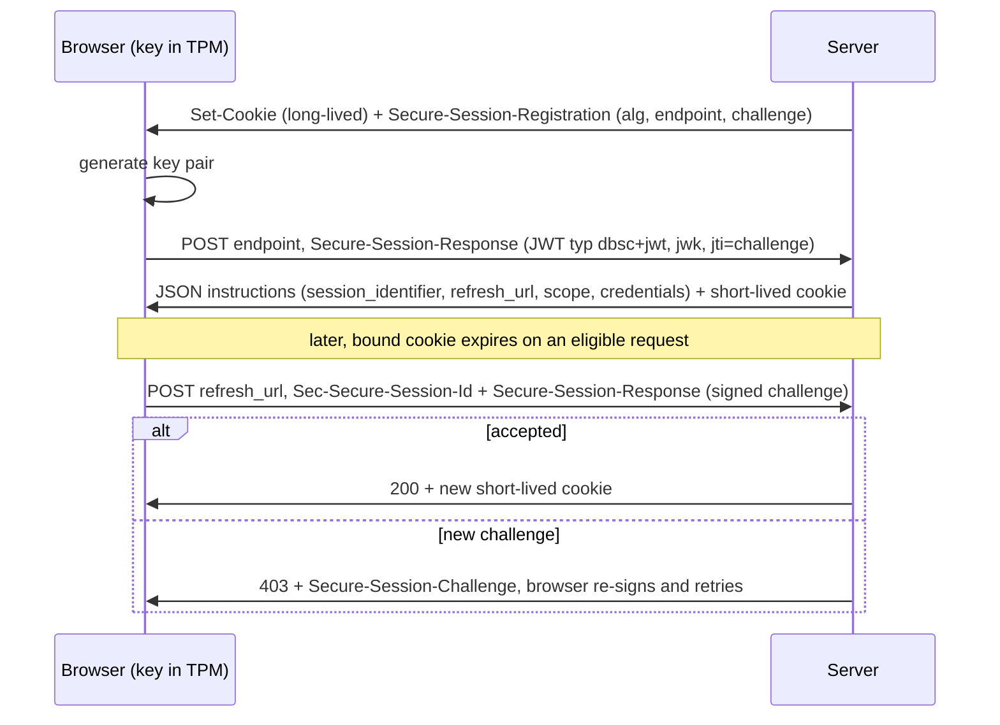
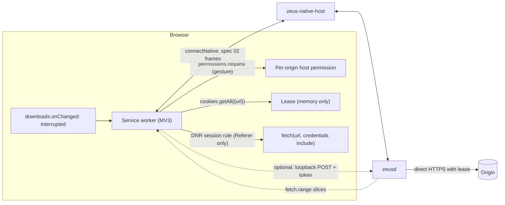

# Browser session handoff and the extension platform

## TL;DR

- **Never read a browser's cookie store.** Chrome encrypts cookies with DPAPI, Keychain or a keyring (v10/v11) and, on Windows since Chrome 127 (announced 2024-07-30), with App-Bound Encryption (v20): a privileged service checks that the caller is Chrome [Google: ABE blog]. Every known workaround is infostealer tradecraft [Elastic: ABE bypass]; Zeus doing the same would look like malware.
- **DBSC changes what a "session" is.** Chrome 146 shipped Device Bound Session Credentials on Windows on 2026-04-09; the W3C editor's draft is dated 2026-09-08 [Google: DBSC], [W3C: DBSC]. Bound cookies are short-lived and refreshed by the browser with a TPM key, so a daemon can use a leased cookie only until it expires. Leases must be TTL-aware; only the in-browser proxy inherits the binding.
- **MV3 has every primitive needed** (`downloads.onChanged`, `cookies.getAll({url})`, `nativeMessaging`, `optional_host_permissions`, DNR). Gaps: `DownloadItem` has no ETag or Last-Modified; extension `fetch` cannot set `Referer`, `User-Agent` or `Cookie`; partitioned cookies need an explicit `partitionKey`.
- **Measured on Chrome for Testing 154 (Windows 11)**: native-messaging frames are capped at exactly 1,048,576 bytes host-to-extension and 64 MiB extension-to-host (+1 byte throws); sustained throughput was about 80 MiB/s extension-to-host, 40 MiB/s the other way, and 60 to 140 MiB/s for loopback `fetch` POST [Exp: scratch07]. Native messaging saturates links up to about 600 Mbit/s, so a localhost side channel is an optimisation, not a requirement.
- **The service worker dies about 30 s after start even while `fetch` bodies and timers are active** (measured); an open native port keeps it alive (75 s idle survived) and an alarm revives a dead worker [Exp: scratch07]. Spec 02's keepalive design holds.
- **Header fidelity has a hard edge.** DNR `modifyHeaders` can overwrite `Referer`, `Origin`, `User-Agent`, `Sec-CH-UA` and even `Sec-Fetch-Site` on extension fetches (measured). Zeus may use it only for a single-stream `Referer` rule scoped by `initiatorDomains`. If a site blocks the daemon, use the real browser; never impersonate one.
- **Consent maps onto `optional_host_permissions`**: `https://*/*` optional, `permissions.request` from the approving click, `permissions.remove` at expiry [Chrome: permissions].
- **CDP is an opt-in automation lane, not the handoff.** Chrome 136 ignores `--remote-debugging-port` on the default profile; Chrome 144 added a `chrome://inspect` toggle with a per-session prompt [Chrome: remote debugging 136], [Chrome: DevTools MCP].
- **Stores**: broad host permissions slow Chrome Web Store review and remote logic is banned; AMO requires `data_collection_permissions` for new extensions since 2025-11-03; Edge may assign another extension ID, so list both in the host manifest [CWS: review], [Mozilla: data collection], [Edge: native messaging].

## 1. Method and evidence levels

Primary documentation was fetched on 2026-10-05/06; secondary press is tagged. Behaviour marked [Exp: scratch07] was measured with a scratch MV3 extension, a Node native host and a Node loopback server (`tools/research-checks/_scratch07`) on Windows 11, Chrome for Testing 154, `--headless=new`, unpacked extension. Caveats: one machine with background load; headless (`HeadlessChrome` UA); the extension only loaded with `--disable-features=DisableLoadExtensionCommandLineSwitch` (branded Chrome dropped `--load-extension` in 137 [Chromium-extensions: load-extension PSA]). Treat measurements as Medium confidence until repeated on branded Chrome, Edge and Firefox.

## 2. Why Zeus must not read cookie stores

### 2.1 Chrome cookie storage and encryption

| Scheme | Platform | Key custody | Who can decrypt | Confidence |
|---|---|---|---|---|
| v10 | Windows | AES-256-GCM key in `Local State`, wrapped by user DPAPI | Any process running as the user | High [Web: v20 layout] |
| v10 | macOS | AES-128-CBC key derived from a Keychain item ("Safe Storage") | Processes the Keychain ACL admits | Medium [Web: browserforensics macOS] |
| v10 / v11 | Linux | Fixed fallback key (v10) or Secret Service/KWallet key (v11); newer Chrome may use the XDG secret portal (unverified) | User session processes | Medium |
| v20 (App-Bound) | Windows, Chrome 127+ | Key wrapped by system DPAPI, user DPAPI, then an app-bound step; a SYSTEM elevation service validates that the caller is Chrome | Chrome, or an attacker with SYSTEM, injection or debugger access | High [Google: ABE blog], [Web: v20 layout] |

Google's stated intent: another app that tries to decrypt fails, so attackers must escalate in detectable ways [Google: ABE blog]. Elastic catalogued what malware families did, at fact level: inject into Chrome, call the elevation service over COM, use the remote-debugging port, read browser process memory [Elastic: ABE bypass]. Wider context: a September 2026 study of about 170,000 infostealer victims names exposed browser sessions a critical attack surface [arXiv:2609.30070]; profiles lack protection against file-system attackers [arXiv:2504.17692]; a proposed Chromium variant adds `BrowserOnly` and `Monitored` cookie attributes to hide cookies even from extensions [arXiv:2405.06830].

*Inference:* a download manager that read the cookie database would need the same techniques, trip the detections Elastic recommends (a non-browser process touching cookie files, COM elevation access), and be indistinguishable from a stealer to a user. The rule is absolute: **Zeus reads cookies only through the extension, per origin, with consent**.

### 2.2 DBSC: protocol and consequences

DBSC binds a session to a key held in a TPM (Windows) or Secure Enclave (macOS); the server sets short-lived cookies and the browser proves key possession to refresh them [W3C: DBSC].

Editor's draft (2026-09-08): headers `Secure-Session-Registration`, `Secure-Session-Challenge`, `Secure-Session-Response`, `Sec-Secure-Session-Id`, `Secure-Session-Skipped`; JWT `typ` is `dbsc+jwt`, `alg` ES256 or RS256; a 4xx other than 403 ends the session, 5xx may back off; nothing is said about non-browser clients [W3C: DBSC]. Chrome's guide shows a 30-day login cookie replaced by a 10-minute one, with fallback to long-lived cookies when the refresh endpoint is unreachable, the TPM errors, or third-party cookies are blocked [Chrome: DBSC]. Chrome 146 reached public availability on Windows on 2026-04-09, macOS "in an upcoming release" [Google: DBSC]. Edge ran an origin trial; Mozilla and WebKit have not committed [Web: DBSC status] (Medium; secondary).

Consequences for a non-browser client (*Inference* unless cited):

1. A leased cookie is useful for at most its remaining lifetime $\tau$; the daemon cannot satisfy a refresh challenge because the key never leaves the device [W3C: DBSC].
2. Refresh is browser-initiated on an eligible browser request. No extension API forces it, so "ask the extension for refreshed cookies" works only if the extension first causes an eligible in-browser request (for example a `Range: bytes=0-0` fetch) and then re-reads cookies. Untested (open question Q1).
3. A job that issues new range requests over time needs $n_r = \lceil T/(\tau-\delta)\rceil-1$ re-leases, with $T$ the job duration and $\delta$ a safety margin. Worked: 20 GiB at 25 MiB/s gives $T=819$ s; with $\tau=600$ s and $\delta=60$ s that is 1 re-lease; at 50 MiB/s ($T=410$ s) none. Plainly: long jobs on DBSC sites need leases renewed before expiry or must run through the browser.

### 2.3 Firefox, Safari, third-party cookies and CHIPS

| Browser | Cookie model that matters here | Source |
|---|---|---|
| Chrome | Third-party cookies stay, no standalone prompt; most Privacy Sandbox APIs retired (October 2025); CHIPS, FedCM, Private State Tokens continue | [Privacy Sandbox: Oct 2025] |
| Chrome (extension view) | `cookies.getAll` operates on unpartitioned cookies by default; `partitionKey` since Chrome 119, `hasCrossSiteAncestor` since 130; HttpOnly cookies are returned | [Chrome: cookies] |
| Firefox | Total Cookie Protection: one jar per top-level site; strict mode in Firefox 86, default for all users June 2022 (secondary); `cookies` API needs `firstPartyDomain` under first-party isolation, `partitionKey` since 94, containers via `cookieStoreId` | [Mozilla: TCP], [Web: TCP default], [MDN: cookies] |
| Safari | ITP blocks all third-party cookies; script-written cookies expire after 7 days without interaction; cookies set in HTTP responses are not capped | [WebKit: ITP] |

research.md [60] calls Firefox's cookie database readable (not re-verified); per-site jars would complicate a raw read, and Zeus does not read it. For downloads, auth cookies are normally first-party and HTTP-set, so ITP caps do not bite. The risk is embedded viewers and CHIPS: a `Partitioned` cookie is invisible to a default `getAll`. My loopback probe could not settle this (a `Secure` cookie over `http://127.0.0.1` was not returned by `getAll({url})` though it was sent by `fetch`), so the rule below is an untested inference.

## 3. MV3 capabilities with exact details

| API | What Zeus uses | Exact facts | Source |
|---|---|---|---|
| `chrome.downloads` | Trigger and rescue | States `in_progress`, `interrupted`, `complete`. `DownloadItem` fields: `id url finalUrl filename incognito danger mime startTime endTime estimatedEndTime state error bytesReceived totalBytes fileSize exists paused canResume referrer byExtensionId byExtensionName`: **no ETag or Last-Modified** (also absent on live items). `onChanged` skips `bytesReceived` and `estimatedEndTime`. `onDeterminingFilename`: one listener per extension, call `suggest()` once. `download({headers})` rejects `Referer`, `Cookie`, `User-Agent`, `Origin`, `Sec-*` ("Unsafe request header name") but accepts custom headers, `Accept-Language`, `Range` [Exp: scratch07]. 29 `InterruptReason` values; eligibility mapping is spec 01 section 8.4 | [Chrome: downloads] |
| `chrome.cookies` | Session leases | `getAll({url, domain, name, path, secure, session, storeId, partitionKey})`; `getAllCookieStores()`; needs `cookies` plus host permission | [Chrome: cookies] |
| `webRequest` | Observation only | Blocking only for policy-installed extensions in MV3; `extraHeaders` exposes `Cookie`, `Set-Cookie`, `Referer`; `tabId` is -1 for extension and service-worker requests | [Chrome: webRequest] |
| `declarativeNetRequest` | Scoped `Referer` | `modifyHeaders` ops are `append`, `set`, `remove`; `append` is restricted to a header allow-list, `set` is not (measured). 30,000 dynamic (5,000 unsafe) and 5,000 session rules. Fetch resource type is `xmlhttprequest`. `declarativeNetRequestWithHostAccess` shows no install warning but needs host access | [Chrome: DNR] |
| `permissions` | Consent | `request` needs a user gesture and entries declared in `optional_permissions` / `optional_host_permissions`; nine permissions cannot be optional (`debugger`, `declarativeNetRequest`, `devtools`, `geolocation`, `mdns`, `proxy`, `tts`, `ttsEngine`, `wallpaper`) | [Chrome: permissions] |
| `activeTab` | Not a fit | Temporary access to the current tab after a user gesture, revoked on navigation or tab close; docs do not say it covers service-worker cross-origin `fetch` | [Chrome: activeTab] |
| `nativeMessaging` | Daemon link | See 3.1 | [Chrome: native messaging] |
| `alarms`, `storage.session`, `offscreen` | Wake-up, state, rarely a DOM | Alarms fire at most every 30 s (unpacked exempt); `storage.session` holds 10 MB and clears on restart, reload and update; one offscreen document per extension, only `chrome.runtime` inside | [Chrome: alarms], [Chrome: storage], [Chrome: offscreen] |

### 3.1 Native messaging

- **Framing**: 32-bit length in native byte order plus UTF-8 JSON. **Limits (documented)**: host to extension 1 MB, extension to host 64 MiB [Chrome: native messaging]. **Limits (measured)**: a 1,000,000-byte and a 1,048,576-byte frame arrived; 1,048,577 and 2,097,152 closed the port with "Error when communicating with the native messaging host."; extension-to-host 4, 32 and 64 MiB (67,108,864 bytes) were accepted and 64 MiB + 1 made `postMessage` throw "Message exceeded maximum allowed size of 64MiB" [Exp: scratch07]. So "1 MB" means 1 MiB; Edge's page agrees ("must not exceed 1024*1024") but still advertises 4 GB for the other direction, which looks stale [Edge: native messaging].
- **Capacity of one frame**: base64 expands by 4/3. Host-to-extension, a 1,048,576-byte frame with a 250-byte envelope carries at most $3\lfloor(1048576-250)/4\rfloor = 786{,}243$ raw bytes; extension-to-host, at most 48 MiB raw per 64 MiB frame. A 750,000-raw-byte frame (1,000,030 bytes) worked.
- **Manifest**: `name` lowercase alphanumerics, `_`, `.`; `type: stdio`; `allowed_origins` exact, no wildcards; `path` absolute on macOS/Linux. The host receives the caller origin as `argv[1]` and, on Windows, `--parent-window=<handle>` (0 for service workers).
- **Registration**: Chrome Windows `HKCU\SOFTWARE\Google\Chrome\NativeMessagingHosts\<name>` (then HKLM, 32-bit before 64-bit). **Edge** checks its own key first, then falls back to Chromium's and Chrome's keys [Edge: native messaging]; one Chrome registration therefore serves Edge, but the manifest must list the Chrome Web Store and Edge Add-ons IDs because only the first manifest found is read. Edge user paths: macOS `~/Library/Application Support/Microsoft Edge/NativeMessagingHosts/`, Linux `~/.config/microsoft-edge/NativeMessagingHosts/`; Chrome's equivalents are in spec 02 section 3.1. Firefox: `HKCU\Software\Mozilla\NativeMessagingHosts\<name>`, `~/.mozilla/native-messaging-hosts/` (system: `/Library/Application Support/Mozilla/NativeMessagingHosts/`, `/etc/opt/firefox/native-messaging-hosts/`), `allowed_extensions`, `argv[1]` manifest path, `argv[2]` add-on ID [MDN: native messaging].
- **`connectNative` vs `sendNativeMessage`**: `connectNative` keeps one host process until the port closes; `sendNativeMessage` starts a process per message and handles only the first reply [Chrome: native messaging]. Zeus needs sessions, so `connectNative` only.
- **Host quality dominates**: a host that re-concatenated its buffer on every 64 KiB read gave 2 to 18 MiB/s extension-to-host in my first run; a chunk-list reader gave 77 to 113 MiB/s. Windows hosts also need binary-mode stdio and a clean stdout.

### 3.2 Service-worker lifetime

| Fact | Evidence |
|---|---|
| Idle timeout 30 s; single event over 5 min or a `fetch` response taking over 30 s ends the worker | [Chrome: SW lifecycle] |
| Events and extension API calls reset the timer; long-lived message ports since Chrome 114; WebSocket traffic since 116; active `chrome.debugger` since 118 | [Chrome: SW lifecycle] |
| Open `connectNative` port keeps the worker alive | [Chrome: SW lifecycle]; measured: worker and host survived 75 s with no events [Exp: scratch07] |
| No port, no API calls: timers set for 15 s and 25 s fired (at 21.6 s and 31.5 s elapsed); timers for 35, 50, 70 and 100 s never did, so the worker was reaped between about 32 s and 41 s after start | Measured, clean single instance [Exp: scratch07] |
| An alarm created for 2 minutes started a new worker (new script instance, `BOOT` changed) about 11 s late | Measured [Exp: scratch07] |
| A long streaming `fetch` with no API calls | See 4.3 |
| Firefox: non-persistent event pages (about 30 s idle); `connectNative` keeps the event page alive from Firefox 105; plain message ports do not | [MDN: native messaging], [MDN: event pages] |

One earlier run saw a 45 s timer fire with no port amid other worker activity; treat 30 s as the rule. MDN answers spec 02's open issue O3: Firefox 105 and later documents the native-port keepalive.

## 4. Fetch from the service worker and the bulk-data path

### 4.1 Credentials, CORS, forbidden headers

A service worker or extension page may call remote servers outside its origin when the extension holds host permissions; content scripts remain bound by the page's origin [Chrome: network requests]. With `credentials: "include"` the worker's request carried cookies set earlier by a tab navigation and by earlier responses, including a `SameSite=Strict` one [Exp: scratch07].

Measured request headers from an extension service-worker `fetch` to a loopback server:

| Header | Plain GET | Script-set value | With DNR `set` rule |
|---|---|---|---|
| `Cookie` | browser's cookies | ignored | still sent (rule can `remove` it: measured) |
| `User-Agent` | browser UA | ignored | **replaced** |
| `Referer` | absent (`referrer:` option also gave none) | ignored | **set** |
| `Origin` | absent on GET, `chrome-extension://<id>` on POST | **honoured** | **set** |
| `Accept-Language`, `Accept-Encoding`, `Range`, custom | browser defaults | **honoured** | set |
| `Sec-Fetch-Site/Mode/Dest` | `none` / `cors` / `empty` | ignored | `Sec-Fetch-Site` **replaced** |
| `Sec-CH-UA` | absent on this loopback `http` request | not tested | **set** |

The Fetch Standard forbids `Cookie`, `Origin`, `Referer`, `Accept-Encoding` and any `Sec-`/`Proxy-` header for scripts [Fetch: forbidden headers]; the extension worker honoured `Origin` and `Accept-Encoding: identity` anyway (Medium: headless Chrome for Testing). Consequences: (a) `Accept-Encoding: identity` is available for range fetches, contrary to spec 02 section 9.2 rule 2; (b) `Origin` cannot authenticate the extension to a local server, and a GitHub report (2026-09-28) says Chrome 153 sends none on some extension worker fetches [GitHub: Origin missing 153]; (c) DNR can forge nearly anything, which sets the evasion line in section 8.

DNR scoping (measured): a rule with `initiatorDomains: [<extension id>]` applied to the worker's fetch, one with `initiatorDomains: ["example.com"]` did not, `tabIds: [-1]` and `urlFilter` also worked [Exp: scratch07]. Session rules vanish on browser restart, which is the desired default.

### 4.2 Throughput: native messaging versus loopback HTTP

Measured, MiB/s of raw payload, 32 MiB per repetition, 3 interleaved repetitions (min / median / max), chunk-list host [Exp: scratch07]:

| Path | Frame/body size | min | median | max |
|---|---|---|---|---|
| Extension to host (NM, base64 in JSON) | 64 KiB | 41.7 | 46.8 | 47.0 |
| | 256 KiB | 76.2 | 85.4 | 85.5 |
| | 1 MiB | 46.9 | 81.9 | 112.8 |
| | 4 MiB | 37.3 | 48.3 | 82.3 |
| Host to extension (NM) | 64 KiB | 12.3 | 24.2 | 37.0 |
| | 256 KiB | 37.6 | 40.9 | 53.5 |
| | 700,000 B | 38.1 | 40.1 | 51.8 |
| `fetch` POST to `127.0.0.1` | 256 KiB | 61.4 | 61.6 | 75.3 |
| | 1 MiB | 62.2 | 111.0 | 111.7 |
| | 4 MiB | 40.9 | 138.3 | 145.3 |

The worker's JSON-plus-base64 encode ran at about 500 MiB/s for 256 KiB to 1 MiB chunks (`Uint8Array.prototype.toBase64` exists in Chrome 154), so encoding is not the limit. Single loopback download streams measured 14 to 52 MiB/s, noisy and dominated by the test server.

Worked example: 1 GiB at 82 MiB/s takes $S/R = 1024/82 = 12.5$ s through native messaging and 9.2 s at 111 MiB/s over loopback POST; base64 adds 341 MiB of pipe traffic. A 1 Gbit/s link delivers 119 MiB/s, a 500 Mbit/s link 60 MiB/s. So NM keeps up with links to roughly 600 Mbit/s with sensible frames (256 KiB to 1 MiB), and the loopback path buys 1.3 to 1.7 times at most. CPU cost was not measured.

| Option | Pros | Cons |
|---|---|---|
| NM chunks (spec 02) | No network surface; browser-vetted launch; identity attested by `allowed_origins` | base64 inflation; 1 MiB return cap; worker must stay alive |
| Loopback HTTP POST (extension to daemon) | Binary bodies, simple streaming, 1.3 to 1.7 times faster | Opens a local port to every web page: needs token, `Host` check, rebinding defence; extension needs a loopback host permission |
| Loopback WebSocket | Keeps worker alive since Chrome 116; binary frames | Same exposure; worker lifetime coupling is subtle; not measured here |

Local Network Access (Chrome 142) prompts for public-site requests to loopback; the Chrome team said extensions holding host permissions should not be gated and fixed two bugs that wrongly gated them (Chrome 144.0.7512.0 and later). A secondary source adds that WebSocket and WebTransport are gated from Chrome 147 and the temporary opt-out policy ends in Chrome 156 [Chrome: LNA], [Chromium-extensions: LNA thread], [Web: LNA 156]. A Zeus web UI on a normal page would be gated; the worker and a Tauri window would not.

### 4.3 Long fetches and memory

Always stream (`response.body.getReader()`), never `arrayBuffer()` a download. An in-flight response body does not keep the worker alive: a 75 s stream delivering 1 KiB per second was cut when the worker died (the server saw the client close at 29.8 s; no completion report), and two earlier benchmark runs stalled the same way mid-stream [Exp: scratch07]. Design consequence: bound every `fetch.range` slice (spec 02: 16 MiB), keep the native port open, and treat worker death as normal.

## 5. Browser differences

| | Chrome | Edge | Firefox | Safari | Brave, Vivaldi, Opera, Arc |
|---|---|---|---|---|---|
| Background | Service worker | Service worker | Event page (no service worker) | n/a (app extension) | As Chrome |
| Blocking webRequest | Policy-installed only | As Chrome | **Kept in MV3** [Mozilla: MV3 2024] | n/a | As Chrome |
| NM target | Host executable | Host executable | Host executable | Only the containing app's extension handler; app ID argument ignored; dictionaries, no stdio; `connectNative` limited [Web: Safari native messaging] | Host executable |
| Host allow-list | `allowed_origins` | `allowed_origins` (both store IDs) | `allowed_extensions` | n/a | `allowed_origins` |
| Cookies | `partitionKey`, `storeId` | same | `firstPartyDomain`, `partitionKey`, containers | not usable | as Chrome |
| Host permissions UX | Install warning unless optional | same | Shown at install since Firefox 127, user-revocable | n/a | as Chrome |

Firefox on Windows kills the host's job object, so a daemon started by the host needs breakaway (spec 02 section 3.4) [MDN: native messaging]. For Brave, Vivaldi, Opera and Arc I found no primary documentation of manifest directories or registry keys; they may fall back to Chrome's location as Edge does. Test them (Q4). Safari needs a separate app-extension design that spec 02 leaves out of v1 (O8); keep it out.

## 6. Store policies and extension ID stability

| Store | Rule that bites Zeus | Source |
|---|---|---|
| Chrome Web Store | Single narrow purpose; narrowest permissions; limited use of user data; code discernible from the submission (no remotely hosted logic); disclosure and consent before collecting user data; no obfuscation. Policy text updated 2025-05-22. | [CWS: policies] |
| Chrome Web Store review | Longer review for `<all_urls>`, `*://*/*`, `https://*/*`; `tabs`, `downloads`, `cookies`, `webRequest` must be justified; new developers and large changes get closer looks | [CWS: review] |
| AMO | New extensions since 2025-11-03 must declare `browser_specific_settings.gecko.data_collection_permissions` (`none` if nothing is collected); extensions supporting Firefox before 140 (desktop) or 142 (Android) also need a post-install control; all extensions to follow in H1 2026 | [Mozilla: data collection] |
| Edge Add-ons | Published ID can differ from the sideloaded ID; list both in `allowed_origins` | [Edge: native messaging] |

*Inference:* the single purpose is "download and file handoff for the Zeus daemon"; leases, URL refresh and the fetch proxy serve it, a "scrape any page" feature would not. Declare `https://*/*` only as `optional_host_permissions`.

**ID stability.** A `key` field in `manifest.json` pins the extension ID across unpacked and packed builds (the public key comes from the Developer Dashboard package tab) [Chrome: manifest key]. Pin it, use the same ID in the host manifest, and run CI against it. Keep the private signing key out of the repository; only the public `key` belongs there. Firefox pins the ID with `browser_specific_settings.gecko.id` [MDN: native messaging].

## 7. CDP and WebDriver BiDi alternatives

| Mechanism | Verified surface | Fit |
|---|---|---|
| CDP `Browser` domain (experimental) | `setDownloadBehavior(behavior: deny\|allow\|allowAndName\|default, browserContextId?, downloadPath?, eventsEnabled?)`; events `downloadWillBegin(frameId, guid, url, suggestedFilename)`, `downloadProgress(guid, totalBytes, receivedBytes, state, filePath)`; `cancelDownload(guid)`; the `Page` versions are deprecated [CDP: protocol JSON] | Sees downloads, but no request headers or failure reason |
| CDP `Fetch` / `Network` | `Fetch.requestPaused`, `fulfillRequest`, `takeResponseBodyAsStream`; `Network.getCookies(urls)`; `Cookie` has `partitionKey` and `partitionKeyOpaque`; `Storage.getCookies(browserContextId)` [CDP: protocol JSON] | Full cookie access to any attached client |
| Chrome 136 restriction | `--remote-debugging-port` and `--remote-debugging-pipe` ignored for the default user-data directory (cookie theft); Chrome for Testing unaffected [Chrome: remote debugging 136] | Real profile needs a copy or user action |
| Chrome 144+ `autoConnect` | User enables `chrome://inspect/#remote-debugging`; each session shows a permission dialog and the "controlled by automated test software" banner (post dated 2025-12-11) [Chrome: DevTools MCP] | The only consented path to the live profile |
| WebDriver BiDi | Editor's draft 2026-09-30 defines `browsingContext.downloadWillBegin`, `browsingContext.downloadEnd`, `browser.setDownloadBehavior`, `storage.getCookies/setCookie/deleteCookies` with `PartitionKey` [W3C: WebDriver BiDi] | Cross-browser automation lane; still a full-control channel |
| Playwright | `launchPersistentContext(userDataDir)` warns against the default profile; `connectOverCDP` is lower fidelity; downloads go to a temp folder deleted with the context [Playwright: BrowserType], [Playwright: downloads] | Test harness, agent-owned profiles |

Attaching to the user's browser needs no extension, but any attached client reads every cookie (Elastic lists port 9222 as a stealer technique), Chrome now blocks the easy route, and consent is all-or-nothing, not per-origin. **Decision:** CDP/BiDi is an explicit "automation profile" mode for sessions the agent owns (a dedicated profile with `--user-data-dir`), never the default handoff, and never attached to the user's main profile except through Chrome's own `autoConnect` prompt.

## 8. Session refresh, replay fidelity and the line against evasion

### 8.1 Refresh on 401/403 and expiring URLs

1. The daemon classifies the failure with spec 01 section 8.3 (probe first; 403 is ambiguous: auth, expired signature, or block).
2. `401` or a login redirect: `session.request` with a new lease; if the cookie expiry is before `now + remaining job time` ($T$ from the engine's ETA), schedule re-lease at $0.8\tau$ rather than waiting for the 401.
3. Expired signed URL (for example a past `X-Amz-Expires`): `url.refresh.request`; prefer `refetch`, use `download_api` for single-use URLs (spec 02 O7).
4. Cap at 2 refreshes per job per 10 minutes, then ask the human.
5. `cf-mitigated` or a challenge page: do not retry from the daemon; go to the browser proxy or ask the user. DBSC sites with $\tau$ shorter than the job: proxy.

### 8.2 What the daemon may keep

Cookies, header values and tokens live only in memory for the lease (`ttl_ms` at most 900,000), in zeroizing buffers, and never reach the journal, audit log, crash dumps or logs; the audit log records name, domain, path and expiry, never values. Persisted state is grants and consent records (research.md section 5.3 agrees). The extension keeps only non-secret consent records in `storage.local` and leases out of `storage.session`.

### 8.3 Fidelity versus evasion

| Practice | Verdict | Rationale |
|---|---|---|
| Replay the exact cookies the browser would send for that URL (`cookies.getAll({url})`, path/secure/domain-matched) | Fidelity, allowed | Same authorisation as the user's click |
| Send the browser's real `User-Agent`, `Accept-Language` and low-entropy `sec-ch-ua*` values read from `navigator` | Fidelity, allowed | Mirrors the user's browser; needed because servers bind sessions to them |
| `Referer` equal to the page the user was on, set for one stream by a DNR rule scoped by `initiatorDomains` and `urlFilter`, removed afterwards | Fidelity, allowed | Reproduces a header the click would have sent |
| Spoofing TLS/HTTP/2 fingerprints (JA3/JA4 impersonation libraries), rotating UAs or proxies per request | **Evasion, forbidden** | research.md section 4.1 already excludes it |
| Setting `Sec-Fetch-*`, `Sec-CH-UA*` or `User-Agent` through DNR, or sending `Sec-Fetch-*` or an `Origin` the daemon did not originate | **Forbidden** | Measured possible, so it needs a code-level ban; it would assert browser provenance. Sites that demand these headers go to the browser proxy |
| Solving or bypassing challenges (`cf-mitigated`) | **Forbidden** | Stop and report |
| When blocked, fetching through the user's real browser | Allowed | The user is the actor and no control is bypassed |

For agent crawls, the legitimate counterpart of fingerprint games is declaring the bot. The IETF Web Bot Auth working group (chartered October 2025, secondary) adopted `draft-ietf-webbotauth-httpsig-protocol-00` on 2026-09-01; it profiles HTTP Message Signatures [RFC 9421] with a signature-agent directory [IETF: webbotauth]. *Inference:* once stable, signing workflow-runner requests is the sanctioned way to be recognised; it does not apply to a user's own browser session.

## 9. Recommended handoff architecture

**Message types** (names from spec 02; additions marked new):

| Flow | Messages | Notes |
|---|---|---|
| Handoff | `handoff.offer` / `accept` / `reject` / `withdraw` | `validators` usually null (no ETag in `DownloadItem`) |
| Lease | `session.request` / `session.response` | Add `min_remaining_ms` to the response so D can decide lease versus proxy (new field) |
| URL refresh | `url.refresh.request` / `response` | Methods `refetch`, `download_api` |
| Proxy | `fetch.range`, `fetch.head`, `fetch.chunk`, `fetch.credit`, `fetch.end`, `fetch.error`, `fetch.cancel` | Slices of at most 16 MiB; chunk 256 KiB; use `Accept-Encoding: identity` |
| Side channel (optional) | `fetch.side_open` (D to E: URL with one-time token) / `fetch.side_ready` (new) | Chunks POSTed to loopback; same credits and consent |
| Consent | `approval.*`, `grant.*`; `permission.changed` (E to D, new) | On `permissions.onRemoved`, so D revokes grants the user removed in browser settings |

**Consent model on `optional_host_permissions`:**

| Zeus scope | Browser step | Expiry and revocation |
|---|---|---|
| `once` | `permissions.request` in the approve click handler; `permissions.remove` when the job ends | Job state change |
| `site` (24 h) | Same request; alarm at expiry calls `permissions.remove` | Grant expiry, `grant.revoked`, or the user removing site access |
| `workflow` (7 days, renewable) | Same | Run end or renewal prompt |
| `never` | Zeus blocklist; `permissions.remove` | Persistent |

The browser's prompt stacks on Zeus's approval: two independent gates. Required permissions: `nativeMessaging`, `downloads`, `cookies`, `storage`, `alarms`. Optional: `https://*/*`, `http://localhost/*` and loopback, `declarativeNetRequestWithHostAccess` (*Inference*: allowed as optional because it is absent from the list of nine). No `externally_connectable`, no content scripts.

**Failure and fallback ladder:**

| Rung | Mechanism | Move down when |
|---|---|---|
| 0 | Browser completes or resumes the download | `interrupted` with an eligible reason, or user forwards it |
| 1 | Daemon probe, no session (public or signed URL) | 401/403, HTML where a file is expected |
| 2 | Lease: cookies, UA, low-entropy hints; direct ranged fetch | 401/403 again, lease shorter than the job (DBSC), TLS/anti-bot block |
| 3 | Refresh: re-lease or `url.refresh.request` (at most 2 per 10 min) | Refresh yields a login page, or limit reached |
| 4 | Browser proxy: `fetch.range` slices over native messaging (optionally the loopback side channel) | Browser fetch is also blocked or consent missing |
| 5 | Human in the loop: show the approval, ask the user to sign in or click download | User declines |
| 6 | Stop and report; never escalate to evasion | Terminal |

Agent-owned sessions use a separate lane: a dedicated automation profile with CDP/BiDi, outside this ladder.

## Implications for Zeus

1. **Extension plus native host is the only session path; no cookie-database code, ever** (2.1, 2.2). *Test:* a static check that no crate opens browser user-data paths; an EDR-style run showing no cookie-file access.
2. **Keep spec 02's keepalive: permanent `connectNative` port, 20 s pings, alarm fallback** (3.2). *Test:* 2-hour idle soak; kill the host and confirm reconnect inside 35 s.
3. **Frame sizes**: host-to-extension at most 700,000 raw bytes (933,336 base64 characters), default 256 KiB; extension-to-host 256 KiB to 1 MiB (3.1). *Test:* boundary check of 1,048,576 vs 1,048,577 and 64 MiB vs +1 on every Chrome, Edge and Firefox stable release; fail the build if limits move.
4. **Throughput guards**: at least 40 MiB/s extension-to-host at 256 KiB frames and 20 MiB/s host-to-extension on reference hardware; write the host with a chunk-list reader (3.1). *Test:* the scratch07 benchmark ported to CI.
5. **Defer the loopback side channel** until users need more than about 500 Mbit/s through the proxy. If built: 127.0.0.1 only, one-time 128-bit token per stream, `Host` check, reject any `Sec-Fetch-Site` other than `none`, never rely on `Origin` (4.1, 4.2). *Test:* DNS-rebinding, cross-site and missing-`Origin` requests all get 403.
6. **Declare host access only as `optional_host_permissions`, requested per origin from the approving click** (section 9): fewer install warnings, faster review, a browser-enforced gate. *Test:* manual script (prompts need a gesture).
7. **DNR has one purpose: a `Referer` for one stream**, with `initiatorDomains: [own id]`, `requestDomains`, a single-URL `urlFilter`, removed at stream end; code rejects any rule touching `Sec-*`, `User-Agent` or `Cookie` (4.1, 8.3). *Test:* loopback echo canary asserting scope and removal.
8. **Lease TTL logic**: compute $n_r$ at job start; if the earliest cookie expiry falls inside the ETA, re-lease at $0.8\tau$ or use the proxy; default lease 15 minutes (2.2). *Test:* a DBSC test server with 2-minute cookies and Chrome 146+ on Windows.
9. **Partitioned cookies**: until Q2 is answered, query both `getAll({url})` and `getAll({url, partitionKey:{topLevelSite}})` and merge (2.3). *Test:* an HTTPS origin setting `Partitioned` cookies in first-party and embedded contexts.
10. **Send `Accept-Encoding: identity` on proxy range fetches**, verified per browser (4.1); correct spec 02 section 9.2 rule 2, keep its abort-on-`Content-Encoding` guard.
11. **CDP/BiDi only as an opt-in automation profile** with its own consent record and a dedicated `--user-data-dir` (section 7).
12. **Store posture**: one purpose statement, no remote code, honest `data_collection_permissions` (cookies and browsing activity reach a local daemon); pin `key` and `gecko.id`; list Chrome and Edge IDs in `allowed_origins` (section 6). E2E tests run on Chrome for Testing with `--disable-features=DisableLoadExtensionCommandLineSwitch` or Playwright persistent contexts.

## Corrections to research.md

| research.md | Correction | Confidence |
|---|---|---|
| Section 4.2 "DBSC-bound sites: ask the extension for refreshed cookies on 401/403" | Refresh is browser-initiated on an eligible browser request using a key that never leaves the device; the extension has no refresh call. It can trigger one only by issuing a browser fetch and re-reading cookies. | Medium |
| Section 4.2 "In-browser fetch proxy: slowest" | Measured native-messaging capacity is 40 to 110 MiB/s depending on direction and frame size, above typical consumer links; the cost is CPU and complexity, not necessarily speed. | Medium |
| Section 5.4 passes the browser's `referrer` to the daemon | Fine for the daemon's own requests, but the proxy path cannot replay it: extension `fetch` ignores a script-set `Referer` (measured) and needs a scoped DNR rule; `chrome.downloads.download({headers})` rejects it too. | High |
| Table row "Manifest V3: blocking webRequest restricted" | True for Chrome and Edge only; Firefox keeps blocking `webRequest` in MV3. | High |
| Sources [29] to [32] (App-Bound Encryption, DBSC) are secondary | Primary sources: Google Security Blog 2024-07-30, blog.google 2026-04-09, W3C DBSC editor's draft 2026-09-08. | High |
| Section 4.2 CDP row | Add Chrome 136 (default-profile ban) and Chrome 144 `autoConnect` (per-session prompt). | High |

## Open questions

- **Q1.** Does an extension `fetch` trigger DBSC refresh, and does `chrome.cookies` then expose the refreshed cookie? Needs Chrome 146+ and a DBSC test server.
- **Q2.** Does `chrome.cookies.getAll` return first-party `Partitioned` cookies, and does extension `fetch` attach them? My http probe was inconclusive.
- **Q3.** Do branded Chrome, Edge and Firefox match these Chrome for Testing measurements (headers including `Accept-Encoding`, 1 MiB boundary, worker lifetime)?
- **Q4.** Native-messaging locations and fallbacks for Brave, Vivaldi, Opera, Arc.
- **Q5.** Does the `persistAcrossSessions` alarm flag documented for Chrome 150 [Chrome: alarms] change reconnect behaviour after a browser restart?
- **Q6.** Does `activeTab` allow a worker `fetch` to the tab's origin (a lighter "once" consent)?
- **Q7.** `draft-ietf-httpbis-rfc6265bis` (revision 22, 2025-12-01) was in the RFC Editor queue when checked; one press summary claims publication on 2026-08-31 [unverified]; the RFC Editor still shows RFC 6265 as current [Web: RFC 6265bis status].
- **Q8.** Whether `Origin` omission on extension worker `fetch` (reported for Chrome 153) is intended.

## References

- [Google: ABE blog] Google Security Blog, "Improving the security of Chrome cookies on Windows", 2024-07-30. https://security.googleblog.com/2024/07/improving-security-of-chrome-cookies-on.html
- [Elastic: ABE bypass] Elastic Security Labs, "Katz and Mouse Game: MaaS Infostealers Adapt to Patched Chrome Defenses". https://www.elastic.co/security-labs/katz-and-mouse-game
- [Web: v20 layout] browserforensics.app, "Chrome v20 app-bound encryption, explained". https://www.browserforensics.app/en/blog/chrome-v20-app-bound-encryption
- [Web: browserforensics macOS] browserforensics.app, "Decrypting Chrome cookies on macOS (Safe Storage)". https://www.browserforensics.app/en/blog/chrome-cookies-macos-safe-storage
- [W3C: DBSC] W3C WebAppSec WG, "Device Bound Session Credentials", Editor's Draft 2026-09-08. https://w3c.github.io/webappsec-dbsc/
- [Google: DBSC] Google, "Protecting Cookies with Device Bound Session Credentials", 2026-04-09. https://blog.google/security/protecting-cookies-with-device-bound-session-credentials/
- [Chrome: DBSC] Chrome for Developers, "Device Bound Session Credentials". https://developer.chrome.com/docs/web-platform/device-bound-session-credentials
- [Web: DBSC status] Corbado, "Device Bound Session Credentials (DBSC) explained" (secondary). https://www.corbado.com/blog/device-bound-session-credentials-dbsc
- [Chrome: remote debugging 136] Chrome for Developers, "Changes to remote debugging switches to improve security". https://developer.chrome.com/blog/remote-debugging-port
- [Chrome: DevTools MCP] Chrome for Developers, "Let your coding agent debug your browser session", 2025-12-11. https://developer.chrome.com/blog/chrome-devtools-mcp-debug-your-browser-session
- [Chrome: downloads] Chrome for Developers, "chrome.downloads". https://developer.chrome.com/docs/extensions/reference/api/downloads
- [Chrome: cookies] Chrome for Developers, "chrome.cookies". https://developer.chrome.com/docs/extensions/reference/api/cookies
- [Chrome: webRequest] Chrome for Developers, "chrome.webRequest". https://developer.chrome.com/docs/extensions/reference/api/webRequest
- [Chrome: DNR] Chrome for Developers, "chrome.declarativeNetRequest". https://developer.chrome.com/docs/extensions/reference/api/declarativeNetRequest
- [Chrome: permissions] Chrome for Developers, "chrome.permissions". https://developer.chrome.com/docs/extensions/reference/api/permissions
- [Chrome: activeTab] Chrome for Developers, "The activeTab permission". https://developer.chrome.com/docs/extensions/develop/concepts/activeTab
- [Chrome: offscreen] Chrome for Developers, "chrome.offscreen". https://developer.chrome.com/docs/extensions/reference/api/offscreen
- [Chrome: alarms] Chrome for Developers, "chrome.alarms". https://developer.chrome.com/docs/extensions/reference/api/alarms
- [Chrome: storage] Chrome for Developers, "chrome.storage". https://developer.chrome.com/docs/extensions/reference/api/storage
- [Chrome: native messaging] Chrome for Developers, "Native messaging". https://developer.chrome.com/docs/extensions/develop/concepts/native-messaging
- [Chrome: SW lifecycle] Chrome for Developers, "The extension service worker lifecycle". https://developer.chrome.com/docs/extensions/develop/concepts/service-workers/lifecycle
- [Chrome: network requests] Chrome for Developers, "Cross-origin network requests". https://developer.chrome.com/docs/extensions/develop/concepts/network-requests
- [Chrome: manifest key] Chrome for Developers, "Manifest: key". https://developer.chrome.com/docs/extensions/reference/manifest/key
- [Chrome: LNA] Chrome for Developers, "New permission prompt for Local Network Access". https://developer.chrome.com/blog/local-network-access
- [Chromium-extensions: LNA thread] "Local network access restrictions". https://groups.google.com/a/chromium.org/g/chromium-extensions/c/pUDh8RiTjJk
- [Web: LNA 156] superchargebrowser.com, "Chrome 156 Blocks Local Network?" (secondary). https://www.superchargebrowser.com/library/chrome-156-local-network-access
- [GitHub: Origin missing 153] htlin222/openevidence-mcp issue 5, opened 2026-09-28. https://github.com/htlin222/openevidence-mcp/issues/5
- [Chromium-extensions: load-extension PSA] "PSA: Removing --load-extension flag in Chrome branded builds". https://groups.google.com/a/chromium.org/g/chromium-extensions/c/1-g8EFx2BBY/m/S0ET5wPjCAAJ
- [CWS: policies] Chrome Web Store program policies, updated 2025-05-22. https://developer.chrome.com/docs/webstore/program-policies/policies
- [CWS: review] Chrome Web Store review process. https://developer.chrome.com/docs/webstore/review-process
- [MDN: native messaging] MDN, "Native messaging". https://developer.mozilla.org/en-US/docs/Mozilla/Add-ons/WebExtensions/Native_messaging
- [MDN: event pages] MDN, "Background scripts". https://developer.mozilla.org/en-US/docs/Mozilla/Add-ons/WebExtensions/Background_scripts
- [MDN: cookies] MDN, "cookies API". https://developer.mozilla.org/en-US/docs/Mozilla/Add-ons/WebExtensions/API/cookies
- [Mozilla: MV3 2024] Mozilla Add-ons blog, "Manifest V3 and Manifest V2 (March 2024 update)". https://blog.mozilla.org/addons/2024/03/13/manifest-v3-manifest-v2-march-2024-update/
- [Mozilla: data collection] Mozilla Add-ons blog, "Announcing data collection consent changes for new Firefox extensions", 2025-10-23. https://blog.mozilla.org/addons/2025/10/23/data-collection-consent-changes-for-new-firefox-extensions/
- [Mozilla: TCP] Mozilla Security Blog, "Firefox 86 introduces Total Cookie Protection", 2021-02-23. https://blog.mozilla.org/security/2021/02/23/total-cookie-protection/
- [Web: TCP default] MacRumors, "Firefox's Total Cookie Protection now available to all users by default", 2022-06-14 (secondary). https://www.macrumors.com/2022/06/14/firefox-total-cookie-protection/
- [Edge: native messaging] Microsoft Learn, "Native messaging", Edge extensions. https://learn.microsoft.com/en-us/microsoft-edge/extensions/developer-guide/native-messaging
- [Web: Safari native messaging] mv3-extension.com, "Native Messaging in Firefox and Safari" (secondary). https://mv3-extension.com/core-apis-cross-browser-data-management/native-messaging-host-integration/native-messaging-in-firefox-and-safari/
- [WebKit: ITP] WebKit, "Tracking Prevention". https://webkit.org/tracking-prevention/
- [Privacy Sandbox: Oct 2025] Google, "Update on plans for Privacy Sandbox technologies", October 2025. https://privacysandbox.google.com/blog/update-on-plans-for-privacy-sandbox-technologies
- [CDP: protocol JSON] ChromeDevTools/devtools-protocol `browser_protocol.json`, fetched 2026-10-06. https://raw.githubusercontent.com/ChromeDevTools/devtools-protocol/master/json/browser_protocol.json
- [W3C: WebDriver BiDi] W3C, "WebDriver BiDi", Editor's Draft 2026-09-30. https://w3c.github.io/webdriver-bidi/
- [Playwright: downloads] Playwright docs, "Downloads". https://playwright.dev/docs/downloads
- [Playwright: BrowserType] Playwright docs, "BrowserType". https://playwright.dev/docs/api/class-browsertype
- [IETF: webbotauth] IETF datatracker, Web Bot Auth WG documents. https://datatracker.ietf.org/wg/webbotauth/documents/
- [Fetch: forbidden headers] WHATWG Fetch Standard, forbidden request-header. https://fetch.spec.whatwg.org/#forbidden-request-header
- [Web: RFC 6265bis status] IETF datatracker, draft-ietf-httpbis-rfc6265bis (rev 22). https://datatracker.ietf.org/doc/draft-ietf-httpbis-rfc6265bis/
- [RFC 9421] Backman, Richer, Sporny, "HTTP Message Signatures", 2024. https://www.rfc-editor.org/info/rfc9421
- [Exp: scratch07] Local measurements, 2026-10-06: Chrome for Testing 154 (headless, Windows 11), scratch MV3 extensions, Node host and loopback server; scripts and raw JSON in `tools/research-checks/_scratch07` (`results2.json`, `results3.json`, `results4_run3_partial.json`, `results5_*.json`); the browser binary and profiles were deleted afterwards.
- [arXiv:2609.30070] Paju, Nurmi, Arroyo et al., "A Data-Driven Analysis of Infostealer Malware Victims", 2026.
- [arXiv:2405.06830] Tyler, Nunes, "Towards Browser Controls to Protect Cookies from Malicious Extensions", 2024.
- [arXiv:2504.17692] Somé, Airan, Durumeric et al., "User Profiles: The Achilles' Heel of Web Browsers", 2025.
