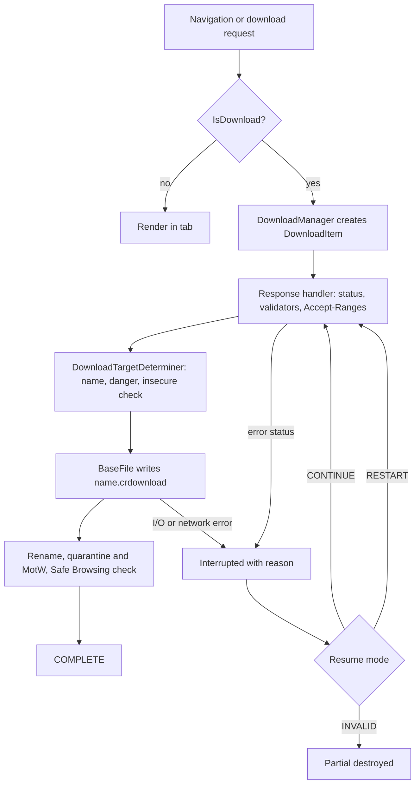
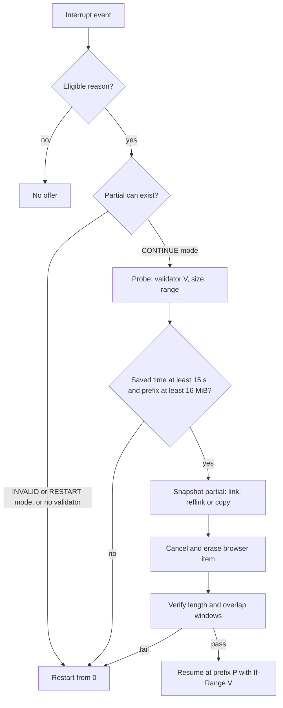

# How browsers download: internals and failure modes

This document explains what Chromium, Firefox and WebKit do between a click and a finished file, what a Manifest V3 extension can and cannot observe, and what that implies for Zeus's "browser failed, hand it to the engine" path. Chromium claims come from files read on the `main` branch in October 2026 (High confidence for that source, Medium for any shipped release). research.md calls the product "Haul"; the spec documents call it Zeus, and this document follows the spec.

## TL;DR

- **The browser's failure reason is a coarse hint.** Chromium folds every unlisted HTTP status (400, 410, 429, 451, all 5xx) into `SERVER_FAILED`, 403 into `SERVER_FORBIDDEN`, and 404, 204 and 205 into `SERVER_BAD_CONTENT` [Chromium: download_utils.cc]. Firefox's extension API reports `CRASH` for anything that is neither a network nor a file error [Firefox: ext-downloads.js]. Zeus must re-probe before classifying.
- **`chrome.downloads` hides what resume needs.** No ETag, no Last-Modified, no headers, and `filename` is the target, not the partial [Chromium: downloads_api.cc]. Zeus can never prove a browser partial matches the representation its own probe sees.
- **`bytesReceived` is not a resume offset.** With parallel download it sums slices, while Chromium resumes from the first hole [Chromium: download_item_impl.cc].
- **Chromium deletes the partial for most non-network failures.** It survives only in `CONTINUE` resume modes; `INVALID` and `RESTART` destroy it. A resume answered with 403 (expired signed URL) very likely leaves nothing (*Inference*, test T2). Snapshot at the first interruption.
- **Desktop Chromium cannot resume without a strong validator and never follows a redirect on resume** (cross-origin: `NETWORK_INVALID_REQUEST`; same-origin: `SERVER_UNREACHABLE`) [Chromium: download_features.cc], [Chromium: download_response_handler.cc]. Zeus, which re-walks the original URL, can finish what Chromium structurally cannot.
- **`USER_CANCELED` is not always the user.** `ERR_ABORTED` maps to it (a code comment names laptop lid-close), and a cancel appears as `state: "interrupted"` [Chromium: download_utils.cc]. Filter on `error`.
- **A browser block is a security decision.** `FILE_BLOCKED` covers policy, Safe Browsing and the silent insecure-download block, and `chrome.downloads.download()` is exempt from the insecure check [Chromium: insecure_download_blocking.cc]. Zeus must not launder blocks.
- **Safari offers extensions no download events.** The `downloads` API is unsupported (forum thread to January 2025; WWDC26 session 216 silent) [Apple: forum 660046], [Apple: WWDC26 216]. Safari means "send to Zeus", not rescue.
- **Mark-of-the-Web is the daemon's job.** Chromium and Firefox write `Zone.Identifier` on Windows, macOS marks only opted-in apps, Linux has nothing; propagate marks through extraction (CVE-2025-0411).

## 1. Evidence conventions

| Tag | Meaning |
|---|---|
| `[Source]` | File read from the project's main branch, October 2026 |
| `[Vendor]` | Vendor documentation fetched in this session |
| `[Calc]` | Computed with Node in `tools/research-checks/_calc08.mjs` and `_calc08b.mjs` |
| *Inference* | Reasoned from the above, not directly stated by a source |

| Claim group | Confidence |
|---|---|
| Interrupt enum, status mapping, resume modes, parallel gating, `IsDownload` | High (read from source) |
| Partial deleted after a 403 resume | Medium (state machine read, not executed) |
| Firefox resume and error mapping | High for source, Medium for shipped behaviour |
| Edge differences, Safari behaviour | Medium (documentation, headers, one forum thread) |
| Insecure-download rollout dates | Low (search summaries; the blog text did not load) |

## 2. The Chromium download stack

### 2.1 Pipeline

### 2.2 Download or navigation

`IsDownload()` decides in this order [Chromium: download_utils_impl.cc]:

1. `Content-Disposition` with an `attachment` disposition: download.
2. Embedder force-download hook (for example user-script URLs): download.
3. MHTML-type responses (`multipart/related` and the `message` family): download unless the embedder allows rendering.
4. MIME type that Blink can render: navigate.
5. Otherwise: download only if there are no headers or the status is 2xx.

Consequences for Zeus. A plain link to an expired S3 URL returns a 403 XML body with a renderable type, so Chromium navigates and shows the XML; **no `DownloadItem` exists and `chrome.downloads` stays silent**. The same URL requested through `<a download>`, "Save link as" or `chrome.downloads.download()` is a download request from the start, and the 403 becomes `SERVER_FORBIDDEN`. An extension that wants to see plain-navigation failures needs `webRequest` observation (status only) or `webNavigation`. Step 1 also means an HTML login page served with `attachment` is saved as an `.html` file with `mime: text/html`, a signal Zeus should treat as `auth_expired` (spec 01 rule D6).

### 2.3 File naming and the `.crdownload` file

`DownloadTargetDeterminer::GenerateFileName` passes URL, `Content-Disposition`, referrer charset, the caller's suggested name (the `download` attribute or the extension's `filename`) and the sniffed MIME type to `net::GenerateFileName`. The extension is replaced from the sniffed type only when no name was suggested, the header carried no filename, the type is not a Safe-Browsing-checked binary, and a `text/plain` sniff did not override a different original type [Chromium: download_target_determiner.cc]. Header parsing is covered in [Zeus: 01-http-download-semantics], section 4.

The intermediate file is `<target name>.crdownload` for safe types and `Unconfirmed <random 0..1000000>.crdownload` for a dangerous type awaiting confirmation; transient downloads and forced paths skip the suffix, and the intermediate name is always uniquified [Chromium: download_target_determiner.cc]. The file holds raw payload bytes (Chromium hashes it directly on resume); validators, hash state and slices live in Chromium's own database [Chromium: base_file.cc], [Chromium: download_item_impl.cc]. Edge uses the same suffix (secondary sources only).

### 2.4 Resumption

**Preconditions.** Resume mode is computed from the last interrupt reason, whether the item has a file path, whether it has a strong validator, and whether auto-resume attempts reached 5 (`kMaxAutoResumeAttempts`) or the item is paused [Chromium: download_item_impl.cc]. Strong validators are stored only if `HasStrongValidators()` held on the response; weak ETags are discarded [Chromium: download_utils.cc]. Without a validator, desktop Chromium forces a restart, because `kAllowDownloadResumptionWithoutStrongValidators` defaults on only for Android [Chromium: download_features.cc].

**Request shape.** `Range: bytes=N-`, `If-Range: <ETag, else Last-Modified>`, `Accept-Encoding: identity`, the original referrer unchanged, redirects disallowed [Chromium: download_utils.cc], [Chromium: download_item_impl.cc]. The older `If-Match` path is obsolete; `SERVER_PRECONDITION` (32) was retired because `If-Range` does not produce a 412 [Chromium: download_interrupt_reason_values.h].

**Response checks.** A `200` to a ranged resume silently resets the offset to 0 and clears the hash (the file is rewritten). A `206` whose `Content-Range` start differs from the requested offset becomes `SERVER_NO_RANGE`. A `416` is `SERVER_NO_RANGE`. A content-decoding failure on a partial request is also `SERVER_NO_RANGE` [Chromium: download_utils.cc].

**Partial-file check.** On resume Chromium re-reads the whole prefix and compares a SHA-256 with the stored hash: a short file gives `FILE_TOO_SHORT`, a mismatch `FILE_HASH_MISMATCH`, an oversized file is truncated to the recorded length [Chromium: base_file.cc]. Cost is linear in the partial size: a 30 GB prefix at an assumed 1 GB/s hash rate takes 30 s [Calc].

**Resume modes.** The table gives the mode per reason (from `GetDownloadResumeMode`) and what happens to the partial: it survives only when the mode ends in `CONTINUE`, because `ReleaseDownloadFile(destroy_file)` is called with `destroy_file = mode is neither IMMEDIATE_CONTINUE nor USER_CONTINUE` [Chromium: download_item_impl.cc].

| Mode | Reasons (with a strong validator) | Partial |
|---|---|---|
| `IMMEDIATE_CONTINUE` (auto, up to 5) | `NETWORK_TIMEOUT` (desktop), `FILE_TRANSIENT_ERROR`, `SERVER_CONTENT_LENGTH_MISMATCH` | Kept |
| `USER_CONTINUE` (user clicks Resume) | `NETWORK_FAILED`, `NETWORK_DISCONNECTED`, `NETWORK_SERVER_DOWN`, `SERVER_FAILED`, `SERVER_UNREACHABLE`, `CRASH`, `FILE_NO_SPACE`, `NETWORK_TIMEOUT` (Android) | Kept |
| `IMMEDIATE_RESTART` | `SERVER_NO_RANGE`, `FILE_HASH_MISMATCH`, `FILE_TOO_SHORT`; also every non-`INVALID` reason when there is no strong validator | Destroyed, restarts from 0 |
| `USER_RESTART` | `FILE_FAILED`, `FILE_ACCESS_DENIED`, `FILE_NAME_TOO_LONG`, `FILE_TOO_LARGE` | Destroyed |
| `INVALID` (`canResume` false) | `SERVER_BAD_CONTENT`, `SERVER_UNAUTHORIZED`, `SERVER_FORBIDDEN`, `SERVER_CERT_PROBLEM`, `SERVER_CROSS_ORIGIN_REDIRECT`, `NETWORK_INVALID_REQUEST`, `USER_CANCELED`, `USER_SHUTDOWN`, `FILE_BLOCKED`, `FILE_VIRUS_INFECTED`, `FILE_SECURITY_CHECK_FAILED`, `FILE_SAME_AS_SOURCE`, any non-HTTP(S) URL (`blob:`, `data:`) | Destroyed |

### 2.5 Parallel download

Chromium's parallel (sliced) downloading files carry 2018 copyright headers. It is off by default on desktop and on by default on Android, exposed on desktop as `chrome://flags/#enable-parallel-downloading` [Chromium: download_features.cc], [Web: parallel downloading flag]. The gate [Chromium: download_job_factory.cc]:

1. A strong validator.
2. `Accept-Ranges: bytes`, a `206`, or unknown range support.
3. A positive `Content-Length` of at least the minimum slice size (default 1,365,333 bytes) unless slices already exist.
4. HTTP/1.1, or HTTP/2 and QUIC (`kUseParallelRequestsForHTTP2` and `kUseParallelRequestsForQUIC` are on by default; a stale comment in the file still says "HTTP/1.1 only").
5. A `GET` over http(s), no Service Worker fetch, no obfuscation, not an explicit range request.

Defaults from Finch keys [Chromium: parallel_download_utils.cc]: `request_count` 3 including the original, `min_slice_size` 1,365,333, `parallel_request_delay` 0 ms, `parallel_request_remaining_time` 2 s (no fork if the remaining transfer is predicted to finish within 2 s).

Slicing: $s=\max(\lfloor L/n\rfloor, s_{\min})$ and the number of requests is $\min(n,\lfloor L/s\rfloor)$, with the last slice half-open (`Range: N-`) because `Content-Length` is not trusted. Computed [Calc]: a 1,000,000-byte file gets 1 request; 4,000,000 bytes gets 2; 10,000,000 gets 3 (starts 0, 3,333,333, 6,666,666); 104,857,600 bytes gets starts 0, 34,952,533 and 69,905,066. Three requests need $L\ge 4{,}095{,}999$.

**Why it matters here.** With slices, `destination_info_.received_bytes` is the total across slices, but resume restarts from the first hole (`FindSlicesToDownload(...)[0].offset`) and drops the stored hash if the two differ [Chromium: download_item_impl.cc]. Example [Calc]: three streams hold 30,000,000, 28,000,000 and 25,000,000 bytes; `bytesReceived` reports 83,000,000 while only 30,000,000 bytes are contiguous, 2.77 times too many. The partial is also sparse, so a read of a hole returns zeros without error. Zeus must never resume at `bytesReceived`.

### 2.6 Download protection and the dangerous-file list

- **File-type policy.** On main, `download_file_types.asciipb` is `version_id: 69` with 412 `file_types` entries: 212 `ALLOW_ON_USER_GESTURE`, 9 that differ by platform, 7 always `DANGEROUS` (`cfg`, `dll`, `dng`, `ini`, `local`, `manifest`, `scf`) and 184 with only ping settings [Chromium: download_file_types.asciipb] (script count, [Calc]). Gesture-gated types (`exe`, `msi`, `bat`, `ps1`, `js`, `lnk`, `dmg`) skip the warning only if a user gesture started the request and the referrer host was visited before the most recent midnight [Edge: download interruptions]; an empty or invalid referrer counts as unvisited [Chromium: download_target_determiner.cc]. So a risky type fetched by an extension will usually need user confirmation (*Inference*).
- **Safe Browsing.** Standard protection sends the file checksum and metadata to Google; Enhanced Protection can upload suspicious files for deep scanning (search-result summaries of Google help pages; Medium). Extensions see the verdict as `danger`, one of 27 internal types [Chromium: downloads_api.cc].
- **Insecure downloads.** Google's 2020-02-06 plan moved from warning to blocking mixed-content downloads, executables and archives first (Chrome 84), all types by Chrome 88; dates are from search summaries, not the post [Google: insecure downloads]. Current code flags a download when the initiator is untrustworthy or the redirect chain or final URL is not secure, except localhost. Text, JSON and CSV, common images, audio and video are exempt, as are retries, reloads and `EXTENSION_API` sources [Chromium: insecure_download_blocking.cc]. A silent block ends with `FILE_BLOCKED` [Chromium: download_target_determiner.cc].
- **Edge.** Same download component and enum. Edge uses Microsoft Defender SmartScreen reputation instead of Safe Browsing [Edge: SmartScreen], inherits "most" of the file-type policy, and since Edge 91 interrupts gesture-less downloads of gesture-gated types [Edge: download interruptions].

## 3. What the extension can see

[Chrome: downloads API] lists 29 `InterruptReason` strings; the internal header adds `NONE` (0) and `LOCAL_DOWNLOAD_BLOCKED` (51), and the extension layer folds the latter into `FILE_BLOCKED` [Chromium: downloads_api.cc]. Numeric values are persisted and fixed: 1, 2, 3, 5, 6, 7, 10 to 15, 20 to 24, 30, 31, 33 to 39, 40, 41, 50, 51 [Chromium: download_interrupt_reason_values.h].

| Item | Behaviour | Source |
|---|---|---|
| `url` / `finalUrl` | Original request URL / last URL after redirects; `finalUrl` since Chrome 54 | [Chromium: downloads_api.cc], [Chrome: downloads API] |
| `filename` | Target path, not the `.crdownload` | [Chromium: downloads_api.cc] |
| `state` | Chromium's `CANCELLED` is reported as `interrupted` with `error: USER_CANCELED` | [Chromium: downloads_api.cc] |
| `error` | Present only when interrupted or cancelled | [Chromium: downloads_api.cc] |
| `bytesReceived` / `totalBytes` | Received total (see 2.5) / `Content-Length` or -1 | [Chrome: downloads API] |
| `fileSize` | A copy of `totalBytes` (a `TODO` in source) | [Chromium: downloads_api.cc] |
| `canResume` | For an interrupted item, true only in `USER_CONTINUE` or `USER_RESTART` mode; false while Chromium auto-resumes and for `INVALID`; for live items it means "paused" | [Chromium: download_item_impl.cc] |
| ETag, headers | Not exposed | [Chromium: downloads_api.cc] |
| `resume()` | Fails with "not resumable" when cancelled or interrupted without `canResume` | [Chromium: downloads_api.cc] |
| `download()` | Sends the host's cookies, allows only XHR-safe headers, never prompts for 401/407 | [Chrome: downloads API], [Chromium: downloads_api.cc] |

## 4. Other engines

| Aspect | Firefox | Safari / WebKit |
|---|---|---|
| Partial file | Helper-app path creates `<random>[.ext].part` in the download directory, mode 0600 [Firefox: nsExternalHelperAppService.cpp]; the Downloads JSON store holds `partFilePath` | App chooses the destination in `decideDestinationUsing`; no documented partial format |
| Resume request | `Range: bytes=N-` plus `If-Match: <etag>` plus `If-Unmodified-Since: <lastmod>` from an entity id `etag/size/lastmod` [Firefox: nsHttpChannel.cpp] | Opaque `resumeData` from `cancel(_:)` or `didFailWithError`; `nil` if the server cannot resume [WebKit: WKDownload.h] |
| Validator mismatch | `NS_ERROR_ENTITY_CHANGED`; a weak ETag cannot satisfy `If-Match` | Not documented |
| Resumable when | stopped or cancelled, has partial data, and (no error or `becauseSourceFailed`) [Firefox: ext-downloads.js] | App calls `WKWebView.resumeDownload(fromResumeData:)` (macOS 11.3, iOS 14.5) [WebKit: WKWebView.h] |
| Extension errors | `NETWORK_FAILED` (source failed), `FILE_FAILED` (target failed), `CRASH` (everything else, including reputation blocks), `USER_CANCELED` (no error); HTTP statuses map only for extension-started downloads: 204/205/404 to `SERVER_BAD_CONTENT`, 403 to `SERVER_FORBIDDEN`, 407 and (apparently a typo) **402** to `SERVER_UNAUTHORIZED`, other 4xx and 5xx to `SERVER_FAILED` [Firefox: ext-downloads.js] | No `downloads` extension API [Apple: forum 660046] |
| MotW | Writes `Zone.Identifier` directly on Windows, deliberately avoiding `IAttachmentExecute::Save` [Firefox: DownloadIntegration.sys.mjs] | App's responsibility; WebKit's header exposes a placeholder-file policy (iOS 18.2) [WebKit: WKDownloadDelegate.h] |

MDN lists 24 interrupt reasons for Firefox and omits `FILE_HASH_MISMATCH`, `FILE_SAME_AS_SOURCE`, `SERVER_UNREACHABLE`, `SERVER_CONTENT_LENGTH_MISMATCH` and `SERVER_CROSS_ORIGIN_REDIRECT` [MDN: downloads.InterruptReason]. Per Firefox's source a 401 reaches the extension as `SERVER_FAILED`, so Firefox's `SERVER_UNAUTHORIZED` is effectively proxy-auth only (*Inference*, Medium).

## 5. Download paths that bypass the network stack

| Path | Mechanics | Failure and handoff |
|---|---|---|
| `<a download>` | Forces a download for same-origin, `blob:` and `data:` URLs; Blink ignores the attribute on cross-origin URLs since Chrome 65 [Chrome: 65 deprecations], [HTML: downloading resources] | A same-origin 403 becomes `SERVER_FORBIDDEN` (a download request from the start) |
| `blob:` URL | Bytes live in the originating renderer; the URL dies on revoke or unload | Chromium resume is `INVALID` for non-HTTP(S) [Chromium: download_utils.cc]; the daemon cannot fetch it; only the extension can, in the page's origin and only while the URL lives |
| `data:` URL | The bytes are in the URL | The daemon can decode `item.url` itself; Edge documents that such a download cannot be exempted per domain because it has no origin [Edge: download interruptions] |
| File System Access API | `showSaveFilePicker` needs a user gesture and a secure context; writes go to a swap file (`.crswap`) and Safe Browsing runs on `close()` [Chrome: File System Access], [Chromium: crswap thread] | No `DownloadItem` at all; invisible to `chrome.downloads`; not rescuable |
| Service-worker stream (StreamSaver pattern) | A service worker answers a fetch with a `Content-Disposition: attachment` stream the page feeds through `postMessage` [StreamSaver.js] | No resume by design. Chromium parallelism and `If-Range` do not apply (`fetched_via_service_worker`). A mid-stream abort now maps to `NETWORK_FAILED`, not `USER_CANCELED` (crbug 40410035 in the code comment), so the extension can see it; the server never sees a range request |

## 6. Signed-URL expiry as the browser experiences it

Server-side expiry semantics (in-flight transfers survive, new requests fail) are in [Zeus: 01-http-download-semantics], section 6. This table adds the browser side.

| Scenario | What Chromium does | Extension sees | User sees |
|---|---|---|---|
| S1 Link expired before the click, plain link | 403 with an XML body, renderable type: navigates | Nothing from `chrome.downloads`; `webRequest` shows 403 | The XML error page |
| S2 Same, via `download` attribute, "Save link as" or `chrome.downloads.download` | 403: download request from the start | `interrupted`, `SERVER_FORBIDDEN`, `canResume: false` | "Failed - Forbidden" (classic) or "File wasn't available on site" (bubble) |
| S3 URL expires mid-stream | Transfer finishes on S3 and CloudFront | `complete` | Nothing |
| S4 Connection drops, user resumes after expiry | Resume goes to the last (signed) URL with `Range` and `If-Range`; 403 | `interrupted` first with a network reason, then `SERVER_FORBIDDEN`; partial likely destroyed (*Inference*) | Network text first, then the S2 text after the click |
| S5 Gateway redirects to a signed host | Resume never re-walks the chain; a redirect on resume is an error | `NETWORK_INVALID_REQUEST` (cross-origin) or `SERVER_UNREACHABLE` | "Check internet connection" or "Site wasn't available" (bubble) |
| S6 One-time token | Re-request consumes or rejects the token | Usually `SERVER_FORBIDDEN` or `SERVER_BAD_CONTENT` | As S2 |

Chromium has two status-text builders. The classic one prints "Failed - <reason>": "Forbidden" (403), "No file" (404), "Needs authorization", "Network error", "Server problem", "Server unreachable", "File incomplete", "Blocked" [Chromium: generated_resources.grd]. The download-bubble builder is coarser: `SERVER_UNAUTHORIZED`, `SERVER_FORBIDDEN` and `SERVER_BAD_CONTENT` all read "File wasn't available on site"; every `NETWORK_*` reason except `NETWORK_SERVER_DOWN` reads "Check internet connection"; `NETWORK_SERVER_DOWN`, `SERVER_FAILED`, `SERVER_UNREACHABLE` and `SERVER_CERT_PROBLEM` read "Site wasn't available"; `CRASH` and `SERVER_CONTENT_LENGTH_MISMATCH` read "Couldn't finish download"; `SERVER_NO_RANGE` reads "Something went wrong" [Chromium: download_ui_model.cc]. I did not verify which surface uses which builder. In the bubble a user cannot tell an expired link from a deleted file, so Zeus's offer should name the cause after its probe.

**Worked example** [Calc]. A 50 GB file, 900 s signed URL, one stream at 50 MB/s needs 1,000 s. The first 45 GB (90%) arrive before expiry. If the connection drops at 600 s, 30 GB are on disk and 20 GB (400 s) remain. A browser resume after expiry fails with 403. Zeus, holding the original URL, fetches a fresh URL and resumes from 30 GB. Overlap-verifying 1 MiB costs about 21 ms at 50 MB/s; re-hashing the 30 GB prefix costs 30 s at an assumed 1 GB/s.

## 7. Key deliverable: signal to Zeus error class

Classes are the spec's [Zeus: spec 00 conventions] section 9.2; `disk`, `integrity` and `policy_denied` appear because the browser reasons include local-file and security outcomes. The browser reason is a first-probe strategy; the daemon's probe (spec 01 section 8.3 rules A to D) decides.

### 7.1 Chromium and Edge interrupt reasons

| Reason (value) | Produced by | Browser resume mode and partial | Zeus class | Recovery |
|---|---|---|---|---|
| `NETWORK_FAILED` (20) | Unmapped network error; SW stream abort | `USER_CONTINUE`, kept | `transient_network` | Snapshot partial; resume with overlap check |
| `NETWORK_TIMEOUT` (21) | `ERR_TIMED_OUT` | Auto-resume (desktop), kept | `transient_network` | Offer only if the item stays interrupted past the grace window (8.3, I3) |
| `NETWORK_DISCONNECTED` (22) | `ERR_NETWORK_CHANGED`, `ERR_INTERNET_DISCONNECTED` | `USER_CONTINUE`, kept | `transient_network` | Wait for connectivity; do not spend retry budget |
| `NETWORK_SERVER_DOWN` (23) | `ERR_CONNECTION_FAILED` | `USER_CONTINUE`, kept | `transient_network` | Host-level backoff |
| `NETWORK_INVALID_REQUEST` (24) | Bad scheme, policy, or a cross-origin redirect during resume | `INVALID` | `permanent`; probe the original URL first if the item had been resumed | Re-walk redirects from `url`; if the probe succeeds the class was wrong |
| `SERVER_FAILED` (30) | Any status not listed elsewhere: 400, 410, 429, 451, 5xx | `USER_CONTINUE`, kept | By probe: 429 and 503 `throttled`; 5xx `transient_network`; 400, 410, 451 `permanent` | Honour `Retry-After`; host-wide |
| `SERVER_NO_RANGE` (31) | 416, wrong `Content-Range` start, decode failure on partial | `IMMEDIATE_RESTART`, destroyed | `transient_network` | Restart from 0, single stream if range is broken |
| `SERVER_BAD_CONTENT` (33) | 404, 204, 205; bad `Content-Range` | `INVALID`, destroyed | `permanent`, or `url_expired` for a signed or one-time URL (spec D2, D3) | Refresh via origin, else report |
| `SERVER_UNAUTHORIZED` (34) | 401, 407 | `INVALID`, destroyed | `auth_expired` (407: `permanent`, proxy) | Session lease refresh |
| `SERVER_CERT_PROBLEM` (35) | `ERR_ABORTED` with certificate error | `INVALID` | `permanent` | Never bypass |
| `SERVER_FORBIDDEN` (36) | 403 | `INVALID`, destroyed (*Inference*) | Ambiguous: `url_expired`, `auth_expired`, `blocked`, `permanent` by rules D1 to D5 | Probe; refresh URL, lease, or in-browser proxy |
| `SERVER_UNREACHABLE` (37) | Any redirect on a partial request | `USER_CONTINUE`, kept | `transient_network`, probe from `url` | Redirects are legal for Zeus; also detects captive portals |
| `SERVER_CONTENT_LENGTH_MISMATCH` (38) | Short body; only an interruption if strong validators exist | `IMMEDIATE_CONTINUE`, kept | `transient_network` | Resume |
| `SERVER_CROSS_ORIGIN_REDIRECT` (39) | Only when the caller sets manual redirect mode | `INVALID` | `transient_network` | Follow; rarely seen from desktop sources |
| `USER_CANCELED` (40) | `Cancel`, `Remove`, and `ERR_ABORTED` outside a service worker | `INVALID`, destroyed | None | Never auto-offer; allow a manual forward only |
| `USER_SHUTDOWN` (41), `CRASH` (50) | Browser exit | `INVALID`/`USER_CONTINUE` | `transient_network` | Low-priority offer |
| `FILE_NO_SPACE` (3) | Disk full | `USER_CONTINUE`, kept | `disk` | Write on another volume; reuse partial if readable |
| `FILE_FAILED` (1), `FILE_ACCESS_DENIED` (2), `FILE_NAME_TOO_LONG` (5), `FILE_TOO_LARGE` (6) | Local write problem; too large for the filesystem | `USER_RESTART`, destroyed | `disk` | Restart in Zeus's directory; for `FILE_TOO_LARGE` pick a volume that can hold the size |
| `FILE_TRANSIENT_ERROR` (10) | In use, too many files, no memory | Auto-resume, kept | `disk` (transient) | Wait |
| `FILE_TOO_SHORT` (13), `FILE_HASH_MISMATCH` (14) | Prefix check failed on resume | `IMMEDIATE_RESTART` | `integrity` | Restart from 0 |
| `FILE_VIRUS_INFECTED` (7), `FILE_BLOCKED` (11), `FILE_SECURITY_CHECK_FAILED` (12), `FILE_SAME_AS_SOURCE` (15) | Antivirus, policy, Safe Browsing, insecure-download block, local oddity | `INVALID` | `policy_denied` | Never launder (spec 01 section 8.4) |

### 7.2 Signals with no interrupt reason

| Observable | Meaning | Zeus class and action |
|---|---|---|
| `webRequest` 4xx or 5xx on a navigation | Plain link failed, no `DownloadItem` | Class by HTTP status (spec 01 section 8.3 stage D) |
| `state: complete`, `bytesReceived < totalBytes` | Server closed early without strong validators; Chromium treats it as finished [Chromium: download_interrupt_reason_values.h] | `integrity`: flag the file, offer a verified re-fetch |
| `state: complete`, `mime: text/html`, small size, binary expected | Login or interstitial page saved as a file | `auth_expired` (rule D6) |
| `canResume: true` with a network reason | `USER_CONTINUE` (partial kept) or, after failed auto-restarts without a validator, `USER_RESTART` (nothing kept); Zeus cannot tell which | `transient_network`; look for the file, else restart |
| `exists: false` | User deleted the file | None |
| `danger` not `safe` or `accepted` | Safe Browsing or type policy verdict | Not an error; `policy_denied` if the user rejects; never auto-accept |
| Firefox `CRASH` or `USER_CANCELED` after a block | Reputation or content-analysis block, or real cancel | Treat as unknown; probe, but do not offer if a block is plausible |

## 8. Recovery design

### 8.1 Reuse or restart

Reuse rule (*Inference*, to be tuned by T5): reuse the browser's bytes only when the saved transfer time $P/\hat r$ is at least 15 s and $P\ge 16$ MiB, where $\hat r$ is the recent rate. Below that the snapshot, verification and extra code paths cost about as much as re-downloading. At 50 MB/s the threshold is $P\approx 750$ MB; at 5 MB/s it is 75 MB; the 16 MiB floor binds only below about 1.1 MB/s ($16\,\mathrm{MiB}/15\,\mathrm{s}$).

### 8.2 Taking over the partial file

1. **Offer.** The extension sends `download.id`, `url`, `finalUrl`, `referrer`, `filename`, `bytesReceived`, `totalBytes`, `canResume`, `error`. It cannot send a validator.
2. **Probe.** The daemon runs its own probe and records strong validator $V$ and total size. If the probe returns no strong validator, restart.
3. **Locate.** Candidate path: `<filename>.crdownload`, or a single `Unconfirmed *.crdownload` in the same directory whose size is at least `bytesReceived` (ambiguous when several exist: restart). Accept only a regular file inside the configured browser download roots, never a symlink or reparse point.
4. **Snapshot first, then cancel.** Create a hard link (same volume), else a reflink (`FICLONE`, APFS `clonefile`, ReFS block clone), else a copy into `partials/<job>.part`. Only then call `chrome.downloads.cancel` and `erase`. Cancelling first would delete the file: `Cancel()` calls `InterruptAndDiscardPartialState` [Chromium: download_item_impl.cc]. After the cancel the surviving inode has one name and no other writer.
5. **Choose $P$.** $P=\min(\text{file length},\ \text{contiguous prefix})$; the daemon cannot see slices, so treat the file length as an upper bound.
6. **Overlap verify.** Fetch `Range: bytes=(P-1 MiB)-P-1` plus 8 sampled 128 KiB windows across $[0,P)$ (about 2 MiB in total, 42 ms at 50 MB/s [Calc]) with `If-Range: V`, and compare byte for byte. A mismatch rejects the partial. This substitutes for the validator Zeus could not see; it catches a changed object, a torn tail write and sparse holes (a hole reads as zeros). It is not proof against a change confined to unsampled regions (*Inference*).
7. **Resume.** `Range: bytes=P-`, `If-Range: V`, `Accept-Encoding: identity`, a fresh session lease; accept only a `206` whose `Content-Range` starts at $P$ and whose ETag equals $V$ (spec 01 section 3.5).
8. **Finish.** SHA-256 over the whole file, MotW or quarantine, atomic rename to the destination. Chromium's own prefix check costs $O(P)$ per resume; Zeus hashes once, in its journal.

### 8.3 Avoiding double writes

- **I1 single writer.** Zeus never opens a `.crdownload` for write. On Windows Chromium opens it with `FLAG_WIN_EXCLUSIVE_WRITE | FLAG_WIN_SHARE_DELETE`: others cannot write, may rename and delete, and readers must request `FILE_SHARE_READ | FILE_SHARE_WRITE | FILE_SHARE_DELETE` [Chromium: base_file.cc], [Chromium: file_win.cc]. Linux and macOS have no mandatory locking, so protocol enforces I1.
- **I2 ordering.** Snapshot, then cancel, then write. Chromium could append between snapshot and cancel (a hard link shares the inode), so take $P$ from a `bytesReceived` read before the snapshot.
- **I3 auto-resume race.** `IMMEDIATE_*` modes resume within milliseconds, up to 5 times, and show `canResume: false` meanwhile. For `NETWORK_TIMEOUT`, `FILE_TRANSIENT_ERROR`, `SERVER_CONTENT_LENGTH_MISMATCH`, `SERVER_NO_RANGE`, `FILE_HASH_MISMATCH` and `FILE_TOO_SHORT`, offer only if the item is still `interrupted` after 3 s. Other eligible reasons are stable and may be offered at once.
- **I4 live items.** Forwarding an in-progress download first calls `chrome.downloads.pause`, then snapshots only after two reads 500 ms apart show no growth.
- **I5 final name.** Chromium uniquifies names (`name (1).ext`); Zeus reserves the final name at commit time with exclusive create.

### 8.4 User-visible handoff and dedupe

One prompt per eligible interrupted item: "This download did not finish. Finish with Zeus?" [Finish] [Always for this site] [Dismiss], with the probed cause ("link expired", "server asked to slow down") filled in once known. After consent the browser entry is erased and a Zeus job with the browser's file name replaces it; the file lands in the browser's download directory under the intended name. Dedupe key: strong validator plus size, else normalised URL (signature parameters removed) plus size, else SHA-256 after completion. A re-click while the job runs returns `deduplicated` (spec 02 section 7); a same-hash `name (1).ext` afterwards is offered for deletion, never deleted silently. A Chromium cancel cannot be undone; "Undo" can only restart.

## 9. Operating-system specifics

| Topic | Windows | macOS | Linux |
|---|---|---|---|
| Browser partial | `name.crdownload`, exclusive write, share-delete [Chromium: file_win.cc] | Same | Same |
| Origin mark | `IAttachmentExecute::Save` with a direct `Zone.Identifier` ADS fallback (`ZoneId=3`, plus `ReferrerUrl` and `HostUrl` on Windows 10 and later) [Chromium: quarantine_win.cc] | `com.apple.quarantine` applied by the OS only to apps with `LSFileQuarantineEnabled`; Chromium adds quarantine properties and `kMDItemWhereFroms` [Chromium: quarantine_mac.mm] | None: no quarantine implementation exists in Chromium's quarantine directory [Chromium: quarantine directory]; Chromium dropped `user.xdg.*` xattrs for privacy [Chromium: issue 40088105] (Medium) |
| Zeus action | Use `IAttachmentExecute::Save` for Zeus-owned files; `about:internet` when the URL is unknown; do the mark inside a private temp directory before the rename [Web: MotW guidance] | Ship a bundle with `LSFileQuarantineEnabled`, or set `NSURLQuarantinePropertiesKey` | Record origin in the Zeus manifest; no xattr by default |
| Archive extraction | Propagate the mark to extracted files: 7-Zip before 24.09 did not for nested archives (CVE-2025-0411, exploited in the wild) [ZDI-25-045], [Trend: CVE-2025-0411] | Copy quarantine explicitly in Zeus converters [unverified: what Archive Utility does] | Not applicable |
| Locking and AV | Defender and EDR may hold a handle: expect sharing violations (spec 01 rule A4) | Rare | Rare |
| Preallocation and sparse | Chrome's parallel file is sparse; a hole reads as zeros | Same | Same |

Zeus marks everything it writes from an untrusted origin. Guidance is to let the OS API write the mark where possible, since the result depends on client configuration [Web: MotW guidance].

## Implications for Zeus

1. **Probe first, classify second.** *Evidence:* `SERVER_FAILED`, `SERVER_FORBIDDEN` and `SERVER_BAD_CONTENT` each cover several causes; Firefox's `CRASH` can mean a reputation block. *Do:* treat section 7.1 as first-probe strategy only. *Test T1:* replay 403, 404 and 429 responses (expired S3, WAF challenge, plain forbidden) and require the probe's class to match a labelled truth in at least 95% of cases.
2. **Capture at the first interruption.** *Evidence:* only `CONTINUE` modes keep the partial; a 403 on resume is `INVALID`. *Do:* offer on the first eligible interruption, never after a user resume attempt; the native host snapshots on acceptance. *Test T2:* a server that drops at 40% then returns 403 to the resume; list the `.crdownload` after each step.
3. **Never resume at `bytesReceived`.** *Evidence:* slices, sparse files, Chromium's first-hole rule. *Do:* $P=\min$(length, verified contiguous prefix) plus the 8.2 overlap check. *Test T3:* force `#enable-parallel-downloading`, interrupt mid-transfer, assert `bytesReceived` exceeds the contiguous prefix and Zeus's $P$ is right.
4. **Reuse only past 15 s saved and 16 MiB, else restart.** *Evidence:* snapshot and verification cost against transfer time. *Test T5:* sweep prefix sizes and rates, time reuse against restart, and move the threshold to the measured break-even.
5. **Snapshot, cancel, write.** *Evidence:* `Cancel()` discards the partial; exclusive write on Windows; no locking elsewhere. *Do:* invariants I1 to I5. *Test T4:* race Chromium auto-resume against takeover 1,000 times; no byte may be written by both.
6. **Filter on `error`.** *Evidence:* cancels arrive as `interrupted`; `USER_CANCELED` can be a lid close. *Do:* offer only the eligible set of 7.1, a manual forward for `USER_CANCELED`, nothing for `FILE_BLOCKED`. *Test T6:* cancel from UI, from `chrome.downloads.cancel` and by suspend; record `error`.
7. **Do not launder browser blocks.** *Evidence:* `FILE_BLOCKED` is policy, Safe Browsing or silent insecure block; `EXTENSION_API` skips the insecure check. *Do:* keep spec 01 section 8.4; never call `chrome.downloads.download` for a URL the browser blocked; any override is a per-job approval labelled "insecure transport", for unmanaged browsers only (*Inference*, open question 4). *Test T7:* an `http://` executable linked from an `https://` page must withhold the offer.
8. **Seed Zeus's dangerous-type policy from Chromium's list.** *Evidence:* version 69, 412 entries, 7 always dangerous, 212 gesture-gated. *Do:* vendor the list with its version and gate agent-initiated gesture-gated types behind approval. *Test T8:* diff against upstream weekly.
9. **Verify "complete".** *Evidence:* without strong validators a short body counts as finished. *Do:* on `complete`, compare `bytesReceived`, `totalBytes` and disk size; flag `integrity`. *Test T9:* a server that closes early without validators.
10. **Re-walk the original URL.** *Evidence:* Chromium resumes only the last URL and fails on any redirect. *Do:* store `url` and `final_url`; try `final_url` with the range, and on 401, 403, 404, `SERVER_UNREACHABLE` or `NETWORK_INVALID_REQUEST` re-walk `url`. *Test T10:* a gateway that 302s to short-lived signed URLs.
11. **Safari: "send to Zeus".** *Evidence:* no `downloads` API. *Do:* context-menu and share-extension entry handing over the URL and consented cookies.
12. **Mark everything.** *Evidence:* section 9. *Do:* OS-specific writers for handoff and agent jobs, and mark extracted files. *Test T11:* extract a nested archive on Windows; every file needs `Zone.Identifier`.
13. **Do not sell parallelism.** *Evidence:* Chromium has it, off by default on desktop. *Do:* position on session-awareness and recovery, which the browser structurally lacks.

## Corrections to research.md

| Where | research.md says | Evidence says |
|---|---|---|
| 4.1 (Signed URLs row) and 5.4 sequence | "resume against the same ETag"; handoff `{... bytes_received ...}` then `Range probe + If-Range(ETag)` | `chrome.downloads` exposes no ETag or Last-Modified, so the ETag can only come from Zeus's own probe, and the partial cannot be matched to it; `bytes_received` may exceed the contiguous prefix [Chromium: downloads_api.cc], [Chromium: download_item_impl.cc] |
| 5.4 diagram, first step | `onChanged = interrupted` triggers the prompt | A cancel also arrives as `interrupted` (`USER_CANCELED`), and `IMMEDIATE_*` reasons recover in milliseconds; filter on `error` and wait for a grace period |
| 5.4 retry table | `permanent` includes 404 | Chromium's `SERVER_BAD_CONTENT` is also what an expired one-time or signed URL on a gateway can look like; classify after the probe |
| 4.5 Quarantine row | "Mark-of-the-Web / `com.apple.quarantine`" | Linux has none; on macOS the OS marks only opted-in apps, so a plain daemon must write its own; on Windows prefer `IAttachmentExecute::Save` over a raw stream |

## Open questions

1. Does a 403 on resume really delete the partial (test T2)? The path is `Start` with a failing `result`, then `InterruptWithPartialState`, then `ReleaseDownloadFile(true)`.
2. Does desktop `bytesReceived` equal the slice sum, as the code suggests, and what does the extension see after a browser restart mid-parallel-download?
3. What does Edge add beyond the documented SmartScreen and file-type changes?
4. Can an extension tell an insecure-download block from an enterprise block? Both are `FILE_BLOCKED`; if not, a per-job approval path cannot be scoped safely.
5. Has Safari 27 added a `downloads` API? WWDC26 session 216 does not mention one.
6. Is the Firefox 402-for-401 mapping a filed bug, and does a user-initiated Firefox failure expose any HTTP status?
7. Which desktop Chromium versions auto-resume on network reconnect (Android has a separate handler)?

## References

- [Chromium: download_interrupt_reason_values.h] Interrupt enum with numeric values. https://chromium.googlesource.com/chromium/src/+/refs/heads/main/components/download/public/common/download_interrupt_reason_values.h
- [Chromium: download_interrupt_reasons_utils.cc] Net and file error to interrupt reason mapping. https://chromium.googlesource.com/chromium/src/+/refs/heads/main/components/download/internal/common/download_interrupt_reasons_utils.cc
- [Chromium: download_utils.cc] `HandleSuccessfulServerResponse`, `HandleRequestCompletionStatus`, `GetDownloadResumeMode`, request headers. https://chromium.googlesource.com/chromium/src/+/refs/heads/main/components/download/internal/common/download_utils.cc
- [Chromium: download_item_impl.cc] `DownloadItemImpl` state machine, resume and cancel. https://chromium.googlesource.com/chromium/src/+/refs/heads/main/components/download/internal/common/download_item_impl.cc
- [Chromium: download_response_handler.cc] Redirect handling for downloads. https://chromium.googlesource.com/chromium/src/+/refs/heads/main/components/download/internal/common/download_response_handler.cc
- [Chromium: base_file.cc] Partial-file hash check and open flags. https://chromium.googlesource.com/chromium/src/+/refs/heads/main/components/download/internal/common/base_file.cc
- [Chromium: file_win.cc] `base::File` share-mode mapping. https://chromium.googlesource.com/chromium/src/+/refs/heads/main/base/files/file_win.cc
- [Chromium: download_features.cc] Download feature defaults. https://chromium.googlesource.com/chromium/src/+/refs/heads/main/components/download/public/common/download_features.cc
- [Chromium: parallel_download_utils.cc] Slicing and Finch defaults. https://chromium.googlesource.com/chromium/src/+/refs/heads/main/components/download/internal/common/parallel_download_utils.cc
- [Chromium: download_job_factory.cc] Parallelizable gate. https://chromium.googlesource.com/chromium/src/+/refs/heads/main/components/download/internal/common/download_job_factory.cc
- [Chromium: download_utils_impl.cc] `MustDownload` and `IsDownload`. https://chromium.googlesource.com/chromium/src/+/refs/heads/main/content/browser/loader/download_utils_impl.cc
- [Chromium: download_target_determiner.cc] Filename, `.crdownload` and danger logic. https://chromium.googlesource.com/chromium/src/+/refs/heads/main/chrome/browser/download/download_target_determiner.cc
- [Chromium: insecure_download_blocking.cc] Insecure and mixed-content download policy. https://chromium.googlesource.com/chromium/src/+/refs/heads/main/chrome/browser/download/insecure_download_blocking.cc
- [Chromium: download_file_types.asciipb] File-type policy, `version_id` 69. https://chromium.googlesource.com/chromium/src/+/refs/heads/main/components/safe_browsing/content/resources/download_file_types.asciipb
- [Chromium: downloads_api.cc] `chrome.downloads` implementation. https://chromium.googlesource.com/chromium/src/+/refs/heads/main/chrome/browser/extensions/api/downloads/downloads_api.cc
- [Chromium: download_ui_model.cc] Status text builders. https://chromium.googlesource.com/chromium/src/+/refs/heads/main/chrome/browser/download/download_ui_model.cc
- [Chromium: generated_resources.grd] Download interruption strings. https://chromium.googlesource.com/chromium/src/+/refs/heads/main/chrome/app/generated_resources.grd
- [Chromium: quarantine_win.cc] https://chromium.googlesource.com/chromium/src/+/refs/heads/main/components/services/quarantine/quarantine_win.cc
- [Chromium: quarantine_mac.mm] https://chromium.googlesource.com/chromium/src/+/refs/heads/main/components/services/quarantine/quarantine_mac.mm
- [Chromium: quarantine directory] File listing showing no Linux implementation. https://chromium.googlesource.com/chromium/src/+/refs/heads/main/components/services/quarantine/
- [Chromium: issue 40088105] "Do not store URLs in xattr", Chromium issue tracker (summary from search results). https://issues.chromium.org/issues/40088105
- [Chromium: crswap thread] chromium-dev discussion of `.crswap` swap files. https://groups.google.com/a/chromium.org/g/chromium-dev/c/UyU-U-V0Jo4
- [Chrome: downloads API] "chrome.downloads", Google, Chrome for Developers. https://developer.chrome.com/docs/extensions/reference/api/downloads
- [Chrome: File System Access] "The File System Access API", Google. https://developer.chrome.com/docs/capabilities/web-apis/file-system-access
- [Chrome: 65 deprecations] "Chrome 65 deprecations", Google, 2018-02-08. https://developer.chrome.com/blog/chrome-65-deprecations
- [Google: insecure downloads] "Protecting users from insecure downloads in Google Chrome", Google Online Security Blog, 2020-02-06 (dates not verified against the text). https://security.googleblog.com/2020/02/protecting-users-from-insecure_6.html
- [Edge: download interruptions] "Identify and interrupt downloads of potentially dangerous files", Microsoft Learn, updated 2026-06-15. https://learn.microsoft.com/en-us/deployedge/microsoft-edge-security-downloads-interruptions
- [Edge: SmartScreen] "Microsoft Edge support for Microsoft Defender SmartScreen", Microsoft Learn (search summary). https://learn.microsoft.com/en-us/deployedge/microsoft-edge-security-smartscreen
- [MDN: downloads.InterruptReason] Mozilla, MDN Web Docs. https://developer.mozilla.org/en-US/docs/Mozilla/Add-ons/WebExtensions/API/downloads/InterruptReason
- [Firefox: DownloadCore.sys.mjs] https://github.com/mozilla-firefox/firefox/blob/main/toolkit/components/downloads/DownloadCore.sys.mjs
- [Firefox: DownloadIntegration.sys.mjs] https://github.com/mozilla-firefox/firefox/blob/main/toolkit/components/downloads/DownloadIntegration.sys.mjs
- [Firefox: nsExternalHelperAppService.cpp] https://github.com/mozilla-firefox/firefox/blob/main/uriloader/exthandler/nsExternalHelperAppService.cpp
- [Firefox: nsHttpChannel.cpp] https://github.com/mozilla-firefox/firefox/blob/main/netwerk/protocol/http/nsHttpChannel.cpp
- [Firefox: ext-downloads.js] https://github.com/mozilla-firefox/firefox/blob/main/toolkit/components/extensions/parent/ext-downloads.js
- [WebKit: WKDownload.h] https://github.com/WebKit/WebKit/blob/main/Source/WebKit/UIProcess/API/Cocoa/WKDownload.h
- [WebKit: WKDownloadDelegate.h] https://github.com/WebKit/WebKit/blob/main/Source/WebKit/UIProcess/API/Cocoa/WKDownloadDelegate.h
- [WebKit: WKWebView.h] https://github.com/WebKit/WebKit/blob/main/Source/WebKit/UIProcess/API/Cocoa/WKWebView.h
- [Apple: forum 660046] "browser.downloads API for Safari Web Extensions", Apple Developer Forums, 2020 to January 2025. https://developer.apple.com/forums/thread/660046
- [Apple: WWDC26 216] "Create web extensions for Safari", Apple, WWDC26. https://developer.apple.com/videos/play/wwdc2026/216/
- [HTML: downloading resources] HTML Living Standard, WHATWG, section "Downloading resources". https://html.spec.whatwg.org/multipage/links.html#downloading-resources
- [StreamSaver.js] J. Warting, GitHub repository README. https://github.com/jimmywarting/StreamSaver.js
- [Web: parallel downloading flag] Describes `chrome://flags/#enable-parallel-downloading` (Medium). https://chromestory.com/2023/09/enable-parallel-downloading/
- [Web: MotW guidance] E. Lawrence, "Mark-of-the-Web: Additional Guidance", 2022-12-02. https://textslashplain.com/2022/12/02/mark-of-the-web-additional-guidance/
- [ZDI-25-045] "7-Zip Mark-of-the-Web Bypass Vulnerability", Zero Day Initiative, 2025. https://www.zerodayinitiative.com/advisories/ZDI-25-045/
- [Trend: CVE-2025-0411] "CVE-2025-0411: Ukrainian Organizations Targeted in Zero-Day Campaign", Trend Micro, 2025. https://www.trendmicro.com/en_us/research/25/a/cve-2025-0411-ukrainian-organizations-targeted.html
- [Zeus: 01-http-download-semantics] `docs/research/01-http-download-semantics.md`.
- [Zeus: spec 00 conventions] `docs/spec/00-conventions.md`, section 9.2 error classes.
