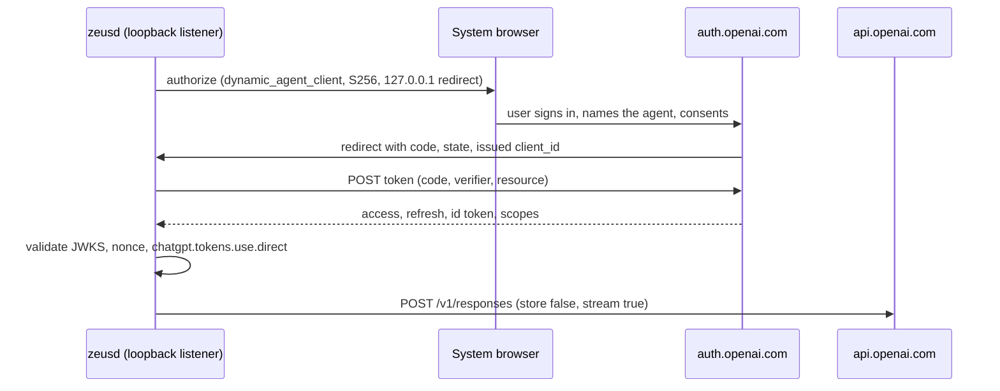
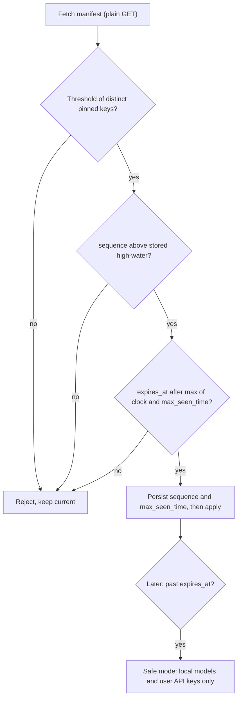

# LLM providers, subscription auth, routing and local models

Which routes to a language model Zeus may build, what each costs in policy risk, and how to run the cheap ones locally. Vendor docs, spec text and registries were fetched on 2026-10-05 and 06 (machine clock); claims resting on trade press are tagged Medium or Low; *Inference* marks my reasoning. `research.md` barely covers this topic, so the corrections target ADR 0008 and HANDOFF.md as well.

## TL;DR

- **"Sign in with ChatGPT" for open-source local apps is real and documented.** DevDay was 2026-09-29. The redirect is `http://127.0.0.1:{port}/auth/callback` (only the port may vary; `localhost` is rejected), `dynamic_agent_client` is registration-only (keep the issued `oaiapp_...` id), access tokens last 3,600 s, refresh tokens 30 days and rotate [SIWC: sign-in] [SIWC: token reference] (High).
- **It is a narrow pipe.** Responses API only, `store:false`, `stream:true`, no `max_output_tokens` or `temperature`, Plus and Pro only, a user-set per-app weekly cap of 10% to 100%, and a Plus five-hour window shared by all apps [SIWC: preview limitations] [SIWC: accounts and sessions]. Use it for plan drafting and occasional classification, not 10,000-file loops.
- **Never route Claude subscriptions.** Anthropic's Claude Code legal page forbids third-party developers from routing requests through Free, Pro or Max credentials or intermediating Claude.ai tokens [Anthropic: Claude Code legal]. The April 2026 cutoff and the paused June credit change keep practice volatile (section 3). Claude means API key.
- **Google consumer routes are gone or banned.** Code Assist for individuals, AI Pro and AI Ultra stopped serving Gemini CLI on 2026-06-18 [Google: Code Assist deprecation]; piggybacking CLI OAuth from third-party software is a stated violation [Gemini CLI: ToS]. Gemini API free-tier content is used to improve Google products [Google: Gemini pricing]. xAI's SuperGrok device-flow OAuth is endorsed only for Hermes and returns 403 for some tiers: experimental, off by default.
- **MCP sampling is deprecated** in spec 2026-07-28 (SEP-2577), stays at least 12 months, and now exists only nested in a client's `tools/call`, so it cannot serve daemon-initiated work [MCP: sampling]. OpenCode had not implemented it as of 2026-08 [OpenCode: sampling issue].
- **Local CPU decoding is memory-bandwidth-bound.** A 2B model at Q4_K_M reads about 1.4 GB per token: dual-channel DDR4-3200 caps it near 37 tokens/s, so 60 tokens take 1.6 s at the ceiling and 2.7 to 3.3 s at 50% to 60% efficiency (computed, section 5). Default local tier: Qwen3.5-2B with a grammar.
- **Constrained decoding fixes syntax, not meaning.** On 0.6B to 4B models schema validity rose from 78.6%-92.9% to 100% while semantic failures remained [arXiv:2609.23742]. Validate and fall back.
- **Credential plumbing has hard limits.** A Windows Credential Manager blob holds at most 2,560 bytes [Microsoft: CREDENTIALW]; an OAuth bundle probably exceeds it (*Inference*). Keep a vault key in the OS store, the bundle in an encrypted file, one refresh writer.
- **Manifest and dependencies.** Keep DSSE plus ed25519, add a persisted high-water sequence and time and a 2-of-3 threshold, borrowing TUF's rollback and freeze rules [TUF spec]. Avoid LiteLLM (malicious PyPI releases 1.82.7 and 1.82.8 on 2026-03-24 [Datadog: LiteLLM]) and treat RouteLLM (last push 2024-08-10 [GitHub: RouteLLM]) as a paper, not a dependency.

## 1. Every route at a glance

Dates are last-verified (2026-10-06). Risk is risk to Zeus and its users of an account action or policy conflict, not legal advice. Keys in brackets resolve to URLs in References.

### 1.1 Subscription-backed routes

| Route | Official? | ToS risk | Effort | Verified; source URL |
|---|---|---|---|---|
| Sign in with ChatGPT (OSS and local apps) | Yes, documented programme | Low | M | 10-06; https://developers.openai.com/siwc/token-sharing-open-source |
| Delegate to the user's `codex exec` | Yes, OpenAI's binary | Low; docs advise API keys for CI | S | 10-06; https://developers.openai.com/codex/auth |
| Codex app-server fed a SIWC token | Yes, in SIWC docs | Low | M | 10-06; https://developers.openai.com/siwc/token-sharing-open-source/codex-app-server |
| xAI SuperGrok OAuth (RFC 8628 device flow) | Partly: xAI names Hermes | Medium; tier 403s | M | 10-06; https://x.ai/news/grok-hermes |
| GitHub Copilot SDK (Rust SDK at GA) | SDK yes; token reuse no | Medium | L | 10-06; https://github.blog/changelog/2026-06-02-copilot-sdk-is-now-generally-available/ |
| Claude token reuse, `claude -p`, Agent SDK wrapper | No | High | n/a | 10-06; https://code.claude.com/docs/en/legal-and-compliance |
| Gemini CLI or Antigravity OAuth reuse | No | Prohibited; suspensions | n/a | 10-06; https://github.com/google-gemini/gemini-cli/discussions/20632 |
| Cursor SDK | Yes, but agent runs, not inference | Low | L, poor fit | 10-06; https://cursor.com/docs/sdk/typescript |

### 1.2 Key-, credit- and local routes

| Route | Official? | ToS risk | Effort | Verified; source URL |
|---|---|---|---|---|
| Host agent over MCP (Zeus runs no model) | n/a | None | S | design |
| MCP sampling | Deprecated spec feature | None | S, opportunistic | 10-06; https://modelcontextprotocol.io/specification/2026-07-28/client/sampling |
| OpenRouter OAuth PKCE, user key | Yes | Low | S | 10-06; https://openrouter.ai/docs/guides/overview/auth/oauth |
| API keys: OpenAI, Anthropic, Gemini paid, xAI | Yes | Low | S each | 10-06; https://platform.claude.com/docs/en/build-with-claude/structured-outputs |
| Vercel or Cloudflare AI Gateway | Yes | Low | S, OpenAI-compatible | 10-06; https://vercel.com/docs/ai-gateway/pricing |
| Together, Groq, Fireworks | Yes | Low | S, OpenAI-compatible | 10-06 (secondary); https://docs.fireworks.ai/structured-responses/structured-response-formatting |
| LiteLLM proxy | OSS | Low legal; supply-chain incident | Do not bundle | 10-06; https://securitylabs.datadoghq.com/articles/litellm-compromised-pypi-teampcp-supply-chain-campaign/ |
| Ollama, `llama-server`, LM Studio, vLLM | n/a | None | S | 10-06; sections 5 and 6 |

Windsurf was not researched; no claim is made.

## 2. OpenAI: Sign in with ChatGPT and Codex

### 2.1 What the documentation says

| Item | Fact (fetched 2026-10-06) |
|---|---|
| Eligibility | Open-source and locally hosted apps; paid or remote apps use an interest form [SIWC: overview] |
| Plans and caps | Plus and Pro; per-app weekly cap of 10% to 100% of the allowance [SIWC: partners] |
| Plus window | Five-hour limit shared by all apps; not applied to Pro [SIWC: accounts and sessions] |
| Authorize | `https://auth.openai.com/api/accounts/authorize`; first time `client_id=dynamic_agent_client`, `agent_name_hint`, `ext_agent_host_id`; later the issued `oaiapp_...` id [SIWC: sign-in] |
| Redirect | `http://127.0.0.1:1455/auth/callback` in the example; only the port may change later [SIWC: sign-in] |
| Scopes | `openid profile email offline_access resource.invoke chatgpt.tokens.use.direct`; `resource=https://api.openai.com/v1`; PKCE S256, `state`, `nonce` |
| Token endpoint | `https://auth.openai.com/api/accounts/oauth/token`, form-encoded, no secret |
| Validation | ID token against OpenAI's JWKS (issuer, audience, expiry, nonce); grant must include `chatgpt.tokens.use.direct` |
| Lifetimes | Access 3,600 s; refresh 30 days, replaced on every use; `earliest_refresh_at` returned [SIWC: token reference] |
| Host id | Opaque; prefer an RFC 9278 JWK thumbprint URI or `urn:uuid:`; possession unverified [RFC 9278] |
| Sign-out | POST the refresh token to the discovery document's `revocation_endpoint` [SIWC: accounts and sessions] |

The conversation's DevDay date, loopback redirect and `dynamic_agent_client` are confirmed. A TechCrunch DevDay story carries a 2026-09-29 path date [Web: DevDay 2026 coverage]; OpenAI's DevDay pages returned HTTP 403 to my fetcher, so the date is High but not first-party fetched. The Codex CLI source shows the same shape: default port 1455, redirect `http://127.0.0.1:{port}/auth/callback` [Codex: login source]. This is the native-app pattern of [RFC 8252] with PKCE [RFC 7636].

### 2.2 Constraints that shape the implementation

1. **Strict request shape.** Calls are `POST /v1/responses` and `GET /v1/models` [SIWC: models and inference]. The route rejects `background`, `conversation`, `max_output_tokens`, `max_tool_calls`, `metadata`, `moderation`, `prompt`, `prompt_cache_retention`, `safety_identifier`, `temperature`, `top_logprobs`, `top_p`, `truncation` and `user`, rejects `system`-role items (use `instructions`), and lacks image generation, file search, Code Interpreter, hosted MCP and `tool_search` [SIWC: preview limitations]. A typed client that serialises defaults will fail; build requests by hand and cancel the stream client-side to cap output.
2. **Specific errors.** `subscription_sharing_usage_limit_exceeded` (429): pause and link to ChatGPT Settings, Usage. `subscription_sharing_user_not_eligible` (403): stop. Admission failures may return `{"detail":...}`. OpenAI never silently falls back to API billing [SIWC: errors and recovery].
3. **Silent disconnection.** OpenAI does not notify the app; treat a confirmed 401 or refresh failure as revoked, and keep credentials through 503s.
4. **Single-writer refresh.** Rotating tokens and a `refresh_token_reused` error mean two processes refreshing one token break it; the docs say to serialise refreshes [SIWC: accounts and sessions].
5. **PII in the bundle.** Sign-in shares name, email and picture; conversations and memories are not shared [SIWC: partners]. Keep the email local, out of the audit log.
6. **Untested:** whether `text.format` Structured Outputs is accepted; the docs list no restriction. Probe on first use and store the capability.

### 2.3 Codex CLI and app-server

`codex login` runs the browser flow; `codex login --with-api-key` reads a key from stdin; OpenAI says to use API keys for programmatic CI [Codex: auth]. `codex exec` is read-only by default and supports `--output-schema`, `--json` and `--ephemeral` [Codex: exec]. App-server is JSON-RPC 2.0 over stdio (`thread/start`, `turn/start`, `model/list`, generated schemas); its WebSocket transport is experimental [Codex: app-server]. For SIWC, start it with a `responses` provider whose `env_key` is `ACCESS_TOKEN` and `supports_websockets=false`, and restart it on each refresh [SIWC: Codex app-server]. Codex acts as an MCP client; a `codex mcp-server` mode is not in the fetched MCP page (unverified) [Codex: MCP docs]. Codex is Apache-2.0 with 127,961 stars and release `rust-v0.160.1` (2026-10-05) [GitHub: codex]. A token in a child's environment is readable by same-user processes (*Inference*): use short-lived children and never persist it.

*Recommendation:* direct SIWC calls beat `codex exec` for single-shot structured tasks (no agent loop); keep `codex exec` for users who already have a Codex login and do not want Zeus to hold tokens.

## 3. Anthropic, Google, xAI, GitHub, Cursor, OpenCode

| Date | Event | Confidence | Source |
|---|---|---|---|
| 2025-10-08 | Consumer Terms (version fetched) bar automated or non-human access except with an API key or where Anthropic explicitly permits | High | [Anthropic: Consumer Terms] |
| 2026-01-16 | GitHub partners with OpenCode so Copilot subscribers can sign in | High | [GitHub: Copilot OpenCode] |
| 2026-02-27 | Google restores Antigravity-banned accounts after a recertification form; a second violation is permanent | High | [Gemini CLI: Antigravity bans] |
| 2026-03-18 | Google announces detection of "policy-violating use cases (e.g. using Gemini CLI oAuth with third-party software)" | High | [Gemini CLI: service update] |
| 2026-04-04 | Subscription limits stop covering third-party tools such as OpenClaw; pay-as-you-go billed separately; policy said to apply to all third-party harnesses | High | [TechCrunch: Anthropic OpenClaw] |
| 2026-05-15 | xAI says Grok subscriptions connect to Hermes Agent on all tiers | High | [xAI: Grok and Hermes] |
| 2026-06-02 | Copilot SDK generally available with BYOK; Rust and Java added | High | [GitHub: Copilot SDK GA] |
| 2026-06-15 | Anthropic pauses its planned Agent SDK credit change: SDK, `claude -p` and third-party apps "still draw from your subscription's usage limits" | High | [Anthropic: Agent SDK plan] |
| 2026-06-18 | Code Assist for individuals, AI Pro, AI Ultra stop serving CLI and IDE; Antigravity is the migration path | High | [Google: Code Assist deprecation] |

**Anthropic.** The legal page says OAuth is "intended exclusively" for plan purchasers using Claude Code and native apps, that Agent SDK developers should use API keys, and that Anthropic does not permit third-party developers to offer Claude.ai login or route requests through Free, Pro or Max credentials for users; enforcement may come "without prior notice" [Anthropic: Claude Code legal]. The support page, updated 2026-06-16, still describes "third-party apps that authenticate with your Claude subscription through the Agent SDK" [Anthropic: Agent SDK plan]. These first-party texts conflict. *Inference:* SDK tolerance is a paused billing question; the legal page is the enforceable text. Whether the April cutoff still binds non-SDK harnesses is unclear (Low). OpenCode's docs say Anthropic "explicitly prohibits" the plugin route and dropped the bundled plugins in 1.3.0 [OpenCode: providers]. Verdict: no Claude subscription rung and no default `claude -p` delegation; any user-initiated delegate must be a separate experimental `ProviderKind` behind the manifest.

**Google.** The Gemini CLI ToS names OpenClaw with CLI OAuth as a violation that can end the account [Gemini CLI: ToS]. Since 2026-06-18 consumer Login with Google no longer works in Gemini CLI; Standard and Enterprise licences and paid API keys do. The remaining route is an API key; paid-tier content is not used to improve products, free-tier content is [Google: Gemini pricing].

**xAI.** Hermes documents a device-code login ([RFC 8628]) against `accounts.x.ai` and warns that xAI's backend allowlist has returned 403 to standard SuperGrok subscribers [Hermes: xAI OAuth]; OpenCode lists the same login. Experimental (Medium).

**OpenCode, GitHub, Cursor.** OpenCode offers ChatGPT Plus and Pro browser login, Copilot device login and xAI device login, keeps credentials in `auth.json`, and reaches local engines through OpenAI-compatible URLs [OpenCode: providers]. Copilot is official for OpenCode and for apps built on the Copilot SDK, which embeds Copilot's agent engine rather than raw completion. Cursor's SDK runs the Cursor agent, bills the user's plan or a service account, and is not a model-inference API [Cursor: SDK]. Neither fits a narrow "label this file" call.

## 4. OpenRouter and gateways

OpenRouter's PKCE flow: send the user to `https://openrouter.ai/auth` with `callback_url` (localhost, any port), `code_challenge`, `code_challenge_method=S256`, optional `key_label` and `state`; exchange at `POST /api/v1/auth/keys` with `code`, `code_verifier`, `code_challenge_method` and receive `{ "key": ... }`. Codes expire after 10 minutes; a headless mode shows a code to paste [OpenRouter: OAuth]. The result is an ordinary API key and needs the same storage as a pasted one.

| Gateway | Cost model | Notes |
|---|---|---|
| OpenRouter | 5.5% ($0.80 minimum) on card credits, 5% crypto [OpenRouter: FAQ]; BYOK free to $25,000 per month list-price spend, then 5% [OpenRouter: BYOK] | Free models 20 requests/min, 50/day, or 1,000/day after a $10 purchase; `GET /api/v1/key` returns `limit_remaining`, `usage`, `free_model_daily_requests` [OpenRouter: limits]; prompts not logged by default |
| Vercel AI Gateway | No markup, BYOK included, but BYOK needs purchased credits and falls back to system credentials on failure [Vercel: pricing] | Budgets per team, project, key or user |
| Cloudflare AI Gateway | Core features free; 5% surcharge on credit purchases [Cloudflare: pricing] | Log caps changed for gateways created from 2026-09-24 |
| Together, Groq, Fireworks | Per-token, API key | OpenAI-style JSON-schema `response_format`; Fireworks adds BNF grammars [Web: hosted inference] (Medium) |
| LiteLLM | Self-hosted OSS | 60,173 stars; releases 1.82.7 and 1.82.8 (2026-03-24) carried a credential-stealing payload [Datadog: LiteLLM] |
| Portkey gateway | Self-hosted, MIT | Last release v1.15.2 (2026-01-12) [GitHub: Portkey] |

*Recommendation:* only OpenRouter has a PKCE key-minting endpoint, so it alone earns a one-click flow; the rest are "paste base URL and key". Keep Python proxies out of a credential-handling daemon.

## 5. Local inference and small models

### 5.1 Engines

| Engine | State (2026-10-06) | Structured output | OpenAI-compatible surface |
|---|---|---|---|
| Ollama | MIT, 182,272 stars; newest tag `v0.40.0-rc5` (pre-release, 2026-09-25) | `format` schema; `response_format` on the OpenAI route; Cloud lacks it [Ollama: structured outputs] | chat, completions, embeddings, models, stateless responses; no `logprobs`, `tool_choice`, `n` [Ollama: OpenAI compat] |
| `llama-server` | MIT, 130,410 stars; build `b11433` | `json_schema`, `--grammar`, GBNF [llama.cpp: server] [llama.cpp: grammars] | chat, responses, embeddings; `--jinja` default |
| LM Studio | GUI app; `lms server start` | GGUF via llama.cpp grammars, MLX via Outlines; docs caution below 7B [LM Studio: structured output] | chat, completions, embeddings |
| vLLM | Apache-2.0, 93,229 stars; v0.31.0 | xgrammar, guidance, outlines, lm-format-enforcer [vLLM: structured outputs] | Full, GPU-oriented |
| mistral.rs | MIT; GitHub v0.9.4 but crates.io 0.8.1 (2026-04-02) | Not verified | Embeddable |
| candle | Apache-2.0; 0.11.0 | Not verified | Library |

*Recommendation:* Zeus embeds no engine. It speaks the OpenAI-compatible protocol to a server the user already runs and probes capabilities (`/v1/models`, a one-token schema request). Linking llama.cpp bindings (`llama-cpp-2` 0.1.158) puts a large C++ build into the signed binary for little gain (*Inference*).

### 5.2 Small models and CPU latency

| Model | Params | Licence | Created | Note |
|---|---|---|---|---|
| Qwen3.5-0.8B, 2B, 4B | 0.87B, 2.27B, 4.66B | Apache-2.0 | 2026-02-27 | Newest small family verified; 4B is a popular CPU pick in secondary guides (Medium) |
| Gemma 4 E2B-it, E4B-it | 5.12B, 8.00B stored | Apache-2.0 | 2026-03-02 | Per-layer embeddings, so active compute is below stored size (*Inference*); Gemma 3 used the Gemma licence |
| Phi-4-mini-instruct | 3.84B | MIT | 2025-02-19 | Older |
| SmolLM3-3B | 3.08B | Apache-2.0 | 2025-07-08 | |
| Ministral-3-3B-Instruct-2512 | 3B class | Apache-2.0 | 2025-10-31 | Mistral's small option; 8B and 14B siblings exist |
| Llama-3.2-3B-Instruct | 3.21B | Llama 3.2, gated | 2024-09-18 | Gated download is awkward to package |

Rows are from the Hugging Face model API [HF: model metadata]. I did not measure accuracy.

Decoding streams all weights once per token, so

$$\text{tok/s}_{\max} \approx \frac{B}{S},\qquad S \approx \frac{P\,b}{8}$$

with $B$ memory bandwidth, $P$ parameters, $b$ bits per weight. llama.cpp's table gives an 8B model 32.1 GB at f32 and 4.9 GB at Q4_K_M [llama.cpp: quantize], so $b = 4.9\cdot 8/(32.1/4) = 4.885$.

| Q4_K_M model | $S$ (GB) | DDR4-3200 dual (51.2 GB/s) | DDR5-5600 dual (89.6 GB/s) | 60 tokens at 50% to 60% of ceiling, DDR4 |
|---|---|---|---|---|
| 0.8B | 0.53 | 96.4 tok/s | 168.7 tok/s | 1.0 to 1.2 s |
| 2B | 1.39 | 36.9 tok/s | 64.6 tok/s | 2.7 to 3.3 s |
| 4B | 2.85 | 18.0 tok/s | 31.5 tok/s | 5.6 to 6.7 s |

The efficiency range and the omission of prefill are assumptions, not measurements; parameter counts include all stored tensors, so $S$ is an upper bound (*Inference*). Default: 2B for rename and classify, 0.8B for enum-only labels, 4B opt-in.

### 5.3 Embedding models

| Model | Params | Dim | Licence | Notes |
|---|---|---|---|---|
| bge-small-en-v1.5 | 0.03B | 384 | MIT | `fastembed` default; 512 tokens |
| multilingual-e5-small | 0.12B | 384 | MIT | Multilingual |
| nomic-embed-text-v1.5 | 0.14B | 768 | Apache-2.0 | 2,048 positions |
| EmbeddingGemma-300m | 0.30B | 768 | Gemma terms, gated | Paper reports state of the art under 500M parameters on MTEB, also when quantised [arXiv:2509.20354] |
| Qwen3-Embedding-0.6B | 0.60B | 1,024 | Apache-2.0 | 32,768 positions |
| bge-m3 | n/a | 1,024 | MIT | 8,194 positions |
| nomic-embed-text-v2-moe | 0.48B | 768 | Apache-2.0 | `fastembed` only via a candle feature |

Dimensions come from each `config.json` [HF: model metadata]. Index size is $N\,d\,\text{bytes}$: 100,000 files at 768-d float32 is 307.2 MB, 384-d float32 153.6 MB, 256-d int8 25.6 MB (computed). `fastembed` 7.1.0 wraps `ort`, still `2.0.0-rc.13` [crates.io: versions]. Default: bge-small for English names and titles; EmbeddingGemma opt-in (gated licence).

## 6. Structured output, constrained decoding, MCP sampling

| Route | How | Limits |
|---|---|---|
| OpenAI | `text.format` JSON schema, `strict: true` | All fields required, `additionalProperties: false`; first request per schema slower; refusals arrive as a `refusal` field [OpenAI: structured outputs] |
| Anthropic | `output_config.format` (GA; old beta header deprecated) or `strict` tools | `additionalProperties` must be `false`; no recursion; numeric and length bounds unenforced; grammar cached 24 h; refusal or `max_tokens` stops can break the schema; enum casing not guaranteed [Anthropic: structured outputs] |
| Gemini | Schema response, streams valid partial JSON | Large or deep schemas may be rejected [Google: Gemini structured output] |
| Local | Ollama `format`, llama.cpp `json_schema` or GBNF, vLLM backends | Section 5.1 |

XGrammar compiles grammars to an automaton for token masking [arXiv:2411.15100]; XGrammar-2 targets agentic tool use [arXiv:2601.04426]; Outlines recast generation as finite-state-machine transitions over a vocabulary index, for regex and CFG constraints [arXiv:2307.09702]; `llguidance` (Rust crate 1.9.1) is a CFG engine. JSONSchemaBench compares six frameworks on 10,000 real schemas [arXiv:2501.10868]; format restrictions can change task performance [arXiv:2408.02442]. Zeus calls engines through their servers, so its job is pass-through plus validation: flat objects, enums, short strings; a `label` plus short `reason`; JSON Schema validation in Rust; one retry at temperature 0; then escalate or return `unknown`.

| Client | MCP sampling | Evidence | Confidence |
|---|---|---|---|
| VS Code with Copilot | Yes; confirmation on first use; per-server model access | Experimental in 1.101, MCP GA in 1.102 in 2025; the current docs page I fetched has no sampling section [VS Code: MCP support] | Medium |
| OpenCode | No | Issue 11948 auto-closed by the stale bot 2026-04-05, unimplemented; users still asking in 2026-07 and 08 [OpenCode: sampling issue] | High |
| Claude Code | No evidence | Request 1785 open, updated 2026-08-17 [GitHub: claude-code 1785] | Medium |
| Codex | Not documented | MCP page has no mention [Codex: MCP docs]; older request 4929 closed 2025-10-17, outcome unstated | Low |
| Claude Desktop, Cursor | Unverified | Secondary mention of tracking issues | Low |

Under spec 2026-07-28 sampling travels in an `InputRequiredResult` inside a client's `tools/call`, and new implementations should not adopt it [MCP: sampling] [MCP: changelog]. *Inference:* a rule firing after a download completes has no client request to nest in, so sampling can never serve background classification.

## 7. Rust client maturity

| Crate | Version (date) | Recent downloads | Assessment |
|---|---|---|---|
| `async-openai` | 0.42.1 (2026-09-28) | 2.7M | Pre-1.0; typed requests risk SIWC field rejections |
| `genai` | 0.6.5 (2026-10-05); 0.7.0-beta pending | 192k | 27+ providers incl. `github_copilot`; `ServiceTargetResolver` allows custom endpoint and auth |
| `rig-core` | 0.43.0 (2026-09-30) | 1.8M | README warns of breaking changes; agent framework beyond Zeus's need |
| `ollama-rs` | 0.3.6 (2026-07-24) | 109k | Thin; the OpenAI route suffices |
| `rmcp` | 3.5.1 (2026-10-05) | 17.4M | MCP server and client |
| `fastembed`, `ort` | 7.1.0, 2.0.0-rc.13 | 2.0M, 8.0M | `ort` still a release candidate |
| `keyring` | 4.2.0 (2026-08-29) | 13.0M | Modular `keyring-core` plus store crates [docs.rs: keyring] |

*Recommendation:* a thin `reqwest` layer (about 600 lines) for credentialed routes (SIWC, OpenRouter, Anthropic, OpenAI-compatible), with `genai` behind a cargo feature for API-key breadth. SIWC's rejected-field list and rotating tokens are easier to get right by hand.

## 8. Signed policy manifest

`zeus-llm` already has `schema_version`, monotonic `sequence`, `issued_at`, `expires_at`, `min_zeus_version`, per-provider `status`, `reason`, `url`, `last_verified` and `kill_switches` in a DSSE-style envelope with a pinned key set (`crates/zeus-llm/src/policy.rs`). DSSE 1.0.2 requires that the verified payload bytes be the bytes the application consumes and that consumers ignore unknown fields [DSSE: envelope]. TUF 1.0.36 (2026-08-05) gives the rules to copy: a new timestamp's version must exceed the trusted one, expiry must exceed the update-start time, and one key counts once toward a threshold [TUF spec].

1. Persist `sequence` and `max_seen_time` in redb in one transaction before applying; judge expiry against $\max(\text{clock},\ \text{max\_seen\_time})$ so a clock rollback cannot revive an expired manifest (*Inference*).
2. Require 2-of-3 distinct key ids; rotate through a manifest signed by the old threshold. Crates: `ed25519-dalek` 3.0.0, `minisign-verify` 0.3.0 (verify-only, release artifacts), `tough` 0.24.0 if TUF delegation is ever needed [crates.io: versions].
3. Embed a bootstrap manifest per binary; refresh at most daily; if the user disables fetching, the last manifest simply expires.
4. On expiry fail closed for subscription and experimental rungs and open for the user's own keys and local models (ADR 0008). Use about 30 days of validity, published weekly.
5. Add `not_before`, `max_zeus_version`, per-provider `capabilities` (for example `structured_outputs`) and a signed price table so spend maths is not hard-coded.

## 9. Credentials, refresh and spend

| Store | Limit or caveat | Source |
|---|---|---|
| Windows Credential Manager | Blob at most 5x512 = 2,560 bytes; `CRED_PERSIST_LOCAL_MACHINE` is visible to other logon sessions of the same user | [Microsoft: CREDENTIALW] |
| macOS Keychain; Secret Service, KWallet | Prompts for unsigned binaries; needs a D-Bus session and unlocked collection (*Inference*, unverified) | none |
| `keyring` 4.x | Pick stores explicitly via `keyring-core` | [docs.rs: keyring] |
| Encrypted file | `age` 0.12.1; mode `0600` as OpenAI instructs | [crates.io: versions] [SIWC: sign-in] |

*Design:* a 32-byte vault key in the OS store; each provider bundle (access, refresh and ID tokens, scopes, issued client id, host id, email) is an AEAD record in a vault file. With no OS store the key comes from an `age` passphrase or `ZEUS_VAULT_KEY`; fail closed rather than write plaintext. Only the daemon refreshes: at about 3,000 s of a 3,600 s token, replacing access, refresh, scopes and expiry atomically; the CLI asks the daemon for a token. On `refresh_token_reused` or `invalid_grant` stop, mark the route `needs_reauth` and surface it through the approval surface. Never log URLs containing `id_token_hint`. A daemon offline over 30 days loses the SIWC refresh token.

Spend: the existing ledger counts integer micro-USD per day and month. Add (a) a token-and-request ledger for plan routes, since SIWC has no price; (b) reservation before each call (estimated input plus the output cap, enforced by stream cancellation); (c) per-job and per-workflow ceilings; (d) provider-reported usage as settling truth; (e) periodic `GET /api/v1/key` reconciliation for OpenRouter [OpenRouter: limits].

## 10. Privacy tiers, routing and caching

| Tier | Default | May enter a prompt | Routes |
|---|---|---|---|
| `metadata_only` | Yes | Names, sizes, types, redacted URLs; secrets redacted at every tier | All enabled |
| `local_only` | Opt-in | Same | Local engines and host agent |
| `content` | Per task | Short excerpts | Routes with known data terms; not the Gemini free tier |

Verified: Gemini free-tier content improves Google products [Google: Gemini pricing]; OpenRouter does not log prompts by default [OpenRouter: FAQ]; SIWC shares no conversation history [SIWC: partners]. OpenAI and Anthropic API retention terms were not re-verified. Extend `redact_text` (userinfo, queries, fragments, cookie and authorization values, bearer tokens) with signed-URL path tokens and JWT-shaped strings (*Inference*).

**Routing.** FrugalGPT's LLM cascade matched GPT-4 with up to 98% lower cost on its benchmarks [arXiv:2305.05176]; RouteLLM reports over 2x cost reduction at unchanged quality [arXiv:2406.18665]; RouterBench and RouterArena compare routers [arXiv:2403.12031] [arXiv:2510.00202]; a 2026 survey organises the field [arXiv:2603.04445]. A decision-theoretic result says cascades pay the cheap model before any escalation, and lightweight pre-generation routers beat cascades on four of five datasets [arXiv:2605.06350]. Tasks are known in advance, so route by class:

| Task | Default route | Escalate when |
|---|---|---|
| Normalise a name; label a category | Local 2B with grammar | Schema invalid twice, or `unknown` |
| Near-duplicate judgement | Embeddings plus threshold, then local 2B | Similarity in the ambiguity band |
| Draft a workflow plan | Host agent, else SIWC or API key | User must approve the plan anyway |
| Explain a failure | Template, then local | Never |

Worked cost (illustrative price, not a quote: $1 per million input tokens, $4 per million output): a 450-token prompt with a 60-token answer costs $0.00069; 10,000 items cost $6.90 all-remote, and $3.45, $2.07 or $0.69 when 50%, 70% or 90% are accepted locally (computed). Local decoding costs seconds: at 3 s per item the 70% case spends about 5.8 hours on 7,000 items.

**Caching.** Anthropic prompt caching: 5-minute write 1.25x input price, 1-hour write 2x, read 0.1x (0.05x on Opus 5.5), at most 4 explicit breakpoints, 512 to 4,096 token minimums by model [Anthropic: prompt caching]. With write multiplier $w$ and read multiplier $r$, a cache pays off after

$$n^* = \frac{w-1}{1-r}$$

reads: 0.278 (one read) for a 5-minute write at $r=0.1$, 1.111 (two) for a 1-hour write, 0.263 and 1.053 on Opus 5.5 (computed). Put the stable system prompt and schema first, per-file data last. Locally use exact-match caching keyed by (task, content hash, model, prompt version); reject semantic caching, because a near-miss on a file name is a wrong rename.

## 11. Re-verify before each release

| Item | Check | Source key | Gate |
|---|---|---|---|
| SIWC redirect, scopes, resource, caps | Re-read four SIWC pages; live login | [SIWC: sign-in] | Block on mismatch |
| Rejected-field list on `/v1/responses` | Fixture request; diff rejections | [SIWC: preview limitations] | Update builder |
| Anthropic legal and support pages | Diff authentication section | [Anthropic: Claude Code legal] | Manifest status |
| Gemini CLI ToS, Code Assist deprecation | Diff text; Antigravity statements | [Gemini CLI: ToS] | Manifest status |
| xAI OAuth tiers | Login with a standard SuperGrok account | [Hermes: xAI OAuth] | Stay experimental |
| MCP spec revision, sampling | Look for a newer revision | [MCP: changelog] | Update matrix |
| OpenRouter fees, BYOK, limits, PKCE | Re-read FAQ, BYOK, limits, OAuth | [OpenRouter: FAQ] | Docs only |
| Local engine flags | Capability probe on pinned versions | [llama.cpp: server] | CI job |
| Model licences and gating | Re-query metadata | [HF: model metadata] | Default list |
| Crate versions, advisories | `cargo audit`, `cargo deny`, pin `ort` | [crates.io: versions] | CI |
| Manifest keys, sequence, expiry | Sign fresh manifest; rollback, freeze tests | [TUF spec] | Release checklist |

## Implications for Zeus

1. **Ladder.** Host agent, SIWC, user's `codex exec`, OpenRouter, then local engines before API keys (what `ProviderKind::LADDER` already does inside rung 6; write it into ADR 0008). Demote MCP sampling to an opportunistic bonus with no further engineering: it is deprecated and cannot serve background work (section 6).
2. **SIWC.** Hand-built `reqwest` client; exact `127.0.0.1` redirect with path `/auth/callback` on a random free port per attempt; verify `state`, `nonce`, JWKS and `chatgpt.tokens.use.direct`; persist the issued `oaiapp_` id and a stable host id (RFC 9278 thumbprint made at install); `agent_name_hint` `Zeus`; one daemon-owned refresh loop; treat `subscription_sharing_usage_limit_exceeded` as a pause with a link. Tests: recorded-fixture conformance; 8 concurrent refreshers cause one network refresh; a crash between token receipt and persistence loses nothing.
3. **Rate posture.** Cap SIWC at 20 requests per minute plus a stored daily budget (the user's cap may be 10% of a weekly allowance). Benchmark: a 1,000-item classification run sends at most 5% of items to SIWC.
4. **Claude and Gemini.** No path accepts, stores or replays Claude or Gemini consumer tokens; `ProviderKind` has no variant for them. API keys only; `zeus auth` labels the Gemini free tier "content used to improve products". CI test: grep the workspace for `claude -p` and Gemini CLI OAuth client strings.
5. **xAI.** Add `XaiOauth` only as `experimental`, default off; record a 403 as `tier_unavailable`, not a retry.
6. **Local default.** An Ollama and `llama-server` profile: Qwen3.5-2B Q4_K_M, grammar-constrained, temperature 0, 4 threads; 0.8B and 4B optional. Benchmark: 500 labelled name and category items; report schema-valid rate (target at least 99.5% with grammar), exact-match accuracy against a frontier baseline, p50 and p95 latency and RSS on DDR4 and DDR5 laptops; adopt a model only if it loses at most 3 points to the 4B.
7. **Structured output.** Probe and store capabilities at connect time (`structured_outputs`, `json_schema_strict`, `logprobs`); never rely on Ollama `logprobs`. Always validate locally; one retry; then escalate.
8. **Credentials.** Vault key in the OS store, bundles in an AEAD vault file; a Windows test with three 2,560-byte secrets proves the split is needed; headless fails closed.
9. **Manifest.** Persist high-water sequence and time; 2-of-3 threshold; bootstrap manifest; safe mode on expiry. Tests: rollback, freeze, clock rollback, unknown key, truncated payload, tampered `payloadType`.
10. **Dependencies.** No LiteLLM or Python proxy; `genai` only behind a feature; pin `ort` and track its 2.0; review `cargo tree` for `llguidance` and `ort` additions each release.
11. **Privacy.** `metadata_only` stays default; `content` excludes routes that train on input; `local_only` must open zero outbound LLM connections (test in a network-deny sandbox).

## Corrections to research.md

- Section 5.3 and the architecture diagram list "BYOK LLMs: OpenAI, Anthropic, Google, Ollama, llama.cpp". They omit SIWC and OpenRouter PKCE, and do not warn that Google's consumer login ended on 2026-06-18 or that Gemini free-tier content is used to improve Google products.
- Section 4.4 names `keyring` without noting the 2,560-byte Windows blob cap or that 4.x is modular.
- The "stateless 2026-07-28 spec" claim is confirmed: sessions and the initialize handshake are removed, `server/discover` is added, and Roots, Sampling and Logging are deprecated [MCP: changelog]. research.md omits the sampling deprecation.
- ADR 0008 and HANDOFF.md: the DevDay doubt is resolved (2026-09-29); rung 2 (sampling) is deprecated; "Grok experimental" is supported; the cap wording should be a per-app cap of 10% to 100% of the weekly allowance set by the user.

## Open questions

1. Does the SIWC route accept `text.format` and reasoning-effort fields? Probe with a live login.
2. Is the April 2026 Anthropic cutoff still enforced for non-SDK harnesses, and is a user-launched `claude -p` from a third-party app "third-party app usage"? Ask Anthropic via the legal page's contact.
3. Are open-source apps shipping binaries eligible for SIWC, and is `agent_name_hint` reviewed? The docs are silent.
4. Real CPU prefill and decode numbers for Qwen3.5 and Gemma 4 on Windows laptops.
5. Does Gemma 4's per-layer-embedding design move the 2B-class ceiling?
6. Secret Service and Keychain behaviour for an unsigned daemon.
7. OpenAI and Anthropic API retention terms against the `content` tier.
8. Which MCP clients will implement sampling before it becomes removable (not before 2027-07-28)?

## References

- [SIWC: overview] OpenAI, "Sign in with ChatGPT: open-source overview", 2026. https://developers.openai.com/siwc/token-sharing-open-source
- [SIWC: sign-in] OpenAI, "Registration and sign-in", 2026. https://developers.openai.com/siwc/token-sharing-open-source/sign-in
- [SIWC: models and inference] OpenAI, 2026. https://developers.openai.com/siwc/token-sharing-open-source/models-and-inference
- [SIWC: preview limitations] OpenAI, 2026. https://developers.openai.com/siwc/token-sharing-open-source/preview-limitations
- [SIWC: errors and recovery] OpenAI, 2026. https://developers.openai.com/siwc/token-sharing-open-source/errors-and-recovery
- [SIWC: accounts and sessions] OpenAI, 2026. https://developers.openai.com/siwc/token-sharing-open-source/profiles-and-sessions
- [SIWC: token reference] OpenAI, 2026. https://developers.openai.com/siwc/token-sharing-open-source/token-reference
- [SIWC: Codex app-server] OpenAI, 2026. https://developers.openai.com/siwc/token-sharing-open-source/codex-app-server
- [SIWC: partners] OpenAI, "Sign in with ChatGPT" (apps, caps, data shared), 2026. https://learn.chatgpt.com/docs/sign-in-with-chatgpt
- [Web: DevDay 2026 coverage] TechCrunch, 2026-09-29. https://techcrunch.com/2026/09/29/openai-takes-on-microsoft-with-the-launch-of-what-feels-a-whole-lot-like-chatgpts-own-office-suite/
- [Codex: auth] OpenAI, "Authentication", 2026. https://developers.openai.com/codex/auth
- [Codex: exec] OpenAI, "Non-interactive mode", 2026. https://developers.openai.com/codex/noninteractive
- [Codex: app-server] OpenAI, "Codex App Server", 2026. https://learn.chatgpt.com/docs/app-server
- [Codex: MCP docs] OpenAI, "MCP", 2026. https://learn.chatgpt.com/docs/extend/mcp?surface=cli
- [Codex: login source] openai/codex, `codex-rs/login/src/server.rs`. https://github.com/openai/codex/blob/main/codex-rs/login/src/server.rs
- [GitHub: codex] openai/codex repository. https://github.com/openai/codex
- [Anthropic: Claude Code legal] Anthropic, "Legal and compliance", 2026. https://code.claude.com/docs/en/legal-and-compliance
- [Anthropic: Consumer Terms] Anthropic, Consumer Terms of Service, effective 2025-10-08. https://www.anthropic.com/legal/consumer-terms
- [Anthropic: Agent SDK plan] Anthropic Support, "Use the Claude Agent SDK with your Claude plan", updated 2026-06-16. https://support.claude.com/en/articles/15036540-use-the-claude-agent-sdk-with-your-claude-plan
- [Anthropic: structured outputs] Anthropic, Claude API docs, 2026. https://platform.claude.com/docs/en/build-with-claude/structured-outputs
- [Anthropic: prompt caching] Anthropic, Claude API docs, 2026. https://platform.claude.com/docs/en/build-with-claude/prompt-caching
- [TechCrunch: Anthropic OpenClaw] TechCrunch, 2026-04-04. https://techcrunch.com/2026/04/04/anthropic-says-claude-code-subscribers-will-need-to-pay-extra-for-openclaw-support/
- [Google: Code Assist deprecation] Google, "Gemini Code Assist consumer accounts", 2026. https://developers.google.com/gemini-code-assist/docs/deprecations/code-assist-individuals
- [Gemini CLI: ToS] google-gemini/gemini-cli, `docs/resources/tos-privacy.md`. https://github.com/google-gemini/gemini-cli/blob/main/docs/resources/tos-privacy.md
- [Gemini CLI: service update] R. Salva, discussion 22970, 2026-03-18. https://github.com/google-gemini/gemini-cli/discussions/22970
- [Gemini CLI: Antigravity bans] Discussion 20632, 2026-02-27. https://github.com/google-gemini/gemini-cli/discussions/20632
- [Google: Gemini pricing] Google AI, Gemini API pricing, 2026. https://ai.google.dev/gemini-api/docs/pricing
- [Google: Gemini structured output] Google AI, 2026. https://ai.google.dev/gemini-api/docs/structured-output
- [xAI: Grok and Hermes] xAI, 2026-05-15. https://x.ai/news/grok-hermes
- [Hermes: xAI OAuth] Nous Research, "xAI Grok OAuth", 2026. https://hermes-agent.nousresearch.com/docs/guides/xai-grok-oauth
- [GitHub: Copilot OpenCode] GitHub Changelog, 2026-01-16. https://github.blog/changelog/2026-01-16-github-copilot-now-supports-opencode/
- [GitHub: Copilot SDK GA] GitHub Changelog, 2026-06-02. https://github.blog/changelog/2026-06-02-copilot-sdk-is-now-generally-available/
- [Cursor: SDK] Cursor, "TypeScript SDK", 2026. https://cursor.com/docs/sdk/typescript
- [OpenCode: providers] OpenCode, "Providers", 2026. https://opencode.ai/docs/providers/
- [OpenCode: sampling issue] anomalyco/opencode issue 11948. https://github.com/anomalyco/opencode/issues/11948
- [OpenRouter: OAuth] OpenRouter, "OAuth PKCE", 2026. https://openrouter.ai/docs/guides/overview/auth/oauth
- [OpenRouter: FAQ] OpenRouter, 2026. https://openrouter.ai/docs/faq
- [OpenRouter: BYOK] OpenRouter, 2026. https://openrouter.ai/docs/guides/overview/auth/byok
- [OpenRouter: limits] OpenRouter, 2026. https://openrouter.ai/docs/api/reference/limits
- [Vercel: pricing] Vercel, "AI Gateway Pricing", updated 2026-09-08. https://vercel.com/docs/ai-gateway/pricing
- [Cloudflare: pricing] Cloudflare, "AI Gateway pricing", 2026. https://developers.cloudflare.com/ai-gateway/reference/pricing/
- [Web: hosted inference] Search summaries of Groq, Together and Fireworks docs, 2026 (secondary). https://docs.fireworks.ai/structured-responses/structured-response-formatting
- [Datadog: LiteLLM] Datadog Security Labs, LiteLLM and Telnyx compromise, 2026-03. https://securitylabs.datadoghq.com/articles/litellm-compromised-pypi-teampcp-supply-chain-campaign/
- [GitHub: Portkey] Portkey-AI/gateway releases. https://github.com/Portkey-AI/gateway
- [GitHub: RouteLLM] lm-sys/RouteLLM repository. https://github.com/lm-sys/RouteLLM
- [GitHub: claude-code 1785] anthropics/claude-code issue 1785. https://github.com/anthropics/claude-code/issues/1785
- [MCP: sampling] Model Context Protocol, "Sampling", spec 2026-07-28. https://modelcontextprotocol.io/specification/2026-07-28/client/sampling
- [MCP: changelog] Model Context Protocol, "Key Changes", spec 2026-07-28. https://modelcontextprotocol.io/specification/2026-07-28/changelog
- [VS Code: MCP support] VS Code team, "The Complete MCP Experience", 2025-06-12. https://code.visualstudio.com/blogs/2025/06/12/full-mcp-spec-support
- [Ollama: structured outputs] Ollama docs. https://docs.ollama.com/capabilities/structured-outputs
- [Ollama: OpenAI compat] Ollama docs. https://docs.ollama.com/api/openai-compatibility
- [llama.cpp: server] ggml-org/llama.cpp, `tools/server/README.md`. https://github.com/ggml-org/llama.cpp/blob/master/tools/server/README.md
- [llama.cpp: grammars] ggml-org/llama.cpp, "GBNF Guide". https://github.com/ggml-org/llama.cpp/blob/master/grammars/README.md
- [llama.cpp: quantize] ggml-org/llama.cpp, `tools/quantize/README.md`. https://github.com/ggml-org/llama.cpp/blob/master/tools/quantize/README.md
- [vLLM: structured outputs] vLLM docs. https://docs.vllm.ai/en/latest/features/structured_outputs/
- [LM Studio: structured output] LM Studio docs. https://lmstudio.ai/docs/developer/openai-compat/structured-output
- [OpenAI: structured outputs] OpenAI API docs. https://developers.openai.com/api/docs/guides/structured-outputs
- [HF: model metadata] Hugging Face model API and `config.json` files, queried 2026-10-06. https://huggingface.co/api/models
- [crates.io: versions] crates.io API, queried 2026-10-06. https://crates.io/api/v1/crates
- [docs.rs: keyring] keyring 4.2.0 documentation. https://docs.rs/keyring/latest/keyring/
- [Microsoft: CREDENTIALW] Microsoft Learn, "CREDENTIALW structure". https://learn.microsoft.com/en-us/windows/win32/api/wincred/ns-wincred-credentialw
- [TUF spec] The Update Framework specification 1.0.36, 2026-08-05. https://theupdateframework.github.io/specification/latest/
- [DSSE: envelope] secure-systems-lab, DSSE envelope 1.0.2, 2024. https://github.com/secure-systems-lab/dsse/blob/master/envelope.md
- [RFC 7636] IETF, "Proof Key for Code Exchange by OAuth Public Clients", 2015. https://www.rfc-editor.org/rfc/rfc7636
- [RFC 8252] IETF, "OAuth 2.0 for Native Apps", 2017. https://www.rfc-editor.org/rfc/rfc8252
- [RFC 8628] IETF, "OAuth 2.0 Device Authorization Grant", 2019. https://www.rfc-editor.org/rfc/rfc8628
- [RFC 9278] IETF, "JWK Thumbprint URI", 2022. https://www.rfc-editor.org/rfc/rfc9278
- [arXiv:2411.15100] Dong et al., "XGrammar", 2024.
- [arXiv:2601.04426] Li et al., "XGrammar-2", 2026.
- [arXiv:2501.10868] Geng et al., "JSONSchemaBench", 2025.
- [arXiv:2307.09702] Willard and Louf, "Efficient Guided Generation for Large Language Models", 2023.
- [arXiv:2408.02442] Tam et al., "Let Me Speak Freely?", 2024.
- [arXiv:2609.23742] Chavan, "Constrained Decoding Eliminates Structural Failures in Small LLMs but Reveals a Scale-Dependent Semantic Gap", 2026.
- [arXiv:2305.05176] Chen, Zaharia and Zou, "FrugalGPT", 2023.
- [arXiv:2406.18665] Ong et al., "RouteLLM", 2024.
- [arXiv:2403.12031] Hu et al., "RouterBench", 2024.
- [arXiv:2510.00202] Lu et al., "RouterArena", 2025.
- [arXiv:2603.04445] Moslem and Kelleher, "Dynamic Model Routing and Cascading for Efficient LLM Inference: A Survey", 2026.
- [arXiv:2605.06350] Bouchard, "Is Escalation Worth It? A Decision-Theoretic Characterization of LLM Cascades", 2026.
- [arXiv:2509.20354] Vera et al., "EmbeddingGemma", 2025.
