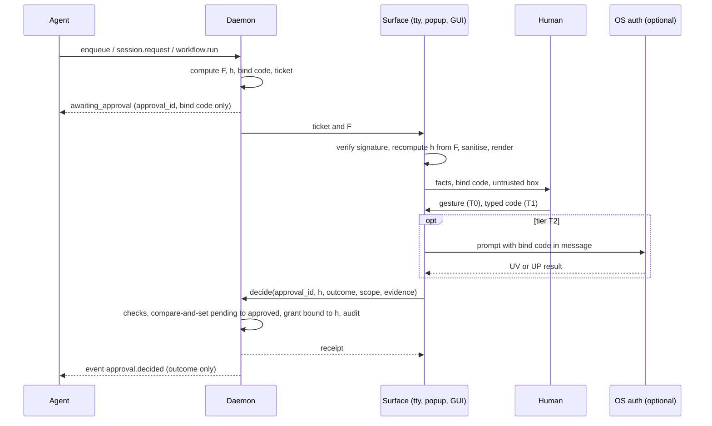
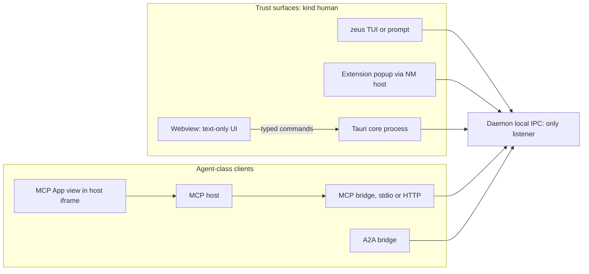

# Trust surface, human approvals and GUI architecture

## TL;DR

- An approval is only meaningful if (a) the human sees facts the agent cannot influence and (b) the decision is cryptographically bound to exactly those facts. ADR 0007 delivers (a); the current native-messaging schema does not deliver (b): `approval.decide` carries no request hash. Add `request_hash`, recompute it inside every surface, and make decisions single-use.
- Click-through approval decays. Anthropic reports users approve 93% of Claude Code permission prompts [Anthropic: auto mode], which is only about 0.37 bits of information per prompt (section 1.2). Design for fewer, tiered prompts: T0 click, T1 typed confirmation, T2 OS or hardware authentication.
- Rank the surfaces: terminal (`/dev/tty`, `CONIN$`) and extension popup first, Tauri GUI later, OS-auth as an optional step-up. OS notifications are a pointer only and never decide, because any Windows process can send a toast under another app's identity with attacker-chosen actions [Web: toast spoofing]. MCP elicitation and MCP App buttons are never a decision path.
- No software surface survives a same-user attacker. In August 2026 SpecterOps showed code that switches on the DevTools protocol inside a live, logged-in Chrome without flags [THN: CDP-Enable], which also exposes extension popups. Only biometric or hardware-touch step-up narrows the gap. Disclose this limit (ADR 0007 item 5).
- Bind grants to content, not names. Cursor's MCPoison (CVE-2025-54136) let an attacker swap an approved MCP config because approval was keyed to a name [Check Point: MCPoison]. Zeus grants must carry the plan hash and bounds, and any change forces a new approval.
- The GUI is Tauri 2 (2.12.1 on 2026-10-01), a thin client with a typed command allowlist (Tauri app commands are open to all windows by default), a separate approval window capability, no remote content and no localhost server (ADR 0010, DNS-rebinding evidence).
- MCP Apps (stable 2026-01-26; 11 clients in the community matrix) is a cheap embedded view for progress, plan preview and diff. It runs at agent authority, so nothing in it is approvable; it can deep-link to a trust surface by approval id only.
- The existing global cap of 50 pending approvals is a lock-out vector: at 1 request/s a hostile page fills it in 50 s and the user needs 5 min to clear it at 10 decisions/min. Add per-requester and per-origin caps, coalescing and deny back-off.
- Accessibility and i18n are part of the security design: sanitise every untrusted string, keep security tokens ASCII, use CLDR plurals (Bangla `bn` is `one`/`other`, with 0 in `one`), and test Bangla shaping on every surface. egui now shapes with harfrust, but Bangla completeness is unverified.

## 1. The problem and the evidence

### 1.1 What must be protected, and from whom

Zeus holds authority an agent wants: live browser sessions, disk writes, deletes, workflow runs. Approval kinds (spec 01 section 5.3) are `handoff`, `session_grant`, `retry_escalation`, `policy_exception`, `workflow_plan`, `destructive_op`. Adversaries, in order of how much they can do:

| Id | Adversary | Typical move |
|---|---|---|
| A1 | Prompt-injected or malicious agent (MCP, A2A) | Forge or auto-approve consent; talk the human into it |
| A2 | Hostile web page | Trigger handoffs to flood the queue; craft filenames and URLs that mislead |
| A3 | Another browser extension | Overlay or script the popup |
| A4 | Same-user process (malware, an agent with a shell) | Drive a pty, re-point the native-messaging host, call D-Bus or WinRT |
| A5 | Computer-use agent that sees and clicks the screen | Click "Approve" in any visible window |

This is Hardy's confused deputy: a privileged program induced to use its own authority for the wrong party [Hardy 1988]. Meta's "Rule of Two" says an agent should not combine untrusted input, sensitive-system access and state change without a human step [Web: Rule of Two]; a Zeus-driven agent has all three, so the human step is the design, not an add-on. Prompt-level defences are weak here; structural ones (CaMeL's capability and policy layer [arXiv:2503.18813], the design patterns of [arXiv:2506.08837]) work because they do not depend on the model resisting.

### 1.2 Consent and warning research that carries over

| Source | Finding | Consequence for Zeus |
|---|---|---|
| [Akhawe & Felt 2013] | 25M+ warning impressions; users clicked through about 10% of Firefox malware and phishing warnings, about 25% of Chrome's, about a third of Firefox SSL and 70.2% of Chrome SSL | Warning design changes behaviour a lot; frequency and context matter |
| [Felt 2012] | 17% of 308 Android users paid attention to permissions at install; 3% answered all comprehension questions | Do not rely on users reading dense text; show few, concrete facts |
| [Wijesekera 2015] | 36-person field study, 27M data points; at least 80% would have blocked at least one request, over a third of requests overall | Asking per use is wrong for routine access; ask on context change |
| [Anderson 2015] | fMRI: visual-processing response to a warning drops sharply from the second exposure; varying the warning slows it | Identical repeated dialogs habituate; vary layout when facts differ |
| [Anthropic: auto mode] (2026-03-25) | Users approve 93% of prompts; classifier approval misses 17% of real overeager actions and 5.7% of synthetic exfiltration | Prompts habituate; automation is not a substitute |
| [arXiv:2606.08919] | Reviewers agree only moderately on what is risky (Fleiss kappa 0.52, 125 actions); a *model* of fatiguing reviewers gives an inverted-U: more escalation can lower safety | Budget the prompts; escalate less, more precisely |
| [arXiv:2605.24309] | 59 papers, 21 production systems, 26 plugins: runtime approval is in 14 to 16 of 21 systems; intent anchoring and trust labelling in none | Approval is the deployed norm, so make it robust |
| [arXiv:2608.04755] | Frontier models handling Android-style permission pop-ups granted 26/32 for a familiar requester and 0/32 for another in the same task | A computer-use agent decides on cues; it will click Allow (A5) |
| [arXiv:2607.13718] | Survey of 21 proposals and 5 commercial agents: taxonomy of how permission policy is specified, derived and enforced | Use as the vocabulary for the policy UI (section 6) |

Information per prompt: with approval probability $p=0.93$, the binary entropy is $H(p) = -p\log_2 p - (1-p)\log_2(1-p) = 0.366$ bits (computed). Restated: a prompt that is approved 93% of the time tells you almost nothing about the human's judgement. *Inference:* the same arithmetic applies to Zeus; once a prompt kind is approved more than about 95% of the time, replace it with a standing, budgeted policy.

### 1.3 Spoofing and forging attacks on approval UIs

| Attack | Mechanism (source) | Zeus defence |
|---|---|---|
| HITL dialog forging | Injected text pads or rewrites the approval dialog so a harmful command looks benign; shown against Claude Code [OWASP: LITL] | Facts come from the daemon; agent text only in a labelled box |
| Terminal escape injection | ANSI sequences hide text, move the cursor, clear the screen, fake links [Trail of Bits: ANSI]; LLM output hijacking terminals [Embrace The Red: DiLLMa] | Strip all C0/C1 controls (not only `ESC`) from every non-literal string |
| Approval keyed to a name | MCPoison, Cursor 1.2.4 and earlier: config swapped after approval, fixed in 1.3 [Check Point: MCPoison] | Grant stores `request_hash` and an envelope; changed content means a new approval |
| DOM-based extension clickjacking | Page script makes an extension's injected UI invisible, then harvests the user's click; 10 of 11 password managers affected at DEF CON 33 [THN: DOM clickjacking] | Never inject UI into a page; render only in extension-origin pages; input delay |
| Notification spoofing | Any process can send a toast as another app's AUMID; action arguments are attacker-controlled [Web: toast spoofing]; freedesktop `app_name` is informational [Freedesktop: Notifications] | Notifications are pointers, never deciders |
| Bidi and confusable text | Visual reordering hides content from reviewers [arXiv:2111.00169] | Isolate and escape untrusted text; show punycode beside Unicode |
| Flooding and fatigue | MFA push bombing countered by number matching, enforced by Microsoft from 2023-05-08 [BleepingComputer: number matching] | Per-origin caps; typed bind code for T1 |
| Approval by agent | Same-user agent drives a pty or the screen | Tiers, T2, kill switch; honest limit |

### 1.4 What OS and web platforms teach

| Mechanism | Lesson | Limit |
|---|---|---|
| UAC secure desktop | Consent UI on a desktop only Windows processes can reach; imitations gain no elevation [Microsoft: UAC] | MSRC lists UAC as defence in depth with no servicing commitment [MSRC: servicing criteria] |
| Administrator protection (available with KB5120998, Aug 2026, off by default) | Every elevation needs Windows Hello; admin token is just-in-time [Microsoft: Admin protection] | Project Zero found 9 silent bypasses in preview; a visible prompt is not a boundary crossing, a silent bypass is [Project Zero: Admin protection] |
| polkit | The caller supplies `polkit.message` and details shown by the authentication agent, expanded from detail keys [polkit docs] | Message is caller-controlled; the agent shows what it is given |
| Windows Hello, Touch ID | `RequestVerificationForWindowAsync(hwnd, message)` [Microsoft: UserConsentVerifier] and `LAContext.evaluatePolicy(_:localizedReason:)` [Apple: LocalAuthentication] show a caller string | Proves a person verified, not which content was approved |
| WebAuthn Level 3 (W3C Recommendation 2026-08-25) | Separates user presence (UP) from user verification (UV) in signed authenticator data [W3C: WebAuthn 3] | Authenticator does not display content; challenge binding gives replay protection only |
| Secure Payment Confirmation | Browser renders transaction details in its own UI and the authenticator signs them (Candidate Recommendation draft 2026-07-02) [W3C: SPC] | Requires a browser-owned UI Zeus does not have |
| PSD2 dynamic linking | The authentication code must be specific to amount and payee; any change invalidates it [EU: 2018/389] | Direct regulatory precedent for `request_hash` |
| CIBA `binding_message` | A short message shown on both devices to interlock them [OpenID: CIBA] | Aid for humans, not a cryptographic proof |
| RAR (RFC 9396) | Structured `authorization_details` shown at consent [RFC 9396] | Same idea: typed, structured facts |

### 1.5 MCP elicitation cannot be the channel

The current MCP revision (2026-07-28) is stateless: servers return an `InputRequiredResult` and the client retries with `inputResponses`, replacing server-initiated `elicitation/create` [MCP: changelog 2026-07-28]. Clients must show which server is asking and offer decline and cancel; form mode may not ask for secrets; URL mode must display the full URL and highlight the domain [MCP: elicitation]. All of that is client-side UI controlled by the agent host, so the protocol gives no way to prove a human, not the model, answered. This confirms ADR 0007's rejection of elicitation. Zeus may *use* URL-mode elicitation only to tell the user to open a Zeus surface.

## 2. Trust surfaces and the daemon-computed-facts principle

### 2.1 The principle

Every field on an approval screen has one of three provenances, and the screen says which:

1. **Measured by the daemon:** requester identity (from the IPC credential and OS peer data, not a self-declared name), canonical paths after symlink resolution, counts, byte bounds, expiry, pace.
2. **Derived by the daemon:** origin and eTLD+1 from a parsed URL, effect lines from a fixed per-kind template in a bundled catalogue, plan hash.
3. **Asserted by others and labelled:** server-reported size ("server says"), and the single free-text `agent_says` field, at most 280 characters (*Inference*, chosen to fit one screen line pair), rendered as plain text in a visually distinct box headed "Untrusted text from <client>".

Sanitiser (applies to every string that is not a catalogue literal): Unicode NFC; drop C0 controls except none, C1 (U+0080 to U+009F), DEL, ESC, bidi controls (U+202A to U+202E, U+2066 to U+2069) and zero-width characters; collapse whitespace; escape rather than interpret markup; show origins as Unicode and punycode with the eTLD+1 emphasised and a mixed-script flag; truncate paths in the middle so the root and the leaf both stay visible; insert Unicode isolates (U+2068, U+2069) around an untrusted run embedded in a localised sentence.

### 2.2 Candidate surfaces compared

| Surface | Hostile page | Other extension | Agent via MCP or A2A | Same-user process, no GUI | Same-user with CDP, UI automation or computer-use agent | Daemon facts intact | Human-presence proof | Stage |
|---|---|---|---|---|---|---|---|---|
| Extension popup | Blocked: own origin, no content script, no `externally_connectable` | Blocked by origin isolation (Medium, *Inference*) | Blocked: no path | Fake native-messaging host if the manifest is re-pointed (*Inference*); ticket check defeats it | Not blocked: CDP in a live profile [THN: CDP-Enable]; screen clicks | Yes: hash recomputed in the popup | Weak: user-activation flag | MVP |
| Terminal prompt on `/dev/tty` or `CONIN$` | Blocked | Blocked | Blocked | Weak: own pty; `TIOCSTI` needs `CAP_SYS_ADMIN` on Linux 6.2+ by default [man: TIOCSTI] | Not blocked if the agent owns the terminal; a screen reader of an agent sees the code | Yes, after sanitising | Weak: typing | MVP |
| OS toast with buttons | Blocked | n/a | Blocked | Spoofable [Web: toast spoofing] | Spoofable | No | None | Pointer only |
| Tauri GUI window | Blocked | Blocked | Blocked | UI automation possible (*Inference*) | Not blocked | Yes: typed commands, text-only render | Weak | Phase 2 (ADR 0009) |
| OS-auth step-up (Hello, Touch ID, polkit, FIDO key) | Blocked | Blocked | Blocked | Caller can set its own message; whether the prompt names the caller is unverified | Biometric or key touch cannot be synthesised; a PIN fallback may be typed (*Inference*) | Only what the message string carries | Strong: UP or UV flag | Optional tier T2 |
| MCP elicitation or MCP App button | n/a | n/a | Agent host controls it | n/a | n/a | No | None | Never |

The honest limit stands: an agent with the same OS user and arbitrary shell can read the same credential files and drive a pty (ADR 0007 item 5). In August 2026 SpecterOps showed a Windows technique that starts Chrome's remote-debugging server from inside the running process, with no admin rights and no flags, getting cookies and interactive control of the logged-in browser [THN: CDP-Enable]; it defeats Chrome 136's restriction on the default profile [Web: Chrome 136 CDP]. The popup is therefore a trust surface against pages, extensions and agent protocols, not against malware running as the user. The product claim is "no agent-facing interface can approve anything; every approval is attributable", not "malware cannot".

### 2.3 Example screens (mock-ups)

Terminal prompt, tier T1, workflow plan. All values are daemon-computed; 1,240 files at one request per 2 s is 41.3 min (computed).

```text
+--------------------------------------------------------------------+
| ZEUS APPROVAL  ap_01M45NHJ3XS0QXG9T42HHN2YR8           code TK9-MRJ |
| Run a workflow with your logged-in session                          |
|--------------------------------------------------------------------|
| Site       portal.example.org   (https; registrable: example.org)   |
| Asked by   claude-code, MCP, pid 18422, client cl_claude_code_7f3a  |
| Will fetch up to 1,240 files, up to 3.10 GiB                        |
| Pace       1 request / 2 s per site  (about 41 min)                 |
| Saves to   /home/ada/Downloads/Zeus/portal-2026   (inside roots)    |
| Session    cookies for portal.example.org only, via the extension   |
| Valid      this request 14 min; the grant would last 7 days         |
| Plan hash  d4d34c4b2f2a...b5324                                     |
|--------------------------------------------------------------------|
| UNTRUSTED TEXT from claude-code (not checked by Zeus):              |
|   "Download the 2026 conference papers as requested"                |
|--------------------------------------------------------------------|
| Type TK9-MRJ to approve; d deny; n never for this site:  _          |
+--------------------------------------------------------------------+
```

Extension popup, tier T0, browser handoff (buttons enable 750 ms after first paint, *Inference*; Chrome's `chrome.action.openPopup()` exists from Chrome 127 [Chrome: action API] but Zeus should not auto-open it, because a popup appearing under the user's cursor invites accidental clicks).

```text
Zeus  [daemon connected]                                  [Pause all]
-------------------------------------------------------------------
Finish this download with Zeus?
  dataset-v3.tar.zst      1.20 GiB (server says)
  from  portal.example.org   first time for this site
  Zeus will ask this browser for cookies of portal.example.org only.
  [ Once ]  [ This site, 24 h ]  [ Deny ]  [ Never ]
  Facts check: hash d4d3...b324 recomputed here, matches daemon.
```

OS-auth message (T2), shown by Hello, Touch ID or polkit: `Zeus approval TK9-MRJ: workflow on portal.example.org, up to 1,240 files`. It carries the bind code so the human can cross-check it against the screen.

## 3. The human-only approval protocol (proposed for spec 07)

### 3.1 Objects

- **Facts** $F$: a JCS object (RFC 8785) with `t: "zeus.approval.request.v1"`, `approval_id`, `kind`, `requester`, `origins`, `scope`, a plan or operation hash, limits, destination, `created_at`, `expires_at` and a daemon-random `nonce`. No floats, per spec 00 section 7.
- **Request hash** $h = \mathrm{BLAKE3}(\mathrm{JCS}(F))$, 32 bytes, lowercase hex, as in ADR 0007 and spec 00. Plain restatement: change any byte of any fact and $h$ changes.
- **Bind code:** the first 30 bits of $h$ in Crockford base32 as `XXX-XXX`. A human cross-check aid in the style of CIBA's `binding_message`, not a security primitive.
- **Ticket:** $(h,\ \texttt{expires\_at},\ \sigma)$ with $\sigma = \mathrm{Ed25519}_{sk_D}(\texttt{"zeus.approval.ticket.v1"} \| h \| \texttt{expires\_at})$ (RFC 8032), key in the OS keyring, public key pinned by each surface at first pairing.
- **Decision:** `{approval_id, request_hash, outcome, scope, surface, evidence}`; the daemon gathers its own evidence where it can (peer pid and exe hash, tty device).

Worked example, computed with BLAKE3 over RFC 8785 output of the facts below (538 canonical bytes):

```json
{"approval_id":"ap_01M45NHJ3XS0QXG9T42HHN2YR8","bytes_max":3328599654,
 "created_at":"2026-10-05T09:15:30.301Z","dest_root":"/home/ada/Downloads/Zeus/portal-2026",
 "expires_at":"2026-10-05T09:30:30.301Z","files_max":1240,"kind":"workflow_plan",
 "min_interval_ms":2000,"nonce":"b7f0c2d94e1a5c08","origins":["https://portal.example.org"],
 "plan_blake3":"9c1d0f0a6e8b4d2a7f31c5be0a44d9e2d3b1a7c85e6f40923a1b7cd8e5f60a12",
 "requester":{"client_id":"cl_claude_code_7f3a","kind":"agent","via":"mcp"},
 "scope":"workflow","t":"zeus.approval.request.v1"}
```

- $h$ = `d4d34c4b2f2a7b6e3ec7e0d3dc742647bf84b9324eecb54980503876467b5324`, bind code `TK9-MRJ`.
- Changing only `files_max` to 12400 gives `86fd77243ef6b300225112974f3b4710b1ca05707b70931783a476ab524b523b`, so a decision naming the original $h$ cannot approve the inflated plan.
- The audit receipt `{decided_at, outcome, request_hash, scope, surface, t}` canonicalises to a hash `d00d1077e4a66f8b81613c779cecd1cd73b0ea8103a2d79785655c0c6b9cdc37` that is chained into the audit log (spec 04).

### 3.2 Flow



Daemon checks, in order: (1) approval exists, is `pending`, not expired (wall clock and a persisted high-water mark; if the wall clock is more than 5 min behind it, treat pending requests as expired, *Inference*); (2) `request_hash` equals the stored hash (constant-time); (3) outcome and scope are allowed for the kind; (4) client kind is `human` and the channel evidence satisfies the approval's tier; (5) rate limits; (6) the state change is one journal transaction, single use; (7) the grant stores $h$ and an **envelope** (plan hash, file and byte bounds, origins, destination root); each later use re-derives its facts and must fall inside it; (8) audit `approval.decided` with $h$, surface and an evidence digest.

Surface-side recomputation does the real work: a fake relay that shows benign facts but names the real hash is caught because the surface hashes what it displays. The ticket signature adds that a surface renders only daemon-authored approvals (*Inference*: it matters mainly for phishing screens, not for decision safety).

### 3.3 Tiers and expiry (proposed defaults)

| Kind or action | Tier | Allowed surfaces | Request expiry | Why |
|---|---|---|---|---|
| `handoff`, once or 24 h site | T0 click, 750 ms input delay | popup, GUI, tty | 24 h (spec 01) | User already acted in the browser |
| `session_grant` site | T1 typed code | popup, GUI, tty | 15 min | Releases cookies |
| `workflow_plan`, `session_grant` workflow, renewal | T1 (T2 when enabled) | GUI, tty (popup shows pointer) | 30 min | 7-day authority |
| `destructive_op`, `policy_exception` | T1; T2 above 100 files or outside Zeus-made folders (*Inference*) | GUI, tty | 10 min | Irreversible |
| Policy or budget change, kill-switch release, audit-key export | T2 | GUI, tty | 5 min | The injected agent's best target |

Typed confirmation and number matching are anti-reflex friction; I found no controlled study of their effect in agent approvals, so this tiering is *Inference* and needs a user test (section Implications, I6). A typed-code step must allow paste and offer the T2 alternative, by analogy with WCAG 3.3.8 [WCAG 2.2].

### 3.4 Flood control

Let $C$ be the global pending cap, $\lambda$ the hostile request rate and $\mu$ the human decision limit. Time to fill is $t_{fill}=C/\lambda$; time to clear is $t_{clear}=C/\mu$. With $C=50$, $\lambda=1$/s, $\mu=10$/min: $t_{fill}=50$ s, $t_{clear}=5$ min (computed), and legitimate requests are refused with `policy.too_many_pending` meanwhile. Fix: per-origin cap 2 (an attacker then needs $\lceil 50/2\rceil=25$ origins), per-requester cap 5, coalescing of identical `(kind, origin, scope)`, and after 3 denials of one `(requester, origin)` within an hour, auto-deny for an hour with a single inbox line.

### 3.5 Gaps found in the current specs

Spec 02 section 10 and `native-messaging.v1.schema.json`: `approval.pending` and `approval.decide` have no `request_hash`; `ui.user_gesture` is a self-asserted boolean; the daemon-side evidence for the popup is only the extension id Chrome passes to the host as an argument [Chrome: native messaging]. Fix: add `request_hash`, `ticket`, `bind_code` and a `tier` field; treat `user_gesture` as weak evidence.

## 4. GUI architecture

### 4.1 Thin-client rule



Rules: (1) the daemon API (ADR 0002) is the single contract; the GUI is generated from the same schema; (2) no GUI-only feature except the trust-surface rendering of approvals, and that still ends in `approvals.decide`; (3) the GUI never receives session material (ADR 0009); (4) the webview never speaks to the daemon; the Tauri Rust core does, as a `human` client with `gui` channel evidence; (5) the webview gets named commands (`approvals_list`, `approvals_decide`, `jobs_list`), never a generic `rpc(method, params)` pass-through, which would turn every capability allowlist into a no-op.

### 4.2 Tauri 2 security model and what to configure

| Mechanism | What the docs say [Tauri: Security] | Zeus configuration |
|---|---|---|
| Trust boundary | Rust core has full access; the webview reaches resources only through the IPC layer | Core holds the daemon connection |
| Capabilities | JSON/TOML in `src-tauri/capabilities/`, scoped to window or webview labels; capabilities that apply to the same window merge [Tauri: Capabilities] | Two windows: `main` (read, control) and `approval` (approvals commands only); no `shell`, `fs`, `http`, `opener` or `remote` entries |
| App commands | Registered commands are accessible to all windows by default; restrict with `AppManifest::new().commands(...)` in `build.rs` [Tauri: Capabilities] | Declare every command in the manifest; CI test fails if a command is missing |
| CSP | Set in `app.security.csp` | `default-src 'none'`; scripts and styles `'self'`; `connect-src` only Tauri's IPC origins; no remote origins |
| Isolation pattern | A sandboxed iframe intercepts and validates IPC, encrypting with AES-GCM keys generated per launch; mainly defends against hostile frontend dependencies; on Windows external files fail to load in the iframe so scripts must be inlined, and ES modules do not load [Tauri: Isolation] | Use if the build handles it; the better protection is a tiny dependency set |
| Remote content | `remote.urls` can grant IPC to external domains; on Linux and Android iframes cannot be told from windows | Never configure |
| Localhost plugin | Docs warn it "brings considerable security risks" [Tauri: Localhost] | Do not use |

Webview constraints: WebView2 on Windows (evergreen runtime; Tauri 2.12 dropped Windows 7 [Tauri: 2.12]), WKWebView on macOS 10.15+, and WebKitGTK 4.1 on Linux, whose version and Wayland behaviour follow the distribution [Tauri: Prerequisites]. Tauri itself notes OS vendors patch webviews faster than app developers do. Consequences: write conservative CSS and JS; test on the oldest supported WebKitGTK; do not assume fonts (Bangla, section 7); expect different accessibility trees per platform. Tauri 2.12.1 was current on 2026-10-01 (MSRV 1.90); a CEF runtime existed only as `tauri-cef` alpha in 2026-05 [crates.io: GUI crates] [Low confidence on its roadmap].

The approval view is a static page that writes server-provided fields with `textContent` only, never `innerHTML`, so a hostile filename cannot become markup.

### 4.3 Serving the UI from the daemon on localhost: reject

- ADR 0010 forbids a daemon TCP listener. A browser tab is also not a trust surface: any web page can *address* a localhost port.
- DNS rebinding is real for MCP: the Python SDK did not enable protection by default until 1.23.0 (CVE-2025-66416) [CVE-2025-66416], and the MCP transport now says servers MUST validate `Origin` and SHOULD bind to 127.0.0.1 and authenticate [MCP: Streamable HTTP].
- Chrome's Local Network Access prompt (Chrome 142) covers fetch, subresources and subframe navigations but not yet WebSockets, WebTransport or WebRTC, and does not address DNS rebinding or other browsers [Chrome: LNA]. It is not a defence you can rely on.
- If a read-only web dashboard is ever wanted: a separate bridge process (`zeus ui --http`), random port, a bearer token delivered in the URL fragment and exchanged for an `HttpOnly; SameSite=Strict` cookie, an allow-list for `Host`, `Origin` checks on every non-GET, `frame-ancestors 'none'`, no approval route, agent-class credential.

### 4.4 Toolkit alternatives

| Option | Version and date | Accessibility | Bangla or complex shaping | Fit |
|---|---|---|---|---|
| Tauri 2 (webview) | 2.12.1, 2026-10-01 | Platform webview trees | System text stack: best for Bangla | Primary GUI; matches ADR 0009 and MCP App reuse |
| egui/eframe | 0.36.2, 2026-09-08 | AccessKit always on [egui changelog] | `harfrust` since 0.35 (PR 8031); issue 2517 on complex text still open [egui #2517] | Small native approval helper; verify Bangla first |
| iced | 0.14.0, 2025-12-07 | No `accesskit` dependency; issue 552 open [iced #552] | `cosmic-text` (rustybuzz) | Avoid for approvals until accessibility lands |
| Slint | 1.18.1, 2026-09-21 | AccessKit or Qt | `parley`, `rustybuzz`, `swash` [Slint changelog] | Strong native option; check its GPL, royalty-free or commercial terms against Apache-2.0 open core |
| Dioxus | 0.7.10, 2026-07-31 | Webview by default; native renderer experimental | Webview: system stack | Only if the team prefers Rust-only UI code |
| ratatui 0.30.2 plus crossterm 0.29 (`use-dev-tty` feature) | 2026-06-19 and 2025-05-04 | Weak for screen readers; offer a plain line mode | Terminal font dependent | The tty trust surface |

Prefer a native toolkit only if you want an approval helper with no JavaScript at all; the price is weaker accessibility and Bangla confidence than a webview.

## 5. MCP Apps as a low-cost embedded view

MCP Apps (extension id `io.modelcontextprotocol/ui`, spec 2026-01-26, MIME `text/html;profile=mcp-app`) lets a tool declare `_meta.ui.resourceUri` pointing at a `ui://` resource that the host renders in a sandboxed iframe and talks to over a JSON-RPC dialect on `postMessage`. The default CSP is deny-all (`default-src 'none'`, `connect-src 'none'`, scripts and styles `'self'` plus inline); extra origins need `_meta.ui.csp`; hosts SHOULD use a double-iframe proxy on a different origin, validate and log view-initiated calls, and enforce tool visibility (`model`, `app`, or both by default) [MCP: Apps spec] [MCP: Apps overview]. Client support per the community-maintained matrix (August 2026; not conformance-tested): Claude (web) and Claude Desktop, VS Code GitHub Copilot, Microsoft 365 Copilot, Goose, Postman, MCPJam, ChatGPT, Cursor, Archestra.AI, PostHog Code [MCP: client matrix] [Web: MCP Apps field log]. JetBrains, Kiro and Antigravity were "exploring" in January and still absent in August.

| Render in the app | Never approvable or releasable there |
|---|---|
| Job list and progress (about 1 Hz), ETA, per-host throttling | `session_grant`, `handoff`, `retry_escalation` |
| Plan preview, dry-run diff, collision list | `workflow_plan` approval, grant renewal |
| Budgets used and left, audit excerpt, chain status | `destructive_op`, `policy_exception` |
| Pause or cancel of the agent's own jobs (reduce-only) | Policy or budget changes, kill-switch release |
| A "Review in Zeus" button | Anything that carries a decision |

Why: the view runs inside a host the agent drives, calls tools over the same MCP channel, and the daemon classifies everything arriving through a bridge as `agent` (ADR 0010). Marking tools `visibility: ["app"]` hides them from the model but does not make the caller human. *Inference:* `ui/message` and `ui/update-model-context` write into the model's context, so untrusted text (filenames, page titles) must not flow into them. Deep link: `ui/open-link` to `zeus://approval/<id>` carries only an id; the trust surface fetches facts from the daemon. Hosts may block custom schemes (unverified), so also print the CLI command. Cost: one self-contained HTML bundle that reuses the Tauri frontend components.

## 6. Agent-activity UX

- **Inbox.** Tabs: *Needs you* (approvals grouped by requester and origin, sorted by expiry), *Running*, *Recent*, *Blocked*. Counts are coalesced. Windows' agent model, with agents as separate, auditable, interruptible principals, is useful precedent [Windows blog: AI agents]; Zeus's analogue is `client_id`.
- **Per-agent permissions and budgets.** Rows are agents, columns are capabilities (probe, enqueue public, enqueue with session, organise, delete, convert, workflow run) set to Allow, Ask or Deny, plus daily budgets for bytes, files, requests per origin per minute and LLM tokens. This is the "sandbox" analogue: a standing budgeted policy replaces per-action prompts, which is what moved Anthropic away from prompting [Anthropic: auto mode]. Editing policy is itself a T2 approval, because it is the injected agent's best target.
- **Audit view.** Timeline filtered by agent, origin or approval; each `approval.decided` row shows surface, tier, `request_hash` and chain position; a Verify button runs the chain check of spec 04 ("48,220 records, head 3df1...") and says whether keyed mode needs the keyring key.
- **Kill switch.** Visible on every surface (popup header, GUI toolbar, TUI key, `zeus kill`); activation needs no confirmation (safe direction); release is T2. Effect per ADR 0007: revoke all grants, pause all jobs.
- **Plan preview and dry-run diff.** Lead with the irreversible count.

```text
Organise ~/Downloads/Zeus   (dry run, nothing changed yet)
  moves 212 | renames 40 | skips 12 (name collisions) | DELETES 31 (4.8 GiB)
  DELETE  old/report-final-FINAL.pdf   (duplicate of 2026/report.pdf, sha256 match)
  MOVE    inbox/a1b2.pdf  ->  papers/2026/Chen-quantum-routing.pdf
  ... first 50 of 255 shown   [View all]      [Approve in Zeus]   (T1)
```

- **A2A peers.** Show per peer: Agent Card issuer, JWS signature status (A2A 1.0.0 requires signing procedures for Agent Cards, section 8.4 [A2A spec]), TLS identity, first-seen date, attested versus claimed capabilities, delegation depth, per-peer budgets. A 2026 analysis found 11 vulnerabilities in A2A, including unattested capability claims and multi-hop identity loss [arXiv:2609.10871]. A peer's `INPUT_REQUIRED` or `AUTH_REQUIRED` text is agent text: show it in the inbox as "peer says", never as a trust-surface prompt.

## 7. Accessibility and i18n, including Bangla

Targets: WCAG 2.2 AA (a W3C Recommendation since October 2023) for the GUI and popup; WCAG 3.0 is still a working draft with no compliance date (candidate recommendation expected around Q4 2027, secondary sources) [WCAG 2.2]. Relevant criteria: 2.5.8 target size at least 24 by 24 CSS px; 3.3.8 accessible authentication (applied by analogy to typed codes: allow paste, offer T2); 2.1.1 keyboard operation; 4.1.3 status messages for progress; 2.2.1 timing, where request expiry is a security control, so offer "re-issue request" rather than an extension (*Inference*). The terminal needs a plain line mode (no alternate screen, no colour dependence, honour `NO_COLOR`).

Bangla, computed with Node 22 (ICU 76.1, CLDR 46.0):

| Check | Result |
|---|---|
| Plural categories for `bn` | `one`, `other`; 0 and 1 map to `one`, 2 and 5 to `other` (English puts 0 in `other`) |
| 1,288,490,188 bytes in `bn-BD` | `১,২৮,৮৪,৯০,১৮৮` (native digits, lakh and crore grouping) |
| Same with `nu-latn` | `1,28,84,90,188` |
| `bn-BD` for 1240 and 3,328,599,654 | `১,২৪০` and `৩,৩২,৮৫,৯৯,৬৫৪` |

Rules: use ICU MessageFormat or Fluent with CLDR plurals, never string concatenation; show size as a short GiB figure (`১.২ GiB` or `1.20 GiB`) and put the exact byte count, hashes, ids and origins on a technical line with ASCII digits and western grouping, so a user comparing `1,288,490,188` with the audit log is not confused by lakh grouping (*Inference*; confirm with Bangla-speaking users). Bangla is left-to-right, but untrusted runs still get bidi isolates. Shaping: reordering vowel signs, reph and conjuncts need an Indic-capable shaper. Webviews use the system stack; native toolkits need a bundled font (Noto Sans Bengali, SIL OFL) and a shaping test. Illustrative test strings (native-speaker review required): `অনুমোদন` (approval), `ডাউনলোড` (download), `ফাইল` (file). Translated catalogues are bundled and reviewed; agent text is never translated or localised.

## Implications for Zeus

| # | Recommendation | Evidence | Test or benchmark |
|---|---|---|---|
| I1 | Keep ADR 0007's invariant; add tiers T0, T1, T2 and the kind-to-tier map (3.3) | 93% approval [Anthropic: auto mode]; kappa 0.52 [arXiv:2606.08919] | Property test: every kind has a tier; decisions below the tier are refused |
| I2 | Add `request_hash`, `ticket`, `bind_code`, `tier` to spec 02; surfaces recompute $h$ from displayed facts; decisions single-use | PSD2 dynamic linking [EU: 2018/389]; MCPoison [Check Point: MCPoison] | Mutate each fact field: hash changes and decision rejected; replay rejected; two surfaces decide at once, exactly one wins |
| I3 | Grants carry an envelope (plan hash, bounds, origins, root); reuse outside it forces a new approval | MCPoison | Edit an approved plan: next use returns to `awaiting_approval` |
| I4 | Specify the sanitiser (2.1) and golden-test it on all surfaces | LITL [OWASP: LITL]; ANSI [Trail of Bits: ANSI]; bidi [arXiv:2111.00169] | Corpus: `ESC` and C1 sequences, bidi, zero-width, 10 kB strings, punycode lookalikes, markup; snapshots in tty, popup, GUI |
| I5 | Per-origin (2) and per-requester (5) caps, coalescing, deny back-off; shorter expiry for high-risk kinds | 3.4 arithmetic | Simulate 1 req/s from one origin for 1 h: legitimate handoff still accepted within 1 s |
| I6 | Prompt budget: at most 3 approvals per workflow run; when a kind passes 95% approval over 30 decisions, propose a budgeted standing policy; no "approve all" | [Anthropic: auto mode]; 0.37 bits | Telemetry stays local; user study (n of at least 12) comparing T0, T1, T2 with seeded malicious prompts |
| I7 | Notifications are pointers: no deciding buttons; text says "N approvals waiting" and opens the surface | [Web: toast spoofing] | Test: no code path calls `approvals.decide` from a notification action |
| I8 | Terminal prompt: read the controlling tty only, sanitise, require typed code for T1, and have `zeus doctor` read `/proc/sys/dev/tty/legacy_tiocsti` and warn if 1 | [man: TIOCSTI]; ADR 0007 | Doctor test on kernel 6.1 and 6.6; refuse when no tty |
| I9 | Popup: render only in extension pages, never in page DOM; 750 ms input delay; do not auto-open | DOM clickjacking [THN: DOM clickjacking]; spec 02 section 10.2 | Automated: clicks within 700 ms ignored; manifest lint rejects content scripts and `externally_connectable` |
| I10 | T2 as optional, off by default in the MVP: Windows Hello (Windows 11, build 22000+ for the desktop interop), macOS `LAContext`, polkit `polkit.message`; message carries the bind code. State plainly that T2 proves a person, not content | Admin protection [Microsoft: Admin protection]; [W3C: WebAuthn 3] | Verify per OS whether the prompt names the calling process |
| I11 | GUI: Tauri 2.12, two windows, command allowlist in `build.rs`, no remote or localhost, text-only approval page | Tauri docs 4.2 | CI: parse generated capabilities; fail on `fs`, `shell`, `http`, `opener`, `remote`, or an undeclared command |
| I12 | MCP App: view-only, deny-all CSP, no approval tools exposed at all; deep-link by id | 5 | Server test: every approval operation rejects `agent`-class callers; manual run in three hosts |
| I13 | Accessibility and Bangla in CI: axe-core on webview pages, NVDA and VoiceOver smoke tests, golden screenshots of `bn` on Windows, macOS and WebKitGTK, pseudo-localisation | Section 7 | Render `অনুমোদন` conjunct and vowel-sign cases on egui and Tauri |
| I14 | Document the same-user limit in spec 12 and in the first-run screen; do not claim malware-proof approvals | [THN: CDP-Enable]; ADR 0007 item 5 | Doc review; CDP-enabled browser test shows the popup is still drivable |

## Corrections to research.md

1. Section 5.3 says MCP over HTTP is a daemon option bound to localhost with token auth. ADR 0010 supersedes it: no daemon TCP listener, HTTP surfaces are bridge processes, and the current MCP transport requires `Origin` validation [MCP: Streamable HTTP].
2. Section 5.4's popup text offers "[Always for this site]", but its own grant model is Once, Site (24 h), Workflow (7 days) and Never. Say "This site, 24 h".
3. Section 5.5 gives `workflow.run` an `approve_token` that an agent passes. A token an agent can hold is a bearer path around the human. Make `workflow.run` return `awaiting_approval` and let the daemon start the run on a human decision bound to the plan hash.
4. Section 5.7 lists "untrusted-content labels; mutating tools require explicit parameters" as the prompt-injection mitigation. The evidence (dialog forging, MCPoison, 93% approval) says that is not enough; replace it with hash-bound, tiered, human-only approvals and budgets.
5. The `haul.*` tool names and "Haul" product name predate the Zeus naming; the MCP surface in spec 06 should use `zeus.*`.

## Open questions

1. Can the extension popup run WebAuthn with an RP ID that works for a local-only product? Mozilla documents extension WebAuthn; Chrome's equivalent was only found through secondary sources [unverified].
2. Does the Windows Hello or `LAContext` prompt name the calling process, and does that survive an attacker calling the same API with another message?
3. Are macOS and Linux notification actions spoofable in practice? Only Windows is verified.
4. Can a computer-use agent type a Windows Hello PIN? Can the PIN fallback be disabled for T2?
5. Does egui with harfrust render Bangla conjuncts and pre-base vowel signs correctly? The changelog says "better kerning and ligatures"; no Indic claim.
6. Do MCP App hosts honour a `zeus://` open-link, and how do they show it?
7. Can a same-user process re-point Chrome's native-messaging manifest (registry on Windows) to a fake host, and how best to pin the daemon from the extension?
8. What typed-code length and wording minimise rubber-stamping without harming accessibility? Needs the user study (I6).
9. Do Bangla-speaking users prefer native or Latin numerals for security-relevant numbers?

## References

- [Hardy 1988] Hardy, N. "The Confused Deputy (or why capabilities might have been invented)". ACM SIGOPS Operating Systems Review 22(4), 1988. https://www.semanticscholar.org/paper/The-Confused-Deputy:-(or-why-capabilities-might-Hardy/5493f512ba418c21f1ce20e20985157f7509007c
- [Akhawe & Felt 2013] Akhawe, D., Felt, A. P. "Alice in Warningland: A Large-Scale Field Study of Browser Security Warning Effectiveness". USENIX Security 2013. https://www.usenix.org/conference/usenixsecurity13/technical-sessions/presentation/akhawe
- [Felt 2012] Felt, A. P. et al. "Android permissions: user attention, comprehension, and behavior". SOUPS 2012. https://dblp.org/rec/conf/soups/FeltHEHCW12.html
- [Wijesekera 2015] Wijesekera, P. et al. "Android Permissions Remystified: A Field Study on Contextual Integrity". USENIX Security 2015. https://www.usenix.org/conference/usenixsecurity15/technical-sessions/presentation/wijesekera
- [Anderson 2015] Anderson, B. B. et al. "How Polymorphic Warnings Reduce Habituation in the Brain: Insights from an fMRI Study". CHI 2015. https://dl.acm.org/doi/10.1145/2702123.2702322
- [Anthropic: auto mode] Anthropic Engineering, "Claude Code auto mode", 2026-03-25. https://www.anthropic.com/engineering/claude-code-auto-mode
- [arXiv:2606.08919] Turan, E. "Oversight Has a Capacity: Calibrating Agent Guards to a Subjective, Fatiguing Human". 2026.
- [arXiv:2605.24309] Wang, P., Li, Y., Tian, Y. "Reframing LLM Agent Security as an Agent-Human Interaction Problem". 2026.
- [arXiv:2608.04755] Chen, D. et al. "'Allow' to Achieve, Over-Privileged Inadvertently: The Unintended Cost of Task-Completion-Driven Pop-up Decisions in Mobile GUI Agents". 2026.
- [arXiv:2607.13718] Michael, A. E., Roesner, F. "How Agents Ask for Permission: User Permissions for AI Agents, from Interfaces to Enforcement". 2026.
- [arXiv:2503.18813] Debenedetti, E. et al. "Defeating Prompt Injections by Design". 2025.
- [arXiv:2506.08837] Beurer-Kellner, L. et al. "Design Patterns for Securing LLM Agents against Prompt Injections". 2025.
- [arXiv:2111.00169] Boucher, N., Anderson, R. "Trojan Source: Invisible Vulnerabilities". 2021.
- [arXiv:2609.10871] Lotfi, A. et al. "A2ABreak: Systematic Security Analysis of the A2A Protocol". 2026.
- [Web: Rule of Two] "Agents Rule of Two" (Meta, 2025), explainer. https://www.osohq.com/learn/agents-rule-of-two-a-practical-approach-to-ai-agent-security
- [OWASP: LITL] OWASP Community, "HITL Dialog Forging (Lies-in-the-Loop)". https://community.owasp.org/attacks/Lies_in_the_Loop
- [Trail of Bits: ANSI] "Deceiving users with ANSI terminal codes in MCP", 2025-04-29. https://blog.trailofbits.com/2025/04/29/deceiving-users-with-ansi-terminal-codes-in-mcp/
- [Embrace The Red: DiLLMa] "Terminal DiLLMa: LLM-powered Apps Can Hijack Your Terminal Via Prompt Injection", 2024. https://embracethered.com/blog/posts/2024/terminal-dillmas-prompt-injection-ansi-sequences/
- [Check Point: MCPoison] "Cursor IDE's MCP Vulnerability" (CVE-2025-54136), 2025. https://research.checkpoint.com/2025/cursor-vulnerability-mcpoison/
- [THN: DOM clickjacking] "DOM-Based Extension Clickjacking Exposes Popular Password Managers", 2025-08. https://thehackernews.com/2025/08/dom-based-extension-clickjacking.html
- [Web: toast spoofing] "Toast Notifications", iPurple, 2026-03-25. https://ipurple.team/2026/03/25/toast-notifications/
- [Freedesktop: Notifications] Desktop Notifications Specification. https://developer-old.gnome.org/notification-spec/
- [BleepingComputer: number matching] "Microsoft enforces number matching to fight MFA fatigue attacks", 2023-05. https://www.bleepingcomputer.com/news/microsoft/microsoft-enforces-number-matching-to-fight-mfa-fatigue-attacks/
- [Microsoft: UAC] "How User Account Control works", Microsoft Learn (2026-04-23). https://learn.microsoft.com/en-us/windows/security/application-security/application-control/user-account-control/how-it-works
- [MSRC: servicing criteria] "Microsoft Security Servicing Criteria for Windows". https://www.microsoft.com/en-us/msrc/windows-security-servicing-criteria
- [Microsoft: Admin protection] "Administrator protection", Microsoft Learn (2026-09-23). https://learn.microsoft.com/en-us/windows/security/application-security/application-control/administrator-protection/
- [Project Zero: Admin protection] Forshaw, J. "Bypassing Windows Administrator Protection", 2026. https://projectzero.google/2026/26/windows-administrator-protection.html
- [polkit docs] polkit Reference Manual: PolkitAuthority and "Writing polkit applications". https://www.freedesktop.org/software/polkit/docs/latest/PolkitAuthority.html
- [Microsoft: UserConsentVerifier] `IUserConsentVerifierInterop::RequestVerificationForWindowAsync`. https://learn.microsoft.com/en-us/windows/win32/api/userconsentverifierinterop/nf-userconsentverifierinterop-iuserconsentverifierinterop-requestverificationforwindowasync
- [Apple: LocalAuthentication] LocalAuthentication framework (`LAContext`); behaviour taken from secondary tutorials. https://developer.apple.com/documentation/localauthentication
- [W3C: WebAuthn 3] Web Authentication Level 3, W3C Recommendation, 2026-08-25. https://www.w3.org/TR/webauthn-3/
- [W3C: SPC] Secure Payment Confirmation. https://www.w3.org/TR/secure-payment-confirmation/
- [EU: 2018/389] Commission Delegated Regulation (EU) 2018/389, Article 5 (dynamic linking). https://eur-lex.europa.eu/eli/reg_del/2018/389/oj/eng
- [OpenID: CIBA] OpenID Connect Client-Initiated Backchannel Authentication Flow, Core 1.0. https://openid.net/specs/openid-client-initiated-backchannel-authentication-core-1_0.html
- [RFC 9396] OAuth 2.0 Rich Authorization Requests, 2023. https://www.rfc-editor.org/rfc/rfc9396
- [RFC 8785] JSON Canonicalization Scheme (JCS), 2020. https://www.rfc-editor.org/rfc/rfc8785
- [RFC 8032] Edwards-Curve Digital Signature Algorithm (EdDSA), 2017. https://www.rfc-editor.org/rfc/rfc8032
- [MCP: changelog 2026-07-28] Key Changes, MCP specification 2026-07-28. https://modelcontextprotocol.io/specification/2026-07-28/changelog
- [MCP: elicitation] MCP specification (draft) elicitation. https://modelcontextprotocol.io/specification/draft/client/elicitation
- [MCP: Streamable HTTP] MCP specification 2026-07-28, Streamable HTTP transport. https://modelcontextprotocol.io/specification/2026-07-28/basic/transports/streamable-http
- [MCP: Apps spec] MCP Apps specification 2026-01-26 (SEP-1865). https://github.com/modelcontextprotocol/ext-apps/blob/main/specification/2026-01-26/apps.mdx
- [MCP: Apps overview] https://modelcontextprotocol.io/extensions/apps/overview
- [MCP: client matrix] Extension Support Matrix (community maintained). https://modelcontextprotocol.io/extensions/client-matrix
- [Web: MCP Apps field log] "MCP Apps in 2026: What Actually Shipped, Host by Host", DevMoment, 2026-08. https://www.devmoment.dev/journal/mcp-apps-field-log-2026
- [CVE-2025-66416] MCP Python SDK lacks default DNS rebinding protection, fixed in 1.23.0. https://advisories.gitlab.com/pypi/mcp/CVE-2025-66416/
- [Chrome: LNA] "New permission prompt for Local Network Access". https://developer.chrome.com/blog/local-network-access
- [Web: Chrome 136 CDP] Chrome 136 ignores remote-debugging switches on the default profile (coverage via SpecterOps and The Hacker News). https://specterops.io/blog/2026/08/13/chrome-devtools-protocol-cookie-theft/
- [THN: CDP-Enable] "Chrome DevTools Technique Enables Authenticated Session Hijacking in Live Windows Browsers", disclosed 2026-08-14. https://thehackernews.com/2026/08/chrome-devtools-technique-enables.html
- [Chrome: native messaging] Native messaging, Chrome for Developers. https://developer.chrome.com/docs/extensions/develop/concepts/native-messaging
- [Chrome: action API] `chrome.action` (`openPopup`, Chrome 127+). https://developer.chrome.com/docs/extensions/reference/api/action
- [man: TIOCSTI] TIOCSTI(2const); the `dev.tty.legacy_tiocsti` sysctl, Linux 6.2+. https://man.archlinux.org/man/core/man-pages/TIOCSTI.2const.en
- [Tauri: Security] https://v2.tauri.app/security/
- [Tauri: Capabilities] https://v2.tauri.app/security/capabilities/
- [Tauri: Isolation] https://v2.tauri.app/concept/inter-process-communication/isolation/
- [Tauri: Localhost] https://v2.tauri.app/plugin/localhost/
- [Tauri: Prerequisites] https://v2.tauri.app/start/prerequisites/
- [Tauri: 2.12] "Announcing Tauri 2.12", 2026-09-26. https://v2.tauri.app/blog/tauri-2.12/
- [crates.io: GUI crates] crates.io API, queried 2026-10-05: tauri 2.12.1, egui and eframe 0.36.2, iced 0.14.0, slint 1.18.1, dioxus 0.7.10, ratatui 0.30.2, crossterm 0.29.0. https://crates.io/crates/tauri
- [egui changelog] https://github.com/emilk/egui/blob/main/CHANGELOG.md ; [egui #2517] https://github.com/emilk/egui/issues/2517
- [iced #552] "Implement accessibility support". https://github.com/iced-rs/iced/issues/552
- [Slint changelog] https://github.com/slint-ui/slint/blob/master/CHANGELOG.md
- [A2A spec] Agent2Agent Protocol Specification 1.0.0. https://a2a-protocol.org/latest/specification/
- [Windows blog: AI agents] "Securing AI agents on Windows", 2025-10-16 (via search summary). https://blogs.windows.com/windowsexperience/2025/10/16/securing-ai-agents-on-windows/
- [WCAG 2.2] Web Content Accessibility Guidelines 2.2, W3C Recommendation, 2023-10. https://www.w3.org/TR/WCAG22/
- [Zeus: ADR 0007, 0009, 0010] `docs/adr/0007-human-only-approvals.md`, `0009-tauri-gui-later.md`, `0010-one-local-listener-http-bridges.md`; [Zeus: spec 00, 01, 02, 04] under `docs/spec/`.
