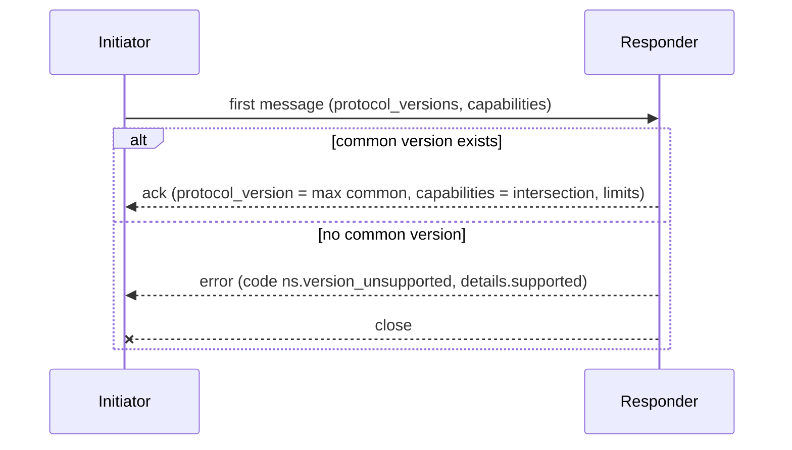

# 00. Conventions

| | |
|---|---|
| Status | Draft 1 (normative once the three repositories adopt it) |
| Applies to | `zeus` (app), `zeus-core` (engine library), `zeus-extension` (browser extension) |
| Related | [01 domain model](01-domain-model.md), [02 native messaging](02-native-messaging-v1.md), [03 journal](03-journal-and-commit-protocol.md), [04 audit and provenance](04-audit-log-and-provenance.md) |
| Schemas | [`schema/common.schema.json`](schema/common.schema.json), [`schema/redaction-vectors.v1.json`](schema/redaction-vectors.v1.json) |

The key words MUST, MUST NOT, SHOULD, SHOULD NOT and MAY are used as in RFC 2119 and RFC 8174 and carry that meaning only when written in capitals.

## 1. Purpose

Three codebases written in two languages implement Zeus independently. This document fixes everything that would otherwise be decided three times: names, identifier and time formats, the canonical form used for hashing, the error envelope, numeric limits, what may never be written to a log, and how protocols are versioned. Documents 01 to 04 and every later spec use these rules without restating them.

If this document and another spec disagree, this document wins for the topics it covers. If a JSON Schema and prose disagree, the prose wins and the schema is a bug; report it.

## 2. Terminology

| Term | Meaning |
|---|---|
| Zeus | The product and its codename. |
| Daemon | `zeusd`, the long-running local process that owns state. |
| Host | `zeus-native-host`, the short-lived process the browser launches for native messaging. It relays to the daemon. |
| Extension | The MV3 browser extension in `zeus-extension`. |
| Client | Anything that talks to the daemon: CLI, TUI, MCP server, A2A endpoint, extension, embedding applications. |
| Trust surface | A UI path that only a human can drive: extension popup, TUI, interactive CLI. Agents never reach it. |
| Session material | Cookies and the minimal headers released for one origin under a grant. Always secret. |
| Wire type | A JSON structure that crosses a process boundary and has a JSON Schema. |
| Durable event | An event stored in the journal with a sequence number. Opposite: ephemeral event. |

## 3. Naming

| Thing | Rule | Examples |
|---|---|---|
| Product | `Zeus` in prose. | |
| Rust crates | `zeus-<name>`, kebab-case. Library crate identifiers are `zeus_<name>`. | `zeus-engine`, `zeus-journal` |
| Binaries | Exactly `zeus` (CLI), `zeusd` (daemon), `zeus-native-host`. | |
| MCP tools | `zeus_<verb>[_<noun>]`, lowercase ASCII letters, digits and `_` only, at most 64 characters. The MCP specification (2025-11-25 and 2026-07-28, section Tool Names, verified 2026-10-05) says names SHOULD be 1 to 128 characters from `A-Z a-z 0-9 _ - .`; Zeus uses the subset that every client accepts and never uses `.` or `-`. | `zeus_enqueue`, `zeus_session_request` |
| JSON-RPC methods | `<namespace>.<verb>`, lowercase, dotted. | `jobs.enqueue`, `approvals.decide` |
| Native-message types | `<noun>[.<verb>]`, lowercase, dotted (02). | `handoff.offer`, `fetch.chunk` |
| Event names | `<noun>.<verb or state>`, lowercase, dotted. The set is closed and listed in 01 section 9. | `job.created`, `approval.decided` |
| JSON object keys | `snake_case`, ASCII. Never camelCase, never kebab-case. | `bytes_done` |
| Enum values | `snake_case` strings. Never integers. Browser-defined enums keep the browser's spelling (for example `FILE_NO_SPACE`) and are marked as such. | `retry_scheduled` |
| Error codes | `<namespace>.<reason>`, lowercase `snake_case`, at least one dot (section 9.3). | `http.status_429` |
| Capability names | Same lexical form as error codes but the dot is optional. | `fetch_proxy`, `url_refresh.refetch` |
| Config keys, CLI flags | `snake_case` in files, `--kebab-case` flags. | `max_connections`, `--max-connections` |
| Files created by Zeus | Data in progress: `<final name>.zpart`. Journal: `zeus.redb`. Audit: `audit-<index>.jsonl`. Manifest: `manifest.jsonl`. | |
| Native host name | `dev.zeus.native_host` (lowercase letters, digits, `_` and `.` only, as both browsers require). | |

Field-name suffixes carry the unit and are part of the name:

| Suffix | Unit | Type |
|---|---|---|
| `_ms` | milliseconds | integer |
| `_s` | seconds | integer, allowed only on agent-facing fields that existing research fixed (`eta_s`, `timeout_s`) |
| `_bytes` | bytes | integer |
| `_at` | instant, section 6.1 | string |
| `_id` | identifier, section 5 | string |

Throughput has no suffix convention: the single field `rate_ewma` is bytes per second.

## 4. Protocol versioning and capability negotiation

### 4.1 Rules

1. Every protocol with two independently released endpoints has a **protocol version**: a positive integer, written `v` or `protocol_version`. It increases only for a breaking change. It is unrelated to any product semver.
2. Each endpoint also advertises **capabilities**: a set of strings naming optional behaviour. A capability is added when new optional behaviour appears without breaking old peers.
3. Negotiation is performed once per connection, by the first message the connecting side sends:
   1. The initiator sends the list of protocol versions it can speak (`protocol_versions`) and the set of capabilities it implements.
   2. The responder chooses the **highest** version present in both lists. If the intersection is empty it answers with an error `<ns>.version_unsupported` whose `details.supported` lists its own versions, then closes.
   3. The responder answers with the chosen version and the **intersection** of capabilities, plus its own limits.
   4. From then on both sides MUST behave as the chosen version and MUST NOT use any behaviour gated by a capability outside the intersection.
4. The first message of every protocol is sent with the lowest protocol version that exists (today `1`) so that any future peer can parse it. That message's envelope is frozen forever.
5. Additive changes do **not** raise the version: new optional fields, new enum values on request fields, new message types gated by a capability, new error codes.
6. Breaking changes **do** raise the version: removing or renaming a field, changing a type or unit, making an optional field required, changing the meaning of an existing value, changing framing or ordering rules.
7. Receivers MUST ignore unknown object keys. One exception: a document that a human approves by its hash (a workflow plan, 08) is rejected when it has a key its reader does not know, because an ignored key would make the run differ from what was approved. Receivers MUST NOT fail on an unknown enum value in a field they only display or log; they SHOULD map it to a generic "other" presentation. Receivers MUST fail with `invalid_request` on an unknown enum value in a field that drives behaviour they cannot guess (for example an unknown `decision`).
8. A release SHOULD support its own protocol version and the previous one. Dropping a version needs one release in which the daemon logs a deprecation notice when it is negotiated.
9. Wire types are described by JSON Schema 2020-12 documents in `docs/spec/schema/`. The schema is an aid for testing and code generation. Schemas do not set `additionalProperties: false` because of rule 7, except for the approved-by-hash documents that rule names; test suites SHOULD additionally run a strict mode (`unevaluatedProperties: false`) on their own outputs to catch typos. The tool in `docs/spec/tools/` does exactly that for the examples in these documents.



### 4.2 Registry

| Protocol | Name | Version today | Spec |
|---|---|---|---|
| Extension to daemon through the host | native messaging | 1 | 02 |
| Daemon local API (JSON-RPC) | daemon api | 1 | 05 |
| MCP tool surface (tools, resources, prompt) | mcp tools | 1 (`_meta["dev.zeus/tools_version"]` in `tools/list`) | 06 |
| Journal store format | journal | 1 (`schema_version`) | 03 |
| Audit record | audit | 1 (`v`) | 04 |
| Provenance manifest | manifest | 0 (`manifest_version`) | 04 |
| Job state machine | state machine | 1 | 01 |
| Artifact store layout and index; artifact record | artifact store | 1 (`format_version` in `store.json`), 1 (`artifact_version`) | 13 |

Stored formats (journal, audit, manifest) carry their version in the data itself. A reader MUST refuse data whose version is higher than it understands and MUST NOT attempt a partial read.

## 5. Identifiers

### 5.1 Prefixed ULIDs

Entity identifiers are a lowercase prefix, an underscore and a 26 character ULID (Crockford base32, alphabet `0123456789ABCDEFGHJKMNPQRSTVWXYZ`, uppercase, first character `0` to `7`). The ULID timestamp is milliseconds since the Unix epoch; the 80 random bits come from a CSPRNG. Generators SHOULD be monotonic within one millisecond (increment the random part) so identifiers sort by creation order.

| Prefix | Entity | Created by | Persisted | Notes |
|---|---|---|---|---|
| `job_` | Job | daemon | yes | One per download. |
| `clp_` | Cloud delivery plan | daemon | yes | Immutable scoped plan and hash (14). |
| `cld_` | Cloud delivery | daemon | yes | One remote delivery identity across retries and reconciliation (14). |
| `run_` | Workflow run | daemon | yes | Groups jobs of one workflow (spec 08). |
| `gr_` | Session grant | daemon | yes | Consent record, never contains cookies. |
| `ap_` | Approval | daemon | yes | One pending or decided human decision. |
| `sess_` | Session lease | daemon | metadata only | Handle for one release of cookies. Safe to log. The material it names is never persisted. |
| `conn_` | Native-messaging connection | daemon | no | Per connection, for logs. |
| `chain_` | Audit chain | daemon | yes | Identifies one hash chain (04). |
| `art_` | Artifact record | artifact store (the `zeus-core` library inside the store's owner) | yes | Local to one store instance; the same content in another store has another id (13). |
| `plan_` | Workflow plan draft | daemon | yes | A stored candidate plan with its samples; expires 24 h after last use. An approved run keeps its plan by hash, not by id (08). |
| `cli_` | Client credential | daemon (provisioning, `clients.add`) | yes, in the verifier store | Names a daemon API credential; it is the `client_id` of actors, job sources and audit records. Safe to log; the token it belongs to never is (05). |

Ogun (ADR 0011) registers its own prefixes here when its spec O-00 is written. A new prefix requires an entry in this table.

Rules:

1. Only the daemon (the zeus-core library when embedded) mints identifiers. A client that needs a correlation value uses a message id (section 5.3) or an `idempotency_key`.
2. Identifiers are **opaque** to everyone except the minting code. Consumers MUST NOT derive meaning from the timestamp part for security decisions; they MAY use it for sorting and display.
3. Parsers MUST accept exactly the pattern in `common.schema.json` (`^<prefix>_[0-7][0-9A-HJKMNP-TV-Z]{25}$`) and MUST reject lowercase letters.
4. Identifiers are never reused, including after deletion.

```json validate=common#/$defs/JobId
"job_01M45MN5M0PZ0D9W0APDCGRNZD"
```

### 5.2 Event sequence

Durable events carry `seq`: a positive unsigned integer, strictly increasing, assigned inside the journal transaction that records the state change it describes (03 invariant I9). It never decreases and is never reused, across restarts included. JSON carries it as an integer; it MUST stay below 2^53 (9007199254740991). Textual contexts (URIs, cursors, logs) write it as `ev_<decimal>` with no leading zeros, for example `ev_48213`. The shorthand "ev" in this specification family always means this sequence.

Ephemeral events (only `job.progress`) have no `seq`; they carry `after_seq`, the last durable sequence assigned when they were emitted (01 section 9).

### 5.3 Message and request ids

Correlation ids on a connection (native messaging `id` and `re`, JSON-RPC `id`) are chosen by the sender of the request and are unique per sender per connection. For native messaging: 1 to 64 characters of `A-Z a-z 0-9 _ -`. They are not entities, are never persisted and carry no meaning. Recommended form: the extension uses `e<counter>`, the daemon `d<counter>`.

### 5.4 Idempotency keys

A mutating request MAY carry `idempotency_key`, a client-chosen string of 1 to 128 characters. The daemon stores `(client_id, key) -> (request_hash, result)` for at least 24 hours (03, table `idempotency`). `request_hash` is the BLAKE3 digest of the JCS form (section 7) of the object `{"method": <method or message type>, "params": <the request parameters without the key itself>}`, so one key used with two methods cannot collide. Details for the daemon API, including which failures are stored, are in 05 section 12.

| Situation | Behaviour |
|---|---|
| First request with this key | Execute and store the result. |
| Same key, same `request_hash` within the retention window | Return the stored result and do not execute again. The daemon API marks such a result with `replayed: true` (05 section 8.3); nothing else changes. |
| Same key, different `request_hash` | Reject with `api.idempotency_conflict`, class `conflict`, not retryable. |

## 6. Time, durations and units

### 6.1 Instants

1. Wire and storage form: RFC 3339, UTC only, designator `Z`, **exactly three** fractional digits: `2026-10-05T09:15:30.250Z`. Emitters MUST produce this form. Parsers SHOULD accept zero to nine fractional digits and offsets, and normalise.
2. Instants are wall-clock times and can jump. They are used for display, for absolute deadlines that must survive a restart (`expires_at`, `next_attempt_at`) and for ordering across processes. They MUST NOT be used to measure elapsed time.

### 6.2 Durations and monotonic time

1. Durations are integers in milliseconds, field suffix `_ms`. Fractions are not used.
2. Elapsed time inside one process is measured with the monotonic clock of the platform (`Instant` in Rust, `performance.now()` in the extension). A deadline that must be sent to another process is sent as a duration (`deadline_ms` = time remaining), never as an instant, so clock skew cannot shorten or extend it.
3. A deadline that must survive a restart is stored as an instant. On startup the process recomputes remaining time from the wall clock and clamps a negative remainder to zero. A wall-clock step backwards MUST NOT extend a stored deadline by more than the step.
4. Timers fire no earlier than requested and MAY fire late. Nothing may depend on exact firing.

### 6.3 Sizes and rates

1. Byte counts and offsets are unsigned integers, field suffix `_bytes` (or the names `offset`, `length`, `start`, `end`, `bytes_done`, `bytes_total` where fixed by the domain model). They MUST NOT exceed 2^53 - 1 (about 8 PiB), which every JSON implementation represents exactly. A peer that sees a larger value rejects the message with `invalid_request`.
2. Unknown size is `null`, never `-1` and never `0`. (The browser's `totalBytes: -1` is converted at the extension boundary.)
3. Binary units only: KiB = 1024 bytes, MiB = 1024 KiB. Decimal "MB" never appears in a normative limit; where a browser documents "1 MB" the more conservative reading 1,000,000 bytes is used (02 section 3.3).
4. Byte ranges are half-open `[start, end)` everywhere in Zeus. The only exception is text copied into or out of HTTP headers, where the inclusive RFC 9110 form is used; conversion happens at the HTTP boundary and nowhere else. Native messaging uses `offset` and `length`.
5. `rate_ewma` is bytes per second as an integer.

### 6.4 Hash notation

Digests are lowercase hexadecimal strings: 64 characters for SHA-256 and BLAKE3 (32-byte output). Field names say which: `sha256`, `blake3`. A bare `hash` field is used only in the audit log (04) and means BLAKE3.

## 7. Canonical JSON and hashing

1. Wherever a JSON value is hashed or compared byte-for-byte (audit records, request hashes, signed material later), the **canonical form is RFC 8785 JSON Canonicalization Scheme (JCS)**: UTF-8, object keys sorted by UTF-16 code units, no insignificant whitespace, ECMAScript number serialisation, minimal string escaping.
2. Hashed documents MUST NOT contain floating-point numbers, `NaN`, infinities, or integers outside +/- (2^53 - 1). Where a fraction is needed use an integer in a smaller unit or a string. This keeps JCS number formatting out of the interoperability surface.
3. Hashed documents MUST NOT contain duplicate object keys. Parsers feeding a hash MUST reject them.
4. The BLAKE3 hash function (default 32-byte output, no key, no context string) is used for the audit chain; SHA-256 and BLAKE3 both appear in provenance (04).
5. Test vectors: implementations MUST include a test that canonicalises and hashes the records in 04 section 4.7 and reproduces the published digests.

## 8. Logging, redaction and secrets

### 8.1 What must never be written

The following MUST NOT appear in any log line, panic message, error `message` or `details`, event payload, audit record, trace, metric label, crash report, test fixture (when real), CLI output without an explicit `--show-secrets`, or LLM prompt:

| Secret | Examples |
|---|---|
| Cookie names and values | `Cookie:` and `Set-Cookie:` headers, `SessionMaterial.cookies` |
| Authorization material | `Authorization`, `Proxy-Authorization`, API keys, bearer tokens, `x-api-key` and similar |
| URL secrets | Query strings, fragments and userinfo of any URL (section 8.2); path segments that look like credentials |
| Daemon and client tokens | Per-client IPC tokens, MCP HTTP tokens |
| LLM provider keys | Keys from the keyring |
| Request and response bodies of authenticated requests | Except as downloaded file content on disk |

Allowed alongside: origins, host names, paths after redaction, status codes, header **names**, cookie **counts**, sizes, timing, identifiers from section 5.

### 8.2 `redact_url`

`redact_url(url, mode)` returns `(url, redacted)`. It is total (never fails on a parseable absolute http(s) URL), idempotent, and deterministic. Normative vectors: [`schema/redaction-vectors.v1.json`](schema/redaction-vectors.v1.json); reference implementation: `docs/spec/tools/redact-url.mjs`.

Common to all modes: the userinfo (`user:password@`) and the fragment are removed; scheme and host are lowercased; the default port is dropped by the URL parser.

| Mode | Used for | Query | Path |
|---|---|---|---|
| `log` | Logs, errors, events, MCP output, UI strings | Replaced by `?…` if any query was present | Segments that look secret are replaced by `…` |
| `record` | Audit records, provenance manifests (default) | Each parameter is dropped if its name matches the deny pattern or its value looks secret; others kept in order, bytes untouched | Kept |
| `strict` | Manifests with `privacy.url_query = dropped`, shared exports | Dropped entirely | Segments that look secret are replaced by `…` |

`redacted` is true when anything was removed or masked.

A value or path segment **looks secret** when, after percent-decoding, it is not a UUID and one of the following holds: (a) it has the JWT shape `eyJ<b64url>.<b64url>.<b64url>`; (b) it is at least 32 hex digits; (c) it is at least 24 characters of `A-Za-z0-9_-+/=~`, has at least three of the classes lower case, upper case, digit, is not a slug of three or more alphabetic words joined by `-` or `_`, and has Shannon entropy of at least 4.0 bits per character.

A parameter name matches the **deny pattern** when it contains, delimited by start, end, `_`, `-` or `.`, any of `token key secret sig signature auth authorization password passwd pwd credential credentials session sessionid sid jwt bearer otp code state nonce policy hmac hdnts sas`, or starts with `x-amz-`, `x-goog-` or `x-ms-`, or equals `awsaccesskeyid`, `googleaccessid`, `access_token`, `id_token`, `refresh_token`, `api_key`, `apikey` (case-insensitive).

The heuristics are deliberately conservative and will over-redact. Over-redaction is a documented, acceptable failure; under-redaction is a bug.

The one place a full URL is stored is the journal (03): the job record, and the checkpoint of a workflow run (08), because resuming needs them. That file is created with owner-only permissions and the URL never leaves it except toward the origin server and, over the local pipe, the extension (02).

### 8.3 Rules for implementers

1. Session material is held in zeroizing types (`zeroize::Zeroizing`, `secrecy::SecretBox` in Rust; overwritten `Uint8Array` or dropped references in the extension, which cannot guarantee zeroing and MUST NOT keep material in any persistent store). Types holding it implement `Debug` as `[REDACTED]` and do not implement `Serialize` except through an explicit, grep-able wrapper.
2. Schema properties holding secrets are annotated `"x-zeus-secret": true`. Code generators SHOULD map them to the zeroizing type.
3. Logging uses structured fields. A log call MUST pass URLs only through `redact_url(.., log)`.
4. Tests MUST include a **canary test**: run a job with a session whose cookies and URL query contain the marker `ZEUS-CANARY-` and fail the build if that string appears in any log, event, journal field other than `spec.url`, audit record or manifest produced during the run.
5. Crash dumps and panic hooks MUST NOT print message bodies; `RUST_BACKTRACE` output is acceptable because it carries code locations only.
6. Telemetry: none. No component makes a network request except those a task or user action explicitly causes.

## 9. Error envelope

### 9.1 Shape

Every error that crosses a process boundary uses this object ([`common.schema.json#/$defs/ErrorEnvelope`](schema/common.schema.json)):

| Field | Type | Meaning |
|---|---|---|
| `code` | string | Stable machine identifier, section 9.3. Never translated. |
| `class` | enum | Coarse class, section 9.2. Drives retry and presentation. |
| `message` | string, at most 1024 chars | English diagnostic. Never parsed by code. No secrets. |
| `retryable` | boolean | True iff repeating the same request, possibly after the delay or refresh the class implies, may succeed **without human action**. |
| `details` | object, optional | Code-specific structured data, at most 8 KiB serialised. No secrets. |

```json validate=common#/$defs/ErrorEnvelope
{
  "code": "http.status_429",
  "class": "throttled",
  "message": "Server answered 429 Too Many Requests.",
  "retryable": true,
  "details": { "status": 429, "retry_after_ms": 30000, "host": "files.example.com" }
}
```

Transport mapping:

| Transport | Carrying rule |
|---|---|
| Native messaging | `error` message body, or the `error` member of a typed response (02). |
| JSON-RPC (05) | `error.data` holds the envelope; `error.code` is the JSON-RPC code chosen by the table of 05 section 11.1 (by error code first, then by class; `-32000` for job classes); `error.message` repeats `message`. |
| MCP tools (06) | A tool execution error: `isError: true`, `structuredContent` is the envelope plus a `next` recovery hint (06 section 5.4), `content[0].text` is the one-line rendering `"<code>: <message>"`, followed by `" Next: <action>."` or `" Next: <action> with <tool>."` when a hint applies. Invalid argument values are tool execution errors too, as MCP 2025-11-25 and later require; only an unknown tool, `arguments` that is not an object and MCP-level failures (version, headers, `_meta`) are JSON-RPC errors (06 section 5.4). |
| A2A (10) | Task status message with the envelope in a data part. |
| CLI | Message on stderr, exit status by class (11). |
| Event `job.failed` | Envelope in `data.error`. |

### 9.2 Classes

| Class | Scope | Meaning in one line | `retryable` default |
|---|---|---|---|
| `transient_network` | job | Connection-level failure likely to pass. | true |
| `throttled` | job | The server asked us to slow down. | true |
| `auth_expired` | job | The session or credential was rejected. | true (after a refresh) |
| `url_expired` | job | The signed or one-shot URL no longer works. | true (after a refresh) |
| `blocked` | job | The server refuses this client but may accept the user's browser. | true (through the in-browser proxy only) |
| `permanent` | job | Retrying cannot help. | false |
| `disk` | job | Local storage problem. | depends on code |
| `integrity` | job | Bytes or metadata contradict each other or an expectation. | one restart, then false |
| `policy_denied` | job | A rule or a human said no. | false |
| `invalid_request` | protocol | Malformed or semantically invalid input. | false |
| `not_found` | protocol | The named entity does not exist. | false |
| `conflict` | protocol | The request conflicts with current state (wrong state, idempotency clash, stale version). | false |
| `unauthenticated` | protocol | The caller is not an authorised peer. | false |
| `unsupported` | protocol | The peer lacks the capability or version. | false |
| `unavailable` | protocol | A dependency is not ready (daemon starting, extension absent). | true |
| `timeout` | protocol | No answer within the deadline. | true |
| `internal` | protocol | Bug or invariant violation. | false |

The nine job classes, their classification rules and retry policy are defined in 01 section 8. Protocol classes are defined by the spec that raises them (02 for native messaging).

### 9.3 Codes

A code is `<namespace>.<reason>` in lowercase `snake_case`. A code, once published, keeps its meaning forever; a replaced code is deprecated, never reused. A code always maps to exactly one class.

| Namespace | Raised by | Spec |
|---|---|---|
| `http` | HTTP status classification (`http.status_404`, `http.unexpected_html`, `http.redirect_loop`) | 01 |
| `net` | DNS, connect, TLS-transport, timeouts (`net.connect_timeout`) | 01 |
| `tls` | Certificate and handshake policy (`tls.cert_invalid`) | 01 |
| `fs` | Local file system (`fs.no_space`, `fs.permission_denied`) | 01, 03 |
| `integrity` | Hash, size, validator conflicts (`integrity.hash_mismatch`) | 01, 03 |
| `policy` | Grants, roots, never-list (`policy.origin_never`) | 01, 07 |
| `session` | Session leases and grants (`session.consent_required`) | 01, 02 |
| `url` | URL refresh (`url.refresh_failed`) | 02 |
| `fetch` | In-browser fetch proxy (`fetch.network_error`) | 02 |
| `handoff` | Browser handoff (`handoff.not_eligible`) | 02 |
| `nm` | Native messaging framing and protocol | 02 |
| `journal` | Journal store (`journal.corrupt`) | 03 |
| `audit` | Audit log (`audit.chain_broken`) | 04 |
| `engine` | Engine internals (`engine.crash_loop`) | 01 |
| `api` | Daemon API generic (`api.idempotency_conflict`, `api.not_found`) | 05 |
| `artifact` | Artifact store (`artifact.object_absent`, `artifact.store_locked`) | 13 |
| `workflow` | Workflow plans and runs (`workflow.plan_hash_mismatch`, `workflow.host_not_allowed`) | 08 |
| `plan` | Plan diagnostics, not errors: the same lexical form, carried in `Diagnostic.code` (`plan.selector_no_match`) | 08 |
| `internal` | Bugs | all |

## 10. Limits

Limits are normative maxima for what a conforming sender emits and what a conforming receiver accepts. A receiver MAY accept more but MUST reject at least these maxima with `invalid_request` (or the protocol-specific code). Configuration may lower defaults, never raise a hard maximum.

| Item | Limit | Notes |
|---|---|---|
| JSON nesting depth | 32 | Receivers parse with a depth limit. |
| Native messaging frame, daemon to extension | 1,000,000 bytes | Browser hard limit is "1 MB" (Chrome: 1 MiB; Firefox: 1 MB). See 02 section 3.3. |
| Native messaging frame, extension to daemon | 4,194,304 bytes (4 MiB) | Chrome allows 64 MiB, Firefox 4 GiB; Zeus stays far below both. |
| Local API request line | 1 MiB | 5 MiB on `native_host` connections, which carry 4 MiB extension frames (05 section 4.3). |
| Local API response line | 16 MiB | Larger results are paged. |
| URL | 8192 bytes | After punycode and percent-encoding. |
| Origin | 300 bytes | |
| File name | 255 UTF-8 bytes | Applies to a single path component. |
| Path | 4096 bytes | |
| HTTP header value carried in a message | 8192 bytes | |
| Cookie name | 256 bytes | |
| Cookie value | 8192 bytes | Browsers limit a cookie to about 4096 bytes. |
| Cookies per session response | 150 | And at most 128 KiB serialised. |
| Error `message` | 1024 characters | |
| Error `details` | 8 KiB serialised | |
| Event `data` | 64 KiB serialised | |
| `idempotency_key` | 128 characters | |
| Labels per job | 16 | Key and value at most 256 characters. |
| Extra request headers per job | 16 | Never `Cookie` or `Authorization` (01 section 3). |
| Page size (`limit`) | default 50, maximum 100 | List calls. |
| Concurrent native-messaging streams per connection | 8 | Default 4 (02). |
| Session material time to live | 900,000 ms (15 min) | Per release (02). |
| Redirects followed | 10 | |
| MCP tool name | 64 characters | |
| MCP tool result | 32,768 bytes | `structuredContent` as compact JSON (06 section 5.3). |

Default rate limits (per peer, token bucket, burst equals twice the sustained rate unless stated): native messaging control messages 200 per second sustained, excluding `fetch.chunk` and `fetch.credit`, which flow control governs; `handoff.offer` 30 per minute; `approval.decide` 10 per minute; local API mutating calls 50 per second. Exceeding a limit yields `<ns>.rate_limited`, class `unavailable`, `retryable: true`, with `details.retry_after_ms`.

## 11. Localisation

1. Error codes, event names, enum values, JSON keys and log field names are stable machine strings and are never translated.
2. `message` fields are English diagnostics for logs and developers. User interfaces render their own text keyed by `code` (or `class` as a fallback) and MAY append the English `message` in a details pane.
3. Text meant for humans that originates from remote servers (file names, page titles) is data. It is displayed as-is after sanitisation (control characters, bidirectional overrides and path separators removed) and is never interpreted as an instruction (01 section 12).
4. All wire text is UTF-8. File names are Unicode NFC when created by Zeus; Zeus does not normalise names it reads.

## 12. Security considerations

| Threat | Rule in this document |
|---|---|
| Secret leakage through logs | Section 8: closed list, `redact_url`, canary tests, zeroizing types. |
| Hash ambiguity | Section 7: JCS, integers only, no duplicate keys. |
| Integer precision loss across JSON implementations | Section 6.3: 2^53 - 1 bound everywhere. |
| Clock manipulation | Section 6.2: durations over the wire, monotonic clocks locally. |
| Confused deputy through identifiers | Section 5: opaque ids, authorisation always rechecked against the caller, never inferred from an id. |
| Resource exhaustion | Section 10: depth, size and rate limits enforced before parsing into typed structures where possible. |
| Version downgrade | Section 4: highest common version wins; a peer cannot be pushed below what both support, and the chosen version is fixed for the connection. |

## 13. Conformance

An implementation conforms if it passes: (a) the schema validation of every example in these documents (`docs/spec/tools`, `npm run validate`); (b) the redaction vectors; (c) the state-machine table tests of 01; (d) the journal and audit tests of 03 and 04. The tools in `docs/spec/tools` are the reference for (a) to (c).

## 14. Open issues

| # | Issue | Proposed direction |
|---|---|---|
| O1 | `site` scope is keyed by exact origin, not by registrable domain. Users may expect `example.com` to cover `cdn.example.com`. | Keep exact origin for the MVP (safer); add an explicit "include subdomains" flag in a later protocol minor. |
| O2 | The secret heuristics in section 8.2 will over-redact some provenance URLs (for example Google Drive file ids). | Allow a per-origin allow-list of parameter names for `record` mode in configuration. |
| O3 | Timestamps with three fractional digits cannot express leap-second ordering or sub-millisecond event order. | Event `seq` is the order of record; timestamps are informational. |
| O4 | Prefixed ULIDs leak creation time to anyone who sees an id. | Accepted: local-first product; revisit if ids are ever published. |
