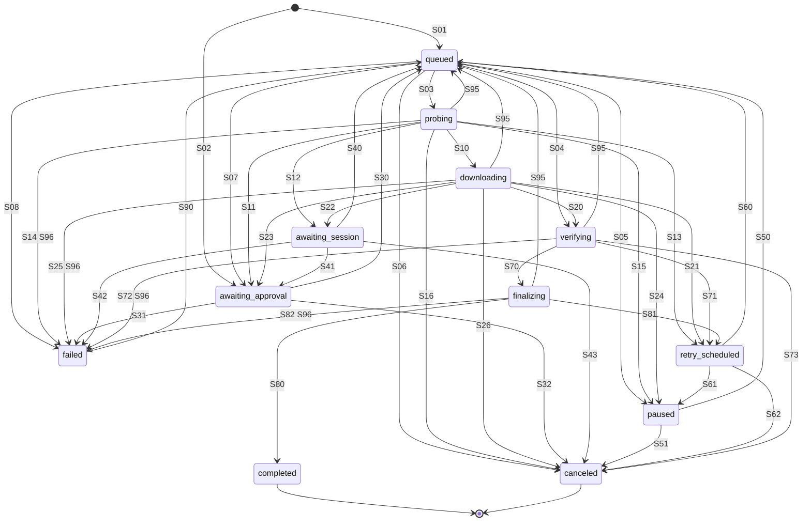

# 01. Domain model

| | |
|---|---|
| Status | Draft 1 |
| Depends on | [00 conventions](00-conventions.md) |
| Used by | 02 to 12 |
| Schemas | [`schema/domain.schema.json`](schema/domain.schema.json), [`schema/job-state-machine.v1.json`](schema/job-state-machine.v1.json), [`schema/common.schema.json`](schema/common.schema.json) |

## 1. Purpose

This document defines the entities Zeus manipulates, the exact job state machine, the error classes with their classification and retry rules, and the event catalogue. Everything the engine, daemon, CLI, MCP server, extension and tests need in order to agree on "what state is this download in and what happens next" is here. Mechanics of byte storage are in 03, of audit in 04.

## 2. Terminology

| Term | Meaning |
|---|---|
| Job | One requested download and everything Zeus knows and does about it. |
| Probe | The first conditional request that learns size, range support, validators and whether a session is needed. Also the resume-validation step (03). |
| Committed range | A byte interval whose data is durable on disk and recorded in the journal (03). Progress is counted in committed bytes only. |
| Lease | One release of session material to the engine for a job, identified by a `sess_` id and limited by a time to live. |
| Effective grant | An active, unexpired grant that covers a job's session origin (section 5.3). |
| Trust surface | A UI that only a human can drive (00 section 2). |
| Epoch | Counter incremented whenever a job enters `probing`; stale workers cannot commit data (03 invariant I5). |

## 3. Entities

### 3.1 Job

A Job is the aggregate root. All fields except `spec` change over time; `spec` is immutable apart from `priority`.

| Field | Type | Notes |
|---|---|---|
| `id` | `job_` id | |
| `state` | JobState | Section 6. |
| `quarantined` | boolean | Only ever true when `state` is `completed`. Immutable afterwards. |
| `quarantine_reasons` | list of QuarantineReason | Present when `quarantined`. Section 11.3. |
| `spec` | JobSpec | Section 3.2. |
| `created_at`, `updated_at`, `state_since` | instants | `updated_at` changes on any field change; `state_since` only on a transition. |
| `probe` | ProbeResult or null | Latest probe. |
| `progress` | Progress | Section 3.7. |
| `retry` | RetryState | Counters and timers, section 3.8. |
| `error` | ErrorEnvelope or null | The most recent error; set while `retry_scheduled`, `failed`, and kept after a later success for diagnostics until completion. |
| `result` | JobResult or null | Present only when `completed`. |
| `transport` | `direct` or `browser_proxy` | How bytes currently flow. Starts `direct`; section 8.6 explains the switch. |
| `grant_id` | `gr_` id or null | Effective grant the job currently relies on. |
| `approval_id` | `ap_` id or null | Pending approval, if any. |

```json validate=domain#/$defs/Job
{
  "id": "job_01M45NHJ2AHWMXT8JVJ7BEEJX7",
  "state": "downloading",
  "quarantined": false,
  "spec": {
    "url": "https://portal.example.org/download/8841",
    "hint_url": "https://cdn.example.org/blobs/dataset-v3.tar.zst?X-Amz-Signature=REDACTED-IN-DOCS",
    "referrer": "https://portal.example.org/datasets/v3",
    "filename": "dataset-v3.tar.zst",
    "priority": "high",
    "session_origin": "https://portal.example.org",
    "grant_scope_hint": "site",
    "overwrite": "rename",
    "source": {
      "kind": "browser_handoff",
      "via": "native_messaging",
      "client_id": "ext:chrome",
      "browser": {
        "name": "chrome",
        "extension_id": "abcdefghijklmnopabcdefghijklmnop",
        "download_id": 317,
        "offer_key": "chrome:317:2026-10-05T09:15:12.004Z",
        "incognito": false
      }
    }
  },
  "created_at": "2026-10-05T09:15:30.250Z",
  "updated_at": "2026-10-05T09:16:10.000Z",
  "state_since": "2026-10-05T09:15:36.640Z",
  "probe": {
    "probed_at": "2026-10-05T09:15:36.610Z",
    "method": "range_get",
    "transport": "direct",
    "http_version": "h2",
    "status": 206,
    "final_url_redacted": "https://cdn.example.org/blobs/dataset-v3.tar.zst?…",
    "redirects": 1,
    "range_support": "verified",
    "total_bytes": 1288490188,
    "content_type": "application/zstd",
    "content_encoding": null,
    "filename": { "value": "dataset-v3.tar.zst", "source": "content_disposition" },
    "validators": {
      "etag": "\"5f3a9c-4c1d2e7b\"",
      "last_modified": "Tue, 29 Sep 2026 14:02:11 GMT",
      "last_modified_strong": true,
      "repr_digest": null
    },
    "requires_session": true,
    "interstitial_suspected": false
  },
  "progress": {
    "bytes_done": 611057664,
    "bytes_total": 1288490188,
    "rate_ewma": 15728640,
    "eta_s": 43,
    "segments_active": 4,
    "last_error_class": null,
    "updated_at": "2026-10-05T09:16:10.000Z"
  },
  "retry": {
    "attempt": 1,
    "consecutive_failures": 0,
    "last_progress_at": "2026-10-05T09:16:10.000Z",
    "next_attempt_at": null,
    "auth_refreshes": 0,
    "proxy_escalations": 0,
    "integrity_restarts": 0,
    "resource_restarts": 0,
    "recovery_count": 0,
    "session_wait_deadline_at": null
  },
  "error": null,
  "result": null,
  "transport": "direct",
  "grant_id": "gr_01M45NHPJP04TX6B1CJVQVQAK9",
  "approval_id": "ap_01M45NHJ3XS0QXG9T42HHN2YR8"
}
```

(The `hint_url` in the example is a placeholder, not a real signature. Documents never contain real secrets.)

### 3.2 JobSpec

The immutable request. Fields with a default are filled in by the daemon before the job is stored.

| Field | Type | Default | Rules |
|---|---|---|---|
| `url` | URL | required | `http` or `https` only. Other schemes are rejected with `policy.scheme_not_allowed` in the MVP. At most 8192 bytes. The stable address of the resource; it is what the engine re-requests to obtain a fresh signed URL. |
| `hint_url` | URL | none | Last known resolved URL (for a browser handoff, the browser's `finalUrl`). Tried first; `url` is the fallback. |
| `referrer` | URL or null | null | Sent as `Referer` only when it has the same origin as `url`, or `url`'s origin is on the user's referrer allow-list; otherwise it is stored for provenance but not sent. |
| `dest_dir` | path | daemon default root | Must resolve inside a configured write root (section 12.3). |
| `filename` | string | derived | Hint only. Final name comes from `Content-Disposition` (RFC 6266 `filename*` preferred), then the URL path, then this hint, then a type-based default; always sanitised (section 12.3). Exception: for a job whose source kind is `workflow` and whose plan renames files, the value is the final name, sanitised but not replaced by `Content-Disposition` (08). |
| `expected_sha256` | hex | none | When present, a mismatch is an `integrity` failure after at most one restart (section 8.5). |
| `expected_size` | bytes | none | Likewise for size. |
| `priority` | `low`, `normal`, `high` | `normal` (`high` for `browser_handoff`) | Weighted-fair-queue weights 1, 2, 4 (section 10). The only mutable field. |
| `session_origin` | origin | none | Names the origin whose session the job needs. Presence makes the job require an effective grant. |
| `grant_scope_hint` | `once`, `site`, `workflow` | none | A suggestion shown on the approval; the human chooses. |
| `extra_headers` | map | empty | At most 16; names must be on the allow-list `Accept`, `Accept-Language`, `If-Modified-Since`, `X-Requested-With`. `Cookie`, `Authorization`, `Proxy-Authorization`, `Host`, `Range`, `If-Range`, `Content-Length`, `Accept-Encoding` and anything else are rejected with `invalid_request`. |
| `idempotency_key` | string | none | 00 section 5.4. |
| `overwrite` | `rename`, `fail`, `replace` | `rename` | What to do if the final path exists. `rename` appends ` (1)`, ` (2)`, ... before the extension. `replace` moves the old file to the app trash first (03 section 8.1). |
| `max_connections` | 1 to 32 | engine default (8) | Upper bound; the engine may use fewer. |
| `transport_hint` | `auto`, `direct`, `browser_proxy` | `auto` | `browser_proxy` forces the in-browser fetch fallback and needs a connected extension and an effective grant. |
| `labels` | map | empty | Free-form tags from the caller. Untrusted data (section 12.1). |
| `source` | Source | required | Section 3.3. |

```json validate=domain#/$defs/JobSpec
{
  "url": "https://files.example.com/exports/2026/q3.csv.gz",
  "referrer": null,
  "dest_dir": "/home/ada/Downloads/Zeus",
  "filename": "q3.csv.gz",
  "expected_sha256": "9218812567e906efb346546840f6145fc189148e5633d0737fee7402a3207f9a",
  "priority": "normal",
  "idempotency_key": "agent-7f3c:q3-export",
  "overwrite": "rename",
  "max_connections": 8,
  "transport_hint": "auto",
  "labels": { "task": "quarterly-report" },
  "source": { "kind": "agent", "via": "mcp", "client_id": "claude-code:3d9e", "run_id": "run_01M45KGHR0ED0WJDFXKG49029B" }
}
```

### 3.3 Source

Records who asked and by which route. The kind determines default priority, which approvals apply and which UI shows the job.

| `kind` | Created by | `via` values | Extra | Approval behaviour |
|---|---|---|---|---|
| `browser_handoff` | A failed or user-forwarded browser download through the extension (02 `handoff.offer`). | `native_messaging` | `browser` block with browser name, extension id, `profile_id` (which browser profile, and therefore which cookie jar), browser download id, `offer_key`, `incognito`. | Needs an approval of kind `handoff` unless an effective grant covers the origin (S01 vs S02). |
| `agent` | An MCP tool call or an A2A task (06, 10). | `mcp`, `a2a`, `jsonrpc` | `client_id`. | A job naming `session_origin` without an effective grant creates an approval of kind `session_grant`; the agent cannot decide it. Jobs without session need no approval. |
| `cli` | A human using the CLI or TUI (11). | `cli`, `tui` | `client_id`. | Same as `agent` but the CLI is a trust surface, so interactive approval may be offered inline. |
| `workflow` | The workflow runner executing an approved plan (08). | `workflow_runner` | `run_id`. | Covered by the plan's approval and a `workflow` grant. |

### 3.4 Validators

What identifies one representation of a resource. Stored with the job as the **bound validators**: those the committed ranges were fetched under (03).

| Field | Meaning |
|---|---|
| `etag` | Raw entity-tag, including quotes and any `W/` prefix. A weak tag is **never** used in `If-Range` (RFC 9110 section 13.1.5). |
| `last_modified` | Raw HTTP-date. |
| `last_modified_strong` | True iff `Last-Modified` is at least one second older than the response `Date`, which is when RFC 9110 allows it in `If-Range`. |
| `repr_digest` | Raw `Repr-Digest` header (RFC 9530), if the server sent one. Informational; verification still uses the hashes Zeus computes. |

A representation is **strongly identified** when it has a strong `etag`, or a strong `last_modified`.

### 3.5 ProbeResult

Produced by every probe (each entry into `probing`). See the Job example above for a full instance.

| Field | Meaning |
|---|---|
| `method` | `range_get` (a `GET` with `Range: bytes=0-0`; the default), `head`, or `get_stream` (plain `GET`, used when `HEAD` and ranged `GET` are both refused). |
| `transport` | `direct` or `browser_proxy`. |
| `status`, `http_version`, `redirects`, `final_url_redacted` | What the server answered; the URL goes through `redact_url(log)`. |
| `range_support` | `verified` only after a `206` with a correct `Content-Range` was observed in this job. `unsupported` after a `200` to a ranged request. `unknown` otherwise. `Accept-Ranges` is advisory and never sufficient. |
| `total_bytes` | From `Content-Range` total, else `Content-Length` of an unranged `200`, else null. |
| `content_type`, `content_encoding` | As received. A `content_encoding` other than identity on a response to a request that sent `Accept-Encoding: identity` is an error (`http.content_encoded`). |
| `filename` | Resolved name and where it came from. |
| `validators` | Section 3.4. |
| `requires_session` | The origin refused an unauthenticated request in a way that a session may fix (401, 403, redirect to a login page, unexpected HTML). Never inferred from the URL alone. |
| `interstitial_suspected` | The response looked like an HTML wall (login, consent, challenge) instead of the expected file. |

```json validate=domain#/$defs/ProbeResult
{
  "probed_at": "2026-10-05T09:15:36.610Z",
  "method": "range_get",
  "transport": "direct",
  "http_version": "h2",
  "status": 206,
  "final_url_redacted": "https://cdn.example.org/blobs/dataset-v3.tar.zst?…",
  "redirects": 1,
  "range_support": "verified",
  "total_bytes": 1288490188,
  "content_type": "application/zstd",
  "content_encoding": null,
  "filename": { "value": "dataset-v3.tar.zst", "source": "content_disposition" },
  "validators": {
    "etag": "\"5f3a9c-4c1d2e7b\"",
    "last_modified": "Tue, 29 Sep 2026 14:02:11 GMT",
    "last_modified_strong": true,
    "repr_digest": null
  },
  "requires_session": true,
  "interstitial_suspected": false
}
```

### 3.6 Segment

A planned unit of parallel work. It is a **view**, not stored truth: the committed range set (03 section 3) is the truth, and segments are recomputed from it and the work plan whenever a job (re)starts. Splitting for work stealing creates new segments at any time.

| Field | Meaning |
|---|---|
| `index` | Position in the current plan. |
| `start`, `end` | Half-open `[start, end)` byte interval. |
| `committed_bytes` | Bytes of this interval already committed. Not necessarily contiguous from `start`. |
| `state` | `pending`, `active`, `done` (fully committed), `failed` (retry budget for this segment spent; job-level classification then applies). |

```json validate=domain#/$defs/Segment
{ "index": 3, "start": 50331648, "end": 67108864, "committed_bytes": 4194304, "state": "active" }
```

Default segment size is 16 MiB, adaptive between 8 and 32 MiB, with dynamic splitting of the largest remaining segment when a worker idles and more than 4 MiB remain (research section 8.7).

### 3.7 Progress

Always reflects **committed** bytes, so what an agent reads survives a crash.

| Field | Type | Meaning |
|---|---|---|
| `bytes_done` | bytes | Committed bytes. During `verifying` it is the number of bytes hashed so far. |
| `bytes_total` | bytes or null | Null while unknown. |
| `rate_ewma` | integer | Bytes per second, EWMA with alpha 0.2 over 1 s samples. Zero outside `downloading` and `verifying`. |
| `eta_s` | integer or null | `(bytes_total - bytes_done) / rate_ewma`, null when either is unknown or the rate is zero. |
| `segments_active` | integer | Workers currently transferring. |
| `last_error_class` | ErrorClass or null | Class of the latest error, kept after recovery so agents can see flakiness. |
| `updated_at` | instant | |

```json validate=domain#/$defs/Progress
{
  "bytes_done": 611057664,
  "bytes_total": 1288490188,
  "rate_ewma": 15728640,
  "eta_s": 43,
  "segments_active": 4,
  "last_error_class": null,
  "updated_at": "2026-10-05T09:16:10.000Z"
}
```

### 3.8 RetryState

Counters that make retry policy (section 8.5) restart-safe. All are persisted with the job.

| Field | Meaning |
|---|---|
| `attempt` | Number of times the job entered `probing`. |
| `consecutive_failures` | Failures since the last progress reset (section 8.5). |
| `last_progress_at` | When `bytes_done` last increased by at least the reset threshold. |
| `next_attempt_at` | Set while `retry_scheduled`. |
| `auth_refreshes` | Session or URL refreshes since the last reset. Budget 3. |
| `proxy_escalations` | Switches to the in-browser proxy. Budget 1. |
| `integrity_restarts` | Restarts from zero caused by a hash or size mismatch. Budget 1. |
| `resource_restarts` | Restarts caused by the resource changing upstream. Budget 2. |
| `recovery_count` | Daemon-restart recoveries since the last committed progress. Crash-loop limit 3 (S95, S96). |
| `session_wait_deadline_at` | When `awaiting_session` gives up (section 8.5). |

### 3.9 JobResult

| Field | Meaning |
|---|---|
| `path` | Absolute final path on the daemon's host. |
| `size_bytes`, `sha256`, `blake3` | Of the file as it exists at `path`. |
| `detected_mime` | From magic bytes; null if unknown. |
| `completed_at` | Instant of the S80 commit. |

## 4. Origin

An **origin** is `scheme://host[:port]` as produced by the WHATWG URL standard: scheme lowercase, host lowercase ASCII (IDNA/punycode), the default port (80 for `http`, 443 for `https`) omitted, IPv6 hosts in brackets. No path, query, fragment or userinfo. Opaque origins do not exist in Zeus.

1. `origin(url)` is computed by the daemon from the URL; clients never send an origin they computed themselves as proof of anything.
2. Sessions are scoped to **one exact origin** (so `https://example.com` and `https://cdn.example.com` are different, and `http` and `https` are different). The cookies released are those the browser would send for a request to the job URL (`chrome.cookies.getAll({url})`), which may include cookies set by a parent domain.
3. Session material is released only for `https` origins, and for `http` only when the host is `localhost`, `127.0.0.1` or `[::1]`.
4. Redirects: the engine follows redirects (at most 10). It sends session cookies only to requests whose origin equals `session_origin`. A redirect to another origin continues **without** session material. If the target then answers 401 or 403 the job fails as `auth_expired`, and the human sees that a second origin is involved (a grant for that origin is a separate approval).

## 5. Session grants and approvals

### 5.1 SessionGrant

A grant is a recorded consent. It **never contains cookies**: cookies are fetched on demand, held in memory for the lease and wiped (00 section 8). Only a human trust surface creates, renews or revokes grants.

| Scope | Binds to | Lifetime | Renewable | Meaning |
|---|---|---|---|---|
| `once` | one job (`job_id`) and all its retries and refreshes | Until that job reaches a terminal state, with a hard maximum of 24 h | no | State `consumed` when the job ends. |
| `site` | one origin | 24 h (86,400,000 ms) from creation | no; a new grant needs a new approval | Any job whose `session_origin` equals the origin. |
| `workflow` | one origin and one `run_id` | 7 days (604,800,000 ms) from creation or last renewal | yes, by a human approval; each renewal restarts the 7 days and increments `renewal_count` | Jobs of that run. |
| `never` | one origin | no expiry (`expires_at` null) until a human removes it | n/a | Block-list entry: handoffs are rejected (`policy.origin_never`), session requests are refused, no probing with session. |

Fields: `id`, `origin`, `scope`, `state` (`active`, `expired`, `revoked`, `consumed`), `created_at`, `expires_at`, `job_id` (once), `run_id` (workflow), `approval_id`, `decided_by` (an Actor), `uses`, `last_used_at`, `revoked_at`, `revoked_by` (an Actor) and `revocation_reason` (`user_request`, `kill_switch`, `origin_blocked`) once revoked, `renewable`, `renewal_count`, `renewed_at`. Lifetimes, renewal, the never list and the invariants between these fields are fixed in 07 section 6 and enforced by `GrantRecord` in [`schema/approvals.v1.schema.json`](schema/approvals.v1.schema.json).

```json validate=domain#/$defs/SessionGrant
{
  "id": "gr_01M45NHPJP04TX6B1CJVQVQAK9",
  "origin": "https://portal.example.org",
  "scope": "site",
  "state": "active",
  "created_at": "2026-10-05T09:15:34.870Z",
  "expires_at": "2026-10-06T09:15:34.870Z",
  "approval_id": "ap_01M45NHJ3XS0QXG9T42HHN2YR8",
  "decided_by": { "kind": "human", "surface": "extension_popup" },
  "uses": 1,
  "last_used_at": "2026-10-05T09:15:36.140Z",
  "revoked_at": null,
  "renewable": false,
  "renewal_count": 0
}
```

### 5.2 Grant lifecycle rules

1. **Creation.** Only as the outcome of an approval decided by a human (S30, S31) or a human action in a trust surface ("never for this site"). The decision supplies the scope.
2. **Resolution.** For a request needing `origin`, candidate grants are those with `state = active` and unexpired. Precedence: `never` (deny), then `once` bound to the job, then `workflow` bound to the job's run, then `site`. The first match is the effective grant.
3. **Use.** An audit record `session.lease_requested` (04) is made durable **before** the request for material is sent to the extension. Each lease then increments `uses`, sets `last_used_at`, emits `session.leased` and appends the audit record `session.leased`.
4. **Expiry.** A sweeper checks every 60 s and every use also checks lazily. On expiry the grant becomes `expired`, `grant.expired` is emitted, leases are dropped, and dependent jobs follow S07, S23 or S41.
5. **Revocation.** `sessions.revoke` by a human is immediate: state `revoked`, `grant.revoked` emitted, outstanding leases zeroized, the extension removes its local consent record (02), dependent jobs follow S07, S23 or S41. Revocation is idempotent.
6. **Daemon restart.** Grants persist (03); leases do not. A job that needs a lease after a restart goes through `awaiting_session`.
7. **Agents cannot** create, renew, extend or revoke grants, cannot read cookies, and cannot change the scope a human picked.

### 5.3 Approval

An Approval is a request for a human decision. Full flow, UI text and policy are in [07](07-approvals-trust-surface-and-consent.md); this section fixes the entity and kinds. 07 adds five members to the entity: `requested_by`, `facts`, `agent_says`, `request_hash` and `revision` (07 sections 4.3 to 4.7).

| `kind` | Raised when | `allowed_scopes` | On `approve` | On `deny` | Default expiry |
|---|---|---|---|---|---|
| `handoff` | A browser handoff arrives and no effective grant covers its origin (S02). | `once`, `site`, `never` | Grant created with the chosen scope; job to `queued` (S30). | Job fails `policy.approval_denied` (S31); with scope `never` a `never` grant is also created. | 24 h |
| `session_grant` | A job names `session_origin` and none is effective (S02, S11, S07, S41). | `once`, `site`, `workflow`, `never` | As above. | As above. | 24 h |
| `retry_escalation` | Refresh budget exhausted (S23). | none (a plain yes or no) | Counters reset, job to `queued`. | Job fails with its last error. | 7 days |
| `policy_exception` | A rule needs a human override (for example a destination outside the write roots, a sensitive category) (07). | none | The exception applies to this job only. | Job fails `policy.approval_denied`. | 24 h |
| `workflow_plan` | A workflow plan is ready to run (08). | `workflow` when the plan needs a session, else none | Plan runs; a `workflow` grant is created if sessions are needed. | Plan discarded; the run ends `failed`. | 7 days |
| `destructive_op` | A file operation that deletes or overwrites (07, 08). | none | The operation runs. | It is dropped. | 24 h |
| `cloud_delivery` | An immutable cloud plan is submitted (14). | none | Authorize that delivery's exact mode, account revision, source and limits; no session grant is created. | Delivery is canceled without dispatch. | 24 h, bounded by plan expiry |

Fields: `id`, `kind`, `state` (`pending`, `approved`, `denied`, `expired`, `canceled`), `job_id`, `run_id`, `origin`, `allowed_scopes`, `reason_codes`, `summary` (display data: title, redacted URL, size, source kind), `created_at`, `expires_at`, `decided_at`, `decision` (`outcome`, `scope`, `actor`, `grant_id`).

```json validate=domain#/$defs/Approval
{
  "id": "ap_01M45NHJ3XS0QXG9T42HHN2YR8",
  "kind": "handoff",
  "state": "approved",
  "job_id": "job_01M45NHJ2AHWMXT8JVJ7BEEJX7",
  "origin": "https://portal.example.org",
  "allowed_scopes": ["once", "site", "never"],
  "reason_codes": ["handoff.interrupted", "session.first_use"],
  "summary": {
    "title": "dataset-v3.tar.zst",
    "url_redacted": "https://portal.example.org/download/8841",
    "total_bytes": 1288490188,
    "source_kind": "browser_handoff"
  },
  "created_at": "2026-10-05T09:15:30.301Z",
  "expires_at": "2026-10-06T09:15:30.301Z",
  "decided_at": "2026-10-05T09:15:34.870Z",
  "decision": {
    "outcome": "approve",
    "scope": "site",
    "actor": { "kind": "human", "surface": "extension_popup" },
    "grant_id": "gr_01M45NHPJP04TX6B1CJVQVQAK9"
  }
}
```

Rules:

1. Only an Actor of kind `human` on a trust surface may decide, and the daemon accepts the actor only on the channel evidence of 07 section 7. A decision whose actor is `agent`, `engine` or an unknown surface is rejected with `unauthenticated` and audited as `denied`. The surfaces, and which of them may approve, are listed in 07 section 7.1 (notification surfaces can only deny).
2. `expire` and `cancel` outcomes are written by `system` (the deadline passed, or the job was canceled).
3. A decided approval is immutable.
4. At most 50 approvals are pending at once; further requests are refused with `policy.too_many_pending` (class `unavailable`, retryable) so a hostile page cannot flood the user. 07 section 9 adds a per-requester cap, batching of concurrent requests into one approval, and how approvals raised by the engine for running jobs are bounded.

## 6. Job states

<!-- BEGIN GENERATED: states -->
| State | Terminal | Meaning |
|---|---|---|
| `queued` | no | Accepted, waiting for a scheduler slot. |
| `probing` | no | Probe and resume validation in flight; no payload bytes are committed in this state. |
| `awaiting_approval` | no | Blocked on a human decision (an Approval is pending). |
| `awaiting_session` | no | Blocked on session material, a fresh URL or the in-browser proxy from the extension; no human needed. |
| `downloading` | no | Payload bytes are being fetched and committed. |
| `paused` | no | Held by an explicit pause; resumes only on request. |
| `retry_scheduled` | no | Waiting for next_attempt_at after a retryable error. |
| `verifying` | no | All bytes committed; hashing and content checks. |
| `finalizing` | no | Non-interruptible: OS marks, fsync, atomic rename, completion commit. |
| `completed` | yes | File is at its final path and verified. May carry quarantined=true. |
| `failed` | no | Stopped with an error. Only a manual retry leaves this state. |
| `canceled` | yes | Stopped by request; partial data deleted. |
<!-- END GENERATED: states -->

Actors that appear in the transition table:

<!-- BEGIN GENERATED: actors -->
| Actor | Who |
|---|---|
| `client` | Any authenticated client allowed to control jobs: CLI, TUI, MCP, A2A, extension popup. |
| `human` | A human-only trust surface (extension popup, TUI, interactive CLI). Never an agent. |
| `engine` | Daemon internals: scheduler, probe, transfer and verification tasks. |
| `policy` | Policy evaluation inside the daemon (grants, never-list, roots). |
| `system` | Timers and daemon startup recovery. |
<!-- END GENERATED: actors -->

Rules that hold for every transition:

1. **Table-driven.** A transition not listed in section 7 is illegal. Attempting it returns `conflict` with code `api.invalid_transition` and changes nothing.
2. **Atomic.** A transition, the counters it changes and its events commit in one journal transaction (03 invariant I9). Observers never see a state without its event or an event without its state.
3. **Serialised.** All transitions of one job are applied by a single owner task, in arrival order. Racing client requests (pause and cancel at once) are resolved by that order; the loser gets `conflict` or a no-op.
4. **Idempotent requests.** A client request whose target state is already the current state succeeds silently with no event (pause on `paused`, cancel on `canceled`). A request that is illegal from the current state (pause on `completed`) is `conflict`.
5. **Event order.** Events of one transition are emitted in the order listed in the table. `job.state_changed` is emitted for every transition **except creation**; creation emits `job.created`.
6. **Non-interruptible finalizing.** In `finalizing`, pause and cancel are refused with `conflict` code `api.not_interruptible`; the state lasts seconds, and the caller may retry. In `verifying`, cancel is allowed and pause is not offered.
7. **Cancel semantics.** `canceled` deletes the partial data (`.zpart`), zeroizes any lease, withdraws a pending approval (decision `cancel`, actor `system`) and keeps the job record as a tombstone for 30 days (configurable).
8. **Pause semantics.** Workers stop reading within one second, buffered bytes are committed, then the transition happens. Nothing is discarded. A lease is dropped.
9. **Quarantine** is decided at S70 and stored; `quarantined` is true only on a `completed` job (section 11.3).
10. **Stall watchdog.** A job in `probing` for more than 45 s, or in `downloading` with no committed byte and no network byte for 60 s, is failed over by the engine as `transient_network` (`net.read_timeout`), following S13 or S21.
11. **Leases during probing.** A job with an effective grant requests its session lease inside `probing` and waits at most 15 s (the native-messaging timeout, 02 section 6.2). Success continues the probe. Failure (`nm.timeout`, `session.extension_unavailable`, `session.consent_required`) leads to S12 (`awaiting_session`), or to S11 (`awaiting_approval`) when consent is missing, never straight to `failed`.

## 7. Transition table

The normative table is machine-readable in [`schema/job-state-machine.v1.json`](schema/job-state-machine.v1.json); this section is generated from it (`npm run gen:state-table` in `docs/spec/tools`). Every row is a test case, and every pair of states **not** in the table must be rejected.

<!-- BEGIN GENERATED: transitions -->
| ID | From | To | Trigger | Actor | Guard | Events emitted |
|---|---|---|---|---|---|---|
| S01 | (none) | `queued` | create | `client` | No approval needed (no session required, or an effective grant exists). | `job.created` |
| S02 | (none) | `awaiting_approval` | create | `client` | Approval needed at creation: browser_handoff without an effective grant, or enqueue naming session_origin without one. | `job.created`, `approval.requested` |
| S03 | `queued` | `probing` | scheduler slot granted | `engine` | Global and per-host budget available; journal does not already cover every byte. | `job.state_changed` |
| S04 | `queued` | `verifying` | scheduler slot granted | `engine` | Journal shows every byte committed (resumption after a crash or a finalize retry). | `job.state_changed` |
| S05 | `queued` | `paused` | pause | `client` | - | `job.state_changed` |
| S06 | `queued` | `canceled` | cancel | `client` | - | `job.state_changed` |
| S07 | `queued` | `awaiting_approval` | policy re-evaluation | `policy` | A grant the job depends on was revoked or expired while queued. | `job.state_changed`, `approval.requested` |
| S08 | `queued` | `failed` | policy re-evaluation | `policy` | Origin is on the never-list or the destination violates the write roots (class policy_denied). | `job.state_changed`, `job.failed` |
| S10 | `probing` | `downloading` | probe and resume validation succeeded | `engine` | Origin reachable; no session needed, or a valid lease is held. | `job.probed`, `job.state_changed` |
| S11 | `probing` | `awaiting_approval` | probe shows session required | `engine` | requires_session and no effective grant covers the origin. | `job.probed`, `job.state_changed`, `approval.requested` |
| S12 | `probing` | `awaiting_session` | probe needs session material or proxy | `engine` | Effective grant exists but no valid lease, or class blocked with refresh/proxy budget left. | `job.probed`, `job.state_changed`, `session.refresh_needed` |
| S13 | `probing` | `retry_scheduled` | retryable error | `engine` | Class transient_network, throttled or disk(transient) and retry budget left; or class integrity with a restart budget left (ranges are invalidated first). | `job.state_changed`, `job.retry_scheduled`, `job.throttled` |
| S14 | `probing` | `failed` | terminal error | `engine` | Non-retryable class or retry budget exhausted. | `job.state_changed`, `job.failed` |
| S15 | `probing` | `paused` | pause | `client` | - | `job.state_changed` |
| S16 | `probing` | `canceled` | cancel | `client` | - | `job.state_changed` |
| S20 | `downloading` | `verifying` | all ranges committed | `engine` | Committed range set equals [0, total) (or EOF reached for unknown length). | `job.state_changed` |
| S21 | `downloading` | `retry_scheduled` | retryable error | `engine` | Class transient_network, throttled or disk(transient) and retry budget left; or class integrity with a restart budget left (ranges are invalidated first). | `job.state_changed`, `job.retry_scheduled`, `job.throttled` |
| S22 | `downloading` | `awaiting_session` | auth, URL or block failure | `engine` | Class auth_expired, url_expired or blocked with refresh/proxy budget left and an effective grant; or the extension connection carrying a browser_proxy transfer was lost. | `job.state_changed`, `session.refresh_needed` |
| S23 | `downloading` | `awaiting_approval` | escalation to human | `engine`, `policy` | Refresh budget exhausted, or the grant was revoked or expired mid-transfer. | `job.state_changed`, `approval.requested` |
| S24 | `downloading` | `paused` | pause | `client` | - | `job.state_changed` |
| S25 | `downloading` | `failed` | terminal error | `engine` | Class permanent, integrity (budget spent), policy_denied, non-transient disk, blocked after a failed proxy attempt, or retry budget exhausted. | `job.state_changed`, `job.failed` |
| S26 | `downloading` | `canceled` | cancel | `client` | - | `job.state_changed` |
| S30 | `awaiting_approval` | `queued` | approval approved | `human` | Approval decision is approve and the approval has not expired. grant.created is emitted only when the decision creates a grant. | `approval.decided`, `grant.created`, `job.state_changed` |
| S31 | `awaiting_approval` | `failed` | approval denied or expired | `human`, `system` | Decision deny, or approval deadline passed (class policy_denied). grant.created is emitted only when a deny decision also records a never grant. | `approval.decided`, `grant.created`, `job.state_changed`, `job.failed` |
| S32 | `awaiting_approval` | `canceled` | cancel | `client` | The pending approval is withdrawn (decision canceled, actor system). When other jobs share the approval (07 section 4.7) the job leaves it instead and emits approval.requested. Exhausted revisions withdraw the old binding before requesting a fresh binding for the remaining jobs. | `approval.decided`, `approval.requested`, `job.state_changed` |
| S40 | `awaiting_session` | `queued` | material delivered | `engine` | Session lease, refreshed URL or proxy channel is now available. | `job.state_changed` |
| S41 | `awaiting_session` | `awaiting_approval` | consent missing | `engine`, `policy` | Extension answered consent_required, or the grant was revoked or expired while waiting. | `job.state_changed`, `approval.requested` |
| S42 | `awaiting_session` | `failed` | wait deadline or refresh impossible | `engine`, `system` | session_wait deadline passed, or the extension answered cannot_refresh / proxy failure with class blocked. | `job.state_changed`, `job.failed` |
| S43 | `awaiting_session` | `canceled` | cancel | `client` | - | `job.state_changed` |
| S50 | `paused` | `queued` | resume | `client` | - | `job.state_changed` |
| S51 | `paused` | `canceled` | cancel | `client` | - | `job.state_changed` |
| S60 | `retry_scheduled` | `queued` | next_attempt_at reached, or retry now | `system`, `client` | - | `job.state_changed` |
| S61 | `retry_scheduled` | `paused` | pause | `client` | - | `job.state_changed` |
| S62 | `retry_scheduled` | `canceled` | cancel | `client` | - | `job.state_changed` |
| S70 | `verifying` | `finalizing` | verification passed | `engine` | Size, expected hash (if any) and content checks pass. | `job.verified`, `job.quarantined`, `job.state_changed` |
| S71 | `verifying` | `retry_scheduled` | integrity mismatch with restart budget, or transient disk error | `engine` | Mismatch and integrity restarts < 1, or class disk(transient). On a mismatch all ranges are invalidated first. | `job.state_changed`, `job.retry_scheduled` |
| S72 | `verifying` | `failed` | integrity failure | `engine` | Mismatch and no restart budget, or non-transient disk error. | `job.state_changed`, `job.failed` |
| S73 | `verifying` | `canceled` | cancel | `client` | - | `job.state_changed` |
| S80 | `finalizing` | `completed` | rename and completion commit done | `engine` | - | `job.completed`, `job.state_changed` |
| S81 | `finalizing` | `retry_scheduled` | transient disk error | `engine` | Sharing violation, destination directory missing, transient I/O error; retry budget left. | `job.state_changed`, `job.retry_scheduled` |
| S82 | `finalizing` | `failed` | terminal disk error | `engine` | Permission denied, no space after retries, or destination outside write roots. | `job.state_changed`, `job.failed` |
| S90 | `failed` | `queued` | manual retry | `client` | Journal data is kept; counters reset. A policy_denied job re-enters approval via S07 on the next evaluation. | `job.state_changed` |
| S95 | `probing`, `downloading`, `verifying`, `finalizing` | `queued` | daemon startup recovery | `system` | recovery_count since last committed progress < 3. | `job.state_changed` |
| S96 | `probing`, `downloading`, `verifying`, `finalizing` | `failed` | daemon startup recovery | `system` | recovery_count since last committed progress >= 3 (crash loop). Error engine.crash_loop, class internal. | `job.state_changed`, `job.failed` |
<!-- END GENERATED: transitions -->

State diagram (edges are labelled with transition ids):

<!-- BEGIN GENERATED: diagram -->

<!-- END GENERATED: diagram -->

### 7.1 Causes

`job.state_changed` carries `cause`, a closed enum, in addition to the transition id.

| Cause | Used by |
|---|---|
| `created` | reserved for the creation event payload |
| `user_request` | S05, S06, S15, S16, S24, S26, S32, S43, S50, S51, S61, S62, S73, S90 (pause, resume, cancel, retry by a client) |
| `scheduler` | S03, S04 |
| `probe_ok` | S10 |
| `session_needed` | S12 |
| `approval_needed` | S07, S11, S41 (S02 is a creation and has no state change) |
| `approval_approved` | S30 |
| `approval_denied` | S31 |
| `approval_expired` | S31 |
| `session_delivered` | S40 |
| `session_deadline` | S42 |
| `refresh_impossible` | S42 |
| `retry_timer` | S60 |
| `retry_now` | S60 by a client |
| `all_committed` | S20 |
| `verification_ok` | S70 |
| `integrity_restart` | S71 |
| `integrity_failed` | S72 |
| `finalized` | S80 |
| `finalize_error` | S81, S82 |
| `error` | S13, S14, S21, S22, S25 |
| `escalation` | S23 |
| `grant_revoked` | S07, S23, S41 |
| `grant_expired` | S07, S23, S41 |
| `policy` | S08 |
| `recovered` | S95 |
| `crash_loop` | S96 |
| `workflow_runner` | S05, S06, S15, S16, S24, S26, S32, S43, S50, S51, S61, S62, S73 when the workflow runner pauses, resumes or cancels a job of its run (08); the event's `actor` is `{"kind": "system"}` |

### 7.2 Walk-through of the main paths

| Path | Transitions |
|---|---|
| Plain agent download, no session | S01, S03, S10, S20, S70, S80 |
| Browser handoff, first time for the origin | S02, S30, S03, S10, S20, S70, S80 |
| Browser handoff, grant already effective | S01, S03, S10, S20, S70, S80 |
| Signed URL expired mid-transfer | ..., S22, S40, S03, S10, ... (up to three times), then S23 |
| Blocked by anti-bot, in-browser proxy | S03, S12, S40, S03, S10 (with `transport = browser_proxy`), ... |
| Throttled | S21, S60, S03, S10, ... |
| Daemon restart while downloading | S95, S03, S10, ... |
| Failed then retried by the user | S25, S90, S03, ... |

## 8. Errors

### 8.1 The nine job classes

The envelope is defined in 00 section 9. These are the classes that drive job behaviour. A class is assigned to every failure by the procedure in section 8.3; the policy for each is section 8.5.

| Class | Why it is separate |
|---|---|
| `transient_network` | Retry with backoff, indefinitely while it makes progress. |
| `throttled` | The server told us to slow down; retry must obey `Retry-After` and reduce concurrency. |
| `auth_expired` | Retry only after a fresh session lease. |
| `url_expired` | Retry only after a fresh URL. |
| `blocked` | The only recovery is the user's own browser (the in-browser proxy). Never an escalation to evasion. |
| `permanent` | Retrying is wasteful or harmful. |
| `disk` | Not the server's fault; the remedy is local (free space, permissions) and its retry timing differs. Without this class, "no space" would be hidden among `permanent` or `transient_network`. |
| `integrity` | Bytes contradict an expectation. The remedy (restart once from zero) is unlike any other. |
| `policy_denied` | A rule or person said no. Must never be retried automatically and never be reported as a network problem. |

### 8.2 Error code registry

Codes of this document. Class is fixed per code. "Retry" is the `retryable` value emitted.

| Code | Class | Retry | Raised when |
|---|---|---|---|
| `http.status_<nnn>` | by status: D7 `throttled`, D8 `throttled`, D9 `transient_network`, D11 and D12 `permanent`; 401 and 403 use only the codes of D1 to D5 | per class | A response status without a more specific code. |
| `http.status_403` | `permanent` | no | Rule D5. |
| `http.forbidden_session` | `auth_expired` | yes | Rule D4. |
| `http.blocked_challenge` | `blocked` | only via proxy | Rule D1. |
| `http.unexpected_html` | `auth_expired` | yes | An HTML wall where a file was expected, with a session in use. |
| `http.content_encoded` | `permanent` | no | `Content-Encoding` other than identity despite `Accept-Encoding: identity`. |
| `http.redirect_loop` | `permanent` | no | More than 10 redirects or a cycle. |
| `http.redirect_scheme` | `permanent` | no | Redirect to a scheme other than http(s). |
| `http.protocol_error` | `permanent` | no | Missing `Location`, malformed response, impossible header combination. |
| `http.retry_after_too_long` | `throttled` | no | `Retry-After` above 24 h. |
| `net.dns_nxdomain` | `transient_network` | yes | Name does not exist (repetition rule R3 may escalate it). |
| `net.host_not_found` | `permanent` | no | Rule R3. |
| `net.dns_failure` | `transient_network` | yes | Resolver failure other than NXDOMAIN. |
| `net.connection_refused` | `transient_network` | yes | |
| `net.connection_reset` | `transient_network` | yes | |
| `net.connect_timeout` | `transient_network` | yes | 15 s. |
| `net.read_timeout` | `transient_network` | yes | No data for 30 s. |
| `net.premature_eof` | `transient_network` | yes | Body ended before its declared length. |
| `net.h2_reset` | `transient_network` | yes | GOAWAY, RST_STREAM (REFUSED_STREAM, INTERNAL_ERROR, CANCEL). |
| `net.h2_enhance_your_calm` | `throttled` | yes | HTTP/2 error code `ENHANCE_YOUR_CALM`. |
| `net.quic_timeout` | `transient_network` | yes | |
| `net.unreachable` | `transient_network` | yes | |
| `net.proxy_failed` | `transient_network` | yes | |
| `net.proxy_auth_required` | `permanent` | no | 407 from a proxy. |
| `tls.cert_invalid` | `permanent` | no | Expired, untrusted, wrong-host or revoked certificate. No bypass exists in the MVP. |
| `tls.handshake_failed` | `transient_network` | yes | |
| `tls.handshake_blocked` | `blocked` | only via proxy | Rule R4. |
| `url.expired` | `url_expired` | yes (after refresh) | Rules D2, D3. |
| `url.refresh_failed` | `url_expired` | no | The extension could not derive a fresh URL (02). |
| `session.expired` | `auth_expired` | yes (after refresh) | Expiry marker without a signed URL. |
| `session.lease_expired` | `auth_expired` | yes (after refresh) | The lease time to live ended during a transfer. |
| `session.consent_required` | `auth_expired` | yes (after approval) | The extension holds no consent. |
| `session.extension_unavailable` | `unavailable` | yes | A request needs the extension and none is connected (API replies; a job just waits in `awaiting_session`). |
| `session.wait_expired` | `auth_expired` | no | The `awaiting_session` deadline passed (S42). |
| `fs.no_space` | `disk` | yes (limited) | `ENOSPC`, `ERROR_DISK_FULL`, `ERROR_HANDLE_DISK_FULL`. |
| `fs.quota_exceeded` | `disk` | yes (limited) | `EDQUOT`. |
| `fs.permission_denied` | `disk` | no | `EACCES`, `EPERM`, `EROFS`, repeated `ERROR_ACCESS_DENIED`. |
| `fs.busy` | `disk` | yes (limited) | `EBUSY`, `ETXTBSY`, `ERROR_SHARING_VIOLATION`, `ERROR_LOCK_VIOLATION`, an antivirus lock on rename. |
| `fs.io_error` | `disk` | yes (limited) | `EIO`, `ERROR_CRC`, `ERROR_IO_DEVICE`. |
| `fs.name_invalid` | `disk` | no | The name stays unusable after shortening and sanitising. |
| `fs.dest_missing` | `disk` | no | Destination directory vanished and cannot be recreated inside the roots. |
| `fs.too_many_open_files` | `disk` | yes | `EMFILE`, `ENFILE`; the engine also lowers concurrency. |
| `fs.finalize_lost` | `disk` | no | Recovery found neither the `.zpart` nor the final file (03). |
| `integrity.hash_mismatch` | `integrity` | one restart | Computed hash differs from `expected_sha256`. |
| `integrity.size_mismatch` | `integrity` | one restart (none for rule R5) | Final size differs from `expected_size` or the probed total; or rule R5. |
| `integrity.resource_changed` | `integrity` | restart (budget 2) | Validators or total changed upstream. |
| `integrity.resource_unstable` | `integrity` | no | `resource_changed` budget spent. |
| `integrity.range_ignored` | `integrity` | restart | Server returned `200` for a ranged request although validators match. |
| `integrity.range_mismatch` | `integrity` | restart | `Content-Range` start differs from the requested start. |
| `integrity.range_overrun` | `integrity` | restart | More bytes than the requested range. |
| `integrity.tail_check_failed` | `integrity` | restart | Recovery tail or overlap check failed (03). |
| `policy.origin_never` | `policy_denied` | no | Origin is on the never-list. |
| `policy.approval_denied` | `policy_denied` | no | A human denied. |
| `policy.approval_expired` | `policy_denied` | no | The approval deadline passed. |
| `policy.path_outside_roots` | `policy_denied` | no | Destination or symlink resolves outside the write roots. |
| `policy.scheme_not_allowed` | `policy_denied` | no | Not `http` or `https`. |
| `policy.robots_disallowed` | `policy_denied` | no | `robots.txt` forbids it (workflow crawls, 08). |
| `policy.quarantine_blocked` | `policy_denied` | no | An operation refused because the file is quarantined (07). |
| `policy.too_many_pending` | `unavailable` | yes | Section 5.3 rule 4. |
| `policy.recently_denied` | `policy_denied` | no | Denial back-off of 07 section 9.4; `details.until`. |
| `policy.confirmation_required` | `unauthenticated` | no | A decision's confirmation is below what its facts require (07 section 12). |
| `engine.crash_loop` | `internal` | no | S96. |
| `engine.shutdown` | `unavailable` | yes | The daemon is stopping. |

Zeus's artifact lifecycle API adds non-job conflict codes `artifact.plan_stale`, `artifact.plan_expired`, `artifact.lifecycle_reconciliation_required` and `artifact.operation_in_progress` (13 section 17). They are non-retryable by transport: recovery requires a fresh preview, inspection of an uncertain destination, or waiting for the same in-flight receipt. They do not change job-state transitions or the nine job classes.

### 8.3 Classification procedure

Classification maps what the engine observed to `(class, code)`. The rules are evaluated per failure, in the stages below; within a stage the first matching rule wins. Stage A (local) wins over stage B (policy), B over C (transport), C over D (HTTP).

**Stage A, local file system.**

| Rule | Observation | Result |
|---|---|---|
| A1 | `EACCES`, `EPERM`, `EROFS` on the data file or directory | `disk`, `fs.permission_denied` |
| A2 | `ENOSPC`, `ERROR_DISK_FULL` (112), `ERROR_HANDLE_DISK_FULL` (39) | `disk`, `fs.no_space` |
| A3 | `EDQUOT` | `disk`, `fs.quota_exceeded` |
| A4 | `EBUSY`, `ETXTBSY`, `ERROR_SHARING_VIOLATION` (32), `ERROR_LOCK_VIOLATION` (33); `ERROR_ACCESS_DENIED` (5) during rename or delete, for the first 5 attempts | `disk`, `fs.busy` |
| A5 | `EIO`, `ERROR_CRC` (23), `ERROR_IO_DEVICE` (1117) | `disk`, `fs.io_error` |
| A6 | `ENAMETOOLONG`, `ERROR_FILENAME_EXCED_RANGE` (206) | Not an error: shorten the name (keep the extension, truncate the stem, append `~` and 4 hex digits) and continue. If it still fails: `disk`, `fs.name_invalid` |
| A7 | `ENOENT` on the destination directory | Recreate it once inside the write roots; if that fails: `disk`, `fs.dest_missing` |
| A8 | `EMFILE`, `ENFILE`, `ERROR_TOO_MANY_OPEN_FILES` (4) | `disk`, `fs.too_many_open_files` |
| A9 | Resolved path or symlink target outside every write root | `policy_denied`, `policy.path_outside_roots` |

**Stage B, policy.** Never-list hit: `policy_denied`, `policy.origin_never`. Approval denied or expired: `policy.approval_denied`, `policy.approval_expired`. Scheme: `policy.scheme_not_allowed`. Robots: `policy.robots_disallowed`.

**Stage C, transport (no HTTP response was received).**

| Rule | Observation | Result |
|---|---|---|
| C1 | DNS answer NXDOMAIN | `transient_network`, `net.dns_nxdomain` (see R3) |
| C2 | Other resolver failure (SERVFAIL, timeout) | `transient_network`, `net.dns_failure` |
| C3 | Connection refused, reset, timeout, broken pipe, unreachable network; QUIC idle timeout; HTTP/2 GOAWAY or RST_STREAM other than `ENHANCE_YOUR_CALM`; stream or body ended before its declared length | `transient_network` with the matching `net.*` code |
| C4 | HTTP/2 `ENHANCE_YOUR_CALM` (0xb) | `throttled`, `net.h2_enhance_your_calm` |
| C5 | TLS alert or verification error about the certificate (expired, unknown issuer, hostname mismatch, revoked) | `permanent`, `tls.cert_invalid`. No retry, no bypass option. |
| C6 | Other TLS handshake failure or reset during the handshake | `transient_network`, `tls.handshake_failed` (see R4) |
| C7 | Proxy `CONNECT` answered 407 | `permanent`, `net.proxy_auth_required`; other proxy failures `transient_network`, `net.proxy_failed` |
| C8 | Redirect loop, more than 10 redirects, redirect to a non-http(s) scheme, redirect without `Location` | `permanent`, `http.redirect_loop`, `http.redirect_scheme`, `http.protocol_error` |

**Stage D, HTTP response.** Before applying these rules the engine reads at most 4 KiB of any error body for marker matching and never stores or logs it.

| Rule | Status and evidence | Result |
|---|---|---|
| D0 | `200`, `206`, and `3xx` with a valid `Location` | Not an error. `200` to a ranged request is handled by resume validation (03 section 7). |
| D1 | `403`, `429`, `503` or a `200` HTML wall with block markers: header `cf-mitigated: challenge`; `Server: cloudflare` with a body containing `Just a moment` or `cf-chl`; `x-datadome-*` or `x-px-*` headers; Akamai `Reference #` pages; the word `captcha` in an HTML body. Marker lists are advisory (SHOULD) and may be extended. | `blocked`, `http.blocked_challenge` |
| D2 | `400`, `401`, `403`, `404`, `410` whose body or `WWW-Authenticate` contains an expiry marker (case-insensitive: `expired`, `ExpiredToken`, `RequestExpired`, `signature not valid in the specified time frame`, `link has expired`) and the URL carries signing parameters (list below) | `url_expired`, `url.expired` |
| D2b | Same as D2 but the URL carries no signing parameters | `auth_expired`, `session.expired` |
| D3 | `403` or `404` for a URL with signing parameters whose own expiry (`X-Amz-Date` plus `X-Amz-Expires`, `Expires`, `X-Goog-Date` plus `X-Goog-Expires`, `se`, `exp`) is in the past, or, when no expiry is parseable, that was obtained more than 5 minutes ago | `url_expired`, `url.expired` |
| D4 | `401`; or `403` while a session lease was used or `requires_session` is set | `auth_expired`, `http.status_401` or `http.forbidden_session` |
| D5 | `403` otherwise | `permanent`, `http.status_403` |
| D6 | `200` HTML (`Content-Type: text/html` or a body starting with an HTML doctype or tag) when a non-HTML file was expected, with a session in use | `auth_expired`, `http.unexpected_html` |
| D7 | `429` | `throttled`, `http.status_429` |
| D8 | `503` | `throttled`, `http.status_503` |
| D9 | `408`, `421`, `425`, `500`, `502`, `504`, Cloudflare `520` to `526`, any other `5xx` except 501 and 505 | `transient_network`, `http.status_<nnn>` |
| D10 | `416` | Resume logic, not an error: `Content-Range: bytes */N` with all `N` bytes committed means verify; otherwise `integrity.resource_changed` (restart) |
| D11 | `407` | `permanent`, `net.proxy_auth_required` |
| D12 | Every other `4xx`, plus `501`, `505` and unknown statuses | `permanent`, `http.status_<nnn>` |

Signing parameters (SHOULD recognise, case-insensitively): `X-Amz-Signature`, `X-Amz-Expires`, `X-Amz-Date`, `AWSAccessKeyId`, `Signature`, `Expires`, `X-Goog-Signature`, `X-Goog-Expires`, `sig` together with `se` (Azure SAS), `hdnts`, `exp`, `token`.

Response-body anomalies (after a `2xx`): HTML where a file is expected and no session was used sets `interstitial_suspected` and `requires_session` on the probe (S11, S12) instead of failing. A `Content-Encoding` other than identity: `permanent`, `http.content_encoded`. More bytes than the requested range: `integrity.range_overrun`.

**Repetition rules.** Some failures change class when they repeat, so one-off glitches stay transient while hard conditions surface quickly.

| Rule | Condition | Reclassify as |
|---|---|---|
| R1 | 10 consecutive `5xx` responses without progress | stop retrying: `failed` with the last error unchanged, `retryable` true (section 8.5) |
| R2 | 3 consecutive refreshes returning the same failing credential or URL | handled by the `auth_refreshes` budget (section 8.5) |
| R3 | 3 consecutive `net.dns_nxdomain` and no successful connection to that host in this job | `permanent`, `net.host_not_found` |
| R4 | 3 consecutive TLS handshake failures or resets in the handshake, no byte ever received from that host, while the browser reached it (the job is a `browser_handoff`) | `blocked`, `tls.handshake_blocked` (suspected fingerprint block; only the in-browser proxy can help) |
| R5 | 5 consecutive `net.premature_eof` ending at the same byte offset with no progress (the server declares more bytes than it will ever send) | `integrity`, `integrity.size_mismatch`, no restart (the restart would repeat it) |

### 8.4 Browser interrupt reasons

`chrome.downloads.InterruptReason` values (verified 2026-10-05 against the Chrome extensions reference). A handoff carries the browser's reason; it is a **hint** that sets the first probe strategy and decides eligibility. The daemon's own probe decides the real class.

| Reason | Hint class | Rescue offer by the extension | Notes |
|---|---|---|---|
| `NETWORK_FAILED`, `NETWORK_TIMEOUT`, `NETWORK_DISCONNECTED`, `NETWORK_SERVER_DOWN`, `SERVER_FAILED`, `SERVER_UNREACHABLE`, `SERVER_CONTENT_LENGTH_MISMATCH` | `transient_network` | prompt (automatic offer) | The core use case: resume what the browser dropped. |
| `SERVER_NO_RANGE` | `transient_network` | prompt | Probe will find `range_support = unsupported`; single stream restart. |
| `SERVER_UNAUTHORIZED` | `auth_expired` | prompt | Needs a session lease. |
| `SERVER_FORBIDDEN` | ambiguous | prompt | Probe decides among `auth_expired`, `url_expired`, `blocked`, `permanent` by rules D1 to D5. |
| `SERVER_BAD_CONTENT` | `permanent` or `url_expired` | prompt, low priority | Chrome uses it when the server "does not have the file"; expired signed URLs sometimes look like this. |
| `SERVER_CROSS_ORIGIN_REDIRECT` | `transient_network` | prompt | The daemon follows the redirect without session cookies for the other origin (section 4). |
| `FILE_NO_SPACE`, `FILE_TRANSIENT_ERROR`, `FILE_FAILED`, `FILE_ACCESS_DENIED`, `FILE_NAME_TOO_LONG`, `FILE_TOO_LARGE` | `disk` (in the browser) | prompt | The browser could not write; Zeus writes elsewhere. |
| `FILE_TOO_SHORT`, `FILE_HASH_MISMATCH` | `integrity` | prompt | Probe starts with a restart from zero. |
| `USER_SHUTDOWN`, `CRASH` | `transient_network` | prompt, low priority | Browser went away; the user may no longer care. |
| `NETWORK_INVALID_REQUEST` | `permanent` | never | The request itself was malformed. |
| `SERVER_CERT_PROBLEM` | `permanent` | never | Zeus never bypasses certificate errors. |
| `FILE_VIRUS_INFECTED`, `FILE_BLOCKED`, `FILE_SECURITY_CHECK_FAILED` | `policy_denied` | **never** | These are security decisions by the browser, an antivirus or enterprise policy. Zeus MUST NOT launder them by downloading elsewhere. |
| `USER_CANCELED` | none | never | User intent. |
| `FILE_SAME_AS_SOURCE` | none | never | Local oddity. |
| `UNKNOWN` (not a browser value) | none | never | An implementation-mapped placeholder: not offered. |

Also eligible, with `trigger = user_initiated` and a null `interrupt_reason`: a download the user explicitly forwards from the extension's context menu or popup.

### 8.5 Retry policy

**Backoff.** For retry number `n` (1 for the first retry) of a class that backs off:

```
delay_ms = max(floor_ms, uniform(0, min(cap_ms, base_ms * 2^(n-1))))
```

This is "full jitter" with a floor, so a retry never happens at once. For `throttled` with a `Retry-After`, `delay_ms = max(delay_ms, retry_after_ms)`. `uniform` draws from a CSPRNG or a seeded PRNG; tests inject a fixed generator.

**Progress reset.** `consecutive_failures` resets to 0 when at least 64 KiB of new bytes were committed since the failure counter started counting. `auth_refreshes` resets when at least 1 MiB was committed after the last refresh.

| Class | base | cap | floor | Budget | Exhaustion | Escalation to a human |
|---|---|---|---|---|---|---|
| `transient_network` | 1 s | 15 min (900,000 ms) | 250 ms | No attempt count. Stall limit: 24 h since `last_progress_at` (or since the first failure if none). Rule R1 for `5xx`. | `failed`, error unchanged, `retryable: true`, `suggested_next: retry` | The job appears as failed in every UI; no approval |
| `throttled` | 5 s | 15 min | 1 s | 20 consecutive throttles without progress; `Retry-After` honoured up to 24 h (longer: `failed`, `http.retry_after_too_long`) | `failed`, `retryable: false` for the too-long case, otherwise true | none |
| `auth_expired` | none (0 ms) | | | 3 refreshes (`auth_refreshes`) | S23: an approval of kind `retry_escalation`, then S30 or S31 | Yes: approval |
| `url_expired` | none | | | Shares the `auth_refreshes` budget of 3 | as `auth_expired`; `url.refresh_failed` (`cannot_refresh`) skips the budget and goes straight to `failed` with `suggested_next: open_in_browser` | via failure |
| `blocked` | none | | | 1 proxy escalation (`proxy_escalations`) | `failed`, `retryable: false`, `suggested_next: open_in_browser` | via failure; **never** an evasion step |
| `permanent` | | | | 0 | `failed` immediately | none |
| `disk` | by code below | | | by code below | `failed`, `suggested_next: free_disk_space` or `fix_destination` | via failure |
| `integrity` | 1 s fixed | | | Hash or size mismatch: 1 restart from zero (`integrity_restarts`). Resource changed: 2 restarts (`resource_restarts`) | `failed`, `retryable: false` | via failure |
| `policy_denied` | | | | 0 | `failed` immediately | The remedy is a new approval: manual retry (S90) re-enters policy evaluation (S07) |

`disk` parameters by code:

| Code | base | cap | Attempts | After the budget |
|---|---|---|---|---|
| `fs.busy` | 500 ms | 30 s | 10 | `failed` |
| `fs.no_space`, `fs.quota_exceeded` | 30 s | 15 min | 6 | `failed`, `suggested_next: free_disk_space` |
| `fs.io_error` | 2 s | 30 s | 3 | `failed` |
| `fs.too_many_open_files` | 1 s | 30 s | 10 | `failed` |
| `fs.permission_denied`, `fs.name_invalid`, `fs.dest_missing`, `fs.finalize_lost` | | | 0 | `failed` immediately |

**Awaiting session.** On entering `awaiting_session` the engine sets `session_wait_deadline_at = now + session_wait` where `session_wait` defaults to 1 h (3,600,000 ms). While waiting, if the extension is connected the engine re-sends its request when the connection is re-established; if the deadline passes: S42, class `auth_expired`, code `session.wait_expired` (with `details.extension_connected` saying whether an extension was connected at any time during the wait). The deadline survives restarts because it is stored as an instant.

**Restart from zero.** `integrity` restarts, validator changes and ignored ranges invalidate every committed range (recorded in table `invalidations`, 03), reset the data file, emit `job.retry_scheduled` with `restart_from_zero: true`, and go through S71 or S21 then S60.

### 8.6 The in-browser proxy path

When a job is classified `blocked`, or `transport_hint` is `browser_proxy`, and an effective grant exists and the extension advertises `fetch_proxy`, the engine switches `transport` to `browser_proxy`, increments `proxy_escalations`, and continues through `awaiting_session` (need `proxy`), `queued` and `probing`. The bytes are then fetched by the user's own browser (02), which inherits the user's cookies, TLS fingerprint and device-bound session. This is the *only* recovery from `blocked`. If the proxy attempt itself ends `blocked` (a challenge in the browser too), the job fails (S25 or S42) with `suggested_next: open_in_browser`: Zeus reports the situation and stops. No component in Zeus rotates identities, spoofs fingerprints, solves captchas or otherwise evades a control.

## 9. Events

### 9.1 Catalogue

All events share the envelope `{seq | after_seq, ts, type, job_id?, run_id?, data}` ([`domain.schema.json#/$defs/Event`](schema/domain.schema.json)). **Durable** events carry `seq` and are stored; **ephemeral** events carry `after_seq` and are live only.

| Event | Durable | Emitted by | `data` |
|---|---|---|---|
| `job.created` | yes | S01, S02 | `source`, `state`, `url_redacted`, `filename_hint`, `origin`, `session_origin`, `priority` |
| `job.state_changed` | yes | every transition except creation | `from`, `to`, `transition`, `cause`, `actor` |
| `job.probed` | yes | S10, S11, S12 | `probe` |
| `job.progress` | no | engine, at most 1 Hz per job (subscribers may ask for slower, minimum 1000 ms) | `progress` |
| `job.throttled` | yes | S13, S21 when the cause is `throttled` | `host`, `status`, `retry_after_ms`, `concurrency_before`, `concurrency_after` |
| `job.retry_scheduled` | yes | S13, S21, S71, S81 | `attempt`, `error`, `delay_ms`, `next_attempt_at`, `restart_from_zero` |
| `session.refresh_needed` | yes | S12, S22 | `origin`, `need` (`session`, `url`, `proxy`), `reason`, `attempt`, `deadline_at` |
| `session.leased` | yes | every release of session material | `lease_id`, `grant_id`, `origin`, `purpose`, `cookie_count`, `ttl_ms`. No cookie names or values. |
| `grant.created` | yes | S30, S31 and trust-surface actions | `grant` |
| `grant.revoked` | yes | revocation | `grant_id`, `origin`, `by` |
| `grant.expired` | yes | sweeper | `grant_id`, `origin` |
| `grant.renewed` | yes | a human renewal of a `workflow` grant (07 section 6.3) | `grant` |
| `approval.requested` | yes | S02, S07, S11, S23, S41 and other raisers; again for the same approval when it is amended (07 section 4.7) | `approval` (without `facts` and `agent_says`, 07 section 11) |
| `approval.decided` | yes | S30, S31, S32 | `approval_id`, `kind`, `outcome`, `scope`, `actor`, `grant_id` |
| `job.verified` | yes | S70 | `size_bytes`, `sha256`, `blake3`, `detected_mime`, `declared_mime`, `mime_match`, `expected_sha256_match`, `expected_size_match` |
| `job.quarantined` | yes | S70 when any quarantine rule fires | `reasons` |
| `job.completed` | yes | S80 | `path`, `size_bytes`, `sha256`, `blake3`, `quarantined`, `duration_ms` |
| `job.failed` | yes | S08, S14, S25, S31, S42, S72, S82, S96 | `error`, `suggested_next` (`action`, `tool`) |
| `daemon.started` | yes | startup, after recovery | `version`, `instance_id`, `recovery` |
| `daemon.stopping` | yes | orderly shutdown | `reason` |
| `daemon.kill_switch` | yes | the kill switch is engaged or released (07 section 8) | `engaged`, `grants_revoked`, `jobs_paused`, `by` |

`suggested_next.action` values: `retry`, `approve`, `request_session`, `open_in_browser`, `free_disk_space`, `fix_destination`, `check_url`, `none`. `tool` is a Zeus MCP tool name (for example `zeus_control`) or null. It is advice for agents, never an automatic action.

### 9.2 Delivery semantics

1. **Order.** Durable events are totally ordered by `seq`. Events of one transition appear in table order.
2. **At least once, replayable.** A subscriber that disconnects resumes with `since_seq`; the daemon replays durable events with a larger `seq`. The subscriber de-duplicates by `seq`. If `since_seq` is older than retention, the reply says `replay_truncated` and the subscriber re-reads current state (`jobs.list`).
3. **Ephemeral events** are best effort and coalesced: a slow subscriber receives only the newest `job.progress` for a job. They are never replayed.
4. **Retention.** Durable events are kept for 30 days or 1,000,000 events, whichever is smaller. The audit log (04) is the long-term record.
5. **Size.** `data` is at most 64 KiB.
6. **No secrets.** Events are built from already-redacted values (00 section 8). `session.leased` carries counts and handles only.
7. **Consumers MUST ignore unknown event types and unknown fields** (00 section 4).

### 9.3 Examples

A browser handoff from first offer to completion (all events are consistent with the Job example in section 3.1). The ephemeral `job.progress` line shows `after_seq`.

```jsonl validate=domain#/$defs/Event
{"seq":48210,"ts":"2026-10-05T09:15:30.250Z","type":"job.created","job_id":"job_01M45NHJ2AHWMXT8JVJ7BEEJX7","data":{"source":{"kind":"browser_handoff","via":"native_messaging","client_id":"ext:chrome","browser":{"name":"chrome","extension_id":"abcdefghijklmnopabcdefghijklmnop","download_id":317,"offer_key":"chrome:317:2026-10-05T09:15:12.004Z","incognito":false}},"state":"awaiting_approval","url_redacted":"https://portal.example.org/download/8841","filename_hint":"dataset-v3.tar.zst","origin":"https://portal.example.org","session_origin":"https://portal.example.org","priority":"high"}}
{"seq":48211,"ts":"2026-10-05T09:15:30.301Z","type":"approval.requested","job_id":"job_01M45NHJ2AHWMXT8JVJ7BEEJX7","data":{"approval":{"id":"ap_01M45NHJ3XS0QXG9T42HHN2YR8","kind":"handoff","state":"pending","job_id":"job_01M45NHJ2AHWMXT8JVJ7BEEJX7","origin":"https://portal.example.org","allowed_scopes":["once","site","never"],"reason_codes":["handoff.interrupted","session.first_use"],"summary":{"title":"dataset-v3.tar.zst","url_redacted":"https://portal.example.org/download/8841","total_bytes":1288490188,"source_kind":"browser_handoff"},"created_at":"2026-10-05T09:15:30.301Z","expires_at":"2026-10-06T09:15:30.301Z","decided_at":null}}}
{"seq":48212,"ts":"2026-10-05T09:15:34.870Z","type":"approval.decided","job_id":"job_01M45NHJ2AHWMXT8JVJ7BEEJX7","data":{"approval_id":"ap_01M45NHJ3XS0QXG9T42HHN2YR8","kind":"handoff","outcome":"approve","scope":"site","actor":{"kind":"human","surface":"extension_popup"},"grant_id":"gr_01M45NHPJP04TX6B1CJVQVQAK9"}}
{"seq":48213,"ts":"2026-10-05T09:15:34.870Z","type":"grant.created","data":{"grant":{"id":"gr_01M45NHPJP04TX6B1CJVQVQAK9","origin":"https://portal.example.org","scope":"site","state":"active","created_at":"2026-10-05T09:15:34.870Z","expires_at":"2026-10-06T09:15:34.870Z","approval_id":"ap_01M45NHJ3XS0QXG9T42HHN2YR8","decided_by":{"kind":"human","surface":"extension_popup"},"uses":0,"last_used_at":null,"revoked_at":null,"renewable":false,"renewal_count":0}}}
{"seq":48214,"ts":"2026-10-05T09:15:34.871Z","type":"job.state_changed","job_id":"job_01M45NHJ2AHWMXT8JVJ7BEEJX7","data":{"from":"awaiting_approval","to":"queued","transition":"S30","cause":"approval_approved","actor":{"kind":"human","surface":"extension_popup"}}}
{"seq":48215,"ts":"2026-10-05T09:15:34.900Z","type":"job.state_changed","job_id":"job_01M45NHJ2AHWMXT8JVJ7BEEJX7","data":{"from":"queued","to":"probing","transition":"S03","cause":"scheduler","actor":{"kind":"engine"}}}
{"seq":48216,"ts":"2026-10-05T09:15:36.140Z","type":"session.leased","job_id":"job_01M45NHJ2AHWMXT8JVJ7BEEJX7","data":{"lease_id":"sess_01M45NHQTC78XWWC8N35Y2BPEA","grant_id":"gr_01M45NHPJP04TX6B1CJVQVQAK9","origin":"https://portal.example.org","purpose":"download","cookie_count":7,"ttl_ms":900000}}
{"seq":48217,"ts":"2026-10-05T09:15:36.610Z","type":"job.probed","job_id":"job_01M45NHJ2AHWMXT8JVJ7BEEJX7","data":{"probe":{"probed_at":"2026-10-05T09:15:36.610Z","method":"range_get","transport":"direct","http_version":"h2","status":206,"final_url_redacted":"https://cdn.example.org/blobs/dataset-v3.tar.zst?…","redirects":1,"range_support":"verified","total_bytes":1288490188,"content_type":"application/zstd","content_encoding":null,"filename":{"value":"dataset-v3.tar.zst","source":"content_disposition"},"validators":{"etag":"\"5f3a9c-4c1d2e7b\"","last_modified":"Tue, 29 Sep 2026 14:02:11 GMT","last_modified_strong":true,"repr_digest":null},"requires_session":true,"interstitial_suspected":false}}}
{"seq":48218,"ts":"2026-10-05T09:15:36.640Z","type":"job.state_changed","job_id":"job_01M45NHJ2AHWMXT8JVJ7BEEJX7","data":{"from":"probing","to":"downloading","transition":"S10","cause":"probe_ok","actor":{"kind":"engine"}}}
{"after_seq":48218,"ts":"2026-10-05T09:16:10.000Z","type":"job.progress","job_id":"job_01M45NHJ2AHWMXT8JVJ7BEEJX7","data":{"progress":{"bytes_done":611057664,"bytes_total":1288490188,"rate_ewma":15728640,"eta_s":43,"segments_active":4,"last_error_class":null,"updated_at":"2026-10-05T09:16:10.000Z"}}}
{"seq":48219,"ts":"2026-10-05T09:17:02.311Z","type":"job.state_changed","job_id":"job_01M45NHJ2AHWMXT8JVJ7BEEJX7","data":{"from":"downloading","to":"verifying","transition":"S20","cause":"all_committed","actor":{"kind":"engine"}}}
{"seq":48220,"ts":"2026-10-05T09:17:11.870Z","type":"job.verified","job_id":"job_01M45NHJ2AHWMXT8JVJ7BEEJX7","data":{"size_bytes":1288490188,"sha256":"eba4a8587ad422baa9bb314f660b11dfd73563c9af06c6c6ed6ec4bf2da2bc47","blake3":"1e0f07a3c0beca17e28b2d889c3e78a743e9c931e3d5efbff76921fe028ce231","detected_mime":"application/zstd","declared_mime":"application/zstd","mime_match":true,"expected_sha256_match":null,"expected_size_match":true}}
{"seq":48221,"ts":"2026-10-05T09:17:11.905Z","type":"job.state_changed","job_id":"job_01M45NHJ2AHWMXT8JVJ7BEEJX7","data":{"from":"verifying","to":"finalizing","transition":"S70","cause":"verification_ok","actor":{"kind":"engine"}}}
{"seq":48222,"ts":"2026-10-05T09:17:12.020Z","type":"job.completed","job_id":"job_01M45NHJ2AHWMXT8JVJ7BEEJX7","data":{"path":"/home/ada/Downloads/Zeus/dataset-v3.tar.zst","size_bytes":1288490188,"sha256":"eba4a8587ad422baa9bb314f660b11dfd73563c9af06c6c6ed6ec4bf2da2bc47","blake3":"1e0f07a3c0beca17e28b2d889c3e78a743e9c931e3d5efbff76921fe028ce231","quarantined":false,"duration_ms":101770}}
{"seq":48223,"ts":"2026-10-05T09:17:12.020Z","type":"job.state_changed","job_id":"job_01M45NHJ2AHWMXT8JVJ7BEEJX7","data":{"from":"finalizing","to":"completed","transition":"S80","cause":"finalized","actor":{"kind":"engine"}}}
```

Retry, refresh, escalation and failure events:

```jsonl validate=domain#/$defs/Event
{"seq":48301,"ts":"2026-10-05T10:03:44.100Z","type":"job.state_changed","job_id":"job_01M45R71NCNH3W8EQ63TAFME4C","data":{"from":"downloading","to":"retry_scheduled","transition":"S21","cause":"error","actor":{"kind":"engine"}}}
{"seq":48302,"ts":"2026-10-05T10:03:44.100Z","type":"job.retry_scheduled","job_id":"job_01M45R71NCNH3W8EQ63TAFME4C","data":{"attempt":1,"error":{"code":"http.status_429","class":"throttled","message":"Server answered 429 Too Many Requests.","retryable":true,"details":{"status":429,"retry_after_ms":30000}},"delay_ms":30000,"next_attempt_at":"2026-10-05T10:04:14.100Z","restart_from_zero":false}}
{"seq":48303,"ts":"2026-10-05T10:03:44.100Z","type":"job.throttled","job_id":"job_01M45R71NCNH3W8EQ63TAFME4C","data":{"host":"cdn.example.org","status":429,"retry_after_ms":30000,"concurrency_before":4,"concurrency_after":2}}
{"seq":48304,"ts":"2026-10-05T10:04:14.100Z","type":"job.state_changed","job_id":"job_01M45R71NCNH3W8EQ63TAFME4C","data":{"from":"retry_scheduled","to":"queued","transition":"S60","cause":"retry_timer","actor":{"kind":"system"}}}
{"seq":48410,"ts":"2026-10-05T10:31:20.000Z","type":"job.state_changed","job_id":"job_01M45SSZ20WN6VYFYEM4GP8SZD","data":{"from":"downloading","to":"awaiting_session","transition":"S22","cause":"error","actor":{"kind":"engine"}}}
{"seq":48411,"ts":"2026-10-05T10:31:20.000Z","type":"session.refresh_needed","job_id":"job_01M45SSZ20WN6VYFYEM4GP8SZD","data":{"origin":"https://portal.example.org","need":"url","reason":"url_expired","attempt":1,"deadline_at":"2026-10-05T11:31:20.000Z"}}
{"seq":48420,"ts":"2026-10-05T10:40:00.000Z","type":"job.state_changed","job_id":"job_01M45SSZ20WN6VYFYEM4GP8SZD","data":{"from":"downloading","to":"awaiting_approval","transition":"S23","cause":"escalation","actor":{"kind":"engine"}}}
{"seq":48421,"ts":"2026-10-05T10:40:00.000Z","type":"approval.requested","job_id":"job_01M45SSZ20WN6VYFYEM4GP8SZD","data":{"approval":{"id":"ap_01M45TC900WT1S4TZV708J04JP","kind":"retry_escalation","state":"pending","job_id":"job_01M45SSZ20WN6VYFYEM4GP8SZD","origin":"https://portal.example.org","allowed_scopes":[],"reason_codes":["retry.exhausted","url.expired"],"summary":{"title":"annual-report.pdf","url_redacted":"https://portal.example.org/files/annual-report.pdf","total_bytes":734003200,"source_kind":"browser_handoff"},"created_at":"2026-10-05T10:40:00.000Z","expires_at":"2026-10-12T10:40:00.000Z","decided_at":null}}}
{"seq":48530,"ts":"2026-10-05T11:03:10.000Z","type":"job.state_changed","job_id":"job_01M45VGWW0NNYSESRJPP2BBRQN","data":{"from":"downloading","to":"failed","transition":"S25","cause":"error","actor":{"kind":"engine"}}}
{"seq":48531,"ts":"2026-10-05T11:03:10.000Z","type":"job.failed","job_id":"job_01M45VGWW0NNYSESRJPP2BBRQN","data":{"error":{"code":"http.blocked_challenge","class":"blocked","message":"A challenge page was served to the engine and to the in-browser proxy.","retryable":false,"details":{"proxy_attempted":true}},"suggested_next":{"action":"open_in_browser","tool":null}}}
{"seq":48600,"ts":"2026-10-05T12:05:41.000Z","type":"job.quarantined","job_id":"job_01M45Z7XF00EGQK145RK7K5ZSV","data":{"reasons":["executable_type","mime_mismatch"]}}
{"seq":48700,"ts":"2026-10-05T12:30:00.000Z","type":"grant.revoked","data":{"grant_id":"gr_01M45NHPJP04TX6B1CJVQVQAK9","origin":"https://portal.example.org","by":{"kind":"human","surface":"extension_popup"}}}
{"seq":48701,"ts":"2026-10-05T13:00:00.000Z","type":"grant.expired","data":{"grant_id":"gr_01M43TJMZ0J1FV0KM8533A5XGG","origin":"https://files.example.com"}}
{"seq":48000,"ts":"2026-10-05T08:55:02.000Z","type":"daemon.started","data":{"version":"0.1.0","instance_id":"3f9a6c2d1b7e4a08c5d2e9f1a0b3c4d5","recovery":{"jobs_recovered":2,"jobs_failed":0,"orphans_found":1,"audit_chain_ok":true}}}
```

## 10. Scheduling defaults

Values the engine, scheduler and other specs rely on. All are configurable within the stated bounds.

| Parameter | Default | Bounds | Notes |
|---|---|---|---|
| Fair-queue weights | low 1, normal 2, high 4 | fixed | Weighted fair queueing across jobs (research 8.6). |
| Concurrent jobs, global | 4 | 1 to 64 | |
| Connections per job | 8 | 1 to 32 (`spec.max_connections`) | |
| Connections per host, global | 8 | 1 to 64 | Halved on throttling, grows by 1 per 2 s without errors, never below 1. |
| Segment size | 16 MiB | 8 to 32 MiB | Section 3.6. |
| Connect timeout | 15 s | 1 to 120 s | |
| Idle read timeout | 30 s | 5 to 300 s | `net.read_timeout`. |
| Probe deadline | 45 s | 5 to 300 s | Section 6 rule 10. |
| Redirect limit | 10 | fixed | |
| Retry caps and budgets | section 8.5 | | |
| `awaiting_session` wait | 1 h | 1 min to 24 h | |
| Approval expiry | 24 h (`retry_escalation`, `workflow_plan` 7 d) | 1 min to 30 d | |
| Job tombstone retention | 30 days | 1 to 365 days | `canceled`, `completed` records. |

## 11. Sources and flows

### 11.1 Browser handoff lifecycle

1. The extension observes a browser download interrupted with a reason that section 8.4 marks as eligible (or the user forwards a download) and sends `handoff.offer` (02).
2. The daemon deduplicates by `(browser name, download id, start time)` (the `offer_key`); a repeat returns the existing job.
3. The daemon checks the never-list and rate limits, resolves the effective grant, and creates the job at S01 (grant effective) or S02 (approval needed).
4. The user decides on the trust surface; session material and fresh URLs are fetched from the extension as needed (02).
5. If the user completes the download in the browser meanwhile, the extension sends `handoff.withdraw` and the daemon cancels the job (S06, S16, S26, S32, S43, S51, S62, S73 as appropriate; cause `user_request`).

### 11.2 Agent and CLI sources

Agent and CLI jobs enter at S01, or S02 when they name a `session_origin` with no effective grant. `workflow` jobs are created in bulk by an approved plan and share a `run_id`.

### 11.3 Quarantine

`quarantined` is decided during verification (S70) by these rules; any match sets the flag and lists its reason.

| Reason | Rule |
|---|---|
| `executable_type` | Magic bytes or extension identify a PE, ELF, Mach-O, script (`.ps1 .bat .cmd .sh .js .vbs .wsf`), installer (`.msi .pkg .dmg .appimage`), `.jar`, `.lnk`, `.scr`, `.dll`, or an office document with macros. |
| `mime_mismatch` | Detected type contradicts the declared `Content-Type` or the extension in a way that crosses a safety boundary (a document or image extension on executable content). |
| `html_disguised` | HTML or script content under a non-HTML name or type. |
| `archive_limits` | An archive exceeds the safety limits when inspection is enabled: compression ratio above 100:1, nesting deeper than 3, more than 10,000 entries, or any path escaping the archive root. |
| `av_flagged` | The optional antivirus hook (07) reported the file as not clean. |
| `untrusted_origin` | The origin is not on the user's trusted list and policy `quarantine_untrusted` is enabled (default off). |
| `session_derived` | The file was retrieved with a session lease and policy `quarantine_session_files` is enabled (default off). |

Effects of quarantine: the file is still placed at its final path; the flag is exposed in every API and event; Zeus never opens, executes or converts it automatically; any Zeus operation that opens, converts, moves out of its directory or deletes it requires an approval (kind `destructive_op` or `policy_exception`, 07). OS-level marks (Mark-of-the-Web, `com.apple.quarantine`) are applied to **every** downloaded file regardless (04 section 6), so `quarantined` is Zeus's own stronger flag on top.

## 12. Security considerations

### 12.1 Untrusted data and prompt injection

The following values originate from remote servers or unauthenticated callers and are **data, never instructions**: `spec.filename` and `probe.filename.value`, `probe.content_type`, `spec.labels`, `source.client_id`, `Approval.summary.title`, any response header, and the content of every downloaded file. Rules:

1. Every API that returns them to a model (MCP, A2A) marks them as untrusted (06): they are returned in clearly delimited fields, never concatenated into instructions or tool descriptions.
2. Zeus never follows instructions found in file names, headers, HTML or file content, and never lets such content select tools, paths, grants or approvals.
3. Mutating tools require explicit parameters; there is no "do what the page says" mode.

### 12.2 What an agent cannot do

An agent can enqueue, probe, observe, pause, resume, cancel and retry jobs within the write roots. It cannot: decide an approval, create or extend a grant, read cookies, see session material, change a grant scope, disable redaction, write outside the roots, or change the audit log.

### 12.3 Paths and names

1. Every destination is canonicalised and must lie inside a configured write root after resolving symlinks (this is the class of bug Playwright MCP fixed in 2025: symlink escape). Failure: `policy.path_outside_roots`.
2. File names are sanitised: path separators and `..` removed; control characters, bidirectional override characters and NUL removed; characters illegal on Windows (`< > : " | ? *`) replaced by `_`; trailing dots and spaces removed; Windows reserved device names (`CON PRN AUX NUL COM1` to `COM9`, `LPT1` to `LPT9`, with or without an extension) prefixed with `_`; leading dots allowed on Unix but never produce a hidden-file surprise (a name that is only dots becomes `download`); alternate-data-stream syntax (`name:stream`) neutralised; length limited to 255 UTF-8 bytes preserving the extension.
3. A double extension that disguises an executable (`invoice.pdf.exe`) is kept as is but triggers `executable_type` quarantine.
4. Deletes go to an application trash directory under the state directory, never straight to unlink (except partial data of a canceled job).

### 12.4 Threats

| Threat | Mitigation |
|---|---|
| Malicious page floods approvals | Pending cap (section 5.3 rule 4), per-origin offer rate limit (02), approvals expire. |
| Agent self-approves | Approvals are decidable only by human actors on trust surfaces; the MCP and A2A layers expose no decide operation. |
| Cookie exfiltration to a model | Session material never enters events, API results, logs or model context (00 section 8). |
| Download of a hostile file, auto-open | Quarantine rules, OS marks, never auto-open. |
| Cross-origin session leak through redirects | Section 4 rule 4. |
| Replay of a stale handoff | `offer_key` deduplication; validators and probe on every start. |

## 13. Versioning

This document is version 1 of the domain model. Adding a state, a transition, an event type, an error code or a class is an additive change if consumers following 00 section 4 rule 7 keep working; changing or removing one, or changing a retry parameter's meaning, is breaking and requires a new `version` in `job-state-machine.v1.json` and the protocols that embed it.

## 14. Open issues

| # | Issue | Proposed direction |
|---|---|---|
| O1 | `Content-Encoding: gzip` on a real `.tar.gz` file served by a misconfigured server makes `http.content_encoded` a hard failure although browsers would save the decoded bytes. | Add an explicit `accept_content_encoding` job option later; keep the safe default. |
| O2 | The marker lists in rules D1 and D2 are heuristics and will rot as WAF vendors change pages. | Move the lists to a versioned data file updated independently of releases. |
| O3 | `site` grants are per exact origin. Many portals spread a session over several subdomains and a CDN. | See 00 open issue O1; a user can already grant each origin separately. |
| O4 | `blocked` recovery exists only through the browser. Headless servers with no browser have no path. | Out of scope for the MVP; consider a CDP automation-profile transport (research 4.2) as a later transport. |
| O5 | Quarantine of office documents with macros needs content inspection that the MVP may not ship. | Gate behind the `inspect` feature; extension-based detection first. |
| O6 | The transition table has no `paused` to `awaiting_*` edge: a paused job whose grant expired re-evaluates only on resume (S50, then S07). | Acceptable; revisit if UI shows stale paused jobs. |
| O7 | Approval and grant flows for multi-user daemons are not modelled; the daemon serves one OS user. | Out of scope. |
