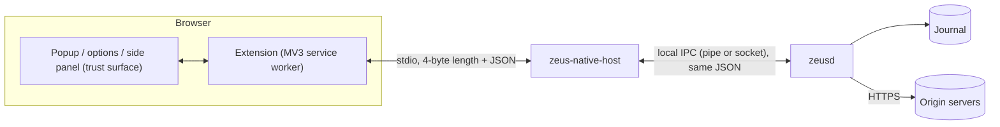
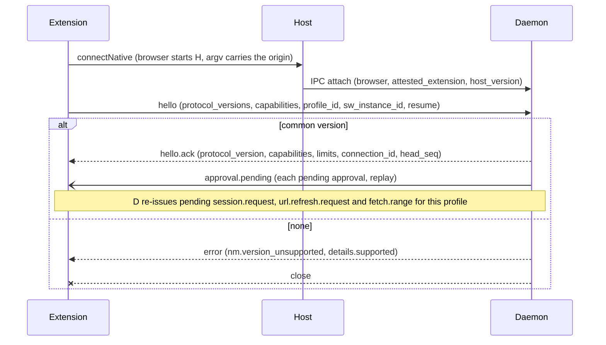
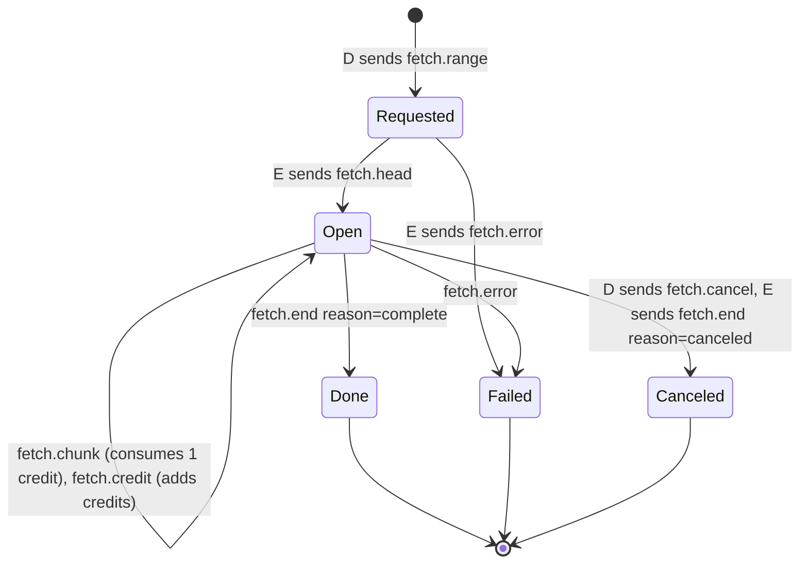
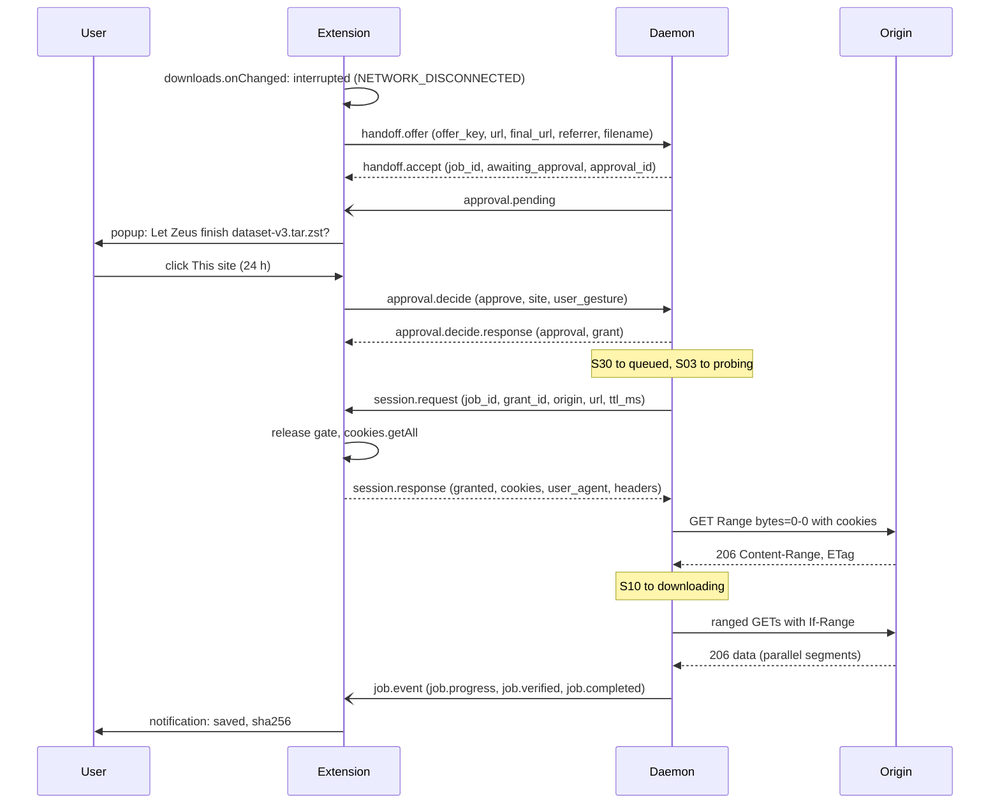
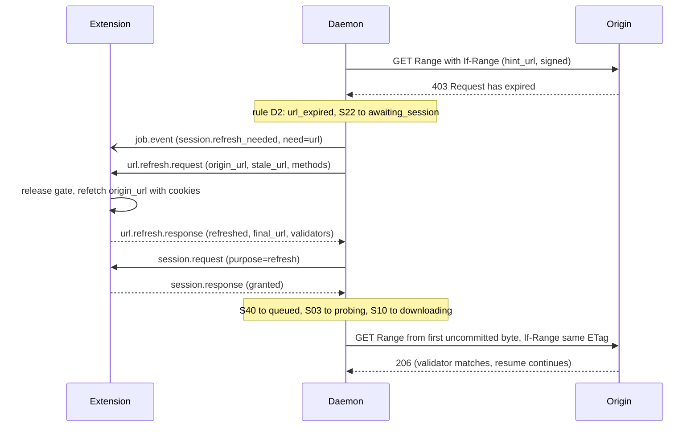
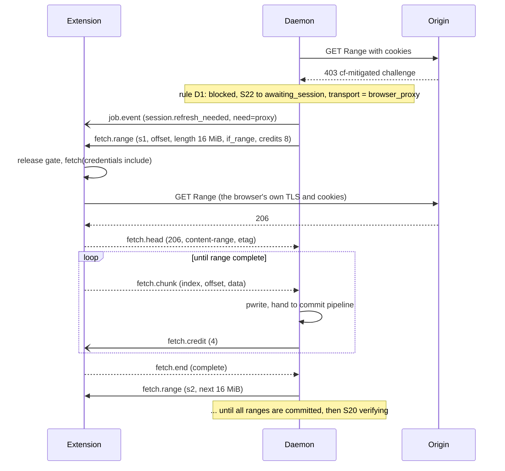
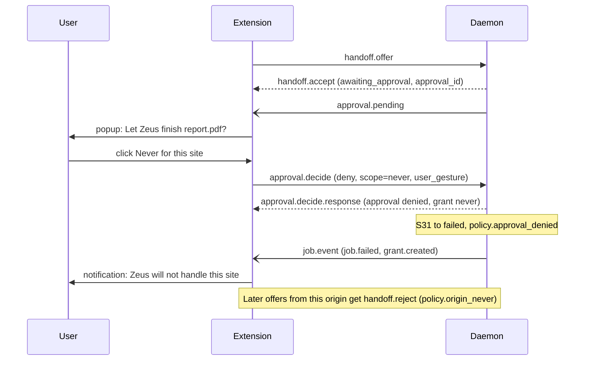
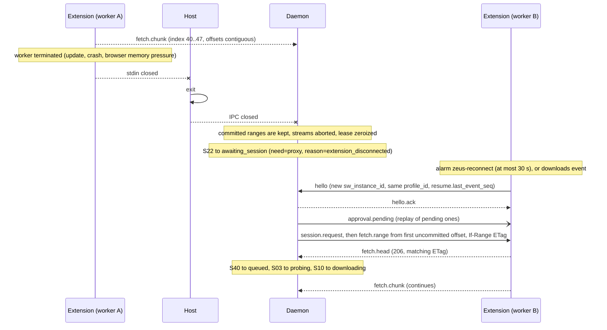

# 02. Native messaging protocol v1

| | |
|---|---|
| Status | Draft 1 |
| Depends on | [00 conventions](00-conventions.md), [01 domain model](01-domain-model.md) |
| Implemented by | `zeus-extension` (extension side), `zeus-native-host` and `zeusd` (app side) |
| Schema | [`schema/native-messaging.v1.schema.json`](schema/native-messaging.v1.schema.json) |

## 1. Purpose and scope

This protocol connects the browser extension to the Zeus daemon through a native-messaging host. It exists for four jobs:

1. **Handoff.** The extension offers a failed browser download to Zeus.
2. **Session oracle.** The daemon asks the extension for scoped session material (cookies for one origin) and for fresh URLs, and only the extension, with the human's consent, can supply them.
3. **In-browser fetch proxy.** When the server refuses the daemon (anti-bot, device-bound sessions), the daemon asks the user's browser to fetch byte ranges and stream them back.
4. **Trust surface.** The extension shows approvals, grants and job status to the human and carries the human's decisions back.

Out of scope: the daemon's local API for CLI and agents (05), the approval policy text (07), the extension's UI (in `zeus-extension`).

## 2. Terminology and architecture

| Term | Meaning |
|---|---|
| **E** | The extension's background service worker (Chrome, Edge) or event page (Firefox). |
| **H** | `zeus-native-host`, started by the browser, speaking native messaging on stdio. |
| **D** | `zeusd`, the daemon. |
| Connection | One native-messaging port from E, through one H process, to D. One browser profile has at most one live connection. |
| Request, response, notification | A message that expects a reply; the reply; a message that expects none. |
| Stream | One `fetch.range` and the messages that answer it (section 9). |
| Consent record | The extension's local note that the human allowed release of session material for an origin (section 10.2). |



H is deliberately thin. It (a) enforces framing and size limits, (b) verifies at launch which extension started it and tells D (section 3.4), (c) relays JSON payloads unchanged in both directions. D is the protocol peer: it validates every message against the schema and holds all authoritative state except what section 12 assigns to E.

## 3. Transport

### 3.1 Registration

The installer registers the host with each browser. Host name: `dev.zeus.native_host`.

| Browser | Manifest location | Pinning field |
|---|---|---|
| Chrome, Chromium, Brave | Windows: registry value `HKCU\Software\Google\Chrome\NativeMessagingHosts\dev.zeus.native_host` (default value = absolute path to the manifest file). macOS: `~/Library/Application Support/Google/Chrome/NativeMessagingHosts/dev.zeus.native_host.json`. Linux: `~/.config/google-chrome/NativeMessagingHosts/dev.zeus.native_host.json`. | `allowed_origins`: exact `chrome-extension://<id>/` entries, no wildcards (Chrome rejects wildcards). |
| Edge | Windows: `HKCU\Software\Microsoft\Edge\NativeMessagingHosts\dev.zeus.native_host`. macOS: `~/Library/Application Support/Microsoft Edge/NativeMessagingHosts/`. Linux: `~/.config/microsoft-edge/NativeMessagingHosts/`. | `allowed_origins`, as Chrome. |
| Firefox | Windows: `HKCU\Software\Mozilla\NativeMessagingHosts\dev.zeus.native_host`. macOS: `~/Library/Application Support/Mozilla/NativeMessagingHosts/`. Linux: `~/.mozilla/native-messaging-hosts/`. | `allowed_extensions`: add-on ids (the `browser_specific_settings.gecko.id` of the extension). |

Per-user registration only (HKCU, home directory). The installer MUST NOT register system-wide hosts by default.

```json validate=native-messaging.v1#/$defs/HostManifestChrome
{
  "name": "dev.zeus.native_host",
  "description": "Zeus native messaging host",
  "path": "C:\\Users\\ada\\AppData\\Local\\Programs\\Zeus\\zeus-native-host.exe",
  "type": "stdio",
  "allowed_origins": ["chrome-extension://abcdefghijklmnopabcdefghijklmnop/"]
}
```

```json validate=native-messaging.v1#/$defs/HostManifestFirefox
{
  "name": "dev.zeus.native_host",
  "description": "Zeus native messaging host",
  "path": "/home/ada/.local/share/zeus/bin/zeus-native-host",
  "type": "stdio",
  "allowed_extensions": ["zeus@zeus.invalid"]
}
```

### 3.2 Launch

The browser starts H when E calls `runtime.connectNative("dev.zeus.native_host")` and keeps it until the port is closed. `sendNativeMessage` (one process per message) MUST NOT be used: it cannot carry a session.

| Browser | Arguments given to H |
|---|---|
| Chrome, Edge | `argv[1]` = origin of the caller, for example `chrome-extension://abcdefghijklmnopabcdefghijklmnop/`. On Windows an extra `--parent-window=<decimal handle>` follows (0 when the caller is a service worker); H ignores it. |
| Firefox | `argv[1]` = full path of the host manifest; `argv[2]` = the add-on id (Firefox 55 and later). |

H MUST write nothing to stdout except frames (and MUST switch stdout and stdin to binary mode on Windows, otherwise `\n` becomes `\r\n` and corrupts the stream). Diagnostics go to H's log file (redacted, 00 section 8), never to stdout.

### 3.3 Framing and size limits

Every frame in both directions is:

```
+----------------------+---------------------------------+
| length: uint32       | payload: UTF-8 JSON object      |
| native byte order    | exactly `length` bytes          |
+----------------------+---------------------------------+
```

`length` counts payload bytes only (not the 4 prefix bytes) and MUST equal the byte count of the UTF-8 text, not the character count. Native byte order is little-endian on every platform Zeus supports (x86-64, ARM64); implementations MUST nevertheless use native-endian conversions, not a hard-coded order. Example: the 41-byte message `{"v":1,"id":"e1","type":"ping","body":{}}` is preceded by the bytes `29 00 00 00`.

Browser limits, verified against the Chrome extensions documentation and MDN on 2026-10-05:

| Direction | Chrome and Edge | Firefox | **Zeus limit** |
|---|---|---|---|
| H to E | 1 MB | 1 MB | **1,000,000 bytes** |
| E to H | 64 MiB | 4 GB | **4,194,304 bytes** (4 MiB) |

Chrome states "1 MB" for H to E without saying whether that means 10^6 or 2^20 bytes; Zeus takes the smaller number. Older Chrome documentation said 4 GB for E to H and the current page says 64 MiB; Zeus's 4 MiB is far below either, so the discrepancy does not matter.

Rules:

1. A sender MUST NOT emit a frame whose payload exceeds the limit for its direction. H enforces both directions: a D-to-E frame over 1,000,000 bytes is dropped by H and answered to D with `nm.frame_too_large`; D MUST split or page before sending (events are at most 64 KiB, lists are paged to 100 entries, `fetch.chunk` is bounded by `max_chunk_bytes`).
2. A frame with an announced `length` above the limit, or `length` 0, cannot be skipped safely (the stream would desynchronise): the receiver closes the connection (section 13.2).
3. Binary data travels as standard base64 with padding (RFC 4648 section 4) inside a JSON string. Base64 inflates data by 4/3.
4. JSON text MUST be valid UTF-8 without a byte-order mark and MUST be an object. Numbers follow 00 section 6.3.

### 3.4 H to D leg

H connects to D over the platform local IPC (Windows named pipe; Unix domain socket in the user's runtime directory), defined in spec 05. The IPC uses the same length-prefixed framing and carries the same JSON, plus an attach preamble that H sends before relaying any E frame:

| Preamble field | Meaning |
|---|---|
| `browser` | Which browser launched H, derived from the registration path or argument shape. |
| `attested_extension` | The extension id taken from `argv` (Chrome/Edge origin, Firefox add-on id) and found in H's allow-list. This is the only authoritative identity. |
| `host_version` | Version of H. |

D MUST reject an `hello` whose `extension_id` differs from `attested_extension` with `nm.extension_mismatch`. `extension_id` in `hello` is informational and self-declared.

If D is not running, H tries to start it (once, with a 5 s wait). On Windows, Firefox documents that the browser places H in a job object that is killed with H; Zeus assumes the same for Chrome and Edge. A daemon started by H must therefore be created with `CREATE_BREAKAWAY_FROM_JOB` or it dies when the port closes; if breakaway is refused H reports `nm.daemon_unavailable`. The supported setup is that the installer registers `zeusd` for per-user autostart, so H's launch is only a fallback. If D cannot be reached H sends `error` with `nm.daemon_unavailable` and exits.

### 3.5 Process lifetime

1. One H process per port. H exits when its stdin reaches end-of-file (the browser closed the port, the service worker was terminated, or the browser quit) or when D closes the IPC.
2. When H exits, E sees `port.onDisconnect`. When D closes while E is alive, H sends `bye` with `daemon_gone`, then exits.
3. D treats loss of the IPC connection as the end of the connection: pending requests to E fail with `nm.timeout` semantics, streams are aborted (section 9.6), session material from that connection is dropped.

## 4. Service-worker lifetime and keepalive

These facts come from the Chrome extension service-worker lifecycle documentation (verified 2026-10-05) and drive the design:

| Fact | Consequence |
|---|---|
| A service worker is terminated after 30 s without activity. | E MUST NOT rely on staying alive; it MUST keep a connection alive actively. |
| A single event handler or API call that runs longer than 5 minutes terminates it. | Long transfers are split into slices of at most 16 MiB (section 9.5) so no handler runs for minutes. |
| A `fetch()` whose response takes more than 30 s to arrive terminates it. | `fetch.range` carries `deadline_ms` (at most 60 s but the extension aborts at 25 s). |
| An active `runtime.connectNative()` port keeps the worker alive (Chrome 105 and later). If the host exits, the port closes and the worker ends after the usual timeout. | Opening the port at startup and keeping it open is the primary keepalive. |
| Receiving events and extension API calls reset the idle timer (Chrome 110 and later). `chrome.alarms` has a 30 s minimum period (Chrome 120 and later). | Pings and an alarm give belt and braces and a wake-up path. |
| Firefox terminates the event page after about 30 s of idleness; whether an open native port prevents this is not documented. | Same strategy, treated as best effort (open issue O3). |

**Keepalive strategy (normative for E):**

1. E opens the port at worker start (top-level code of the worker, and in every `runtime.onStartup`, `runtime.onInstalled`, `alarms.onAlarm`, `downloads.onChanged` and popup-message handler that finds no open port).
2. While connected E sends `ping` every `ping_interval_ms` (20 s from `hello.ack`, always below 30 s). D answers `pong` within `pong_timeout_ms` (5 s). Two missed pongs: E closes the port and reconnects.
3. D also sends `ping` when it has seen no frame from E for `ping_interval_ms + 5 s`; E answers `pong`. (An inbound native message counts as activity in Chrome; this makes keepalive independent of E's timer.)
4. Reconnect with exponential backoff and full jitter: 500 ms base, doubling, capped at 30 s. Reset after 60 s of stable connection.
5. E sets the persistent flag `desired_connected` (in `chrome.storage.session`) while it has pending offers, pending approvals, or D reported active browser-bound jobs; while the flag is set E keeps an alarm `zeus-reconnect` with a 30 s period that reconnects if the port is gone. With the flag clear, the alarm is removed and the port is closed after 60 s of idleness so Zeus costs nothing when unused.
6. Because the worker can be terminated at any moment, E MUST persist (in `chrome.storage.local`, non-secret only) its consent records, undelivered offers keyed by `offer_key`, `last_event_seq`, and its `profile_id`. Everything else (streams, cookies, pending requests) is memory-only and is rebuilt after a restart by D (section 15.5).
7. A connection that lasts less than 2 s, five times in a row, makes E stop reconnecting for 5 minutes and show a persistent warning (the host may be broken).

## 5. Session: handshake and negotiation



Rules:

1. `hello` is the first frame E sends and MUST arrive within 10 s of connection; otherwise H closes. Any other message before `hello.ack` is answered with `nm.not_negotiated`.
2. `hello` is sent with `v: 1` (00 section 4.1 rule 4). `protocol_versions` lists what E supports; D picks the highest common (00 section 4).
3. Capabilities:

| Capability | Declared by | Meaning |
|---|---|---|
| `handoff` | E, D | `handoff.offer`, `.accept`, `.reject`, `.withdraw`. |
| `session` | E | E can release session material (`session.request`). |
| `url_refresh.refetch` | E | E can derive a fresh URL by refetching the origin URL (section 8). |
| `url_refresh.download_api` | E | E can derive a fresh URL by starting and cancelling a browser download. |
| `fetch_proxy` | E, D | In-browser fetch proxy (`fetch.*`). |
| `incognito` | E | E can serve requests flagged `incognito` (it is allowed in private windows and can resolve the private cookie store). |
| `approvals` | D | `approval.list`, `approval.pending`, `approval.decide`. |
| `events` | D | `events.subscribe` and `job.event`. |
| `job_control` | D | `job.list`, `job.control`. |
| `grants` | D | `grant.list`, `grant.revoke`. |

A sender MUST NOT send a message whose capability is not in the negotiated intersection; the receiver answers `nm.capability_missing`.
4. `hello.ack` carries `limits` (all hard maxima for this connection) and `head_seq`, the newest durable event sequence.
5. If `hello.resume.last_event_seq` is present and E later subscribes, D replays from there (section 11).
6. Several connections may exist at once (different browsers, different profiles), at most 8. D keys them by `profile_id`. A second connection with the same `profile_id` and `sw_instance_id` closes the older one with `bye` `superseded`.
7. **Routing.** Work that belongs to a browser profile (a handoff job, session requests for it) is sent only over the connection with that `profile_id`. Agent jobs that need a session are offered to connections in order of most recent activity; a `consent_required` or `denied` answer moves on to the next. Jobs are never routed to a connection of an incognito-excluded profile.

```json validate=native-messaging.v1#/$defs/ExtensionToDaemonMessage
{
  "v": 1,
  "id": "e1",
  "type": "hello",
  "body": {
    "client": "zeus-extension",
    "extension_id": "abcdefghijklmnopabcdefghijklmnop",
    "extension_version": "0.1.0",
    "browser": { "name": "chrome", "version": "141.0.7390.65", "platform": "win" },
    "profile_id": "5e0b1f6d9a2c47e8b3d1f0a7c6e92b41",
    "protocol_versions": [1],
    "capabilities": ["handoff", "session", "url_refresh.refetch", "url_refresh.download_api", "fetch_proxy", "incognito"],
    "sw_instance_id": "9c1f4a7e52b84d06",
    "resume": { "last_event_seq": 48198 }
  }
}
```

```json validate=native-messaging.v1#/$defs/DaemonToExtensionMessage
{
  "v": 1,
  "id": "d1",
  "re": "e1",
  "type": "hello.ack",
  "body": {
    "protocol_version": 1,
    "capabilities": ["handoff", "session", "url_refresh.refetch", "url_refresh.download_api", "fetch_proxy", "incognito", "approvals", "events", "job_control", "grants"],
    "daemon": { "version": "0.1.0", "instance_id": "3f9a6c2d1b7e4a08c5d2e9f1a0b3c4d5" },
    "host": { "version": "0.1.0" },
    "connection_id": "conn_01M45NGARG09NTCP2S5QFQEN6J",
    "limits": {
      "max_frame_to_extension_bytes": 1000000,
      "max_frame_to_daemon_bytes": 4194304,
      "default_chunk_bytes": 262144,
      "max_chunk_bytes": 2097152,
      "default_credit_window": 8,
      "max_credit_window": 32,
      "max_concurrent_streams": 4,
      "max_range_bytes": 16777216,
      "ping_interval_ms": 20000,
      "pong_timeout_ms": 5000,
      "max_cookie_count": 150,
      "max_session_ttl_ms": 900000
    },
    "server_time": "2026-10-05T09:14:50.120Z",
    "head_seq": 48209
  }
}
```

## 6. Messages

### 6.1 Envelope

Every frame is one JSON object:

| Field | Type | Meaning |
|---|---|---|
| `v` | integer | Protocol version of this message. `1`. |
| `id` | string | Sender-chosen message id, 1 to 64 characters `A-Za-z0-9_-`, unique among that sender's messages on this connection (00 section 5.3). |
| `type` | string | One of the types below. |
| `re` | string | Present on a response: the `id` of the request it answers. |
| `body` | object | Type-specific payload; always present (may be `{}`). |

Correlation: a response is matched by `re` to the request's `id`. Responses of one request never reuse the request's `type`; the response type is in the catalogue. A sender reusing an `id` that is still outstanding gets `nm.duplicate_id`.

### 6.2 Catalogue

Direction: E to D, D to E. Kind: **Q** request (a response is mandatory), **R** response, **N** notification (no reply), **S** stream message. Timeout is how long the *requester* waits before giving up (then the late response, if any, is discarded).

| Type | Dir | Kind | Answered by | Timeout | Capability |
|---|---|---|---|---|---|
| `hello` | E to D | Q | `hello.ack` or `error` | 10 s | none |
| `hello.ack` | D to E | R | | | |
| `ping` | both | Q | `pong` | 5 s | none |
| `pong` | both | R | | | |
| `bye` | both | N | | | none |
| `error` | both | R or N | | | none |
| `handoff.offer` | E to D | Q | `handoff.accept` or `handoff.reject` | 10 s | `handoff` |
| `handoff.accept` | D to E | R | | | |
| `handoff.reject` | D to E | R | | | |
| `handoff.withdraw` | E to D | N | | | `handoff` |
| `session.request` | D to E | Q | `session.response` | 15 s | `session` |
| `session.response` | E to D | R | | | |
| `url.refresh.request` | D to E | Q | `url.refresh.response` | `deadline_ms` + 5 s | `url_refresh.*` |
| `url.refresh.response` | E to D | R | | | |
| `fetch.range` | D to E | Q | `fetch.head` then stream | `deadline_ms` for `fetch.head` | `fetch_proxy` |
| `fetch.head` | E to D | R | | | |
| `fetch.chunk` | E to D | S | | 30 s idle | |
| `fetch.credit` | D to E | S | | | |
| `fetch.end` | E to D | S | | | |
| `fetch.error` | E to D | S | | | |
| `fetch.cancel` | D to E | N | | | |
| `approval.list` | E to D | Q | `approval.list.response` | 10 s | `approvals` |
| `approval.list.response` | D to E | R | | | |
| `approval.pending` | D to E | N | | | `approvals` |
| `approval.decide` | E to D | Q | `approval.decide.response` | 10 s | `approvals` |
| `approval.decide.response` | D to E | R | | | |
| `events.subscribe` | E to D | Q | `events.subscribe.response` | 10 s | `events` |
| `events.subscribe.response` | D to E | R | | | |
| `events.unsubscribe` | E to D | N | | | `events` |
| `job.event` | D to E | N | | | `events` |
| `job.list` | E to D | Q | `job.list.response` | 10 s | `job_control` |
| `job.list.response` | D to E | R | | | |
| `job.control` | E to D | Q | `job.control.response` | 10 s | `job_control` |
| `job.control.response` | D to E | R | | | |
| `grant.list` | E to D | Q | `grant.list.response` | 10 s | `grants` |
| `grant.list.response` | D to E | R | | | |
| `grant.revoke` | E to D | Q | `grant.revoke.response` | 10 s | `grants` |
| `grant.revoke.response` | D to E | R | | | |

An error answer to any request is an `error` frame with `re` set, or the typed `*.reject` / `status` forms defined below where the schema gives one. A request that is not answered within its timeout is treated by the requester as `nm.timeout` (class `timeout`, retryable).

### 6.3 Ordering and delivery

1. The connection is one ordered byte stream; frames are delivered in order, exactly once, or the connection fails. There is no retransmission layer.
2. Requests are processed in arrival order but responses MAY be returned out of order; correlation is by `re`.
3. After a reconnect nothing is replayed automatically except what the protocol says (D re-issues pending work, section 5; E re-subscribes with `since_seq`, section 11). Retried offers carry the same `offer_key` and are deduplicated.
4. Notifications are best effort across a disconnect; the state they describe is recoverable by the corresponding list request (`approval.list`, `job.list`) or event replay.

### 6.4 Unknown and invalid messages

| Situation | Behaviour |
|---|---|
| Unknown `type`, a request (it has an `id` and its type is not a known notification) | `error` `nm.unknown_type` with `re`. |
| Unknown `type`, apparently a notification | Ignore and log at debug. |
| Valid JSON, fails the schema | `error` `nm.schema_violation` with `re` when `id` is readable; `details.errors` lists up to 5 `{path, message}`. The connection stays open. |
| Valid JSON, not an object, or no string `type` | `error` `nm.schema_violation` without `re`. |
| Not valid UTF-8 or not JSON | `error` `nm.invalid_json`. Three in a row close the connection. |
| Wrong `v` after negotiation | `error` `nm.version_unsupported`; the connection closes. |

## 7. Handoff

### 7.1 `handoff.offer` (E to D)

Sent when a browser download is interrupted with a reason that 01 section 8.4 marks eligible, or when the user forwards a download.

| Field | Meaning |
|---|---|
| `offer_key` | `<browser>:<download id>:<start time>`, for example `chrome:317:2026-10-05T09:15:12.004Z`. D deduplicates by it (a retry returns the same job with `deduplicated: true`). |
| `trigger` | `interrupted` or `user_initiated`. |
| `download.browser_download_id` | The browser's id. |
| `download.url` | `DownloadItem.url`: the original URL before redirects (becomes `spec.url`). |
| `download.final_url` | `DownloadItem.finalUrl` (Chrome 54 and later) after redirects, often signed (becomes `spec.hint_url`). |
| `download.referrer` | `DownloadItem.referrer`, or null. |
| `download.filename` | **Basename only** of `DownloadItem.filename`. Absolute paths MUST NOT leave the browser. |
| `download.mime` | `DownloadItem.mime` or null. |
| `download.bytes_received`, `download.total_bytes` | `bytesReceived`; `totalBytes`, with -1 converted to null. Informational: Zeus never trusts bytes the browser wrote. |
| `download.start_time` | `DownloadItem.startTime`, normalised to 00 section 6.1. |
| `download.incognito` | `DownloadItem.incognito`. |
| `download.can_resume` | `DownloadItem.canResume`. |
| `download.interrupt_reason` | `DownloadItem.error` (an `InterruptReason`) or null when `user_initiated`. |
| `validators` | Optional. `chrome.downloads.DownloadItem` has no ETag or Last-Modified (verified), so E normally sends null. E MAY fill it from a `HEAD`/ranged `fetch` it performed with the user's consent; D treats it as a hint and re-probes. |

```json validate=native-messaging.v1#/$defs/ExtensionToDaemonMessage
{
  "v": 1,
  "id": "e2",
  "type": "handoff.offer",
  "body": {
    "offer_key": "chrome:317:2026-10-05T09:15:12.004Z",
    "trigger": "interrupted",
    "download": {
      "browser_download_id": 317,
      "url": "https://portal.example.org/download/8841",
      "final_url": "https://cdn.example.org/blobs/dataset-v3.tar.zst?X-Amz-Expires=300&X-Amz-Signature=EXAMPLE",
      "referrer": "https://portal.example.org/datasets/v3",
      "filename": "dataset-v3.tar.zst",
      "mime": "application/zstd",
      "bytes_received": 402653184,
      "total_bytes": 1288490188,
      "start_time": "2026-10-05T09:15:12.004Z",
      "incognito": false,
      "can_resume": false,
      "interrupt_reason": "NETWORK_DISCONNECTED"
    },
    "validators": null
  }
}
```

### 7.2 D's handling

1. Validate: `url` and `final_url` are http(s); `filename` has no path separators; the interrupt reason is eligible (01 section 8.4). Failure: `handoff.reject` with `handoff.not_eligible` (class `policy_denied`) for `FILE_VIRUS_INFECTED`, `FILE_BLOCKED`, `FILE_SECURITY_CHECK_FAILED`, `USER_CANCELED`, `SERVER_CERT_PROBLEM`; `invalid_request` for malformed values.
2. Rate limit: `handoff.offer` at most 30 per minute per connection and 5 per minute per origin; excess gets `handoff.reject` with `handoff.rate_limited` (class `unavailable`, `retry_after_ms`).
3. Never-list: an effective `never` grant gets `handoff.reject` with `policy.origin_never`.
4. Deduplicate by `offer_key`.
5. Create the job: S01 if an effective grant exists, S02 (approval of kind `handoff`) otherwise (01 section 5). D fills `source.browser` from the connection (`name`, `extension_id`, `profile_id`) and from the offer (`download_id`, `offer_key`, `incognito`).
6. Reply `handoff.accept` (`job_id`, current `state`, `approval_id` when one was raised, `deduplicated`). If an approval was raised D also sends `approval.pending` (section 10).

```json validate=native-messaging.v1#/$defs/DaemonToExtensionMessage
{
  "v": 1,
  "id": "d2",
  "re": "e2",
  "type": "handoff.accept",
  "body": {
    "job_id": "job_01M45NHJ2AHWMXT8JVJ7BEEJX7",
    "state": "awaiting_approval",
    "approval_id": "ap_01M45NHJ3XS0QXG9T42HHN2YR8",
    "deduplicated": false
  }
}
```

```json validate=native-messaging.v1#/$defs/DaemonToExtensionMessage
{
  "v": 1,
  "id": "d3",
  "re": "e13",
  "type": "handoff.reject",
  "body": {
    "error": {
      "code": "handoff.not_eligible",
      "class": "policy_denied",
      "message": "The browser blocked this file as unsafe (FILE_BLOCKED); Zeus does not override security decisions.",
      "retryable": false,
      "details": { "interrupt_reason": "FILE_BLOCKED" }
    }
  }
}
```

### 7.3 `handoff.withdraw` (E to D, notification)

E sends it when the browser download is completed, resumed successfully or erased by the user while a job for it exists, or when the user cancels the offer in the popup. D cancels the job through the transition for its current state (01 section 11.1) with cause `user_request`.

```json validate=native-messaging.v1#/$defs/ExtensionToDaemonMessage
{
  "v": 1,
  "id": "e14",
  "type": "handoff.withdraw",
  "body": {
    "job_id": "job_01M45NHJ2AHWMXT8JVJ7BEEJX7",
    "offer_key": "chrome:317:2026-10-05T09:15:12.004Z",
    "reason": "completed_in_browser"
  }
}
```

## 8. Session oracle

### 8.1 `session.request` and `session.response`

D asks for session material only when it holds an effective grant for the job (01 section 5.2) and it has just made a durable audit record of the intended release (04). E answers only after its own consent check (section 10.2).

```json validate=native-messaging.v1#/$defs/DaemonToExtensionMessage
{
  "v": 1,
  "id": "d6",
  "type": "session.request",
  "body": {
    "job_id": "job_01M45NHJ2AHWMXT8JVJ7BEEJX7",
    "session_id": "sess_01M45NHQTC78XWWC8N35Y2BPEA",
    "grant_id": "gr_01M45NHPJP04TX6B1CJVQVQAK9",
    "origin": "https://portal.example.org",
    "url": "https://portal.example.org/download/8841",
    "purpose": "download",
    "request_headers": ["accept-language", "sec-ch-ua", "sec-ch-ua-mobile", "sec-ch-ua-platform"],
    "ttl_ms": 900000,
    "incognito": false
  }
}
```

| Request field | Rule |
|---|---|
| `origin` | MUST equal the origin of `url` (01 section 4). E rejects a mismatch with `session.origin_mismatch`. |
| `url` | The URL D will request. E uses it for `cookies.getAll({url})` so that cookie `path`, `secure` and `domain` rules match what the browser would send. |
| `session_id` | Minted by D (00 section 5.1). Echoed in the response; safe to log. |
| `request_headers` | Names from the allow-list `accept-language`, `sec-ch-ua`, `sec-ch-ua-mobile`, `sec-ch-ua-platform`. The `User-Agent` is always included. No other header is ever released. |
| `ttl_ms` | Requested lifetime, at most 900,000 (15 min). E may shorten it to the remaining consent time. |
| `incognito` | True for a job that came from a private window. E MUST use the private cookie store, or answer `unavailable` with `session.store_unavailable` if it cannot identify it. |

Response (`granted`): the material, scoped to one origin.

| Field | Meaning |
|---|---|
| `session.session_id`, `origin`, `issued_at`, `ttl_ms` | Echo and time to live. D drops the material at `issued_at + ttl_ms` (monotonic) or when the job leaves the engine, whichever is first. |
| `session.cookies` | At most 150 and 128 KiB serialised. Fields: `name`, `value` (secret), `domain`, `path`, `secure`, `http_only`, `same_site`, `host_only`, `expires_at` (null for session cookies), optional `partition_key` (CHIPS). |
| `session.user_agent` | `navigator.userAgent` of the browser. |
| `session.headers` | The allow-listed headers E could produce (`sec-ch-ua*` from `navigator.userAgentData`). |
| `session.cookie_store_id` | Optional, which cookie store was used. |

```json validate=native-messaging.v1#/$defs/ExtensionToDaemonMessage
{
  "v": 1,
  "id": "e4",
  "re": "d6",
  "type": "session.response",
  "body": {
    "status": "granted",
    "session": {
      "session_id": "sess_01M45NHQTC78XWWC8N35Y2BPEA",
      "origin": "https://portal.example.org",
      "issued_at": "2026-10-05T09:15:36.130Z",
      "ttl_ms": 900000,
      "cookies": [
        {
          "name": "portal_session",
          "value": "example-session-value-not-real",
          "domain": "portal.example.org",
          "path": "/",
          "secure": true,
          "http_only": true,
          "same_site": "lax",
          "host_only": true,
          "expires_at": null
        },
        {
          "name": "csrf",
          "value": "example-csrf-value-not-real",
          "domain": ".example.org",
          "path": "/download",
          "secure": true,
          "http_only": false,
          "same_site": "strict",
          "host_only": false,
          "expires_at": "2026-10-06T09:00:00.000Z"
        }
      ],
      "user_agent": "Mozilla/5.0 (Windows NT 10.0; Win64; x64) AppleWebKit/537.36 (KHTML, like Gecko) Chrome/141.0.0.0 Safari/537.36",
      "headers": {
        "accept-language": "en-US,en;q=0.9",
        "sec-ch-ua": "\"Chromium\";v=\"141\", \"Not?A_Brand\";v=\"8\"",
        "sec-ch-ua-mobile": "?0",
        "sec-ch-ua-platform": "\"Windows\""
      }
    }
  }
}
```

Non-granted outcomes (`status`):

| `status` | `error.code` | When | Job effect |
|---|---|---|---|
| `consent_required` | `session.consent_required` | E has no unexpired consent record for this grant and origin. E MAY raise a notification asking the user to open the popup. | S41 (back to approval) |
| `denied` | `policy.origin_never`, `session.consent_denied` | The user denied, or the origin is on a local never-list. | S41 or S42 |
| `unavailable` | `session.store_unavailable`, `session.extension_busy` | Incognito store unknown; too many concurrent releases. | Retry or the next connection. |

```json validate=native-messaging.v1#/$defs/ExtensionToDaemonMessage
{
  "v": 1,
  "id": "e5",
  "re": "d6",
  "type": "session.response",
  "body": {
    "status": "consent_required",
    "error": {
      "code": "session.consent_required",
      "class": "auth_expired",
      "message": "No consent record covers gr_01M45NHPJP04TX6B1CJVQVQAK9 for https://portal.example.org.",
      "retryable": true
    }
  }
}
```

### 8.2 `url.refresh.request` and `url.refresh.response`

Signed URLs expire. D re-resolves them itself from `spec.url` when it can. It asks E when it cannot (a login-gated redirect, a page-derived URL, a block) and the job has an effective grant.

```json validate=native-messaging.v1#/$defs/DaemonToExtensionMessage
{
  "v": 1,
  "id": "d7",
  "type": "url.refresh.request",
  "body": {
    "job_id": "job_01M45SSZ20WN6VYFYEM4GP8SZD",
    "origin": "https://portal.example.org",
    "origin_url": "https://portal.example.org/files/annual-report.pdf",
    "stale_url": "https://cdn.example.org/blobs/annual-report.pdf?X-Amz-Expires=300&X-Amz-Signature=EXAMPLE",
    "reason": "url_expired",
    "methods": ["refetch", "download_api"],
    "expected": { "total_bytes": 734003200, "etag": "\"a81c-77e2\"", "filename": "annual-report.pdf" },
    "deadline_ms": 25000
  }
}
```

Methods E may use, in the order D lists them:

| Method | How | Requirements |
|---|---|---|
| `refetch` | `fetch(origin_url, {credentials: "include", redirect: "follow", cache: "no-store", headers: {Range: "bytes=0-0"}, signal})`; read `response.url` (the final URL) and the validators; abort the body. | Host permission for `origin` (granted at consent time, section 10.2). |
| `download_api` | `chrome.downloads.download({url: origin_url, saveAs: false})`, wait for the item's `finalUrl`, then `cancel`, `erase` and remove the partial file. | `downloads` permission. Used when `refetch` yields an HTML page or an error the browser would have handled differently. |

Rules: E applies the same consent gate as for `session.request` (the refresh uses the user's cookies). If the final origin differs from `origin` the cross-origin redirect rule of section 9.3 applies. If the response is a login page (HTML where a file is expected, or a redirect to a different path whose `Content-Type` is HTML) E answers `cannot_refresh` with `url.login_required` so the human can sign in; the browser session itself has expired.

```json validate=native-messaging.v1#/$defs/ExtensionToDaemonMessage
{
  "v": 1,
  "id": "e6",
  "re": "d7",
  "type": "url.refresh.response",
  "body": {
    "status": "refreshed",
    "url": "https://portal.example.org/files/annual-report.pdf",
    "final_url": "https://cdn.example.org/blobs/annual-report.pdf?X-Amz-Expires=300&X-Amz-Signature=FRESH-EXAMPLE",
    "method": "refetch",
    "validators": { "etag": "\"a81c-77e2\"", "last_modified": null },
    "total_bytes": 734003200
  }
}
```

`status` values: `refreshed` (new `final_url`), `unchanged` (the browser obtained the same URL, so expiry was not the cause; D re-classifies), `cannot_refresh` (an `error`: `url.refresh_failed`, `url.login_required`, `url.refresh_unsupported`, `session.consent_required`, `fetch.cross_origin_denied`).

## 9. In-browser fetch proxy

The proxy lets the user's real browser fetch bytes the daemon's own client cannot get, inheriting the user's cookies, TLS fingerprint and device-bound session credentials. It is slower than a direct download (everything is base64 over a pipe) and exists only as the recovery for class `blocked` (01 section 8.6). It never alters headers to disguise anything: the browser makes an ordinary credentialed request, exactly as if the user had clicked the link.

### 9.1 Messages and states



A stream is identified by `stream_id` (1 to 32 characters `A-Za-z0-9_-`, chosen by D, unique per connection while open). At most `max_concurrent_streams` (default 4, at most 8) are open at once, else `nm.too_many_streams`.

### 9.2 `fetch.range` (D to E)

```json validate=native-messaging.v1#/$defs/DaemonToExtensionMessage
{
  "v": 1,
  "id": "d8",
  "type": "fetch.range",
  "body": {
    "stream_id": "s1",
    "job_id": "job_01M45VGWW0NNYSESRJPP2BBRQN",
    "url": "https://portal.example.org/download/9120",
    "origin": "https://portal.example.org",
    "range": { "offset": 402653184, "length": 16777216 },
    "if_range": "\"5f3a9c-4c1d2e7b\"",
    "request_headers": { "accept": "*/*" },
    "chunk_bytes": 262144,
    "credits": 8,
    "deadline_ms": 25000
  }
}
```

| Field | Rule |
|---|---|
| `range` | `{offset, length}` (half-open, 00 section 6.3) or null for the whole resource. `length` at most `max_range_bytes` (16 MiB); D slices bigger ranges (section 9.5). E turns it into `Range: bytes=<offset>-<offset+length-1>`. |
| `if_range` | A strong validator (a strong ETag, or an HTTP-date from a strong `Last-Modified`) sent as `If-Range`. Absent for weak or missing validators. |
| `request_headers` | Only `accept` and `accept-language`. E ignores anything else and answers `nm.schema_violation` if present. The browser controls `Cookie`, `User-Agent`, `Accept-Encoding`, `Sec-*` and `Referer`. |
| `chunk_bytes` | Raw bytes per `fetch.chunk` (1,024 to `max_chunk_bytes`); default 262,144. |
| `credits` | Initial credit grant (1 to `max_credit_window`). |
| `deadline_ms` | Time allowed until the response headers arrive; E aborts at `min(deadline_ms, 25000)`. |

E performs `fetch(url, {credentials: "include", redirect: "follow", cache: "no-store", signal, headers})` and applies these rules:

1. **Origin check.** `origin(url)` MUST equal `origin`; else `nm.schema_violation`/`session.origin_mismatch`. E also runs the consent gate of section 10.2 (this fetch uses the user's cookies).
2. **Content encoding.** `Accept-Encoding` is a forbidden request header for scripts and the browser decodes bodies automatically, which would break byte ranges. If the response carries `Content-Encoding` other than identity, E aborts with `fetch.error` `fetch.content_encoded` (class `permanent`).
3. **Referrer.** The `Referer` of an extension-initiated fetch cannot be set arbitrarily by a script. D therefore treats `referrer` as unavailable in this transport; sites that require a referrer need the optional capability `fetch_proxy.referer_dnr` (reserved, open issue O2).
4. **Range support.** E does not interpret the status. It reports it in `fetch.head` and D applies 01 section 8.3 and the resume rules (03 section 7), including `200` instead of `206` and validator mismatches.

### 9.3 Cross-origin redirects

`redirect: "follow"` lets the browser attach *its own* cookies for the redirect target. To keep the grant scoped to one origin, after `fetch` resolves E compares `new URL(response.url).origin` with `origin`:

| Final origin | Cookies exist for the final URL (`cookies.getAll({url: response.url})`) | Action |
|---|---|---|
| same as `origin` | n/a | Continue. |
| different | none | Continue (public CDN, signed storage). `fetch.head.redirected` is true and `final_url` is reported. |
| different | some, and E holds a consent record for that final origin | Continue. |
| different | some, and no consent record | Abort the body, send `fetch.error` `fetch.cross_origin_denied` (class `policy_denied`). Response bytes never reach D; only the server had already seen the browser's cookies for that origin. |

### 9.4 `fetch.head`, `fetch.chunk`, `fetch.credit`, `fetch.end`, `fetch.error`, `fetch.cancel`

```json validate=native-messaging.v1#/$defs/ExtensionToDaemonMessage
{
  "v": 1,
  "id": "e7",
  "re": "d8",
  "type": "fetch.head",
  "body": {
    "stream_id": "s1",
    "status": 206,
    "final_url": "https://cdn.example.org/blobs/dataset-v3.tar.zst?X-Amz-Expires=300&X-Amz-Signature=EXAMPLE",
    "redirected": true,
    "headers": {
      "content-range": "bytes 402653184-419430399/1288490188",
      "content-length": "16777216",
      "etag": "\"5f3a9c-4c1d2e7b\"",
      "accept-ranges": "bytes",
      "content-type": "application/zstd"
    }
  }
}
```

`headers` carries only these response header names (lowercase): `accept-ranges cache-control cf-mitigated content-digest content-disposition content-encoding content-length content-range content-type date etag last-modified repr-digest retry-after server www-authenticate`. `Set-Cookie` is never visible to scripts and is never forwarded. D classifies the status with 01 section 8.3 stage D exactly as for a direct response; E never classifies.

A non-2xx status is reported through `fetch.head` as well; D then ends the stream with `fetch.cancel` (reason `superseded`) and E aborts the body.

```json validate=native-messaging.v1#/$defs/ExtensionToDaemonMessage
{
  "v": 1,
  "id": "e8",
  "type": "fetch.chunk",
  "body": {
    "stream_id": "s1",
    "index": 0,
    "offset": 402653184,
    "length": 12,
    "data": "aGVsbG8td29ybGQh"
  }
}
```

(The example carries 12 bytes for brevity. Real chunks carry `chunk_bytes` bytes except the last.)

| `fetch.chunk` field | Rule |
|---|---|
| `index` | 0, 1, 2, ... consecutive per stream. |
| `offset` | Absolute offset in the resource of the first byte: the stream's `range.offset` plus bytes already sent. D checks `offset` equals what it expects; any gap or overlap is `nm.stream_protocol_violation` and D cancels the stream. |
| `length` | Raw (decoded) bytes; MUST equal the length of the decoded `data`. |
| `data` | Base64, standard alphabet, padding required. |

```json validate=native-messaging.v1#/$defs/DaemonToExtensionMessage
{ "v": 1, "id": "d9", "type": "fetch.credit", "body": { "stream_id": "s1", "credits": 4 } }
```

```json validate=native-messaging.v1#/$defs/ExtensionToDaemonMessage
{ "v": 1, "id": "e9", "type": "fetch.end", "body": { "stream_id": "s1", "reason": "complete", "chunks": 64, "bytes": 16777216 } }
```

```json validate=native-messaging.v1#/$defs/ExtensionToDaemonMessage
{
  "v": 1,
  "id": "e10",
  "type": "fetch.error",
  "body": {
    "stream_id": "s1",
    "error": {
      "code": "fetch.network_error",
      "class": "transient_network",
      "message": "fetch() rejected: Failed to fetch",
      "retryable": true
    },
    "bytes": 5242880
  }
}
```

```json validate=native-messaging.v1#/$defs/DaemonToExtensionMessage
{ "v": 1, "id": "d10", "type": "fetch.cancel", "body": { "stream_id": "s1", "reason": "job_canceled" } }
```

`fetch.error` codes: `fetch.network_error` (a `fetch()` rejection: the browser does not say why, so it cannot tell DNS from reset from block), `fetch.timeout` (no headers within the deadline), `fetch.body_error` (the body reader failed mid-stream), `fetch.aborted` (aborted for a reason other than a D request), `fetch.content_encoded`, `fetch.cross_origin_denied`, `fetch.extension_busy`, `session.consent_required`, `session.origin_mismatch`. Classes (section 14): `fetch.network_error`, `fetch.timeout`, `fetch.body_error` and `fetch.aborted` are `transient_network`; `fetch.content_encoded` is `permanent`; `fetch.cross_origin_denied` is `policy_denied`; `fetch.extension_busy` is `unavailable`.

### 9.5 Flow control (credits)

The goal is to keep D's memory and E's memory bounded and to let D's disk speed throttle the browser, under the frame limits of section 3.3.

1. **Unit.** One credit permits one `fetch.chunk`. A credit is worth `chunk_bytes` bytes of payload.
2. **Initial window.** `fetch.range.credits` credits (default 8, so 2 MiB in flight at 256 KiB chunks).
3. **Sending.** E decrements its counter per chunk sent and MUST NOT send a chunk with zero credits (`nm.credit_exceeded` on violation). With zero credits E stops reading the response body (`reader.read()` is not called), which applies TCP backpressure to the origin.
4. **Replenishing.** D sends `fetch.credit` after a chunk has been written to the data file with `pwrite` and handed to the commit pipeline (03). D replenishes in batches of `credits / 2` to avoid a message per chunk. D's per-job bound on written-but-uncommitted bytes (03 `max_unacked_bytes`) provides the second layer of backpressure: when it is reached D simply withholds credits.
5. **Frame size.** Payload bytes per frame are at most `max_chunk_bytes` (2 MiB). Encoded as base64 plus an envelope of about 250 bytes this is at most 2,796,204 + 250 bytes, under the 4 MiB E-to-D limit. The H-to-E direction carries only credits, headers and small control messages, far below 1,000,000 bytes. If a future capability needs bulk data towards E, it MUST chunk to at most 700,000 raw bytes (933,336 base64 characters).
6. **In-flight bound.** `credits x chunk_bytes` at most 16 MiB per stream; `credits` at most 32; at most 8 streams.
7. **Slices.** D requests at most `max_range_bytes` (16 MiB) per stream and issues the next `fetch.range` when one ends. Slicing bounds the loss when the worker is killed (section 15.5), keeps every handler short (section 4) and lets D change plans (for example hedge or reorder).
8. **Idle timeout.** If D holds credits for a stream and receives no chunk or end for 30 s it cancels the stream (`nm.timeout`).
9. **Throughput expectation.** Hundreds of KB per message, several streams in parallel, tens of MB/s at best, because of JSON and base64 on both sides. Spec 05 may later add an optional localhost HTTP side channel that avoids base64 (open issue O1).

### 9.6 Stream lifecycle rules

1. After `fetch.end` or `fetch.error` the stream id is free for reuse.
2. `fetch.cancel` is a notification; E MUST abort the `fetch` (AbortController), stop sending, and answer `fetch.end` with `reason: "canceled"` (chunks already in flight may still arrive; D discards chunks for closed streams silently).
3. If the connection closes, all streams close. D keeps every byte it had already committed; E discards its state.
4. D MUST NOT trust a stream's byte count: it commits exactly the chunks it received, at the offsets they carried, and re-validates against validators on every `fetch.head`.

## 10. Approvals, grants and the trust surface

### 10.1 Messages

| Type | Purpose |
|---|---|
| `approval.pending` (D to E, notification) | D pushes a full approval when it is created, and re-pushes every still-pending approval after each `hello.ack`. The popup shows it. |
| `approval.list` (E to D) | Pull pending (default) or decided approvals, paged. |
| `approval.decide` (E to D) | The human's decision. Response carries the updated approval and, when a grant was created, the grant. |
| `grant.list`, `grant.revoke` (E to D) | Show and revoke grants. |
| `job.event` | Carries `approval.decided`, `grant.created`, `grant.revoked`, `grant.expired` so every surface stays in sync, including decisions made in the TUI or CLI. |

```json validate=native-messaging.v1#/$defs/DaemonToExtensionMessage
{
  "v": 1,
  "id": "d4",
  "type": "approval.pending",
  "body": {
    "approval": {
      "id": "ap_01M45NHJ3XS0QXG9T42HHN2YR8",
      "kind": "handoff",
      "state": "pending",
      "job_id": "job_01M45NHJ2AHWMXT8JVJ7BEEJX7",
      "origin": "https://portal.example.org",
      "allowed_scopes": ["once", "site", "never"],
      "reason_codes": ["handoff.interrupted", "session.first_use"],
      "summary": {
        "title": "dataset-v3.tar.zst",
        "url_redacted": "https://portal.example.org/download/8841",
        "total_bytes": 1288490188,
        "source_kind": "browser_handoff"
      },
      "created_at": "2026-10-05T09:15:30.301Z",
      "expires_at": "2026-10-06T09:15:30.301Z",
      "decided_at": null
    }
  }
}
```

```json validate=native-messaging.v1#/$defs/ExtensionToDaemonMessage
{
  "v": 1,
  "id": "e3",
  "type": "approval.decide",
  "body": {
    "approval_id": "ap_01M45NHJ3XS0QXG9T42HHN2YR8",
    "decision": "approve",
    "scope": "site",
    "ui": { "surface": "extension_popup", "user_gesture": true }
  }
}
```

```json validate=native-messaging.v1#/$defs/DaemonToExtensionMessage
{
  "v": 1,
  "id": "d5",
  "re": "e3",
  "type": "approval.decide.response",
  "body": {
    "approval": {
      "id": "ap_01M45NHJ3XS0QXG9T42HHN2YR8",
      "kind": "handoff",
      "state": "approved",
      "job_id": "job_01M45NHJ2AHWMXT8JVJ7BEEJX7",
      "origin": "https://portal.example.org",
      "allowed_scopes": ["once", "site", "never"],
      "reason_codes": ["handoff.interrupted", "session.first_use"],
      "summary": { "title": "dataset-v3.tar.zst", "url_redacted": "https://portal.example.org/download/8841", "total_bytes": 1288490188, "source_kind": "browser_handoff" },
      "created_at": "2026-10-05T09:15:30.301Z",
      "expires_at": "2026-10-06T09:15:30.301Z",
      "decided_at": "2026-10-05T09:15:34.870Z",
      "decision": { "outcome": "approve", "scope": "site", "actor": { "kind": "human", "surface": "extension_popup" }, "grant_id": "gr_01M45NHPJP04TX6B1CJVQVQAK9" }
    },
    "grant": {
      "id": "gr_01M45NHPJP04TX6B1CJVQVQAK9",
      "origin": "https://portal.example.org",
      "scope": "site",
      "state": "active",
      "created_at": "2026-10-05T09:15:34.870Z",
      "expires_at": "2026-10-06T09:15:34.870Z",
      "approval_id": "ap_01M45NHJ3XS0QXG9T42HHN2YR8",
      "decided_by": { "kind": "human", "surface": "extension_popup" },
      "uses": 0,
      "last_used_at": null,
      "revoked_at": null,
      "renewable": false,
      "renewal_count": 0
    }
  }
}
```

D validates `approval.decide`:

1. The approval exists and is `pending` (`nm.not_found`, `nm.conflict` when already decided; the response then carries the current approval in `error.details`).
2. `scope` is in `allowed_scopes` when the decision is `approve`, and for `deny` may be `never` or omitted.
3. `ui.surface` is one of the four extension surfaces and `ui.user_gesture` is true (the schema allows only `true`; D additionally requires that the sender's capability set included `approvals`). A missing or false value is `nm.user_gesture_required` (class `unauthenticated`).
4. Rate: 10 decisions per minute.
5. The decision is applied in one journal transaction with its events (01 section 6 rule 2) and audited as `approval.decided` with actor `human`, surface as sent.

### 10.2 Consent record and release gate (E)

E is the last gate before cookies leave the browser; the daemon's grant alone is not enough. E keeps **consent records** in `chrome.storage.local`:

| Field | Meaning |
|---|---|
| `grant_id` | The daemon's grant id. |
| `origin` | One origin. |
| `scope` | `once`, `site`, `workflow` (never `never`). |
| `job_id` / `run_id` | For `once` and `workflow`. |
| `expires_at_ms` | Epoch milliseconds. |
| `source` | `ui` (created by the human's click in an extension page) or `event` (created from a daemon event, below). |

Consent records contain no cookies and no URLs with secrets.

A record is created (a) when the user clicks Approve in an extension page: the `approval.decide.response` carries the grant; or (b) when a `grant.created` event arrives for an `approval_id` that E displayed earlier through `approval.pending` and whose `decided_by.kind` is `human` (a decision taken in the TUI or CLI). E ignores `grant.created` events for approvals it never showed. A record is removed on `grant.revoked`, `grant.expired`, when its `expires_at_ms` passes, and when a `once` job reaches a terminal state.

**Release gate**, evaluated for every `session.request`, `url.refresh.request` and `fetch.range`:

1. `origin` equals `origin(url)` and the scheme rule of 01 section 4 rule 3 holds.
2. A record exists with the request's `grant_id` (and for `once` the request's `job_id`; for `workflow` the job's run), the same origin, scope not `never`, and `expires_at_ms` in the future.
3. The browser holds host permission for the origin (`permissions.contains`). E SHOULD declare `https://*/*` and `http://localhost/*` as `optional_host_permissions` only and call `permissions.request({origins: [origin + "/*"]})` from the click handler that approves the grant. This gives browser-enforced scoping on top of the consent record.
4. The effective `ttl_ms` is `min(requested, 900000, remaining consent time)`.
5. If any step fails, E answers `consent_required` (or `denied` when the user denied) and sends nothing else.

The popup is the only place that can create a consent record from a click. E MUST ignore any approval-related message that originates from a content script, a web page, or `externally_connectable` (the manifest MUST NOT declare `externally_connectable` and Zeus ships no content script that can talk to the approval path); it checks `sender.id === chrome.runtime.id` and that `sender.url` starts with the extension's own origin before acting on a popup message. A notification button click counts as a user gesture on the notification surface.

## 11. Events and job control

### 11.1 `events.subscribe`

```json validate=native-messaging.v1#/$defs/ExtensionToDaemonMessage
{
  "v": 1,
  "id": "e11",
  "type": "events.subscribe",
  "body": { "since_seq": 48198, "include_progress": true, "progress_interval_ms": 1000, "scope": "all" }
}
```

| Field | Rule |
|---|---|
| `since_seq` | Replay durable events with a larger `seq` (01 section 9.2). Absent: live only. |
| `types` | Optional filter by event name. Absent: all events permitted to the extension (`job.*`, `approval.*`, `grant.*`, `session.refresh_needed`, `daemon.*`; never `session.leased`). |
| `include_progress` | Deliver the ephemeral `job.progress` events. |
| `progress_interval_ms` | At least 1000. |
| `scope` | `all`: every job (the popup shows agent downloads too). `own`: only jobs whose `source.browser.profile_id` equals this connection's. |

One subscription per connection; a second `events.subscribe` replaces the first. Response:

```json validate=native-messaging.v1#/$defs/DaemonToExtensionMessage
{
  "v": 1,
  "id": "d11",
  "re": "e11",
  "type": "events.subscribe.response",
  "body": { "subscription_id": "sub1", "head_seq": 48209, "replay_count": 11, "replay_truncated": false }
}
```

Replay is delivered as ordinary `job.event` frames before live events, in `seq` order, at most 500 per second. `replay_truncated: true` means older events were pruned; E should call `job.list`.

```json validate=native-messaging.v1#/$defs/DaemonToExtensionMessage
{
  "v": 1,
  "id": "d12",
  "type": "job.event",
  "body": {
    "subscription_id": "sub1",
    "event": {
      "seq": 48222,
      "ts": "2026-10-05T09:17:12.020Z",
      "type": "job.completed",
      "job_id": "job_01M45NHJ2AHWMXT8JVJ7BEEJX7",
      "data": {
        "path": "/home/ada/Downloads/Zeus/dataset-v3.tar.zst",
        "size_bytes": 1288490188,
        "sha256": "eba4a8587ad422baa9bb314f660b11dfd73563c9af06c6c6ed6ec4bf2da2bc47",
        "blake3": "1e0f07a3c0beca17e28b2d889c3e78a743e9c931e3d5efbff76921fe028ce231",
        "quarantined": false,
        "duration_ms": 101770
      }
    }
  }
}
```

`events.unsubscribe` (`{"subscription_id": "sub1"}`) stops delivery. E de-duplicates by `seq` and stores the highest `seq` it processed as `last_event_seq`.

### 11.2 `job.list` and `job.control`

```json validate=native-messaging.v1#/$defs/DaemonToExtensionMessage
{
  "v": 1,
  "id": "d13",
  "re": "e12",
  "type": "job.list.response",
  "body": {
    "jobs": [
      {
        "id": "job_01M45NHJ2AHWMXT8JVJ7BEEJX7",
        "state": "downloading",
        "quarantined": false,
        "source_kind": "browser_handoff",
        "filename": "dataset-v3.tar.zst",
        "url_redacted": "https://portal.example.org/download/8841",
        "origin": "https://portal.example.org",
        "bytes_done": 611057664,
        "bytes_total": 1288490188,
        "last_error": null,
        "created_at": "2026-10-05T09:15:30.250Z",
        "updated_at": "2026-10-05T09:16:10.000Z"
      }
    ],
    "next_cursor": null
  }
}
```

`job.control` takes `{job_id, action}` with `action` one of `pause`, `resume`, `cancel`, `retry`, and is answered by `job.control.response` with the new `JobSummary`. Illegal transitions answer `nm.conflict` with the 01 error `api.invalid_transition` in `details`. E, being a trust surface, may issue these on the human's click.

## 12. State authority

Where two sides hold a copy of something, exactly one is authoritative; the other re-fetches or is overwritten on conflict.

| State | Authority | Other side |
|---|---|---|
| Job state, progress, counters, journal, committed ranges | D | E mirrors for display from events and `job.list`. |
| Event sequence (`seq`) | D | E remembers the highest seen. |
| Approvals (state, decision) | D | E displays; E changes it only through `approval.decide`. |
| Grants (policy, expiry, usage, audit) | D | E holds consent records for the release gate. |
| **Consent to release session material** | **E** | D is told through `consent_required` / `denied` and must obey. |
| Cookies | The browser's cookie store | A transient copy in D's memory for one lease. Never stored. |
| Browser download items (ids, bytes, state, incognito) | The browser, read by E | D holds a snapshot from the offer; D never assumes the browser still has the item. |
| Fresh URLs | E derives, D uses and then discards | |
| Open fetch streams | E owns the `fetch`; D owns which bytes are committed and where the next range starts | After any loss D restarts from its committed ranges, never from E's counters. |
| Protocol version, capabilities, limits, `connection_id` | D decides at `hello.ack` | E obeys. |
| Extension identity | The browser, attested by H through `argv` | D trusts the attestation, not `hello`. |
| Extension UI preferences | E | |

## 13. Security

### 13.1 Rules

1. **Pinning in both directions.** The host manifest pins the extension (`allowed_origins` or `allowed_extensions`, exact ids, no wildcards). H independently verifies that `argv` carries an id in its own allow-list file (written by the installer next to the binary, user-writable only by the installer), so a tampered manifest alone does not widen access. Development ids are accepted only when the allow-list contains an explicit `dev_extensions` entry and logs a warning on every start.
2. **Identity.** Only the attested id counts (section 3.4). A mismatching `hello.extension_id` closes the connection with `nm.extension_mismatch`.
3. **No cookie persistence.** E never writes cookie values to any storage, log or message other than `session.response`. H never writes frame bodies to disk or logs. D holds session material in zeroizing memory for at most its TTL and never in the journal, an event, an audit record, a log or a core dump (00 section 8). A lease dies with its connection.
4. **TTL and scope.** Material is for one origin and at most 15 minutes. A new lease is requested per probe or refresh; leases are never extended.
5. **Human-only approvals.** Only extension pages can emit `approval.decide`; D accepts it only on a connection whose attested extension passed pinning, with the gesture attestation, within the rate limit, for a pending approval whose `allowed_scopes` include the scope.
6. **Least privilege in the manifest.** The extension declares `nativeMessaging`, `downloads`, `cookies`, `storage`, `alarms`; host permissions are optional and requested per origin at approval time. It has no content scripts that touch pages, no `externally_connectable`, no `webRequest` blocking, no `<all_urls>` at install.
7. **Limits.** Frame sizes (section 3.3), rate limits (00 section 10), at most 4 (maximum 8) streams, at most 50 pending approvals, at most 8 connections. D checks the announced `length` before allocating.
8. **No amplification.** E never forwards a URL, header or cookie it received from a web page; the only inputs to `handoff.offer` are browser-owned `DownloadItem` fields and the user's explicit forward action.
9. **Input validation.** D validates every frame against the schema, and then semantically: URL schemes, filename path separators, origin equals URL origin, stream offsets, credit accounting, range lengths.
10. **Redaction.** URLs in D's and H's logs go through `redact_url(log)`. Frame bodies are never logged; log type, id, size and result only.
11. **A hostile page cannot spend the user's attention.** Offers are rate limited, approvals are capped and expire, and the popup coalesces offers from one origin.

### 13.2 Malformed-frame handling

| Condition | Detection | Response |
|---|---|---|
| `length` 0 | H reads the prefix | Close the connection (`nm.malformed_frame`), exit. |
| `length` above the limit for the direction | H reads the prefix, before reading any payload | Close (`nm.frame_too_large`); never allocate. D-to-E frames above 1,000,000 bytes are not sent; H reports to D. |
| Stream ends inside a prefix or payload | Short read | Treat as disconnect. |
| Payload not valid UTF-8 or not JSON | Parse | `error` `nm.invalid_json`; keep reading (framing is intact). Three consecutive: close. |
| JSON nesting deeper than 32 | Parse with a depth limit | `error` `nm.schema_violation`. |
| Payload valid JSON but violates the schema | Validation | `error` `nm.schema_violation`. Ten violations within a minute: close with `bye` `protocol_error`. |
| Message before `hello.ack` | State check | `error` `nm.not_negotiated`. |
| Rate limit exceeded | Token bucket | `error` `nm.rate_limited` with `retry_after_ms`; continued flooding closes with `bye` `protocol_error`. |

### 13.3 Threats

| Threat | Mitigation |
|---|---|
| Another extension or a local process talks to H | Browser-enforced `allowed_origins`; H's own allow-list; only the browser launches H with a valid origin. |
| Another local process impersonates H towards D | IPC permissions (owner only), per-user pipe or socket path, attach preamble verified by D (spec 05 adds a per-launch token). |
| Compromised web page triggers cookie release | No page-to-extension channel; release only for a daemon request that matches a consent record created by a click. |
| Agent obtains cookies | Agents talk to D through MCP/A2A, which exposes no cookie and no approval operation. |
| Hostile host returns forged `approval.decided` events | E creates consent records from events only for approvals it displayed, decided by a human, and the browser's own optional host permission still has to be granted by a click. A fully compromised D can read any lease it is given: the trust boundary is "D is the user's own installed program". |
| Replay of an old `session.request` | `session_id` is single use per lease; E rejects a repeated `session_id`; consent records expire. |
| Large-frame memory exhaustion | Length checked before allocation. |
| Cross-origin data pull through redirects | Section 9.3. |

## 14. Error codes

All errors use the envelope of 00 section 9. Codes of this protocol:

| Code | Class | Retryable | Sent by | Meaning |
|---|---|---|---|---|
| `nm.invalid_json` | `invalid_request` | no | either | Payload is not UTF-8 JSON. |
| `nm.schema_violation` | `invalid_request` | no | either | Schema or semantic validation failed; `details.errors`. |
| `nm.malformed_frame` | `invalid_request` | no | H | Bad length prefix; connection closes. |
| `nm.frame_too_large` | `invalid_request` | no | H, D | Payload over the direction's limit. |
| `nm.unknown_type` | `unsupported` | no | either | Unknown request type. |
| `nm.not_negotiated` | `conflict` | no | D | Message before `hello.ack`. |
| `nm.version_unsupported` | `unsupported` | no | D | No common version; `details.supported`. |
| `nm.capability_missing` | `unsupported` | no | either | Message needs a capability not negotiated; `details.capability`. |
| `nm.origin_not_allowed` | `unauthenticated` | no | H | `argv` origin not in the allow-list. H exits. |
| `nm.extension_mismatch` | `unauthenticated` | no | D | `hello.extension_id` differs from the attested id. |
| `nm.user_gesture_required` | `unauthenticated` | no | D | `approval.decide` without a human gesture attestation. |
| `nm.rate_limited` | `unavailable` | yes | either | Token bucket exceeded; `details.retry_after_ms`. |
| `nm.too_many_connections` | `unavailable` | yes | D | More than 8 connections. |
| `nm.daemon_unavailable` | `unavailable` | yes | H | Cannot reach or start D. |
| `nm.shutting_down` | `unavailable` | yes | D | D is stopping. |
| `nm.timeout` | `timeout` | yes | either | No answer in time; also used locally by a requester. |
| `nm.duplicate_id` | `invalid_request` | no | either | A request id is still outstanding. |
| `nm.not_found` | `not_found` | no | D | Unknown job, approval or grant. |
| `nm.conflict` | `conflict` | no | D | Wrong state for the request (approval already decided, illegal job action). |
| `nm.stream_unknown` | `not_found` | no | either | Credit, chunk or cancel for a stream that is not open. |
| `nm.stream_protocol_violation` | `invalid_request` | no | D | Offset gap, chunk after end, length mismatch. |
| `nm.credit_exceeded` | `invalid_request` | no | D | A chunk was sent with zero credits. |
| `nm.too_many_streams` | `unavailable` | yes | E | More than `max_concurrent_streams` open. |
| `nm.internal` | `internal` | no | either | A bug. |
| `handoff.not_eligible` | `policy_denied` | no | D | The interrupt reason is a security decision (01 section 8.4). |
| `handoff.rate_limited` | `unavailable` | yes | D | Too many offers. |
| `policy.origin_never` | `policy_denied` | no | D, E | Origin is on the never-list. |
| `session.consent_required` | `auth_expired` | yes, after approval | E | No consent record. |
| `session.consent_denied` | `policy_denied` | no | E | The user denied release. |
| `session.origin_mismatch` | `invalid_request` | no | E | `origin` differs from the URL's origin. |
| `session.store_unavailable` | `unavailable` | yes | E | Cannot resolve the private cookie store. |
| `session.extension_busy` | `unavailable` | yes | E | Too many concurrent releases. |
| `url.refresh_failed` | `url_expired` | no | E | Could not derive a fresh URL. |
| `url.login_required` | `auth_expired` | yes, after the user signs in | E | The browser itself has no valid session. |
| `url.refresh_unsupported` | `unsupported` | no | E | None of the requested methods is available. |
| `fetch.network_error` | `transient_network` | yes | E | `fetch()` rejected. |
| `fetch.timeout` | `transient_network` | yes | E | No headers before the deadline. |
| `fetch.body_error` | `transient_network` | yes | E | The body failed mid-stream. |
| `fetch.aborted` | `transient_network` | yes | E | Aborted for a local reason. |
| `fetch.content_encoded` | `permanent` | no | E | Response is content-encoded (section 9.2). |
| `fetch.cross_origin_denied` | `policy_denied` | no | E | Redirect to an origin without consent (section 9.3). |
| `fetch.extension_busy` | `unavailable` | yes | E | Too many concurrent fetches. |

D maps an error received for a job to a job-level classification with 01 section 8.3 when it affects a transfer: `fetch.network_error` while `transport = browser_proxy` counts as `transient_network` (S21), a `blocked` HTTP status inside `fetch.head` as `blocked` (S25, no further escalation), and so on.

## 15. Sequence diagrams

The extension, host and daemon are drawn as E and D; H only relays. "Origin" is the origin server.

### 15.1 Rescue happy path



### 15.2 Expired URL



If the validators differ the resume rules restart from zero (03 section 7). After three refreshes without progress the job escalates to an approval of kind `retry_escalation` (S23).

### 15.3 Blocked, then in-browser fetch



If the browser fetch is also met by a challenge (`fetch.head` shows 403 with `cf-mitigated`), D cancels the stream and the job fails as `blocked` with `suggested_next: open_in_browser` (01 section 8.6). Zeus does not try anything further.

### 15.4 Consent denied



The same ending is reached from an approved grant when E holds no consent record: `session.response` with `consent_required`, then S41 to `awaiting_approval`.

### 15.5 Service worker restart mid-transfer



Loss is bounded by the slice size and the unacknowledged window: bytes whose `pwrite` finished but were not yet committed are simply re-fetched (03 invariant I2). The offer is idempotent by `offer_key`, so a retried `handoff.offer` after the restart returns the existing job.

## 16. Versioning and compatibility

1. This document defines protocol version 1. `v` is 1 in every frame.
2. Additive changes (new optional fields, new message types behind a new capability, new error codes, new event types) do not change `v`. Receivers ignore unknown fields (00 section 4).
3. A breaking change raises `v`. D SHOULD speak the current and the previous version for at least one release.
4. The schema file is versioned in its name (`native-messaging.v1`). A v2 schema lives beside it.
5. Compatibility test: the extension and the daemon each run the conformance suite against recorded transcripts of this document's examples; the daemon additionally replays the sequences of section 15 against a scripted extension.

## 17. Open issues

| # | Issue | Proposed direction |
|---|---|---|
| O1 | Base64 over a pipe caps proxy throughput and burns CPU in the worker. | Optional capability `fetch_proxy.http_sidechannel`: the extension `POST`s binary chunks to a one-time `127.0.0.1` URL given by D (`host_permissions` for loopback). Must keep the same credit and consent model. |
| O2 | An extension cannot set arbitrary `Referer` or `Origin` on `fetch`. Some sites require them. | Capability `fetch_proxy.referer_dnr` using `declarativeNetRequest` session rules limited to the single stream's request; needs `declarativeNetRequestWithHostAccess`. Not in the MVP. |
| O3 | Firefox event-page lifetime with an open native port is undocumented; alarms there have a longer minimum period. | Test on Firefox 140 and later; the strategy of section 4 degrades to reconnect-on-event. |
| O4 | `chrome.downloads` exposes no ETag or Last-Modified, so a handoff always costs a probe round trip. | Acceptable (the probe is needed for resume validation anyway). |
| O5 | The extension cannot enumerate cookie stores of private windows reliably. | `session.store_unavailable` until `cookies.getAllCookieStores` plus tab mapping is proven; incognito support is optional (`incognito` capability). |
| O6 | Several browser profiles may hold different sessions for one origin; D routes by `profile_id` for handoffs but must guess for agent jobs. | Ask the human once which profile to use for an agent job (spec 07). |
| O7 | A signed one-shot URL consumed by the `refetch` probe may no longer be usable by D. | Prefer `download_api` for URLs known to be single use; learn per origin. |
| O8 | Safari (App Extension native messaging) is not covered. | Out of scope for v1. |
