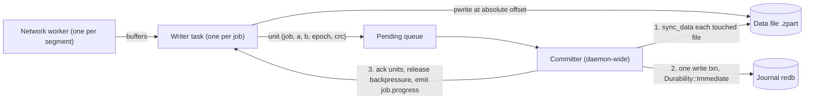

# 03. Journal and commit protocol

| | |
|---|---|
| Status | Draft 1 |
| Depends on | [00 conventions](00-conventions.md), [01 domain model](01-domain-model.md) |
| Implemented by | `zeus-journal` (store), `zeus-fs` (file operations), `zeus-engine` (protocol), `zeusd` (recovery at startup) |
| Schema | [`schema/journal.v1.schema.json`](schema/journal.v1.schema.json) |

## 1. Purpose

A download is worth more than the bytes already on disk only if the engine can prove which bytes are right. This document defines the durable transfer journal and the exact ordering of writes, syncs and commits that lets Zeus trust a resumed file after a crash, power loss or restart, finalise it without ever exposing a partial file, and recover automatically. It fixes data file naming, record layouts, every crash point and its recovery, resume validation against a server that may change or lie, and the invariants (I1 to I12) that tests must check.

Research basis: `research.md` section 4.1 ("`pwrite` the data, `fsync`, then commit the range. On restart, trust only committed ranges.", "`.part`, verify, `fsync`, atomic rename") and `research.md` section 8.10 (why resume pays). The research corpus items 16 and 23 referenced by the task were not present in `docs/research` when this draft was written; the cross-check against them is open issue O1.

## 2. Terminology

| Term | Meaning |
|---|---|
| Data file | The partial file `<name>.zpart` in the destination directory. Byte `i` of the resource is at file offset `i`. |
| Journal | The durable store (redb) holding job records, committed ranges, events, grants and approvals. |
| Commit unit | A contiguous run of bytes written by the writer and committed together; 4 MiB by default, smaller at segment ends and flushes. |
| Committed range | A half-open byte interval `[a, b)` recorded in the journal after its data was synced. The committed range set of a job is the only evidence of what is on disk. |
| Writer | The single task per job that issues all writes to the data file. |
| Committer | The single daemon-wide task that syncs data files and commits journal transactions in rounds. |
| Round | One iteration of the committer: sync touched files, then one journal write transaction. |
| Epoch | Per-job counter, incremented on every entry to `probing`; every commit unit carries the epoch of the attempt that produced it. |
| Bound validators | The validators of the representation the committed ranges were fetched under. |
| Finalize | The sequence from a verified `.zpart` to the file at its final path (section 8). |

## 3. Storage layout

### 3.1 Directories and files

| Item | Location | Permissions |
|---|---|---|
| State directory | Windows `%LOCALAPPDATA%\Zeus`; macOS `~/Library/Application Support/Zeus`; Linux `$XDG_STATE_HOME/zeus` (default `~/.local/state/zeus`) | Owner only (Windows: ACL granting only the user; Unix: mode 0700) |
| Journal | `<state>/zeus.redb` | 0600 / user ACL |
| Daemon lock | `<state>/zeusd.lock` (advisory lock held for the daemon's life) | 0600 |
| Audit log | `<state>/audit/audit-<index>.jsonl` (04) | 0600 |
| Trash | `<state>/trash/<yyyymmdd>/` | 0700 |
| Data file | `<dest_dir>/<final name>.zpart`, in the **same directory** as the final file so the final rename is atomic on one file system | Created with mode 0600 (Unix) and renamed with the final mode applied afterwards (default 0644 masked by umask); on Windows inherits the directory ACL |

The journal contains secrets only in `spec.url` and `spec.hint_url` (query strings that a resume needs). It never contains cookies, `Authorization` headers or session material (invariant I10).

### 3.2 Data file naming and reservation

1. The final path `P` of a job is resolved before the data file is created: `dest_dir` plus the sanitised file name (01 section 12.3), adjusted by the overwrite policy (`rename` picks the first free name `name (1).ext`, `name (2).ext`, ...; `fail` refuses; `replace` plans a trash move at finalize).
2. The data file is `P + ".zpart"`. Because `P` is unique among active jobs, so is the data file.
3. Uniqueness among active jobs is enforced by the journal table `reservations` (key: normalised path, case-folded on case-insensitive file systems; value: `job_id`). The reservation is inserted in the same transaction that stores `dest_path` and `zpart_path` in the job record, and removed in the transaction that moves the job to a terminal state. A conflict makes the resolver pick another name.
4. A file already existing at `P` or at `P.zpart` that the journal does not know is foreign: Zeus never writes into it. It picks another name.
5. Preallocation: when the total size is known and free space (minus a 5 % margin) is at least the total, the writer extends the file to the full size (`set_len`; `fallocate` on Linux when available; `F_PREALLOCATE` on macOS) and, on NTFS, marks it sparse before extending (`FSCTL_SET_SPARSE`) so a write at a far offset does not force zero-filling the gap. If there is not enough space the job fails immediately with `fs.no_space` instead of downloading for an hour first. **File length is never evidence of progress** (I2): a preallocated file has its final size from the first second.

### 3.3 The redb journal

Zeus stores the journal in redb, an embedded ACID key-value store with copy-on-write B+trees and MVCC. Facts relied upon, verified against redb 4.3.0 (released 2026-09-15) on docs.rs:

| Fact | Consequence |
|---|---|
| `Durability` has exactly two levels: `Immediate` ("guaranteed to be persistent as soon as `WriteTransaction::commit` returns") and `None` ("will not be persisted to disk unless followed by a commit with `Durability::Immediate`"). `Immediate` is the default. `set_durability` returns `Result<(), SetDurabilityError>`. | Section 5.4: only `Immediate` is allowed for any transaction that carries range rows or state changes. |
| `commit` returns `Result<(), CommitError>`. On errors other than `TransactionPoisoned`, "changes are applied atomically (fully or not at all) but may already be persisted". | A failed commit is **ambiguous**: the committer treats the round as unknown and re-reads the journal before continuing (section 5.5). |
| Single process: opening a database that is already open fails (`DatabaseError::DatabaseAlreadyOpen`, "Cannot acquire lock"). | Invariant I6; the daemon also holds `zeusd.lock`. |
| One write transaction at a time, many concurrent read transactions. | The committer is the only writer of range rows; other writers (state transitions, grants) go through the same single writer queue. |
| Commit protocol: by default one phase (update the inactive commit slot, flip the primary bit, `fsync`); `set_two_phase_commit(true)` adds an intermediate `fsync`; `set_quick_repair(true)` saves allocator state per commit for near-instant crash recovery at the cost of slower commits. | Defaults are used (one phase, no quick repair); the checksummed commit slots let redb detect a torn commit. Both can be enabled by configuration for hardware with unreliable ordering. |
| An open that follows an unclean shutdown repairs the database (and `RepairAborted` / `UpgradeRequired` errors exist). | Section 10 step 1 treats these as typed failures. |

`zeus-journal` MUST hide redb behind a trait (`JournalStore`) so an alternative backend that provides atomic, durable, multi-row transactions (SQLite in WAL mode with `synchronous=FULL`) can be substituted without touching `zeus-engine`. This document specifies behaviour in backend-neutral terms; section 4 gives the redb layout.

### 3.4 Range sets

The committed ranges of a job form an **interval set** over `[0, 2^53)`:

1. Stored as sorted, non-overlapping, **non-adjacent** half-open intervals (invariant I4). Adjacent or overlapping intervals are merged on insert, so the number of rows stays small (a clean sequential download is one row).
2. `insert([a, b))` is idempotent and monotone: it unions the interval in, deleting the rows it merges. Inserting an interval already covered changes nothing.
3. `remove([a, b))` exists only for invalidation (section 7.6) and splits rows when needed.
4. `uncovered(total)` is the complement within `[0, total)`; the scheduler plans segments from it.
5. `covered_bytes` equals `Progress.bytes_done`.

Overlapping inserts are legal (work stealing and hedged requests fetch the same range twice). They are safe only because every ranged request carries the bound validators (section 7.3), so both copies come from the same representation.

## 4. Record layout and versioning

### 4.1 Tables

| Table | Key | Value | Purpose |
|---|---|---|---|
| `meta` | `"store"` (str) | JSON `Meta` | Schema version, store id, `last_event_seq`, outbox cursors, audit head, the kill-switch latch (07 section 8). |
| `jobs` | `job_id` (str) | JSON `JobRecord` | The full job (01) plus `internal` (engine-private state). |
| `ranges` | `(job_id: str, start: u64)` | `(end: u64, epoch: u32)` | Committed range set. redb orders integer keys numerically, so a range scan by `job_id` yields intervals in order. |
| `unit_crc` | `(job_id: str, offset: u64)` | `(length: u32, crc32c: u32)` | Per commit unit checksum for the tail check of section 7.2. Optional (feature `journal-crc`, default on). Not coalesced. |
| `invalidations` | `(job_id: str, at_ms: u64)` | JSON `InvalidationRow` | Append-only record of every shrink of a range set (I3). |
| `reservations` | normalised path (str) | JSON `ReservationRow` | Final-path uniqueness (section 3.2). |
| `events` | `seq: u64` | JSON `Event` (01 section 9) | Durable event log, pruned by retention. |
| `grants` | `grant_id` (str) | JSON `SessionGrant` (01) | Consent records. |
| `approvals` | `approval_id` (str) | JSON `ApprovalRequest` (01 `Approval` plus the 07 members `request_hash`, `requested_by`, `facts`, `agent_says`) | Pending and decided approvals. The `DecisionRecord` of 07 section 5.3 (with channel evidence) is stored next to it. |
| `idempotency` | `(client_id: str, key: str)` | JSON `IdempotencyRow` | 00 section 5.4. |
| `plans` | `plan_id` (str) | JSON draft (08 section 9.2) | Workflow plan drafts; deleted 24 h after last use. Sample bodies are not stored here. |
| `runs` | `run_id` (str) | JSON run record with its `Checkpoint` (08 section 9.2) | Workflow runs. The checkpoint may hold full document URLs (00 section 8.2). |
| `run_keys` | `(run_id: str, key: [u8; 32])` | `()` | BLAKE3 of each URL and dedupe key a run has seen (08 section 9.1, invariant W1). Deleted with the run record. |

Rows holding JSON use `serde_json` output (UTF-8, not canonical; canonical JSON is for hashing only, 00 section 7). The fixed-layout tables use redb's native integer and tuple encodings so a commit round writes only a few bytes per unit.

```json validate=journal.v1#/$defs/Meta
{
  "schema_version": 1,
  "store_id": "01M2YVHK60EHVSRRHA6BW4QCWM",
  "created_at": "2026-09-20T07:30:00.000Z",
  "created_by": "zeus-journal 0.1.0",
  "last_event_seq": 48223,
  "audit_cursor": 48223,
  "manifest_cursor": 48222,
  "audit_head": {
    "chain_id": "chain_01M3TC5H007DRT2QA1P1NY311K",
    "seq": 1204,
    "hash": "1e0f07a3c0beca17e28b2d889c3e78a743e9c931e3d5efbff76921fe028ce231"
  }
}
```

A `JobRecord` of a job in `downloading` (the `job` member is the entity of 01 section 3.1; `internal` is private):

```json validate=journal.v1#/$defs/JobRecord
{
  "schema": 1,
  "job": {
    "id": "job_01M45NHJ2AHWMXT8JVJ7BEEJX7",
    "state": "downloading",
    "quarantined": false,
    "spec": {
      "url": "https://portal.example.org/download/8841",
      "hint_url": "https://cdn.example.org/blobs/dataset-v3.tar.zst?X-Amz-Signature=REDACTED-IN-DOCS",
      "referrer": "https://portal.example.org/datasets/v3",
      "filename": "dataset-v3.tar.zst",
      "priority": "high",
      "session_origin": "https://portal.example.org",
      "overwrite": "rename",
      "source": { "kind": "browser_handoff", "via": "native_messaging", "client_id": "ext:chrome" }
    },
    "created_at": "2026-10-05T09:15:30.250Z",
    "updated_at": "2026-10-05T09:16:10.000Z",
    "state_since": "2026-10-05T09:15:36.640Z",
    "probe": null,
    "progress": {
      "bytes_done": 611057664,
      "bytes_total": 1288490188,
      "rate_ewma": 15728640,
      "eta_s": 43,
      "segments_active": 4,
      "last_error_class": null,
      "updated_at": "2026-10-05T09:16:10.000Z"
    },
    "retry": {
      "attempt": 1,
      "consecutive_failures": 0,
      "last_progress_at": "2026-10-05T09:16:10.000Z",
      "next_attempt_at": null,
      "auth_refreshes": 0,
      "proxy_escalations": 0,
      "integrity_restarts": 0,
      "resource_restarts": 0,
      "recovery_count": 0,
      "session_wait_deadline_at": null
    },
    "error": null,
    "result": null,
    "transport": "direct",
    "grant_id": "gr_01M45NHPJP04TX6B1CJVQVQAK9",
    "approval_id": "ap_01M45NHJ3XS0QXG9T42HHN2YR8"
  },
  "internal": {
    "epoch": 1,
    "dest_path": "/home/ada/Downloads/Zeus/dataset-v3.tar.zst",
    "zpart_path": "/home/ada/Downloads/Zeus/dataset-v3.tar.zst.zpart",
    "zpart_file_id": { "kind": "unix", "dev": "2049", "ino": "5517423" },
    "total_bytes": 1288490188,
    "data_complete": false,
    "eof_size": null,
    "bound_validators": {
      "etag": "\"5f3a9c-4c1d2e7b\"",
      "last_modified": "Tue, 29 Sep 2026 14:02:11 GMT",
      "last_modified_strong": true,
      "repr_digest": null
    },
    "range_support": "verified",
    "resume_recheck": "tail",
    "verify_result": null,
    "finalize": null,
    "url_secret_stored": true
  }
}
```

Row shapes of the other tables, one per line (the first three are range rows of the job above as a reader would see them after decoding):

```jsonl validate=journal.v1#/$defs/RangeRow
{"job_id":"job_01M45NHJ2AHWMXT8JVJ7BEEJX7","start":0,"end":402653184,"epoch":1}
{"job_id":"job_01M45NHJ2AHWMXT8JVJ7BEEJX7","start":419430400,"end":436207616,"epoch":1}
{"job_id":"job_01M45NHJ2AHWMXT8JVJ7BEEJX7","start":520093696,"end":528482304,"epoch":1}
```

```json validate=journal.v1#/$defs/UnitCrcRow
{ "job_id": "job_01M45NHJ2AHWMXT8JVJ7BEEJX7", "offset": 524288000, "length": 4194304, "crc32c": 2864434397 }
```

```json validate=journal.v1#/$defs/InvalidationRow
{ "job_id": "job_01M45R71NCNH3W8EQ63TAFME4C", "at": "2026-10-05T10:09:02.410Z", "epoch": 2, "reason": "validator_changed", "dropped_bytes": 314572800 }
```

```json validate=journal.v1#/$defs/IdempotencyRow
{
  "client_id": "cli_01M45KGHR0ED0WJDFXKG49029B",
  "key": "agent-7f3c:q3-export",
  "request_hash": "9218812567e906efb346546840f6145fc189148e5633d0737fee7402a3207f9a",
  "method": "jobs.enqueue",
  "result": { "jobs": [{ "job_id": "job_01M45R71NCNH3W8EQ63TAFME4C", "state": "queued" }], "dry_run": false, "replayed": false },
  "job_id": "job_01M45R71NCNH3W8EQ63TAFME4C",
  "created_at": "2026-10-05T10:02:11.500Z",
  "expires_at": "2026-10-06T10:02:11.500Z"
}
```

```json validate=journal.v1#/$defs/ReservationRow
{ "path_key": "c:\\users\\ada\\downloads\\zeus\\q3.csv.gz", "job_id": "job_01M45R71NCNH3W8EQ63TAFME4C", "created_at": "2026-10-05T10:02:11.540Z" }
```

### 4.2 Versioning and migration

1. `meta.schema_version` is 1. A daemon that finds a higher version refuses to open (`journal.version_unsupported`, class `unsupported`) and never writes.
2. A lower version is migrated forward: copy `zeus.redb` to `zeus.redb.v<old>.bak`, run the migration in one transaction, bump the version in that transaction. Forward-only; no downgrade path.
3. New optional JSON fields do not change the version; readers ignore unknown fields (00 section 4). Changing a binary table layout does.
4. The record `schema` field of `JobRecord` follows the same rule.

## 5. The commit protocol

### 5.1 Actors and the write path



Workers never touch the data file. They hand buffers to the job's writer over a bounded channel. The writer is the only code that calls positional writes on a data file, which also removes the cursor race that Windows overlapped I/O has on a shared handle.

### 5.2 Steps for one commit unit (normative ordering)

For a unit covering `[a, b)` of job `J` produced in epoch `e`:

| Step | Action | Durable after it? |
|---|---|---|
| W1 | The writer receives the buffer and checks `J.epoch == e` and `J.state == downloading` in memory. A stale epoch drops the buffer (I5). | no |
| W2 | `pwrite(file, a, bytes)` for all `b - a` bytes; short writes are looped. | no (page cache) |
| W3 | Compute `crc32c(bytes)` (if `journal-crc` is on). | no |
| W4 | Push `Unit{J, a, b, e, crc}` to the pending queue, marking it **written**. | no |
| C1 | The committer starts a round when the group-commit policy fires (section 5.3). It takes a snapshot `S` of all pending units whose state is written. | no |
| C2 | For every distinct data file touched by `S`: `sync_data` (data-only flush where the OS has one, else a full flush). Windows: `FlushFileBuffers`; Linux: `fdatasync`; macOS: `fcntl(F_FULLFSYNC)` (a plain `fsync` does not flush the drive cache there). This step starts **after** all writes of `S` completed (W2) and completes **before** C3 starts. | data durable |
| C3 | Open one journal write transaction with `Durability::Immediate`. For each unit in `S`: read the job record; if `epoch != e` or the state is not `downloading`, discard the unit (I5). Else insert `[a, b)` into `ranges` (section 3.4), insert the `unit_crc` row, update `Job.progress.bytes_done`, `updated_at` and `retry.last_progress_at`. If the range set now covers the resource, perform transition S20 **in the same transaction**: set `data_complete`, set state `verifying`, append `job.state_changed` (01 section 7). Append every event of the round (allocating `seq` and updating `meta.last_event_seq`). | no |
| C4 | `commit()`. On `Ok`, the units in `S` are durable. | **yes** |
| C5 | Acknowledge the units: the writer reduces its un-acknowledged byte count, the network workers are released, `job.progress` (ephemeral) is emitted. | |

The order W2 then C2 then C4 is the heart of the protocol: **a range is written to the journal only after the bytes it names have been flushed to stable storage**. Any other order (journal first, or journal and data flushed "together" with no fence between them) can leave a committed range whose bytes are not on disk (violating I1).

The fence between C2 and C3 is per round, not per unit. A unit that finished its write while the round's `sync_data` was already running is **not** in `S`; it waits for the next round. The committer therefore snapshots `S` before it starts C2 and never adds to it.

### 5.3 Group commit policy

Syncing and committing for every unit would cost two device flushes per 4 MiB. The committer batches.

| Parameter | Default | Bounds | Meaning |
|---|---|---|---|
| `commit_unit_bytes` | 4 MiB | 256 KiB to 32 MiB | The writer closes a unit when it reaches this size, at a segment end, at EOF, or when a flush is requested. |
| `group_commit_ms` | 200 | 20 to 2000 | A round starts at most this long after the first written unit enters an empty queue. |
| `group_commit_bytes` | 32 MiB | 4 to 256 MiB | A round starts early when the written, uncommitted bytes of all jobs reach this. |
| `flush_idle_ms` | 1000 | 100 to 10000 | A job with data written and no new data for this long is flushed. |
| `max_unacked_bytes` | 64 MiB | 8 to 512 MiB | Per job; when written-but-uncommitted bytes reach it, the writer stops accepting buffers, so the network is throttled by disk speed (and `fetch.credit` is withheld in the browser proxy, 02 section 9.5). |

Flush barriers force an immediate round for the affected job and wait for it: pause, cancel (before deletion), shutdown, the last unit of a job, and any state transition other than S20 that needs durable progress. A barrier never skips C2.

At the defaults a single sequential download costs about 5 rounds per second at most and one journal commit every 200 ms: a few kilobytes of journal writes per second. Expected cost of a crash: at most `group_commit_ms` of transfer plus the un-acknowledged window is re-fetched.

### 5.4 Durability levels

1. Every journal transaction that inserts or removes range rows, changes a job `state`, writes `finalize` or `verify_result`, appends events, or changes a grant or approval MUST use `Durability::Immediate`.
2. `Durability::None` MAY be used only for caches that are fully derivable from durable rows (none exist in v1). It MUST NOT be used for range rows, because a non-durable commit "will not be persisted unless followed by a commit with `Durability::Immediate`" and a later `Immediate` commit would then persist those rows **without any guarantee that the data they name was synced** unless a fence ran between them: that is exactly the violation I1 forbids. The safe variant (sync, then a fence, then an `Immediate` commit for the whole batch) is the round of section 5.2; use it.
3. Progress shown to users and agents comes from the in-memory counters of the writer (committed bytes only) and is emitted as an ephemeral event; it is not journaled per tick.

### 5.5 Failure handling inside a round

| Failure | Action |
|---|---|
| `pwrite` error (W2) | Classify with 01 stage A; the job leaves `downloading` through S21 or S25. Units not yet written are dropped. |
| `sync_data` error (C2) | Treat as `fs.io_error`; the whole round's units remain un-committed and their bytes untrusted; the affected jobs follow S21 or S25. Never retry a failed `fsync` and then proceed as if it had succeeded: after an `fsync` failure the page cache state is unknown (the kernel may have dropped the dirty pages), so the data of that round MUST be rewritten. |
| `commit` returns `Err` (C4) | The outcome is ambiguous (redb: "may already be persisted"). The committer drops its in-memory view of the affected jobs, re-reads the committed range sets from the journal, and reconciles: units that appear are acknowledged; units that do not appear are rewritten by re-fetching (their bytes are not trusted for resume only because they are not in the journal). `TransactionPoisoned` makes the daemon stop accepting work, emit `daemon.stopping` with `fatal_error` and exit; recovery reopens the store. |
| Journal full disk | `fs.no_space` for all active jobs; transient disk policy (01 section 8.5). |

### 5.6 Epoch fence and control operations

1. The epoch of a job increases on every entry to `probing` (S03, S95 followed by S03). Units carry the epoch of the attempt that produced them.
2. A commit round discards units whose epoch differs from the job's current epoch or whose job is no longer `downloading` (I5). Pause, cancel, retry scheduling, session refresh and daemon restart therefore need no cross-task cancellation protocol for correctness: a late worker's data is simply refused.
3. **Cancel.** S06, S16, S26 and friends: take a flush barrier only if the data should be kept (it should not); transition in a journal transaction, then delete the data file and release the reservation. A crash between the transaction and the delete leaves an orphan `.zpart`, collected by section 10 step 7.
4. **Pause.** Flush barrier, then S05/S15/S24/S61. Nothing is discarded.

## 6. Preparing a data file

Order when a job first needs a data file (inside `probing`, after the probe succeeded and `dest_path` is resolved):

1. Insert the reservation and store `dest_path`, `zpart_path`, `total_bytes` (journal commit).
2. Create the data file with `O_CREAT | O_EXCL | O_NOFOLLOW` (`CREATE_NEW` and `FILE_FLAG_OPEN_REPARSE_POINT` on Windows) so a pre-planted symlink or file cannot be followed or reused.
3. Preallocate (section 3.2 item 5).
4. `sync_all` the file and, on Unix, `fsync` the parent directory, so the directory entry is durable.
5. Query the file identity (`dev`+`ino`, or volume serial plus 128-bit file index) and store `zpart_file_id` in the job record (journal commit, `Immediate`).
6. Only now may the first range be committed.

A crash before step 5 leaves a data file the journal does not own; recovery deletes it if empty or no longer referenced (section 10 step 7). A crash after step 5 leaves a consistent empty job.

## 7. Resume validation

Resume is where a download manager silently corrupts files. Zeus resumes only what it can prove.

### 7.1 Inputs

For a job with a non-empty committed range set: the data file; `bound_validators` (what the committed ranges were fetched under); `total_bytes`; `range_support`; the committed ranges and `unit_crc` rows; the job's `resume_recheck` mode (`none`, `tail`, `full`; default `tail`).

### 7.2 Local checks (before any request)

| # | Check | On failure |
|---|---|---|
| L1 | The data file exists and is a regular file (not a symlink or reparse point). | Invalidate all ranges (`file_replaced` if present but not ours, else `file_truncated`); restart from zero. |
| L2 | `file_id` equals `zpart_file_id`. | Invalidate all ranges (`file_replaced`). |
| L3 | `file length >= max committed end`. | Remove ranges beyond the length (`file_truncated`). (A preallocated file has full length from the start, so this only catches truncation.) |
| L4 | `resume_recheck = tail`: re-read the last 16 commit units recorded in `unit_crc` (by offset) and compare CRC32C. `full`: every unit. `none`: skip. | Remove the failing unit intervals from the range set (`tail_check_failed`). With `tail`, continue checking one unit earlier until 4 consecutive units pass or the set is empty. |

### 7.3 Network revalidation

Let `m` be the first uncovered byte. The probe is a ranged `GET` starting at `m` (not `0-0`), because it doubles as the first data request.

1. If the bound validators contain a **strong** `etag`, send `If-Range: <etag>`. RFC 9110 section 13.1.5: a weak entity-tag never matches `If-Range`, and a client MUST NOT send one.
2. Else if `last_modified` is strong (`last_modified_strong`), send `If-Range: <HTTP-date>`.
3. Else (weak or no validators): send no `If-Range`; apply the **overlap check**: start the range at `m - overlap` where `overlap = min(1 MiB, m)` and compare those bytes with the bytes already on disk.
4. Always send `Accept-Encoding: identity`.

Decision table for the first response:

| # | Response | Condition | Action |
|---|---|---|---|
| R1 | `206`, `Content-Range` start equals the requested start, total equals `total_bytes` | validators in the response equal the bound validators (compared strongly), or both absent; overlap bytes (if any) equal the disk | **Resume**. `range_support = verified`. |
| R2 | `206` | `Content-Range` total differs from `total_bytes` | `integrity.resource_changed`: restart (section 7.6). |
| R3 | `206` | Response `ETag` or strong `Last-Modified` differs from the bound validators although `If-Range` was sent | `integrity.resource_changed`: restart. (The server ignored `If-Range`.) |
| R4 | `200` | `If-Range` was sent, response validators equal the bound ones | The server ignores ranges: `integrity.range_ignored`. Set `range_support = unsupported`; restart as a single stream from zero. |
| R5 | `200` | `If-Range` was sent, response validators differ | The resource changed (the standard `If-Range` behaviour): `integrity.resource_changed`: restart. |
| R6 | `200` | no `If-Range` sent | Ranges are not supported: `range_support = unsupported`; restart from zero. |
| R7 | `206` | `Content-Range` start differs from the requested start | `integrity.range_mismatch`: treat as unsupported; restart from zero. |
| R8 | `206` | Overlap bytes differ from the disk | `integrity.tail_check_failed`: restart. |
| R9 | `416` | `Content-Range: bytes */N` with `N == total_bytes` and the ranges cover `[0, N)` | Nothing left to fetch: go to verification (S20). |
| R10 | `416` | otherwise | `integrity.resource_changed`: restart. |
| R11 | `3xx`, `4xx`, `5xx`, transport error | | Classify with 01 section 8.3; ranges unchanged. |

When no validators exist at all and `total_bytes` is known, resume is allowed only after a passing overlap check (`resume_without_validators = overlap`, the default). Configuration may set `never` (always restart) or `size_only` (trust the size; discouraged). When `total_bytes` is unknown and validators are not strong, resume is not allowed.

### 7.4 Every ranged response, not only the first

For every `206` of the job's life the engine checks, **before handing bytes to the writer**: `Content-Range` start equals the requested start; total equals `total_bytes`; `ETag` and strong `Last-Modified`, when present, equal the bound validators; the body does not exceed the requested length. A violation aborts that request without committing its bytes and applies R2, R3, R7 or `integrity.range_overrun`. Bytes of a failed response that were already written are never committed.

### 7.5 A server that lies

| Lie | Detection | Handling |
|---|---|---|
| `Accept-Ranges: bytes` but answers `200` | R4, R6 | `range_support = unsupported`; single stream. |
| `Accept-Ranges: none` but answers `206` | Observed `206` | Trust the observation; `range_support = verified`. |
| `Content-Range` does not match the requested range | R7 | Treat as unsupported. |
| `Content-Length` differs from the `Content-Range` total | Compared on the first response | Prefer `Content-Range`; if they remain inconsistent across two requests: `integrity.size_mismatch`. |
| Declares more bytes than it sends | `net.premature_eof` at the same offset five times (01 rule R5) | `integrity.size_mismatch`; failed. |
| Sends more than asked | Body longer than `length` | `integrity.range_overrun`; restart. |
| Different ETag from each backend of a load-balanced cluster | R3/R5 on every resume although the content is unchanged | After two restarts: `integrity.resource_unstable`. Mitigation (MAY): once two different strong tags were seen with the same total and `Last-Modified`, mark the job `etag_unreliable` and resume with `Last-Modified` plus size plus overlap check only. Open issue O3. |
| Content-Encoding other than identity | `Content-Encoding` present | `http.content_encoded` (01). |

### 7.6 Restart from zero

A restart (`validator_changed`, `range_unsupported`, `integrity_restart`, `file_replaced`, `file_truncated`, `tail_check_failed`, `overlap_check_failed`, `user_request`) is one journal transaction:

1. Remove all range rows and `unit_crc` rows of the job (and write one `invalidations` row with the dropped byte count and the reason).
2. Set the new bound validators and `total_bytes` from the response (when the restart is a resource change), `data_complete = false`, `verify_result = null`.
3. Truncate and re-extend the data file after the transaction commits (a crash in between leaves a file whose bytes are untrusted anyway, I2).
4. Increment the matching budget counter in `retry` (01 section 8.5) and schedule `job.retry_scheduled` with `restart_from_zero: true`.

Because the journal is cleared before the file is touched, a crash can never leave committed ranges that point at overwritten bytes.

## 8. Finalization

Finalization turns a verified data file into the final file. The final path must **never** exist with partial content, and a crash at any point must resolve to either "not finished" or "finished".

### 8.1 Steps

Preconditions: S70 committed `verify_result` (size, SHA-256, BLAKE3, detected MIME, `mtime_ms` of the data file), the quarantine decision and the state `finalizing` in one transaction. The data file is not written again after S20.

| Step | Action | Notes |
|---|---|---|
| F0 | Verification (state `verifying`): stream the data file from disk and compute SHA-256 and BLAKE3 in one pass; check the size against the total and `expected_size`; compare `expected_sha256`; detect MIME from magic bytes; evaluate quarantine rules (01 section 11.3). Then commit S70. | Hashes MUST be computed from the bytes on disk (SHOULD be read back through the page cache, MAY be skipped only by the fingerprint rule below), not from the bytes handed to `pwrite`: this catches write-path corruption. |
| F1 | Apply OS provenance marks to the **data file** (04 section 6): Zone.Identifier stream on NTFS, `com.apple.quarantine` and `kMDItemWhereFroms` on macOS, `user.xdg.origin.url` on Linux, as policy allows. | Done **before** the rename so the file is never visible without its Mark-of-the-Web. Idempotent. An unsupported file system (FAT, exFAT, tmpfs without user xattrs) is recorded in the manifest and is not an error. |
| F2 | `sync_all` on the data file (data and metadata, including length and attributes set in F1). | |
| F3 | Choose the final path again (the reserved path is normally free; if a foreign file appeared, apply the overwrite policy). Commit `finalize = {phase: "intent", tmp_path, dest_path, file_id, intent_at}` (`Immediate`). | After this commit, recovery can tell which side of the rename a crash fell on. |
| F4 | Atomic rename of `tmp_path` to `dest_path` **without replacing**: Linux `renameat2(RENAME_NOREPLACE)`; macOS `renamex_np(RENAME_EXCL)`; Windows `MoveFileExW` with `MOVEFILE_WRITE_THROUGH` and without `MOVEFILE_REPLACE_EXISTING`. For `overwrite = replace`: Unix `link(dest, trash/...)` then atomic `rename`; Windows `ReplaceFile` with a backup name in the trash directory. | Same directory, same volume, so the rename is a single metadata operation. |
| F5 | Unix: `fsync` the parent directory. Windows: `MOVEFILE_WRITE_THROUGH` already covers it. | |
| F6 | Commit S80 (`Immediate`): `state = completed`, `result`, `finalize = null`, remove the job's range, `unit_crc` and reservation rows, append `job.completed` and `job.state_changed`. | **The point of no return.** Before it the job is "finalizing"; after it, "completed". |
| F7 | Post-commit, idempotent side effects driven by the durable event stream (outbox pattern): append the audit record `file.finalized` (04) and the provenance manifest record (04), and register the artifact in the artifact store (13 section 7.5); advance `meta.audit_cursor`, `meta.manifest_cursor` and `meta.artifact_cursor` in later transactions. | If the daemon crashes between F6 and F7, startup recovery replays durable events above the cursors (section 10 step 6). |
| F8 | Delete the trash entries older than their retention, notify subscribers (the events already exist). | |

Fingerprint rule (skip re-hash): when recovery re-enters `verifying` or `finalizing` for a job with a durable `verify_result`, it MAY skip F0 if the data file's `file_id`, length and `mtime_ms` equal the recorded values. Otherwise F0 is repeated.

The deviation from "write marks after completion" is deliberate: the Mark-of-the-Web and quarantine attributes follow a file through a rename, and applying them to the data file first removes the window in which a user, a scanner or an indexer could see an unmarked, final-named file.

### 8.2 Crash points during finalization

| Crash between | Journal state on restart | Disk state | Recovery action |
|---|---|---|---|
| S20 commit and F0 end | `verifying`, no `verify_result` | `.zpart` complete | S95 to `queued`, S04, repeat F0. |
| F0 and S70 commit | as above | as above | Same. |
| S70 and F1 | `finalizing`, `verify_result` | `.zpart` | S95, S04; fingerprint rule may skip F0; continue at F1. |
| F1 and F2 | `finalizing` | `.zpart` with marks | Repeat F1 (idempotent), F2. |
| F2 and F3 | `finalizing` | `.zpart` | Continue at F3. |
| F3 commit and F4 | `finalize.phase = intent` | `.zpart` exists, final absent | Repeat F4. |
| inside F4 (rename) | `intent` | exactly one of: `.zpart` exists and final absent, or `.zpart` absent and final present (rename is atomic) | Decide by file identity (below). |
| F4 and F5 | `intent` | final present, `.zpart` absent | Final's `file_id` equals `finalize.file_id`: do F5, then F6. |
| F5 and F6 | `intent` | same | Do F6. |
| F6 commit and F7 | `completed` | final present | Replay events above the outbox cursors (F7). |
| After F7 | `completed` | final present | Nothing. |

Decision procedure when `finalize.phase` is `intent` at recovery, with `T = tmp_path`, `D = dest_path`, `id = finalize.file_id`:

1. `T` exists and `D` does not: the rename did not happen: repeat F4.
2. `D` exists, `T` does not, and `file_id(D) == id`: the rename happened: continue at F5.
3. `D` exists, `T` does not, and `file_id(D) != id`: someone else put a file at `D` and our file is lost: `fs.finalize_lost`, class `disk`, state `failed` (S82).
4. Both exist and `file_id(T) == id`: `D` appeared after the intent. Pick a new unique name per the overwrite policy, write a new `intent` and rename again.
5. Neither exists: `fs.finalize_lost`, S82.

## 9. Crash points during download

| Point | Description | State after restart | Why it is safe |
|---|---|---|---|
| D1 | Bytes received, not yet written | Journal unchanged | Never committed. |
| D2 | After `pwrite`, before `sync_data` | Journal unchanged; the file may hold the bytes, part of them, or garbage | The range is not committed, so the bytes are untrusted and re-fetched (I2). |
| D3 | After `sync_data`, before the journal commit | Journal unchanged; data durable but unreferenced | Wasted work only. |
| D4 | Inside the journal commit | Old root or new root (redb commit slots are checksummed and flipped atomically) | The transaction is atomic: either all rows of the round or none. |
| D5 | After the commit, before the acknowledgement | Round durable | Recovery reads the journal; the ack was in-memory only. |
| D6 | During data file creation (section 6 steps 2 to 4) | Journal may own a reservation but no `zpart_file_id`; an orphan or empty file may exist | Recovery: no `zpart_file_id` means the file is not ours; delete if empty, create anew. |
| D7 | During S20 transaction | Either still `downloading` with all ranges, or `verifying` with `data_complete` | Atomic with the last range commit. |
| D8 | During restart from zero (section 7.6) | Either old ranges and old file or no ranges and an untrusted file | Journal first, file second. |
| D9 | Device lies about `fsync` (cache not flushed) | Journal may reference bytes that are not durable | Out of scope for the protocol; caught by F0 hash (I8) and by tail checks (L4); the job restarts once (`integrity.hash_mismatch`). |
| D10 | Journal file damaged | `journal.corrupt` at open | Section 10 step 1. |

## 10. Recovery on startup

`zeusd` runs this before accepting any connection. Each step is idempotent: a crash during recovery followed by another recovery gives the same result (I11).

| Step | Action |
|---|---|
| 1 | Acquire `zeusd.lock`. Open `zeus.redb` (this runs redb's repair if the previous shutdown was unclean). `DatabaseAlreadyOpen`: another daemon runs; exit with a clear message. `UpgradeRequired` or a newer `schema_version`: refuse (section 4.2). Corruption that repair cannot fix: move the file to `zeus.redb.corrupt-<ts>`, create a fresh store, emit a prominent warning, and treat all `.zpart` files as orphans (their ranges are lost; completed files and the audit log are unaffected). Report `journal.corrupt`. |
| 2 | Check `meta.schema_version`; migrate if lower. |
| 3 | Scan `jobs`. For every job in `probing`, `downloading`, `verifying` or `finalizing`: increment `retry.recovery_count`; if it reached 3 without intervening committed progress (progress resets the counter) apply S96 (`engine.crash_loop`, failed); else apply S95 (to `queued`). `awaiting_*`, `paused`, `retry_scheduled` jobs keep their state; timers are re-armed from stored instants (`next_attempt_at`, `session_wait_deadline_at`). All in one transaction with their events. |
| 4 | For each job going to `queued` with committed ranges, the usual probe will run the local checks of section 7.2. For each job with `finalize` set, apply the decision procedure of section 8.2 now (before the scheduler runs it). |
| 5 | Normalise range sets: verify I4 (sorted, disjoint, non-adjacent, within `[0, total)`); repair by re-coalescing; log any repair. A range beyond `total_bytes` is removed with an invalidation row. |
| 6 | Outbox replay: read durable events above `meta.audit_cursor` and write the missing audit records; above `meta.manifest_cursor` and write the missing manifest records; above `meta.artifact_cursor` (when the artifact store is enabled) and register the missing artifacts, idempotently by ingest key (13 section 7.5). Verify the audit chain tail against `meta.audit_head` (04 section 4.5); a mismatch is reported as `audit.chain_broken` in `daemon.started.recovery.audit_chain_ok = false` and logged; recovery continues. |
| 7 | Orphans: list `*.zpart` files in every destination directory referenced by a non-terminal job and in the configured roots. A file whose path is not `zpart_path` of a non-terminal job is an orphan; count it (`orphans_found`); delete it when it is older than `orphan_gc_age` (default 7 days, minimum 1 hour), otherwise leave it and report. Empty orphans created by D6 are deleted at once. Also delete reservations whose job is terminal or missing. |
| 8 | Expire grants and approvals whose deadlines passed (`grant.expired`, `approval.decided` with outcome `expire`). Prune events beyond retention and idempotency rows beyond `expires_at`. |
| 9 | Emit `daemon.started` with the recovery summary, start the scheduler and the IPC listeners. |

Time budget: steps 1 to 9 are O(jobs + range rows + `.zpart` files); with 10,000 jobs they take well under a few seconds. Hashing is never performed during recovery (it happens later, in `verifying`).

## 11. Invariants

Each invariant is checkable by an automated test; the test is stated with it.

| ID | Invariant | How to test |
|---|---|---|
| I1 | **Commit after sync.** Every byte inside a committed range was written, and a `sync_data` that started after its write completed, before the journal transaction that contains the range committed. | Fault-injecting file system (section 12.2) that discards every unsynced write at a simulated crash; after recovery every committed offset holds the correct byte. Negative test: remove step C2 and expect the test to fail. |
| I2 | **Only the journal is evidence.** Progress, resume and finalization decisions use the committed range set only; file length, preallocation, mtime and file contents outside committed ranges are never trusted. | Property test: arbitrary garbage in uncommitted regions and arbitrary file length never changes `bytes_done` or the resume point. |
| I3 | **Shrink only with a record.** The committed set of a job only grows, except through an invalidation transaction that writes an `invalidations` row with a reason. | Model test over random operation sequences; assert that every shrink of the set coincides with a row. |
| I4 | **Normal form.** Stored ranges are sorted, disjoint, non-adjacent and inside `[0, total)` (when known). | Proptest on the range-set type: after any sequence of `insert`/`remove`, the normal form holds; `insert` is idempotent and commutative as a set operation; `uncovered` is the complement. |
| I5 | **Epoch fence.** A unit whose epoch differs from the job's epoch, or whose job is not `downloading`, is never committed. | Interleave pause, cancel, retry and late workers; assert no row with a stale epoch. |
| I6 | **Single writer process.** At most one process has the journal open for writing; a second daemon fails fast. | Integration test starting two daemons on one state directory. |
| I7 | **Atomic visibility.** The final path never exists with incomplete or unverified content: it appears only by an atomic no-replace rename of a data file whose size and hashes were verified. | Crash-point enumeration of section 8.2 plus a watcher thread that polls the final path and checks content whenever it exists. |
| I8 | **Completed means verified.** A job is `completed` only if its record holds a `verify_result` whose size equals the file size and whose hashes were computed from the on-disk bytes, and the final file exists. | After every simulated crash and recovery, assert for every completed job: hash of the file at `result.path` equals `result.sha256`. |
| I9 | **State and events are atomic; `seq` is gapless among durable events.** A transition, its counter changes and its events commit in one transaction; `seq` strictly increases by 1 per durable event and is never reused, across restarts included. | Crash at every commit; compare `events` with state; assert contiguity. |
| I10 | **No secret persistence.** The journal, events and audit log contain no cookie names or values, no `Authorization` material and no URL query other than `spec.url` and `spec.hint_url`. | Canary test of 00 section 8.3 over a full run including crash and recovery. |
| I11 | **Recovery is idempotent.** Running recovery any number of times, including crashing during recovery, yields the same journal state and the same files. | Run recovery twice and compare byte-for-byte dumps; inject crashes inside recovery. |
| I12 | **Bounded exposure.** Written-but-uncommitted bytes per job never exceed `max_unacked_bytes`; a crash costs at most `group_commit_ms` plus that window of re-fetching. | Instrumented run with a slow disk; assert the bound and that the network is throttled. |

## 12. Model-check sketch

### 12.1 Abstract model of the write path (TLA+ style)

The first model covers only the ordering that I1 depends on. Offsets are commit units; a unit's bytes are either missing, correct or garbage; the disk has a volatile (page cache) and a durable layer; a crash keeps the durable layer and may keep any subset of unsynced writes as garbage.

```tla
---- MODULE ZeusCommit ----
EXTENDS Naturals, FiniteSets

CONSTANTS Units            \* e.g. {1, 2, 3}: commit units of one job
VARIABLES vol,             \* [Units -> {"none","good","bad"}]  page-cache view of the data file
          dur,             \* [Units -> {"none","good","bad"}]  what is on stable storage
          synced,          \* SUBSET Units: written before the latest completed sync
          jdur,            \* SUBSET Units: committed ranges in the durable journal
          running          \* BOOLEAN: the process is alive

Init == /\ vol = [u \in Units |-> "none"] /\ dur = [u \in Units |-> "none"]
        /\ synced = {} /\ jdur = {} /\ running = TRUE

Write(u)  == /\ running /\ vol' = [vol EXCEPT ![u] = "good"]
             /\ UNCHANGED <<dur, synced, jdur, running>>

Sync      == /\ running /\ dur' = vol
             /\ synced' = {u \in Units : vol[u] = "good"}
             /\ UNCHANGED <<vol, jdur, running>>

Commit(B) == /\ running /\ B \subseteq synced        \* the fence: only synced units may be committed
             /\ jdur' = jdur \cup B
             /\ UNCHANGED <<vol, dur, synced, running>>

Crash     == /\ running /\ running' = FALSE
             \* unsynced writes may or may not have reached the platter, and may be garbage
             /\ \E d \in [Units -> {"none","good","bad"}] :
                  /\ \A u \in Units : (u \in synced) => (d[u] = dur[u])
                  /\ dur' = d
             /\ UNCHANGED <<vol, synced, jdur>>

Recover   == /\ ~running /\ running' = TRUE
             /\ vol' = dur /\ synced' = {u \in Units : dur[u] = "good"} /\ UNCHANGED <<dur, jdur>>

Next == \/ \E u \in Units : Write(u)
        \/ Sync
        \/ \E B \in SUBSET Units : Commit(B)
        \/ Crash \/ Recover

Spec == Init /\ [][Next]_<<vol, dur, synced, jdur, running>>

\* I1: every committed unit is good on stable storage, at all times.
Inv == \A u \in jdur : dur[u] = "good"
THEOREM Spec => []Inv
====
```

Checking: with `Units = {1,2,3}` TLC explores the full state space in seconds. The model is **meant to be broken**: delete the conjunct `B \subseteq synced` from `Commit` and TLC produces the counter-example (`Write(1)`, `Commit({1})`, `Crash`, with `dur[1] = "bad"`), which is the bug that journal-first or unfenced designs have. Keep that mutation as a documented negative test. (The `vol` sets in `Sync` assume nothing is written concurrently with the sync; the implementation guarantees it by snapshotting units per round, section 5.2.)

### 12.2 Second model: finalization

State: `tmp` (absent or present with content `partial`, `verified`), `dest` (absent or a file with an id), `phase` in {`none`, `intent`, `completed`}, plus `crash` and `recover` actions. Actions follow F0 to F6. Properties: (a) `dest` never holds `partial` content (I7); (b) `phase = completed` implies `dest` holds `verified` content (I8); (c) from every reachable crash state, `recover` reaches `phase = completed` or a state in which `tmp` or `dest` still holds the verified file, or `failed`; (d) `recover` is idempotent (I11). The decision procedure of section 8.2 is the transition relation of `recover`; model it first and keep the table in sync.

### 12.3 Deterministic simulation in Rust

`zeus-fs` MUST define a `Filesystem` trait (open, create-new, pwrite, sync_data, sync_all, rename-noreplace, fsync-dir, file id, set_len, remove) and `zeus-journal` the `JournalStore` trait. `zeus-testkit` provides:

1. `SimFs`: two layers (volatile, durable). `sync_data` copies the file's volatile bytes to durable; `crash()` keeps durable bytes and, for unsynced regions, chooses per region (seeded) between old content, new content and garbage; directory entries become durable only after a directory sync; a rename is durable only after a directory sync (Unix) or immediately with write-through (Windows mode).
2. `SimJournal`: same two-layer treatment of transactions: a transaction is atomic; `Durability::Immediate` makes it durable at commit; the sim can also model "commit returned an error but the data is durable".
3. A driver that runs a job against a scripted server (hermetic, `127.0.0.1:0`), numbers every I/O call, and runs the whole job `N` times, crashing after call `k` for `k = 0..N`, then recovering and finishing. It asserts I1 to I12 after each recovery and that the finished file equals the source.
4. Property tests (proptest) for the range set (I4), the decision tables of sections 7.3 and 8.2 (each row is a case; random response mutations must never produce a commit of bytes from a mismatching representation), and the backoff function (01 section 8.5).
5. A mutation suite: a build with each ordering rule disabled (no C2, journal before data, rename before `sync_all`, MoW after rename, no epoch check, `Durability::None` for ranges) MUST fail the corresponding invariant test.

## 13. Retention and garbage collection

| Item | Rule |
|---|---|
| Job tombstones (`completed`, `canceled`, `failed` after 30 days with no retry) | Kept 30 days (01 section 10), then the job row, remaining events and idempotency rows are deleted. Provenance and audit are separate and unaffected. |
| Data files of `failed` jobs | Kept for `failed_partial_retention` (7 days) so a manual retry resumes; then deleted with an `invalidations`-style record. |
| Events | 30 days or 1,000,000 events, whichever is smaller. Never pruned above `min(audit_cursor, manifest_cursor, artifact_cursor)`; `artifact_cursor` counts only when the artifact store is enabled (13). |
| Trash | 30 days, then deleted. |
| Journal size | redb does not shrink on its own; `zeus-journal` runs the store's compaction at idle when the file exceeds twice the live data (verify the redb compaction API available in the pinned version). |

## 14. Security considerations

| Concern | Rule |
|---|---|
| Permissions | State directory and journal are owner-only (section 3.1). The daemon refuses to start if the state directory is writable by others. |
| Symlink and junction attacks | Data files are created with `O_EXCL | O_NOFOLLOW` (or `CREATE_NEW` with reparse-point opening); every path is resolved and checked against the write roots (01 section 12.3) at reservation time and again at F4. The destination directory's identity is re-checked before the rename (a swapped directory fails `policy.path_outside_roots`). |
| TOCTOU on the final path | `RENAME_NOREPLACE` / `MOVEFILE` without replace means a racing file is never overwritten. |
| Secrets at rest | Section 3.1 and I10. Optional encryption of `spec.url` under a keyring-held key is a later feature (open issue O5). |
| Disk-filling | Preallocation checks free space up front; `max_unacked_bytes` bounds memory; archives are never auto-expanded (01 section 11.3). |
| Integrity vs malice | Hashes protect against corruption and accidents, not against a server that serves different bytes consistently. Expected hashes, when the caller knows them, are the defence. |
| Journal tampering | Anyone who can write the journal can forge state. The audit log (04) records what the daemon did and detects edits that are not fully rewritten; neither is a defence against an attacker running as the user (04 section 5). |

## 15. Error codes

Codes raised by the journal and the commit protocol (class per 00 section 9.2).

| Code | Class | Retryable | Meaning |
|---|---|---|---|
| `journal.corrupt` | `internal` | no | The store cannot be opened or repaired (section 10 step 1). |
| `journal.version_unsupported` | `unsupported` | no | `schema_version` is newer than this build. |
| `journal.already_open` | `conflict` | no | Another process holds the store (I6). |
| `journal.commit_ambiguous` | `internal` | yes | A commit returned an error whose outcome is unknown; the committer reconciles (section 5.5). |
| `journal.poisoned` | `internal` | no | The store reported `TransactionPoisoned`; the daemon must restart. |

Job-level codes (`fs.*`, `integrity.*`) are in 01 section 8.2.

## 16. Versioning and compatibility

The journal format version is 1. Backward-incompatible changes (table layouts, key encodings, meaning of a field) bump `schema_version` and require a migration (section 4.2). Behavioural rules in this document (ordering of steps, invariants) are part of version 1; relaxing one needs a new major version of this document and a review of every invariant test.

## 17. Open issues

| # | Issue | Proposed direction |
|---|---|---|
| O1 | Research documents 16 and 23 were not available at drafting time. | Cross-check sections 5, 7 and 8 against them when they land; amend this document, not the invariants, unless they expose a hole. |
| O2 | redb's repair after an unclean shutdown scans the file; with a very large journal that costs seconds. | Measure; consider `set_quick_repair(true)` if recovery time matters more than commit latency. |
| O3 | Load-balanced mirrors that serve different strong ETags for identical bytes make resume impossible under strict `If-Range`. | The `etag_unreliable` heuristic of section 7.5 needs real-world data; keep it behind configuration. |
| O4 | `fsync` semantics on network file systems, exFAT and some Windows filter-driver setups are weaker than assumed. | Detect file system type; for non-local destinations download to a local staging directory and copy at finalize (loses atomic-rename-on-destination, gains correctness). |
| O5 | The URL (possibly signed) is stored in clear in the journal. | Encrypt `spec.url`/`spec.hint_url` with a key from the OS keyring; decrypt only in the engine. |
| O6 | Hashing on finalize doubles read I/O for very large files. | Incremental in-order hashing is valid only when the entire transfer was one sequential run in one process; keep as an optimisation guarded by the fingerprint rule, never as a replacement for I8. |
| O7 | Sparse preallocation behaviour differs across file systems (ReFS, APFS, ext4, btrfs). | Test matrix in CI; fall back to no preallocation. |
| O8 | A Merkle tree of per-unit hashes would allow re-fetching one bad unit instead of restarting (research 4.1). | Out of scope for v1; the `unit_crc` rows are a first step. |
