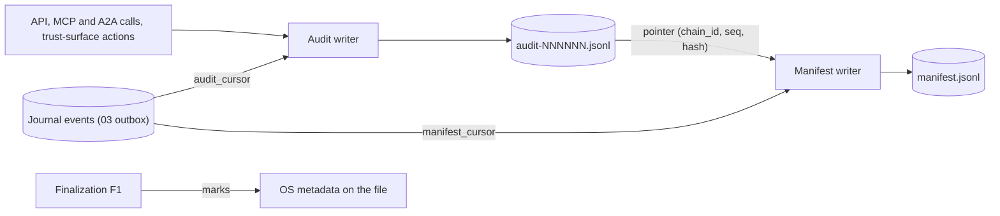

# 04. Audit log and provenance

| | |
|---|---|
| Status | Draft 1 |
| Depends on | [00 conventions](00-conventions.md), [01 domain model](01-domain-model.md), [03 journal](03-journal-and-commit-protocol.md) |
| Implemented by | `zeus-journal` (outbox cursors), `zeus-engine` (records), `zeusd` (audit writer, manifest writer), `zeus` CLI (`zeus audit verify`, `zeus manifest export`) |
| Schemas | [`schema/audit-record.v1.schema.json`](schema/audit-record.v1.schema.json), [`schema/provenance-manifest.v0.schema.json`](schema/provenance-manifest.v0.schema.json), [`schema/export-mappings.schema.json`](schema/export-mappings.schema.json) |

## 1. Purpose

Two records answer two different questions.

* The **audit log** answers "what did Zeus and the people and agents using it do, and in what order?" It is an append-only, hash-chained JSON Lines log of tool calls, consent decisions, uses of session material and file changes. It makes after-the-fact edits detectable under stated assumptions (section 5 says honestly which).
* The **provenance manifest** answers "where did this file come from, and what is it?" It is a JSON Lines ledger with one record per file: hashes, source, time, validators, tool versions, conversions, license (or "unknown"). It can be exported to W3C PROV and Croissant shapes (section 7) and is the basis of the paid team and compliance features in the research (section 2.5).

Research basis: `research.md` section 4.5 ("Audit: append-only, hash-chained log of tool calls, session use and file changes"), `research.md` section 5.4 ("Every use of a session is logged with the origin, the job, the time and the caller") and `research.md` section 5.6 (manifest row fields).

## 2. Terminology

| Term | Meaning |
|---|---|
| Record | One line of the audit log. |
| Chain | The sequence of records linked by `prev_hash`. One chain has one `chain_id`. |
| Head | The `(chain_id, seq, hash)` of the newest record. |
| Anchor | A head value stored somewhere an attacker of the log file cannot rewrite. |
| Outbox | The durable event stream of the journal (03), read through persisted cursors, from which audit and manifest records are produced after the fact. |
| Manifest | The provenance ledger (section 3). |
| OS metadata | File-system attributes that browsers and operating systems use to remember origin (section 6). |



## 3. Provenance manifest v0

### 3.1 Location and shape

1. One ledger per write root: `<write_root>/.zeus/manifest.jsonl`. It lives next to the data so it travels with a dataset. The directory `.zeus` is created with the same permissions as the root.
2. The file is JSON Lines, UTF-8, one JSON object per line, append-only. The first line is a **header** record, every other line is a **file** record ([`provenance-manifest.v0.schema.json`](schema/provenance-manifest.v0.schema.json), `ManifestLine`).
3. `zeus manifest export` (06, 11) produces filtered copies (by run, by directory, by time) with a fresh header, and CSV and Croissant renderings (section 7). The export header's `privacy` block states what was removed.
4. Manifest version 0 means: additive changes without a version bump; consumers MUST ignore unknown properties; a breaking change moves to `manifest_version` 1.

### 3.2 Header record

| Field | Meaning |
|---|---|
| `record_type` | `"header"`. |
| `manifest_version` | `0`. |
| `created_at` | When the ledger (or export) was created. |
| `generator` | `{name: "zeus", version}`. |
| `run_id` | Present on exports of one workflow run. |
| `root_label` | Human label of the root (not a path). |
| `privacy.url_query` | `sanitized` (`record` mode of `redact_url`) or `dropped` (`strict` mode), 00 section 8.2. |
| `privacy.session_origin_included` | If false every `session_origin` is `null`. |
| `privacy.os_metadata` | `off`, `mark_only` or `full`: what was written to the files (section 6). |
| `hash_algorithms` | The digests present in every file record. |

### 3.3 File record

| Field | Type | Rule |
|---|---|---|
| `record_type` | `"file"` | |
| `path` | string | Path relative to the root, `/` separators, no drive letter, no `..` segment, no control characters (`RelPath` pattern). Absolute paths never appear, so manifests do not leak user names. |
| `size_bytes` | bytes | From `verify_result` (03). |
| `sha256`, `blake3` | hex | From `verify_result`: computed from the bytes on disk. Both always present. |
| `media_type` | string or null | Detected from magic bytes. |
| `declared_media_type` | string or null | `Content-Type` of the response (parameters stripped). |
| `source.kind` | SourceKind | `browser_handoff`, `agent`, `cli`, `workflow` (01). |
| `source.url` | redacted URL | `spec.url` after `redact_url` in `record` or `strict` mode. |
| `source.final_url` | redacted URL | The final URL after redirects, likewise redacted. |
| `source.url_redacted` | boolean | True when the redaction removed or masked anything in `url`, `final_url` or `referrer`. |
| `source.referrer` | redacted URL, optional | Included only when the job had one and privacy allows. |
| `retrieved_at` | instant | When the last byte was committed (entry into `verifying`, transition S20). |
| `session_origin` | origin or null | The origin whose session was used, else null. Null for every record when `session_origin_included` is false. Never contains cookies or lease ids. |
| `http` | object | `status` of the first data response, `etag`, `last_modified`, `date`, `repr_digest`: the validators the bytes were fetched under. Null members allowed. |
| `tools` | object | `zeus` (daemon version), `engine` (library version), optional `extension` (extension version for handoffs). |
| `converter_chain` | list | Ordered conversion steps `{tool, version, input_sha256, output_sha256, args_digest?}`. Empty for untransformed downloads. |
| `license` | object | `{spdx, source, evidence_url?}`. `spdx` is an SPDX expression, a `LicenseRef-*` id, or the literal `unknown`. `source` is `unknown` (the default), `declared` (a header such as `Link: rel="license"` or workflow-extracted metadata, or a caller-provided label), `detected` (content analysis; not in the MVP) or `user` (a human supplied it). Zeus never guesses a license. |
| `run_id` | run id or null | Workflow run, if any. |
| `job_id` | job id | |
| `quarantined` | boolean | Final quarantine flag (01 section 11.3). |
| `os_metadata` | list | Which OS attributes were actually written (section 6). |
| `derived_from` | list of SHA-256 | Present for converted files: the input files' digests. |
| `audit` | `{chain_id, seq, hash}` | Pointer to the audit record `file.finalized` (or `file.converted`) that records this file. Lets a reader of the manifest verify the chain from the log (section 4.5). |

### 3.4 Rules

1. **Append only.** Records are appended with a single `write` of one complete line to a file opened append-only; existing lines are never rewritten. Zeus never corrects a record. A file that is replaced produces a new record; consumers use the most recent record per `path`.
2. **When.** The manifest record is produced from the durable event `job.completed` (and from conversion events) by the outbox (03 section 8.1 step F7) **after** the audit record for the same event exists; the manifest's `audit.hash` is that record's hash. Hence `meta.manifest_cursor` never exceeds `meta.audit_cursor`.
3. **Idempotent.** The writer first looks for an existing line with the same `job_id` and `path` (it scans the last 256 lines and keeps an in-memory index per open ledger). A crash between append and cursor advance can still produce a duplicate; duplicates are byte-identical and consumers de-duplicate by `(job_id, path)`.
4. **Durability.** Appends are fsynced in batches (every 1 s, every 64 records, at shutdown). A lost tail is regenerated from the outbox at recovery (03 section 10 step 6).
5. **Redaction.** `source.*` URLs always pass `redact_url`; there is no way to store a raw URL in the manifest. A job from a private browser window (`source.browser.incognito`) is recorded with `session_origin` null and `source.url`, `final_url` reduced to the origin plus `/` (mode `strict` and path removed), and `os_metadata` `mark_only` at most.
6. **License.** Unknown is a first-class answer. A downstream consumer must not read "unknown" as "permissive".
7. **Converted files.** A conversion produces a new file record with `converter_chain`, `derived_from` set to the input digests, the `source` of the first input, and its own `audit` pointer to a `file.converted` record (section 4.4). Zeus never edits the record of an input.
8. **Size.** A record is at most 16 KiB.

### 3.5 Example

A ledger with a header and three files (one handoff, one agent download, one conversion). The `audit` pointers refer to the records of the audit chain in section 4.7, whose hashes the validation tooling recomputes.

```jsonl validate=provenance-manifest.v0#/$defs/ManifestLine
{"created_at":"2026-10-05T09:17:12.100Z","generator":{"name":"zeus","version":"0.1.0"},"hash_algorithms":["sha256","blake3"],"manifest_version":0,"privacy":{"os_metadata":"mark_only","session_origin_included":true,"url_query":"sanitized"},"record_type":"header","root_label":"Zeus downloads"}
{"audit":{"chain_id":"chain_01M3TC5H007DRT2QA1P1NY311K","hash":"180a9271bfe48c75d6580e81535a1e359c5fb32549ac4385a1e67f9c70914c65","seq":7},"blake3":"1e0f07a3c0beca17e28b2d889c3e78a743e9c931e3d5efbff76921fe028ce231","converter_chain":[],"declared_media_type":"application/zstd","http":{"date":"Mon, 05 Oct 2026 09:15:36 GMT","etag":"\"5f3a9c-4c1d2e7b\"","last_modified":"Tue, 29 Sep 2026 14:02:11 GMT","repr_digest":null,"status":206},"job_id":"job_01M45NHJ2AHWMXT8JVJ7BEEJX7","license":{"source":"unknown","spdx":"unknown"},"media_type":"application/zstd","os_metadata":["zone_identifier"],"path":"dataset-v3.tar.zst","quarantined":false,"record_type":"file","retrieved_at":"2026-10-05T09:17:02.311Z","run_id":null,"session_origin":"https://portal.example.org","sha256":"eba4a8587ad422baa9bb314f660b11dfd73563c9af06c6c6ed6ec4bf2da2bc47","size_bytes":1288490188,"source":{"final_url":"https://cdn.example.org/blobs/dataset-v3.tar.zst","kind":"browser_handoff","referrer":"https://portal.example.org/datasets/v3","url":"https://portal.example.org/download/8841","url_redacted":true},"tools":{"engine":"0.1.0","extension":"0.1.0","zeus":"0.1.0"}}
{"audit":{"chain_id":"chain_01M3TC5H007DRT2QA1P1NY311K","hash":"0895e39ca2a7caa5309e0bd9a7929dd2fb433ec07d07944cc15c58f45beb5c73","seq":9},"blake3":"c3a07f73ec4e30b696bc8c5659e85461b00c76674eaeaa02ef12f6b8c83571ec","converter_chain":[],"declared_media_type":"application/gzip","http":{"date":"Mon, 05 Oct 2026 10:02:12 GMT","etag":null,"last_modified":"Fri, 02 Oct 2026 06:00:00 GMT","repr_digest":null,"status":200},"job_id":"job_01M45R71NCNH3W8EQ63TAFME4C","license":{"evidence_url":"https://files.example.com/exports/2026/LICENSE","source":"declared","spdx":"CC-BY-4.0"},"media_type":"application/gzip","os_metadata":["zone_identifier"],"path":"reports/q3.csv.gz","quarantined":false,"record_type":"file","retrieved_at":"2026-10-05T10:19:41.000Z","run_id":"run_01M45KGHR0ED0WJDFXKG49029B","session_origin":null,"sha256":"9218812567e906efb346546840f6145fc189148e5633d0737fee7402a3207f9a","size_bytes":1073741824,"source":{"final_url":"https://files.example.com/exports/2026/q3.csv.gz","kind":"agent","url":"https://files.example.com/exports/2026/q3.csv.gz","url_redacted":false},"tools":{"engine":"0.1.0","zeus":"0.1.0"}}
{"audit":{"chain_id":"chain_01M3TC5H007DRT2QA1P1NY311K","hash":"3e5368402c4a310121179fe76ccf4411c5dba812cd66779c45c9c9291bdfdaa7","seq":10},"blake3":"c8bd1103e018465a8abdca368d62f6d3af1f434442b10cfa47d0aed9d527a803","converter_chain":[{"input_sha256":"9218812567e906efb346546840f6145fc189148e5633d0737fee7402a3207f9a","output_sha256":"f24f5ddf46354d10a2b2340f00bd9223e75c25a31b4328498f2fa98ebc55d096","tool":"gzip","version":"1.13"}],"declared_media_type":null,"derived_from":["9218812567e906efb346546840f6145fc189148e5633d0737fee7402a3207f9a"],"job_id":"job_01M45R71NCNH3W8EQ63TAFME4C","license":{"evidence_url":"https://files.example.com/exports/2026/LICENSE","source":"declared","spdx":"CC-BY-4.0"},"media_type":"text/csv","os_metadata":[],"path":"reports/q3.csv","quarantined":false,"record_type":"file","retrieved_at":"2026-10-05T10:19:41.000Z","run_id":"run_01M45KGHR0ED0WJDFXKG49029B","session_origin":null,"sha256":"f24f5ddf46354d10a2b2340f00bd9223e75c25a31b4328498f2fa98ebc55d096","size_bytes":4831838208,"source":{"final_url":"https://files.example.com/exports/2026/q3.csv.gz","kind":"agent","url":"https://files.example.com/exports/2026/q3.csv.gz","url_redacted":false},"tools":{"engine":"0.1.0","zeus":"0.1.0"}}
```

## 4. Audit log

### 4.1 Files

| Item | Rule |
|---|---|
| Location | `<state>/audit/` (03 section 3.1). Never inside a write root, so agents with file tools cannot reach it. |
| Names | `audit-<index>.jsonl`, `index` a 6-digit zero-padded integer starting at `000001`. |
| Format | UTF-8 JSON Lines. Each line is one record in **canonical JSON** (RFC 8785, 00 section 7), terminated by `\n`. A record is at most 64 KiB. |
| Permissions | Owner only. |
| Chain | One chain continues across files: the first record of file `n+1` has the `prev_hash` of the last record of file `n`. |

### 4.2 Record

[`audit-record.v1.schema.json`](schema/audit-record.v1.schema.json):

| Field | Type | Meaning |
|---|---|---|
| `v` | `1` | Record format version. |
| `seq` | integer | 1, 2, 3, ... gapless within a chain. |
| `ts` | instant | Wall-clock time (00 section 6.1). Informational for ordering: `seq` is the order. |
| `actor` | Actor | Who did it: `kind` (`human`, `agent`, `cli`, `extension`, `engine`, `policy`, `system`), `surface`, `client_id` (01 section 5.3). |
| `action` | string | Dotted, from the registry in section 4.4. |
| `subject` | object | What it concerned: any of `job_id`, `run_id`, `grant_id`, `approval_id`, `lease_id`, `origin`, `url_redacted`, `path`. May be empty. |
| `outcome` | enum | `ok`, `denied`, `error`. |
| `data` | object | Action-specific facts. At most 32 KiB. **Never** secrets (00 section 8.1); URLs only as `url_redacted` (mode `record`); integers only, no floats (00 section 7). |
| `prev_hash` | hex | Hash of the previous record, or the genesis hash. |
| `hash` | hex | This record's hash (section 4.3). |

### 4.3 Canonicalisation, hash and genesis

For record `r` with sequence `n`:

1. `body(r)` is the record **without** its `hash` member (it still contains `prev_hash`).
2. `canon(r)` is the JCS (RFC 8785) serialisation of `body(r)` as UTF-8 bytes.
3. `r.hash = hex( BLAKE3( prev_hash_bytes || canon(r) ) )`, where `prev_hash_bytes` is the 32-byte binary form of `r.prev_hash`, `||` is concatenation and BLAKE3 is the default 32-byte, unkeyed output.
4. **Genesis.** The first record of a chain has `seq` 1 and action `audit.chain_started`. Its `data` contains `chain_id` (a `chain_` id, 00 section 5.1), `zeus_version`, `store_id` and `keyed` (false). Its `prev_hash` is
   `hex( BLAKE3( UTF-8("zeus.audit.genesis.v1" || chain_id) ) )`
   (the ASCII string `zeus.audit.genesis.v1` immediately followed by the `chain_id` text). The genesis hash is therefore unique per chain and recomputable from the first record alone.
5. Writers emit the **canonical form of the whole record, including `hash`**, as the line, so the exact bytes are stable and diffable. Readers MUST NOT rely on that: they parse, drop `hash`, canonicalise and compare.
6. **Keyed mode (optional).** When `keyed` is true, step 3 uses BLAKE3 keyed hashing with a 32-byte key held in the OS keyring (`zeus-audit-chain`) instead of the plain hash; genesis is computed with the same key. Verification then needs the key. It stops a party without keyring access from recomputing a rewritten chain (section 5).

### 4.4 Actions

`write-ahead` means the record MUST be durably appended (written and fsynced) **before** the act it describes takes place. Records without it are written from the outbox after the fact.

| Action | When | Write-ahead | `data` (all optional ids go in `subject`) |
|---|---|---|---|
| `audit.chain_started` | Chain creation | n/a | `chain_id`, `zeus_version`, `store_id`, `keyed` |
| `audit.rotated` | Last record of a file | n/a | `next_file` |
| `audit.checkpoint` | Every 1000 records and at rotation | n/a | `covered_seq`, `journal_last_event_seq`, `store_id` |
| `audit.recovered` | After a torn tail was cut (section 4.6) | n/a | `discarded_bytes`, `quarantine_file` |
| `daemon.started`, `daemon.stopping` | Lifecycle | no | `version`, `instance_id` or `reason` |
| `client.connected`, `client.rejected` | A client authenticated or was refused on any interface | no | `via`, `client_id`, `reason` |
| `tool.call` | Every MCP tool, A2A task or JSON-RPC method that mutates state or reads sensitive state (06, 05) | **yes**, for mutating calls | `tool`, `args_blake3` (BLAKE3 of the JCS of the arguments, never the arguments), result summary (`job_ids`, counts) |
| `approval.requested`, `approval.decided` | From events | no for requested; **yes** for decided | `kind`, `outcome`, `scope`, `grant_id` |
| `grant.created`, `grant.revoked`, `grant.expired` | From events | **yes** for created and revoked | `scope`, `expires_at` or `reason` |
| `session.lease_requested` | Just before the daemon asks the extension for session material (02) | **yes** | `purpose`, `ttl_ms`, `via` |
| `session.leased` | Material arrived | no | `purpose`, `cookie_count`, `ttl_ms`. Never cookie names or values. |
| `session.denied` | Extension refused or policy refused | no | `status`, `error_code` |
| `job.created` | From events | no | `source_kind`, `via` |
| `job.completed`, `file.finalized` | From events at S80 | no | `size_bytes`, `sha256`, `blake3`, `quarantined`, `os_metadata` |
| `job.failed` | From events | no | `error_code`, `error_class` |
| `job.canceled` | Transition to `canceled` | no | `actor`, `cause` |
| `file.converted` | A conversion produced a file | no | `tool`, `tool_version`, `input_sha256`, `output_sha256`, `output_blake3`, `output_size_bytes` |
| `file.moved`, `file.deleted`, `file.renamed` | Organisation operations (07, 08) | **yes** | `from`, `to` (paths), `plan_id`, `approval_id` |
| `policy.denied` | A rule refused something | no | `rule`, `reason_code` |
| `config.changed` | Configuration or allow-list changed | **yes** | `key`, `old_blake3`, `new_blake3` (never values of secrets) |
| `audit.verify` | A verification run finished | no | `result`, `records`, `first_problem_seq` |
| `audit.error` | A record could not be built as asked (for example `redaction_violation`, section 9) | no | `reason`, `action` |

`job.state_changed` and `job.progress` are **not** audited: they are high-volume and reproducible from the journal. The audit records the security-relevant and file-changing facts.

### 4.5 Verification algorithm

Input: the files `audit-*.jsonl` in index order; optionally a trusted anchor `(seq, hash)` (from the journal's `meta.audit_head`, an external anchor, or a manifest pointer); optionally the chain key.

```
verify(files, anchor?):
  prev      = null
  expectSeq = null
  for each file f in index order:
      for each line L in f, in order:
          if L is empty or not valid JSON or not an object:   fail(torn_or_malformed, f, line)
          r = parse(L); validate r against audit-record.v1
          if prev == null:                                    # first record seen
              if anchor given and anchor.seq != 0:            # verification starts mid-chain
                  expectSeq = r.seq ; prev = r.prev_hash      # trust r.prev_hash only if it equals anchor.hash of seq-1 (see below)
              else:
                  require r.action == "audit.chain_started" and r.seq == 1
                  require r.prev_hash == genesis(r.data.chain_id)     # section 4.3 item 4
                  expectSeq = 1 ; prev = r.prev_hash
          require r.seq == expectSeq                          else fail(seq_gap)
          require r.prev_hash == prev                         else fail(prev_mismatch)
          require hash(prev, r) == r.hash                     else fail(hash_mismatch)   # section 4.3
          prev = r.hash ; expectSeq = r.seq + 1
          warn if r.ts < previous r.ts - 5 min                # clock step, not a break
      if f is not the last file: require its last record is audit.rotated and the next file starts at expectSeq   else fail(rotation)
  if anchor given: require a record with anchor.seq whose hash == anchor.hash     else fail(anchor_mismatch)
  compare the final (seq, hash) with journal meta.audit_head:
      equal                           -> ok
      journal head is ahead of the log -> fail(tail_truncated)       # records were removed from the end
      log is ahead of the journal head -> ok, note: journal lagged   # the journal head is updated after the append
  return ok(head = prev, records = expectSeq - 1)
```

* **Mid-chain start.** When old files were pruned (section 4.6), the first record's `prev_hash` cannot be recomputed. The verifier accepts it only if an anchor says that the hash at `seq - 1` is exactly that value (kept in `audit/anchor.json`, written when files are pruned).
* **Tail check at startup** (03 section 10 step 6): verify only the last file from its first record's `prev_hash` and compare the head with the journal. A full verification is a separate command (`zeus audit verify`, 11).
* **Output.** On failure: error `audit.chain_broken` (class `internal`, not retryable) with `details {kind, seq, file, line}`; kinds are `torn_or_malformed`, `seq_gap`, `prev_mismatch`, `hash_mismatch`, `bad_genesis`, `rotation`, `tail_truncated`, `anchor_mismatch`, `missing_file`.
* **Cost.** Streaming, O(records) time, O(1) memory; about 1 million records per second on a laptop is expected (BLAKE3 plus JCS).

### 4.6 Appending, fsync, torn tails, rotation, retention

1. **Single writer.** One task appends; the daemon holds the audit directory's lock. Each record is serialised, hashed with the previous head, and written with **one** `write` call (`O_APPEND`; Windows `FILE_APPEND_DATA`) as one complete line.
2. **fsync policy.**

| Class | Policy |
|---|---|
| Write-ahead records (section 4.4) | `fsync` (data flush) of the log file before returning to the caller that is about to act. |
| Everything else | Batched: `fsync` after 64 records, 64 KiB, or 1 s, whichever first; always at rotation, at shutdown and when a write-ahead record is written (it flushes the earlier ones too). |

3. **Head in the journal.** After each fsync the writer updates `meta.audit_head` in the journal (a durable transaction, batched with other work). The journal is therefore at most one batch behind the log; section 4.5 tolerates that direction only.
4. **Torn tail.** On startup, if the last file does not end with `\n`, or its last line is not valid JSON or its hash is wrong, the incomplete tail is **moved**, not deleted: bytes after the last valid newline go to `audit-<index>.torn-<ts>`, and the chain continues from the last valid record with a new record `audit.recovered` (`discarded_bytes`, `quarantine_file`). A tail cut that removes more than the final partial line is a verification failure (`tail_truncated`), not a recovery.
5. **Rotation.** When the active file reaches 64 MiB, or the UTC date changes, the writer appends `audit.checkpoint`, then `audit.rotated` as the last record, fsyncs, and starts `audit-<index+1>.jsonl`. The first line of the new file is an ordinary record.
6. **Retention.** Files are kept at least 365 days (configurable). Pruning removes whole files from the oldest end only, after writing `audit/anchor.json` `{chain_id, seq, hash}` (the hash of the last record of the newest pruned file) and an `audit.checkpoint` noting the prune. Verification then runs from that anchor.
7. **Size and cost.** A record is about 400 bytes to 1.5 KiB; at 50 audited actions per second (a busy workflow) the log grows about 100 MB per day, so rotation matters. Jobs themselves are not audited per progress tick.
8. **Disabled?** The audit log cannot be disabled in the free product. If it cannot be written (disk full, permission), write-ahead actions fail closed (`audit.unavailable`, class `unavailable`): Zeus does not release session material or delete files without a record.

### 4.7 Test vectors

Worked example: record 2 of the chain below.

* `prev_hash` (the `hash` of record 1): `ccd1d1eec3132fd18803168d9492a1db7c3a8ff8bb6b37167efeb6aff0989434`
* `canon(r)` (one line, no whitespace):

```
{"action":"daemon.started","actor":{"kind":"system"},"data":{"instance_id":"3f9a6c2d1b7e4a08c5d2e9f1a0b3c4d5","version":"0.1.0"},"outcome":"ok","prev_hash":"ccd1d1eec3132fd18803168d9492a1db7c3a8ff8bb6b37167efeb6aff0989434","seq":2,"subject":{},"ts":"2026-10-01T00:00:00.412Z","v":1}
```

* `hash = BLAKE3( bytes(prev_hash) || canon(r) )` = `3df1096a1681e2d5473e36417a0cef262a1d6887ff94d8f7332d25e52d1f29a5`
* Genesis for `chain_01M3TC5H007DRT2QA1P1NY311K` = `d2f842db12929eb9a0c5f557bd4506e3596619bcddb92a460403d8edbb4639a4`

The chain (11 records). `npm run validate` in `docs/spec/tools` checks every line against the schema **and recomputes the whole chain**; every implementation MUST pass the same test against this block. Head after record 11: `0bf55ec3cae965128968b92a062399b8262f131eec57d9f7da687e6b1a3fbb72`.

```jsonl validate=audit-record.v1#/$defs/AuditRecord chain
{"action":"audit.chain_started","actor":{"kind":"system"},"data":{"chain_id":"chain_01M3TC5H007DRT2QA1P1NY311K","keyed":false,"store_id":"01M2YVHK60EHVSRRHA6BW4QCWM","zeus_version":"0.1.0"},"hash":"ccd1d1eec3132fd18803168d9492a1db7c3a8ff8bb6b37167efeb6aff0989434","outcome":"ok","prev_hash":"d2f842db12929eb9a0c5f557bd4506e3596619bcddb92a460403d8edbb4639a4","seq":1,"subject":{},"ts":"2026-10-01T00:00:00.000Z","v":1}
{"action":"daemon.started","actor":{"kind":"system"},"data":{"instance_id":"3f9a6c2d1b7e4a08c5d2e9f1a0b3c4d5","version":"0.1.0"},"hash":"3df1096a1681e2d5473e36417a0cef262a1d6887ff94d8f7332d25e52d1f29a5","outcome":"ok","prev_hash":"ccd1d1eec3132fd18803168d9492a1db7c3a8ff8bb6b37167efeb6aff0989434","seq":2,"subject":{},"ts":"2026-10-01T00:00:00.412Z","v":1}
{"action":"approval.decided","actor":{"kind":"human","surface":"extension_popup"},"data":{"grant_id":"gr_01M45NHPJP04TX6B1CJVQVQAK9","kind":"handoff","outcome":"approve","scope":"site"},"hash":"b410a4e74e71f50de56a39f832cc3f1e08db022e862b0b9f1c06fab8b55e1fab","outcome":"ok","prev_hash":"3df1096a1681e2d5473e36417a0cef262a1d6887ff94d8f7332d25e52d1f29a5","seq":3,"subject":{"approval_id":"ap_01M45NHJ3XS0QXG9T42HHN2YR8","job_id":"job_01M45NHJ2AHWMXT8JVJ7BEEJX7","origin":"https://portal.example.org"},"ts":"2026-10-05T09:15:34.870Z","v":1}
{"action":"grant.created","actor":{"kind":"human","surface":"extension_popup"},"data":{"expires_at":"2026-10-06T09:15:34.870Z","scope":"site"},"hash":"2d9e4419a888b0d3a1c6f61c5713da8acb121ebc0286c8d6c0bbacf9a4e7d093","outcome":"ok","prev_hash":"b410a4e74e71f50de56a39f832cc3f1e08db022e862b0b9f1c06fab8b55e1fab","seq":4,"subject":{"approval_id":"ap_01M45NHJ3XS0QXG9T42HHN2YR8","grant_id":"gr_01M45NHPJP04TX6B1CJVQVQAK9","origin":"https://portal.example.org"},"ts":"2026-10-05T09:15:34.870Z","v":1}
{"action":"session.lease_requested","actor":{"kind":"engine"},"data":{"purpose":"download","ttl_ms":900000,"via":"native_messaging"},"hash":"43441ca5d7defb550da11ab4f1a49db5c7c52140f24d56e98cf8d83e04b9ed79","outcome":"ok","prev_hash":"2d9e4419a888b0d3a1c6f61c5713da8acb121ebc0286c8d6c0bbacf9a4e7d093","seq":5,"subject":{"grant_id":"gr_01M45NHPJP04TX6B1CJVQVQAK9","job_id":"job_01M45NHJ2AHWMXT8JVJ7BEEJX7","lease_id":"sess_01M45NHQTC78XWWC8N35Y2BPEA","origin":"https://portal.example.org"},"ts":"2026-10-05T09:15:36.100Z","v":1}
{"action":"session.leased","actor":{"kind":"engine"},"data":{"cookie_count":7,"purpose":"download","ttl_ms":900000},"hash":"3d87c07ebcb2b51a6e2eda53c1496ab103bc7fc46806906c6815cb9ee5169047","outcome":"ok","prev_hash":"43441ca5d7defb550da11ab4f1a49db5c7c52140f24d56e98cf8d83e04b9ed79","seq":6,"subject":{"grant_id":"gr_01M45NHPJP04TX6B1CJVQVQAK9","job_id":"job_01M45NHJ2AHWMXT8JVJ7BEEJX7","lease_id":"sess_01M45NHQTC78XWWC8N35Y2BPEA","origin":"https://portal.example.org"},"ts":"2026-10-05T09:15:36.140Z","v":1}
{"action":"file.finalized","actor":{"kind":"engine"},"data":{"blake3":"1e0f07a3c0beca17e28b2d889c3e78a743e9c931e3d5efbff76921fe028ce231","os_metadata":["zone_identifier"],"quarantined":false,"sha256":"eba4a8587ad422baa9bb314f660b11dfd73563c9af06c6c6ed6ec4bf2da2bc47","size_bytes":1288490188},"hash":"180a9271bfe48c75d6580e81535a1e359c5fb32549ac4385a1e67f9c70914c65","outcome":"ok","prev_hash":"3d87c07ebcb2b51a6e2eda53c1496ab103bc7fc46806906c6815cb9ee5169047","seq":7,"subject":{"job_id":"job_01M45NHJ2AHWMXT8JVJ7BEEJX7","origin":"https://portal.example.org","path":"/home/ada/Downloads/Zeus/dataset-v3.tar.zst","url_redacted":"https://portal.example.org/download/8841"},"ts":"2026-10-05T09:17:12.020Z","v":1}
{"action":"tool.call","actor":{"client_id":"claude-code:3d9e","kind":"agent","surface":"mcp"},"data":{"args_blake3":"8a0f2d3c5b7e1a94d6c8e0f2a4b6d8f0123456789abcdef0123456789abcdef0","job_ids":["job_01M45R71NCNH3W8EQ63TAFME4C"],"tool":"zeus_enqueue"},"hash":"dbf3412e51f20bfb6b9405839075265b2ed2324eb83b3df6e4d7fb4ac9fb51ff","outcome":"ok","prev_hash":"180a9271bfe48c75d6580e81535a1e359c5fb32549ac4385a1e67f9c70914c65","seq":8,"subject":{"origin":"https://files.example.com"},"ts":"2026-10-05T10:02:11.500Z","v":1}
{"action":"file.finalized","actor":{"kind":"engine"},"data":{"blake3":"c3a07f73ec4e30b696bc8c5659e85461b00c76674eaeaa02ef12f6b8c83571ec","os_metadata":["zone_identifier"],"quarantined":false,"sha256":"9218812567e906efb346546840f6145fc189148e5633d0737fee7402a3207f9a","size_bytes":1073741824},"hash":"0895e39ca2a7caa5309e0bd9a7929dd2fb433ec07d07944cc15c58f45beb5c73","outcome":"ok","prev_hash":"dbf3412e51f20bfb6b9405839075265b2ed2324eb83b3df6e4d7fb4ac9fb51ff","seq":9,"subject":{"job_id":"job_01M45R71NCNH3W8EQ63TAFME4C","origin":"https://files.example.com","path":"/home/ada/Downloads/Zeus/reports/q3.csv.gz","url_redacted":"https://files.example.com/exports/2026/q3.csv.gz"},"ts":"2026-10-05T10:20:00.000Z","v":1}
{"action":"file.converted","actor":{"kind":"engine"},"data":{"input_sha256":"9218812567e906efb346546840f6145fc189148e5633d0737fee7402a3207f9a","output_blake3":"c8bd1103e018465a8abdca368d62f6d3af1f434442b10cfa47d0aed9d527a803","output_sha256":"f24f5ddf46354d10a2b2340f00bd9223e75c25a31b4328498f2fa98ebc55d096","output_size_bytes":4831838208,"tool":"gzip","tool_version":"1.13"},"hash":"3e5368402c4a310121179fe76ccf4411c5dba812cd66779c45c9c9291bdfdaa7","outcome":"ok","prev_hash":"0895e39ca2a7caa5309e0bd9a7929dd2fb433ec07d07944cc15c58f45beb5c73","seq":10,"subject":{"job_id":"job_01M45R71NCNH3W8EQ63TAFME4C","path":"/home/ada/Downloads/Zeus/reports/q3.csv"},"ts":"2026-10-05T10:21:00.000Z","v":1}
{"action":"grant.revoked","actor":{"kind":"human","surface":"extension_popup"},"data":{"reason":"user_request"},"hash":"0bf55ec3cae965128968b92a062399b8262f131eec57d9f7da687e6b1a3fbb72","outcome":"ok","prev_hash":"3e5368402c4a310121179fe76ccf4411c5dba812cd66779c45c9c9291bdfdaa7","seq":11,"subject":{"grant_id":"gr_01M45NHPJP04TX6B1CJVQVQAK9","origin":"https://portal.example.org"},"ts":"2026-10-05T12:30:00.000Z","v":1}
```

Required negative tests: flip one character of any field; delete a middle record; swap two records; truncate the tail while keeping the journal head; append a record with a wrong `prev_hash`: each MUST be reported with the matching failure kind.

## 5. What tamper evidence does and does not give

State the limits plainly, because an audit log that claims more than it delivers is worse than none.

**Detected** (given an intact later record, an intact anchor or an unmodified journal head):

* Modification of any field of an interior record.
* Deletion or insertion of an interior record.
* Reordering of records.
* Truncation of the log's tail, when the journal head or an external anchor still holds a newer head.
* A torn write (distinguished from malicious truncation by the rules of section 4.6 item 4).

**Not detected, and why:**

| Attack | Why it succeeds |
|---|---|
| An attacker who can write the log recomputes every hash from the first modified record to the end (the algorithm is public and unkeyed). | The chain proves consistency, not authorship. Mitigations: keyed mode (needs the keyring secret), external anchors, signed checkpoints (open issue O2). |
| The same attacker also rewrites `meta.audit_head` in the journal. | Both files are owned by the same OS user. Anchors outside the user's control (a git repository, a different machine, a notarisation service) are the only fix. |
| Deleting the whole log and starting a new chain. | A fresh chain with a new `chain_id` verifies cleanly. Detected only if the old head was anchored or the journal records the chain id (the journal's `audit_head.chain_id` mismatch is reported as `anchor_mismatch`). |
| Omission by a compromised daemon (it never writes a record). | A log cannot prove completeness against its own writer. Write-ahead records for the most sensitive acts (session release, deletion) and an independent extension-side record (the browser's own consent store, 02) narrow the gap but do not close it. |
| False `ts` values. | `ts` is wall-clock text; `seq` is the order. A verifier warns about backward jumps. |
| Content of `data` is wrong or misleading because the code that built it was. | Hashes protect what was written, not its truth. |

**Anchoring.** `zeus audit head` prints `(chain_id, seq, hash)`; `zeus audit anchor --git <repo>` or `--file <path>` appends it to an external location. The daemon offers an hourly option and anchors at every rotation. Anchors are optional and off by default (no network access without an explicit user setting).

**Bottom line.** The log is evidence against accidents, bugs and casual tampering, and a good basis for investigations when anchored. It is not a defence against an attacker who runs as the user and wants to erase their tracks, nor against a malicious Zeus binary.

## 6. OS provenance metadata

Browsers record where a file came from and that it came from the internet, using attributes that the operating system and other programs read. Zeus does the same, in a way that is safe by default and respects privacy. These attributes are a convenience for other software. **Zeus never reads them as provenance**: any program can edit them. The manifest and the audit log are the record.

### 6.1 Policy

`os_metadata` is configured per write root:

| Mode | Windows | macOS | Linux |
|---|---|---|---|
| `off` | nothing | nothing | nothing |
| `mark_only` (default) | `Zone.Identifier` with `ZoneId=3` only | `com.apple.quarantine` only | nothing (there is no standard mark) |
| `full` | `ZoneId=3` plus `ReferrerUrl` and `HostUrl` | quarantine plus `kMDItemWhereFroms` | `user.xdg.origin.url` and `user.xdg.referrer.url` |

All URLs in `full` mode are redacted in `strict` mode (query dropped, secret-looking path segments masked), never the raw job URL. Marks are applied to the **data file before the rename** (03 section 8.1 step F1), so the final file is never visible without them. The set actually written is recorded in the manifest (`os_metadata`) and the `file.finalized` audit record.

### 6.2 Windows: Zone.Identifier alternate data stream

The Mark-of-the-Web is the NTFS alternate data stream `<file>:Zone.Identifier`. Content is ASCII text with CRLF line endings, no byte-order mark:

```
[ZoneTransfer]
ZoneId=3
ReferrerUrl=https://portal.example.org/datasets/v3
HostUrl=https://cdn.example.org/blobs/dataset-v3.tar.zst
```

`ZoneId=3` means "Internet". In `mark_only` only the first two lines are written. The stream is created with an ordinary `CreateFileW("path:Zone.Identifier")` on the data file. Effects users see (SmartScreen, Office Protected View) are intended for risky files and annoying for bulk data; hence the `off` mode for trusted data roots. File systems without streams (FAT, exFAT, many network shares) answer with `ERROR_INVALID_NAME` or `ERROR_NOT_SUPPORTED`: skip silently and record `os_metadata: []`.

### 6.3 macOS: quarantine and where-from

* `com.apple.quarantine` extended attribute, value `<flags>;<timestamp hex seconds>;<agent name>;<UUID>`, for example `0081;66f1c2a0;Zeus;` followed by an optional UUID. The agent name is `Zeus`. The flags value follows what Chromium writes for web downloads; the implementer MUST verify it against the current Chromium source (`quarantine_mac`) and Apple documentation before release (open issue O4). Gatekeeper treats such files according to its policy.
* `com.apple.metadata:kMDItemWhereFroms`: a binary property list containing an array of one or two strings (the data URL and, when present, the referrer). Spotlight shows it as "Where from".
* Written with `setxattr` on the data file before the rename. Not written on file systems without extended attributes.

### 6.4 Linux: freedesktop xattrs

* `user.xdg.origin.url`: UTF-8 URL the file was obtained from. `user.xdg.referrer.url`: the referring URL. (freedesktop.org "Common extended attributes".)
* They need a file system with user extended attributes (ext4, XFS, btrfs; support on tmpfs depends on the kernel). `ENOTSUP` is skipped silently.
* There is no quarantine mark on Linux; `mark_only` writes nothing there. Quarantine remains Zeus's own flag (01 section 11.3).

### 6.5 When NOT to write OS metadata

Do not write the URL attributes (use at most `mark_only`; `off` where stated) when:

1. The mode is `off` (always allowed, one setting per root).
2. The job came from a **private browser window** (`incognito`): no URLs anywhere on disk beyond what the journal needs for a resume, no `session_origin`.
3. The job used a **session** (the URL may reveal account identifiers such as `/u/12345/`): default to `mark_only` unless the user opts into `full` for that root.
4. The destination is a **network share, removable medium or cloud-synchronised folder** (OneDrive, Dropbox, iCloud Drive, Google Drive, detected by path or file-system type): attributes can be uploaded or copied to other machines and other people. Default `mark_only`.
5. The file is destined for **export or sharing** as part of a dataset: attributes travel with copies on some systems; the manifest carries provenance instead.
6. The URL passed through redaction and `redacted` is true **and** the remaining URL would be misleading (for example everything but the host removed): write the origin only.
7. The file system does not support the attribute: skip, record, no error.
8. A root is marked `trusted` by the user (a data lake you built yourself): `off`.

## 7. Crosswalk to W3C PROV and Croissant

The manifest is Zeus's own format; exports map it to widely used vocabularies. The mapping is one-way and lossy where the target has no place for a field.

### 7.1 W3C PROV

PROV-O (the W3C Recommendation) concepts; PROV-JSON (a W3C Member Submission) as the serialisation used by `zeus manifest export --format prov-json`.

| Manifest field | PROV concept | Notes |
|---|---|---|
| a file record | `prov:Entity` `zeus:file/<sha256>` | Content-addressed identifier. |
| `sha256`, `blake3`, `size_bytes`, `media_type`, `path` | attributes of the entity (`zeus:sha256`, `zeus:blake3`, `zeus:size_bytes`, `prov:label` = file name) | |
| `source.url` | `prov:Entity` `zeus:remote/<hash of redacted url>` with `prov:label` = redacted URL; `prov:wasDerivedFrom` / `prov:hadPrimarySource` from the file to it | The remote resource at the time of retrieval. |
| `job_id`, `retrieved_at` | `prov:Activity` `zeus:job/<job_id>` with `prov:endTime` = `retrieved_at`; `prov:wasGeneratedBy` (`prov:time` = `retrieved_at`) | The download. |
| `source.kind`, `run_id` | attributes of the activity (`zeus:sourceKind`, `zeus:run`) | |
| `tools.zeus` | `prov:Agent` of type `prov:SoftwareAgent`, `prov:wasAssociatedWith` the activity | |
| the human or agent that asked | `prov:Agent` (pseudonymous client id; never a person's name unless configured), `prov:wasAssociatedWith` | Privacy: omitted when `privacy` says so. |
| `session_origin` | attribute `zeus:sessionOrigin` on the activity | PROV has no concept for "authenticated access"; an extension attribute keeps it explicit. |
| `http.etag`, `http.last_modified` | attributes of the remote entity (`zeus:etag`, `zeus:lastModified`) | |
| `converter_chain[i]` | a further `prov:Activity` that `prov:used` the input entity and generated the output entity; `prov:wasDerivedFrom` (with the activity) between them | One activity per step. |
| `derived_from` | `prov:wasDerivedFrom` | |
| `license` | `dcterms:license` attribute on the entity | |
| `audit` | attribute `zeus:auditRecord` = `<chain_id>#<seq>` and `zeus:auditHash` | Link back to the evidence. |

```json validate=export-mappings#/$defs/ProvJson
{
  "prefix": {
    "prov": "http://www.w3.org/ns/prov#",
    "zeus": "https://zeus.invalid/ns#",
    "xsd": "http://www.w3.org/2001/XMLSchema#"
  },
  "entity": {
    "zeus:file/eba4a8587ad422baa9bb314f660b11dfd73563c9af06c6c6ed6ec4bf2da2bc47": {
      "prov:label": "dataset-v3.tar.zst",
      "zeus:sha256": "eba4a8587ad422baa9bb314f660b11dfd73563c9af06c6c6ed6ec4bf2da2bc47",
      "zeus:blake3": "1e0f07a3c0beca17e28b2d889c3e78a743e9c931e3d5efbff76921fe028ce231",
      "zeus:size_bytes": { "$": "1288490188", "type": "xsd:long" },
      "zeus:auditRecord": "chain_01M3TC5H007DRT2QA1P1NY311K#7"
    },
    "zeus:remote/7f3a91c2": {
      "prov:label": "https://portal.example.org/download/8841",
      "zeus:etag": "\"5f3a9c-4c1d2e7b\"",
      "zeus:lastModified": "Tue, 29 Sep 2026 14:02:11 GMT"
    }
  },
  "activity": {
    "zeus:job/job_01M45NHJ2AHWMXT8JVJ7BEEJX7": {
      "prov:startTime": "2026-10-05T09:15:30.250Z",
      "prov:endTime": "2026-10-05T09:17:02.311Z",
      "zeus:sourceKind": "browser_handoff",
      "zeus:sessionOrigin": "https://portal.example.org"
    }
  },
  "agent": {
    "zeus:software/zeus-0.1.0": {
      "prov:type": { "$": "prov:SoftwareAgent", "type": "prov:QUALIFIED_NAME" },
      "prov:label": "Zeus 0.1.0"
    }
  },
  "wasGeneratedBy": {
    "_:g1": {
      "prov:entity": "zeus:file/eba4a8587ad422baa9bb314f660b11dfd73563c9af06c6c6ed6ec4bf2da2bc47",
      "prov:activity": "zeus:job/job_01M45NHJ2AHWMXT8JVJ7BEEJX7",
      "prov:time": "2026-10-05T09:17:02.311Z"
    }
  },
  "used": {
    "_:u1": {
      "prov:activity": "zeus:job/job_01M45NHJ2AHWMXT8JVJ7BEEJX7",
      "prov:entity": "zeus:remote/7f3a91c2"
    }
  },
  "wasAssociatedWith": {
    "_:a1": {
      "prov:activity": "zeus:job/job_01M45NHJ2AHWMXT8JVJ7BEEJX7",
      "prov:agent": "zeus:software/zeus-0.1.0"
    }
  },
  "wasDerivedFrom": {
    "_:d1": {
      "prov:generatedEntity": "zeus:file/eba4a8587ad422baa9bb314f660b11dfd73563c9af06c6c6ed6ec4bf2da2bc47",
      "prov:usedEntity": "zeus:remote/7f3a91c2",
      "prov:activity": "zeus:job/job_01M45NHJ2AHWMXT8JVJ7BEEJX7"
    }
  }
}
```

### 7.2 Croissant (MLCommons, version 1.0)

Croissant describes ML datasets in JSON-LD. A downloaded file maps to a `cr:FileObject` in the dataset's `distribution`. Version 1.0 (published 2024-03-01) is the current version verified at drafting time; later versions are tracked in open issue O5.

| Manifest field | Croissant `cr:FileObject` property | Notes |
|---|---|---|
| `path` (basename) | `name` | Includes the extension. |
| `path` | `@id` | Unique within the dataset; Zeus uses the relative path. |
| `source.final_url` or `source.url` | `contentUrl` | The redacted source URL; a dataset that is to be re-downloadable needs a stable, public URL that the user supplies. |
| `media_type` or `declared_media_type` | `encodingFormat` | A MIME type. |
| `sha256` | `sha256` | Croissant also allows `md5`; Zeus does not emit it. |
| `size_bytes` | `contentSize` | Text such as `"1288490188 B"`. |
| `derived_from` | `containedIn` (an archive) or a separate `prov:wasDerivedFrom` | Croissant has no general derivation property. |
| `license` | `license` on the **dataset**, not the file | Croissant recommends the URL of a known license, for example `https://spdx.org/licenses/CC-BY-4.0.html`; `unknown` is omitted, never mapped to a default. |
| `blake3`, `retrieved_at`, `session_origin`, `http`, `tools`, `audit` | none | Exported through a PROV block alongside (section 7.1) or in a `zeus:` extension. |

```json validate=export-mappings#/$defs/CroissantFileObject
{
  "@type": "cr:FileObject",
  "@id": "reports/q3.csv.gz",
  "name": "q3.csv.gz",
  "contentUrl": "https://files.example.com/exports/2026/q3.csv.gz",
  "encodingFormat": "application/gzip",
  "sha256": "9218812567e906efb346546840f6145fc189148e5633d0737fee7402a3207f9a",
  "contentSize": "1073741824 B"
}
```

The export also writes the Croissant context and dataset wrapper (`@context` with `cr`, `sc` and the standard terms, `conformsTo` `http://mlcommons.org/croissant/1.0`, `name`, `license` when every file shares one). The wrapper is generated from the Croissant specification and is not reproduced here.

### 7.3 CSV

`zeus manifest export --format csv` writes the columns `path, size_bytes, sha256, blake3, media_type, source_url, retrieved_at, license_spdx, license_source, job_id, run_id, quarantined`, UTF-8 with a header row, RFC 4180 quoting.

## 8. Privacy summary

| Datum | Journal | Audit log | Manifest | OS metadata |
|---|---|---|---|---|
| Full job URL with query | yes (`spec.url`, needed to resume) | never | never | never |
| Redacted URL | n/a | yes (`url_redacted`, mode `record`) | yes (mode `record` or `strict`) | `full` mode only, `strict` redaction |
| Cookies, tokens | never | never (count only) | never | never |
| Session origin | yes | yes | yes unless header says otherwise | never |
| Absolute file path | yes | yes (`path`) | never (relative) | n/a |
| Who asked (client id) | yes | yes | no | no |
| Incognito jobs | URL kept for resume | origin only | origin only, no `session_origin` | `mark_only` at most |

Export tools MUST apply the header's `privacy` block and MUST NOT add data the manifest does not contain.

## 9. Security considerations

1. The audit directory and manifest directory are not writable by agents: the audit directory is outside every write root; the manifest directory `.zeus` inside a root is excluded from every file tool of the MCP server (06) and from workflow output globs.
2. Records are built from typed values, never from interpolated text, so file names and URLs from remote servers cannot inject lines (JSON string escaping; a newline cannot appear inside a record).
3. Audit and manifest entries are limited in size (64 KiB, 16 KiB) so one hostile value cannot bloat the log.
4. The redaction function runs at record construction time and again as a validation pass: a record whose URL fields still contain `?` followed by a query, or `@`, or `#`, is refused and replaced by `audit.error` (`data.reason = redaction_violation`).
5. Verification code treats the log as untrusted input: bounded line length, bounded depth, no allocation from a length the file announces.
6. Keys for keyed mode live in the OS keyring (`keyring` crate); they never appear in the journal, logs or events.

## 10. Versioning

* Audit records: `v` 1. A reader refuses unknown `v`. New actions are additive.
* Manifest: `manifest_version` 0; see section 3.1 item 4.
* Hash construction changes (a different function, a new genesis string) are breaking: new `v`, and a new chain starts with a record that links to the old chain's final hash in its `data`.

## 11. Open issues

| # | Issue | Proposed direction |
|---|---|---|
| O1 | Unkeyed chains can be fully rewritten by an attacker with write access (section 5). | Ship keyed mode and external anchoring in the first release; make the install default `keyed: true` when a keyring is available. |
| O2 | No signatures. Team and enterprise tiers need signed checkpoints (research 2.5, "signed provenance"). | Ed25519-signed `audit.checkpoint` records (key in keyring or HSM) as an additive field; define the manifest signature envelope (JWS over the JCS of a record) with the same key. |
| O3 | `license.source = detected` has no defined algorithm. | Out of scope for the MVP; document an interface for plug-in detectors (08). |
| O4 | The macOS quarantine flag bits and format must be checked against current Chromium and Apple documentation before implementation. | Implementer task; add a test that Gatekeeper treats a Zeus download like a Safari download. |
| O5 | Croissant has versions after 1.0 (RAI and provenance extensions evolve). | Track the MLCommons repository; keep the mapping table versioned. |
| O6 | Audit of `tool.call` stores only `args_blake3`; investigators may want the arguments. | Optional "verbose audit" mode that stores redacted arguments, off by default for privacy. |
| O7 | Manifest `path` is relative to a root; moving files breaks the link between ledger and file. | `zeus manifest verify` re-hashes files and reports orphans and mismatches; moves done by Zeus update the ledger with a `file.moved` audit record and a new manifest record. |
| O8 | Dedupe by `(job_id, path)` scans the last 256 lines; a very long gap between append and cursor advance could miss a duplicate. | Index the ledger by `job_id` in the journal if this ever matters. |
