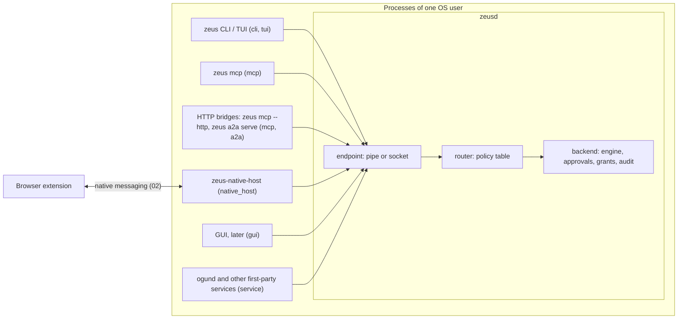
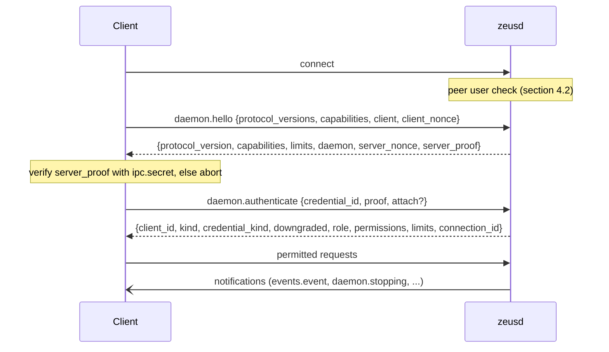
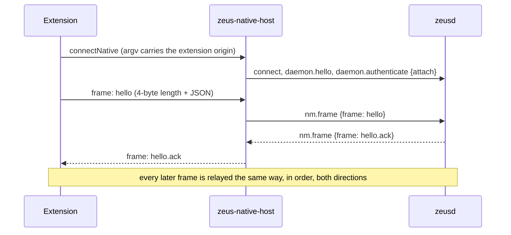
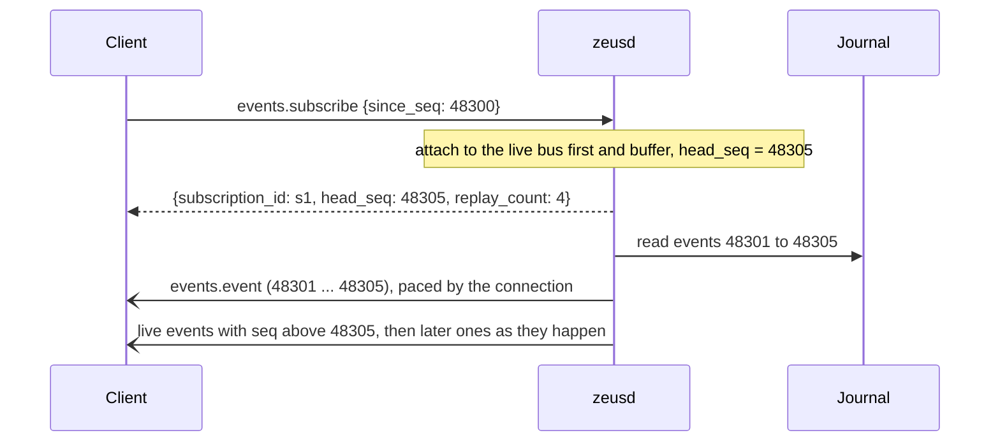
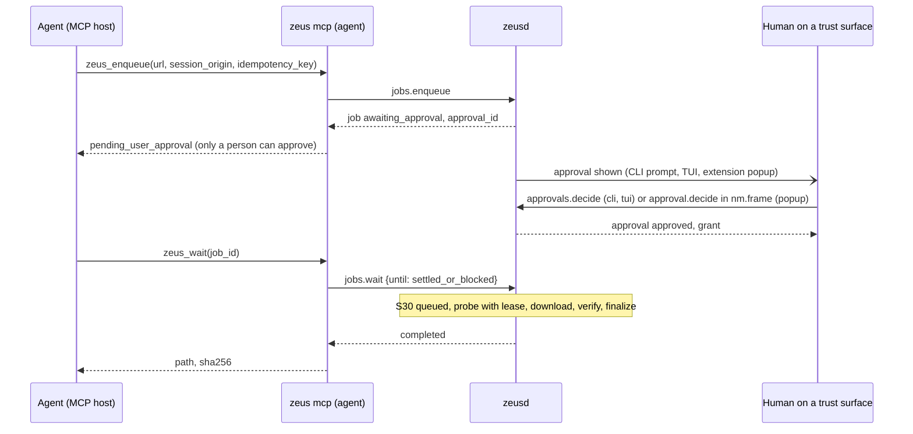

# 05. Daemon API v1

| | |
|---|---|
| Status | Draft 1 |
| Depends on | [00 conventions](00-conventions.md), [01 domain model](01-domain-model.md), [02 native messaging](02-native-messaging-v1.md), [03 journal](03-journal-and-commit-protocol.md), [04 audit and provenance](04-audit-log-and-provenance.md) |
| Used by | 06 (MCP tools), 07 (approvals), 08 (workflow plans), 10 (A2A), 11 (CLI and TUI), 13 (artifact store), Ogun (as a `service` client) |
| Implemented by | `zeus-api` (types, codec, client, router), `zeus-daemon` (`zeusd`), every client: `zeus` CLI and TUI, `zeus mcp`, `zeus-native-host`, bridges, the future GUI |
| Schema | [`schema/daemon-api.v1.schema.json`](schema/daemon-api.v1.schema.json) |
| Design inputs | [ADR 0002](../adr/0002-local-json-rpc-daemon-api.md), [ADR 0007](../adr/0007-human-only-approvals.md), [ADR 0010](../adr/0010-one-local-listener-http-bridges.md), [ADR 0011](../adr/0011-ogun-built-on-zeus-core.md), [ARCHITECTURE](../ARCHITECTURE.md) §5 |

The key words MUST, MUST NOT, SHOULD, SHOULD NOT and MAY are used as in RFC 2119 and RFC 8174 and carry that meaning only when written in capitals.

## 1. Purpose and scope

`zeusd` owns all durable state of Zeus: the journal, grants, approvals and the audit log. Every other program talks to it through exactly one interface, defined here: JSON-RPC 2.0, one message per line, over a local socket that only the user's own processes can open. The CLI and TUI, the MCP server, the native-messaging host, HTTP bridges (MCP Streamable HTTP, A2A), the future GUI and first-party unattended programs such as Ogun's `ogund` are all clients of this API and of nothing else.

This document fixes:

1. the transport (endpoint names, permissions, peer checks), the framing, and the JSON-RPC profile;
2. discovery of a running daemon, start and stop;
3. the connection handshake: version and capability negotiation, mutual challenge-response authentication;
4. client kinds, roles and permissions, and who may call which method;
5. every method with its parameters, result, rules and errors, marked MVP or later;
6. event subscriptions with replay and backpressure, idempotency, pagination, limits and rate limits;
7. the mapping of the 00 error envelope onto JSON-RPC errors, and which calls are audited.

Out of scope: the semantics of jobs, grants, approvals and events (01), the native-messaging messages relayed by `nm.frame` (02), what a human sees on a trust surface and the channel evidence for decisions (07), plan contents (08), provider configuration (09), the MCP tool projection (06), CLI commands (11).

Where this document and the draft Rust types in `crates/zeus-api` disagree, this document is normative; the differences found while writing it are listed in section 18.

## 2. Terminology

| Term | Meaning |
|---|---|
| Endpoint | The daemon's single listener: a Windows named pipe or a Unix domain socket. |
| Connection | One accepted stream on the endpoint. It carries one authenticated principal for its whole life. |
| Credential | A `(credential_id, token)` pair held by a client in a file, plus the daemon's stored verifier. It fixes the kind, role and permissions of every connection that authenticates with it. |
| Kind | Authority class of a credential: `agent`, `service`, `human`, `admin` (section 7.1). |
| Effective kind | The kind a connection actually holds after the peer checks of 07 section 7.2; never higher than the credential's kind. |
| Human-capable | A connection whose effective kind is `human` or `admin`. |
| Role | The concrete program behind a credential (`cli`, `mcp`, `native_host`, ...), section 7.2. |
| Permission | A dotted capability of a credential (`jobs.write`), section 7.3. |
| Method | A JSON-RPC method of this API, `<namespace>.<verb>` (00 section 3). |
| Mutating method | A method that changes durable state or the file system. Mutating methods accept `idempotency_key` and are audited. |
| Notification | A JSON-RPC message without `id`; it has no response. |
| Subscription | A stream of events (01 section 9) delivered to one connection as `events.event` notifications. |
| Peer facts | What the daemon learns about the connecting process from the operating system: user, process id, executable path (section 4.2). |
| MVP, later | Delivery stage of a method. A later method is fully specified here but a v1 daemon MAY answer it with `api.not_implemented`. |
| A, S, H, Ad | Short forms of the kinds agent, service, human, admin in tables. |

## 3. Architecture



Rules:

1. The daemon has exactly one listener, the endpoint of section 4.1. It binds no TCP or UDP port (ADR 0010). HTTP surfaces are separate bridge processes that are ordinary clients with an `agent` credential.
2. Authorisation happens in one place: the router consults one method table (section 8.1) before any handler runs. The Rust form of the table is `zeus_api::policy::METHODS`; the two MUST be identical, and a test in `zeus-api` checks it against the schema of this document.
3. Who a caller is comes from the credential and the operating system, never from request parameters. In particular the `source` of a job (01 section 3.3) is derived from the connection (section 7.2).
4. No method returns session material, tokens, credential verifiers or an unredacted URL, with the single audited exception of `jobs.get` with `reveal_urls` for a human-capable caller (section 9.2).

## 4. Transport

### 4.1 Endpoints

**Windows.** The endpoint is the named pipe `\\.\pipe\zeusd-<h>`, where `h` is the first 16 lowercase hex digits of `BLAKE3(UTF-8("zeus-endpoint-v1") || UTF-8(identity))` and `identity` is the string form of the security identifier of the user the daemon runs as (for example `S-1-5-21-1004336348-1177238915-682003330-1001`, which gives `\\.\pipe\zeusd-3f7430550b129ac6`). Every party reads the SID from its own process token; environment variables such as `USERNAME` MUST NOT be used, because a child process can change them.

| Rule | Requirement |
|---|---|
| First instance | The daemon creates the first pipe instance with `FILE_FLAG_FIRST_PIPE_INSTANCE`. If that fails because the name exists, another process owns it: the daemon MUST NOT start, MUST NOT fall back to another name, and reports the squatted endpoint (exit with a clear message, `zeus doctor` shows it). |
| Remote clients | Every instance is created with `PIPE_REJECT_REMOTE_CLIENTS`, `PIPE_TYPE_BYTE` and `PIPE_READMODE_BYTE`. |
| Access control | Every instance carries an explicit security descriptor whose DACL grants read and write access to the user's SID only. It MUST NOT grant access to Everyone, Anonymous Logon, Authenticated Users, Network or the Users group (the default descriptor grants read access to Everyone and Anonymous). The default mandatory integrity label is kept; the daemon MUST NOT lower it, so low-integrity processes cannot write to the pipe. |
| Continuous ownership | The daemon keeps at least one unconnected instance listening at all times: it creates the next instance before it serves a newly connected one, so the name is never free while the daemon runs. |

**Unix (Linux, macOS, other BSDs).** The endpoint is the stream socket `<runtime>/zeus/zeusd.sock` (`zeusd-<profile>.sock` when a profile is selected, 11):

| `runtime` | When |
|---|---|
| `$ZEUS_RUNTIME_DIR` | Set and non-empty (tests, unusual setups). |
| `$XDG_RUNTIME_DIR` | Set, an absolute path, owned by the user and mode `0700`; otherwise it is ignored. Typical value `/run/user/1000`. |
| `<state>/run` | Otherwise, with `<state>` the state directory of 03 section 3.1. On macOS this gives `~/Library/Application Support/Zeus/run/zeus/zeusd.sock`. |

If the resulting path is longer than 100 bytes (the smallest `sun_path` among supported systems is 104 bytes, on macOS), the fallback `<tmp>/zeus-<h>/zeusd.sock` is used, where `<tmp>` is the process temporary directory and `h` the first 16 lowercase hex digits of `BLAKE3(UTF-8(decimal uid))`.

| Rule | Requirement |
|---|---|
| Directory | The daemon creates `<runtime>/zeus` (or `zeus-<h>`) with mode `0700`. If it already exists it MUST be a directory (checked with `lstat`, so a symbolic link fails), owned by the daemon's effective uid, with no group or other permission bits; otherwise the daemon MUST NOT start. A hostile directory created by another user is therefore a denial of service, never a takeover. |
| Socket mode | The socket is bound with a umask of `0177`, so it is created with mode `0600`; the daemon then sets `0600` explicitly. |
| Stale socket | A socket file left by a crashed daemon is removed only by a process that holds `zeusd.lock` (section 5.2), immediately before `bind`. |
| No abstract sockets | The Linux abstract namespace MUST NOT be used: it ignores file permissions. |

### 4.2 Peer verification

**Daemon side.** Immediately after accepting a connection, before reading any byte, the daemon obtains the peer's user and compares it with its own. A mismatch closes the connection without a response and is audited as `client.rejected` with reason `peer_user_mismatch` (04 section 4.4).

| Platform | User | Process id | Executable |
|---|---|---|---|
| Windows | Token user SID of the client process (`GetNamedPipeClientProcessId`, then `OpenProcessToken`; or `ImpersonateNamedPipeClient` and the thread token) | `GetNamedPipeClientProcessId` | `QueryFullProcessImageNameW` |
| Linux | `SO_PEERCRED` uid | `SO_PEERCRED` pid | `/proc/<pid>/exe` |
| macOS and BSD | `getpeereid` or `LOCAL_PEERCRED` | `LOCAL_PEERPID` where available | `proc_pidpath` on macOS |

The daemon records these **peer facts** with the connection. They are used for audit, for the effective-kind rules of 07 section 7.2 and for the channel evidence of 07 section 7. Process ids can be reused, so peer facts MAY lower the authority of a connection and MUST NOT raise it above what its credential grants.

**Client side.** Before sending `daemon.hello` a client SHOULD check that the server runs as the same user: on Windows with `GetNamedPipeServerProcessId` and that process's token user; on Linux with `SO_PEERCRED` on the connected socket; on macOS with `getpeereid`; and on every Unix by checking the owner and mode of the socket directory as in section 4.1. Whatever the result, a client MUST verify `server_proof` (section 6.4) before it sends anything derived from its token.

### 4.3 Framing

Each message is one **line**: the UTF-8 text of one JSON-RPC object, serialised compactly, followed by one line feed (`0x0A`).

1. Senders MUST NOT emit a byte-order mark, a carriage return, or any line feed inside a message. Compact JSON cannot contain a raw line feed, because JSON escapes control characters inside strings.
2. Receivers MUST strip one carriage return immediately before the line feed (hand-typed sessions on Windows tools produce it) and MUST ignore empty lines.
3. Line limits, excluding the line feed: the daemon accepts request lines of at most `max_request_bytes` (1 MiB on ordinary connections, 5 MiB on `native_host` connections, which carry 4 MiB extension frames plus the envelope) and sends lines of at most `max_response_bytes` (16 MiB). These refine 00 section 10. A receiver detects an over-long line before buffering it beyond the limit, answers `api.payload_too_large` with `id: null` and `details.limit_bytes` if it can, and closes the connection: the stream cannot be resynchronised cheaply and the sender may be hostile.
4. A line that is not valid UTF-8 or not valid JSON is answered with `api.parse_error` and `id: null`; the connection stays open. Three consecutive such lines close it.
5. JSON nesting deeper than 32 (00 section 10) and duplicate object keys are answered with `api.invalid_request`. Duplicate keys are refused because parameters are hashed for idempotency and audit (00 section 7).
6. Every number in a message is an integer within plus or minus 2^53 - 1 (00 section 6.3). A fraction or exponent anywhere in `params` is `api.invalid_params`.

**Why lines and not `Content-Length` headers** (the LSP framing) or the native-messaging length prefix:

* A line framing can be spoken by `socat`, `nc`, PowerShell and shell scripts, and read in a hex dump; for a local machine-to-machine protocol that is a real debugging and interoperability asset.
* After a corrupt or truncated message a reader can find the next line feed; a corrupt length prefix desynchronises the stream for good.
* JSON serialisers already guarantee the absence of raw line feeds in compact output, so no escaping layer is added.
* The 4-byte native-messaging prefix is dictated by browsers on the stdio leg (02 section 3.3); nothing requires it here, and the host translates between the two framings.
* A length header would let a receiver allocate before reading; with lines the receiver enforces its limit while reading.

### 4.4 JSON-RPC profile

Zeus uses JSON-RPC 2.0 with these restrictions:

1. Every message has `"jsonrpc": "2.0"`. Members not defined by JSON-RPC 2.0 at the envelope level are ignored.
2. **Requests** carry `id`: an integer within plus or minus 2^53 - 1, or a string of 1 to 64 characters. A `null` id is `api.invalid_request`. A client MUST NOT reuse the id of a request that is still in flight on the same connection; the daemon MAY answer such a request with `api.invalid_request` and `details.reason = "duplicate_id"`.
3. `params` is an object or is omitted, which means `{}`. An array is `api.invalid_params`.
4. **Batches** (a line holding a JSON array) are not supported in protocol version 1: the daemon answers with a single `api.invalid_request` error with `id: null`.
5. **Responses**: exactly one per request, carrying `result` or `error`, never both. `error.data` always holds the 00 error envelope (section 11). The `id` is echoed exactly; it is `null` only when the request's id could not be read.
6. **Notifications**: the daemon sends `events.event`, `events.lagged`, `daemon.stopping` and, on `native_host` connections, `nm.frame`. The only notification a client may send is `nm.frame`, and only on a `native_host` connection; any other client notification is ignored and logged at debug level.
7. The daemon never sends requests to clients in protocol version 1. A response line received from a client is ignored.
8. Method names are case-sensitive.

### 4.5 Concurrency, ordering and backpressure

1. After authentication the daemon processes requests of one connection **concurrently**, at most `max_in_flight_requests` (32) at a time. At the limit it stops reading from the connection until a request completes; it never rejects for this reason. `daemon.hello` and `daemon.authenticate` are processed one at a time, in order.
2. Responses MAY be sent in any order; clients match them by `id`. Notifications interleave freely with responses.
3. The connection does not order effects. Two requests that touch the same job are ordered by the job's single owner task in arrival order (01 section 6 rule 3), not by the connection. A client that needs order waits for the first response.
4. `nm.frame` notifications are handed to the native-messaging endpoint in line order and are never processed concurrently with each other.
5. Outgoing messages of a connection pass through one bounded queue. Responses and `nm.frame` notifications are never dropped: their producer waits for space. Event notifications are never allowed to wait: when they cannot be queued, their subscription lags (section 10.4).
6. **Write stall.** If the daemon has data queued for a connection and cannot write any byte to it for 30 s, it closes the connection and logs `api.slow_consumer`. Clients MUST keep reading while they have requests in flight or subscriptions open.
7. Clients SHOULD apply their own deadline per request (for example 30 s, and `timeout_ms` plus 5 s for `jobs.wait`). Protocol version 1 has no request cancellation (open issue O1); a client that gives up simply ignores the late response.

## 5. Discovery and daemon lifecycle

### 5.1 Files in the state directory

All files are in the owner-only state directory of 03 section 3.1.

| File | Mode | Written by | Content |
|---|---|---|---|
| `zeusd.lock` | `0600` | `zeusd` | Advisory exclusive lock held for the daemon's whole life (`flock` on Unix, `LockFileEx` on Windows). Its text content (the pid) is informational. |
| `zeusd.json` | `0600` | `zeusd` | The discovery record below. Written atomically (temporary file, then rename) once the endpoint is listening; removed on a clean exit. |
| `ipc.secret` | `0600` | `zeusd init` or the first daemon start | 32 random bytes as 64 lowercase hex digits and a line feed. Proves the daemon's identity to clients (section 6.4). |
| `credentials/` | `0700` | provisioning, `clients.add` | One file per credential: `<name>.token`, mode `0600`, holding `<credential_id> <token>` and a line feed (section 6.5). |
| `credentials.json` | `0600` | provisioning, `clients.add`, `clients.revoke` | The daemon's verifier store: per credential its id, name, kind, role, permissions, derived `auth_key` and revocation state. Never a token. |

On Windows, files inherit the owner-only ACL of `%LOCALAPPDATA%\Zeus` (03 section 3.1); the modes above apply to Unix.

```json validate=daemon-api.v1#/$defs/DiscoveryRecord
{
  "pid": 18422,
  "instance_id": "3f9a6c2d1b7e4a08c5d2e9f1a0b3c4d5",
  "version": "0.1.0",
  "protocol_versions": [1],
  "endpoint": "\\\\.\\pipe\\zeusd-3f7430550b129ac6",
  "started_at": "2026-10-05T08:55:02.000Z"
}
```

The discovery record is a convenience for diagnostics and for clients that want the endpoint without recomputing it. It is not evidence that a daemon is alive: a record whose daemon no longer holds `zeusd.lock` is stale, and liveness is established only by a successful `daemon.hello`. A pid in the record is never used to signal or kill a process.

### 5.2 Startup

`zeusd` performs these steps in order and accepts no connection before step 6.

1. Resolve the directories; refuse to start if the state directory is writable by others (03 section 14).
2. Acquire `zeusd.lock` without waiting. If another process holds it, a daemon is already running: exit with a message naming the endpoint from `zeusd.json`, without touching anything else.
3. Load `ipc.secret` and `credentials.json`. If `ipc.secret` is missing, provision as `zeusd init` does (section 6.5); a missing or corrupt verifier store is a startup error, never silently recreated with new tokens.
4. Open the journal and run recovery (03 section 10).
5. Create the endpoint (section 4.1). A squatted pipe name or a hostile socket directory stops the start here.
6. Write `zeusd.json`, emit the durable event `daemon.started` (01 section 9.1), and begin accepting connections.

### 5.3 Finding and starting the daemon

A client:

1. resolves the state directory and computes the endpoint itself (section 4.1); it MAY read `endpoint` from `zeusd.json` instead, which is useful when `ZEUS_RUNTIME_DIR` differs between processes;
2. connects; if no endpoint exists, the daemon is not running;
3. MAY start the daemon when it is not running. The CLI, the TUI, `zeus mcp` and `zeus-native-host` (02 section 3.4) MAY do so; other clients SHOULD report `api.unavailable` instead. A client starts the installed `zeusd` binary at most once per invocation, detached from its own process group or job object, and waits up to 5 s (the CLI up to 30 s, with a progress message on stderr) for the endpoint to accept a `daemon.hello`;
4. runs the handshake of section 6.

A client that finds no daemon and does not start one reports `api.unavailable` (class `unavailable`, retryable).

### 5.4 Shutdown

1. `daemon.shutdown` (admin, section 9.1), a service-manager stop or a termination signal starts an orderly shutdown with a grace period (default 10 000 ms, at most 60 000 ms).
2. The daemon stops accepting connections and sends `daemon.stopping` (`{reason, grace_ms}`) to every authenticated connection, and appends the durable event `daemon.stopping`.
3. In-flight requests that complete within the grace period are answered; requests arriving after the notification fail with `api.unavailable` (`details.reason = "stopping"`).
4. The engine stops workers at commit points (03); jobs keep their journal state and are recovered on the next start (S95).
5. After the grace period the daemon closes every connection, removes `zeusd.json`, releases `zeusd.lock` and exits.

The native host reacts to a closed daemon connection as 02 section 3.5 describes.

## 6. Connection lifecycle and authentication

### 6.1 States



| State | Entered when | The client may send | The daemon closes the connection when |
|---|---|---|---|
| `accepted` | The peer user check passed. | `daemon.hello` only. | No valid `daemon.hello` within 10 s; any other request (answered first with `api.not_authenticated`); any failed `daemon.hello`. |
| `negotiated` | `daemon.hello` succeeded. | `daemon.authenticate` only. | No `daemon.authenticate` within 10 s; any other request (answered first with `api.not_authenticated`); any failed `daemon.authenticate`. |
| `authenticated` | `daemon.authenticate` succeeded. | Any request the policy permits; `nm.frame` on a `native_host` connection. | A framing violation of section 4.3, revocation of its credential (section 9.11), shutdown (section 5.4), a write stall (section 4.5). |

Rules:

1. One connection authenticates once, as one principal. There is no re-authentication and no change of identity. A repeated `daemon.hello` or `daemon.authenticate` on an authenticated connection is answered with `api.already_authenticated` and the connection stays open.
2. Every failure of `daemon.hello` or `daemon.authenticate` is answered and then the connection is closed. One authentication attempt per connection means a peer cannot grind guesses against a fixed pair of nonces.
3. Before authentication only `daemon.hello` and `daemon.authenticate` exist; every other method is answered with `api.not_authenticated`, whatever its name, so the method table is not an oracle for unauthenticated peers.
4. A connection has no idle timeout once authenticated.

### 6.2 `daemon.hello`

The first request on every connection. Its request and result shapes are frozen forever (00 section 4.1 rule 4): every future daemon MUST understand the version 1 `daemon.hello` and answer it, at least with `api.version_unsupported`.

| Parameter | Rule |
|---|---|
| `protocol_versions` | Versions the client speaks, 1 to 16 distinct integers. The daemon chooses the highest common one (00 section 4.1). With no common version it answers `api.version_unsupported` with `details.supported` and closes. |
| `capabilities` | Capabilities the client implements (section 8.2). The result carries the intersection with the daemon's set. |
| `client` | `{name, version, role}`. Name and version are self-declared, untrusted and used for logs only. `role` MUST equal the role of the credential presented next; otherwise authentication fails. |
| `client_nonce` | 32 bytes from a CSPRNG, fresh for every connection, as 64 lowercase hex digits. |

| Result | Meaning |
|---|---|
| `protocol_version` | The chosen version. Both sides behave as this version until the connection closes. |
| `capabilities` | The negotiated set. Neither side may use behaviour gated by a capability outside it. |
| `limits` | Limits before authentication (the ordinary-connection values of section 13). |
| `daemon` | `{version, instance_id}`; `instance_id` changes on every daemon start. |
| `server_nonce` | 32 fresh random bytes, 64 lowercase hex digits. |
| `server_proof` | Proof that the daemon holds `ipc.secret` (section 6.4). |

```json validate=daemon-api.v1#/$defs/Request
{"jsonrpc":"2.0","id":1,"method":"daemon.hello","params":{"protocol_versions":[1],"capabilities":["events","events.replay","jobs.wait","idempotency"],"client":{"name":"zeus-mcp","version":"0.1.0","role":"mcp"},"client_nonce":"6c0f2e1b9a7d43c58e1f0a2b3c4d5e6f708192a3b4c5d6e7f8091a2b3c4d5e6f"}}
```

```json validate=daemon-api.v1#/$defs/DaemonHelloResponse
{"jsonrpc":"2.0","id":1,"result":{"protocol_version":1,"capabilities":["events","events.replay","idempotency","jobs.wait"],"limits":{"max_request_bytes":1048576,"max_response_bytes":16777216,"max_in_flight_requests":32,"max_subscriptions":4,"event_buffer":1024},"daemon":{"version":"0.1.0","instance_id":"3f9a6c2d1b7e4a08c5d2e9f1a0b3c4d5"},"server_nonce":"d2a4c6e8f0123456789abcdef0123456789abcdef0123456789abcdef0123456","server_proof":"feef3250296ce13ec3a4cf668322916856528fe7e77e56f7b7eabf9eaaeea7b2"}}
```

A future client offering only version 2 to this daemon:

```json validate=daemon-api.v1#/$defs/ErrorResponse
{"jsonrpc":"2.0","id":1,"error":{"code":-32007,"message":"No protocol version in common.","data":{"code":"api.version_unsupported","class":"unsupported","message":"No protocol version in common.","retryable":false,"details":{"supported":[1]}}}}
```

### 6.3 `daemon.authenticate`

| Parameter | Rule |
|---|---|
| `credential_id` | The `cli_` id from the client's credential file. |
| `proof` | Proof of possession of the token (section 6.4). The token itself never crosses the connection. |
| `attach` | Required when the credential's role is `native_host`, forbidden otherwise. `{browser, attested_extension, host_version, parent_verified}`: the browser and the extension id the host read from its own `argv` and found in its allow-list (02 section 3.4), and whether the host found its parent process to be a registered browser executable (07 section 7.4). |

The daemon verifies, doing the same work whether or not the credential exists and comparing digests in constant time:

1. the id is well formed and names a stored credential;
2. `proof` equals the expected proof;
3. the credential is not revoked;
4. `client.role` from `daemon.hello` equals the credential's role.

Any failure of steps 1 to 4 is answered with `api.bad_credential` and the fixed message `authentication failed`, so the answer does not reveal which step failed or whether the id exists; then the connection closes and `client.rejected` is audited. A missing `attach` on a `native_host` credential is `api.bad_credential` as well; an `attach` on any other role is `api.invalid_params`. The daemon SHOULD also check `attested_extension` against its own configured allow-list (`native_messaging.allowed_extensions`) and refuse unknown ids with `api.bad_credential`.

Then the daemon evaluates the peer facts against 07 section 7.2, which MAY lower the effective kind (for example a `human` credential presented by a process that is not a verified Zeus binary). It never raises it. The connection is audited as `client.connected` with `role`, `credential_kind`, `effective_kind`, `exe_verified` and `downgraded` (04 section 4.4).

| Result | Meaning |
|---|---|
| `client_id` | The credential id. It is the `client_id` of every actor, source and audit record this connection produces. |
| `kind`, `credential_kind`, `downgraded` | The effective kind, the credential's kind, and whether they differ. |
| `role` | The credential's role. |
| `permissions` | Effective permissions: the credential's permissions intersected with the ceiling of the effective kind (section 7.3), plus `nm.relay` for `native_host` credentials that hold it. |
| `limits` | The limits that now apply to this connection (section 13). |
| `connection_id` | A `conn_` id for logs (00 section 5.1). |

```json validate=daemon-api.v1#/$defs/Request
{"jsonrpc":"2.0","id":2,"method":"daemon.authenticate","params":{"credential_id":"cli_01M45KGHR0ED0WJDFXKG49029B","proof":"a7bf03456a5719e1733783d8945e63cda3e4ffde13bed92018d9f6c9499adcf2"}}
```

```json validate=daemon-api.v1#/$defs/DaemonAuthenticateResponse
{"jsonrpc":"2.0","id":2,"result":{"client_id":"cli_01M45KGHR0ED0WJDFXKG49029B","kind":"agent","credential_kind":"agent","downgraded":false,"role":"mcp","permissions":["jobs.read","jobs.write","jobs.control","events.read","sessions.read","sessions.request","approvals.read","files.read","files.write","workflows.plan","workflows.run","audit.read","config.read","llm.read","daemon.read"],"limits":{"max_request_bytes":1048576,"max_response_bytes":16777216,"max_in_flight_requests":32,"max_subscriptions":4,"event_buffer":1024},"connection_id":"conn_01M45P0Z9X8W7V6T5S4R3Q2P1N"}}
```

The native host authenticates with `attach` (its proof comes from its own token; the value shown is illustrative) and receives the larger request limit:

```json validate=daemon-api.v1#/$defs/Request
{"jsonrpc":"2.0","id":2,"method":"daemon.authenticate","params":{"credential_id":"cli_01M2YW3JB9C3D5F7G1H3J5K7M9","proof":"0b6d2f8e4a1c7e3b9d5f0a2c4e6b8d1f3a5c7e9b0d2f4a6c8e0b1d3f5a7c9e1b","attach":{"browser":"chrome","attested_extension":"abcdefghijklmnopabcdefghijklmnop","host_version":"0.1.0","parent_verified":true}}}
```

```json validate=daemon-api.v1#/$defs/DaemonAuthenticateResponse
{"jsonrpc":"2.0","id":2,"result":{"client_id":"cli_01M2YW3JB9C3D5F7G1H3J5K7M9","kind":"human","credential_kind":"human","downgraded":false,"role":"native_host","permissions":["daemon.read","nm.relay"],"limits":{"max_request_bytes":5242880,"max_response_bytes":16777216,"max_in_flight_requests":32,"max_subscriptions":4,"event_buffer":1024},"connection_id":"conn_01M45NGARG09NTCP2S5QFQEN6J"}}
```

### 6.4 Proof construction and test vector

All digests are BLAKE3 with 32-byte output, written as 64 lowercase hex digits. Nonces and the credential id enter the hashes as the ASCII bytes of their text forms; `||` is concatenation.

| Value | Definition |
|---|---|
| `ipc_secret` | 32 random bytes, stored hex-encoded in `ipc.secret`. |
| `token` | 32 random bytes, written `zt1_` plus 64 lowercase hex digits in the credential file. |
| `auth_key` | `BLAKE3-derive-key(context = "zeus 2026-10 client auth key v1", key material = token bytes)`. The daemon stores `auth_key`, never the token. |
| `server_proof` | `BLAKE3-keyed(key = ipc_secret, "zeus-server-v1" || client_nonce)` |
| `proof` | `BLAKE3-keyed(key = auth_key, "zeus-client-v1" || credential_id || server_nonce || client_nonce)` |

Properties: the token never leaves the client; both nonces are fresh per connection, so a recorded `proof` is useless on another connection; a process that answers on a squatted endpoint cannot compute `server_proof` and so never receives a proof; the two labels keep the proofs of the two directions apart.

Test vector (fake values; every implementation MUST reproduce it):

| Input or output | Value |
|---|---|
| `ipc_secret` | `000102030405060708090a0b0c0d0e0f101112131415161718191a1b1c1d1e1f` |
| token | `zt1_202122232425262728292a2b2c2d2e2f303132333435363738393a3b3c3d3e3f` |
| `credential_id` | `cli_01M45KGHR0ED0WJDFXKG49029B` |
| `client_nonce` | `6c0f2e1b9a7d43c58e1f0a2b3c4d5e6f708192a3b4c5d6e7f8091a2b3c4d5e6f` |
| `server_nonce` | `d2a4c6e8f0123456789abcdef0123456789abcdef0123456789abcdef0123456` |
| `auth_key` | `6658313f2d9f55b56a04620d4e70827b6e3c8a363d8934590749472b7430000a` |
| `server_proof` | `feef3250296ce13ec3a4cf668322916856528fe7e77e56f7b7eabf9eaaeea7b2` |
| `proof` | `a7bf03456a5719e1733783d8945e63cda3e4ffde13bed92018d9f6c9499adcf2` |
| Pipe name for SID `S-1-5-21-1004336348-1177238915-682003330-1001` | `\\.\pipe\zeusd-3f7430550b129ac6` |

The values were computed independently with the Rust `blake3` crate and with `@noble/hashes`. The examples in sections 6.2 and 6.3 use this vector.

### 6.5 Credentials

`zeusd init` and `zeus daemon install` (11) provision, idempotently and never rotating what exists, `ipc.secret` and three credentials:

| File | Kind | Role | Permissions | Used by |
|---|---|---|---|---|
| `credentials/cli.token` | `admin` | `cli` | admin ceiling | `zeus` and the TUI |
| `credentials/agent.token` | `agent` | `mcp` | agent ceiling | `zeus mcp` and the bridges |
| `credentials/host.token` | `human` | `native_host` | narrowed to `nm.relay`, `daemon.read` | `zeus-native-host` |

1. **Further credentials.** No `service` credential exists by default. A human creates further `agent` or `service` credentials with `clients.add` (section 9.11), which is the only way to create a `service` credential.
2. **Least privilege for the host.** The host only relays. Decisions taken in the extension popup arrive inside `nm.frame` and are authorised by 02 section 10.1 and 07 section 7 (pinned extension, gesture attestation, human-capable host connection), not by the `approvals.decide` permission, which the host credential does not hold.
3. **Storage.** A client reads its credential file and `ipc.secret` when it connects and keeps the token in zeroizing memory (00 section 8.3). The daemon keeps only `auth_key` verifiers. Tokens never appear in a log, an error, a result, an audit record or CLI output (00 section 8.1).
4. **Revocation.** `clients.revoke` marks a credential revoked and closes its live connections. Rotation is revoke plus add.
5. **Honest limit.** Credential files are readable by every process of the same OS user. Kinds separate kinds of client; they do not defend against code running as the user, which is why decisions also need channel evidence (ADR 0007, 07 section 7) and why the strongest claim is that no agent-facing interface can decide anything.

## 7. Client kinds, roles and permissions

### 7.1 Kinds

| Kind | Who | Ceiling | Human-only methods |
|---|---|---|---|
| `agent` | `zeus mcp`, `zeus a2a serve`, every HTTP bridge, scripts given an agent credential | Observe and control jobs, enqueue, probe, request sessions (which only raises an approval), read grants, own approvals, files, audit and redacted configuration; plan and run workflows (later). | Refused with `api.human_required`. |
| `service` | First-party programs that use `zeusd` unattended; today only Ogun's `ogund` (ADR 0011) | The agent ceiling plus `files.roots.register`. | Refused with `api.human_required`, exactly as for `agent`. |
| `human` | `zeus` on a terminal, the TUI, the GUI, `zeus-native-host` relaying the extension popup | Everything an agent can do plus `approvals.decide`, `sessions.revoke`, `config.set`, `daemon.kill_switch`, `llm.configure`. | Allowed, with the channel evidence the method requires. |
| `admin` | `zeus` on a terminal with the admin credential | Everything a human can do plus `daemon.shutdown` and credential management (`clients.*`). | Allowed. |

Kinds are **not** totally ordered: `service` is beside `agent`, not between `agent` and `human`. A human-only check MUST test whether the effective kind is `human` or `admin` (human-capable), never compare kinds with an ordering. A `service` credential can never become human-capable.

### 7.2 Roles

| Role | Program | Allowed kinds | Source of the jobs it enqueues (01 section 3.3) | Request line limit |
|---|---|---|---|---|
| `cli` | `zeus` | agent, human, admin | `cli`, via `cli` | 1 MiB |
| `tui` | `zeus tui` | agent, human | `cli`, via `tui` | 1 MiB |
| `gui` | the GUI (later) | agent, human | `cli`, via `jsonrpc` | 1 MiB |
| `native_host` | `zeus-native-host` | human | none: handoffs arrive as `nm.frame` (02 section 7) | 5 MiB |
| `mcp` | `zeus mcp`, MCP bridges | agent | `agent`, via `mcp` | 1 MiB |
| `a2a` | `zeus a2a serve` (phase 2) | agent | `agent`, via `a2a` | 1 MiB |
| `service` | first-party unattended programs | service | `agent`, via `jsonrpc` | 1 MiB |
| `embedded` | applications embedding a Zeus client | agent, human, admin | `agent`, via `jsonrpc` | 1 MiB |
| `test` | test harnesses | any | `agent`, via `jsonrpc` | 1 MiB |

Rules:

1. A credential fixes `(kind, role, permissions)`. The daemon refuses to create a credential whose `(kind, role)` pair is not in this table.
2. The claimed role in `daemon.hello` must equal the credential's role (section 6.3). The daemon never infers a kind from a claimed name.
3. The job `source` is built by the daemon: `kind` and `via` from this table, `client_id` set to the credential id. `NewJob` has no `source` and no `run_id` (section 9.2); workflow jobs are created by the daemon's runner, never through the API.
4. The actor recorded for a non-decision action is `{kind: "agent", surface, client_id}` for agent and service connections (surface `mcp`, `a2a` or `jsonrpc` by role) and `{kind: "cli", surface, client_id}` for human-capable ones (surface `tui` for the TUI, `jsonrpc` otherwise). Decisions record `{kind: "human", surface: <channel>, client_id}` (01 section 5.3).

### 7.3 Permissions

| Permission | Grants | A | S | H | Ad |
|---|---|---|---|---|---|
| `jobs.read` | `jobs.probe`, `jobs.list`, `jobs.get`, `jobs.wait`, `jobs.verify`; `cloud.accounts.list`, `cloud.list`, `cloud.get` | yes | yes | yes | yes |
| `jobs.write` | `jobs.enqueue`; `cloud.plan`, `cloud.submit` | yes | yes | yes | yes |
| `jobs.control` | `jobs.control`, `cloud.control` | yes | yes | yes | yes |
| `events.read` | `events.subscribe`, `events.unsubscribe` | yes | yes | yes | yes |
| `sessions.read` | `sessions.list` | yes | yes | yes | yes |
| `sessions.request` | `sessions.request` (raises an approval, never grants) | yes | yes | yes | yes |
| `sessions.revoke` | `sessions.revoke` | no | no | yes | yes |
| `approvals.read` | `approvals.list`, `approvals.get` | yes | yes | yes | yes |
| `approvals.decide` | `approvals.decide` | no | no | yes | yes |
| `files.read` | `files.list`; `artifacts.get`, `.list`, `.lineage` (later) | yes | yes | yes | yes |
| `files.write` | `files.organize`, `files.convert`, `files.undo`, `artifacts.ingest` (later) | yes | yes | yes | yes |
| `files.roots.register` | `files.roots.register` | no | yes | no | no |
| `workflows.plan` | `workflows.plan`, `.dry_run`, `.get`, `.list`, `.manifest` (later) | yes | yes | yes | yes |
| `workflows.run` | `workflows.run`, `workflows.control` (later) | yes | yes | yes | yes |
| `audit.read` | `audit.tail`, `audit.verify` | yes | yes | yes | yes |
| `config.read` | `config.get` | yes | yes | yes | yes |
| `config.write` | `config.set`; `cloud.accounts.configure`, `cloud.accounts.revoke` (physical terminal) | no | no | yes | yes |
| `llm.read` | `llm.status` (later) | yes | yes | yes | yes |
| `llm.configure` | `llm.configure` (later) | no | no | yes | yes |
| `daemon.read` | `daemon.ping`, `daemon.status`, `doctor.run` | yes | yes | yes | yes |
| `daemon.admin` | `daemon.shutdown`, `clients.*` | no | no | no | yes |
| `kill_switch` | `daemon.kill_switch` | no | no | yes | yes |
| `nm.relay` | the `nm.frame` notification | role `native_host` only | | | |

The columns give each kind's **ceiling** (its default set). A credential MAY be narrowed to a subset of its kind's ceiling, never widened; `nm.relay` is outside every ceiling and is held only by credentials whose role is `native_host`. When 07 section 7.2 lowers the effective kind, the effective permissions are the credential's permissions intersected with the lower ceiling.

### 7.4 Authorisation procedure

For every request the router applies these checks in order, before any handler runs; the first failure is the answer.

| Step | Check | Failure |
|---|---|---|
| 1 | The connection is authenticated, or the method is `daemon.hello` or `daemon.authenticate`. | `api.not_authenticated`, then close |
| 2 | The method exists in the table of section 8.1. | `api.method_not_found` |
| 3 | This daemon implements the method. | `api.not_implemented` |
| 4 | The method's capability, if any, is in the negotiated set (section 8.2). | `api.capability_missing` |
| 5 | The effective permissions hold the method's permission. | `api.permission_denied` |
| 6 | The method's role restriction, if any, matches (`files.roots.register`: `service`). | `api.permission_denied` |
| 7 | A human-only method, or a human-only parameter set to `true` (`jobs.get` `reveal_urls`), needs a human-capable connection. | `api.human_required` |
| 8 | The rate limit of the caller's bucket (section 13.2). | `api.rate_limited` |
| 9 | `params` matches the method's schema and value rules. | `api.invalid_params` |
| 10 | Method-specific rules: visibility (section 7.5), channel evidence (07 section 7), policy (01, 07). | as the method states |

Refusals at steps 5 to 7 are audited as `policy.denied` (section 14).

### 7.5 Visibility

Agent and service connections see a scoped view. An entity outside the caller's view is reported exactly as a missing one (`api.not_found`), so identifiers cannot be probed.

| Data | Agent | Service | Human, admin |
|---|---|---|---|
| Jobs (`jobs.*`, job events) | All jobs | Jobs whose `source.client_id` is its credential id | All jobs |
| Approvals (`approvals.*`, `approval.*` events) | Those it requested (`requested_by` is its credential id) | Those it requested | All |
| `facts` and `agent_says` of approvals | Returned for the approvals it can see | Returned for the approvals it can see | Returned |
| Grants (`sessions.list`, `grant.*` events) | All grants | Grants created by approvals it requested, or bound to its jobs | All |
| Files (`files.list`) | The user's write roots | Its registered roots | All roots |
| Artifacts (`artifacts.*`, later) | All records | Records of its jobs and those it ingested | All records |
| Workflow runs (`workflows.*`, later) | Runs it started | Runs it started | All runs |
| Audit records (`audit.tail`) | All | Records whose `actor.client_id` is its credential id | All |
| Idempotency records | Its credential's only | Its credential's only | Its credential's only |

`daemon.*` events and `session.leased` events of visible jobs are visible to every kind. `session.leased` carries counts and handles only (01 section 9.1).

### 7.6 Service clients

ADR 0011 introduces the `service` kind for first-party programs that use the daemon unattended. Ogun's `ogund` is the first: it embeds the `zeus-core` engine for ordinary sources and reaches browser-session sources only as Zeus jobs, through this API.

1. **Provisioning.** Only `clients.add` with `kind: "service"` creates a service credential. It is an admin method that a human runs from a terminal (`zeus clients add --kind service --name ogun`, 11). The daemon writes `<state>/credentials/<name>.token` and returns its path; the human points the service at that file. The token is never shown.
2. **Ceiling.** The agent ceiling plus `files.roots.register`. Every human-only method is refused with `api.human_required`, exactly as for agents.
3. **Roots.** A service registers the directories it owns with `files.roots.register` (section 9.6). Every job it enqueues MUST resolve its destination inside one of its registered roots: a relative or absent `dest_dir` is resolved against its first registered root, and a destination elsewhere (or no registered root) fails with `policy.path_outside_roots`. At most 16 roots per service.
4. **Sessions.** A service job naming `session_origin` without an effective grant raises an approval of kind `session_grant` whose `requested_by` is the service's credential id; only a human on a trust surface decides it (07). Session use by a service is therefore always bounded by a grant a human created.
5. **Visibility** as in section 7.5: a service sees its own jobs, approvals, grants, roots and audit records only.
6. **Rate limits.** Each service credential has its own buckets with their own configuration (section 13.2), so an unattended batch cannot exhaust the budget of interactive agents, and the reverse.
7. **Attribution.** Every actor, job source and audit record produced by the connection carries the service's credential id; `client.connected` records role `service`.
8. **Revocation.** `clients.revoke` closes the service's connections, withdraws approvals it requested that are still pending (outcome `cancel`, actor `system`) and deactivates its roots. Its jobs continue; a human can cancel them.

## 8. Method catalogue

### 8.1 Catalogue

"Callable by" lists the kinds whose ceiling allows the method (A agent, S service, H human, Ad admin); "mut." marks mutating methods. Every mutating method accepts an optional `idempotency_key` (section 12). Schema definitions are named `<Name>Params`, `<Name>Result`, `<Name>Request` and `<Name>Response`, where `<Name>` is the method name in PascalCase without dots (`jobs.enqueue` gives `JobsEnqueue`).

| Method | Stage | Permission | Callable by | Mut. | Notes |
|---|---|---|---|---|---|
| `daemon.hello` | MVP | none (before authentication) | all | no | Section 6.2. |
| `daemon.authenticate` | MVP | none (before authentication) | all | no | Section 6.3. |
| `daemon.ping` | MVP | `daemon.read` | A S H Ad | no | |
| `daemon.status` | MVP | `daemon.read` | A S H Ad | no | |
| `daemon.shutdown` | MVP | `daemon.admin` | Ad | yes | Human-only. |
| `daemon.kill_switch` | MVP | `kill_switch` | H Ad | yes | Human-only; `release` needs approving-surface evidence. |
| `jobs.probe` | MVP | `jobs.read` | A S H Ad | no | Network read; own rate bucket. |
| `jobs.enqueue` | MVP | `jobs.write` | A S H Ad | yes | 1 to 100 jobs, `dry_run`. |
| `jobs.list` | MVP | `jobs.read` | A S H Ad | no | Paged. |
| `jobs.get` | MVP | `jobs.read` | A S H Ad | no | `reveal_urls` is human-only and audited. |
| `jobs.wait` | MVP | `jobs.read` | A S H Ad | no | At most 60 000 ms. Capability `jobs.wait`. |
| `jobs.control` | MVP | `jobs.control` | A S H Ad | yes | `pause`, `resume`, `cancel`, `retry`, `retry_now`, `reprioritize`. |
| `jobs.verify` | MVP | `jobs.read` | A S H Ad | no | Re-hashes a completed file. |
| `events.subscribe` | MVP | `events.read` | A S H Ad | no | Capability `events`. |
| `events.unsubscribe` | MVP | `events.read` | A S H Ad | no | Capability `events`. |
| `sessions.list` | MVP | `sessions.read` | A S H Ad | no | Grants, never material. Paged. |
| `sessions.request` | MVP | `sessions.request` | A S H Ad | yes | Raises an approval, never grants, never blocks. |
| `sessions.revoke` | MVP | `sessions.revoke` | H Ad | yes | Human-only; revoking a `never` grant needs approving-surface evidence. |
| `approvals.list` | MVP | `approvals.read` | A S H Ad | no | Paged; scoped for A and S. |
| `approvals.get` | MVP | `approvals.read` | A S H Ad | no | Scoped for A and S. |
| `approvals.decide` | MVP | `approvals.decide` | H Ad | yes | Human-only, channel evidence, request hash. |
| `files.list` | MVP | `files.read` | A S H Ad | no | Paged. |
| `cloud.accounts.list` | cloud delivery (14) | `jobs.read` | A S H Ad | no | Configured scopes/capabilities, without credentials. |
| `cloud.accounts.configure` | cloud delivery (14) | `config.write` | H Ad | yes | Independently verified physical terminal; revision-bound scope and keyring credential. |
| `cloud.accounts.revoke` | cloud delivery (14) | `config.write` | H Ad | yes | Same terminal requirement; invalidates old revision and stops local work. |
| `cloud.plan` | cloud delivery (14) | `jobs.write` | A S H Ad | yes | Persist immutable dry run; no source reads or remote object mutations. |
| `cloud.submit` | cloud delivery (14) | `jobs.write` | A S H Ad | yes | Reserve delivery and request human approval; never authorizes it. |
| `cloud.list` | cloud delivery (14) | `jobs.read` | A S H Ad | no | At most 100 visible delivery records, newest first. |
| `cloud.get` | cloud delivery (14) | `jobs.read` | A S H Ad | no | Owner-scoped for agent/service clients. |
| `cloud.control` | cloud delivery (14) | `jobs.control` | A S H Ad | yes | Pause/resume/cancel; retains remote cancellation uncertainty. |
| `files.roots.register` | MVP | `files.roots.register` | S | yes | Role `service` only. Capability `files.roots`. |
| `files.organize` | later | `files.write` | A S H Ad | yes | Dry run by default. Capability `files.organize`. |
| `files.convert` | later | `files.write` | A S H Ad | yes | Dry run by default. Capability `files.convert`. |
| `files.undo` | later | `files.write` | A S H Ad | yes | Capability `files.organize`. |
| `workflows.plan` | later | `workflows.plan` | A S H Ad | yes | Stores a draft. Capability `workflows`. |
| `workflows.dry_run` | later | `workflows.plan` | A S H Ad | no | Capability `workflows`. |
| `workflows.run` | later | `workflows.run` | A S H Ad | yes | Needs a `workflow_plan` approval. Capability `workflows`. |
| `workflows.get` | later | `workflows.plan` | A S H Ad | no | Capability `workflows`. |
| `workflows.list` | later | `workflows.plan` | A S H Ad | no | Paged. Capability `workflows`. |
| `workflows.control` | later | `workflows.run` | A S H Ad | yes | Capability `workflows`. |
| `workflows.manifest` | later | `workflows.plan` | A S H Ad | yes | Writes a manifest file. Capability `workflows`. |
| `audit.tail` | MVP | `audit.read` | A S H Ad | no | Scoped for S. |
| `audit.verify` | MVP | `audit.read` | A S H Ad | no | |
| `config.get` | MVP | `config.read` | A S H Ad | no | Secrets withheld. |
| `config.set` | MVP | `config.write` | H Ad | yes | Human-only; approving-surface evidence. |
| `doctor.run` | MVP | `daemon.read` | A S H Ad | no | |
| `llm.status` | later | `llm.read` | A S H Ad | no | Capability `llm`. |
| `llm.configure` | later | `llm.configure` | H Ad | yes | Human-only. Carries a secret. Capability `llm`. |
| `clients.list` | MVP | `daemon.admin` | Ad | no | Human-only. Capability `clients`. |
| `clients.add` | MVP | `daemon.admin` | Ad | yes | Human-only. The only way to create a `service` credential. Capability `clients`. |
| `clients.revoke` | MVP | `daemon.admin` | Ad | yes | Human-only. Capability `clients`. |
| `artifacts.get` | later | `files.read` | A S H Ad | no | Capability `artifacts`. |
| `artifacts.list` | later | `files.read` | A S H Ad | no | Paged. Capability `artifacts`. |
| `artifacts.lineage` | later | `files.read` | A S H Ad | no | Capability `artifacts`. |
| `artifacts.ingest` | later | `files.write` | A S H Ad | yes | Capability `artifacts`. |

Notifications:

| Notification | Direction | Stage | Condition | Params |
|---|---|---|---|---|
| `events.event` | daemon to client | MVP | A subscription delivers an event. | `EventsEventParams` |
| `events.lagged` | daemon to client | MVP | A subscription fell behind and ended (section 10.4). | `EventsLaggedParams` |
| `daemon.stopping` | daemon to client | MVP | Shutdown began (section 5.4). | `DaemonStoppingParams` |
| `nm.frame` | both, `native_host` connections only | MVP | One native-messaging frame (section 9.12). Needs `nm.relay` and capability `nm.relay`. | `NmFrameToDaemonParams`, `NmFrameToHostParams` |

### 8.2 Capabilities

Capabilities follow 00 section 4.1. A daemon advertises a capability only when it implements everything the capability gates. Methods not listed below are always available in protocol version 1.

| Capability | Gates | Stage | A v1 daemon |
|---|---|---|---|
| `events` | `events.subscribe`, `events.unsubscribe`, `events.event`, `events.lagged` | MVP | MUST offer |
| `events.replay` | `since_seq` of `events.subscribe` | MVP | MUST offer |
| `jobs.wait` | `jobs.wait` | MVP | MUST offer |
| `idempotency` | `idempotency_key` on mutating methods | MVP | MUST offer |
| `nm.relay` | `nm.frame` | MVP | MUST offer |
| `clients` | `clients.list`, `clients.add`, `clients.revoke` | MVP | MUST offer |
| `files.roots` | `files.roots.register` | MVP | MUST offer |
| `files.organize` | `files.organize`, `files.undo` | later | MAY offer |
| `files.convert` | `files.convert` | later | MAY offer |
| `workflows` | `workflows.*` | later | MAY offer |
| `llm` | `llm.status`, `llm.configure` | later | MAY offer |
| `artifacts` | `artifacts.*` | later | MAY offer |
| `approvals.facts_v2` | Approvals whose facts use a later facts tag (07 section 14) | reserved | MUST NOT offer in v1 |

A client lists every capability it understands. Calling a gated method, or sending a gated parameter, outside the negotiated set fails with `api.not_implemented` when this daemon does not implement it, and with `api.capability_missing` (`details.capability`) when the daemon implements it but the client did not negotiate it.

### 8.3 Common rules for parameters and results

1. **Unknown members** are ignored (00 section 4.1 rule 7). Members that a client must not control (`source` and `run_id` of a job, an actor, a `requested_by`) do not exist in any parameter object; sending them has no effect.
2. **Invalid parameters** are answered with `api.invalid_params`. The message and `details.fields` name the offending members, never their values: a value can be a secret.
3. **Units and formats** follow 00 sections 5 and 6: identifiers are prefixed ULIDs, instants are RFC 3339 UTC with three fractional digits, durations end in `_ms`, sizes in `_bytes`, every number is an integer.
4. **Pagination.** List methods take `limit` (default 50; values above 100 are treated as 100; 0 is `api.invalid_params`) and `cursor` at the top level of `params`, and return `{items, next_cursor}`; `next_cursor` is `null` on the last page. Items are ordered newest first by identifier unless the method says otherwise. Pagination is keyset-based: a page never repeats an item of an earlier page, and items created after the first page may be missed. A cursor is opaque, at most 512 characters, and valid only for the same method and filters; a cursor that does not fit is `api.invalid_params`.
5. **Redaction.** Every URL in a result is redacted with mode `log` (00 section 8.2) and named `*_redacted`. The only raw URLs the API returns are `revealed` in `jobs.get` (section 9.2).
6. **Untrusted data.** File names, labels, content types, `reason`, `agent_says`, `goal`, client names and any text from remote servers are data, never instructions (01 section 12.1). The daemon never interprets them; clients that show them sanitise them; the MCP projection labels them (06).
7. **Errors** follow section 11. A method lists its specific errors; the procedure of section 7.4 can produce the generic ones for every method.
8. **Replays.** Every result of a mutating method carries `replayed`: `false` when the call executed now, `true` when the result came from the idempotency store (section 12).
9. **Kill switch.** While the kill switch is engaged, the operations listed in 07 section 8.2 (among them `jobs.enqueue`, `sessions.request`, `workflows.run`, file operations, `jobs.control` `resume` and `retry`, and approving) fail with `policy.kill_switch_engaged`; reads are unaffected.

## 9. Methods

### 9.1 `daemon.*`

#### `daemon.ping`

Liveness. Result `{server_time}` with the daemon's wall-clock time.

#### `daemon.status`

A summary for dashboards and `zeus status`: daemon identity, protocol version, start time, monotonic uptime, `head_seq` (the newest durable event sequence, 0 when none), job counts per state, pending approvals, whether an extension is connected, whether the kill switch is engaged, whether the journal is writable.

```json validate=daemon-api.v1#/$defs/DaemonStatusResponse
{"jsonrpc":"2.0","id":3,"result":{"daemon":{"version":"0.1.0","instance_id":"3f9a6c2d1b7e4a08c5d2e9f1a0b3c4d5"},"protocol_version":1,"started_at":"2026-10-05T08:55:02.000Z","uptime_ms":4269000,"head_seq":48305,"jobs":{"queued":1,"downloading":2,"awaiting_approval":1,"completed":41,"failed":2},"pending_approvals":1,"extension_connected":true,"kill_switch_engaged":false,"journal_ok":true}}
```

#### `daemon.shutdown`

Admin, human-only. `grace_ms` defaults to 10 000 and is at most 60 000. The result `{accepted, grace_ms}` is sent before the `daemon.stopping` notification; the procedure is section 5.4.

#### `daemon.kill_switch`

Human-only. Parameters and result are the `KillSwitchRequest` and `KillSwitchResult` of 07 (`approvals.v1.schema.json`): `action` (`engage` or `release`), `surface` (the trust surface the human used), `reason` (untrusted free text of at most 280 characters, recorded in the audit log only as a digest) and `idempotency_key`. Engaging revokes every active `once`, `site` and `workflow` grant (`never` entries stay) and pauses every job that can be paused, in one journal transaction, and latches the switch; releasing clears the latch and restores nothing. The semantics, what the latch blocks while engaged, and the audit rule are in 07 section 8 and 04 section 4.6. Over this API `surface` MUST match the connection's role as for `approvals.decide` (section 9.5); `release` additionally requires the channel evidence of `approvals.decide`, while `engage` requires only a human-capable connection, because it only removes authority. Result: `{engaged, changed, grants_revoked, jobs_paused, approvals_pending, replayed}`.

```json validate=daemon-api.v1#/$defs/Request
{"jsonrpc":"2.0","id":31,"method":"daemon.kill_switch","params":{"action":"engage","surface":"tui","reason":"Agent behaving oddly; stop everything."}}
```

```json validate=daemon-api.v1#/$defs/DaemonKillSwitchResponse
{"jsonrpc":"2.0","id":31,"result":{"engaged":true,"changed":true,"grants_revoked":3,"jobs_paused":2,"approvals_pending":1,"replayed":false}}
```

### 9.2 `jobs.*`

#### `jobs.probe`

Probes a URL as the engine would at the start of a job (01 section 3.5), without creating a job. With `session_origin`, the probe uses an active `site` grant for that origin if one exists and its lease; it never raises an approval and never uses a `once` or `workflow` grant (those bind to a job or a run). Result: `{probe, effective_grant?, approval_needed}`, where `approval_needed` says whether enqueuing the URL would raise an approval. A probe that reaches the server returns its status inside `probe` (a 404 is a result, not an error); a failure before any response is an error with the transport code of 01 section 8.2 (for example `net.dns_failure`, JSON-RPC code `-32000`). Probes have their own rate bucket (section 13.2).

```json validate=daemon-api.v1#/$defs/JobsProbeResponse
{"jsonrpc":"2.0","id":5,"result":{"probe":{"probed_at":"2026-10-05T10:01:58.200Z","method":"range_get","transport":"direct","http_version":"h2","status":206,"final_url_redacted":"https://files.example.com/exports/2026/q3.csv.gz","redirects":0,"range_support":"verified","total_bytes":1073741824,"content_type":"application/gzip","content_encoding":null,"filename":{"value":"q3.csv.gz","source":"url_path"},"validators":{"etag":"\"9f2c-61a8b3c0\"","last_modified":"Mon, 28 Sep 2026 08:00:00 GMT","last_modified_strong":true,"repr_digest":null},"requires_session":false,"interstitial_suspected":false},"approval_needed":false}}
```

#### `jobs.enqueue`

Creates one to 100 jobs.

| Parameter | Rule |
|---|---|
| `jobs` | 1 to 100 `NewJob` objects: the caller-settable fields of a JobSpec (01 section 3.2), with the same rules and defaults. `extra_headers` names are checked case-insensitively against the allow-list of 01 section 3.2. |
| `dry_run` | When true, nothing is created or stored: each entry returns a `plan` (resolved name, destination, whether an approval would be needed, warnings such as `policy.path_outside_roots`). Dry runs ignore `idempotency_key`. |
| `idempotency_key` | Section 12. |

Rules:

1. The daemon fills in the `source` from the connection (section 7.2). There is no way to claim another source or a workflow run.
2. `dest_dir` is an absolute path, or a path relative to the caller's default root. It is canonicalised, symbolic links resolved, and must lie inside a write root the caller may use: the user's write roots for agent and human-capable callers, the service's registered roots for a service (section 7.6). Otherwise the entry fails with `policy.path_outside_roots`.
3. Entries are independent: the result has one entry per requested job, in request order, holding `job_id` and `state` (and `approval_id` when the job waits for one), or `plan` on a dry run, or `error` when that entry was refused. A failure of the whole call (for example more than 100 jobs, malformed parameters, a rate limit) is a JSON-RPC error and creates nothing.
4. A job naming `session_origin` without an effective grant is created at S02 in `awaiting_approval` with an approval of kind `session_grant` (01 section 5.3); the caller cannot decide it.
5. `overwrite: "replace"` is subject to the destructive-operation policy of 07.
6. The audit record `tool.call` with the new job ids is written ahead of the transaction that creates the jobs (section 14).
7. An entry that would raise an approval is refused on its own by the caps and the denial back-off of 07 section 9 (`policy.too_many_pending`, `policy.recently_denied`). While the kill switch is engaged the whole call fails with `policy.kill_switch_engaged` (07 section 8.2).

```json validate=daemon-api.v1#/$defs/Request
{"jsonrpc":"2.0","id":7,"method":"jobs.enqueue","params":{"jobs":[{"url":"https://files.example.com/exports/2026/q3.csv.gz","filename":"q3.csv.gz","expected_sha256":"9218812567e906efb346546840f6145fc189148e5633d0737fee7402a3207f9a","labels":{"task":"quarterly-report"}},{"url":"https://portal.example.org/files/annual-report.pdf","session_origin":"https://portal.example.org","grant_scope_hint":"site"}],"idempotency_key":"agent-7f3c:q3-and-annual"}}
```

```json validate=daemon-api.v1#/$defs/JobsEnqueueResponse
{"jsonrpc":"2.0","id":7,"result":{"jobs":[{"job_id":"job_01M45R71NCNH3W8EQ63TAFME4C","state":"queued"},{"job_id":"job_01M45R71NDA5B7C9E1F3G5H7J9","state":"awaiting_approval","approval_id":"ap_01M45R71NE2K4M6P8R0T2V4X6Z"}],"dry_run":false,"replayed":false}}
```

A dry run of two entries, the second with a destination outside the roots:

```json validate=daemon-api.v1#/$defs/JobsEnqueueResponse
{"jsonrpc":"2.0","id":8,"result":{"jobs":[{"plan":{"url_redacted":"https://files.example.com/exports/2026/q3.csv.gz","resolved_filename":"q3 (1).csv.gz","dest_path":"/home/ada/Downloads/Zeus/q3 (1).csv.gz","approval_needed":false}},{"error":{"code":"policy.path_outside_roots","class":"policy_denied","message":"The destination is outside the write roots.","retryable":false}}],"dry_run":true,"replayed":false}}
```

#### `jobs.list`

Paged list of `JobSummary` records (domain schema) visible to the caller, newest first. Filters: `states` (any of), `source_kind`, `run_id`, `origin`.

`JobSummary` is the compact projection used by `jobs.list`, `jobs.wait`, `jobs.control` and the extension (02 section 11.2). The daemon API always fills its optional members when they are known, so that a client rarely needs `jobs.get`: `state_seq` (the `seq` of the durable event that put the job into its current state, `job.created` or `job.state_changed`), `rate_ewma` and `eta_s` (from `progress`), and for completed jobs `path` and `sha256` (from `result`).

```json validate=daemon-api.v1#/$defs/JobsListResponse
{"jsonrpc":"2.0","id":12,"result":{"items":[{"id":"job_01M45R71NDA5B7C9E1F3G5H7J9","state":"awaiting_approval","quarantined":false,"source_kind":"agent","filename":null,"url_redacted":"https://portal.example.org/files/annual-report.pdf","origin":"https://portal.example.org","bytes_done":0,"bytes_total":null,"last_error":null,"created_at":"2026-10-05T10:02:11.540Z","updated_at":"2026-10-05T10:02:11.540Z","state_seq":48297,"rate_ewma":0,"eta_s":null},{"id":"job_01M45R71NCNH3W8EQ63TAFME4C","state":"downloading","quarantined":false,"source_kind":"agent","filename":"q3.csv.gz","url_redacted":"https://files.example.com/exports/2026/q3.csv.gz","origin":"https://files.example.com","bytes_done":268435456,"bytes_total":1073741824,"last_error":null,"created_at":"2026-10-05T10:02:11.500Z","updated_at":"2026-10-05T10:02:41.000Z","state_seq":48299,"rate_ewma":10485760,"eta_s":77}],"next_cursor":"c1.job_01M45R71NCNH3W8EQ63TAFME4C"}}
```

#### `jobs.get`

Result `{job, revealed?}`. `job` is a **JobView**: the Job of 01 section 3.1 with `spec` replaced by `JobSpecView`, in which every URL is redacted (mode `log`) and extra headers are reduced to their names. The raw Job, which carries the full URL, is never returned.

`reveal_urls: true` asks for `revealed` (`spec.url` and `spec.hint_url` as stored). It is human-only (section 7.4 step 7), its audit record is written ahead of the response (section 14), and `revealed` is secret: clients MUST NOT log it, and the CLI shows it only with `--show-secrets` (00 section 8.1).

```json validate=daemon-api.v1#/$defs/JobsGetResponse
{"jsonrpc":"2.0","id":11,"result":{"job":{"id":"job_01M45NHJ2AHWMXT8JVJ7BEEJX7","state":"downloading","quarantined":false,"spec":{"url_redacted":"https://portal.example.org/download/8841","hint_url_redacted":"https://cdn.example.org/blobs/dataset-v3.tar.zst?…","referrer_redacted":"https://portal.example.org/datasets/v3","filename":"dataset-v3.tar.zst","priority":"high","session_origin":"https://portal.example.org","grant_scope_hint":"site","overwrite":"rename","max_connections":8,"transport_hint":"auto","source":{"kind":"browser_handoff","via":"native_messaging","client_id":"ext:chrome","browser":{"name":"chrome","extension_id":"abcdefghijklmnopabcdefghijklmnop","download_id":317,"offer_key":"chrome:317:2026-10-05T09:15:12.004Z","incognito":false}}},"created_at":"2026-10-05T09:15:30.250Z","updated_at":"2026-10-05T09:16:10.000Z","state_since":"2026-10-05T09:15:36.640Z","probe":{"probed_at":"2026-10-05T09:15:36.610Z","method":"range_get","transport":"direct","http_version":"h2","status":206,"final_url_redacted":"https://cdn.example.org/blobs/dataset-v3.tar.zst?…","redirects":1,"range_support":"verified","total_bytes":1288490188,"content_type":"application/zstd","content_encoding":null,"filename":{"value":"dataset-v3.tar.zst","source":"content_disposition"},"validators":{"etag":"\"5f3a9c-4c1d2e7b\"","last_modified":"Tue, 29 Sep 2026 14:02:11 GMT","last_modified_strong":true,"repr_digest":null},"requires_session":true,"interstitial_suspected":false},"progress":{"bytes_done":611057664,"bytes_total":1288490188,"rate_ewma":15728640,"eta_s":43,"segments_active":4,"last_error_class":null,"updated_at":"2026-10-05T09:16:10.000Z"},"retry":{"attempt":1,"consecutive_failures":0,"last_progress_at":"2026-10-05T09:16:10.000Z","next_attempt_at":null,"auth_refreshes":0,"proxy_escalations":0,"integrity_restarts":0,"resource_restarts":0,"recovery_count":0,"session_wait_deadline_at":null},"error":null,"result":null,"transport":"direct","grant_id":"gr_01M45NHPJP04TX6B1CJVQVQAK9","approval_id":"ap_01M45NHJ3XS0QXG9T42HHN2YR8"}}}
```

An agent asking for raw URLs:

```json validate=daemon-api.v1#/$defs/ErrorResponse
{"jsonrpc":"2.0","id":13,"error":{"code":-32002,"message":"jobs.get with reveal_urls can only be called by a human-capable client.","data":{"code":"api.human_required","class":"unauthenticated","message":"jobs.get with reveal_urls can only be called by a human-capable client.","retryable":false,"details":{"method":"jobs.get","param":"reveal_urls"}}}}
```

#### `jobs.wait`

Long poll on 1 to 100 jobs. It never blocks the connection's other requests (section 4.5).

| Parameter | Rule |
|---|---|
| `job_ids` | 1 to 100 distinct visible jobs; an invisible or unknown id is `api.not_found`. |
| `until` | What to wait for (below). Default `settled_or_blocked`. |
| `since_seq` | Optional event position `C` (00 section 5.2). Absent: `C` is the newest durable `seq` when the call starts. |
| `timeout_ms` | 1 to 60 000. When it expires the call returns normally with `timed_out: true`; this is not an error. |
| `progress_bytes` | Optional: also return once any watched job has committed at least this many bytes since the call began. |

A job is **final** when its state is `completed`, `failed` or `canceled`, and **blocked** when it is `awaiting_approval`, `awaiting_session` or `paused` (it needs a person, the browser or a resume). Its `state_seq` is the `seq` of the durable event that put it into its current state.

| `until` | The call returns when |
|---|---|
| `settled_or_blocked` | some watched job is final or blocked, and either `since_seq` is absent or that job's `state_seq` is greater than `C`. Without `since_seq`, a job already final or blocked ends the call at once, so a first call reports what is already known. |
| `all_final` | every watched job is final (`C` is irrelevant). |
| `any_change` | some watched job's `state_seq` is greater than `C`. |

The condition is evaluated first against the state at the time of the call. Result: the current `JobSummary` of every watched job in request order (with `state_seq`), `timed_out`, and `head_seq`, the newest durable `seq` the answer reflects. Passing `head_seq` back as `since_seq` turns repeated calls into a change feed: a job that stays in `awaiting_approval` no longer ends each call at once, while a job that completes does. A client that follows up with `events.subscribe` passes `head_seq` as `since_seq` and misses nothing. The MCP tool `zeus_wait` maps its `timeout_s` onto `timeout_ms` and its `since` cursor onto `since_seq` (06).

```json validate=daemon-api.v1#/$defs/Request
{"jsonrpc":"2.0","id":9,"method":"jobs.wait","params":{"job_ids":["job_01M45R71NCNH3W8EQ63TAFME4C","job_01M45R71NDA5B7C9E1F3G5H7J9"],"until":"settled_or_blocked","timeout_ms":30000}}
```

```json validate=daemon-api.v1#/$defs/JobsWaitResponse
{"jsonrpc":"2.0","id":9,"result":{"jobs":[{"id":"job_01M45R71NCNH3W8EQ63TAFME4C","state":"downloading","quarantined":false,"source_kind":"agent","filename":"q3.csv.gz","url_redacted":"https://files.example.com/exports/2026/q3.csv.gz","origin":"https://files.example.com","bytes_done":268435456,"bytes_total":1073741824,"last_error":null,"created_at":"2026-10-05T10:02:11.500Z","updated_at":"2026-10-05T10:02:41.000Z","state_seq":48299,"rate_ewma":10485760,"eta_s":77},{"id":"job_01M45R71NDA5B7C9E1F3G5H7J9","state":"awaiting_approval","quarantined":false,"source_kind":"agent","filename":null,"url_redacted":"https://portal.example.org/files/annual-report.pdf","origin":"https://portal.example.org","bytes_done":0,"bytes_total":null,"last_error":null,"created_at":"2026-10-05T10:02:11.540Z","updated_at":"2026-10-05T10:02:11.540Z","state_seq":48297,"rate_ewma":0,"eta_s":null}],"timed_out":false,"head_seq":48299}}
```

#### `jobs.control`

`action` maps to the client transitions of 01 section 7: `pause` (S05, S15, S24, S61), `resume` (S50), `cancel` (S06, S16, S26, S32, S43, S51, S62, S73), `retry` (S90, from `failed`), `retry_now` (S60, from `retry_scheduled`), `reprioritize` (changes `spec.priority`, the only mutable spec field; `priority` is required for it and forbidden otherwise). A request whose target state is the current state succeeds without an event; an illegal one fails with `api.invalid_transition`, and `pause` or `cancel` in `finalizing` with `api.not_interruptible` (01 section 6). Result: `{job, replayed}`, the job's `JobSummary` after the action.

```json validate=daemon-api.v1#/$defs/Request
{"jsonrpc":"2.0","id":10,"method":"jobs.control","params":{"job_id":"job_01M45NHJ2AHWMXT8JVJ7BEEJX7","action":"pause","idempotency_key":"pause-dataset-1"}}
```

```json validate=daemon-api.v1#/$defs/ErrorResponse
{"jsonrpc":"2.0","id":10,"error":{"code":-32004,"message":"pause is not allowed in state completed.","data":{"code":"api.invalid_transition","class":"conflict","message":"pause is not allowed in state completed.","retryable":false,"details":{"state":"completed","action":"pause"}}}}
```

#### `jobs.verify`

Re-hashes the file of a `completed` job and compares it with the digests recorded at completion and, if given, `expected_sha256`. A job in another state is `api.invalid_transition`; a missing file is `fs.dest_missing`. Result: `sha256`, `blake3`, `size_bytes`, `detected_mime`, `matches_recorded`, `matches_expected`, `quarantined`, `quarantine_reasons`. The call reads the whole file and counts against the `probe` bucket.

### 9.3 `events.*`

#### `events.subscribe`

| Parameter | Rule |
|---|---|
| `since_seq` | Replay durable events with a larger `seq` (00 section 5.2), then deliver live events. Absent: live only. Needs capability `events.replay`. |
| `types` | Event names to deliver (01 section 9.1). Absent: every event visible to the caller. Unknown names are accepted and match nothing. |
| `job_ids`, `run_id` | Only events of these jobs or this run. |
| `include_progress` | Deliver the ephemeral `job.progress` events (default false). |
| `progress_interval_ms` | At least 1000 (default 1000): the minimum interval between two `job.progress` events of one job. |

Result: `subscription_id` (opaque, unique on the connection), `head_seq` at subscription time, `replay_count` (events that will be replayed before live delivery), `replay_truncated` (true when `since_seq` is older than retention: replay starts at the oldest retained event and the subscriber should re-read state with `jobs.list`). At most `max_subscriptions` (4) per connection; a fifth is `api.rate_limited` with `details.limit = "max_subscriptions"`. Delivery semantics are in section 10.

```json validate=daemon-api.v1#/$defs/Request
{"jsonrpc":"2.0","id":20,"method":"events.subscribe","params":{"since_seq":48300,"job_ids":["job_01M45R71NCNH3W8EQ63TAFME4C"],"include_progress":true,"progress_interval_ms":2000}}
```

```json validate=daemon-api.v1#/$defs/EventsSubscribeResponse
{"jsonrpc":"2.0","id":20,"result":{"subscription_id":"s1","head_seq":48305,"replay_count":4,"replay_truncated":false}}
```

#### `events.unsubscribe`

`{subscription_id}`; result `{removed}`, false when the subscription did not exist (the call is idempotent). Events already queued for the subscription may still arrive after the response and are discarded by the client.

#### Notifications `events.event` and `events.lagged`

```jsonl validate=daemon-api.v1#/$defs/ServerNotification
{"jsonrpc":"2.0","method":"events.event","params":{"subscription_id":"s1","event":{"seq":48301,"ts":"2026-10-05T10:03:44.100Z","type":"job.state_changed","job_id":"job_01M45R71NCNH3W8EQ63TAFME4C","data":{"from":"downloading","to":"retry_scheduled","transition":"S21","cause":"error","actor":{"kind":"engine"}}}}}
{"jsonrpc":"2.0","method":"events.event","params":{"subscription_id":"s1","event":{"seq":48304,"ts":"2026-10-05T10:04:14.100Z","type":"job.state_changed","job_id":"job_01M45R71NCNH3W8EQ63TAFME4C","data":{"from":"retry_scheduled","to":"queued","transition":"S60","cause":"retry_timer","actor":{"kind":"system"}}}}}
{"jsonrpc":"2.0","method":"events.event","params":{"subscription_id":"s1","event":{"after_seq":48305,"ts":"2026-10-05T10:04:20.000Z","type":"job.progress","job_id":"job_01M45R71NCNH3W8EQ63TAFME4C","data":{"progress":{"bytes_done":301989888,"bytes_total":1073741824,"rate_ewma":5242880,"eta_s":147,"segments_active":2,"last_error_class":"throttled","updated_at":"2026-10-05T10:04:20.000Z"}}}}}
{"jsonrpc":"2.0","method":"events.lagged","params":{"subscription_id":"s1","dropped":1187,"resume_from_seq":48911}}
```

### 9.4 `sessions.*`

#### `sessions.list`

Paged `SessionGrant` records (01 section 5.1) visible to the caller, ordered by origin and then newest first; active only unless `include_inactive`; optionally for one `origin`. Grants never contain cookies.

```json validate=daemon-api.v1#/$defs/SessionsListResponse
{"jsonrpc":"2.0","id":16,"result":{"items":[{"id":"gr_01M45NHPJP04TX6B1CJVQVQAK9","origin":"https://portal.example.org","scope":"site","state":"active","created_at":"2026-10-05T09:15:34.870Z","expires_at":"2026-10-06T09:15:34.870Z","approval_id":"ap_01M45NHJ3XS0QXG9T42HHN2YR8","decided_by":{"kind":"human","surface":"extension_popup"},"uses":1,"last_used_at":"2026-10-05T09:15:36.140Z","revoked_at":null,"renewable":false,"renewal_count":0}],"next_cursor":null}}
```

#### `sessions.request`

Asks for a session grant. It never grants and never waits for a person.

| Parameter | Rule |
|---|---|
| `origin` | The origin (01 section 4). Session material exists only for `https` origins and loopback `http` (01 section 4 rule 3); other origins are `policy.scheme_not_allowed`. |
| `scope` | A suggestion: `once`, `site` or `workflow`. `never` cannot be requested. The human chooses the scope. |
| `reason` | 1 to 280 characters, shown to the human as the separate, labelled `agent_says` text (07 section 4.5). Untrusted. |
| `job_id`, `run_id` | The job (for `once`) or run (for `workflow`) that needs the session; must be visible to the caller. |

| `status` | When | Other members |
|---|---|---|
| `already_granted` | An effective grant covers the request (01 section 5.2). | `grant_id` |
| `pending_user_approval` | An approval of kind `session_grant` is pending: newly raised, or an existing pending one for the same origin, scope and job or run requested by the same credential. | `approval_id`, `expires_at` |
| `denied` | The origin is on the never-list. | none |

The pending-approval caps (01 section 5.3 rule 4, and 10 per requester, 07 section 9.1: `policy.too_many_pending`), the denial back-off (`policy.recently_denied`, 07 section 9.4), the kill switch (`policy.kill_switch_engaged`) and the `session_request` rate bucket (section 13.2) apply. The caller follows the outcome with `approvals.get`, `jobs.wait` or an `approval.decided` event; it cannot influence it.

```json validate=daemon-api.v1#/$defs/Request
{"jsonrpc":"2.0","id":14,"method":"sessions.request","params":{"origin":"https://portal.example.org","scope":"site","reason":"The annual report link needs the user's portal login.","job_id":"job_01M45R71NDA5B7C9E1F3G5H7J9","idempotency_key":"agent-7f3c:annual-session"}}
```

```json validate=daemon-api.v1#/$defs/SessionsRequestResponse
{"jsonrpc":"2.0","id":14,"result":{"status":"pending_user_approval","approval_id":"ap_01M45R71NE2K4M6P8R0T2V4X6Z","expires_at":"2026-10-06T10:02:11.540Z","replayed":false}}
```

#### `sessions.revoke`

Human-only. `{grant_id, surface}` where `surface` is the trust surface the human used (`cli_interactive`, `tui` or `gui`, matching the connection's role as in section 9.5). Revocation follows 01 section 5.2 rule 5 and is idempotent: revoking a revoked grant returns it unchanged. Removing a `never` entry is a revocation of that grant; because it widens authority it needs the channel evidence of an approving surface (07 section 7.1), while revoking any other grant only narrows authority and needs none. Result: `{grant, replayed}` with the grant after revocation.

### 9.5 `approvals.*`

Approvals are defined in 01 section 5.3; the human-only protocol, the facts, the request hash, the revisions and the channel evidence are in 07, whose schema (`approvals.v1.schema.json`) defines the approval record and the decision parameters used here. This section fixes the API.

#### `approvals.list` and `approvals.get`

`approvals.list` returns a page of approvals, pending only unless `state` is given, optionally filtered by `kind`, `origin` and (for human-capable callers) `requested_by`, ordered by `expires_at`, soonest first (07 section 11.3). `approvals.get` returns `{approval, decision_record?}`, where `decision_record` (the `DecisionRecord` of 07 section 5.3, with its channel evidence) is present for decided approvals and human-capable callers only. Approvals are the **ApprovalRequest** of 07: the Approval of 01 section 5.3 plus `request_hash` (07 section 4.6), `requested_by`, `revision`, `facts` (the exact daemon-computed facts the hash covers) and `agent_says` (the requester's untrusted text, when it gave one). Agents and services see only the approvals they requested (section 7.5), and receive them in full: the requester may see what the human is asked. Events carry the approval without `facts` and `agent_says` (01 section 9.1).

A human client's view of the approval raised by the second job of the `jobs.enqueue` example. `request_hash` is the BLAKE3 of the JCS form of `facts`:

```json validate=daemon-api.v1#/$defs/ApprovalsGetResponse
{"jsonrpc":"2.0","id":15,"result":{"approval":{"id":"ap_01M45R71NE2K4M6P8R0T2V4X6Z","kind":"session_grant","state":"pending","job_id":"job_01M45R71NDA5B7C9E1F3G5H7J9","origin":"https://portal.example.org","request_hash":"4d08616bb08816bdf5644d82d3c54e3059e8e6aee78776931a61ccdb125a41fe","requested_by":"cli_01M45KGHR0ED0WJDFXKG49029B","revision":1,"facts":{"t":"zeus.approval.facts.v1","approval_id":"ap_01M45R71NE2K4M6P8R0T2V4X6Z","revision":1,"kind":"session_grant","requester":{"kind":"agent","role":"mcp","client_id":"cli_01M45KGHR0ED0WJDFXKG49029B","label":"agent"},"issued_at":"2026-10-05T10:02:11.540Z","expires_at":"2026-10-06T10:02:11.540Z","allowed_scopes":["once","site","workflow","never"],"confirmation":{"once":"gesture","site":"typed_code","workflow":"typed_code"},"reason_codes":["session.first_use"],"agent_says_blake3":null,"origin":"https://portal.example.org","first_time_for_origin":true,"scope_hint":"site","run_id":null,"transfer":{"job_ids":["job_01M45R71NDA5B7C9E1F3G5H7J9"],"total_bytes":null,"unknown_size_count":1,"dest_dirs":["/home/ada/Downloads/Zeus"],"dest_dirs_omitted":0},"items":[{"job_id":"job_01M45R71NDA5B7C9E1F3G5H7J9","untrusted_name":"annual-report.pdf","untrusted_url":"https://portal.example.org/files/annual-report.pdf","total_bytes":null}],"items_omitted":0},"allowed_scopes":["once","site","workflow","never"],"reason_codes":["session.first_use"],"summary":{"title":"annual-report.pdf","url_redacted":"https://portal.example.org/files/annual-report.pdf","total_bytes":null,"source_kind":"agent","requested_by":"cli_01M45KGHR0ED0WJDFXKG49029B"},"created_at":"2026-10-05T10:02:11.540Z","expires_at":"2026-10-06T10:02:11.540Z","decided_at":null}}}
```

#### `approvals.decide`

Human-only, with channel evidence. Parameters are the `ApprovalDecision` of 07. Decisions taken in the browser extension do **not** use this method: they arrive as the native-messaging message `approval.decide` inside `nm.frame` (02 section 10.1).

| Parameter | Rule |
|---|---|
| `approval_id` | A pending approval. |
| `request_hash` | The hash the client recomputed from the facts it displayed. |
| `outcome` | `approve` or `deny`. |
| `scope` | For `approve`: a scope from `allowed_scopes` other than `never`, or absent when `allowed_scopes` is empty. For `deny`: absent, or `never` when allowed. |
| `channel` | The trust surface the decision was taken on. Over this API it MUST match the connection's role: `cli_interactive` for `cli`, `tui` for `tui`, `gui` for `gui`. Extension and notification surfaces, `mcp`, `a2a` and `jsonrpc` are refused with `api.human_required`. |
| `confirmation` | How the human confirmed (07); absent means a gesture. It must reach the level that `facts.confirmation` requires for the chosen scope. |

The daemon validates a decision in the order of 07 section 5.2, which is normative, after the generic steps of section 7.4. In summary, the first failure is the answer:

1. the effective kind is human-capable, and `channel` is allowed for the connection's role with the channel evidence of 07 section 7 (for `cli_interactive`: a verified Zeus binary whose process has a controlling terminal): `api.human_required` with `details.check` naming the failed check;
2. a repeated `idempotency_key` returns the stored result (section 12);
3. the approval exists and is visible: `api.not_found`; it is `pending`: `api.invalid_transition`; it is unexpired: `policy.approval_expired`;
4. `request_hash` equals the hash of the current revision: `policy.request_hash_mismatch` with `details.current_revision` (the client re-reads the approval with `approvals.get` and asks again);
5. for `approve`: the kill switch is not engaged (`policy.kill_switch_engaged`) and no `never` grant covers the origin (`policy.origin_never`);
6. the scope rule: `policy.scope_not_allowed`; the confirmation level: `policy.confirmation_required`;
7. for `approve`: the daemon-wide approve rate, counted only for decisions that passed every earlier step (`api.rate_limited`); denials are not rate-limited by it, so a flood of requests can always be cleared.

A valid decision is applied in one journal transaction with its events (S30 or S31, `approval.decided`, `grant.created`); the audit record `approval.decided` is written ahead (04 section 4.4). A decided approval is immutable and a decision is single-use. Result: `{approval, grant?, replayed}`. Refused attempts are audited as `approval.decided` with outcome `denied` (04 section 4.4).

```json validate=daemon-api.v1#/$defs/Request
{"jsonrpc":"2.0","id":21,"method":"approvals.decide","params":{"approval_id":"ap_01M45R71NE2K4M6P8R0T2V4X6Z","request_hash":"4d08616bb08816bdf5644d82d3c54e3059e8e6aee78776931a61ccdb125a41fe","outcome":"approve","scope":"site","channel":"cli_interactive","confirmation":"typed_code"}}
```

```json validate=daemon-api.v1#/$defs/ApprovalsDecideResponse
{"jsonrpc":"2.0","id":21,"result":{"approval":{"id":"ap_01M45R71NE2K4M6P8R0T2V4X6Z","kind":"session_grant","state":"approved","job_id":"job_01M45R71NDA5B7C9E1F3G5H7J9","origin":"https://portal.example.org","request_hash":"4d08616bb08816bdf5644d82d3c54e3059e8e6aee78776931a61ccdb125a41fe","requested_by":"cli_01M45KGHR0ED0WJDFXKG49029B","revision":1,"facts":{"t":"zeus.approval.facts.v1","approval_id":"ap_01M45R71NE2K4M6P8R0T2V4X6Z","revision":1,"kind":"session_grant","requester":{"kind":"agent","role":"mcp","client_id":"cli_01M45KGHR0ED0WJDFXKG49029B","label":"agent"},"issued_at":"2026-10-05T10:02:11.540Z","expires_at":"2026-10-06T10:02:11.540Z","allowed_scopes":["once","site","workflow","never"],"confirmation":{"once":"gesture","site":"typed_code","workflow":"typed_code"},"reason_codes":["session.first_use"],"agent_says_blake3":null,"origin":"https://portal.example.org","first_time_for_origin":true,"scope_hint":"site","run_id":null,"transfer":{"job_ids":["job_01M45R71NDA5B7C9E1F3G5H7J9"],"total_bytes":null,"unknown_size_count":1,"dest_dirs":["/home/ada/Downloads/Zeus"],"dest_dirs_omitted":0},"items":[{"job_id":"job_01M45R71NDA5B7C9E1F3G5H7J9","untrusted_name":"annual-report.pdf","untrusted_url":"https://portal.example.org/files/annual-report.pdf","total_bytes":null}],"items_omitted":0},"allowed_scopes":["once","site","workflow","never"],"reason_codes":["session.first_use"],"summary":{"title":"annual-report.pdf","url_redacted":"https://portal.example.org/files/annual-report.pdf","total_bytes":null,"source_kind":"agent"},"created_at":"2026-10-05T10:02:11.540Z","expires_at":"2026-10-06T10:02:11.540Z","decided_at":"2026-10-05T10:05:02.310Z","decision":{"outcome":"approve","scope":"site","actor":{"kind":"human","surface":"cli_interactive","client_id":"cli_01M2YW3J8Q5RZ0T4VB6N9KXC2D"},"grant_id":"gr_01M45RA2B4C6D8E0F2G4H6J8K0"}},"grant":{"id":"gr_01M45RA2B4C6D8E0F2G4H6J8K0","origin":"https://portal.example.org","scope":"site","state":"active","created_at":"2026-10-05T10:05:02.310Z","expires_at":"2026-10-06T10:05:02.310Z","approval_id":"ap_01M45R71NE2K4M6P8R0T2V4X6Z","decided_by":{"kind":"human","surface":"cli_interactive","client_id":"cli_01M2YW3J8Q5RZ0T4VB6N9KXC2D"},"uses":0,"last_used_at":null,"revoked_at":null,"renewable":false,"renewal_count":0},"replayed":false}}
```

The same request from an agent connection, and a request naming a stale hash:

```json validate=daemon-api.v1#/$defs/ErrorResponse
{"jsonrpc":"2.0","id":21,"error":{"code":-32002,"message":"approvals.decide can only be called by a human-capable client.","data":{"code":"api.human_required","class":"unauthenticated","message":"approvals.decide can only be called by a human-capable client.","retryable":false,"details":{"method":"approvals.decide","check":"kind"}}}}
```

```json validate=daemon-api.v1#/$defs/ErrorResponse
{"jsonrpc":"2.0","id":22,"error":{"code":-32004,"message":"The request changed since it was shown; review it again.","data":{"code":"policy.request_hash_mismatch","class":"conflict","message":"The request changed since it was shown; review it again.","retryable":false,"details":{"current_revision":2}}}}
```

### 9.6 `files.*`

#### `files.list`

Paged listing of files under the write roots visible to the caller (section 7.5). Parameters: `dir` (absolute, or relative to the caller's default root; must lie inside a visible root, else `policy.path_outside_roots`), `recursive`, `include_partial` (list the `.zpart` files of unfinished jobs, flagged `partial`). Items are ordered by `root`, then `path` in byte order. Each `FileEntry` carries the absolute `root`, the `path` relative to it (untrusted data), size, modification time, and when Zeus produced the file its `sha256`, `job_id`, redacted source URL and quarantine flag. `files.list` never follows a symbolic link out of a root.

```json validate=daemon-api.v1#/$defs/FilesListResponse
{"jsonrpc":"2.0","id":17,"result":{"items":[{"root":"/home/ada/Downloads/Zeus","path":"dataset-v3.tar.zst","size_bytes":1288490188,"modified_at":"2026-10-05T09:17:12.020Z","sha256":"eba4a8587ad422baa9bb314f660b11dfd73563c9af06c6c6ed6ec4bf2da2bc47","quarantined":false,"job_id":"job_01M45NHJ2AHWMXT8JVJ7BEEJX7","source_url_redacted":"https://portal.example.org/download/8841"}],"next_cursor":null}}
```

#### `files.roots.register`

Role `service` only (section 7.6). Registers a directory the service owns as one of its write roots.

1. `path` is absolute. After canonicalisation (symbolic links resolved) it MUST lie inside one of the user's write roots (configuration `files.write_roots`, set by a human) and MUST NOT be a user write root itself, the state directory or inside it. Otherwise: `policy.path_outside_roots`.
2. The daemon creates the directory if it does not exist (mode `0700` on Unix), records the root durably with the service's credential id (in the daemon's credential index, beside the credential it belongs to), and returns it. Registering the same canonical path again returns the existing record with `created: false`. A path inside, or containing, another service's root is `api.invalid_params`, so roots never overlap.
3. At most 16 roots per service (`api.rate_limited` with `details.limit = "service_roots"`).
4. Roots never widen anything for other kinds: agents and humans keep writing inside the user's write roots, which already contain the service roots.

```json validate=daemon-api.v1#/$defs/Request
{"jsonrpc":"2.0","id":3,"method":"files.roots.register","params":{"path":"/home/ada/Downloads/Zeus/ogun","label":"ogun datasets","idempotency_key":"ogun-root-default"}}
```

```json validate=daemon-api.v1#/$defs/FilesRootsRegisterResponse
{"jsonrpc":"2.0","id":3,"result":{"root":{"path":"/home/ada/Downloads/Zeus/ogun","label":"ogun datasets","client_id":"cli_01M47A2B3C4D5E6F7G8H9J0K1M","created_at":"2026-10-06T08:00:00.000Z"},"created":true,"replayed":false}}
```

#### `files.organize`, `files.convert`, `files.undo` (later)

`files.organize` plans moves and renames inside one directory from a rule set (08); `files.convert` plans conversions of up to 100 inputs to a target format. Both default to `dry_run: true` and return `steps` (`move`, `rename`, `convert`, `trash`, each flagged `destructive` when it deletes or overwrites). Applying destructive steps needs an approval of kind `destructive_op` (01 section 5.3), whose id is returned; deletions go to the application trash (01 section 12.3) and every applied operation gets an `operation_id` that `files.undo` reverts. A quarantined file is never converted or moved out of its directory without an approval (01 section 11.3). The exact rule language and converter set belong to 08.

### 9.7 `workflows.*` (later)

The workflow lifecycle is designed in [ARCHITECTURE](../ARCHITECTURE.md) §8 and specified in 08, which is normative for the contents of plans, samples, diagnostics and reports; the schema of this document types them as objects.

| Method | Parameters | Result | Notes |
|---|---|---|---|
| `workflows.plan` | `goal`, `start_urls` (1 to 20), `session_origin?`, `candidate?`, `plan_id?` | `plan_id`, `samples`, `plan_schema`, `diagnostics`, `plan?`, `plan_hash?` | Without `candidate`: fetches samples and returns the plan schema. With `candidate`: validates it against the samples (this replaces a separate validate method). `goal` and samples are untrusted. |
| `workflows.dry_run` | `plan_id`, `sample_items` (1 to 100) | DryRunReport | Estimates, collisions, warnings. |
| `workflows.run` | `plan_id`, `plan_hash` | `run_id`, `status`, `approval_id?` | Creates the run in `awaiting_approval` with an approval of kind `workflow_plan` bound to `plan_hash`; a different current hash is `workflow.plan_hash_mismatch` (08). |
| `workflows.get` | `run_id` | RunReport | |
| `workflows.list` | `limit`, `cursor` | page of RunReport | |
| `workflows.control` | `run_id`, `action` (`pause`, `resume`, `cancel`) | `run` | Agent and service clients control only the runs they started (08). |
| `workflows.manifest` | `run_id`, `format` (`jsonl`, `csv`, `croissant`) | `path`, `records` | Writes the run's manifest (04) inside a write root. |

### 9.8 `audit.*`

#### `audit.tail`

The newest audit records (04 section 4.2) visible to the caller, oldest first: `limit` 1 to 100 (default 20), `after_seq` to page forward. Result `{records, head}`, where `head` is the chain head `{chain_id, seq, hash}` or null when the log is empty. Records never contain secrets (04).

```json validate=daemon-api.v1#/$defs/AuditTailResponse
{"jsonrpc":"2.0","id":18,"result":{"records":[{"action":"grant.revoked","actor":{"kind":"human","surface":"extension_popup"},"data":{"reason":"user_request"},"hash":"0bf55ec3cae965128968b92a062399b8262f131eec57d9f7da687e6b1a3fbb72","outcome":"ok","prev_hash":"3e5368402c4a310121179fe76ccf4411c5dba812cd66779c45c9c9291bdfdaa7","seq":11,"subject":{"grant_id":"gr_01M45NHPJP04TX6B1CJVQVQAK9","origin":"https://portal.example.org"},"ts":"2026-10-05T12:30:00.000Z","v":1}],"head":{"chain_id":"chain_01M3TC5H007DRT2QA1P1NY311K","seq":11,"hash":"0bf55ec3cae965128968b92a062399b8262f131eec57d9f7da687e6b1a3fbb72"}}}
```

#### `audit.verify`

Runs the verification algorithm of 04 section 4.5 from genesis or from `from_seq` (which needs the anchor of 04 section 4.6). Result: `ok`, `records_checked`, and on failure `first_broken_seq` and `problem` (`kind` as in 04 section 4.5, `seq`, `file`, `line`), plus the verified `head`. A broken chain is a result with `ok: false`, not an error; an unreadable log is `audit.unavailable`. The run is audited as `audit.verify`. It reads the whole log and counts against the `probe` bucket.

### 9.9 `config.*` and `doctor.run`

#### `config.get`

Returns configuration values by dotted key (`key` absent: everything; a key naming a table returns its members). Values that are secrets (provider keys, tokens) are never returned: their keys are listed in `redacted_keys`. The configuration file and its keys are defined in 11.

```json validate=daemon-api.v1#/$defs/ConfigGetResponse
{"jsonrpc":"2.0","id":19,"result":{"values":{"files.write_roots":["/home/ada/Downloads/Zeus"],"engine.max_concurrent_jobs":4,"engine.connections_per_job":8,"api.rate_limits.agent.mutating_per_s":50},"redacted_keys":["llm.providers.openrouter.api_key"]}}
```

#### `config.set`

Human-only. `{key, value, surface}`; the value MUST NOT contain floating-point numbers. Changing configuration widens authority, so `surface` must match the connection's role and carry the channel evidence of an approving surface, as for `approvals.decide` (07 section 7.1). The audit record `config.changed` (old and new value digests only) is written ahead. Result: `{previous?, applied, restart_required, replayed}`; `previous` is omitted for secret keys.

#### `doctor.run`

Runs the health checks and returns them in a stable order: `{checks: [{id, status, summary, fix?}]}`, `status` one of `ok`, `warn`, `fail`. Check ids are dotted and stable (for example `endpoint.squatted`, `journal.writable`, `audit.chain`, `native_host.registered`, `extension.connected`, `tty.legacy_tiocsti`). `summary` and `fix` are English and never contain secrets.

```json validate=daemon-api.v1#/$defs/DoctorRunResponse
{"jsonrpc":"2.0","id":23,"result":{"checks":[{"id":"journal.writable","status":"ok","summary":"Journal opened read-write."},{"id":"native_host.registered","status":"warn","summary":"No native-messaging manifest found for Firefox.","fix":"Run zeus native-host install --browser firefox."}]}}
```

### 9.10 `llm.*` (later)

`llm.status` reports the provider ladder (09): each rung's provider, status after policy, whether it is configured, and why not when disabled; the privacy tier; spend caps and spending in integer micro-USD; the sequence of the applied policy manifest. `llm.configure` is human-only and changes the privacy tier, spend caps, the experimental flag, or one provider's API key. `api_key` is a secret (`x-zeus-secret`): it travels once over the local connection, goes straight to the OS keyring, and is never echoed, logged, audited (only `config.changed` with digests) or returned. Spec 09 defines the providers and semantics.

### 9.11 `clients.*`

Admin, human-only; the CLI runs these commands only from an interactive terminal, and the daemon applies the `cli_interactive` channel evidence of 07 section 7 to `clients.add` and `clients.revoke`.

#### `clients.list`

`{include_revoked?}`; result `{clients}`: every credential's id, name, kind, role, permissions, creation and last use, revocation state and, for services, their roots. Never tokens or verifiers.

#### `clients.add`

| Parameter | Rule |
|---|---|
| `name` | `[a-z][a-z0-9_-]{0,31}`, unique, not `cli`, `agent` or `host`. Becomes the file `<state>/credentials/<name>.token`. |
| `kind` | `agent` or `service`. Human and admin credentials are created only by provisioning (section 6.5). |
| `role` | Default `service` for kind `service` and `mcp` for kind `agent`; must be allowed for the kind (section 7.2). Through the API an `agent` credential takes `mcp`, `a2a` or `embedded` only: a role whose job source or approval requester label would read as the person's own CLI (`cli`, `tui`, `gui`, `test`) is refused with `api.invalid_params`. |
| `permissions` | Optional narrowing within the kind's ceiling (section 7.3). Default: the ceiling. |

The daemon mints the credential id and a token, stores the verifier, writes the token file owner-only, and returns `{client, credential_file, replayed}`. The token is never part of a result. The audit record (`tool.call` with the new credential id, kind and role) is written ahead.

```json validate=daemon-api.v1#/$defs/Request
{"jsonrpc":"2.0","id":4,"method":"clients.add","params":{"name":"ogun","kind":"service","idempotency_key":"link-ogun-2026-10-06"}}
```

```json validate=daemon-api.v1#/$defs/ClientsAddResponse
{"jsonrpc":"2.0","id":4,"result":{"client":{"credential_id":"cli_01M47A2B3C4D5E6F7G8H9J0K1M","name":"ogun","kind":"service","role":"service","permissions":["jobs.read","jobs.write","jobs.control","events.read","sessions.read","sessions.request","approvals.read","files.read","files.write","files.roots.register","workflows.plan","workflows.run","audit.read","config.read","llm.read","daemon.read"],"created_at":"2026-10-06T07:59:30.000Z","last_used_at":null,"revoked":false,"revoked_at":null,"roots":[]},"credential_file":"/home/ada/.local/state/zeus/credentials/ogun.token","replayed":false}}
```

#### `clients.revoke`

`{credential_id}`. Marks the credential revoked, closes its live connections, and for a service applies section 7.6 rule 8. Revoking the credential of the calling connection is refused with `api.invalid_params`. Idempotent. Result `{client, connections_closed, replayed}`.

### 9.12 `nm.frame`

The native-messaging host (02) relays every frame between the extension and the daemon as an `nm.frame` notification on its own authenticated connection (role `native_host`, permission `nm.relay`, capability `nm.relay`). This replaces the separate length-prefixed channel originally sketched for the host-to-daemon leg (02 section 3.4).



1. **Payload.** `params.frame` is one native-messaging message exactly as 02 defines it (`v`, `id`, `type`, `re`, `body`). The host removes or adds only the 4-byte length prefix; it does not change the message. Correlation between frames uses the native-messaging `id` and `re`, not JSON-RPC ids.
2. **Validation.** The daemon validates every frame against `native-messaging.v1.schema.json` and the rules of 02 (the daemon is the native-messaging peer). Native-messaging errors travel back as `error` frames inside `nm.frame`; they are never JSON-RPC errors.
3. **Identity.** The attested extension id comes from `attach` (section 6.3), never from the frame. The daemon MUST reject a native-messaging `hello` whose `extension_id` differs from `attested_extension` (02 section 3.4).
4. **Sizes.** Host-to-daemon lines may be 5 MiB. The daemon MUST NOT send an `nm.frame` whose `frame`, serialised compactly, exceeds 1,000,000 bytes (02 section 3.3). If the host still receives one it drops it and sends back an `error` frame with code `nm.frame_too_large`, `re` set to the dropped frame's id, in an `nm.frame` with `source: "host"`.
5. **Host-originated frames.** `source` is `extension` (default) for relayed frames and `host` for frames the host synthesises; today only the `error` frame of rule 4.
6. **Ordering and loss.** Frames are processed in line order (section 4.5) and never dropped. Loss of the connection ends the native-messaging connection (02 section 3.5): leases are zeroized, streams aborted, pending requests fail.
7. **Decisions.** An `approval.decide` frame is a human decision only under 02 section 10.1 and 07 section 7: a connection whose effective kind is `human`, a pinned attested extension, gesture attestation, the decision rate limit.
8. **Shutdown.** On `daemon.stopping` the host sends the extension `bye` with `daemon_gone` (02 section 3.5) and exits when the connection closes.

```json validate=daemon-api.v1#/$defs/ClientNotification
{"jsonrpc":"2.0","method":"nm.frame","params":{"frame":{"v":1,"id":"e1","type":"hello","body":{"client":"zeus-extension","extension_id":"abcdefghijklmnopabcdefghijklmnop","extension_version":"0.1.0","browser":{"name":"chrome","version":"141.0.7390.65","platform":"win"},"profile_id":"5e0b1f6d9a2c47e8b3d1f0a7c6e92b41","protocol_versions":[1],"capabilities":["handoff","session","url_refresh.refetch","url_refresh.download_api","fetch_proxy","incognito"],"sw_instance_id":"9c1f4a7e52b84d06","resume":{"last_event_seq":48198}}}}}
```

```json validate=daemon-api.v1#/$defs/ClientNotification
{"jsonrpc":"2.0","method":"nm.frame","params":{"source":"host","frame":{"v":1,"id":"h1","re":"d7","type":"error","body":{"error":{"code":"nm.frame_too_large","class":"invalid_request","message":"A daemon frame exceeded 1000000 bytes and was dropped.","retryable":false,"details":{"limit_bytes":1000000}}}}}}
```

```jsonl validate=daemon-api.v1#/$defs/ServerNotification
{"jsonrpc":"2.0","method":"nm.frame","params":{"frame":{"v":1,"id":"d1","re":"e1","type":"hello.ack","body":{"protocol_version":1,"capabilities":["handoff","session","url_refresh.refetch","url_refresh.download_api","fetch_proxy","incognito","approvals","events","job_control","grants"],"daemon":{"version":"0.1.0","instance_id":"3f9a6c2d1b7e4a08c5d2e9f1a0b3c4d5"},"host":{"version":"0.1.0"},"connection_id":"conn_01M45NGARG09NTCP2S5QFQEN6J","limits":{"max_frame_to_extension_bytes":1000000,"max_frame_to_daemon_bytes":4194304,"default_chunk_bytes":262144,"max_chunk_bytes":2097152,"default_credit_window":8,"max_credit_window":32,"max_concurrent_streams":4,"max_range_bytes":16777216,"ping_interval_ms":20000,"pong_timeout_ms":5000,"max_cookie_count":150,"max_session_ttl_ms":900000},"server_time":"2026-10-05T09:14:50.120Z","head_seq":48209}}}}
{"jsonrpc":"2.0","method":"daemon.stopping","params":{"reason":"shutdown_requested","grace_ms":10000}}
```

### 9.13 `artifacts.*` (later)

Zeus registers every completed download in its artifact store (13 section 7.5). These methods expose that store; 13 is normative for records, lineage and ingestion. Every record they return is an **export form** (13 section 10.1): no locations, no absolute paths, privacy reductions applied. They need capability `artifacts`.

| Method | Permission | Parameters | Result | Notes |
|---|---|---|---|---|
| `artifacts.get` | `files.read` | `artifact_id` | `{artifact}` | `artifact.not_found` for unknown or invisible ids. |
| `artifacts.list` | `files.read` | `limit`, `cursor`, filters `blake3`, `sha256`, `job_id`, `run_id`, `state` | page of export forms, newest first | |
| `artifacts.lineage` | `files.read` | `artifact_id`, `direction` (`ancestors`, `descendants`), `max_depth` (default 8, at most 64), `max_nodes` (default 100, at most 500) | `{nodes, truncated}` | Node 0 is the start record. Each node carries its id (null for a content-only node), `blake3`, `size_bytes`, `depth`, and `links` to the indexes of its parents or children with the parent `role` (13 section 4.3). Full records are read with `artifacts.get`. |
| `artifacts.ingest` | `files.write` | `path` (a file inside a write root the caller may use), `name?`, `media_type?`, `parents?`, `operation?`, `metadata?`, `idempotency_key?` | `{artifact, created, replayed}` | Mutating. Ingests a local file the caller produced (13 section 7). With `idempotency_key` the ingest key (13 section 7.3) is `api:` followed by the first 32 hex digits of `BLAKE3(UTF-8(client_id || ":" || idempotency_key))`, so a retry returns the same record. A quarantined file can be ingested only as it is, and stays quarantined. |

Visibility follows section 7.5: agents and human-capable clients see every record; a service sees the records of its own jobs and those it ingested.

## 10. Event streams

### 10.1 What is delivered

Subscriptions deliver the event catalogue of 01 section 9.1 with the delivery semantics of 01 section 9.2, filtered by the subscription's filters intersected with the caller's visibility (section 7.5). Each `events.event` carries one event, already redacted at its source.

### 10.2 Replay, then live, without gaps



1. The daemon attaches the subscription to the live event bus **before** it reads the replay range, buffering live events, and records `head_seq`.
2. It then delivers the durable events with `since_seq < seq <= head_seq` from the journal, in `seq` order, reading only as fast as the connection drains: replay never lags.
3. It then delivers the buffered and later live events, skipping any durable event with `seq <= head_seq`. The client sees every durable event above `since_seq` exactly once and in order, unless the subscription lags (section 10.4).
4. The response to `events.subscribe` precedes its first `events.event`.

### 10.3 Progress events

`job.progress` is ephemeral (01 section 9.2): it is delivered only with `include_progress`, at most once per `progress_interval_ms` per job, and coalesced: a subscriber that falls behind receives only the newest progress of each job. Progress events carry `after_seq` and are never replayed.

### 10.4 Backpressure and lag

1. Each subscription has a buffer of `event_buffer` (1024) events between the event bus and the connection's outgoing queue. Coalesced progress events occupy at most one slot per job.
2. The event bus never waits for a subscriber: if a durable event does not fit into a subscription's buffer, the daemon **ends the subscription**, discards its buffer, and queues `events.lagged {subscription_id, dropped, resume_from_seq}`, where `resume_from_seq` is the `seq` of the last durable event delivered on the subscription (or the subscription's starting point when none was). The daemon reserves room so that `events.lagged` can always be queued.
3. The client continues without a gap by subscribing again with `since_seq = resume_from_seq`; replay comes from the journal (section 10.2), so nothing is lost while the journal retains the events (01 section 9.2 rule 4). A client that cannot keep up even then should narrow its filters or rely on `jobs.list`.
4. A connection that does not read at all is closed by the write-stall rule (section 4.5).

### 10.5 Ordering

Within a subscription, durable events arrive in `seq` order. Across subscriptions of one connection, and between notifications and responses, there is no order. A response to a mutating call MAY arrive before or after the events it caused; clients that need both should subscribe first, or use the `head_seq` of `jobs.wait` as `since_seq`.

## 11. Errors

### 11.1 JSON-RPC mapping

Every error response carries the 00 error envelope in `error.data`; `error.message` repeats the envelope's `message`. The envelope's `class` is authoritative; the numeric `error.code` exists for generic JSON-RPC tooling. This table resolves 00 open issue O5 and replaces the provisional mapping of 00 section 9.1.

The numeric code is chosen by the envelope's error code first, then by its class:

| JSON-RPC `code` | Chosen when |
|---|---|
| `-32700` | code `api.parse_error` |
| `-32600` | code `api.invalid_request` (not a JSON-RPC request, batches, `null` ids) |
| `-32601` | code `api.method_not_found` |
| `-32002` | codes `api.permission_denied`, `api.human_required` |
| `-32602` | class `invalid_request` (includes `api.invalid_params`, `api.payload_too_large`) |
| `-32603` | class `internal` |
| `-32001` | class `unauthenticated` |
| `-32003` | class `not_found` |
| `-32004` | class `conflict` |
| `-32005` | class `unavailable` (includes rate limits) |
| `-32006` | class `timeout` |
| `-32007` | class `unsupported` |
| `-32000` | every other class: the job classes of 01 section 8.1 raised as call errors, for example a `jobs.probe` that fails with `net.dns_failure` |

Codes from `-32000` to `-32099` are the range JSON-RPC 2.0 reserves for implementation-defined server errors. New mappings may be added within it; an existing mapping never changes.

### 11.2 Code registry

Codes of the `api` namespace (00 section 9.3) and the `policy` codes introduced by this document. Class and retryability are fixed per code; `zeus-types` registers them and a test in `zeus-api` checks the registry against this table.

| Code | Class | Retryable | JSON-RPC | Raised when |
|---|---|---|---|---|
| `api.parse_error` | `invalid_request` | no | -32700 | A line is not UTF-8 JSON (section 4.3). |
| `api.invalid_request` | `invalid_request` | no | -32600 | Not a valid JSON-RPC request, a batch, a `null` or duplicate id, excessive depth, duplicate keys. |
| `api.invalid_params` | `invalid_request` | no | -32602 | Parameters fail the schema or value rules. `details.fields` names members, never values. |
| `api.payload_too_large` | `invalid_request` | no | -32602 | A line exceeds the limit; `details.limit_bytes`. The connection closes. |
| `api.method_not_found` | `unsupported` | no | -32601 | Unknown method. |
| `api.not_implemented` | `unsupported` | no | -32007 | Catalogued, but this daemon does not implement it (a later method). |
| `api.capability_missing` | `unsupported` | no | -32007 | The method or parameter needs a capability that was not negotiated; `details.capability`. |
| `api.version_unsupported` | `unsupported` | no | -32007 | No common protocol version; `details.supported`. The connection closes. |
| `api.not_authenticated` | `unauthenticated` | no | -32001 | A request before authentication. The connection closes. |
| `api.bad_credential` | `unauthenticated` | no | -32001 | Authentication failed, for any reason (section 6.3). The connection closes. |
| `api.permission_denied` | `unauthenticated` | no | -32002 | The credential lacks the permission or the role. `details.method`. |
| `api.human_required` | `unauthenticated` | no | -32002 | The method, parameter or channel needs a human-capable connection and channel evidence. `details.method`, `details.param` when a parameter triggered it, `details.check` naming the failed check (07 section 12). |
| `api.server_proof_invalid` | `unauthenticated` | no | n/a | Raised locally by a client whose server failed `server_proof` or the peer user check. Never sent. |
| `api.already_authenticated` | `conflict` | no | -32004 | A second `daemon.hello` or `daemon.authenticate` on an authenticated connection. |
| `api.idempotency_conflict` | `conflict` | no | -32004 | The key was used with a different request (section 12). |
| `api.invalid_transition` | `conflict` | no | -32004 | The action is illegal in the entity's state (01 section 6 rule 1). |
| `api.not_interruptible` | `conflict` | yes | -32004 | Pause or cancel during `finalizing` (01 section 6 rule 6). |
| `api.not_found` | `not_found` | no | -32003 | The entity does not exist or is not visible to the caller. |
| `api.rate_limited` | `unavailable` | yes | -32005 | A rate or count limit; `details.retry_after_ms`, `details.limit` (bucket or limit name). |
| `api.unavailable` | `unavailable` | yes | -32005 | The daemon is starting, stopping (`details.reason`) or cannot be reached (client side). |
| `api.slow_consumer` | `unavailable` | yes | n/a | Logged when a connection is closed by the write-stall rule. Never sent. |
| `api.timeout` | `timeout` | yes | -32006 | The daemon could not complete the call within its own deadline. |
| `policy.request_hash_mismatch` | `conflict` | no | -32004 | A decision named a hash that is not the current revision's; `details.current_revision` (07 section 5.2). |
| `policy.scope_not_allowed` | `invalid_request` | no | -32602 | The chosen scope is not allowed for the approval. |
| `internal.bug` | `internal` | no | -32603 | An invariant failed. The message carries no internals. |

Codes of other namespaces reach clients unchanged in the envelope with their own class: `policy.*`, `session.*`, `fs.*`, `audit.*`, `journal.*`, `engine.*` and the transport codes (01 section 8.2, 02 section 14, 03, 04).

### 11.3 Details conventions

`details` is optional, at most 8 KiB, and never contains secrets or parameter values (00 section 9.1). Common members:

| Member | Type | Used by |
|---|---|---|
| `retry_after_ms` | integer | `api.rate_limited`, `api.unavailable` |
| `limit` | string | `api.rate_limited`: the bucket (section 13.2) or count limit |
| `limit_bytes` | integer | `api.payload_too_large`, `nm.frame_too_large` |
| `supported` | array of integers | `api.version_unsupported` |
| `capability` | string | `api.capability_missing` |
| `method`, `param` | string | `api.permission_denied`, `api.human_required` |
| `check` | string | `api.human_required` (07 section 12) |
| `current_revision` | integer | `policy.request_hash_mismatch` |
| `fields` | array of member names | `api.invalid_params` |
| `reason` | snake_case string | `api.invalid_request`, `api.unavailable` |
| `state`, `action` | string | `api.invalid_transition` |

```json validate=daemon-api.v1#/$defs/ErrorResponse
{"jsonrpc":"2.0","id":30,"error":{"code":-32005,"message":"Too many mutating calls; retry later.","data":{"code":"api.rate_limited","class":"unavailable","message":"Too many mutating calls; retry later.","retryable":true,"details":{"limit":"mutating","retry_after_ms":120}}}}
```

```json validate=daemon-api.v1#/$defs/ErrorResponse
{"jsonrpc":"2.0","id":null,"error":{"code":-32700,"message":"The line is not valid JSON.","data":{"code":"api.parse_error","class":"invalid_request","message":"The line is not valid JSON.","retryable":false}}}
```

```json validate=daemon-api.v1#/$defs/ErrorResponse
{"jsonrpc":"2.0","id":32,"error":{"code":-32602,"message":"Invalid parameters for jobs.enqueue: unknown header name in extra_headers.","data":{"code":"api.invalid_params","class":"invalid_request","message":"Invalid parameters for jobs.enqueue: unknown header name in extra_headers.","retryable":false,"details":{"fields":["jobs[0].extra_headers"]}}}}
```

## 12. Idempotency

1. Every mutating method accepts an optional `idempotency_key` of 1 to 128 characters (00 section 5.4). The MCP tools make it mandatory for their mutating tools (06).
2. **Scope.** Keys are scoped to the credential: the record key is `(client_id, key)` with `client_id` the credential id (03 section 4.1, table `idempotency`). A caller never sees another credential's keys. Clients that share a credential share the namespace; a bridge serving several agents SHOULD prefix the keys it forwards with a per-agent value (open issue O2).
3. **Request hash.** `request_hash = BLAKE3(JCS({"method": <method>, "params": <params without idempotency_key>}))`, hex. Including the method keeps one key used with two methods apart. (00 section 5.4 defines the hash this way for every protocol.)
4. **Outcomes.**

| Situation | Behaviour |
|---|---|
| First call with the key | Execute. Store the outcome: the result, or an error with `retryable: false`. An error with `retryable: true` raised before any effect is not stored, so a retry executes again. |
| Same key, same hash, outcome stored | Return the stored outcome without executing; a stored result is returned with `replayed: true` and otherwise unchanged. |
| Same key, same hash, first call still executing | Wait for the first call and return its outcome. |
| Same key, different hash | `api.idempotency_conflict`; nothing is executed. |

5. **Retention.** At least 24 hours from the first call (03 section 13 prunes later). After that, the key is free again.
6. Dry runs (`jobs.enqueue` with `dry_run`, `files.*` in dry-run mode) execute nothing and store nothing.
7. Replayed outcomes are not audited again; the original call was.

## 13. Limits and rate limits

### 13.1 Limits

| Item | Value | Reported in |
|---|---|---|
| Request line, ordinary connection | 1 MiB (1,048,576 bytes) | `limits.max_request_bytes` |
| Request line, `native_host` connection | 5 MiB (5,242,880 bytes) | `limits.max_request_bytes` |
| Response and notification line | 16 MiB (16,777,216 bytes) | `limits.max_response_bytes` |
| `nm.frame` payload, daemon to host | 1,000,000 bytes (02 section 3.3) | |
| JSON nesting depth | 32 | |
| Request id | 64 characters | |
| Requests in flight per connection | 32 | `limits.max_in_flight_requests` |
| Subscriptions per connection | 4 | `limits.max_subscriptions` |
| Event buffer per subscription | 1024 | `limits.event_buffer` |
| Connections | 256 in total; further accepts are answered `api.unavailable` (`details.reason = "too_many_connections"`) at `daemon.hello` and closed | |
| Handshake | 10 s for `daemon.hello`, then 10 s for `daemon.authenticate` | |
| Write stall | 30 s | |
| `jobs.enqueue` batch | 100 jobs | |
| `jobs.wait` | 100 ids, `timeout_ms` at most 60,000 | |
| `events.subscribe` job filter | 100 ids, 64 types | |
| Page size | default 50, at most 100 | |
| Cursor | 512 characters | |
| `idempotency_key` | 128 characters, kept at least 24 h | |
| Untrusted free text (`reason`, `agent_says`) | 280 characters | |
| Pending approvals | 50 in total, 10 per requester (07 section 9.1) | |
| `audit.tail` | default 20, at most 100 records | |
| Service roots | 16 per service credential | |
| Shutdown grace | default 10,000 ms, at most 60,000 ms | |

Results larger than the response limit are paged; no method returns an unbounded list.

### 13.2 Rate limits

Token buckets per credential (all connections of one credential share them), with a burst of twice the rate unless stated. Each `service` credential has its own buckets, configured independently (`api.rate_limits.service.<name>.*`); agent credentials are configured under `api.rate_limits.agent.*`. Human-capable credentials have the same defaults. Only a human changes them (`config.set`).

| Bucket | Applies to | Default |
|---|---|---|
| `mutating` | Every mutating method; `jobs.enqueue` costs one token per job | 50 per second (00 section 10) |
| `read` | Every other method except `jobs.wait` and the handshake | 200 per second |
| `probe` | `jobs.probe`, `jobs.verify`, `audit.verify` | 10 per second |
| `session_request` | `sessions.request`, and enqueued jobs that raise a `session_grant` approval | 10 per minute |
| `decide` | Approve decisions through `approvals.decide` and native-messaging `approval.decide`, daemon-wide, counted after validation (07 section 9.2); denials are not counted | 10 per minute |
| `admin` | `clients.add`, `clients.revoke`, `files.roots.register` | 10 per minute |

Exceeding a bucket yields `api.rate_limited` with `details.limit` (the bucket name) and `details.retry_after_ms`. Independent of rates, at most 50 approvals are pending at once (01 section 5.3 rule 4).

## 14. Audit

The daemon writes these audit records (04 section 4.4) for API activity. Clients never write audit records.

| Situation | Action | Write-ahead | Notes |
|---|---|---|---|
| Authentication succeeded | `client.connected` | no | `via: "ipc"`, `client_id`, `role`, `credential_kind`, `effective_kind`, `exe_verified`, `downgraded`. |
| Peer check or authentication failed | `client.rejected` | no | `reason` is a code (`peer_user_mismatch`, `api.bad_credential`, `api.version_unsupported`). Never the claimed id's validity. At most one record per second per peer process; further ones are counted. |
| Refusal at steps 5 to 7 of section 7.4 | `policy.denied` | no | `rule`: the method; `reason_code`: the error code. Rate-limited like `client.rejected`. |
| Mutating call, generic | `tool.call` | yes | `tool`: the method name; `args_blake3`: hex BLAKE3 of the JCS of `params` with members marked `x-zeus-secret` removed; the identifiers minted for the call (`job_ids`, `credential_id`, root path) and counts. If the call then fails, the record stands with the act not performed; the failure is visible in the result and, for jobs, in their events. |
| `jobs.get` with `reveal_urls` | `tool.call` | yes | `data.reveal_urls: true`, `subject.job_id`. The URLs themselves are never recorded. |
| `approvals.decide`, `sessions.revoke`, `daemon.kill_switch`, `config.set`, `llm.configure` | `approval.decided`, `grant.revoked`, `daemon.kill_switch`, `config.changed` | yes (as 04 states) | These dedicated actions replace `tool.call`. |
| `audit.verify` | `audit.verify` | no | |

The `actor` of each record is the connection's actor (section 7.2): its `client_id` is the credential id, so a service's activity is attributable to that service. When a write-ahead record cannot be written, the call fails with `audit.unavailable` and nothing is done (04 section 4.6), except for the kill switch.

## 15. Flows

### 15.1 Agent download with a session



### 15.2 Linking a service (Ogun)

```mermaid
sequenceDiagram
  participant U as Human at a terminal
  participant Z as zeus CLI (admin)
  participant D as zeusd
  participant O as ogund (service)
  U->>Z: zeus clients add --kind service --name ogun
  Z->>D: clients.add {name: ogun, kind: service}
  D-->>Z: {client, credential_file}
  Z-->>U: point ogund at credential_file
  O->>D: daemon.hello, daemon.authenticate (role service)
  O->>D: files.roots.register {path: .../Zeus/ogun}
  O->>D: jobs.enqueue {session_origin, dest_dir inside its root}
  D-->>O: awaiting_approval (requested_by = ogun's credential)
  Note over U,D: a human decides on a trust surface; Ogun cannot
  O->>D: events.subscribe {job_ids}
  D-)O: events until job.completed
```

## 16. Security considerations

| Threat | Mitigation in this document |
|---|---|
| Another local user connects to the daemon | Owner-only DACL or socket mode, `0700` directory, peer user check after accept (sections 4.1, 4.2). |
| Remote access | No TCP listener; `PIPE_REJECT_REMOTE_CLIENTS`; Unix sockets are local by nature (ADR 0010). |
| Another user squats the endpoint name | `FILE_FLAG_FIRST_PIPE_INSTANCE` and a continuously held instance; directory ownership checks; the client checks the server's user and verifies `server_proof` before sending any proof (sections 4.1, 4.2, 6.4). A squatter gets a denial of service at most. |
| Credential theft from the wire | The token never crosses the connection; proofs are bound to two fresh nonces and the credential id, so they cannot be replayed (section 6.4). |
| Relay of a handshake | A relay needs the victim client to connect to an attacker endpoint, which requires control over its environment as the same user, the documented residual risk; clients compute the endpoint from their own SID or uid and check the server's user. |
| Credential guessing and oracles | 256-bit tokens; a single error code and message for every failure, same work for existing and unknown ids, constant-time comparison, one attempt per connection (section 6.3). |
| Agent self-approval or escalation | One policy table enforced before handlers; human-only methods test human-capable kinds; agent and service ceilings lack every decision permission; roles cap kinds; source and actor come from the connection; no `run_id` or `source` in `NewJob`; `reveal_urls` human-only (sections 7, 9.2). |
| Same-user malware | Out of scope for prevention (ADR 0007 item 5): it can read credential files. Mitigated by channel evidence for decisions, effective-kind downgrades from peer facts (07 section 7.2), rate limits, the kill switch and the audit log. |
| Secret leakage through the API | JobView redaction, secret members marked `x-zeus-secret`, no tokens or verifiers in any result, invalid-parameter errors that never echo values, write-ahead audit of URL reveals, canary tests (section 17). |
| Confused deputy through identifiers | Visibility scoping with `not_found` for invisible entities (section 7.5); authorisation is re-checked on every call, never inferred from an id (00 section 5.1 rule 2). |
| Resource exhaustion | Line limits checked before buffering, depth limit, in-flight cap with read backpressure, connection cap, handshake timeouts, rate buckets, bounded queues, lag instead of blocking, write-stall closing (sections 4, 10, 13). |
| Approval flooding | Pending cap of 50, `session_request` bucket, approvals expire (01 section 5.3). |
| Prompt injection through returned text | Untrusted fields are data, labelled by the MCP projection, never interpreted by the daemon (section 8.3 rule 6). |
| Native-host impersonation | Host credential with only `nm.relay` and `daemon.read`, `attach` from argv plus the daemon's own allow-list, extension pinning (02 section 13.1), executable verification of 07 section 7.2. A same-user process holding `host.token` remains the residual risk documented in 02 section 13.3. |
| Version downgrade | Highest common version, fixed for the connection; capabilities intersected (00 section 4.1). |
| Service overreach | Service ceiling equals agent's plus root registration; own roots, own jobs, own approvals; own rate buckets; provisioning only by an admin at a terminal (section 7.6). |

## 17. Versioning and compatibility

1. This document defines daemon API protocol version **1** (00 section 4.2). `daemon.hello` negotiates it; the version 1 `daemon.hello` request and its result are frozen.
2. Additive changes do not raise the version: new methods behind a new capability, new optional parameters, new result members, new notifications behind a capability, new error codes, new enum values in fields clients only display. Clients ignore unknown members (00 section 4.1 rule 7).
3. Breaking changes raise the version: removing or renaming a method, parameter or member; changing a type, unit or default; making an optional parameter required; changing framing, authentication or the meaning of a value.
4. A daemon release SHOULD speak its protocol version and the previous one; dropping a version needs one release that logs a deprecation notice when it is negotiated (00 section 4.1 rule 8).
5. Stage changes (later to MVP) are additive: the method was already catalogued and answered `api.not_implemented`.
6. The schema file is versioned in its name (`daemon-api.v1.schema.json`); a version 2 schema lives beside it.
7. **Conformance.** An implementation passes: the schema validation of every example here (`npm run validate` in `docs/spec/tools`); the handshake vector of section 6.4; a policy-table test that, for every kind and role, every method answers as section 8.1 says (in particular no agent or service credential can call any human-only method, with any parameters); framing tests for over-long lines, CR LF, empty lines, invalid JSON, batches and `null` ids; idempotency tests for all four rows of section 12; visibility tests with two agents and a service; event tests for replay without gaps, coalescing and lag with resume; a canary test (00 section 8.3 rule 4) asserting that no result, notification, error or audit record produced during a session-backed job contains `ZEUS-CANARY-`, except `revealed` for a human who asked.

## 18. Differences from the draft code and other documents

Decided while writing this document; the code and the named documents are to follow.

| Item | Decision | Follow-up |
|---|---|---|
| Client kinds | Fourth kind `service`, new role `service`, permission `files.roots.register`; kinds are not ordered. | `zeus_api::kind`: add the variants; replace `kind < Human` checks with a human-capable test; role-to-kinds table of section 7.2. |
| Effective kind | `daemon.authenticate` returns `kind` (effective), `credential_kind` and `downgraded`. | `AuthenticateResult`; downgrade rules come from 07. |
| Host credential | Provisioned narrowed to `nm.relay` and `daemon.read`. | `zeus-daemon` provisioning. |
| Pagination | `limit` and `cursor` at the top level of `params`. | `#[serde(flatten)]` on `PageRequest` in list parameters. |
| `NewJob.run_id` | Removed: an API caller could otherwise attach a job to a workflow run and use its grant. | `zeus_api::methods::jobs`. |
| `jobs.wait` | `all_terminal` renamed `all_final` (`failed` is not terminal in 01, and 06 uses this name); `since_seq` with per-job `state_seq` semantics and `progress_bytes` added. | `WaitUntil`, `JobsWaitParams`. |
| Idempotency keys | Accepted on every mutating method; the hash covers the method. | Parameter types of `approvals.decide`, `sessions.revoke`, `config.set`, `daemon.*`, `clients.*`, `workflows.control`; 00 section 5.4 and the journal `IdempotencyRow` (now with `method` and `result`) were updated. |
| Capabilities | Added `clients`, `files.roots`, `files.organize`, `files.convert`; new code `api.capability_missing`. | `zeus_api::capabilities`, `codes::TABLE`. |
| Clients | `clients.list`, `clients.add`, `clients.revoke` are MVP (`clients.add` was missing from the table). `ClientRecord` gains `name`, `permissions`, `revoked_at`, `roots`. | `policy::METHODS`, `methods::admin`. |
| `files.roots.register` | New MVP method, role `service`. | `policy::METHODS`, `methods::files`. |
| `daemon.kill_switch` | `action` (`engage`, `release`) and `channel`; result adds `engaged`, `approvals_pending`. | `methods::daemon`. |
| `approvals.decide` channel | Only `cli_interactive`, `tui`, `gui`, matching the role; extension decisions only through `nm.frame`. | `zeus_types::Surface` gains `gui` and `os_notification` (already in the domain schema). |
| `workflows.manifest` | Mutating (it writes a file). `workflows.validate` of ARCHITECTURE §5 is folded into `workflows.plan` with `candidate`. | `policy::METHODS`. |
| Windows endpoint identity | The user's SID from the process token, not `DOMAIN\user` from the environment; Unix fallback hashes the uid. | `zeus_api::endpoint::current_user_identity`. |
| `nm.frame` | Optional `source` (`extension`, `host`). | `notifications::NmFrame`. |
| `attach` | Adds `parent_verified` (07 section 7.4). | `AttachInfo`, `zeus-native-host`. |
| Replays | Every mutating result carries `replayed`; replaces `EnqueuedJob.deduplicated`. | Result types of every mutating method; 00 section 5.4 was updated. |
| `JobSummary` | Optional `state_seq`, `rate_ewma`, `eta_s`, `path`, `sha256`, filled by the daemon (requested by 06). | `zeus_types::JobSummary`; the domain schema was updated. |
| Approvals | `approvals.list` and `approvals.get` return the 07 `ApprovalRequest`; `approvals.get` wraps it as `{approval, decision_record?}`; the decide parameters are the 07 `ApprovalDecision` (adds `confirmation`); the kill switch uses the 07 `KillSwitchRequest` and `KillSwitchResult`. | `methods::sessions`, `methods::daemon`. |
| `config.set` | Adds `surface` (approving-surface evidence, 07 section 7.1). | `ConfigSetParams`. |
| `artifacts.*` | Four later methods for the 13 store, permissions `files.read` and `files.write`, capability `artifacts`. | `policy::METHODS`, `methods`. |
| Schema | This document's schema is hand-written and normative; the generated draft in `crates/zeus-api/schemas` must be reconciled with it and CI should compare the two (ADR 0002 item 9). | `zeus-api` schema test. |

## 19. Open issues

| # | Issue | Proposed direction |
|---|---|---|
| O1 | No request cancellation: a client cannot cancel a long `jobs.wait` or `audit.verify`. | A capability `rpc.cancel` with a `rpc.cancel {id}` notification, as LSP does. |
| O2 | All MCP hosts share `agent.token`: one idempotency namespace, one approvals view, one rate bucket. | Per-host agent credentials through `clients.add` and `zeus mcp --credential <name>`; 06 decides whether `zeus mcp` prefixes keys meanwhile. |
| O3 | A `site` grant created from an agent's request also covers service jobs to that origin (01 section 5.2 resolves grants per origin, not per requester). | Decide in 07 whether grants should be scoped to the requesting credential. |
| O4 | Service visibility (own jobs only) may be too strict if Ogun wants to observe user handoffs. | Revisit with Ogun's spec O-00; a narrower permission could expose read-only summaries. |
| O5 | Service roots cannot be unregistered except by revoking the credential. | Add `files.roots.unregister` (service, own roots) and a human override. |
| O6 | `jobs.probe` and `jobs.enqueue` from agents can target loopback and private-network addresses. | A policy `net.private_targets` (default deny for agent and service kinds) in 07 or 12. |
| O7 | `tool.call` records the daemon method, not the MCP tool name that 04's example shows. | Let bridges pass the outer tool name as an untrusted, length-limited `_meta` member that the daemon records verbatim. |
| O8 | A `never` entry can only be created by denying an approval (07 open issue O1). | A human-only `sessions.block {origin, surface}` method, once 01 allows a `never` grant without an approval. |
| O9 | Agents see every job, including the user's browser handoffs, because rescue flows need them (06 open issue O3 raises the privacy side). | Keep for v1; consider a configuration switch that limits agents to their own jobs plus handoffs the human forwards explicitly. |
