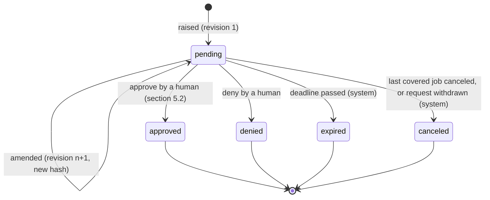
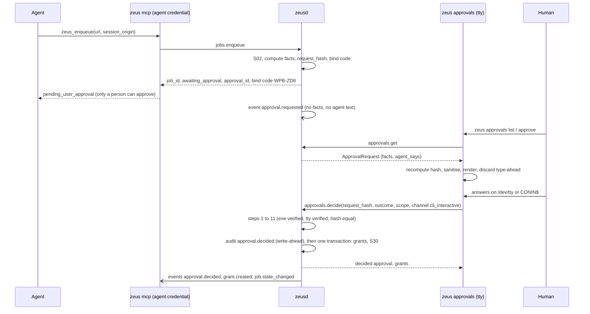
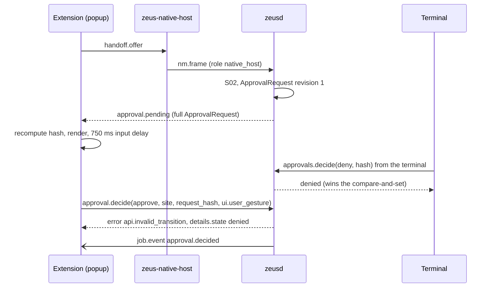
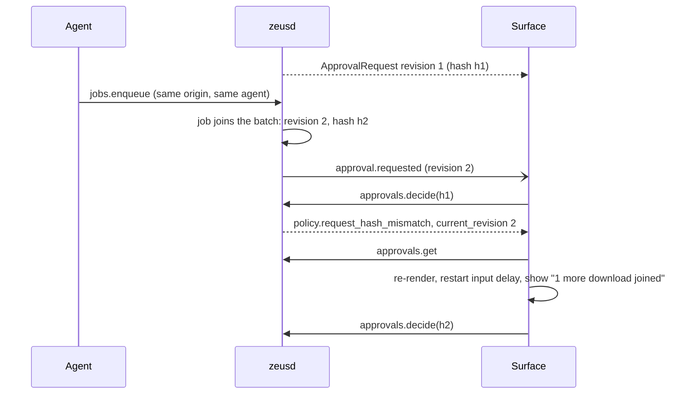
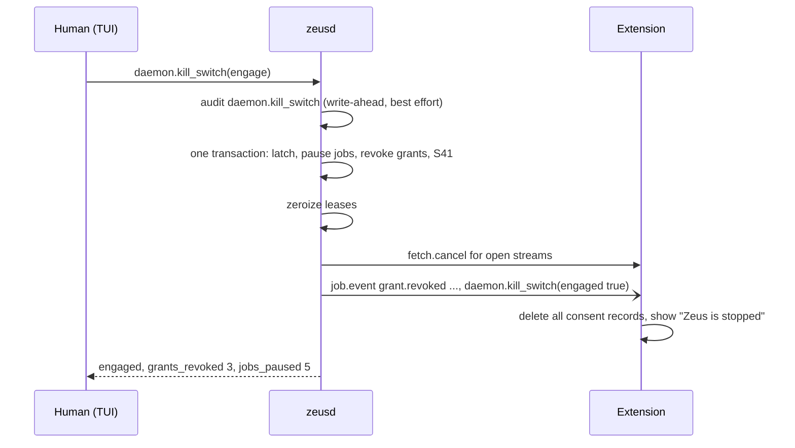

# 07. Approvals, trust surface and consent

| | |
|---|---|
| Status | Draft 1 |
| Applies to | `zeus` (daemon, CLI and TUI, native host, MCP and A2A bridges, later GUI), `zeus-extension` (popup and options pages, notifications) |
| Depends on | [00 conventions](00-conventions.md), [01 domain model](01-domain-model.md), [02 native messaging](02-native-messaging-v1.md), [03 journal](03-journal-and-commit-protocol.md), [04 audit and provenance](04-audit-log-and-provenance.md) |
| Design input | [ADR 0007](../adr/0007-human-only-approvals.md), [ADR 0011](../adr/0011-ogun-built-on-zeus-core.md), [ARCHITECTURE.md](../ARCHITECTURE.md) (part 7), research doc 28 (draft) |
| Schemas | [`schema/approvals.v1.schema.json`](schema/approvals.v1.schema.json) (`ApprovalRequest`, `ApprovalDecision`, `DecisionRecord`, `GrantRecord`, `KillSwitchRequest`, `KillSwitchResult`), [`schema/domain.schema.json`](schema/domain.schema.json) (`Approval`, `SessionGrant`, events) |

The key words MUST, MUST NOT, SHOULD, SHOULD NOT and MAY are used as in RFC 2119 and RFC 8174 and carry that meaning only when written in capitals.

## 1. Purpose and scope

Zeus holds authority that an agent wants: the user's logged-in browser sessions, writes outside a download folder, deletes, multi-day crawls. This document fixes how that authority is granted, and only by whom. Its central claim, which every implementation must make true and every test must try to break:

> **No agent-facing interface can approve anything, and every approval is bound to facts the daemon computed, attributable to a channel the daemon checked, and audited.**

The document defines:

1. the `ApprovalRequest` (the 01 `Approval` entity plus its daemon-computed facts), its request hash, revisions and batching (section 4);
2. decisions: what a trust surface sends, the order of checks, what is recorded and applied (section 5);
3. grant lifetimes, invariants, renewal, revocation and the never list (section 6);
4. the channels that may carry a human decision and the evidence the daemon requires for each, including the honest limit against an agent running as the same OS user (section 7);
5. the kill switch (section 8), anti-fatigue rules (section 9), UX rules and example screens (section 10), events, audit and listing (section 11), error codes (section 12).

Out of scope: the transport and the method envelope of the daemon API (spec 05; this document fixes the payload shapes of `approvals.*`, `sessions.revoke` and `daemon.kill_switch`), MCP tool shapes (spec 06), plan semantics (spec 08), the CLI command tree (spec 11) and the consolidated invariant list (spec 12).

## 2. Terminology

| Term | Meaning |
|---|---|
| Approval | A request for a human decision (01 section 5.3). Identified by an `ap_` id. |
| ApprovalRequest | The full approval: the 01 entity plus `request_hash`, `requested_by`, `revision`, `facts` and `agent_says`. What the journal stores and what trust surfaces receive. |
| Facts | The JSON object, computed only by the daemon, that a human reads and a decision is bound to (section 4.4). |
| Request hash | `hex(BLAKE3(JCS(facts)))` (section 4.6). Not to be confused with the idempotency `request_hash` of 00 section 5.4, which hashes request parameters. |
| Bind code | Six Crockford base32 characters derived from the request hash, shown as `XXX-XXX` on every surface (section 4.6). A cross-check aid and the typed confirmation code, not a secret. |
| Requester | The authenticated client whose request caused the approval, or the daemon itself (section 4.3). |
| Agent text | The single free-text field a requester may supply, stored as `agent_says` and always displayed as untrusted (section 4.5). |
| Revision | The version of a pending approval. A batch amendment produces a new revision with new facts and a new hash (section 4.7). |
| Trust surface | A UI path only a human can drive (00 section 2). Section 7.1 lists them; the **approving surfaces** may approve, the **notification surfaces** may only deny. |
| Channel evidence | What the daemon itself established about the connection a decision arrived on (section 7). Never the client's claim alone. |
| Confirmation level | `gesture`, `typed_code` or `os_auth`: how a human confirmed (section 7.7). |
| Effective kind | The client kind the daemon actually grants a connection after binary verification; a human credential used by an unverified program is downgraded to `agent` (section 7.2). |
| Decision record | The stored result of a decision, with its channel evidence (section 5.3). |
| Kill switch | One human action that revokes every grant and pauses every job, latched until a human releases it (section 8). |
| Batch key | The tuple under which concurrent needs share one pending approval (section 4.7). |

## 3. Threat model and goals

### 3.1 Adversaries

| Id | Adversary | Typical move |
|---|---|---|
| A1 | Prompt-injected or malicious agent reaching Zeus through MCP, A2A or a bridge | Approve its own request; word its request so the human approves something else; flood the human until they click yes |
| A2 | Hostile web page or server | Trigger handoffs to flood the queue; craft file names, URLs and titles that mislead or contain terminal escape and bidirectional-override sequences |
| A3 | Another browser extension | Script or overlay the extension's UI; send messages to the extension |
| A4 | A process running as the same OS user (malware, or an agent with arbitrary shell access) | Read credential files, run the genuine `zeus` binary under a pseudo-terminal, launch `zeus-native-host` with forged arguments, drive the browser |
| A5 | Computer-use agent that sees and clicks the screen | Click "Approve" in any visible window |
| A6 | A first-party service client (ADR 0011) that is buggy or misused | Raise approvals unattended, at volume |

### 3.2 Goals

| Id | Goal | Where |
|---|---|---|
| G1 | No client of kind `agent` or `service`, and no transport that carries agent traffic (MCP, A2A, raw JSON-RPC from a bridge), can decide an approval, create, renew or widen a grant, release the kill switch or change policy. | Sections 5.2, 7.1, 7.2 |
| G2 | A human decides on facts the daemon computed. Requester-supplied text is shown, if at all, in one labelled untrusted field. | Sections 4.4, 4.5, 10.1 |
| G3 | A decision applies to exactly the facts that were shown: it names the request hash, is single use and expires. Changing any fact invalidates it. | Sections 4.6, 4.7, 5.2 |
| G4 | Every decision records which channel and which evidence carried it, and is audited before it takes effect. | Sections 5.3, 11 |
| G5 | Approving is rare enough to stay meaningful: batching, caps, back-off, no approve-all, prompt budgets. | Section 9 |
| G6 | One action withdraws all authority at once and survives a restart. | Section 8 |
| G7 | The limits are stated honestly: Zeus does not claim to stop A4 or A5. | Section 7.8 |

### 3.3 Non-goals

Defending against A4 and A5 completely is impossible in software running as the same user (ADR 0007 item 5). Zeus raises their cost (binary and terminal checks, typed codes, a later OS-authentication step) and records what happened, and says plainly what it cannot do (section 7.8).

## 4. Approval requests

### 4.1 Kinds

The kinds are those of 01 section 5.3; this document adds what each kind's facts contain, who raises it, which confirmation it needs and whether it batches. The design brief for this document used four working names; they map onto the 01 vocabulary as shown in the last column.

| `kind` | Raised by | Requester | `allowed_scopes` (computed per approval) | Default confirmation | Default expiry | Batches | Brief's name |
|---|---|---|---|---|---|---|---|
| `handoff` | `handoff.offer` (02 section 7, S02) | the native host credential | `once`, `site`, `never` | `gesture` | 24 h | yes | |
| `session_grant` | `jobs.enqueue` naming `session_origin` (S02), `sessions.request`, the engine (S07, S11, S41) | the client that created the job or sent the request | `once` (only when at least one job is covered), `site`, `workflow` (only when the request names a run), `never` | `gesture`; `typed_code` for `workflow` | 24 h | yes | `session_grant` |
| `retry_escalation` | the engine (S23) | the client that created the job | none | `gesture` | 7 days | no | |
| `policy_exception` | a policy rule that permits a one-subject override (section 4.4) | the client whose request hit the rule | none | `typed_code` | 24 h | no | `policy_change` (one subject) |
| `workflow_plan` | `workflows.run` (spec 08), and renewal of a `workflow` grant (section 6.3) | the client that asked to run | `workflow` when the plan names a `session_origin`, otherwise none (01 section 5.3) | `typed_code` | 7 days | no | `workflow_run` |
| `destructive_op` | a file operation that deletes, overwrites or moves files (`files.organize`, `files.undo`, `files.convert`, later), and the end-of-run replacements of a workflow run (spec 08) | the client that asked, or the client that started the run | none | `typed_code` | 24 h | no | `destructive_files` |
| `cloud_delivery` | `cloud.submit` (14) | the client that submitted the immutable plan | none | `typed_code` | 24 h, no later than plan expiry | no | |

Rules:

1. A **standing policy change** (write roots, removing a never entry, trusted binaries, confirmation levels, enabling a bridge) is **not** an approval. It is a direct human action (`config.set`, `sessions.revoke` of a `never` grant) that needs the same channel evidence as an approve decision (section 7.1) and is audited as `config.changed` or `grant.revoked`. An agent cannot ask for one: the request fails with `policy_denied`, and the agent can only tell the human.
2. The daemon computes `allowed_scopes` for every approval from the table and the request, and never from a client's wish. `never` is offered only on kinds that name an origin (`handoff`, `session_grant`).
3. Expiry defaults are those of 01 section 10 and are configurable per kind between 1 minute and 30 days. A configuration MAY shorten them; it MUST NOT lengthen `session_grant` beyond 7 days.
4. Every approval kind MUST appear in this table; a new kind needs a row here, a `Facts*` definition in the schema and a template in section 10 before any surface may offer approve for it (section 14).

### 4.2 Lifecycle



1. An approval is created `pending` with `revision` 1. Only the daemon creates, amends, expires or cancels approvals; only a human decides them (01 section 5.3 rules 1 and 2).
2. Leaving `pending` is one compare-and-set inside one journal transaction (03); a decided approval is immutable (01 section 5.3 rule 3). When two surfaces decide at once, exactly one wins; the other gets `api.invalid_transition` (section 12).
3. `expire` is an automatic deny: covered jobs fail with `policy.approval_expired` (S31), and no `never` grant is created.

### 4.3 Requester

`requested_by` names who caused the approval and `facts.requester` describes them. Both are set by the daemon from the authenticated connection and the credential store (spec 05), never from anything a client sends.

| `facts.requester.kind` | Who | Shown to the human as |
|---|---|---|
| `agent` | A client with an agent credential: `zeus mcp`, an A2A or HTTP bridge, a script | `agent "<label>"` with its role (MCP, A2A) |
| `service` | A first-party program using the daemon unattended, today only Ogun's `ogund` (ADR 0011) | `service "<label>" (unattended program, registered <date>)` |
| `human`, `admin` | The CLI, TUI or GUI of the human themself; or the native host for a browser handoff | `you, from the terminal` or `this browser` |
| `daemon` | Nothing attributable (no current kind uses it; reserved) | `Zeus` |

Rules:

1. `label` is the credential's name: `cli`, `agent` and `host` for the credentials `zeusd init` provisions, or the name a human gave with `zeus clients add` (spec 05). It is not the self-declared `client_name` of `daemon.hello`, which is untrusted and never shown as identity.
2. An approval raised by the engine for an existing job (S07, S11, S23, S41) names the client that created the job (its `source.client_id`). An approval raised for a workflow run names the client that started the run.
3. A job enqueued by a **service** client shows the service identity as a fact on every approval it causes; the surface adds the words "unattended program". A service can never decide (section 7.2): a service's session use is bounded by grants a human created on a trust surface, which is exactly what these approvals produce (ADR 0011 decision 4).
4. When a human created one agent credential per agent, `label` names the agent (`claude-code` in the examples). With the shared default `agent` credential the human sees only `agent "agent"`; surfaces SHOULD suggest creating per-agent credentials when more than one agent is active.

### 4.4 Facts

The facts are the only content a surface may present as true. Their schema is `RequestFacts` (a union over `kind`) in [`approvals.v1.schema.json`](schema/approvals.v1.schema.json).

**Common members** (every kind): `t` (the constant `zeus.approval.facts.v1`, which also separates this hash domain from every other BLAKE3 use), `approval_id`, `revision`, `kind`, `requester`, `issued_at` (this revision), `expires_at`, `allowed_scopes`, `confirmation` (the minimum level per approve option, section 7.7), `reason_codes`, `agent_says_blake3`.

**Per kind:**

| Kind | Members |
|---|---|
| `handoff` | `origin`, `first_time_for_origin`, `browser` (`name`, `profile_id`, `incognito`), `transfer`, `items`, `items_omitted` |
| `session_grant` | `origin`, `first_time_for_origin`, `scope_hint`, `run_id`, `transfer` (null for a `sessions.request` that names no job yet), `items`, `items_omitted` |
| `retry_escalation` | `job_id`, `origin`, `untrusted_name`, `error` (`code`, `class`), `refreshes_used`, `bytes_done`, `bytes_total`, `grant_id` |
| `policy_exception` | `rule` (`path_outside_roots`, `quarantined_file`), `operation` (`write`, `open`, `convert`, `move`, `delete`), `job_id`, `origin`, `subject_path`, `untrusted_name`, `quarantine_reasons` |
| `workflow_plan` | `plan_id`, `plan_blake3`, `run_id`, `renewal_of`, `untrusted_title`, `allowed_domains`, `allowed_domains_omitted`, `session_origin`, `budgets` (`max_pages`, `max_files`, `max_bytes`, `max_duration_ms`, `max_depth`), `pace` (`min_interval_ms`, `max_concurrency_per_host`), `robots_txt`, `dest_dir`, `estimate` |
| `destructive_op` | `operation_set_blake3`, `plan_id`, `counts` (`delete`, `overwrite`, `move`, `rename`), `total_bytes`, `to_trash`, `quarantined_count`, `sample`, `sample_omitted` |
| `cloud_delivery` | `delivery_id`, `plan_blake3`, `plan` (14 public immutable plan), `shares_full_source_url_with_provider`, `remote_byte_cap_enforced`, `remote_cancellation_supported` |

Cloud delivery creates no website-session grant. The initial implementation accepts its decisions only from an independently verified physical terminal (`cli_interactive` or `tui`); browser approval views MUST fail closed for this kind until they implement and attest its complete facts. The public plan withholds source URL paths/query strings, binding them through `source_hash`; destination names remain untrusted display data. The person sees the mode, account revision, destination, budget and remote cancellation/byte-limit exceptions before entering the bind code. An approval cannot authorize a later account revision or a changed plan.

`transfer` holds `job_ids` (every covered job, at most 50), `total_bytes` (sum of known sizes, null when none is known), `unknown_size_count`, `dest_dirs` (canonical directories, at most 8) and `dest_dirs_omitted`. `items` is a sample of at most 20 covered downloads, each with `job_id`, `untrusted_name`, `untrusted_url` (through `redact_url(log)`, 00 section 8.2) and `total_bytes`.

Every value has one of three provenances, and surfaces render them differently (section 10.1):

| Provenance | Members | Rendering |
|---|---|---|
| Measured or derived by the daemon | origins (computed by the daemon from URLs, 01 section 4), counts, byte sums, canonical paths after symlink resolution, ids, instants, the requester, hashes of plans and operation lists, budgets and pace after validation | Plain facts |
| Reported by a server or browser and parsed by the daemon | `total_bytes`, `bytes_total`, `estimate` | Facts with the qualifier "reported by the server" or "estimate" |
| Chosen by a server, page or requester | every member whose name starts with `untrusted_` | Sanitised, quoted, labelled untrusted, below the facts |

Rules:

1. The daemon MUST compute every fact itself. It MUST NOT copy a client-supplied string into a fact except into an `untrusted_` member, after the display sanitiser (section 10.1).
2. Facts contain only strings, integers, booleans, `null`, arrays and objects; no floating-point numbers and no integers outside +/- (2^53 - 1) (00 section 7). Their JCS form MUST NOT exceed 16 KiB; lists are cut to their stated maximum and the remainder counted in the `*_omitted` member.
3. Facts change only when the daemon amends the approval (section 4.7). Information learned later (a probe finding a size) does not amend a pending approval.
4. Facts are **closed** per value of `t`: a surface that finds a member it does not know for that `t`, or an unknown `t`, MUST NOT offer approve (it may offer deny and "decide later") and SHOULD tell the human to update. Adding a member therefore requires a new `t` (section 14).
5. `plan_blake3` and `operation_set_blake3` bind the decision to the complete plan or operation list, of which the facts show a summary. The daemon MUST recompute them when it executes; a mismatch aborts execution and raises a new approval.

**Reason codes** are daemon-chosen, dotted, from this registry (additive): `handoff.interrupted`, `handoff.user_initiated`, `session.first_use`, `session.required` (the job names `session_origin` or a probe found it needed, S02 or S11), `session.requested` (`sessions.request`), `session.grant_revoked`, `session.grant_expired` (S07, S41, S23), `retry.exhausted`, the code of the job's last error (`url.expired`, ...), `policy.path_outside_roots`, `file.quarantined`, `workflow.plan_ready`, `workflow.renewal`, `files.delete`, `files.overwrite`, `files.move`, `requester.service`.

### 4.5 Agent text

A requester MAY supply one free-text reason (`sessions.request` `reason`, and the equivalent parameter of other requests, spec 05 and 06). The daemon stores it as `agent_says`:

1. It is passed through the display sanitiser (section 10.1), trimmed, and cut to 280 characters (Unicode scalar values) at a grapheme boundary. Empty text is stored as absent.
2. It is never a fact. Its BLAKE3 over the UTF-8 bytes is the fact `agent_says_blake3` (null when absent), so the hash binds the exact text the human saw.
3. Surfaces render it below the facts, in a visually separate block headed with the requester's label and the words "untrusted text, not checked by Zeus" (section 10). It is never rendered as a heading, never in the colour or weight of a fact, never inside a sentence that Zeus wrote, never as markup, and never translated.
4. It is never placed in events, in notifications, in any other client's view, in logs or in LLM prompts (section 4.8). The audit log stores only its hash, inside the facts hash.
5. Text from a server (file names, titles) is not agent text: it lives in `untrusted_` facts.

### 4.6 Request hash and bind code

```
request_hash = lowercase_hex( BLAKE3( UTF-8( JCS(facts) ) ) )            32-byte unkeyed BLAKE3, RFC 8785 JCS
n            = (first 4 bytes of the digest as a big-endian u32) >> 2    the top 30 bits
bind_code    = 6 Crockford base32 digits of n, most significant first, "-" after the third
```

Rules:

1. The daemon computes `request_hash` when it raises or amends an approval and stores it with the facts. `request_hash` uniquely identifies one revision of one approval, because the facts contain `approval_id` and `revision`.
2. **Every surface MUST recompute** the hash from the facts it received and is about to display, and MUST refuse to render the approve control when its result differs from `request_hash` (it shows "this request failed an integrity check" and offers only deny). The decision it sends carries the hash **it computed**. A relay that showed altered facts therefore produces a decision the daemon rejects (`policy.request_hash_mismatch`).
3. Surfaces display the bind code and at least the first 16 hex digits of the hash. The daemon MAY return the bind code (never anything that decides) to the requester, so an agent can tell the person which request to look for.
4. The bind code is 30 bits: an aid for humans and the typed confirmation code (section 7.7), not a security primitive. Typed input is accepted case-insensitively, with `O` read as `0`, `I` and `L` read as `1`, and spaces and hyphens ignored.

Test vectors (normative):

| Input | Output |
|---|---|
| The facts of the `handoff` example in section 4.9 | `request_hash` `09e8478513076b8b79ed19675402421a3cee9eb3d4c73487daa7bd63a55003ae`, bind code `17M-4F1` |
| The facts of the `session_grant` example in section 4.9 | `e597f6a196cf33172c91da16f2047d995f681858602741c00414358a0b5302b7`, bind code `WPB-ZD8` |
| Digest `d4d34c4b2f2a7b6e3ec7e0d3dc742647bf84b9324eecb54980503876467b5324` (bind code only) | `TK9-MRJ` |

`npm run validate` in `docs/spec/tools` recomputes the hash of every `ApprovalRequest` example in this document and checks that its facts agree with the entity (fence flag `hash`).

### 4.7 Revisions, batching and amendment

When several needs of the same kind arise for the same origin from the same requester, they share **one** pending approval instead of each raising its own. This is the main defence against prompt fatigue (section 9).

1. **Batch key.** `handoff`: (origin, browser `profile_id`). `session_grant`: (origin, `requested_by`, `run_id` or none). No other kind batches. Requests from different requesters never share an approval, so a human always sees who is asking and no client learns about another's jobs.
2. **Joining.** A new job whose need matches the batch key of a pending approval joins it instead of creating one: the daemon recomputes the facts (`transfer`, `items`, the union of `reason_codes`), sets `issued_at`, increments `revision`, recomputes `request_hash`, points the job's `approval_id` at the approval, and emits `approval.requested` again with the same id and the new revision (01 section 9). The creation transitions S02, S07, S11 and S41 do exactly this when the approval already exists. `expires_at` never changes: joining cannot extend a deadline.
3. **Limit.** An approval covers at most 50 jobs. The 51st need raises a new approval (subject to section 9).
4. **Leaving.** When a covered job is canceled (S32) or its need disappears and other jobs remain, the daemon removes it in a new revision and emits `approval.requested`; it does not emit `approval.decided` for that job. When the last job leaves, the approval is canceled (`system_reason` `job_canceled`) and S32 emits `approval.decided`.
5. **Deciding a batch.** One decision applies to every covered job, in one journal transaction: `approve` moves each job through S30, `deny` and `expire` through S31. The events shared by the jobs (`approval.decided`, and `grant.created` for each grant) are emitted once, before the per-job `job.state_changed` events, in `job_ids` order. Approving a batch with scope `once` creates one `once` grant per covered job (section 6.1).
6. **Stale decisions.** A decision naming the hash of an older revision fails with `policy.request_hash_mismatch`, `details.current_revision`. The error deliberately does not carry the new hash: the surface MUST fetch the approval again (`approvals.get`, `approval.list`) and re-render it, restarting its input delay (section 10.1).
7. Surfaces SHOULD show what changed between revisions ("1 more download joined").

Implemented (2026-10-18): `session_grant` batching when a new job is enqueued, rules 1 to 3 and 5, including one `once` grant per covered job and a daemon-wide decision applied to every covered job. Not yet: `handoff` batching by browser profile, and rule 4 (leaving): a canceled covered job stays listed in the facts, and the decision skips it when applied.

### 4.8 Who sees what

| Recipient | What it receives |
|---|---|
| Human-kind clients with approving-surface evidence (terminal, TUI, GUI) and the extension through native messaging (`approval.pending`, `approval.list`, 02 section 10.1) | The full `ApprovalRequest` |
| The requester (an agent or service), for approvals it caused (`approvals.list`, `approvals.get`; spec 05) | The full `ApprovalRequest` of its own approvals only; other approvals are invisible (`api.not_found`) |
| Event subscribers (`approval.requested`, 01 section 9) | The 01 `Approval` with `request_hash`, `requested_by` and `revision`, **without** `facts` and `agent_says` |
| MCP and A2A outputs (specs 06, 10) | Approval id, state, kind, expiry and bind code; never `facts` or `agent_says` (spec 06 returns an agent's own text to no MCP client), never a decision operation |
| Logs | Ids, kind, state, revision; never facts content or `agent_says` (00 section 8) |

Agent text never reaches another agent: events fan out to every subscriber, so they carry neither `facts` nor `agent_says`.

### 4.9 Examples

A browser handoff, the approval of the 01 example before it was decided:

```json validate=approvals.v1#/$defs/ApprovalRequest hash
{
  "id": "ap_01M45NHJ3XS0QXG9T42HHN2YR8",
  "kind": "handoff",
  "state": "pending",
  "job_id": "job_01M45NHJ2AHWMXT8JVJ7BEEJX7",
  "origin": "https://portal.example.org",
  "allowed_scopes": ["once", "site", "never"],
  "reason_codes": ["handoff.interrupted", "session.first_use"],
  "summary": {
    "title": "dataset-v3.tar.zst",
    "url_redacted": "https://portal.example.org/download/8841",
    "total_bytes": 1288490188,
    "source_kind": "browser_handoff"
  },
  "created_at": "2026-10-05T09:15:30.301Z",
  "expires_at": "2026-10-06T09:15:30.301Z",
  "decided_at": null,
  "request_hash": "09e8478513076b8b79ed19675402421a3cee9eb3d4c73487daa7bd63a55003ae",
  "requested_by": "cli_01M3V7ME00TBC6F3THCHXHRYWJ",
  "revision": 1,
  "facts": {
    "t": "zeus.approval.facts.v1",
    "approval_id": "ap_01M45NHJ3XS0QXG9T42HHN2YR8",
    "revision": 1,
    "kind": "handoff",
    "requester": { "kind": "human", "role": "native_host", "client_id": "cli_01M3V7ME00TBC6F3THCHXHRYWJ", "label": "host" },
    "issued_at": "2026-10-05T09:15:30.301Z",
    "expires_at": "2026-10-06T09:15:30.301Z",
    "allowed_scopes": ["once", "site", "never"],
    "confirmation": { "once": "gesture", "site": "gesture" },
    "reason_codes": ["handoff.interrupted", "session.first_use"],
    "origin": "https://portal.example.org",
    "first_time_for_origin": true,
    "browser": { "name": "chrome", "profile_id": "6f1c2a9e0b7d4e3fa5c8d2b1e0f9a7c3", "incognito": false },
    "transfer": {
      "job_ids": ["job_01M45NHJ2AHWMXT8JVJ7BEEJX7"],
      "total_bytes": 1288490188,
      "unknown_size_count": 0,
      "dest_dirs": ["/home/ada/Downloads/Zeus"],
      "dest_dirs_omitted": 0
    },
    "items": [
      {
        "job_id": "job_01M45NHJ2AHWMXT8JVJ7BEEJX7",
        "untrusted_name": "dataset-v3.tar.zst",
        "untrusted_url": "https://portal.example.org/download/8841",
        "total_bytes": 1288490188
      }
    ],
    "items_omitted": 0,
    "agent_says_blake3": null
  }
}
```

An agent's session request after a second job joined the batch (revision 2), with agent text:

```json validate=approvals.v1#/$defs/ApprovalRequest hash
{
  "id": "ap_01M465YFSGE0S6JG9A0WZWQ2F2",
  "kind": "session_grant",
  "state": "pending",
  "job_id": "job_01M465YFRJ5SCBKZ1W5VGH7GR9",
  "origin": "https://files.example.com",
  "allowed_scopes": ["once", "site", "never"],
  "reason_codes": ["session.required", "session.first_use"],
  "summary": {
    "title": "q3-ledger.csv.gz",
    "url_redacted": "https://files.example.com/exports/2026/q3-ledger.csv.gz",
    "total_bytes": 734003200,
    "source_kind": "agent"
  },
  "created_at": "2026-10-05T14:02:11.120Z",
  "expires_at": "2026-10-06T14:02:11.120Z",
  "decided_at": null,
  "request_hash": "e597f6a196cf33172c91da16f2047d995f681858602741c00414358a0b5302b7",
  "requested_by": "cli_01M3Y1JVC0FH2XJFVSFSEEB82F",
  "revision": 2,
  "facts": {
    "t": "zeus.approval.facts.v1",
    "approval_id": "ap_01M465YFSGE0S6JG9A0WZWQ2F2",
    "revision": 2,
    "kind": "session_grant",
    "requester": {
      "kind": "agent",
      "role": "mcp",
      "client_id": "cli_01M3Y1JVC0FH2XJFVSFSEEB82F",
      "label": "claude-code",
      "registered_at": "2026-10-02T10:12:00.000Z"
    },
    "issued_at": "2026-10-05T14:02:40.455Z",
    "expires_at": "2026-10-06T14:02:11.120Z",
    "allowed_scopes": ["once", "site", "never"],
    "confirmation": { "once": "gesture", "site": "gesture" },
    "reason_codes": ["session.required", "session.first_use"],
    "origin": "https://files.example.com",
    "first_time_for_origin": true,
    "scope_hint": "site",
    "run_id": null,
    "transfer": {
      "job_ids": ["job_01M465YFRJ5SCBKZ1W5VGH7GR9", "job_01M465ZCCT4R3CM8KB65RZRGDQ"],
      "total_bytes": 734003200,
      "unknown_size_count": 1,
      "dest_dirs": ["/home/ada/Downloads/Zeus/reports"],
      "dest_dirs_omitted": 0
    },
    "items": [
      {
        "job_id": "job_01M465YFRJ5SCBKZ1W5VGH7GR9",
        "untrusted_name": "q3-ledger.csv.gz",
        "untrusted_url": "https://files.example.com/exports/2026/q3-ledger.csv.gz",
        "total_bytes": 734003200
      },
      {
        "job_id": "job_01M465ZCCT4R3CM8KB65RZRGDQ",
        "untrusted_name": "q3-notes.pdf",
        "untrusted_url": "https://files.example.com/exports/2026/q3-notes.pdf",
        "total_bytes": null
      }
    ],
    "items_omitted": 0,
    "agent_says_blake3": "997d22b16ae10cc4b9a55f7525a9c7f195e5e225f661ccf0427ad922c728b930"
  },
  "agent_says": "Downloading the Q3 exports you asked for in this chat."
}
```

A workflow plan that the service `ogun` asked to run (ADR 0011). The service identity is a fact; the confirmation is a typed code:

```json validate=approvals.v1#/$defs/ApprovalRequest hash
{
  "id": "ap_01M485Z8785RCEFDWFQYPQW37A",
  "kind": "workflow_plan",
  "state": "pending",
  "run_id": "run_01M485Z86WQ4D2XNB7S0HM3K1V",
  "origin": "https://portal.example.org",
  "allowed_scopes": ["workflow"],
  "reason_codes": ["workflow.plan_ready", "requester.service"],
  "summary": { "title": "2026 conference papers", "total_bytes": 3328599654, "source_kind": "workflow" },
  "created_at": "2026-10-06T08:41:05.000Z",
  "expires_at": "2026-10-13T08:41:05.000Z",
  "decided_at": null,
  "request_hash": "fb327bf89e049c3baf272cfb080415fa326f00af97d43cc013e6dc45f5b26502",
  "requested_by": "cli_01M481X360C3DC8V29SPS7ZJNY",
  "revision": 1,
  "facts": {
    "t": "zeus.approval.facts.v1",
    "approval_id": "ap_01M485Z8785RCEFDWFQYPQW37A",
    "revision": 1,
    "kind": "workflow_plan",
    "requester": {
      "kind": "service",
      "role": "service",
      "client_id": "cli_01M481X360C3DC8V29SPS7ZJNY",
      "label": "ogun",
      "registered_at": "2026-10-06T07:30:00.000Z"
    },
    "issued_at": "2026-10-06T08:41:05.000Z",
    "expires_at": "2026-10-13T08:41:05.000Z",
    "allowed_scopes": ["workflow"],
    "confirmation": { "workflow": "typed_code" },
    "reason_codes": ["workflow.plan_ready", "requester.service"],
    "plan_id": "plan_01M485XMF0G5R39QSV0ZZ239PE",
    "plan_blake3": "8c34f7016f32728e9fee583f8509c3ff0f08553f081362d6ef355a5b631babbd",
    "run_id": "run_01M485Z86WQ4D2XNB7S0HM3K1V",
    "renewal_of": null,
    "untrusted_title": "2026 conference papers",
    "allowed_domains": ["portal.example.org"],
    "allowed_domains_omitted": 0,
    "session_origin": "https://portal.example.org",
    "budgets": { "max_pages": 200, "max_files": 1240, "max_bytes": 3328599654, "max_duration_ms": 7200000, "max_depth": 3 },
    "pace": { "min_interval_ms": 2000, "max_concurrency_per_host": 1 },
    "robots_txt": "obey",
    "dest_dir": "/home/ada/Downloads/Zeus/portal-2026",
    "estimate": { "files_low": 1100, "files_high": 1240, "bytes_low": 2684354560, "bytes_high": 3328599654 },
    "agent_says_blake3": null
  }
}
```

A retry escalation (the approval of the 01 section 9.3 event example), a policy exception and a destructive operation:

```json validate=approvals.v1#/$defs/ApprovalRequest hash
{
  "id": "ap_01M45TC900WT1S4TZV708J04JP",
  "kind": "retry_escalation",
  "state": "pending",
  "job_id": "job_01M45SSZ20WN6VYFYEM4GP8SZD",
  "origin": "https://portal.example.org",
  "allowed_scopes": [],
  "reason_codes": ["retry.exhausted", "url.expired"],
  "summary": {
    "title": "annual-report.pdf",
    "url_redacted": "https://portal.example.org/files/annual-report.pdf",
    "total_bytes": 734003200,
    "source_kind": "browser_handoff"
  },
  "created_at": "2026-10-05T10:40:00.000Z",
  "expires_at": "2026-10-12T10:40:00.000Z",
  "decided_at": null,
  "request_hash": "d34239794e9294eb22cfe01bc2132d587cdd2d9231c7e19c01ad43110428dd27",
  "requested_by": "cli_01M3V7ME00TBC6F3THCHXHRYWJ",
  "revision": 1,
  "facts": {
    "t": "zeus.approval.facts.v1",
    "approval_id": "ap_01M45TC900WT1S4TZV708J04JP",
    "revision": 1,
    "kind": "retry_escalation",
    "requester": { "kind": "human", "role": "native_host", "client_id": "cli_01M3V7ME00TBC6F3THCHXHRYWJ", "label": "host" },
    "issued_at": "2026-10-05T10:40:00.000Z",
    "expires_at": "2026-10-12T10:40:00.000Z",
    "allowed_scopes": [],
    "confirmation": { "approve": "gesture" },
    "reason_codes": ["retry.exhausted", "url.expired"],
    "job_id": "job_01M45SSZ20WN6VYFYEM4GP8SZD",
    "origin": "https://portal.example.org",
    "untrusted_name": "annual-report.pdf",
    "error": { "code": "url.expired", "class": "url_expired" },
    "refreshes_used": 3,
    "bytes_done": 402653184,
    "bytes_total": 734003200,
    "grant_id": "gr_01M45NHPJP04TX6B1CJVQVQAK9",
    "agent_says_blake3": null
  }
}
```

```json validate=approvals.v1#/$defs/ApprovalRequest hash
{
  "id": "ap_01M46DTY9CA76DBNDKZPA3JBQF",
  "kind": "policy_exception",
  "state": "pending",
  "job_id": "job_01M46DTY8EWXT1PRSJ9WKFBV2M",
  "origin": "https://downloads.example.net",
  "allowed_scopes": [],
  "reason_codes": ["policy.path_outside_roots"],
  "summary": {
    "title": "toolchain-1.4.2.tar.xz",
    "url_redacted": "https://downloads.example.net/releases/toolchain-1.4.2.tar.xz",
    "total_bytes": 52428800,
    "source_kind": "agent"
  },
  "created_at": "2026-10-05T16:20:03.500Z",
  "expires_at": "2026-10-06T16:20:03.500Z",
  "decided_at": null,
  "request_hash": "9a98c1241687654f1a8164c2976682446e9ff01f1963366f732bb4c7d8dbec07",
  "requested_by": "cli_01M3Y1JVC0FH2XJFVSFSEEB82F",
  "revision": 1,
  "facts": {
    "t": "zeus.approval.facts.v1",
    "approval_id": "ap_01M46DTY9CA76DBNDKZPA3JBQF",
    "revision": 1,
    "kind": "policy_exception",
    "requester": {
      "kind": "agent",
      "role": "mcp",
      "client_id": "cli_01M3Y1JVC0FH2XJFVSFSEEB82F",
      "label": "claude-code",
      "registered_at": "2026-10-02T10:12:00.000Z"
    },
    "issued_at": "2026-10-05T16:20:03.500Z",
    "expires_at": "2026-10-06T16:20:03.500Z",
    "allowed_scopes": [],
    "confirmation": { "approve": "typed_code" },
    "reason_codes": ["policy.path_outside_roots"],
    "rule": "path_outside_roots",
    "operation": "write",
    "job_id": "job_01M46DTY8EWXT1PRSJ9WKFBV2M",
    "origin": "https://downloads.example.net",
    "subject_path": "/home/ada/src/build-tools/vendor",
    "untrusted_name": "toolchain-1.4.2.tar.xz",
    "quarantine_reasons": [],
    "agent_says_blake3": "b8a001ac6784f04845b643da9bd9933d64c24577ca6f93de4102558a6c20f534"
  },
  "agent_says": "Save it next to the project so the build can find it."
}
```

```json validate=approvals.v1#/$defs/ApprovalRequest hash
{
  "id": "ap_01M48E6RV011Z2QV57EPB01YAD",
  "kind": "destructive_op",
  "state": "pending",
  "allowed_scopes": [],
  "reason_codes": ["files.delete", "files.move"],
  "summary": { "title": "Organise ~/Downloads/Zeus", "total_bytes": 5153960755, "source_kind": "agent" },
  "created_at": "2026-10-06T11:05:00.000Z",
  "expires_at": "2026-10-07T11:05:00.000Z",
  "decided_at": null,
  "request_hash": "5224b282c2a54a76c855655bcf19d11238a6ffd5bc8e942a1dd14f23c2e63dea",
  "requested_by": "cli_01M3Y1JVC0FH2XJFVSFSEEB82F",
  "revision": 1,
  "facts": {
    "t": "zeus.approval.facts.v1",
    "approval_id": "ap_01M48E6RV011Z2QV57EPB01YAD",
    "revision": 1,
    "kind": "destructive_op",
    "requester": {
      "kind": "agent",
      "role": "mcp",
      "client_id": "cli_01M3Y1JVC0FH2XJFVSFSEEB82F",
      "label": "claude-code",
      "registered_at": "2026-10-02T10:12:00.000Z"
    },
    "issued_at": "2026-10-06T11:05:00.000Z",
    "expires_at": "2026-10-07T11:05:00.000Z",
    "allowed_scopes": [],
    "confirmation": { "approve": "typed_code" },
    "reason_codes": ["files.delete", "files.move"],
    "operation_set_blake3": "a9c5b5ba55cfc1157add49b1df898f20647aa6ca8a1b0869ee40663c25860aa2",
    "plan_id": "plan_01M48E65A0ZXG82HY4A0G3Z8TD",
    "counts": { "delete": 31, "overwrite": 0, "move": 212, "rename": 40 },
    "total_bytes": 5153960755,
    "to_trash": true,
    "quarantined_count": 0,
    "sample": [
      { "op": "delete", "path": "/home/ada/Downloads/Zeus/old/report-final-FINAL.pdf", "to": null, "size_bytes": 2202010 },
      {
        "op": "move",
        "path": "/home/ada/Downloads/Zeus/inbox/a1b2.pdf",
        "to": "/home/ada/Downloads/Zeus/papers/2026/chen-quantum-routing.pdf",
        "size_bytes": 1048576
      }
    ],
    "sample_omitted": 281,
    "agent_says_blake3": null
  }
}
```

(The `plan_blake3` and `operation_set_blake3` values are digests of placeholder bytes; spec 08 defines what they hash.)

## 5. Decisions

### 5.1 The decision a surface sends

`ApprovalDecision` is the parameter object of `approvals.decide` (spec 05) and, with the native-messaging spellings of 02 section 10.1, the body of `approval.decide`:

| Member | Rule |
|---|---|
| `approval_id` | The approval. |
| `request_hash` | The hash the surface **recomputed** from the facts it displayed (section 4.6). |
| `outcome` | `approve` or `deny`. Unknown values are `invalid_request` (00 section 4 rule 7). |
| `scope` | For `approve`: one of `allowed_scopes` other than `never`, or absent when `allowed_scopes` is empty. For `deny`: absent, or `never` when `never` is allowed. |
| `channel` | The surface the human used. A claim, checked against the daemon's own evidence (section 7). |
| `confirmation` | The level the surface collected (section 7.7); absent means `gesture`. |
| `idempotency_key` | Optional; a repeated key returns the stored result (00 section 5.4), so a surface can retry after a lost response. |

```json validate=approvals.v1#/$defs/ApprovalDecision
{
  "approval_id": "ap_01M465YFSGE0S6JG9A0WZWQ2F2",
  "request_hash": "e597f6a196cf33172c91da16f2047d995f681858602741c00414358a0b5302b7",
  "outcome": "approve",
  "scope": "once",
  "channel": "cli_interactive",
  "confirmation": "gesture",
  "idempotency_key": "tty-18422-ap_01M465YFSGE0S6JG9A0WZWQ2F2"
}
```

```json validate=approvals.v1#/$defs/ApprovalDecision
{
  "approval_id": "ap_01M45NHJ3XS0QXG9T42HHN2YR8",
  "request_hash": "09e8478513076b8b79ed19675402421a3cee9eb3d4c73487daa7bd63a55003ae",
  "outcome": "deny",
  "scope": "never",
  "channel": "extension_popup"
}
```

### 5.2 Validation order

The daemon checks a decision in this order and stops at the first failure. The order is normative because it decides which error a caller sees and what an attacker can learn.

| Step | Check | Failure |
|---|---|---|
| 1 | The connection's **effective** kind is `human` or `admin` (section 7.2). Agents, services and downgraded connections stop here; the method table refuses them before any handler runs (`zeus_api::policy`). | `api.human_required`, `details.check` `kind` |
| 2 | `channel` is a human surface allowed for the connection's role, the daemon's own evidence supports it (sections 7.3 to 7.6), and the outcome is allowed on that surface (a notification surface may only deny, without `never`; section 7.1). | `api.human_required`, `details.check` (section 12) |
| 3 | A repeated `idempotency_key` returns the stored result here. | |
| 4 | The approval exists and the caller may see it. | `api.not_found` |
| 5 | The approval is `pending`. | `api.invalid_transition`, `details.state` |
| 6 | `now < expires_at`. If not, the daemon expires the approval now (section 5.4). | `policy.approval_expired` |
| 7 | `request_hash` equals the current revision's hash, compared in constant time. | `policy.request_hash_mismatch`, `details.current_revision` |
| 8 | For `approve`: the kill switch is not engaged (section 8), and no active `never` grant covers the approval's origin (section 6.5). | `policy.kill_switch_engaged`; `policy.origin_never` |
| 9 | The scope rule of section 5.1. | `policy.scope_not_allowed` |
| 10 | `confirmation` is at least `facts.confirmation[option]`, where the option is the chosen scope or `approve` (section 7.7). A deny needs only a gesture. | `policy.confirmation_required`, `details.required` |
| 11 | For `approve`: the daemon-wide approve rate (section 9.2). Counted only for decisions that passed every earlier step, so a surface retrying a stale hash does not use up the budget. | `api.rate_limited`, `details.retry_after_ms` |
| 12 | The write-ahead audit record `approval.decided` is durable (04 section 4.4). | `audit.unavailable` (fail closed) |
| 13 | One journal transaction: compare-and-set `pending` to the outcome; store the `DecisionRecord`; create grants; apply every covered transition; emit events (section 4.7 item 5). | `api.invalid_transition` if another decision won the race |

Every refusal from step 2 onward is audited (section 11.2). The steps of `zeus_daemon::approvals::validate_decision` (actor and surface, pending, expiry, hash, scope) and the list in spec 05 are subsequences of this order; steps 3, 8, 10, 12 and 13 are added by this document.

### 5.3 The decision record and its effects

When an approval leaves `pending`, the daemon stores a `DecisionRecord` next to the `ApprovalRequest` in the journal (03 section 4.1, table `approvals`). Human records carry the channel evidence; system records carry a reason. The 01 `Approval.decision` is derived from it (`grant_id` there is the first of `grant_ids`).

```json validate=approvals.v1#/$defs/DecisionRecord
{
  "approval_id": "ap_01M45NHJ3XS0QXG9T42HHN2YR8",
  "revision": 1,
  "request_hash": "09e8478513076b8b79ed19675402421a3cee9eb3d4c73487daa7bd63a55003ae",
  "outcome": "approve",
  "scope": "site",
  "actor": { "kind": "human", "surface": "extension_popup", "client_id": "cli_01M3V7ME00TBC6F3THCHXHRYWJ" },
  "decided_at": "2026-10-05T09:15:34.870Z",
  "grant_ids": ["gr_01M45NHPJP04TX6B1CJVQVQAK9"],
  "evidence": {
    "surface": "extension_popup",
    "role": "native_host",
    "client_id": "cli_01M3V7ME00TBC6F3THCHXHRYWJ",
    "credential_kind": "human",
    "effective_kind": "human",
    "exe_verified": true,
    "peer_pid": 23140,
    "tty": "not_applicable",
    "confirmation": "gesture",
    "extension": {
      "browser": "chrome",
      "attested_extension": "abcdefghijklmnopabcdefghijklmnop",
      "profile_id": "6f1c2a9e0b7d4e3fa5c8d2b1e0f9a7c3",
      "connection_id": "conn_01M45MS5HRSRFGHDEW4KQXZXQN",
      "user_gesture": true,
      "parent_verified": true
    }
  }
}
```

```json validate=approvals.v1#/$defs/DecisionRecord
{
  "approval_id": "ap_01M465YFSGE0S6JG9A0WZWQ2F2",
  "revision": 2,
  "request_hash": "e597f6a196cf33172c91da16f2047d995f681858602741c00414358a0b5302b7",
  "outcome": "approve",
  "scope": "once",
  "actor": { "kind": "human", "surface": "cli_interactive", "client_id": "cli_01M3V7ME01HNR0ATMA0D0XY9CW" },
  "decided_at": "2026-10-05T14:03:02.310Z",
  "grant_ids": ["gr_01M46601S6FRJ8B3Z889X861XE", "gr_01M46601S6ATDHX8RHW753JHHV"],
  "evidence": {
    "surface": "cli_interactive",
    "role": "cli",
    "client_id": "cli_01M3V7ME01HNR0ATMA0D0XY9CW",
    "credential_kind": "admin",
    "effective_kind": "admin",
    "exe_verified": true,
    "peer_pid": 18422,
    "tty": "verified",
    "confirmation": "gesture"
  }
}
```

```json validate=approvals.v1#/$defs/DecisionRecord
{
  "approval_id": "ap_01M45TC900WT1S4TZV708J04JP",
  "revision": 1,
  "request_hash": "d34239794e9294eb22cfe01bc2132d587cdd2d9231c7e19c01ad43110428dd27",
  "outcome": "expire",
  "actor": { "kind": "system" },
  "decided_at": "2026-10-12T10:40:00.000Z",
  "grant_ids": [],
  "system_reason": "deadline"
}
```

Effects of a decision, applied in the transaction of step 14:

| Kind | `approve` | `deny` |
|---|---|---|
| `handoff`, `session_grant` | Grants of the chosen scope (section 6.1): one `once` grant per covered job, or one `site` grant, or one `workflow` grant bound to `facts.run_id`. Every covered job S30. | Every covered job S31 with `policy.approval_denied`. With scope `never`: one `never` grant and the effects of section 6.5. |
| `retry_escalation` | As 01 section 5.3: counters reset, job S30. | As 01 section 5.3. |
| `policy_exception` | The exception is recorded on the job for this one subject and operation; it changes no configuration and is not reusable. Job S30. | Job S31 with `policy.approval_denied`. |
| `workflow_plan` | The run starts with the plan whose hash is `plan_blake3`; a `workflow` grant for `session_origin` is created if it is non-null; for a renewal, the grant named by `renewal_of` is renewed (section 6.3). | The plan is discarded and the run ends `failed` (01 section 5.3); for a renewal, the grant keeps its old expiry. |
| `destructive_op` | Exactly the operation set whose hash is `operation_set_blake3` runs (section 4.4 rule 5). | The operations are dropped. |

### 5.4 Expiry and cancellation

1. A sweeper checks pending approvals at least every 60 s, and every read and decision checks lazily. An approval past `expires_at` is decided `expire` by `system` with `system_reason` `deadline`; covered jobs follow S31 (`policy.approval_expired`). Expiry is an automatic deny, but it does not count toward the denial back-off of section 9.4 (no human said no).
2. A deadline is an instant stored in the journal (00 section 6.2 rule 3); after a restart, approvals already past it are expired during recovery, before any surface can see them.
3. Cancellation: when the last covered job is canceled the approval is decided `cancel` (`job_canceled`, S32). When the requester withdraws a plan or operation set, or replaces it with another, the approval is decided `cancel` (`request_withdrawn`).
4. Approvals are never deleted while their jobs exist; decided approvals follow the job tombstone retention (01 section 10).

### 5.5 Sequences

Agent asks for a session; the human decides at the terminal:



Browser handoff decided in the extension popup, with a racing terminal decision:



Amendment while the human is reading:



## 6. Grants

### 6.1 Scopes and lifetimes

The scopes, lifetimes and resolution order are those of 01 sections 5.1 and 5.2. This document adds:

| Scope | Created by | Lifetime | Additional rules |
|---|---|---|---|
| `once` | `approve` with scope `once` | until its job is terminal, hard maximum 24 h from creation | One grant per covered job; a batch approved `once` creates as many grants as it covers jobs, all naming the same `approval_id`. |
| `site` | `approve` with scope `site` | 24 h from creation | Not renewable; a new grant needs a new approval. |
| `workflow` | `approve` of a `session_grant` naming a run, or of a `workflow_plan` with a `session_origin` | 7 days from creation or from the latest renewal | Renewable by a human only (section 6.3). |
| `never` | `deny` with scope `never` | until a human revokes it | Section 6.5. |

A grant is consent, not material: it never contains cookies (01 section 5.1), and the extension's consent record and browser host permission still gate every release (02 section 10.2).

### 6.2 Invariants

The schema `GrantRecord` enforces what a schema can; the daemon enforces the rest and tests MUST cover each.

1. `scope = once`: `job_id` present, `run_id` absent, `renewable` false, `renewal_count` 0, `expires_at` non-null and at most `created_at` + 86,400,000 ms; state may be `consumed`.
2. `scope = site`: no `job_id`, no `run_id`, `renewable` false, `expires_at` = `created_at` + 86,400,000 ms.
3. `scope = workflow`: `run_id` present, no `job_id`, `renewable` true, `expires_at` = (`renewed_at` or `created_at`) + 604,800,000 ms.
4. `scope = never`: `expires_at` null, `uses` 0, never `expired` or `consumed`, no `job_id` or `run_id`.
5. `state = revoked` if and only if `revoked_at`, `revoked_by` and `revocation_reason` are all present; `revoked_by.kind` is `human`.
6. `decided_by` is a human on an approving surface (section 7.1). `approval_id` names the approval whose decision created the grant.
7. `uses` and `last_used_at` change only when a lease is issued (01 section 5.2 rule 3); a grant's other members never change after creation except `state`, the renewal members and the revocation members.
8. No API returns a grant that would let a client widen it: there is no update operation.

```json validate=approvals.v1#/$defs/GrantRecord
{
  "id": "gr_01M46601S6FRJ8B3Z889X861XE",
  "origin": "https://files.example.com",
  "scope": "once",
  "state": "consumed",
  "created_at": "2026-10-05T14:03:02.310Z",
  "expires_at": "2026-10-06T14:03:02.310Z",
  "job_id": "job_01M465YFRJ5SCBKZ1W5VGH7GR9",
  "approval_id": "ap_01M465YFSGE0S6JG9A0WZWQ2F2",
  "decided_by": { "kind": "human", "surface": "cli_interactive", "client_id": "cli_01M3V7ME01HNR0ATMA0D0XY9CW" },
  "uses": 2,
  "last_used_at": "2026-10-05T14:05:40.000Z",
  "revoked_at": null,
  "renewable": false,
  "renewal_count": 0
}
```

```json validate=approvals.v1#/$defs/GrantRecord
{
  "id": "gr_01M45NHPJP04TX6B1CJVQVQAK9",
  "origin": "https://portal.example.org",
  "scope": "site",
  "state": "active",
  "created_at": "2026-10-05T09:15:34.870Z",
  "expires_at": "2026-10-06T09:15:34.870Z",
  "approval_id": "ap_01M45NHJ3XS0QXG9T42HHN2YR8",
  "decided_by": { "kind": "human", "surface": "extension_popup" },
  "uses": 1,
  "last_used_at": "2026-10-05T09:15:36.140Z",
  "revoked_at": null,
  "renewable": false,
  "renewal_count": 0
}
```

### 6.3 Renewal

Only `workflow` grants renew, and only through a human decision:

1. A renewal is an approval of kind `workflow_plan` whose facts carry `renewal_of` (the grant), `run_id` (its run) and the run's current `plan_blake3`. Any client that may run workflows MAY ask for it; nobody but a human decides it. If the plan changed, it is a new plan approval, not a renewal.
2. A renewal can be decided only while the grant is `active`. An expired grant is not revived; the run needs a new grant through a new approval.
3. On approve, in one transaction: `renewed_at` = decision time, `expires_at` = `renewed_at` + 7 days, `renewal_count` + 1; `grant.renewed` is emitted (01 section 9) and `grant.renewed` is audited write-ahead (04 section 4.4). The grant keeps its id, origin, run and `approval_id` (of the original approval); the renewal approval is found through the audit record and its own decision record.
4. Surfaces SHOULD offer renewal from 24 h before expiry and MUST NOT renew automatically.

```json validate=approvals.v1#/$defs/GrantRecord
{
  "id": "gr_01M3RRNJM04D9FTTF4SY2YMFE8",
  "origin": "https://portal.example.org",
  "scope": "workflow",
  "state": "active",
  "created_at": "2026-09-30T09:00:00.000Z",
  "expires_at": "2026-10-13T08:52:10.000Z",
  "run_id": "run_01M3RRNJM041DSY9CRWM6A07TQ",
  "approval_id": "ap_01M3RRK4G0T5PVF241SY96S258",
  "decided_by": { "kind": "human", "surface": "tui" },
  "uses": 412,
  "last_used_at": "2026-10-06T08:51:00.000Z",
  "revoked_at": null,
  "renewable": true,
  "renewal_count": 1,
  "renewed_at": "2026-10-06T08:52:10.000Z"
}
```

Renewal emits the updated grant without session material:

```json validate=domain#/$defs/Event
{
  "seq": 52001,
  "ts": "2026-10-06T08:52:10.000Z",
  "type": "grant.renewed",
  "data": {
    "grant": {
      "id": "gr_01M3RRNJM04D9FTTF4SY2YMFE8",
      "origin": "https://portal.example.org",
      "scope": "workflow",
      "state": "active",
      "created_at": "2026-09-30T09:00:00.000Z",
      "expires_at": "2026-10-13T08:52:10.000Z",
      "run_id": "run_01M3RRNJM041DSY9CRWM6A07TQ",
      "approval_id": "ap_01M3RRK4G0T5PVF241SY96S258",
      "decided_by": {
        "kind": "human",
        "surface": "tui"
      },
      "uses": 412,
      "last_used_at": "2026-10-06T08:51:00.000Z",
      "revoked_at": null,
      "renewable": true,
      "renewal_count": 1,
      "renewed_at": "2026-10-06T08:52:10.000Z"
    }
  }
}
```

### 6.4 Revocation

1. A human revokes a grant through `sessions.revoke` (spec 05), `grant.revoke` (02 section 10.1), the TUI, or the kill switch. Revocation is human-only (`sessions.revoke` permission, `api.human_required` for agents and services). It needs no approving-surface evidence because it only removes authority, **except** revoking a `never` grant, which widens authority and therefore needs the evidence of an approve decision (section 7.1).
2. Effects, in one transaction (01 section 5.2 rule 5): state `revoked`, `revoked_at`, `revoked_by` (the human actor and surface), `revocation_reason` (`user_request`, `kill_switch` or `origin_blocked`); outstanding leases zeroized; in-proxy streams canceled (`fetch.cancel`, 02 section 9); `grant.revoked` emitted and audited write-ahead; dependent jobs follow S07, S23 or S41.
3. The extension removes its consent record on `grant.revoked` (02 section 10.2).
4. Revocation is idempotent: revoking a revoked grant returns it unchanged and emits nothing.

```json validate=approvals.v1#/$defs/GrantRecord
{
  "id": "gr_01M480RFA0TEV0HDZZE5JVV8P8",
  "origin": "https://media.example.net",
  "scope": "site",
  "state": "revoked",
  "created_at": "2026-10-06T07:10:00.000Z",
  "expires_at": "2026-10-07T07:10:00.000Z",
  "approval_id": "ap_01M480QJZRWDM2R3XWHFKTKFF2",
  "decided_by": { "kind": "human", "surface": "extension_popup" },
  "uses": 3,
  "last_used_at": "2026-10-06T07:44:10.000Z",
  "revoked_at": "2026-10-06T09:12:45.120Z",
  "revoked_by": { "kind": "human", "surface": "tui", "client_id": "cli_01M3V7ME01HNR0ATMA0D0XY9CW" },
  "revocation_reason": "kill_switch",
  "renewable": false,
  "renewal_count": 0
}
```

### 6.5 The never list

1. The never list is the set of active `never` grants. An entry is created only by a human `deny` with scope `never` on an approving surface (a notification surface cannot add one, section 7.1). There is no agent path to add or remove an entry.
2. Creating an entry, in the same transaction: every active `once`, `site` and `workflow` grant for that origin is revoked with reason `origin_blocked`; queued jobs needing the origin fail at their next policy evaluation (S08, `policy.origin_never`).
3. While an entry is active: handoffs from the origin are rejected (`policy.origin_never`, 02 section 7); session requests are refused (`sessions.request` answers `denied`); and an `approve` of any other pending approval for the origin is refused at step 8 of section 5.2. Pending approvals for the origin stay visible so the human can deny them.
4. Removing an entry is `sessions.revoke` of the `never` grant with reason `user_request`, which needs approving-surface evidence (section 6.4 rule 1).

```json validate=approvals.v1#/$defs/GrantRecord
{
  "id": "gr_01M488S650Y77C1PWHEESXYDY9",
  "origin": "https://ads.example.net",
  "scope": "never",
  "state": "active",
  "created_at": "2026-10-06T09:30:12.000Z",
  "expires_at": null,
  "approval_id": "ap_01M488RGNGRYGAMFEXDWRQTXS1",
  "decided_by": { "kind": "human", "surface": "extension_popup" },
  "uses": 0,
  "last_used_at": null,
  "revoked_at": null,
  "renewable": false,
  "renewal_count": 0
}
```

### 6.6 Listing

1. `sessions.list` (spec 05) and `grant.list` (02) return grants, active by default, all states on request. They never return material. Agent and service clients see grants (they contain no secret), which lets an agent learn that a session is available without asking.
2. Surfaces SHOULD show for each active grant: origin, scope, expiry, uses, last use, who decided and on which surface, and a revoke control.
3. History (who approved what, when, on which channel) comes from `approvals.list` with decided states and from the audit log (section 11).

## 7. Channels and channel evidence

### 7.1 Surfaces

| Surface | Channel | Approve | Deny | Deny with `never` | Kill switch engage / release | Evidence required (sections) |
|---|---|---|---|---|---|---|
| `cli_interactive` | `zeus` reading the controlling terminal | yes | yes | yes | yes / yes | 7.2, 7.3 |
| `tui` | `zeus tui` approvals pane | yes | yes | yes | yes / yes | 7.2, 7.3 |
| `extension_popup`, `extension_options`, `extension_sidepanel` | Extension pages over native messaging | yes | yes | yes | yes / yes | 7.2, 7.4 |
| `gui` | Desktop GUI (later, ADR 0009) | yes, once 7.5 is specified | yes | yes | yes / yes | 7.2, 7.5 |
| `extension_notification` | Browser notification button | **no** | yes (one approval) | no | engage only | 7.2, 7.4, 7.6 |
| `os_notification` | Operating-system notification | **no** | no in v1 (a pointer only) | no | no in v1 | 7.6 |
| `mcp`, `a2a`, `jsonrpc` | Agent traffic | **never** | **never** | **never** | **never** | not trust surfaces: `api.human_required` |

The approving surfaces (the first four rows) also carry the other authority-widening human actions: releasing the kill switch, revoking a `never` grant and `config.set`. Authority-narrowing actions (deny, revoke a non-`never` grant, engage the kill switch) are accepted from any human surface, because a spoofed narrowing action costs availability only.

There is no MCP, A2A, stdin, environment-variable, configuration-file or command-line-flag path that decides. In particular `--yes` never applies to approvals, MCP elicitation is not a channel (its UI belongs to the agent host), and an MCP App view may link to a trust surface by approval id but never carries a decision.

### 7.2 Client classification

Kinds separate kinds of client; they do not stop same-user code that can read the credential files (spec 05, ADR 0007). The daemon therefore classifies every connection once, at `daemon.authenticate`, and records the result in the audit record `client.connected` (04 section 4.4):

| Field | Meaning |
|---|---|
| `role` | From the credential (spec 05). |
| `credential_kind` | The kind bound to the credential: `agent`, `service`, `human` or `admin`. |
| `exe_verified` | The peer process runs a binary registered for that role (below). |
| `effective_kind` | The kind the connection actually gets. |
| `downgraded` | `credential_kind` is `human` or `admin` and `effective_kind` is `agent`. |

Rules:

1. **Peer identity.** The daemon obtains the peer's process id from the operating system, never from the client: Windows `GetNamedPipeClientProcessId`, Linux `SO_PEERCRED`, macOS `LOCAL_PEERPID`. It resolves the executable (Windows `QueryFullProcessImageNameW`, Linux `/proc/<pid>/exe`, macOS `proc_pidpath`) and canonicalises the path.
2. **Registered binaries.** At installation (`zeusd init`, `zeus daemon install`, `zeus native-host install`) the installer records the canonical paths, and SHOULD record the BLAKE3 digests, of `zeus` (roles `cli` and `tui`), `zeus-native-host` (role `native_host`) and later the GUI binary (role `gui`). The list lives in the daemon's configuration and changes only through `config.set` with approving-surface evidence.
3. **Verification.** `exe_verified` is true when the peer's path equals a registered path for the credential's role and, where a digest is registered, the file's digest matches. The digest SHOULD be cached by file identity and modification time.
4. **Downgrade.** A `human` or `admin` credential presented by an unverified peer is downgraded to `agent`: the connection loses every human-only and admin-only permission, works for reading and agent-level control, and is audited with `downgraded: true`. The daemon does not reject it (scripts using `cli.token` for read-only commands keep working).
5. **Service and agent kinds** are never upgraded. A `service` connection keeps the `service` ceiling of spec 05 and, like `agent`, can never decide, revoke, engage or release the kill switch, or change configuration: every human-only method answers `api.human_required` (ADR 0011 decision 4).
6. **Developer mode.** Configuration `trust.exe_check = "record"` disables the downgrade (the check is still recorded). It is for development builds run from a build directory, needs approving-surface evidence to set, and every surface shows a permanent warning while it is on. The default is `"enforce"`.
7. A connection's classification never changes after authentication; a credential's kind never exceeds its role's cap (spec 05).

### 7.3 Terminal channel

Surfaces `cli_interactive` and `tui`, implemented by the `zeus` binary (`zeus_cli::trust`).

Surface rules (the `zeus` binary):

1. Read the answer from the **controlling terminal** only: Windows `CONIN$` (and write to `CONOUT$`), Unix `/dev/tty` opened read-write. Never stdin or stdout, never an environment variable, a file or a flag. `--yes` is ignored.
2. If the controlling terminal cannot be opened (no console on Windows; `ENXIO` on Unix: the process has no controlling terminal, as with most agent tool runners, cron, services and pipes), do not decide. Print to stderr that a person must decide in a terminal or in the browser extension, name the approval and its bind code, and exit with the "human required" status of spec 11 (exit code 4). The approval stays pending and expires on its own.
3. Before reading an answer, discard pending terminal input (Unix `tcflush(fd, TCIFLUSH)`, Windows `FlushConsoleInputBuffer`), so that keystrokes typed or injected before the screen appeared cannot answer it. Repeat after every re-render.
4. Render from the facts only (section 10), recompute the hash (section 4.6), and send the hash it computed.
5. For a `typed_code` option, require the bind code to be typed (section 7.7); a digit or `y` is not enough.
6. An end of input or an unrecognised answer is "decide later", never approve.

Daemon evidence:

| Check | Linux | macOS | Windows |
|---|---|---|---|
| Binary | section 7.2 | section 7.2 | section 7.2 |
| Controlling terminal of the peer | `/proc/<pid>/stat` field `tty_nr` is non-zero: `tty` = `verified`, else `absent` | `proc_pidinfo` `PROC_PIDTBSDINFO` `e_tdev` is not `NODEV`: `verified`, else `absent` | No supported query for another process's console; the verified binary opened `CONIN$` itself: `asserted`. The peer's session id (`ProcessIdToSessionId`) MUST NOT be 0 (services). |
| Result | A terminal decision with `tty` = `absent` is refused (`api.human_required`, `details.check` `tty`). | same | `asserted` is accepted. |

Limits: a pseudo-terminal (`script`, `expect`, `tmux`, Windows ConPTY) is a controlling terminal. A same-user agent that allocates one can run the genuine `zeus` and type answers (section 7.8). On Linux the `TIOCSTI` ioctl can inject input into another process's terminal; since Linux 6.2 the sysctl `dev.tty.legacy_tiocsti` decides whether an unprivileged process may use it. `zeus doctor` SHOULD warn when that sysctl is 1 or the kernel is older than 6.2.

### 7.4 Extension channel

Surfaces `extension_popup`, `extension_options`, `extension_sidepanel` and (deny only) `extension_notification`, carried by `approval.decide` inside `nm.frame` (02 section 10.1, ADR 0002 item 8).

Extension rules (in addition to 02 sections 10.1, 10.2 and 13.1):

1. Approval UI is rendered only in the extension's own pages, never injected into a web page's DOM, never in an iframe a page controls. The manifest has no `externally_connectable` and no content script on the approval path; messages are accepted only from `sender.id === chrome.runtime.id` and an extension-origin `sender.url` (02 section 10.2).
2. The extension MUST recompute `request_hash` from the facts it renders (JCS and BLAKE3; a small vendored implementation is acceptable and essential) and send that value in `approval.decide.request_hash`.
3. Buttons that approve are disabled for at least 750 ms after the approval is first painted and after every re-render, and are never focused by default (section 10.1). The popup MUST NOT be opened automatically (for example with `action.openPopup()`), because a window appearing under the cursor invites a stray click.
4. `ui.user_gesture` is true only for a decision taken in the handler of a trusted user event (`isTrusted`, and `navigator.userActivation.isActive` where available). It is weak evidence and is recorded as such.
5. For a `typed_code` option the page asks for the bind code (section 7.7).
6. Notifications follow section 7.6.

Daemon evidence, recorded in `evidence.extension`:

| Check | Source |
|---|---|
| The connection's role is `native_host`, credential kind `human`, binary verified (section 7.2) | `daemon.authenticate` |
| `attested_extension` (from `argv`, 02 section 3.2) is in the host's allow-list and equals `hello.extension_id`; the negotiated capabilities include `approvals` | 02 sections 3.4, 5 and 13.1 |
| `zeus-native-host` found its parent process to be a registered browser executable (on Windows the parent may be `cmd.exe` for hosts that are not launched directly; then the grandparent is checked): `parent_verified` | attach data from the host (spec 05) |
| `ui.surface` is an extension surface and `ui.user_gesture` is true (`nm.user_gesture_required` otherwise) | 02 section 10.1 |
| The browser `profile_id` of the connection | 02 section 5 |

`parent_verified` is always recorded. When configuration `trust.require_browser_parent` is true, a connection with `parent_verified` false cannot decide (`api.human_required`, `details.check` `browser_parent`). The default is false in protocol 1 and becomes true once the check is verified for every supported browser and platform (open issue O9). A same-user process can launch the genuine host with forged arguments and its own stdin; the parent check is what tells such a launch from the browser's.

```json validate=native-messaging.v1#/$defs/ExtensionToDaemonMessage
{
  "v": 1,
  "id": "e3",
  "type": "approval.decide",
  "body": {
    "approval_id": "ap_01M45NHJ3XS0QXG9T42HHN2YR8",
    "request_hash": "09e8478513076b8b79ed19675402421a3cee9eb3d4c73487daa7bd63a55003ae",
    "decision": "approve",
    "scope": "site",
    "confirmation": "gesture",
    "ui": { "surface": "extension_popup", "user_gesture": true }
  }
}
```

### 7.5 GUI channel (later)

The GUI (ADR 0009) is a client of role `gui` with a human credential and a registered binary. Its approval view is a separate window with its own command allowlist, renders text only (no markup from facts), and never forwards a generic RPC from its webview. Until the GUI's evidence (window focus, input source, OS-level foreground checks) is specified in the GUI work, the daemon refuses `gui` decisions (`api.human_required`, `details.check` `gui_unspecified`). The surface value `gui` is reserved now so that the schema and the audit format need no change.

### 7.6 Notification channels

Notifications tell the human that a decision is waiting. They are a convenience, never a decision path for approve.

1. **Content.** Kind, count and origin host only: "Zeus: 2 requests need your decision (files.example.com, portal.example.org)". Never file names, URLs, titles, agent text or bind codes: notification text is rendered by components outside Zeus's control and is easy to imitate.
2. **Actions.** "Review" opens the trust surface (the extension's approval page, or tells the human to run `zeus approvals list`). "Deny" is offered only when the notification concerns exactly one approval, sends a plain deny (no `never`), and needs no typed code. "Stop all" (engage the kill switch) MAY be offered. No other action exists.
3. **Coalescing.** At most one notification per surface per 30 s; amendments of a pending approval do not notify again.
4. **Platforms.** Chrome supports two buttons on `chrome.notifications`; Firefox's `notifications` API supports only `type`, `title`, `message` and `iconUrl`, so on Firefox a notification has no buttons and a click only opens the review page (verified against MDN on 2026-10-06). OS notifications are optional and in v1 are pointers only: their single action opens a trust surface, and the daemon API refuses the channel `os_notification` (spec 05). A later version MAY let a verified Zeus binary relay a deny from one.

Spoofing analysis:

| Attack | Possible? | Effect | Why acceptable |
|---|---|---|---|
| A same-user process or another app shows a notification that looks like Zeus's | Yes on every platform: notification identity is weak, and research doc 28 reports that a Windows toast can be shown under another app's identity with chosen actions | It can show any text | Nothing a notification shows is a fact; the human acts on a trust surface that renders daemon facts and the bind code |
| The forged notification's buttons are clicked | Yes | The click goes to the attacker, not to Zeus | Zeus did not send it; it decides nothing |
| A same-user process fakes the activation of a real Zeus notification | Plausible (protocol activation, D-Bus) | At most a deny or a kill-switch engage | Both narrow authority; a same-user attacker can cause the same loss of availability by killing the daemon |
| A forged "approve" activation | Impossible by construction | | Notification surfaces cannot approve (step 2 of section 5.2) |

### 7.7 Confirmation levels

| Level | What the human does | Evidence the daemon has |
|---|---|---|
| `gesture` | A click or key press on an approving control after the input delay | The surface's report, from a verified binary or an attested extension |
| `typed_code` | Types the bind code shown on the same screen | The same, plus the surface's report that the code matched |
| `os_auth` | Passes an operating-system user verification (Windows Hello, Touch ID, polkit, a security key) | Run by the daemon itself through a platform hook (later); a surface's claim of `os_auth` is ignored |

Defaults (configurable upward per kind and scope, never downward below `gesture`):

| Decision | Level |
|---|---|
| `handoff` with `once` or `site`; `session_grant` with `once` or `site`; `retry_escalation` | `gesture` |
| `session_grant` with `workflow`; `workflow_plan` (new run or renewal); `policy_exception`; `destructive_op` | `typed_code` |
| Every deny | `gesture` |

The required level for each approve option is written into `facts.confirmation`, so it is part of what the hash binds and every surface renders the same step. A typed code defends against reflex clicking and habituation (a prompt approved almost every time carries almost no information), not against an agent that can read the screen. `os_auth` is the only level that a same-user process cannot produce by itself, and it proves that a person was present, not which content they saw; for that reason its prompt text carries the bind code so the person can cross-check. `os_auth` is not part of the MVP (open issue O2).

### 7.8 Residual risk: an agent running as the same OS user

An agent with arbitrary shell access as the user (A4), or a computer-use agent (A5), can:

| Capability | Consequence |
|---|---|
| Read `<state>/credentials/*.token` and `ipc.secret` | Authenticate with any default credential. With an unverified binary it is downgraded to `agent` (section 7.2). |
| Run the genuine `zeus` binary under a pseudo-terminal and type into it | Pass the binary and terminal checks, read the bind code, approve. |
| Launch the genuine `zeus-native-host` with forged `argv` and stdin | Defeated only by the parent-process check (section 7.4), which a sufficiently capable attacker can also defeat. |
| Drive the browser (DevTools protocol in a live profile, accessibility APIs, synthetic input) | Click the popup; the extension cannot tell. |
| Edit Zeus's configuration and state files | Disable checks; rewrite an unkeyed audit log (04 section 5). |

Software running as the same user cannot prevent this; ADR 0007 states the claim Zeus makes instead (section 1). Mitigations, in order of strength:

1. **Run agents that have shell access as a different OS user, or in a container, VM or sandbox.** The daemon's endpoint admits only its own user (ADR 0002), so such an agent can reach Zeus only through a bridge and only as `agent`. This is the recommended deployment and `zeus doctor` SHOULD say so when it detects an agent runner as the same user.
2. Kind separation, binary verification, the terminal check and the parent-process check (sections 7.2 to 7.4).
3. Request hash, single use, expiry, typed codes for high-impact kinds (sections 4.6, 7.7).
4. Rate limits, caps, back-off, the kill switch (sections 8 and 9).
5. The audit log, in keyed mode where the keyring protects the key (04 section 4.3), and the human's ability to review it.
6. Later: `os_auth` for `site` and `workflow` scopes, `workflow_plan`, `destructive_op` and kill-switch release (open issue O2).

The first-run screen and spec 12 MUST state this limit plainly; no Zeus text may claim that approvals resist malware running as the user.

## 8. Kill switch

One action withdraws all session authority and stops all transfers, and stays in force until a human releases it.

### 8.1 Engaging

Requested through `daemon.kill_switch` (`KillSwitchRequest`, action `engage`), the native-messaging `kill_switch` request (02 section 10.1), the TUI (a single key shown in the footer) or the CLI (spec 11). Any client of **effective** kind `human` or `admin` on any human surface may engage it, including notification surfaces; no confirmation step and no typed code are required, because engaging only removes authority. Agents and services are refused (`api.human_required`).

The daemon then, in **one** journal transaction, in this order:

| Step | Effect |
|---|---|
| 1 | Set the latch `meta.kill_switch = {engaged: true, changed_at}` (03 section 4.1). |
| 2 | Pause every job that can be paused: `queued` (S05), `probing` (S15), `downloading` (S24), `retry_scheduled` (S61), with cause `user_request` and the human actor. Workers stop as for any pause (01 section 6 rule 8). |
| 3 | Revoke every active `once`, `site` and `workflow` grant with reason `kill_switch` (section 6.4). `never` grants stay: they protect. |
| 4 | Jobs in `awaiting_session` lose their grant and follow S41 to `awaiting_approval`; their approvals are raised (or joined) as usual and cannot be approved until release. |
| 5 | Emit `job.state_changed`, `grant.revoked` and, last, `daemon.kill_switch` (`engaged: true`, counts, `by`). |

Outside the transaction, immediately after it: zeroize every lease, cancel every in-browser fetch stream (`fetch.cancel`), discard late session material, and close no connection. Jobs in `verifying` and `finalizing` run to completion: they use no network and no session. Jobs in `awaiting_approval`, `paused`, `failed`, `completed` and `canceled` are untouched.

Audit: `daemon.kill_switch` is a write-ahead record, but the switch proceeds if the audit log cannot be written, and the record is appended when the log is writable again (04 section 4.6 item 8). Its data: `action`, `grants_revoked`, `jobs_paused`, `approvals_pending`, and `reason_blake3` (the BLAKE3 of the untrusted `reason` text, never the text).

The extension, on the `daemon.kill_switch` event with `engaged` true, MUST delete every consent record and abort every fetch, even before the individual `grant.revoked` events arrive, and shows "Zeus is stopped" in its header.

Engaging while engaged repeats steps 2 to 5 (normally a no-op) and reports `changed: false`.

### 8.2 While engaged

| Operation | Behaviour |
|---|---|
| Reads (`*.list`, `*.get`, events, audit) | Allowed. |
| `approvals.decide` approve | Refused, `policy.kill_switch_engaged`. Deny is allowed. |
| `jobs.enqueue`, `handoff.offer`, `sessions.request`, `workflows.run`, file operations | Refused, `policy.kill_switch_engaged` (`handoff.reject` for offers). |
| `jobs.control` `resume`, `retry` | Refused, `policy.kill_switch_engaged`. `pause`, `cancel` and `reprioritize` are allowed. |
| Scheduler | Admits nothing (no S03 or S04). |
| Session leases, URL refresh, fetch proxy | None are requested. |
| Daemon restart | The latch is read at startup before recovery; nothing is admitted. |

### 8.3 Releasing

`KillSwitchRequest` with action `release`, from an approving surface with full evidence (section 7.1); notification surfaces, agents and services cannot release. Release clears the latch and emits `daemon.kill_switch` with `engaged: false`. It restores nothing: grants stay revoked and paused jobs stay paused until the human resumes them (surfaces SHOULD offer "resume the jobs the kill switch paused" as a separate, explicit action). Pending approvals become approvable again.

```json validate=approvals.v1#/$defs/KillSwitchRequest
{ "action": "engage", "surface": "tui", "reason": "Agent tried to rename my thesis folder" }
```

```json validate=approvals.v1#/$defs/KillSwitchResult
{ "engaged": true, "changed": true, "grants_revoked": 3, "jobs_paused": 5, "approvals_pending": 2 }
```

```jsonl validate=domain#/$defs/Event
{"seq":52101,"ts":"2026-10-06T09:12:45.120Z","type":"grant.revoked","data":{"grant_id":"gr_01M480RFA0TEV0HDZZE5JVV8P8","origin":"https://media.example.net","by":{"kind":"human","surface":"tui","client_id":"cli_01M3V7ME01HNR0ATMA0D0XY9CW"}}}
{"seq":52104,"ts":"2026-10-06T09:12:45.120Z","type":"daemon.kill_switch","data":{"engaged":true,"grants_revoked":3,"jobs_paused":5,"by":{"kind":"human","surface":"tui","client_id":"cli_01M3V7ME01HNR0ATMA0D0XY9CW"}}}
```



## 9. Anti-fatigue and rate limits

### 9.1 Caps

| Cap | Value | On excess |
|---|---|---|
| Pending approvals, daemon-wide | 50 (01 section 5.3 rule 4) | `policy.too_many_pending`, `details.scope` `global` |
| Pending approvals per requester | 10 | `policy.too_many_pending`, `details.scope` `requester` |
| Pending approvals per batch key | 1 (section 4.7) | the need joins the existing approval |
| Jobs per approval | 50 | a new approval |

The caps refuse requests that would raise an approval (`jobs.enqueue` naming `session_origin`, `sessions.request`, `handoff.offer`, `workflows.run`, file operations). Approvals the engine raises for jobs already admitted (S07, S11, S23, S41) cannot be refused without an extra transition, so the daemon prevents them instead: while a requester is at its cap, or the daemon-wide cap is reached, the scheduler admits (S03) none of that requester's jobs. The overshoot is therefore bounded by the number of jobs already `probing` or `downloading` (the global concurrency limit, 01 section 10).

### 9.2 Rates

1. Approve decisions: at most 10 per minute **daemon-wide**, across all surfaces (`api.rate_limited`, `details.retry_after_ms`). Deny decisions are not limited by this rule, so a flood can always be cleared; transport limits still apply to every decide message (00 section 10).
2. Refused decision attempts are audited, coalesced to one record per client and reason per minute (section 11.2), so an attacker cannot flood the audit log through refusals.

### 9.3 Batching and presentation

1. Batching (section 4.7) turns "the agent wants 40 files from one site" into one approval.
2. Surfaces list pending approvals grouped by requester, then origin, sorted by `expires_at` ascending.
3. No surface may offer an action that approves more than one approval ("approve all"). Deny-all is allowed.
4. Notifications are coalesced (section 7.6).
5. The human SHOULD be offered, after approving the same (requester, origin) `once` three times within a day, the suggestion of a `site` grant; Zeus never escalates a scope on its own.

### 9.4 Denial back-off

After a human denies an approval of kind `session_grant` caused by an `agent` or `service` requester:

1. For 10 minutes, new `sessions.request` and `jobs.enqueue` calls by that requester that name the same origin are refused with `policy.recently_denied` (`details.until`), and an S11 for one of its jobs on that origin fails the job (S14) with the same code instead of raising an approval.
2. After three such denials within 24 hours, the back-off for that (requester, origin) is 24 hours.
3. Back-off state SHOULD survive a restart. It never applies to `handoff` (the human acted in the browser) and is cleared when the human approves a request for that (requester, origin), for example one already pending from before the denial.

### 9.5 Expiry is an automatic deny

Every approval expires (section 5.4). A request nobody looks at ends as a deny, never as an approve, and never blocks the queue forever.

### 9.6 Prompt budget

Spec 08 SHOULD design workflows so a run needs one approval up front (the plan approval, which also creates the `workflow` grant), not one per page or file. When a (requester, kind, origin) is approved nearly every time, the right change is a standing, budgeted grant chosen by the human, not more prompts (open issue O5).

## 10. UX rules and example screens

### 10.1 Rules for every surface

**Content and layout.**

1. The screen is built from a per-kind template in the surface's message catalogue, filled with fact values. No sentence is built from untrusted strings.
2. Order: title (from the catalogue, by kind), bind code; facts (site, requester, what, where, session effect, expiry); untrusted values (file names, URLs, titles) in a block labelled as coming from the server or the requester; the agent-text block; the technical line (approval id, revision, hash prefix); the options.
3. The requester line always appears, in the words of section 4.3. A `service` requester is described as an unattended program.
4. Sizes appear in binary units (`1.20 GiB`) with "reported by the server" when they came from a server; exact byte counts, hashes, ids and the bind code appear on a technical line in ASCII digits.
5. Origins are shown as the ASCII (punycode) host; when the Unicode form differs, both are shown. The registrable domain MAY be emphasised. A scheme other than `https` is shown explicitly.
6. Paths are truncated in the middle so the root and the last component stay visible.
7. `first_time_for_origin` is shown ("first time for this site").
8. Option labels describe the effect: "Allow these 2 downloads only", "Allow this site for 24 hours", "Allow this plan for 7 days", "Deny", "Deny and block this site". Never "OK", "Yes" or "Continue".

**The display sanitiser** (applies to every string that is not a catalogue literal; extends 00 section 11 rule 3): normalise to NFC; remove C0 controls, DEL, C1 controls (U+0080 to U+009F), the bidirectional controls U+061C, U+200E, U+200F, U+202A to U+202E and U+2066 to U+2069, the zero-width characters U+200B to U+200D, U+2060 and U+FEFF; collapse whitespace runs into one space; for file names also remove path separators; escape rather than interpret markup (`textContent`, never `innerHTML`); wrap each untrusted run embedded in a localised line in U+2068 ... U+2069 (first-strong isolate) on surfaces that render bidirectional text. The daemon applies it before storing `untrusted_` facts and `agent_says`; surfaces apply it again before rendering, because a surface must not trust a relay. The hash is always computed over the facts as received; sanitising for display never changes what is hashed.

**Input.**

1. No approve control has default focus, and Enter or Space on an unfocused screen never approves. Deny or "decide later" may be the default.
2. Approve controls are inert for at least 750 ms after the first paint and after every re-render (GUI, extension); the terminal discards type-ahead instead (section 7.3).
3. A `typed_code` option shows the bind code and an input; the code may be pasted (accessibility); an incorrect code is refused locally and never sent.
4. Re-render on every new revision, saying what changed.
5. After a decision, show the outcome, the scope, the expiry of any grant created, and how to revoke it.

**Accessibility.** Keyboard operable throughout; controls at least 24 by 24 CSS pixels; screen readers announce the untrusted block with its label; colour is never the only signal; the terminal has a plain line mode (no alternate screen, `NO_COLOR` honoured).

### 10.2 Terminal

`zeus approvals approve ap_01M465YFSGE0S6JG9A0WZWQ2F2` for the batched session request of section 4.9, gesture level:

```text
----------------------------------------------------------------------
 ZEUS  Use your logged-in session for files.example.com?     WPB-ZD8
----------------------------------------------------------------------
 Site        files.example.com (https)        first time for this site
 Asked by    agent "claude-code" (MCP), registered 2026-10-02
 Downloads   2 files: 700 MiB reported by the server, 1 of unknown size
 Saves to    /home/ada/Downloads/Zeus/reports
 Session     Zeus asks your browser for cookies of files.example.com
             only, at most 15 minutes at a time
 Expires     in 23 h 59 min (2026-10-06 14:02 UTC)
----------------------------------------------------------------------
 From the server or the agent (not checked):
   "q3-ledger.csv.gz"   https://files.example.com/exports/2026/q3-ledger.csv.gz
   "q3-notes.pdf"       https://files.example.com/exports/2026/q3-notes.pdf
----------------------------------------------------------------------
 claude-code says (untrusted text, not checked by Zeus):
   "Downloading the Q3 exports you asked for in this chat."
----------------------------------------------------------------------
 ap_01M465YFSGE0S6JG9A0WZWQ2F2  revision 2  hash e597f6a196cf3317...
   [1] Allow these 2 downloads only
   [2] Allow this site for 24 hours
   [n] Deny    [b] Deny and block this site    [l] Decide later
 > 
```

A workflow plan from a service, typed-code level:

```text
----------------------------------------------------------------------
 ZEUS  Run a download plan with your logged-in session?      ZCS-7QY
----------------------------------------------------------------------
 Asked by    service "ogun": an unattended program, registered by you
             on 2026-10-06
 Sites       portal.example.org only
 Session     cookies of https://portal.example.org for this run, 7 days
 Limits      at most 1,240 files, 3.10 GiB, 200 pages, depth 3, 2 h
 Pace        1 request every 2 s per site, 1 connection; robots.txt obeyed
 Estimate    1,100 to 1,240 files, 2.50 to 3.10 GiB (dry run)
 Saves to    /home/ada/Downloads/Zeus/portal-2026
 Expires     in 7 days (2026-10-13 08:41 UTC)
----------------------------------------------------------------------
 Plan title from the requester (not checked): "2026 conference papers"
----------------------------------------------------------------------
 ap_01M485Z8785RCEFDWFQYPQW37A  revision 1  plan 8c34f7016f32728e...
 Type ZCS-7QY to approve, n to deny, l to decide later
 > 
```

No terminal (the command was run by a tool runner without a controlling terminal):

```text
zeus: approval ap_01M465YFSGE0S6JG9A0WZWQ2F2 (code WPB-ZD8) needs a person.
zeus: no terminal is attached to this process, so it cannot be decided here.
zeus: decide in a terminal with `zeus approvals list`, or in the Zeus browser extension.
```

### 10.3 TUI

```text
+- Needs you (3) -------------------------------------------- [K] stop all -+
| claude-code (agent, MCP)                                                    |
|   files.example.com    session   2 downloads, 700 MiB+     23 h   WPB-ZD8   |
|   downloads.example.net write outside roots (1 file)       23 h   KAC-C29   |
| ogun (service, unattended)                                                  |
|   portal.example.org   plan      up to 1,240 files         6 d    ZCS-7QY   |
+-----------------------------------------------------------------------------+
| Enter: review   d: deny   b: deny and block site   r: grants   ?: help      |
+-----------------------------------------------------------------------------+
```

The list never approves; Enter opens the same review screen as section 10.2, inside the TUI.

### 10.4 Extension popup

```text
+-----------------------------------------------------------------+
| Zeus                                  connected     [Stop all]  |
|-----------------------------------------------------------------|
| Finish this download with Zeus?                       17M-4F1   |
|                                                                 |
|  Site      portal.example.org            first time             |
|  Asked by  this browser (Chrome), after the download failed     |
|  Size      1.20 GiB reported by the server                      |
|  Saves to  /home/ada/Downloads/Zeus                             |
|  Zeus will ask this browser for cookies of portal.example.org   |
|  only, at most 15 minutes at a time.                            |
|  File name from the server: "dataset-v3.tar.zst"                |
|                                                                 |
|  [ This download only ]   [ This site for 24 hours ]            |
|  [ Deny ]                 [ Deny and block this site ]          |
|                                                                 |
|  Expires in 24 h   hash 09e8478513076b8b checked                |
+-----------------------------------------------------------------+
```

Kill switch engaged:

```text
+-----------------------------------------------------------------+
| Zeus                            STOPPED       [Resume Zeus...]  |
|-----------------------------------------------------------------|
| Zeus is stopped. 3 site permissions were revoked and            |
| 5 downloads were paused. Nothing runs until you resume.         |
+-----------------------------------------------------------------+
```

"Resume Zeus..." opens a confirmation inside the popup ("Grants stay revoked. Paused downloads stay paused until you resume them.") whose button sends `kill_switch` with action `release`.

### 10.5 Notifications

```text
Zeus: 2 requests need your decision
files.example.com, portal.example.org
[ Review ]                                (Chrome; Firefox: click opens the review page)

Zeus: files.example.com wants your session
[ Review ]  [ Deny ]                      (one approval: Deny is allowed)
```

### 10.6 Localisation

1. Catalogue keys are per kind and per fact (`approval.session_grant.title`, `approval.fact.saves_to`); error messages are keyed by `code` (00 section 11).
2. Plurals use CLDR rules (ICU MessageFormat or Fluent). Bengali (`bn`) has the categories `one` and `other`, and 0 falls in `one`, unlike English.
3. The technical line (bind code, hash, ids, exact byte counts) stays ASCII with Western digits in every locale, so it can be compared with the audit log and with the requester's message. Localised sizes and dates may use native digits elsewhere.
4. Untrusted text and agent text are never translated; they are isolated with U+2068 and U+2069 inside localised lines.
5. Surfaces test complex-script shaping (for example Bengali conjuncts) in the approval view, and a pseudo-locale with 40 % longer strings to catch truncation of facts.

## 11. Events, audit and listing

### 11.1 Events

| Event | When | `data` | Notes |
|---|---|---|---|
| `approval.requested` | Raise and every amendment | `approval`: the 01 `Approval` with `request_hash`, `requested_by`, `revision`; **without** `facts` and `agent_says` | Same `id`, higher `revision` on amendment |
| `approval.decided` | Once per decision, expiry or cancellation | `approval_id`, `kind`, `outcome`, `scope`, `actor`, `grant_id` (the first grant) | Once per batch (section 4.7) |
| `grant.created`, `grant.revoked`, `grant.expired`, `grant.renewed` | As 01 section 9 | as 01 | |
| `daemon.kill_switch` | Engage, release | `engaged`, `grants_revoked`, `jobs_paused`, `by` | |

An amendment as subscribers see it, then the decision of that batch:

```jsonl validate=domain#/$defs/Event
{"seq":51024,"ts":"2026-10-05T14:02:40.455Z","type":"approval.requested","job_id":"job_01M465ZCCT4R3CM8KB65RZRGDQ","data":{"approval":{"id":"ap_01M465YFSGE0S6JG9A0WZWQ2F2","kind":"session_grant","state":"pending","job_id":"job_01M465YFRJ5SCBKZ1W5VGH7GR9","origin":"https://files.example.com","allowed_scopes":["once","site","never"],"reason_codes":["session.required","session.first_use"],"summary":{"title":"q3-ledger.csv.gz","url_redacted":"https://files.example.com/exports/2026/q3-ledger.csv.gz","total_bytes":734003200,"source_kind":"agent"},"created_at":"2026-10-05T14:02:11.120Z","expires_at":"2026-10-06T14:02:11.120Z","decided_at":null,"request_hash":"e597f6a196cf33172c91da16f2047d995f681858602741c00414358a0b5302b7","requested_by":"cli_01M3Y1JVC0FH2XJFVSFSEEB82F","revision":2}}}
{"seq":51031,"ts":"2026-10-05T14:03:02.310Z","type":"approval.decided","data":{"approval_id":"ap_01M465YFSGE0S6JG9A0WZWQ2F2","kind":"session_grant","outcome":"approve","scope":"once","actor":{"kind":"human","surface":"cli_interactive","client_id":"cli_01M3V7ME01HNR0ATMA0D0XY9CW"},"grant_id":"gr_01M46601S6FRJ8B3Z889X861XE"}}
{"seq":51032,"ts":"2026-10-05T14:03:02.310Z","type":"grant.created","job_id":"job_01M465YFRJ5SCBKZ1W5VGH7GR9","data":{"grant":{"id":"gr_01M46601S6FRJ8B3Z889X861XE","origin":"https://files.example.com","scope":"once","state":"active","created_at":"2026-10-05T14:03:02.310Z","expires_at":"2026-10-06T14:03:02.310Z","job_id":"job_01M465YFRJ5SCBKZ1W5VGH7GR9","approval_id":"ap_01M465YFSGE0S6JG9A0WZWQ2F2","decided_by":{"kind":"human","surface":"cli_interactive","client_id":"cli_01M3V7ME01HNR0ATMA0D0XY9CW"},"uses":0,"last_used_at":null,"revoked_at":null,"renewable":false,"renewal_count":0}}}
{"seq":51033,"ts":"2026-10-05T14:03:02.310Z","type":"grant.created","job_id":"job_01M465ZCCT4R3CM8KB65RZRGDQ","data":{"grant":{"id":"gr_01M46601S6ATDHX8RHW753JHHV","origin":"https://files.example.com","scope":"once","state":"active","created_at":"2026-10-05T14:03:02.310Z","expires_at":"2026-10-06T14:03:02.310Z","job_id":"job_01M465ZCCT4R3CM8KB65RZRGDQ","approval_id":"ap_01M465YFSGE0S6JG9A0WZWQ2F2","decided_by":{"kind":"human","surface":"cli_interactive","client_id":"cli_01M3V7ME01HNR0ATMA0D0XY9CW"},"uses":0,"last_used_at":null,"revoked_at":null,"renewable":false,"renewal_count":0}}}
{"seq":51034,"ts":"2026-10-05T14:03:02.310Z","type":"job.state_changed","job_id":"job_01M465YFRJ5SCBKZ1W5VGH7GR9","data":{"from":"awaiting_approval","to":"queued","transition":"S30","cause":"approval_approved","actor":{"kind":"human","surface":"cli_interactive","client_id":"cli_01M3V7ME01HNR0ATMA0D0XY9CW"}}}
{"seq":51035,"ts":"2026-10-05T14:03:02.310Z","type":"job.state_changed","job_id":"job_01M465ZCCT4R3CM8KB65RZRGDQ","data":{"from":"awaiting_approval","to":"queued","transition":"S30","cause":"approval_approved","actor":{"kind":"human","surface":"cli_interactive","client_id":"cli_01M3V7ME01HNR0ATMA0D0XY9CW"}}}
```

### 11.2 Audit

The actions are registered in 04 section 4.4; this document fixes their data.

| Action | Write-ahead | `outcome` | `data` |
|---|---|---|---|
| `approval.requested` | no | `ok` | `kind`, `request_hash`, `revision`, `requested_by` (once per revision) |
| `approval.decided` (decision) | **yes** | `ok` | `kind`, `outcome`, `scope`, `grant_id` (first) and `grant_count`, `request_hash`, `revision`, `channel`: {`surface`, `role`, `client_id`, `effective_kind`, `exe_verified`, `tty`, `confirmation`, `parent_verified` when the channel is the extension} |
| `approval.decided` (expiry, cancellation) | no | `ok` | `kind`, `outcome`, `system_reason` |
| `approval.decided` (refused attempt) | no | `denied` | `reason` (the error code), `surface` as claimed, `client_id`, `count` (attempts coalesced into this record, at most one record per client and reason per minute) |
| `grant.created`, `grant.revoked`, `grant.renewed` | **yes** | `ok` | as 04 section 4.4; `revoked` adds `revocation_reason` |
| `daemon.kill_switch` | yes, but proceeds on failure | `ok` | `action`, `grants_revoked`, `jobs_paused`, `approvals_pending`, `reason_blake3` |
| `client.connected`, `client.rejected` | no | `ok`, `denied` | section 7.2 fields |
| `config.changed` | **yes** | `ok` | 04 section 4.4; includes changes to the trust settings of section 7 |

Facts content and `agent_says` are never in the audit log; `request_hash` binds them, and the `ApprovalRequest` in the journal (retained with the job) lets an investigator recompute it.

### 11.3 Listing

1. `approvals.list` (spec 05): filter by state (default `pending`), kind, requester and origin; sorted by `expires_at`; paged (00 section 10). Agent and service clients see only their own approvals.
2. `approvals.get`: the full `ApprovalRequest`; for human-kind callers it SHOULD also return the `DecisionRecord` of a decided approval.
3. `approval.list` and `approval.pending` (02 section 10.1) carry full `ApprovalRequest`s to the extension.
4. History beyond retention lives in the audit log (`audit.tail` with an action filter).

## 12. Error codes

| Code | Class | Retryable | Raised when |
|---|---|---|---|
| `api.human_required` | `unauthenticated` | no | Defined by spec 05. In this document: section 5.2 steps 1 and 2, and every human-only action. `details.check` says which check failed: `kind` (effective kind not human or admin), `surface_role` (not a human surface, or not allowed for the connection's role), `tty` (no controlling terminal), `browser_parent` (host parent not verified), `gui_unspecified` (section 7.5), `notification_outcome` (approve, `never`, release or `config.set` from a notification surface). |
| `policy.confirmation_required` | `unauthenticated` | no | The confirmation is below `facts.confirmation` for the option (`details.required`). |
| `policy.request_hash_mismatch` | `conflict` | no | The hash is not the current revision's (`details.current_revision`). Registered by `zeus-api`. |
| `policy.scope_not_allowed` | `invalid_request` | no | Scope rule of section 5.1. Registered by `zeus-api`. |
| `policy.approval_expired` | `policy_denied` | no | 01 section 8.2; also returned to a late decision. |
| `policy.origin_never` | `policy_denied` | no | 01 section 8.2; also an approve for an origin on the never list. |
| `policy.kill_switch_engaged` | `policy_denied` | no | An operation refused while the kill switch is engaged (section 8.2). |
| `policy.recently_denied` | `policy_denied` | no | Denial back-off (section 9.4); `details.until`. |
| `policy.too_many_pending` | `unavailable` | yes | A cap of section 9.1; `details.scope`, `details.limit`. |
| `api.rate_limited` | `unavailable` | yes | The approve rate of section 9.2; `details.retry_after_ms`. |
| `api.invalid_transition` | `conflict` | no | The approval is no longer pending (`details.state`). |
| `api.not_found` | `not_found` | no | No such approval, or not visible to the caller. |
| `audit.unavailable` | `unavailable` | yes | The write-ahead audit record could not be written (04 section 4.6 item 8). |
| `nm.user_gesture_required` | `unauthenticated` | no | 02 section 14. |

Over native messaging these codes travel in the `error` frame answering `approval.decide` or `kill_switch` (02 section 6.2), except that `api.not_found` and `api.invalid_transition` are spelled `nm.not_found` and `nm.conflict` there (02 section 14). Over MCP, an agent never calls a decision operation, but it can receive `policy.recently_denied`, `policy.too_many_pending` and `policy.kill_switch_engaged` from requests that would raise approvals; spec 06 maps them to the `ask_user` hint. The new codes (`policy.confirmation_required`, `policy.kill_switch_engaged`, `policy.recently_denied`) MUST be registered in `zeus-types` with these classes.

## 13. Security considerations

| Threat | Mitigation | Sections |
|---|---|---|
| Agent approves its own request (A1) | No agent-kind or service-kind client can call a decision method (method table); agent transports are not trust surfaces; an unverified binary holding a human credential is downgraded | 5.2, 7.1, 7.2 |
| Agent words its request to mislead | Facts are daemon-computed; agent text is one labelled block below the facts; templates, not concatenation | 4.4, 4.5, 10.1 |
| Bait and switch: facts change after the human looked | Request hash over all facts and the agent text; revision on every change; stale hash refused; the new hash is never handed to the surface | 4.6, 4.7 |
| Replay of a decision on another request | The hash includes `approval_id` and `revision`; compare-and-set from `pending`; single use | 4.6, 5.2 |
| A relay shows altered facts | Surfaces recompute the hash from what they display | 4.6, 7.4 |
| Two surfaces decide at once | One journal compare-and-set; the loser gets `api.invalid_transition` | 4.2, 5.2 |
| Hostile names, URLs, titles (A2): terminal escapes, bidirectional tricks, markup | Display sanitiser in the daemon and again in every surface; `untrusted_` naming; `textContent` | 4.4, 10.1 |
| Flooding and fatigue (A2, A1, A6) | Batching, per-requester and global caps, scheduler admission, denial back-off, approve rate limit, expiry as deny, no approve-all, coalesced notifications | 9 |
| Clickjacking and stray clicks | Own-origin pages only, no injected UI, input delay, no default focus, no auto-open, type-ahead discarded | 7.3, 7.4, 10.1 |
| Notification spoofing | Notifications cannot approve and show no facts | 7.6 |
| A forged native host launch | Host allow-list, binary check, parent-process check | 7.4 |
| Service client running unattended at volume (A6) | Service identity shown as a fact; service-specific caps and limits; never decides | 4.3, 7.2, 9 |
| Grant drift: an approved plan or operation set changes before execution | `plan_blake3`, `operation_set_blake3` recomputed at execution | 4.4, 5.3 |
| Same-user process or computer-use agent (A4, A5) | Not prevented; raised cost, typed codes, audit, kill switch, separate OS user recommended, `os_auth` later | 7.8 |
| Secrets in approvals | Facts carry no cookies, tokens or query strings (`redact_url(log)`); agent text never reaches logs, events or prompts | 4.4, 4.5, 4.8 |
| Kill switch blocked by a failing audit log | The switch proceeds and records later | 8.1 |

## 14. Versioning and compatibility

1. The approval wire format is version 1: schema `approvals.v1`, facts tag `zeus.approval.facts.v1`.
2. Adding an optional member to the 01 `Approval`, the `ApprovalDecision`, the `DecisionRecord` evidence or the kill-switch shapes is additive (00 section 4 rule 5). Adding a reason code, an error code, a requester kind or a surface is additive for readers that ignore unknown values in display fields; a surface that does not know a surface or kind MUST NOT offer approve for it.
3. Changing the members of any facts kind, or adding an approval kind, changes what a human must read: it requires a new facts tag (`zeus.approval.facts.v2`). The daemon sends approvals with a new tag only to surfaces that advertise the corresponding capability (`approvals.facts_v2` in native messaging, the equivalent in spec 05); older surfaces receive them but cannot approve them (section 4.4 rule 4).
4. The request-hash algorithm (JCS, unkeyed BLAKE3, lowercase hex) and the bind-code derivation are frozen for `zeus.approval.facts.v1`.
5. **Pre-release correction to native messaging v1.** `approval.decide` now requires `request_hash`; `approval.pending` and `approval.list.response` carry the full `ApprovalRequest`; `kill_switch` is a new request behind the capability `kill_switch` (02 sections 10.1 and 16). No Zeus release has shipped protocol v1, so these are corrections to the draft rather than a version change; the extension must be updated before its first release.

## 15. Conformance tests

Every implementation that decides or renders approvals MUST pass the tests that concern it:

| # | Test |
|---|---|
| C1 | Every `ApprovalRequest` example of section 4.9 validates and its `request_hash` and bind code are reproduced (`npm run validate`; the Rust and TypeScript hashing code reproduce the vectors of section 4.6). |
| C2 | For every member of every facts kind, mutating its value changes the hash, and a decision naming the old hash is refused with `policy.request_hash_mismatch`. |
| C3 | Every method of the method table that decides, revokes a `never` grant, changes configuration or releases the kill switch is refused for kinds `agent` and `service` and for downgraded connections, whatever `channel` they name (property test over all surfaces). |
| C4 | A human-credential connection from an unregistered binary is downgraded and audited with `downgraded: true`. |
| C5 | The terminal surface never reads stdin: with stdin piped `1\n` and no controlling terminal, nothing is decided, exit code 4; with a controlling terminal, type-ahead written before the prompt does not answer it. |
| C6 | Approve, deny with `never`, and kill-switch release from `extension_notification` are refused; a plain deny and an engage are accepted; the API refuses `os_notification`. |
| C7 | Two decisions racing on one approval: exactly one succeeds. |
| C8 | Batching: two needs from one requester and origin share one approval; from two requesters they do not; leaving and joining produce new revisions; a batch approved `once` creates one grant per job; events are emitted once per batch in the order of section 4.7. |
| C9 | Caps, approve rate limit, denial back-off and expiry behave as section 9 states, with an injected clock. |
| C10 | Kill switch: one transaction; paused, revoked and S41 counts match the result; the latch survives a restart; approve and enqueue are refused while engaged; the extension deletes its consent records on the event; release restores nothing. |
| C11 | Display sanitiser golden tests: C0 and C1 controls, `ESC` sequences, bidirectional controls, zero-width characters, 10 KiB strings, markup, punycode look-alikes; snapshots of the terminal, TUI and popup screens. |
| C12 | Surfaces refuse approve when the recomputed hash differs from `request_hash`, when `t` is unknown, or when the facts carry an unknown member. |
| C13 | Canary (00 section 8.3 rule 4): `agent_says` containing `ZEUS-CANARY-` never appears in events, logs, audit records or another client's view. |
| C14 | Every `GrantRecord` invariant of section 6.2 has a positive and a negative test. |

## 16. Open issues

| # | Issue | Proposed direction |
|---|---|---|
| O1 | A `never` entry can be created only through a deny decision, because `SessionGrant.approval_id` is required (01 section 5.1). Users may want to block a site before it asks. | Make `approval_id` optional for `never` grants created by a direct human action and add `sessions.block` (spec 05), or keep the deny path only. |
| O2 | `os_auth` (Windows Hello, Touch ID, polkit, security keys) is designed but not specified: the daemon is headless, Windows Hello's desktop API wants a window handle, and whether each prompt names the calling process is unverified (research doc 28 open questions 2 and 4). | A small helper binary of role `gui` that the daemon launches for the prompt; the prompt text carries the bind code; specify in a later minor. |
| O3 | Default expiry of `session_grant` and `handoff` approvals is 24 h (01 section 10); research doc 28 suggests minutes for high-impact kinds so stale requests are not approved out of context. | Keep 24 h for handoffs (the human started them); consider 1 h for agent `session_grant` after user testing. |
| O4 | Which browser profile serves an agent's session grant when several profiles are connected (02 open issue O6). | Route leases to the profile whose extension connection carried the decision (`evidence.extension.profile_id`); for terminal decisions, ask in the terminal when more than one profile is connected. |
| O5 | Repeated prompts for the same requester and origin habituate. | Standing, budgeted grants per requester (bytes, files, origins, days) that a human creates on a trust surface, replacing per-request prompts. |
| O6 | GUI evidence is unspecified (section 7.5). | Define with the GUI work: focused approval window, OS input source checks, command allowlist. |
| O7 | Engine-raised approvals can exceed the caps by up to the number of running jobs (section 9.1). | Accept; or add a state-machine guard that fails S11 with `policy.too_many_pending` mapped to a job class. |
| O8 | Several pending approvals for one origin from different requesters remain pending after the human grants `site` to one of them. | Surfaces show "already allowed by grant ..." and offer a one-click approve with the same scope; never resolve automatically. |
| O9 | The host's parent-process check on Windows depends on how Chrome launches hosts (directly since Chrome 113 for executables; through `cmd.exe` otherwise). | Verify on Chrome, Edge and Firefox on all three platforms before enforcing `trust.require_browser_parent` by default. |
| O10 | A daemon-signed ticket over the facts would let a surface reject approvals that did not come from the daemon (phishing screens), as research doc 28 proposes. | Not needed for decision safety (the hash and the daemon check suffice); revisit with the GUI. |
| O11 | The extension needs JCS and BLAKE3 in TypeScript (section 7.4 rule 2) and has no runtime dependencies today. | Vendor a reviewed BLAKE3 implementation with test vectors; JCS for facts needs only strings, integers, booleans, null, arrays and objects. |
