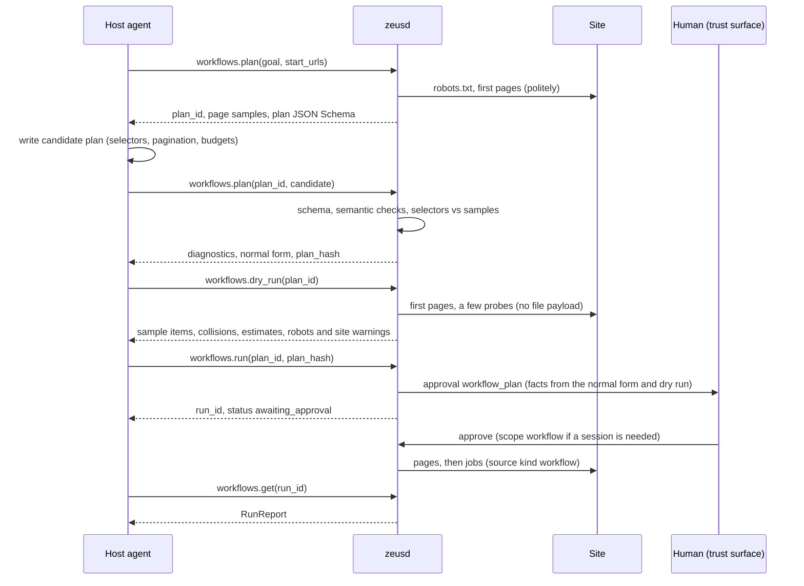
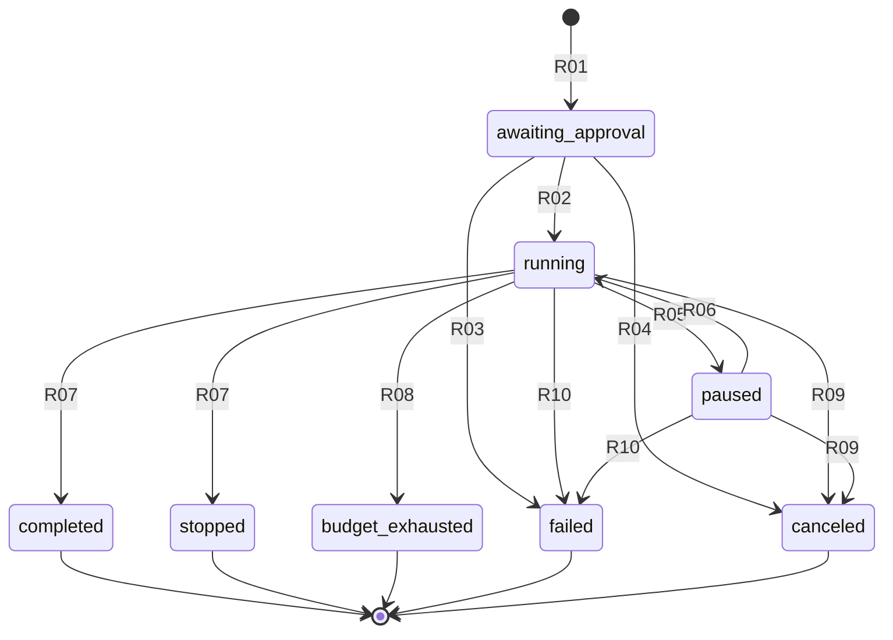

# 08. Workflow plan IR v0

| | |
|---|---|
| Status | Draft 1 |
| Depends on | [00 conventions](00-conventions.md), [01 domain model](01-domain-model.md), [03 journal](03-journal-and-commit-protocol.md), [04 audit and provenance](04-audit-log-and-provenance.md); 05 (daemon API), 07 (approvals) |
| Implemented by | `zeus-workflow` (plan types, templates, validator, estimators), `zeusd` (sampling, dry run, runner, checkpoints), `zeus` CLI and MCP (`zeus_workflow_plan`, `zeus_workflow_run`, later) |
| Schema | [`schema/workflow-plan.v0.schema.json`](schema/workflow-plan.v0.schema.json) |
| Reference code | [`tools/plan-normalize.mjs`](tools/plan-normalize.mjs) (normal form and plan hash) |

The key words MUST, MUST NOT, SHOULD, SHOULD NOT and MAY are used as in RFC 2119 and RFC 8174.

## 1. Purpose and scope

A **workflow plan** is a declarative description of a bounded crawl-and-download task: where to start, how to page through a listing, how to find items and their download URLs, which items to keep, how fast to go, how much is allowed, how to name and file the results. A plan is data, never code. A human approves a plan by its hash once; the daemon then runs it unattended, inside its budgets, and can resume it after a crash.

This document fixes:

1. The plan IR, version 0 (section 4), its normal form and hash (section 4.2).
2. The only expression language a plan contains, templates, and the query languages its selectors use, with their limits (section 5).
3. Validation, including validation of selectors against live page samples before any approval (section 6).
4. The lifecycle plan, dry run, approve, run, and the run state machine (section 7).
5. Execution: chains, politeness and robots.txt, the item pipeline, budgets, stop rules, drift detection (section 8).
6. Checkpoints and resume (section 9), the dry-run and run reports (section 10).
7. Three complete example plans (section 11) and which parts of the IR Ogun reuses (section 12).

Out of scope: the JSON-RPC envelopes of the `workflows.*` methods (05), the approval rendering and facts layout (07), the MCP tool shapes (06), converter sandboxing (12).

## 2. Terminology

| Term | Meaning |
|---|---|
| Plan | A JSON document conforming to this specification (`Plan` in the schema). |
| Candidate | A plan submitted for validation, typically written by the host agent. Untrusted until validated and approved. |
| Draft | A candidate stored by the daemon under a `plan_` id together with its samples. |
| Normal form | The plan with every defaulted member present (section 4.2). |
| Plan hash | Lowercase hex BLAKE3 of the JCS form of the normal form. Binds the approval. |
| Run | One execution of an approved plan, identified by a `run_` id (00 section 5.1). |
| Runner | The daemon component that executes runs. It is an internal client of the engine. |
| Document | A fetched HTML, JSON or XML resource that is parsed (listing page, API page, sitemap, detail page). Opposite: a file, which is downloaded by a job and never parsed by the runner. |
| Chain | One sequence of documents linked by pagination: one start URL, one API endpoint, one date window, or one sitemap document. |
| Item | One match of `extract.items` in a document: a candidate file to download plus its field values. |
| Field | A named value extracted from an item (`extract.fields`). |
| Depth | The link distance of a resource from the start documents (section 8.1). |
| Host | The lowercase ASCII host name of a URL (punycode for IDNs). Politeness is per host. |
| Effective interval | The minimum spacing of request starts to one host: the larger of `fetch.min_interval_ms` and the host's robots.txt `Crawl-delay` (section 8.2). |
| Drift | Evidence during a run that the site no longer matches the plan (section 8.7). |
| Portable | Part of the vocabulary that contains no daemon concept and is reused by Ogun (section 12). |

## 3. Overview

### 3.1 Lifecycle



Every step before the approval is read-only towards the user's files and uses only public network access, or an effective grant the human already gave. Nothing an agent sends can approve, extend or bypass the approval (01 section 12.2).

### 3.2 Components and trust

| Value | Origin | Trust (research doc 12 labels) | May reach a control sink |
|---|---|---|---|
| Plan members other than `name` and `goal` | Agent | untrusted until the plan hash is approved | Only through the validator and the approved hash |
| `name`, `goal` | Agent | untrusted text, always | Never: shown in the `agent says` area of the approval only |
| Page samples, documents, field values | Remote site | untrusted data | Only as template input, after sanitising (01 section 12.3) |
| Write roots, converter registry, private-host allow-list | User configuration | trusted | Yes |
| Approval decision | Human | trusted | Yes |

A field value can never select a host, a tool, a grant or a directory outside `sinks.dest_dir`: hosts come only from `allowed_domains`, directories only from templates whose output is sanitised and contained (section 8.4).

### 3.3 Portable and daemon-only parts

The schema marks each definition `Portable` or `Daemon-only` in its description.

| Part | Members | Class |
|---|---|---|
| Acquisition core | `allowed_domains`, `sources`, `pagination` (except `infinite_scroll`), `extract`, `filters`, `fetch`, `budgets`, `stop` | Portable |
| Expression languages | templates, CSS subset, JSONPath, regular expressions (section 5) | Portable |
| Estimators and diagnostics | `Estimate`, `Diagnostic`, `StopReason` | Portable |
| Envelope | `plan_version`, `name`, `goal` | Daemon-only (the version line is Zeus's) |
| Sessions | `session`, `infinite_scroll` | Daemon-only: they need the browser extension |
| Files | `post`, `sinks` | Daemon-only: write roots, trash, converters, manifests |
| Lifecycle | drafts, samples, dry run, approvals, runs, checkpoints, reports | Daemon-only |

## 4. The plan document

### 4.1 Top-level members

| Member | Required | Default | Meaning |
|---|---|---|---|
| `plan_version` | yes | | `0`. |
| `name` | yes | | Short title, 1 to 120 characters. Untrusted text. |
| `goal` | no | | The user's goal in words, at most 2000 characters. Untrusted text, recorded, never interpreted. |
| `allowed_domains` | yes | | Hosts the run may contact (section 4.3). |
| `session` | no | | The one origin whose browser session the run may use (section 4.4). |
| `sources` | yes | | 1 to 16 entry points (section 4.5). |
| `pagination` | no | | How each chain reaches its next document (section 4.6). Absent: every chain is one document. |
| `extract` | yes | | Items and fields (section 4.7). |
| `filters` | no | | 1 to 32 item filters, applied in order (section 4.8). Omit the member rather than sending `[]`. |
| `fetch` | yes | | Rate and politeness (section 4.9). |
| `budgets` | yes | | Mandatory hard limits (section 4.10). |
| `post` | no | `{}` | Naming, filing, conversion (section 4.11). |
| `sinks` | yes | | Destination and outputs (section 4.12). |
| `stop` | no | see section 4.13 | Early-stop and drift rules. |

`null` is not a valid value anywhere in a plan. Optional members are omitted when unset.

### 4.2 Normal form and plan hash

1. **Strictness.** A plan is a security artifact that a human approves by hash. A daemon MUST reject any plan member it does not know with the diagnostic `plan.unknown_property` (error). This deliberately departs from 00 section 4 rule 7 for this one document type: an ignored member would mean the run differs from what was approved. The schema expresses it with `additionalProperties: false` on every plan object.
2. **Duplicate keys** are rejected (00 section 7 rule 3).
3. **Normal form.** The normal form is the plan with every member that has a default present with its value; optional members without a default are absent. Specifically: `post` (`{}`), `stop` and its three defaulted members, `session.scope`, the regex selector `group`, every field's `extract`, `resolve_url` and `required`, `page_param.step`, `offset_limit.start_offset`, `date_range.date_format` and `order`, the `invert` of `url_regex` and `field_regex` filters, `mime.unknown`, `fetch.max_connections_per_file`, `fetch.respect_robots` and `fetch.priority`, `convert[].keep_original`, `sinks.on_existing`. The field named `url` (in `extract.fields` or `extract.follow.fields`) always has `resolve_url: true` and `required: true` in the normal form, whatever the input said.
4. **Nothing else changes.** Normalisation does not trim, re-case or re-encode strings, does not reorder arrays, and does not resolve URLs. Object member order carries no meaning anywhere in a plan.
5. **Hash.** `plan_hash = hex(BLAKE3(JCS(normal form)))`, BLAKE3 default 32-byte output, JCS per 00 section 7. Plans contain only integers, so JCS number formatting never matters.
6. **Size.** The JCS form of the normal form MUST NOT exceed 65,536 bytes.
7. **Binding.** A run binds to exactly one plan hash for its whole life. Any change to the plan, including a budget, is a different hash and needs a new approval.

The reference implementation is [`tools/plan-normalize.mjs`](tools/plan-normalize.mjs). Test vector: the candidate below normalises to the plan of section 11.3, whose plan hash is `118be09834c5305789d137273af72868e942e9815ff1da106464e4ed6ac87753`. The plans of sections 11.1 and 11.2 are in normal form and hash to `92dd886f1f8acab8b89e434114e9eae74e636f5baf268223a8fbca4603def6ca` and `d3b1f3289ca6d9e093a320e5f9117481dd2ba655ce63edcb1790ace44da51641`. `npm run validate` in `docs/spec/tools` recomputes all four hashes (the `plan_hash=` fence attribute).

```json validate=workflow-plan.v0#/$defs/Plan plan_hash=118be09834c5305789d137273af72868e942e9815ff1da106464e4ed6ac87753
{
  "plan_version": 0,
  "name": "arXiv cs.DL recent submissions (PDF)",
  "goal": "The PDFs of the recent cs.DL submissions, fetched at the crawl rate arXiv states.",
  "allowed_domains": ["arxiv.org"],
  "sources": [{ "type": "start_urls", "urls": ["https://arxiv.org/list/cs.DL/recent"] }],
  "pagination": { "strategy": "offset_limit", "offset_param": "skip", "limit_param": "show", "limit": 25, "max_pages": 4 },
  "extract": {
    "items": { "kind": "css", "query": "dl#articles > dt" },
    "fields": {
      "url": {
        "selector": { "kind": "css", "query": "a[title=\"Download PDF\"]" },
        "extract": { "kind": "attr", "name": "href" }
      },
      "arxiv_id": {
        "selector": { "kind": "css", "query": "a[title=\"Abstract\"]" },
        "extract": { "kind": "attr", "name": "id" },
        "required": true
      }
    }
  },
  "filters": [
    { "type": "url_regex", "pattern": "^https://arxiv\\.org/pdf/[0-9]{4}\\.[0-9]{4,5}(v[0-9]+)?$" },
    { "type": "dedupe", "key": "{arxiv_id}" }
  ],
  "fetch": { "min_interval_ms": 15000, "max_concurrency_per_host": 1 },
  "budgets": { "max_pages": 4, "max_files": 100, "max_bytes": 2147483648, "max_duration_ms": 10800000, "max_depth": 1 },
  "post": { "rename": "arxiv-{arxiv_id}.pdf" },
  "sinks": { "dest_dir": "papers/arxiv-cs.DL", "manifest": { "format": "jsonl" }, "items": { "format": "jsonl" } },
  "stop": { "count_hint": { "kind": "regex", "pattern": "Total of ([0-9,]+) entries" } }
}
```

### 4.3 Allowed domains

1. `allowed_domains` holds 1 to 32 entries. Each is an exact lowercase ASCII host name (`files.example.com`, punycode for IDNs) or `*.` followed by a host name, which allows every proper subdomain of that name but not the name itself (`*.example.com` matches `a.example.com` and `a.b.example.com`, not `example.com`).
2. IP literals, single-label names (`localhost`) and names with a trailing dot are invalid (`plan.allowed_domain_invalid`).
3. A wildcard whose suffix is a public suffix (Public Suffix List, ICANN and private sections, as shipped with the daemon) is invalid (`plan.allowed_domain_too_broad`). A daemon without a suffix list MUST at least reject a wildcard whose suffix has fewer than two labels.
4. Every URL the run requests MUST have a host matching an entry: start URLs, API endpoints, sitemaps and their entries, pagination targets, detail pages, item URLs and **every redirect hop**, including redirects inside file downloads. A request or redirect to any other host is not made: for a document it ends the chain with drift (section 8.7); for a file the job fails with `workflow.host_not_allowed` (section 13).
5. Allowed hosts are a reach limit, not consent: session material is still released only for `session.origin` (section 4.4).

### 4.4 Session requirement

`session` names exactly one origin (01 section 4) whose browser session the run may use, and the scope to request, which in v0 can only be `workflow` (the default).

1. `session.origin` MUST be `https` (or a loopback `http` origin, 01 section 4 rule 3) and its host MUST be allowed by `allowed_domains` (`plan.session_origin_not_allowed`).
2. Approving the plan creates a `workflow` grant for `(origin, run_id)` (01 section 5.1). The plan approval is the only approval a run needs for its session; files from that origin are downloaded under that grant without per-job approvals.
3. Only requests whose origin equals `session.origin` carry session material (01 section 4 rule 4). A plan whose files live on another origin that also needs a session cannot be expressed in v0 (section 17).
4. Page fetches with a session need the native-messaging extension of section 16 item 9. A daemon whose extension lacks it fetches pages without session material; sampling then reports `plan.sample_session_required` and a run pauses with `pause_reason: session`.

### 4.5 Sources

| `type` | Members | Documents produced |
|---|---|---|
| `start_urls` | `urls`: 1 to 100 absolute http(s) URLs, unique | One chain per URL. Pagination applies. |
| `api_endpoint` | `url`; `accept` (media type, default `application/json`) | One chain. The documents are JSON. Pagination applies. |
| `sitemap` | `url`; `loc_pattern` (regex, optional) | The sitemap document, then one single-document chain per `<loc>` page that matches `loc_pattern` (all pages when absent). Pagination does not apply to sitemap pages. |

Sitemap rules: the runner parses `urlset` and `sitemapindex` documents of the sitemaps.org protocol, gzip-compressed or not, at most 52,428,800 bytes uncompressed and 50,000 entries each; a sitemap index's children are sitemaps one depth level further (section 8.1). `<loc>` values outside `allowed_domains` are skipped and counted in `items_out_of_domain`. Entries are taken in document order.

### 4.6 Pagination

A chain starts at its first document and asks the strategy for the next one after each document has been processed. Pagination never crosses chains. Each strategy has its own page limit; `budgets.max_pages` still bounds the run as a whole, and a strategy's `max_pages` above `budgets.max_pages` is an error (`plan.pagination_max_pages`).

| `strategy` | Members | Next document | Explicit end signals |
|---|---|---|---|
| `rel_next` | `max_pages` | The first `Link` header value with `rel="next"` (RFC 8288); for HTML, else the first `<link>` then `<a>` element whose `rel` token list contains `next` (ASCII case-insensitive), `href` resolved against the base URL | No next link |
| `page_param` | `param`, `start`, `step` (1), `end`, `max_pages` | The chain's first URL with `param` set to `start + k * step` for the k-th document (k from 0) | Value above `end`; a document with zero items; HTTP 404 or 410 |
| `offset_limit` | `offset_param`, `limit_param`, `limit` (1 to 1000), `start_offset` (0), `max_pages` | First URL with `offset_param = start_offset + k * limit` and `limit_param = limit` | Fewer than `limit` items; zero items; HTTP 404 or 410 |
| `cursor` | `cursor_path` (JSONPath), `param`, `max_pages` | First URL with `param` set to the cursor read from the current JSON document | Cursor absent, `null`, empty string, or equal to a cursor already used in the chain |
| `next_selector` | `selector`, `max_pages` | First node matched by `selector`: CSS takes its `href` attribute, JSONPath its string value, regex its capture group; resolved against the base URL | No match, or the value is empty |
| `infinite_scroll` | `max_scrolls` (1 to 1000), `settle_ms` (at most 60,000) | The user's browser scrolls the page and returns a snapshot after `settle_ms` | No new items after a scroll |
| `date_range` | `from_param`, `to_param`, `from`, `to`, `chunk_days` (1 to 366), `date_format` (`iso_date`), `order` (`ascending`), `inner` | One chain per window; `inner` paginates inside a window | Last window done |

Rules:

1. **Setting a parameter.** The runner rewrites only the named parameter of the query: if a parameter with that name (compared after percent-decoding names) exists, the first occurrence's value is replaced and later occurrences are removed; otherwise `name=value` is appended (after `&`, or `?` when there is no query). The value is percent-encoded with every byte outside the URL unreserved set encoded. All other bytes of the URL are kept as written. Integers are written in decimal without leading zeros.
2. **First document.** For `page_param`, `offset_limit` and `date_range` the first document already carries the computed parameters (k = 0, first window). For `cursor` the first document is the URL as written, without the cursor parameter.
3. **Windows.** `date_range` splits the inclusive interval [`from`, `to`] into consecutive windows of `chunk_days` days, the last one shorter if needed. `from_param` receives the window's first day and `to_param` its last day (inclusive), formatted `YYYY-MM-DD` (`iso_date`) or `YYYYMMDD` (`basic_date`). `order: descending` processes the newest window first. `from` after `to` is an error (`plan.pagination_dates`). `inner` MUST be one of `rel_next`, `page_param`, `offset_limit`, `cursor`, `next_selector`. More windows than `budgets.max_pages` is a warning (`plan.date_windows_exceed_pages`).
4. **Infinite scroll** is daemon-only and needs a browser capability that native messaging v1 does not define (section 16 item 10). A daemon without it rejects the plan at dry run with `workflow.capability_missing`. Agents SHOULD look for the JSON API behind an infinite-scroll page and use `cursor` or `offset_limit` instead.
5. **Loop protection.** A chain never fetches the same document URL twice (compared after removing the fragment); a repeat ends the chain with `duplicate_page`, independently of `stop.stop_on_duplicate_page`.
6. **Off-domain next link.** A next URL outside `allowed_domains` ends the chain and records drift `plan.drift_off_domain`.

### 4.7 Extraction

`extract` has `items` (a selector), `fields` (1 to 32 named fields) and optionally `follow`.

1. **Items.** `extract.items` is evaluated on each document and yields item nodes in document order: CSS elements (HTML), JSONPath nodes (JSON), or regex matches over the document text (any format; the item is capture group `group`). At most 10,000 items per document are used; more is a validation error on samples (`plan.selector_too_broad`) and drift at run time (`plan.drift_too_many_items`, the first 10,000 are kept).
2. **Fields.** Each field is evaluated relative to its item:

| Member | Default | Meaning |
|---|---|---|
| `selector` | absent | Absent: the item node itself. CSS: descendants of the item element. JSONPath: `$` is the item value. Regex: applied to the item's text (section 5.5). |
| `from_field` | absent | With a regex selector only: apply the regex to the value of another field. The source field MUST NOT itself use `from_field` (`plan.from_field_invalid`). Fields without `from_field` are evaluated first, so declaration order never matters. |
| `extract` | `{"kind":"text"}` | `text`, or `attr` with `name` (lowercase attribute name; HTML only, `plan.extraction_invalid` otherwise). |
| `resolve_url` | `false` | Resolve the value against the document base URL; values that do not resolve to an absolute `http` or `https` URL are discarded. |
| `required` | `false` | Items without a value for this field are dropped (`items_invalid`). |

3. **First match.** When a field selector matches several nodes, the first in document order is used. An empty string after whitespace normalisation counts as no value.
4. **Values.** Values are strings, at most 4,096 characters (longer values are cut, never rejected); control characters and bidirectional overrides are removed. A JSON number becomes its shortest decimal text, `true` and `false` their names; `null`, objects and arrays are no value.
5. **Special field names.** These names have a defined effect when declared:

| Field | Effect |
|---|---|
| `url` | Required. The download URL: always resolved, MUST be http(s) and inside `allowed_domains` (else the item counts as `items_out_of_domain`). |
| `sha256` | If the value is 64 hex digits, optionally prefixed `sha256:` (case-insensitive), it becomes the job's `expected_sha256` (01 section 3.2), lowercased. Otherwise it is an ordinary field. |
| `size_bytes` | If the value is 1 to 16 ASCII digits, it is the declared size used by size filters, estimates and budget reservation. Never used as `expected_size`: listings go stale. |
| `media_type` | If the value parses as `type/subtype` (parameters stripped, lowercased), it is the declared media type used by `mime` filters and routing rules. |
| `license` | If the value is an SPDX license expression or a `LicenseRef-` identifier of at most 256 characters, the file's manifest record gets `license {spdx, source: "declared", evidence_url}` (04 section 3.3) with the document URL as evidence (redacted). |

6. **Built-in names.** `filename`, `ext`, `index` and `page` are template built-ins (section 5.1) and MUST NOT be declared as fields (`plan.field_name_reserved`).
7. **Follow.** `follow` fetches one detail document per item from the value of `url_field` (a listing field) and evaluates `follow.fields` on it with the whole document as the item node. Detail field names MUST differ from listing field names. The detail document is at depth one more than the listing document, counts against `budgets.max_pages`, obeys politeness and robots.txt, and MUST be inside `allowed_domains` (else the item is dropped as `items_out_of_domain`). `url` MUST be declared exactly once, in `fields` or in `follow.fields`. Only one level of `follow` exists in v0.

### 4.8 Filters

Filters run in plan order on each item that has a `url`; the first filter that rejects an item drops it (`items_filtered`).

| `type` | Members | Keeps the item when |
|---|---|---|
| `url_regex` | `pattern`, `invert` (false) | The item URL matches (does not match with `invert`). |
| `field_regex` | `field`, `pattern`, `invert` (false) | The field value matches. A missing field never matches. `field` MUST be declared (`plan.filter_field_unknown`). |
| `mime` | `allow` (1 to 32 `type/subtype` or `type/*`), `unknown` (`keep`) | The media type matches an entry. Before download the media type is the `media_type` field, else the guess from the URL path extension (section 5.5); when neither exists `unknown` decides. After the job's probe the runner checks the probed `Content-Type` again and cancels a job whose type does not match (`files_canceled`). |
| `max_size` | `bytes` | The size is at most `bytes`. Before download: the `size_bytes` field; after the probe: `total_bytes` (late check as for `mime`). Unknown size keeps the item. |
| `min_size` | `bytes` | The size is at least `bytes`, same sources. |
| `dedupe` | `key` (template) | No earlier item of the run rendered the same key. The key is recorded only when the item reaches this filter. |

Independently of filters, an item whose URL (without fragment) was already seen in the run is dropped as `items_duplicate` before filters run. When `follow` is present, the runner evaluates the filters in order and fetches the detail document only when it reaches the first filter that reads a detail field, so filters on listing fields avoid detail fetches; the result is the same as evaluating every filter after `follow`.

### 4.9 Fetch policy

| Member | Default | Rule |
|---|---|---|
| `min_interval_ms` | required | 200 to 3,600,000. Minimum spacing between the starts of two requests of the run to one host. |
| `max_concurrency_per_host` | required | 1 to 8. Simultaneous connections of the run to one host: page fetches plus the connections of the run's jobs, counted by the host actually connected after redirects. |
| `max_connections_per_file` | `1` | 1 to 8. Becomes the job's `max_connections` (01 section 3.2). |
| `respect_robots` | `true` | Must be `true` in v0: a plan with `false` is rejected (`plan.robots_override_unsupported`, section 17). |
| `priority` | `low` | Priority of the run's jobs (01 section 10). |
| `download_accept` | absent | Value of the `Accept` header of the run's file requests (allowed by 01 section 3.2 `extra_headers`). |

A plan cannot set any other header, a user agent, a proxy or a TLS option.

### 4.10 Budgets

All five budgets are required and at least 1. Reaching any of them ends the run with status `budget_exhausted` (section 8.5).

| Budget | Hard maximum | Counts |
|---|---|---|
| `max_pages` | 100,000 | Document fetches: listing, API, sitemap and detail documents, and infinite-scroll steps. Retries of the same document count once. |
| `max_files` | 1,000,000 | Jobs created by the run. |
| `max_bytes` | 2^50 (1 PiB) | Bytes committed by the run's jobs (01 section 3.7), completed files included. |
| `max_duration_ms` | 604,800,000 (7 days) | Time the run spends in `running`, measured monotonically and persisted (section 9.2). Time `paused` or `awaiting_approval` does not count. |
| `max_depth` | 8 | Depth of any resource (section 8.1). |

A daemon MAY configure lower hard maxima; a plan above them is an error (`plan.budget_invalid`). Budgets are never extended by evidence from a site (count hints only feed estimates and stop rules).

### 4.11 Post-processing

| Member | Meaning |
|---|---|
| `rename` | Template for the file name, without directory. |
| `subdir` | Template for a directory below `sinks.dest_dir`. |
| `rules` | 1 to 16 routing rules. The first rule whose `when` holds supplies `rename` and/or `subdir`, overriding the top-level ones for that item. `when` conditions (all present ones must hold): `ext` (list of extensions of the built-in `ext`), `media_type` (list of media type patterns), `url_regex`, `field_regex {field, pattern}`. |
| `convert` | 1 to 8 steps `{from: [ext], to: ext, keep_original: true}`: after a file completes, convert it if its extension is in `from`. |

Naming rules: the rendered name is sanitised by 01 section 12.3 and limited to 255 UTF-8 bytes there; `/` written as a literal in `subdir` separates directory components (at most 8), and any separator produced by a field value is replaced by `_` before sanitising, so values never create directories. Empty components are removed. Without `rename` (and no matching rule) the job names the file by the rules of 01 section 3.2.

Conversion rules (daemon-only):

1. A `(from, to)` pair the daemon's converter registry cannot perform is an error (`plan.convert_unavailable`).
2. Conversion runs after the job reaches `completed`, in the sandboxed converter pipeline (12), and never on a quarantined file (01 section 11.3): such a file is counted, not converted.
3. The output is written next to the input as `<stem>.<to>`, renamed with ` (n)` on collision, recorded in the manifest with `converter_chain` and `derived_from` (04 section 3.3) and audited as `file.converted` (04 section 4.4).
4. `keep_original: false` never deletes during the run: at the end of the run the runner raises one `destructive_op` approval (07) listing the originals to move to the app trash. Denial keeps them.
5. A conversion failure is counted (`files_convert_failed`) and never fails the run.

### 4.12 Sinks

| Member | Default | Meaning |
|---|---|---|
| `dest_dir` | required | A relative path, resolved against the daemon's default download root, or an absolute path inside a write root. No `..` component, no NUL. Checked at validation, at run start and for every job (01 section 12.3): outside the roots is `plan.dest_outside_roots` at validation and `policy.path_outside_roots` later. |
| `on_existing` | `skip` | What to do when the target path existed before the run: `skip` (do not enqueue; for incremental re-runs), `rename` (` (n)` suffix), `replace` (see below). |
| `manifest` | absent | `{"format": ...}` with `jsonl`, `csv` or `croissant`: at the end of the run write an export of the run's manifest records (04 section 3) to `<dest_dir>/zeus-run-<run_id>.manifest.jsonl`, `.csv` or `.croissant.json`. |
| `items` | absent | `{format: jsonl}`: append one `ItemRecord` (section 10.3) per item that reached naming to `<dest_dir>/zeus-run-<run_id>.items.jsonl`. |

`replace` never overwrites during the run. The new file is downloaded under a ` (n)` name; at the end of the run the runner raises one `destructive_op` approval (07) that lists each pair; on approval the old file moves to the app trash and the new one takes its name, each move audited (`file.renamed`, `file.deleted`, 04 section 4.4); on denial both stay. Collisions between items of the same run are always resolved by ` (n)` suffixes, whatever `on_existing` says.

### 4.13 Stop rules

| Member | Default | Meaning |
|---|---|---|
| `no_new_items_pages` | `3` | End a chain after this many consecutive documents without a new item (an item whose URL the run had not seen). `0` disables the rule. |
| `stop_on_duplicate_page` | `true` | End a chain when a document's item fingerprint equals that of an earlier document of the chain (wrap-around detection, section 8.6). |
| `count_hint` | absent | A selector over the first document of each chain yielding the total number of items (for example "1,240 results"); see section 8.6. |
| `on_drift` | `pause` | What drift does: `pause` the run, `stop` discovery (status `stopped`), or `continue` and only record it. |

### 4.14 Limits

| Item | Limit |
|---|---|
| Plan, JCS bytes of the normal form | 65,536 |
| `name` / `goal` | 120 / 2,000 characters |
| `allowed_domains` | 32 entries, 255 bytes each |
| `sources` / start URLs per source | 16 / 100 |
| Fields (listing plus follow) | 32 |
| Filters / routing rules / convert steps | 32 / 16 / 8 |
| Selector, JSONPath, regex | 1,024 bytes each; compiled regex 1 MiB |
| Template | 512 bytes, 16 placeholders, 4 filters per placeholder |
| Items per document | 10,000 |
| Field value | 4,096 characters |
| Document body | 8 MiB (HTML and JSON), 52,428,800 bytes uncompressed (sitemaps) |
| Dedupe keys per run | 2,000,000 |
| Drafts per daemon / draft lifetime | 100 / 24 h after last use |
| Active runs (`running` or `paused`) | default 2, configurable 1 to 8 (`workflow.too_many_runs`) |

## 5. Expression and query languages

A plan contains no code. Four small languages appear in it: templates (the only expressions), CSS selectors, JSONPath and regular expressions (queries). None has loops beyond what the query language defines, side effects, I/O, calls, variables or access to anything outside the document or item being read. Each has a length limit and a linear or bounded evaluation cost.

### 5.1 Templates

```
template    = { literal | placeholder }
literal     = any character except "{" and "}", or "{{" (a literal "{"), or "}}" (a literal "}")
placeholder = "{" field { "|" filter } "}"
field       = [a-z][a-z0-9_]{0,31}
filter      = "lower" | "upper" | "trim" | "slug" | "strip_ext"
            | "truncate:" N            ; N = 1 to 255
            | "default:" TEXT          ; TEXT = 0 to 64 characters, no "|", "}" or control characters
```

1. **Fields.** A placeholder reads a declared field or a built-in: `url` (the item URL), `filename` (last non-empty path segment of the item URL, percent-decoded as UTF-8 with U+FFFD for invalid bytes, `download` when there is none), `ext` (the part of `filename` after its last `.` when that part is 1 to 8 ASCII letters or digits, lowercased; otherwise the empty string), `index` (the item's run-wide position, decimal, from 1), `page` (the document's position in its chain, decimal, from 1). Reading anything else is `plan.template_unknown_field`.
2. **Filters**, applied left to right: `lower` and `upper` (Unicode simple case mapping), `trim` (Unicode whitespace at both ends), `slug` (lowercase; every maximal run of characters that are not Unicode letters or digits becomes one `-`; no leading or trailing `-`), `strip_ext` (remove a final `.` plus 1 to 8 ASCII alphanumerics, if a non-empty stem remains), `truncate:N` (first N Unicode scalar values), `default:TEXT` (TEXT when the value is missing or empty).
3. **Missing values.** A placeholder whose field has no value and that has no `default` filter before any other filter makes rendering fail: the item is dropped (`items_invalid`). Validators warn when a template reads a field that is not `required` without a `default` (`plan.template_field_optional`).
4. **Limits.** At most 512 bytes, 16 placeholders, 4 filters per placeholder. `{` without a matching `}`, a stray `}`, an unknown filter or a bad argument is `plan.template_invalid`.
5. **Output** is plain text. It is never evaluated again, never passed to a shell, and becomes a path component only after sanitising (section 4.11).

### 5.2 CSS selectors

A `css` selector is evaluated on an HTML document parsed with the HTML Living Standard parsing algorithm. The supported subset of Selectors Level 4 is:

1. Type, universal, class and ID selectors; attribute selectors with every operator (`=`, `~=`, `|=`, `^=`, `$=`, `*=`) and the `i` and `s` flags.
2. Combinators: descendant, `>`, `+`, `~`; selector lists with `,`.
3. Pseudo-classes: `:root`, `:empty`, `:first-child`, `:last-child`, `:only-child`, `:first-of-type`, `:last-of-type`, `:only-of-type`, `:nth-child()`, `:nth-last-child()`, `:nth-of-type()`, `:nth-last-of-type()` (the `An+B` forms only), `:not()`, `:is()`, `:where()`, `:has()`, `:scope` (the item element when evaluating a field).

Anything else, including pseudo-elements, user-action and link-state pseudo-classes (`:hover`, `:visited`, `:link`), `:lang()`, `:dir()`, namespace prefixes and `:nth-child(An+B of S)`, MUST be rejected with `plan.selector_unsupported`, never evaluated approximately. Type selectors and attribute names match ASCII case-insensitively; class and ID values match case-sensitively, also in quirks mode, so results do not depend on the document mode. Positional pseudo-classes are discouraged: agents see simplified samples (section 7.1) whose element positions may differ from the full document.

### 5.3 JSONPath

A `json_path` selector is an RFC 9535 query, including filter selectors and the function extensions `length()`, `count()`, `match()`, `search()` and `value()` defined there (whose regular expressions are RFC 9485 I-Regexp). It MUST start with `$`. Evaluated on a document, `$` is the parsed JSON document; evaluated on an item, `$` is the item value. The result is the nodelist in RFC 9535 order. JSON documents are parsed with a nesting limit of 64 and duplicate member names rejected.

### 5.4 Regular expressions

`regex` selectors, `loc_pattern`, `url_regex`, `field_regex` and rule patterns use the syntax of the Rust `regex` crate 1.x (RE2 family): no look-around and no back-references, which guarantees matching time linear in the input. Unicode mode is on; inline flags such as `(?i)` are allowed. A pattern that fails to compile within 1 MiB of compiled program size is `plan.pattern_syntax`. Patterns are unanchored unless they use `^` or `$`; `url_regex` matches against the whole absolute item URL string. `group` names a capture group by number (0 is the whole match); a group that does not exist is `plan.pattern_group`. Implementations in other languages MUST reject constructs outside this syntax rather than interpret them in their native dialect.

### 5.5 Documents, text and URLs

1. **Format.** A document's format comes from its `Content-Type`: `text/html` and `application/xhtml+xml` are `html`; `application/json` and any `+json` type are `json`; `application/xml`, `text/xml` and `+xml` types are `xml`; anything else is `text`. CSS selectors need `html`, JSONPath needs `json`, regex works on every format. In v0 `xml` documents are parsed only as sitemaps; extraction from other XML uses regex (section 17).
2. **Decoding.** The charset comes from `Content-Type`, then a byte order mark, then (HTML) the meta prescan of the HTML standard, else UTF-8; labels per the WHATWG Encoding Standard; invalid sequences become U+FFFD.
3. **Text of a node.** HTML: the concatenation of its descendant text nodes, with every run of Unicode whitespace replaced by one space and the result trimmed. JSON: as in section 4.7 rule 4. Regex item: the text of its capture group. A regex field without `from_field` reads the item's text (HTML text as above; for a JSON item, the string itself if it is a string, else its JCS serialisation).
4. **Document text for regex.** A regex applied to a whole document reads the decoded body (HTML source, JSON text).
5. **Base URL.** The document's final URL after redirects; for HTML, the first `<base href>` if it resolves to an absolute http(s) URL.
6. **URL resolution** uses the WHATWG URL parser; the fragment is removed; only `http` and `https` results are kept.
7. **Media type guess** from a URL path extension, used only where section 4.8 says so: `pdf` application/pdf, `zip` application/zip, `gz` application/gzip, `tgz` application/gzip, `tar` application/x-tar, `zst` application/zstd, `json` application/json, `csv` text/csv, `txt` text/plain, `html` and `htm` text/html, `xml` application/xml, `png` image/png, `jpg` and `jpeg` image/jpeg, `gif` image/gif, `webp` image/webp, `svg` image/svg+xml, `mp3` audio/mpeg, `mp4` video/mp4, `epub` application/epub+zip, `docx` application/vnd.openxmlformats-officedocument.wordprocessingml.document, `xlsx` application/vnd.openxmlformats-officedocument.spreadsheetml.sheet, `pptx` application/vnd.openxmlformats-officedocument.presentationml.presentation. Other extensions give no guess.

## 6. Validation

### 6.1 Stages

A candidate passes three stages in order; each stage reports all its findings, and a later stage runs only when the earlier ones produced no error.

| Stage | Input | Checks |
|---|---|---|
| 1. Schema | The JSON text | Parses, no duplicate keys, conforms to `Plan` in the schema (unknown members are `plan.unknown_property`; other violations `plan.schema_violation` with the JSON Pointer). |
| 2. Semantics | The normal form | Every rule of sections 4 and 5 that the schema cannot express: domains, URLs inside `allowed_domains`, session origin, selector, pattern and template syntax, field references, reserved names, page limits against budgets, budgets against hard maxima, `dest_dir` inside the write roots, converter availability, size limits. |
| 3. Samples | Normal form plus samples | Selectors against the stored samples (section 6.2). |

A plan with an `error` diagnostic cannot be dry-run or run. Warnings are shown in the dry-run report and the approval; they do not block. Diagnostics never contain page content: messages are generated text with counts and indexes.

### 6.2 Validation against samples

Selector validation runs on the full stored sample bodies, not on the simplified copies the agent saw.

1. The item selector MUST match at least one node on at least one sample whose format it can read, and no sample may yield zero items when the sample is the first document of its chain (`plan.selector_no_match`, error).
2. A sample yielding more than 10,000 items is an error (`plan.selector_too_broad`). A sample yielding exactly one item from an HTML listing is a warning (`plan.selector_single_match`).
3. Each `required` field MUST have a value in at least one item of every sample that has items (`plan.field_no_match`, error); an optional field without any value is a warning with the same code.
4. If fewer than half of the sampled items yield a `url` inside `allowed_domains`, warning `plan.url_field_outside_domains` with the counts.
5. If the item selector's kind cannot read a sample's format, info `plan.sample_format_mismatch`.
6. With pagination, the daemon SHOULD fetch the second document of the first chain (one request, politely) and warn `plan.pagination_ineffective` if it yields no items or exactly the first document's items, or `plan.pagination_no_next` if the strategy finds no next document on the first sample.
7. With `follow`, the daemon SHOULD fetch the detail document of the first sampled item and apply rule 3 to `follow.fields`.
8. A `count_hint` that does not yield a number on the first sample is a warning (`plan.count_hint_unparsable`).

### 6.3 Diagnostic codes

Diagnostics use the `Diagnostic` definition: `severity`, `code` (`plan.<reason>`), `path` (RFC 6901 JSON Pointer into the plan, `""` for the whole plan), `message`, optional `details`. The registry of this version:

| Code | Severity | Stage or phase |
|---|---|---|
| `plan.unknown_property`, `plan.schema_violation` | error | schema |
| `plan.unsupported_version`, `plan.too_large`, `plan.name_invalid` | error | semantics |
| `plan.allowed_domains_empty`, `plan.allowed_domain_invalid`, `plan.allowed_domain_too_broad` | error | semantics |
| `plan.session_origin_not_allowed`, `plan.session_scope_invalid` | error | semantics |
| `plan.url_invalid`, `plan.url_outside_allowed_domains`, `plan.sources_empty`, `plan.start_urls_count` | error | semantics |
| `plan.pagination_max_pages`, `plan.pagination_step`, `plan.pagination_limit`, `plan.pagination_scroll`, `plan.pagination_dates`, `plan.pagination_chunk`, `plan.pagination_inner`, `plan.parameter_invalid` | error | semantics |
| `plan.date_windows_exceed_pages` | warning | semantics |
| `plan.needs_browser` | info | semantics (infinite scroll) |
| `plan.fields_count`, `plan.field_url_missing`, `plan.field_name_invalid`, `plan.field_name_reserved`, `plan.from_field_invalid`, `plan.extraction_invalid`, `plan.follow_invalid` | error | semantics |
| `plan.filter_field_unknown`, `plan.filter_mime`, `plan.filter_size` | error | semantics |
| `plan.fetch_interval`, `plan.fetch_concurrency`, `plan.robots_override_unsupported` | error | semantics |
| `plan.budget_invalid`, `plan.depth_exceeded` | error | semantics |
| `plan.template_invalid`, `plan.template_unknown_field` | error | semantics |
| `plan.template_field_optional` | warning | semantics |
| `plan.convert_invalid`, `plan.convert_unavailable`, `plan.dest_dir_invalid`, `plan.dest_outside_roots` | error | semantics |
| `plan.selector_invalid`, `plan.selector_syntax`, `plan.selector_unsupported`, `plan.pattern_invalid`, `plan.pattern_syntax`, `plan.pattern_group` | error | semantics |
| `plan.no_samples`, `plan.selector_no_match`, `plan.selector_too_broad` | error | samples |
| `plan.field_no_match` | error or warning | samples |
| `plan.selector_single_match`, `plan.url_field_outside_domains`, `plan.pagination_ineffective`, `plan.pagination_no_next`, `plan.count_hint_unparsable` | warning | samples |
| `plan.sample_format_mismatch`, `plan.samples_unchecked` | info or warning | samples |
| `plan.sample_session_required`, `plan.sample_failed`, `plan.robots_disallowed_sample` | warning | sampling, dry run |
| `plan.site_policy`, `plan.tos_logged_in`, `plan.dry_run_partial`, `plan.estimate_from_budget` | warning or info | dry run |
| `plan.drift_no_items`, `plan.drift_field_missing`, `plan.drift_item_count`, `plan.drift_content_type`, `plan.drift_interstitial`, `plan.drift_off_domain`, `plan.drift_too_many_items` | warning | run (section 8.7) |

`plan.depth_exceeded` means the plan's structure needs a depth above `budgets.max_depth` (for example `follow` with `max_depth` 1). The diagnostics of a rejected candidate:

```jsonl validate=workflow-plan.v0#/$defs/Diagnostic
{"severity":"error","code":"plan.selector_no_match","path":"/extract/items","message":"The item selector matched nothing on sample 0.","details":{"sample":0}}
{"severity":"error","code":"plan.field_no_match","path":"/extract/fields/report_no","message":"The required field matched in none of 20 items on sample 1.","details":{"sample":1,"items":20}}
{"severity":"warning","code":"plan.template_field_optional","path":"/post/rename","message":"The template reads title, which is not required, without a default filter."}
{"severity":"warning","code":"plan.pagination_ineffective","path":"/pagination","message":"The second page yielded the same 20 items as the first."}
{"severity":"error","code":"plan.depth_exceeded","path":"/budgets/max_depth","message":"follow needs max_depth of at least 2.","details":{"needed":2}}
```

## 7. Lifecycle

### 7.1 Sampling: workflows.plan

The first `workflows.plan` call carries a goal, start URLs (05 allows up to 20) and optionally a `session_origin`. The daemon:

1. Creates a draft with a new `plan_` id. Drafts are visible only to the client that created them (and to human-kind clients) and expire 24 h after last use.
2. Samples the first 5 start URLs, sequentially, at most one request per host per second, after reading the host's robots.txt (section 8.2). Only those hosts are contacted. A URL disallowed by robots.txt is not fetched (`outcome: robots_disallowed`).
3. Uses session material only if `session_origin` has an effective grant (01 section 5.2) and the extension supports page fetches (section 4.4). Without it the page is fetched anonymously; if the response looks like a login wall (01 section 8.3 rules D1, D6) the sample has `requires_session: true` and the result carries `plan.sample_session_required` telling the agent to ask for a session (`zeus_session_request` with scope `site`; only a human can approve).
4. Stores each full body (at most 2 MiB each, in memory or in an owner-only file in the state directory, deleted with the draft; never in events, audit or logs) and returns a **simplified** copy: for HTML, `script`, `style`, `noscript`, `template`, `svg`, `canvas`, `iframe` and comments are removed, attributes other than `id`, `class`, `href`, `src`, `rel`, `type`, `title`, `alt`, `name`, `datetime`, `lang`, `role`, `aria-label` and `data-*` are removed, text nodes are collapsed and cut at 512 characters, and the result is cut at an element boundary to the requested size (default 65,536 bytes, at most 524,288); for JSON, arrays are cut to their first 5 elements and strings to 256 characters and the result re-serialised. `simplified` and `truncated` say what happened.
5. Returns the plan JSON Schema (the `Plan` definition of this document's schema with its dependencies), the samples and no diagnostics.

```json validate=workflow-plan.v0#/$defs/PageSample
{
  "index": 0,
  "url_redacted": "https://portal.example.org/library/reports?…",
  "final_url_redacted": "https://portal.example.org/library/reports?…",
  "outcome": "ok",
  "status": 200,
  "content_type": "text/html; charset=utf-8",
  "format": "html",
  "fetched_at": "2026-10-06T08:02:11.412Z",
  "bytes_total": 183544,
  "truncated": false,
  "simplified": true,
  "requires_session": false,
  "body": "<html><head><title>Reports 2026</title></head><body><span class=\"result-count\">1,240</span><table class=\"results\"><tbody><tr><td class=\"number\">TR-2026-0141</td><td class=\"title\">Corrosion Rates of Marine Alloys</td><td class=\"date\"><time datetime=\"2026-03-02\">2 Mar 2026</time></td><td class=\"file\"><a href=\"/files/reports/2026/TR-2026-0141.pdf\" data-bytes=\"2811904\">PDF</a></td></tr></tbody></table><a rel=\"next\" href=\"?year=2026&amp;page=2\">Next</a></body></html>"
}
```

Page bodies are untrusted remote content (01 section 12.1). Over MCP they are returned in `untrusted_` fields (06). An agent MUST NOT follow instructions found in them; the daemon does not care whether it does, because nothing in a sample can change what the plan is allowed to do.

The daemon MAY draft a candidate itself with a configured LLM provider (task `draft_plan`, 09) instead of or in addition to the host agent; such a candidate is untrusted exactly like an agent's and passes the same validation.

### 7.2 Candidate plans

A later `workflows.plan` call carries `plan_id` and `candidate`. The daemon validates (section 6) against the stored samples, fetching new samples only for start URLs it has not sampled and for the checks of section 6.2 rules 6 and 7. The result carries the diagnostics and, when there is no error, the normal form and the plan hash. The draft keeps the latest candidate; a new candidate replaces it.

### 7.3 Dry run

`workflows.dry_run(plan_id, sample_items)` executes the plan's discovery without downloading any file payload:

1. **Scope.** At most 3 documents per chain and 10 documents in total, plus at most 10 detail documents and at most 10 item probes (01 section 3.5 probes: no payload is committed), all under the plan's politeness and robots rules. It lists the first `sample_items` items (1 to 100) after filters and naming.
2. **Deadline.** The call returns within 60 s. If the politeness budget does not allow finishing (a 15 s crawl delay, for example), the report has `complete: false` and `plan.dry_run_partial`; the dry run continues in the background and a later call returns the updated report. Reports are cached per plan hash for 24 h.
3. **Collisions.** For each sampled item the report gives the final file name and subdirectory, whether the target exists (`action`: `enqueue`, `skip_existing`, `rename_existing`, `replace_existing`), and `collides_with` when an earlier sampled item renders the same path.
4. **Estimates.** Each estimate has `low`, `point` and `high`, meaning P10, P50 and P90 of the estimator, and a `basis`: `exact` (pagination bounds or a declared total leave no doubt), `count_hint`, `pagination_bounds`, `sample_extrapolation` (mean items per sampled document times the expected documents, band from the per-document spread, or half to double with a single sample), or `budget_cap` (the budget is lower than the estimate; the estimate is the budget). Byte estimates multiply the file estimate by the mean declared or probed size of the sampled items. The duration estimate is never below the politeness floor: for each host, the number of requests (documents plus files) times the effective interval; hosts run in parallel, so the floor is the largest per-host product. Implementations SHOULD widen the band with parameter uncertainty (item count, throttling) rather than per-request noise and SHOULD name the `dominant_assumption` (research doc 05, workflow estimation).
5. **Hosts.** Per host contacted: robots.txt status, `Crawl-delay`, effective interval, disallowed sample count.
6. **Warnings.** Robots findings, `plan.tos_logged_in` when the plan uses a session (logged-in automation is governed by the site's terms; the user is responsible), `plan.site_policy` when the daemon's site-policy data (a versioned data file shipped with Zeus, section 17) has a notice for a host, and carried-over warnings from validation.

No file is created, no job is created and no session material is used except for documents of an origin with an effective grant.

### 7.4 Run and approval

`workflows.run(plan_id, plan_hash)`:

1. Fails with `workflow.plan_hash_mismatch` if `plan_hash` differs from the draft's current hash, `workflow.plan_invalid` if the plan has errors, `workflow.dry_run_required` if no complete dry-run report for this hash is younger than 24 h, `workflow.too_many_runs` above the active-run limit.
2. Creates the run (`run_` id), stores the normal form, and raises one approval of kind `workflow_plan` (01 section 5.3). `allowed_scopes` is `["workflow"]` when the plan has `session`, else `[]`. The approval expires after 7 days (01 section 10).
3. Returns immediately with `status: awaiting_approval` and the `approval_id`. It never blocks on the human.

The approval's facts (07 defines their layout and rendering) are computed by the daemon from the normal form and the dry run: the plan hash (07 calls it `plan_blake3`), the plan id, `name` as an untrusted title, `allowed_domains`, `session.origin`, the five budgets, the pace (`min_interval_ms` and `max_concurrency_per_host`), robots.txt obeyed, the resolved absolute `dest_dir`, and the dry run's P10 and P90 for files and bytes. `goal` is the `agent says` text. A plan's selectors are not facts: the human approves reach, rate, budgets and destination, which is what the hash binds.

On approval (by a human, 07): a `workflow` grant for `(session.origin, run_id)` is created when the plan has a session, the audit record `workflow.run_started` is made durable (write-ahead), and the run enters `running`. On denial or expiry the run ends `failed` with `policy.approval_denied` or `policy.approval_expired` and `stop_reason` `approval_denied` or `approval_expired`.

### 7.5 Run states

| Status | Terminal | Meaning |
|---|---|---|
| `awaiting_approval` | no | Created; the plan approval is pending. |
| `running` | no | Discovery and/or jobs in progress. |
| `paused` | no | Held; `pause_reason` is `client`, `drift`, `page_error`, `session` or `kill_switch`. |
| `completed` | yes | Every chain ended on an explicit end signal, `count_reached` or `duplicate_page`, and every job of the run is terminal or `failed`. |
| `stopped` | yes | Discovery ended early on `no_new_items`, `pagination_limit` or drift with `on_drift: stop`, and every job is terminal or `failed`. |
| `budget_exhausted` | yes | A budget was reached (section 8.5). |
| `failed` | yes | Approval denied or expired, the destination became unusable, the plan can no longer be read, or a crash loop. `last_error` says why. |
| `canceled` | yes | A client canceled the run. |

| ID | From | To | Trigger | Actor |
|---|---|---|---|---|
| R01 | (none) | `awaiting_approval` | `workflows.run` accepted | client |
| R02 | `awaiting_approval` | `running` | approval approved | human |
| R03 | `awaiting_approval` | `failed` | approval denied or expired | human, system |
| R04 | `awaiting_approval` | `canceled` | cancel (the approval is withdrawn, decision `cancel`) | client |
| R05 | `running` | `paused` | pause, drift with `on_drift: pause`, page error, session unavailable, kill switch | client, runner, system |
| R06 | `paused` | `running` | resume; or automatically for `session` when an effective grant appears | client, runner |
| R07 | `running` | `completed`, `stopped` | discovery ended and every job is terminal or `failed` | runner |
| R08 | `running` | `budget_exhausted` | a budget reached (section 8.5 rules 6 and 7) | runner |
| R09 | `running`, `paused` | `canceled` | cancel | client |
| R10 | `running`, `paused` | `failed` | fatal error, crash loop | runner, system |



A transition not in the table is refused with `workflow.invalid_transition` (class `conflict`). Every transition is committed in one journal transaction together with the checkpoint (section 9.1). Run state changes are not events of 01 section 9 in v0; clients poll `workflows.get` or watch the jobs' events, which carry `run_id` in their envelope (section 17).

### 7.6 Control

`workflows.control(run_id, action)` with `pause`, `resume` or `cancel` (05). Agent-kind and service-kind clients may control runs they started; human-kind clients may control any run.

1. **Pause** stops discovery after the document in flight is processed and pauses every non-terminal job of the run (01 transitions S05, S15, S24, S61).
2. **Resume** resumes the run's paused jobs (S50) and discovery from the checkpoint. Resuming a run paused for `drift` is allowed: drift is a quality signal, not a security event.
3. **Cancel** stops discovery and cancels every non-terminal job of the run (S06, S16, S26, S32, S43, S51, S62, S73; `finalizing` jobs are left to complete, 01 section 6 rule 6). Completed files stay.

When the runner itself pauses, resumes or cancels a job, the transition is the client transition of the table in 01 section 7, `job.state_changed` carries `cause: workflow_runner` and `actor: {"kind": "system"}`.

## 8. Execution

### 8.1 Chains, frontier and depth

1. The runner keeps a frontier of chains in source order: each `start_urls` URL, each `api_endpoint`, each `sitemap` document; sitemap pages and date windows are appended as they are discovered.
2. **Depth.** Start documents (start URLs, API endpoints, top-level sitemaps) have depth 0. A document reached by pagination has the depth of the document it continues. A document reached by following a link (a sitemap index entry, a sitemap `<loc>` page, a `follow` detail document) has its parent's depth plus 1. A file has the depth of the document its item came from plus 1. Resources deeper than `budgets.max_depth` are not fetched; the validator rejects plans whose structure always exceeds it (`plan.depth_exceeded`).
3. **Order.** The runner SHOULD finish enqueuing the items of a document before fetching the next document of any chain, and SHOULD keep a small backlog of ready items so that the request budget never idles (research doc 05, frontier ordering).
4. **Concurrency across chains.** Chains on different hosts MAY proceed in parallel; chains on one host share that host's politeness.

### 8.2 Politeness and robots.txt

1. **Robots Exclusion Protocol.** Before the first request to a host, the runner fetches `/robots.txt` of that origin and applies RFC 9309 with the product token `Zeus`: the groups matching `Zeus` case-insensitively, else the `*` group; the longest matching rule wins and `allow` wins a tie; `/robots.txt` itself is always allowed; at least 500 KiB of the file are parsed; at least 5 consecutive redirects are followed; a 4xx answer means no restrictions; a 5xx answer or a network error means complete disallow; the result is cached at most 24 h, except that an unreachable file keeps the cached copy (complete disallow if none) for up to 30 days.
2. **Scope.** Robots rules apply to every request of the run: documents, probes, file downloads and every redirect hop of a file download. A disallowed document is skipped (`pages_skipped_robots`); a disallowed item is not enqueued (`items_filtered`, diagnostic `plan.robots_disallowed_sample` in dry runs); a disallowed redirect hop fails the job with `policy.robots_disallowed` (01 section 8.2).
3. **Crawl-delay.** RFC 9309 does not define `Crawl-delay`. The runner honours a `Crawl-delay` line in the selected group as a lower bound on the interval: `effective_interval_ms = max(fetch.min_interval_ms, crawl_delay_seconds * 1000)`, capped at 3,600,000.
4. **Pacing.** For each host, request starts of the run are spaced by at least the effective interval (a GCRA or token bucket of depth 1 keyed by host), and simultaneous connections stay at or below `max_concurrency_per_host`. Both MUST hold for document fetches. For jobs, the runner enqueues a job for host h only when the run has fewer than `max_concurrency_per_host` non-terminal, non-paused jobs on h and the effective interval has elapsed since the last request start on h; the engine SHOULD additionally gate each job's first request and connection count by the run's host limits (section 16 item 11).
5. **Throttling.** A `429` or `503` with `Retry-After`, or HTTP/2 `ENHANCE_YOUR_CALM`, on any request of the run sets a host-wide gate until the indicated time (01 section 8.5) and halves the host's concurrency for the rest of the run (never below 1).
6. **User agent.** Requests without session material carry `User-Agent: Zeus/<version>`, followed by ` (+<url>)` when the user configured a contact URL. Requests with session material use the browser's user agent from the lease (02 section 8.1). Plans cannot change it.
7. **Private addresses.** The runner MUST NOT connect to loopback, private (RFC 1918, RFC 4193), link-local, CGNAT (100.64.0.0/10), unspecified or cloud-metadata addresses unless the host is on the user's private-host allow-list (configuration, human-only). The check uses the connected peer address, on every connection and every redirect. A violation is `workflow.private_address`.

### 8.3 Page fetching

1. Documents are fetched with `GET`, `Accept` by source type (HTML: `text/html,application/xhtml+xml;q=0.9,*/*;q=0.1`; API: the source's `accept`; sitemap: `application/xml,text/xml;q=0.9,*/*;q=0.1`), `Accept-Encoding` with gzip, deflate and brotli (documents are decoded, unlike files), at most 10 redirects, the connect and read timeouts of 01 section 10.
2. A body above its size limit (section 4.14) is `workflow.page_too_large`; a format that the plan's selectors cannot read where the samples could is drift (`plan.drift_content_type`).
3. Failures are classified by 01 section 8.3 and retried per 01 section 8.5 with at most 5 attempts per document. `404` and `410` on a synthetic pagination document (`page_param`, `offset_limit`, `date_range` windows) are end signals, not failures.
4. After the retries, or at once for `auth_expired`, `blocked` and `policy_denied` classes, the run pauses with `pause_reason: page_error` (or `session` for `auth_expired` when a session is configured) and `last_error`. Resume retries the same document.
5. Session material is attached only to documents whose origin equals `session.origin` (section 4.4).

### 8.4 Item pipeline and job creation

For each document, in document order:

1. Evaluate `extract.items` and the listing fields; drop items without `url` or with a missing required field (`items_invalid`); count `items_seen`.
2. Drop items whose URL was already seen in the run (`items_duplicate`); a URL outside `allowed_domains` is `items_out_of_domain`.
3. Run the filters (section 4.8), fetching the detail document when the first filter needing a detail field is reached, or after the last filter when `follow` exists and no filter needed it.
4. Render the name and subdirectory (section 4.11). A render failure is `items_invalid`.
5. Resolve the target path inside `dest_dir`. If it was created earlier by this run, add a ` (n)` suffix. If it existed before the run, apply `on_existing`: `skip` counts `items_skipped_existing` and records the item, `rename` and `replace` continue.
6. Check `max_files` and `max_bytes` (section 8.5), then create the job. Job creation, the item's dedupe and URL keys and the run counters commit in one journal transaction.

Job fields:

| JobSpec field (01 section 3.2) | Value |
|---|---|
| `url` | The item URL. |
| `referrer` | The document URL (sent only when same-origin, 01 rules). |
| `dest_dir` | `sinks.dest_dir` resolved, plus the rendered subdirectory. |
| `filename` | The rendered name when `rename` or a rule applies. For jobs whose source kind is `workflow` this value is the final name after sanitising, not a hint (01 section 3.2). Absent otherwise. |
| `expected_sha256` | From the `sha256` field (section 4.7). |
| `priority` | `fetch.priority`. |
| `session_origin` | `session.origin` when the item URL has that origin, else absent. |
| `grant_scope_hint` | `workflow` when `session_origin` is set. |
| `extra_headers` | `{"Accept": fetch.download_accept}` when set. |
| `idempotency_key` | `wf:<run_id>:` plus the first 32 hex digits of the BLAKE3 of the item URL. |
| `overwrite` | `rename` (the runner already applied `on_existing`; a file that appears between the check and finalization is renamed, never overwritten). |
| `max_connections` | `fetch.max_connections_per_file`. |
| `labels` | `{"run_item": "<index>"}`, plus `"license"` when the `license` field qualified. |
| `source` | `{"kind": "workflow", "via": "workflow_runner", "run_id": "<run_id>"}` (01 section 3.3). |

Jobs of a run with an effective `workflow` grant enter at S01; jobs without session need no approval. The runner watches `job.probed` for the late `mime`, `max_size` and `min_size` checks and cancels mismatching jobs.

### 8.5 Budget accounting

1. **Pages.** A document fetch that would make `pages_fetched` exceed `max_pages` is not made.
2. **Files.** A job that would make `files_enqueued` exceed `max_files` is not created.
3. **Bytes.** The runner reserves the declared size (`size_bytes` field or probed total) of each job. An item whose declared size does not fit in `max_bytes - (committed + reserved)` is not enqueued and ends discovery. The committed bytes of the run's jobs are checked on every `job.progress` and `job.completed`; when they reach `max_bytes` the budget is exhausted. Because progress is reported at most once per second, the overshoot is bounded by about one second of transfer per active job; the reservation rule keeps it small when sizes are declared.
4. **Duration.** `elapsed_ms` grows only while `running` and is persisted with every checkpoint; reaching `max_duration_ms` exhausts the budget.
5. **Depth.** Section 8.1 rule 2.
6. **On exhaustion of `max_pages` or `max_files`** the runner stops discovery; the jobs already created continue, and the run ends `budget_exhausted` (with `stop_reason` `budget_pages` or `budget_files`) when they are terminal or `failed`.
7. **On exhaustion of `max_bytes` or `max_duration_ms`** the runner stops discovery, cancels every job of the run that is neither terminal nor in `verifying` or `finalizing` (those finish), writes the sinks, and ends `budget_exhausted` with `budget_bytes` or `budget_duration`. Canceling deletes partial data (01 section 6 rule 7): these budgets are hard limits a human approved, and paused leftovers would let a client exceed them later.

### 8.6 Ending chains and runs

After each document the runner checks, in this order, and the first condition that holds ends the chain with that `StopReason`: a budget, drift with `on_drift: stop`, `duplicate_page`, `count_reached`, an explicit end signal (`sources_exhausted`), `no_new_items`, `pagination_limit`.

| Reason | When |
|---|---|
| `sources_exhausted` | An explicit end signal of section 4.6, or a single-document chain processed. |
| `duplicate_page` | Wrap-around: the document's fingerprint equals an earlier document's in the chain, with `stop_on_duplicate_page`; or a document URL repeated (always). The fingerprint is the BLAKE3 of the item URLs of the document, in document order, each followed by `\n`; documents without items have none. |
| `count_reached` | `count_hint` was read and the chain's items seen reached it. The hint value is the selected text with `,`, `.`, `'`, U+00A0, U+202F and spaces removed; it is used only if what remains is 1 to 15 ASCII digits. |
| `no_new_items` | `no_new_items_pages` consecutive documents without a new item. |
| `pagination_limit` | The strategy's `max_pages` reached. |
| `drift` | Drift with `on_drift: stop`, or an off-domain next link. |
| budget reasons, `canceled`, `error` | Section 8.5, section 7.6, fatal error. |

The run's `stop_reason` is the most significant chain reason in this order: budget reasons, `drift`, `pagination_limit`, `no_new_items`, `count_reached`, `duplicate_page`, `sources_exhausted`. `possibly_incomplete` is true when any chain ended with `no_new_items`, `pagination_limit`, `drift` or a budget reason: "no new items" is a weak completeness signal on listings whose order changes (research doc 05, stop-rule analysis), so the report says so instead of claiming completeness. Explicit end signals are always preferred.

### 8.7 Drift detection

Drift is evidence that the site changed since the plan was validated. The runner checks every document against the baseline of the samples and the dry run:

| Code | Rule | Default effect |
|---|---|---|
| `plan.drift_no_items` | The first document of a chain, or a document that has a next document, yields zero items. | `on_drift` |
| `plan.drift_field_missing` | At least half of a document's items are dropped for a missing required field. | `on_drift` |
| `plan.drift_content_type` | A document's format differs from its samples' (HTML instead of JSON, for example). | `on_drift` |
| `plan.drift_interstitial` | A document looks like a login, consent or challenge page (01 section 8.3 rules D1, D6). With a session configured this is first treated as `auth_expired` (a fresh lease is requested); otherwise it is drift. | `on_drift` |
| `plan.drift_off_domain` | A next link, or more than half of a document's item URLs, leave `allowed_domains`. | `on_drift` |
| `plan.drift_item_count` | Three consecutive documents yield fewer than a quarter or more than four times the sampled mean of items. | record only |
| `plan.drift_too_many_items` | A document yields more than 10,000 items. | record only |

Each drift finding is added to the run report (at most 100 kept, later ones counted in `details`), audited as `workflow.drift_detected` (04 section 4.4), and then handled by `stop.on_drift`. These are the hooks for re-planning: an agent (or the daemon's LLM task `draft_plan`) can sample again with `workflows.plan`, submit a corrected candidate, and run it as a new run; `on_existing: skip` avoids downloading again what the first run already saved. A changed plan is a new hash and a new approval: drift never edits an approved plan.

### 8.8 Post-processing and sinks

1. Conversion follows section 4.11 as each job completes.
2. When discovery has ended and every job is terminal, the runner writes the sinks: the `manifest` export (04 section 3 records of the run's files, through the export path of 04 section 3.1 rule 3), and raises the end-of-run `destructive_op` approval when `replace` or `keep_original: false` produced pending operations; the run does not wait for that approval to reach its terminal status.
3. Item records (`sinks.items`) are appended as items are enqueued or skipped, URL values redacted with `redact_url` mode `record` (00 section 8.2). The file lives in the write root next to the downloads; it never contains session material.
4. The audit record `workflow.run_ended` is written with the final status, stop reason and counters.

### 8.9 Sessions during a run

1. The run's jobs on `session.origin` use the run's `workflow` grant (01 section 5.2 rule 2: the `workflow` grant bound to the run takes precedence over a `site` grant).
2. Documents on `session.origin` are fetched with a lease of the same grant when the extension supports it (section 4.4).
3. When the grant expires or is revoked, the runner pauses the run (`pause_reason: session`) before policy re-evaluation can raise one approval per job; the daemon MUST present at most one pending approval per `(run, origin)` for the renewal (07 decides its form, a `workflow_plan` approval with `renewal_of`). When an effective grant for the run appears again, the run resumes automatically.
4. The kill switch (07) revokes the grant and pauses all jobs; the run pauses with `pause_reason: kill_switch` and does not resume automatically.

## 9. Checkpoint and resume

### 9.1 Atomic units

Two invariants make discovery exactly-once for enqueuing and at-least-once for fetching:

| ID | Invariant |
|---|---|
| W1 | A job created by the runner, its item's URL key and dedupe key, and the counters that count it commit in one journal transaction. A crash never yields a job without its keys or keys without their job. |
| W2 | A chain's position (next document, page value, window, fingerprints, empty-page counter) advances in the transaction that commits the last job or skip of the document it leaves. A crash after a document was fetched but before its position advanced re-fetches that document. |
| W3 | Every run status transition commits together with the checkpoint it implies. |
| W4 | The checkpoint names the plan hash; a run never resumes under another hash. |

Re-fetching a document after a crash is harmless: items already enqueued are dropped as duplicates by their URL keys (W1). It costs one request of politeness budget and counts once in `max_pages` (retries of the same document count once).

### 9.2 Stored state

The daemon stores (03 section 4.1 tables `plans`, `runs` and `run_keys`):

| Record | Key | Content |
|---|---|---|
| Draft | `plan_id` | Normal form of the latest candidate, plan hash, diagnostics, sample metadata (bodies live outside the journal, section 7.1), owner client id, last use. |
| Run | `run_id` | Plan normal form and hash, status, pause and stop reasons, approval and grant ids, timestamps, `last_error`, drift findings, and the `Checkpoint`. |
| Run keys | `(run_id, key hash)` | The BLAKE3 of each URL key (`u:` plus the item URL) and dedupe key (`d:` plus the rendered key) seen by the run, at most 2,000,000 per run; beyond that discovery stops with `possibly_incomplete` and `error`. |

The checkpoint holds full document URLs (`next_url`), because a cursor or page position may need them. The journal is the one store allowed to hold full URLs (00 section 8.2); the API never returns a checkpoint, only the redacted `RunReport`.

```json validate=workflow-plan.v0#/$defs/Checkpoint
{
  "run_id": "run_01M4ADV2QF8M1R7ZNC4T3K5W6P",
  "plan_hash": "92dd886f1f8acab8b89e434114e9eae74e636f5baf268223a8fbca4603def6ca",
  "checkpoint_seq": 471,
  "updated_at": "2026-10-06T09:41:07.220Z",
  "elapsed_ms": 1338410,
  "chains": [
    {
      "chain": 0,
      "source_index": 0,
      "kind": "start_url",
      "depth": 0,
      "state": "active",
      "end": null,
      "pages_fetched": 23,
      "next_url": "https://portal.example.org/library/reports?year=2026&page=24",
      "page_value": 24,
      "consecutive_no_new": 0,
      "fingerprints": [
        "4f3a3a0f6e3d2b8c1b7d0f4c6a9e2d5b8c7f1e0a3d6b9c2e5f8a1b4c7d0e3f6a",
        "a1c4e7f0b3d6a9c2e5f8b1d4a7c0e3f6b9d2a5c8e1f4b7d0a3c6e9f2b5d8a1c4"
      ]
    }
  ],
  "counts": {
    "pages_fetched": 23,
    "pages_failed": 0,
    "pages_skipped_robots": 0,
    "items_seen": 460,
    "items_duplicate": 0,
    "items_filtered": 14,
    "items_out_of_domain": 0,
    "items_invalid": 0,
    "items_skipped_existing": 0,
    "files_enqueued": 446,
    "files_completed": 431,
    "files_failed": 2,
    "files_canceled": 0,
    "files_quarantined": 0,
    "files_converted": 9,
    "files_convert_failed": 0,
    "bytes_done": 1262485504
  },
  "seen_keys_count": 906,
  "next_item_index": 447
}
```

(`fingerprints` keeps the 64 most recent fingerprints of the chain; wrap-around further back than that is caught by the URL keys as duplicates.)

### 9.3 Recovery

On daemon start, after the journal recovery of 03 section 10:

1. Runs in `awaiting_approval` and `paused` stay as they are.
2. Runs in `running` resume from their checkpoint: robots.txt is re-read when its cached copy is older than 24 h, politeness state starts empty (the first request to each host waits one effective interval), and the run's jobs follow their own recovery (01 transitions S95, S96).
3. A run that is recovered three times without its checkpoint advancing ends `failed` with `engine.crash_loop`.
4. A run whose plan version the daemon no longer reads ends `failed` with `workflow.plan_version_unsupported`; it is never reinterpreted.

## 10. Reports

### 10.1 Dry-run report

The `DryRunReport` of the plan of section 11.1 (after a complete dry run; the portal declares 1,240 results):

```json validate=workflow-plan.v0#/$defs/DryRunReport
{
  "plan_id": "plan_01M4AD8X0R6Q2VZ3M7KJ9C5T1B",
  "plan_hash": "92dd886f1f8acab8b89e434114e9eae74e636f5baf268223a8fbca4603def6ca",
  "generated_at": "2026-10-06T08:05:43.090Z",
  "complete": true,
  "sampled_pages": 3,
  "sample": [
    {
      "index": 1,
      "url_redacted": "https://portal.example.org/files/reports/2026/TR-2026-0141.pdf",
      "file_name": "tr-2026-0141-corrosion-rates-of-marine-alloys.pdf",
      "subdir": "2026",
      "size_bytes": 2811904,
      "media_type": "application/pdf",
      "action": "enqueue",
      "fields": {
        "url": "https://portal.example.org/files/reports/2026/TR-2026-0141.pdf",
        "report_no": "TR-2026-0141",
        "title": "Corrosion Rates of Marine Alloys",
        "published": "2026-03-02",
        "year": "2026",
        "size_bytes": "2811904"
      }
    },
    {
      "index": 2,
      "url_redacted": "https://portal.example.org/files/reports/2026/TR-2026-0142.docx",
      "file_name": "tr-2026-0142-ballast-water-sampling-protocol.docx",
      "subdir": "2026",
      "size_bytes": 912384,
      "media_type": "application/vnd.openxmlformats-officedocument.wordprocessingml.document",
      "action": "enqueue",
      "fields": {
        "url": "https://portal.example.org/files/reports/2026/TR-2026-0142.docx",
        "report_no": "TR-2026-0142",
        "title": "Ballast Water Sampling Protocol",
        "published": "2026-03-04",
        "year": "2026",
        "size_bytes": "912384"
      }
    }
  ],
  "name_collisions": 0,
  "existing_files": 0,
  "estimate_pages": { "low": 62, "point": 62, "high": 62, "basis": "count_hint" },
  "estimate_files": { "low": 1150, "point": 1203, "high": 1240, "basis": "count_hint" },
  "estimate_bytes": { "low": 2684354560, "point": 3328180224, "high": 4294967296, "basis": "sample_extrapolation" },
  "estimate_duration_ms": { "low": 2600000, "point": 2820000, "high": 3560000, "basis": "sample_extrapolation" },
  "dominant_assumption": "politeness",
  "hosts": [
    {
      "host": "portal.example.org",
      "robots": "allowed",
      "crawl_delay_ms": null,
      "effective_interval_ms": 2000,
      "disallowed_samples": 0
    }
  ],
  "session": "grant_effective",
  "requires_browser": false,
  "warnings": [
    {
      "severity": "warning",
      "code": "plan.tos_logged_in",
      "path": "/session",
      "message": "This plan downloads with your logged-in session. The site's terms of use apply to automated access."
    },
    {
      "severity": "info",
      "code": "plan.estimate_from_budget",
      "path": "/budgets/max_duration_ms",
      "message": "The P90 duration is within the 8 h duration budget."
    }
  ]
}
```

The duration floor in this example is (62 documents + 1,203 files) at one request start per 2 s = 2,530 s; the band is above it because file transfers and the 2-connection cap add time.

### 10.2 Run report

`workflows.get` and `workflows.list` return `RunReport`s. They contain no full URL, no field value and no page content. The completed run of the plan of section 11.3, whose listing showed 17 entries:

```json validate=workflow-plan.v0#/$defs/RunReport
{
  "run_id": "run_01M4AF0M7W2B8Y5K3D9X6N1Q4H",
  "plan_id": "plan_01M4AEZB4T0J6R2C8V5N3P7K9F",
  "plan_hash": "118be09834c5305789d137273af72868e942e9815ff1da106464e4ed6ac87753",
  "status": "completed",
  "pause_reason": null,
  "stop_reason": "count_reached",
  "possibly_incomplete": false,
  "approval_id": "ap_01M4AF0M8A3C9Z6M4E0Y7P2R5J",
  "grant_id": null,
  "created_at": "2026-10-06T10:00:02.118Z",
  "started_at": "2026-10-06T10:01:40.006Z",
  "finished_at": "2026-10-06T10:07:21.774Z",
  "updated_at": "2026-10-06T10:07:21.774Z",
  "elapsed_ms": 341768,
  "counts": {
    "pages_fetched": 1,
    "pages_failed": 0,
    "pages_skipped_robots": 0,
    "items_seen": 17,
    "items_duplicate": 0,
    "items_filtered": 0,
    "items_out_of_domain": 0,
    "items_invalid": 0,
    "items_skipped_existing": 0,
    "files_enqueued": 17,
    "files_completed": 17,
    "files_failed": 0,
    "files_canceled": 0,
    "files_quarantined": 0,
    "files_converted": 0,
    "files_convert_failed": 0,
    "bytes_done": 41943040
  },
  "last_error": null,
  "drift": []
}
```

(18 requests at the 15 s crawl delay: about 4.5 minutes of pacing plus transfer time.)

The implemented report includes `report_version: 1`, plan and approval identity, reservation/start/update/end times, active `elapsed_ms`, pause reason, incomplete status, a trusted error envelope and nested `counts`. The first start time is null while awaiting approval and remains fixed across resumes. Discovery counters commit atomically with frontier, keys and job intents; a failed checkpoint does not increment them. Engine outcome counters reflect current durable jobs, including canceled and quarantined jobs, and exclude pending outbox intents. Retrying a failed job can change current outcome counts. Existing flat progress fields remain compatibility fields during pre-alpha.

Legacy checkpoints deserialize as `report_version: 0` with `counts: null`; unrecorded discovery values are unknown. Their former `started_at` was a reservation timestamp, so the API projects it as `created_at` and leaves the actual first start unknown. Missing legacy update time remains null. Page failures count durable failed document attempts; successful page counters count committed discovery. Conversion counters remain zero while conversion is unsupported.

### 10.3 Item records

One `ItemRecord` per line of the `items` sink. Field values are untrusted text copied from the site; URL values are redacted (mode `record`).

```jsonl validate=workflow-plan.v0#/$defs/ItemRecord
{"record_type":"item","run_id":"run_01M4AF0M7W2B8Y5K3D9X6N1Q4H","index":1,"page_url":"https://arxiv.org/list/cs.DL/recent?skip=0&show=25","url":"https://arxiv.org/pdf/2610.05690","url_redacted":false,"fields":{"url":"https://arxiv.org/pdf/2610.05690","arxiv_id":"2610.05690"},"action":"enqueued","job_id":"job_01M4AF1A2B3C4D5E6F7G8H9J0K","path":"papers/arxiv-cs.DL/arxiv-2610.05690.pdf","recorded_at":"2026-10-06T10:01:41.912Z"}
{"record_type":"item","run_id":"run_01M4AF0M7W2B8Y5K3D9X6N1Q4H","index":2,"page_url":"https://arxiv.org/list/cs.DL/recent?skip=0&show=25","url":"https://arxiv.org/pdf/2610.05462","url_redacted":false,"fields":{"url":"https://arxiv.org/pdf/2610.05462","arxiv_id":"2610.05462"},"action":"enqueued","job_id":"job_01M4AF1N5P6Q7R8S9T0V1W2X3Y","path":"papers/arxiv-cs.DL/arxiv-2610.05462.pdf","recorded_at":"2026-10-06T10:01:42.003Z"}
```

`path` is relative to the write root, with `/` separators, as in the manifest (04 section 3.3).

## 11. Example plans

All three plans are in normal form; their hashes are listed in section 4.2.

### 11.1 Paginated PDF portal behind a login

A member library at `portal.example.org` lists 2026 technical reports in a table, 20 per page, `?page=N`, with a result count. Files (PDF, some DOCX) are on the same origin and need the session. The user is logged in in their browser. The plan asks for a `workflow` grant, names files by report number and title, files them by year, converts DOCX to PDF and keeps the originals.

```json validate=workflow-plan.v0#/$defs/Plan plan_hash=92dd886f1f8acab8b89e434114e9eae74e636f5baf268223a8fbca4603def6ca
{
  "plan_version": 0,
  "name": "Member library: technical reports 2026",
  "goal": "Every 2026 technical report from the member library I am logged into, named by report number and title, DOCX converted to PDF.",
  "allowed_domains": ["portal.example.org"],
  "session": { "origin": "https://portal.example.org", "scope": "workflow" },
  "sources": [
    { "type": "start_urls", "urls": ["https://portal.example.org/library/reports?year=2026"] }
  ],
  "pagination": { "strategy": "page_param", "param": "page", "start": 1, "step": 1, "max_pages": 80 },
  "extract": {
    "items": { "kind": "css", "query": "table.results > tbody > tr" },
    "fields": {
      "url": {
        "selector": { "kind": "css", "query": "td.file a[href]" },
        "extract": { "kind": "attr", "name": "href" },
        "resolve_url": true,
        "required": true
      },
      "report_no": {
        "selector": { "kind": "css", "query": "td.number" },
        "extract": { "kind": "text" },
        "resolve_url": false,
        "required": true
      },
      "title": {
        "selector": { "kind": "css", "query": "td.title" },
        "extract": { "kind": "text" },
        "resolve_url": false,
        "required": false
      },
      "published": {
        "selector": { "kind": "css", "query": "td.date time" },
        "extract": { "kind": "attr", "name": "datetime" },
        "resolve_url": false,
        "required": false
      },
      "year": {
        "selector": { "kind": "regex", "pattern": "^([0-9]{4})-", "group": 1 },
        "from_field": "published",
        "extract": { "kind": "text" },
        "resolve_url": false,
        "required": false
      },
      "size_bytes": {
        "selector": { "kind": "css", "query": "td.file a[href]" },
        "extract": { "kind": "attr", "name": "data-bytes" },
        "resolve_url": false,
        "required": false
      }
    }
  },
  "filters": [
    { "type": "url_regex", "pattern": "\\.(pdf|docx)$", "invert": false },
    { "type": "max_size", "bytes": 209715200 },
    { "type": "dedupe", "key": "{report_no|lower}" }
  ],
  "fetch": {
    "min_interval_ms": 2000,
    "max_concurrency_per_host": 2,
    "max_connections_per_file": 2,
    "respect_robots": true,
    "priority": "low"
  },
  "budgets": {
    "max_pages": 80,
    "max_files": 2000,
    "max_bytes": 21474836480,
    "max_duration_ms": 28800000,
    "max_depth": 1
  },
  "post": {
    "rename": "{report_no|slug}-{title|slug|truncate:60|default:untitled}.{ext}",
    "subdir": "{year|default:undated}",
    "convert": [{ "from": ["docx"], "to": "pdf", "keep_original": true }]
  },
  "sinks": {
    "dest_dir": "reports/member-library-2026",
    "on_existing": "skip",
    "manifest": { "format": "jsonl" }
  },
  "stop": {
    "no_new_items_pages": 3,
    "stop_on_duplicate_page": true,
    "count_hint": { "kind": "css", "query": "span.result-count" },
    "on_drift": "pause"
  }
}
```

Notes: `page_param` ends on the first page without rows (or a 404), or at the count hint; the `rel="next"` link in the sample would also work with `rel_next`. If the session expires mid-run, the documents turn into login pages: the runner treats that as `auth_expired`, asks the extension for a fresh lease, and pauses with `pause_reason: session` if that fails (section 8.9). Sampling and document fetches with the session need the extension change of section 16 item 9; until then this plan validates and dry-runs only on anonymously reachable pages.

### 11.2 GitHub release assets

Verified 2026-10-06 against the live API: the releases endpoint pages with a `Link: rel="next"` header; each asset object has `url` (the API asset endpoint), `name`, `size`, `content_type`, `digest` (`sha256:` plus hex) and `browser_download_url`; unauthenticated REST requests are limited to 60 per hour and exceeding the primary limit returns `403` or `429` with `x-ratelimit-remaining: 0` (GitHub REST documentation). Two choices follow from robots.txt: `https://github.com/robots.txt` disallows `/*/download` for every user agent, which covers `/<owner>/<repo>/releases/download/...`, while `https://api.github.com/robots.txt` and `https://release-assets.githubusercontent.com/robots.txt` answer 404 (no restrictions, RFC 9309). The plan therefore downloads through the API asset endpoint with `Accept: application/octet-stream`, which redirects to `release-assets.githubusercontent.com`, and only reads `browser_download_url` to get the tag. The `digest` becomes the expected SHA-256 of each job.

```json validate=workflow-plan.v0#/$defs/Plan plan_hash=d3b1f3289ca6d9e093a320e5f9117481dd2ba655ce63edcb1790ace44da51641
{
  "plan_version": 0,
  "name": "ripgrep release binaries for Windows and Linux x86_64",
  "goal": "The Windows MSVC zip and the Linux musl tarball of the latest ripgrep releases, checked against the SHA-256 digests GitHub publishes.",
  "allowed_domains": ["api.github.com", "release-assets.githubusercontent.com"],
  "sources": [
    {
      "type": "api_endpoint",
      "url": "https://api.github.com/repos/BurntSushi/ripgrep/releases?per_page=5",
      "accept": "application/vnd.github+json"
    }
  ],
  "pagination": { "strategy": "rel_next", "max_pages": 2 },
  "extract": {
    "items": { "kind": "json_path", "query": "$[*].assets[*]" },
    "fields": {
      "url": {
        "selector": { "kind": "json_path", "query": "$.url" },
        "extract": { "kind": "text" },
        "resolve_url": true,
        "required": true
      },
      "name": {
        "selector": { "kind": "json_path", "query": "$.name" },
        "extract": { "kind": "text" },
        "resolve_url": false,
        "required": true
      },
      "web_url": {
        "selector": { "kind": "json_path", "query": "$.browser_download_url" },
        "extract": { "kind": "text" },
        "resolve_url": false,
        "required": true
      },
      "tag": {
        "selector": { "kind": "regex", "pattern": "/releases/download/([^/]+)/", "group": 1 },
        "from_field": "web_url",
        "extract": { "kind": "text" },
        "resolve_url": false,
        "required": true
      },
      "size_bytes": {
        "selector": { "kind": "json_path", "query": "$.size" },
        "extract": { "kind": "text" },
        "resolve_url": false,
        "required": false
      },
      "sha256": {
        "selector": { "kind": "json_path", "query": "$.digest" },
        "extract": { "kind": "text" },
        "resolve_url": false,
        "required": false
      },
      "media_type": {
        "selector": { "kind": "json_path", "query": "$.content_type" },
        "extract": { "kind": "text" },
        "resolve_url": false,
        "required": false
      }
    }
  },
  "filters": [
    {
      "type": "field_regex",
      "field": "name",
      "pattern": "-(x86_64-pc-windows-msvc\\.zip|x86_64-unknown-linux-musl\\.tar\\.gz)$",
      "invert": false
    },
    { "type": "max_size", "bytes": 104857600 },
    { "type": "dedupe", "key": "{tag}/{name}" }
  ],
  "fetch": {
    "min_interval_ms": 2000,
    "max_concurrency_per_host": 1,
    "max_connections_per_file": 2,
    "respect_robots": true,
    "priority": "low",
    "download_accept": "application/octet-stream"
  },
  "budgets": {
    "max_pages": 2,
    "max_files": 20,
    "max_bytes": 1073741824,
    "max_duration_ms": 3600000,
    "max_depth": 1
  },
  "post": { "rename": "{name}", "subdir": "{tag}" },
  "sinks": {
    "dest_dir": "tools/ripgrep",
    "on_existing": "skip",
    "manifest": { "format": "jsonl" }
  },
  "stop": { "no_new_items_pages": 3, "stop_on_duplicate_page": true, "on_drift": "pause" }
}
```

Notes: 2 API documents plus 20 asset requests stay well under 60 requests per hour. `max_concurrency_per_host: 1` keeps API requests serial as GitHub recommends; it also caps connections to the asset CDN at 1, so `max_connections_per_file: 2` has no effect here (section 4.9). The `web_url` field is extracted but never fetched, so `github.com` is not an allowed domain. A primary rate-limit `403` is classified `permanent` by 01 section 8.3 rule D5 today; section 17 records the gap.

### 11.3 arXiv listing within arXiv's access policy

arXiv's stated policy, verified 2026-10-06: the bulk-data page asks harvesters to use the OAI-PMH, API and RSS interfaces for metadata and the Amazon S3 buckets or Kaggle dataset for full text, to use `export.arxiv.org` for harvesting at bursts of at most 4 requests per second with a 1 s sleep per burst, and not to download the complete corpus programmatically; the "robots beware" page forbids indiscriminate automated downloads and warns that continued requests after a `403` are treated as an attack; the API terms of use limit the legacy APIs to one request every three seconds on a single connection. The machine-readable rules differ from that prose: `https://arxiv.org/robots.txt` has, for `*`, `Crawl-delay: 15`, allows `/list` and `/pdf`, and disallows among others `/api`, `/search`, `/e-print` and `/src`; `https://export.arxiv.org/robots.txt` disallows everything for `*`. A robots-obeying runner therefore cannot use `export.arxiv.org` (section 17), and the plan below reads one small category listing on `arxiv.org`, one request every 15 s on a single connection (stricter than every stated rate), with small budgets: an interactive-scale task, not a corpus download. The dry run shows a `plan.site_policy` notice pointing at arXiv's bulk-data page.

```json validate=workflow-plan.v0#/$defs/Plan plan_hash=118be09834c5305789d137273af72868e942e9815ff1da106464e4ed6ac87753
{
  "plan_version": 0,
  "name": "arXiv cs.DL recent submissions (PDF)",
  "goal": "The PDFs of the recent cs.DL submissions, fetched at the crawl rate arXiv states.",
  "allowed_domains": ["arxiv.org"],
  "sources": [{ "type": "start_urls", "urls": ["https://arxiv.org/list/cs.DL/recent"] }],
  "pagination": {
    "strategy": "offset_limit",
    "offset_param": "skip",
    "limit_param": "show",
    "limit": 25,
    "start_offset": 0,
    "max_pages": 4
  },
  "extract": {
    "items": { "kind": "css", "query": "dl#articles > dt" },
    "fields": {
      "url": {
        "selector": { "kind": "css", "query": "a[title=\"Download PDF\"]" },
        "extract": { "kind": "attr", "name": "href" },
        "resolve_url": true,
        "required": true
      },
      "arxiv_id": {
        "selector": { "kind": "css", "query": "a[title=\"Abstract\"]" },
        "extract": { "kind": "attr", "name": "id" },
        "resolve_url": false,
        "required": true
      }
    }
  },
  "filters": [
    {
      "type": "url_regex",
      "pattern": "^https://arxiv\\.org/pdf/[0-9]{4}\\.[0-9]{4,5}(v[0-9]+)?$",
      "invert": false
    },
    { "type": "dedupe", "key": "{arxiv_id}" }
  ],
  "fetch": {
    "min_interval_ms": 15000,
    "max_concurrency_per_host": 1,
    "max_connections_per_file": 1,
    "respect_robots": true,
    "priority": "low"
  },
  "budgets": {
    "max_pages": 4,
    "max_files": 100,
    "max_bytes": 2147483648,
    "max_duration_ms": 10800000,
    "max_depth": 1
  },
  "post": { "rename": "arxiv-{arxiv_id}.pdf" },
  "sinks": {
    "dest_dir": "papers/arxiv-cs.DL",
    "on_existing": "skip",
    "manifest": { "format": "jsonl" },
    "items": { "format": "jsonl" }
  },
  "stop": {
    "no_new_items_pages": 3,
    "stop_on_duplicate_page": true,
    "count_hint": { "kind": "regex", "pattern": "Total of ([0-9,]+) entries", "group": 1 },
    "on_drift": "pause"
  }
}
```

Notes: on the listing (checked 2026-10-06) each entry is a `dt` element holding the abstract link (`title="Abstract"`, `id` = the arXiv identifier) and the PDF link (`title="Download PDF"`), and the title is in the following `dd`, which a field selector relative to the `dt` cannot reach; the plan names files by identifier instead. Fetching the `/abs/` page per item with `follow` would get titles at the cost of one more 15 s request per file. The first document is `https://arxiv.org/list/cs.DL/recent?skip=0&show=25`; the regex count hint reads "Total of 17 entries" and ends the chain once 17 items were seen.

## 12. Reuse by Ogun

ADR 0011 makes `zeus-core` a library with two consumers and names "the pure plan-IR parts of `zeus-workflow`" as a candidate to move into it when Ogun needs them. This specification keeps those parts free of daemon concepts so the move is mechanical:

1. **The acquisition core** (section 3.3) is reusable as is: `allowed_domains`, `sources`, `pagination` without `infinite_scroll`, `extract` with `follow`, `filters`, `fetch`, `budgets`, `stop`, the four languages of section 5, the diagnostics of section 6.3 (codes `plan.*`), the estimators and `Estimate`, `StopReason`, and the execution rules of sections 8.1 to 8.7 except the session rules.
2. **Portable definitions reference only portable definitions** and `common.schema.json`. A test SHOULD check this over the schema (descriptions starting `Portable` versus `Daemon-only`).
3. **Ogun's acquire operator** embeds the core members under its own envelope (its own version line, its own approval and artifact model, spec 13 artifacts instead of `sinks`). It MUST evaluate them with the same semantics and limits, so a plan core validated by one product means the same in the other; it MUST reject `infinite_scroll` and any session requirement, because only `zeusd` holds browser sessions (ADR 0011 decision 3). An Ogun task that needs a logged-in source submits a Zeus plan to `zeusd` as a `service` client, which raises the same human approval.
4. **What never moves**: drafts, samples, approvals, grants, runs and checkpoints in the Zeus journal, write roots, converters, manifests.
5. **Library shape** (a recommendation for the future ADR): pure functions `validate_core(core) -> diagnostics`, `normalize(core)`, `Template::parse/render`, selector evaluation over a parsed document, a pagination state machine `next(state, document) -> Option<url>`, filter and stop-rule evaluation, budget accounting, estimators; the fetcher, robots cache, pacing and job creation are traits the host product implements.

## 13. Errors

Error envelopes (00 section 9) of the `workflows.*` methods and of runs. Diagnostics (section 6.3) are not errors: a method that validates returns them in its result.

| Code | Class | Retryable | Raised when |
|---|---|---|---|
| `workflow.plan_invalid` | `invalid_request` | no | A dry run or run was requested for a plan with error diagnostics; `details.codes` lists them. |
| `workflow.plan_expired` | `not_found` | no | The draft expired (24 h after last use). |
| `workflow.plan_hash_mismatch` | `conflict` | no | `workflows.run` named a hash other than the draft's current one. |
| `workflow.dry_run_required` | `conflict` | no | No complete dry run for this hash within 24 h. |
| `workflow.plan_version_unsupported` | `unsupported` | no | A plan or stored run uses a `plan_version` this daemon does not read. |
| `workflow.capability_missing` | `unsupported` | no | The plan needs a capability the daemon or extension lacks (infinite scroll, session page fetches, a converter removed after validation). `details.capability` names it. |
| `workflow.too_many_runs` | `unavailable` | yes | The active-run limit is reached. |
| `workflow.invalid_transition` | `conflict` | no | A control action is not allowed in the run's status. |
| `workflow.host_not_allowed` | `policy_denied` | no | A request or redirect hop targets a host outside `allowed_domains`. |
| `workflow.private_address` | `policy_denied` | no | A connection would reach a non-public address (section 8.2 rule 7). |
| `workflow.page_too_large` | `permanent` | no | A document exceeds its size limit. |

Existing codes used by runs: `policy.robots_disallowed`, `policy.approval_denied`, `policy.approval_expired`, `policy.path_outside_roots` (01 section 8.2), `engine.crash_loop` (section 9.3), and every page-fetch code of 01 section 8.2 in `last_error`.

## 14. Security considerations

| Threat | Mitigation |
|---|---|
| Arbitrary code through a plan | No code exists: templates have a closed filter set and no evaluation; queries are bounded languages with length limits and linear-time regexes; unknown members are rejected (section 4.2). |
| Prompt-injected agent writes a harmful plan | The human approves reach (`allowed_domains`), session origin, rate, budgets and destination by plan hash; nothing runs before that. Any change is a new hash. |
| Plan steering by a hostile page (it decides which in-domain links look like "the files") | Bounded by `allowed_domains`, file and byte budgets, quarantine and magic-byte checks on every file (01 section 11.3). Residual risk accepted; the approval shows budgets, not selectors. |
| Exfiltration or SSRF through crafted URLs | Every request and redirect hop must be inside `allowed_domains`; non-public addresses are refused (section 8.2 rule 7); plans cannot set headers other than `Accept`; session material only for `session.origin` (01 section 4 rule 4). |
| Session misuse | Session use needs a `workflow` grant created by the human approval, bound to the run, expiring after 7 days; revocation pauses the run; leases are audited (04). Sampling uses only grants the human already gave. |
| Path traversal through names | Field values cannot create directories; names are sanitised and contained in write roots (01 section 12.3); `dest_dir` is checked three times. |
| Silent overwrites and deletes | `replace` and `keep_original: false` only act after an end-of-run `destructive_op` approval, and move to the app trash. |
| Server overload, impoliteness | Mandatory budgets, a 200 ms interval floor, robots.txt obeyed with `Crawl-delay`, per-host pacing and concurrency, `Retry-After` gates. |
| Resource exhaustion in the daemon | Limits of section 4.14; sample and document size caps; seen-key cap; at most 2 active runs by default. |
| Secrets in logs and reports | Reports and diagnostics carry redacted URLs only (00 section 8.2); full URLs exist only in the journal; sample bodies never reach logs, events or audit. |
| Logged-in scraping against a site's terms | The dry run and approval show `plan.tos_logged_in` and site-policy notices; the user acts with their own access at a polite rate (research.md legal notes). Zeus offers no evasion: blocked documents pause the run, and the in-browser proxy is used only for files under 01 section 8.6. |

## 15. Versioning and compatibility

1. `plan_version` is `0`. Version 0 is the first public version of the IR; its rules are normative.
2. **Additive changes** (a new optional member, a new pagination strategy, filter type, selector kind or diagnostic code) keep `plan_version` 0. Because daemons reject unknown members, an older daemon refuses a plan that uses a newer feature (`plan.unknown_property`) instead of misreading it. Agents learn the daemon's dialect from the plan schema returned by `workflows.plan`.
3. **Breaking changes** (a changed meaning, unit or default, a removed member, a changed normal form or hash rule) raise `plan_version`. A daemon SHOULD read the previous version for at least one release and MUST NOT reinterpret a stored run's plan under a different version (section 9.3).
4. The normal form and plan hash are frozen for version 0: the vectors of section 4.2 MUST keep producing the same hashes.
5. Report and record definitions (`DryRunReport`, `RunReport`, `Checkpoint`, `ItemRecord`, `PageSample`, `Diagnostic`) follow 00 section 4: unknown members are ignored by readers.

## 16. Changes to other documents

Applied with this document:

1. 00 section 5.1: `plan_` moves from reserved to the prefix table (workflow plan draft, minted by the daemon, persisted).
2. 00 section 8.2: the journal's run checkpoints may hold full document URLs, like job records.
3. 00 section 9.3: namespaces `plan` (diagnostic codes, 08) and `workflow` (errors, 08).
4. 01 section 3.2: for jobs whose source kind is `workflow`, `filename` is the final name, not a hint.
5. 01 section 5.3: `workflow_plan` approvals have `allowed_scopes` `["workflow"]` only when the plan needs a session.
6. 01 section 7.1 and `domain.schema.json` `StateCause`: new cause `workflow_runner`.
7. 03 section 4.1: tables `plans`, `runs`, `run_keys`.
8. 04 section 4.4: audit actions `workflow.run_started` (write-ahead), `workflow.run_ended`, `workflow.drift_detected`.

Required and not yet applied (owners of those documents and repositories decide the details):

9. **02 native messaging: page fetches with a session.** `session.request` requires `job_id`. Sampling, dry runs and run documents need a capability (proposed `session.page`) under which `session.request` carries `purpose: "page"`, the `grant_id`, an optional `run_id` (or `plan_id` while sampling) and no `job_id`; the extension's release gate (02 section 10.2) then checks the grant and, for `workflow` grants, the run. Until it exists, section 4.4 rule 4 applies. The extension keeps a copy of the 02 schema, so this change is coordinated with `zeus-extension`.
10. **02 native messaging: rendered pages** (proposed capability `page_render`) for `infinite_scroll`: open a URL in a background tab of the user's browser, scroll, wait `settle_ms`, return a DOM snapshot within the frame limits. Until it exists, `infinite_scroll` is rejected at dry run.
11. **`zeus-core` engine: per-run host gate.** The engine needs a hook so the runner can cap connections per `(run, host)` and space a job's first request by the run's effective interval, and a redirect admission callback for `allowed_domains`, robots.txt and private-address checks on each hop of a workflow job.
12. **`zeus-workflow` code** (see the summary of this change): `deny_unknown_fields`-equivalent rejection, the new members (`from_field`, optional `selector`, `follow`, `page_param.end`, `offset_limit.start_offset`, `date_range.date_format`, `order`, `inner`, `field_regex.invert`, `mime.unknown`, `fetch.max_connections_per_file`, `priority`, `download_accept`, `post.rules`, `convert[].keep_original`, `sinks.on_existing`, `sinks.items`, `stop.on_drift`, `api_endpoint.accept`, `sitemap.loc_pattern`), `no_new_items_pages` default 3, `respect_robots: false` rejected, `session.scope` limited to `workflow`, the report shapes of section 10, `seen_keys_count` instead of a digest, and an estimator floor that does not divide by concurrency.

## 17. Open issues

| # | Issue | Proposed direction |
|---|---|---|
| O1 | Run state changes are not events; agents poll `workflows.get`. | Add `run.state_changed` and `run.drift_detected` to 01 section 9 and the state-machine event list once runs are implemented. |
| O2 | `respect_robots: false` cannot be approved: the 07 facts carry `robots_txt: obey` only. research.md allows an override for origins the user owns. | Add a fact `robots_txt: ignore` plus a human-only allow-list of owned origins; until then v0 rejects it. |
| O3 | `export.arxiv.org`, which arXiv's bulk-data page names for harvesting, disallows all user agents in its robots.txt, so a robots-obeying runner cannot use the arXiv API or OAI-PMH there. | Ship site-policy data that records documented API access for such hosts, shown as a fact and approved by the human, rather than a silent exception. |
| O4 | GitHub's primary rate limit answers `403` with `x-ratelimit-remaining: 0`, which 01 rule D5 classifies `permanent`; `x-ratelimit-reset` and the IETF RateLimit fields are not used. | Extend 01 section 8.3: rate-limit headers with remaining 0 make a `403` or `429` `throttled`, with the reset time as `Retry-After`. |
| O5 | Only one session origin per plan; portals that serve files from a second authenticated origin cannot be expressed. | Allow a list of session origins, each a separate grant in one approval. |
| O6 | XML other than sitemaps (RSS, Atom, OAI-PMH) can only be read with regex. | Add CSS-over-XML (local names) or a small XPath subset in a later additive change, with the `xpath` selector kind already reserved. |
| O7 | `dedupe` is per run; incremental re-runs rely on `on_existing: skip`, which does not catch renamed or moved files. | A dedupe scope over the write root's manifest (by URL or SHA-256). |
| O8 | A run cannot continue under a revised plan (larger budget, fixed selector); it starts over and skips existing files. | Allow `workflows.run` to continue a finished run's checkpoint when the new plan differs only in budgets or selectors, with a new approval. |
| O9 | Site-policy notices (`plan.site_policy`) need a maintained data file and an update channel. | A versioned, signed data file delivered with the policy manifest of 09. |
| O10 | Estimator calibration (P10 to P90 should contain about 80% of real outcomes) is untested. | Record estimates and outcomes per run (locally, no telemetry) and test calibration. |
| O11 | The engine's per-run host gate and redirect hook (section 16 item 11) do not exist in `zeus-core` yet; enqueue-time pacing alone cannot guarantee job-start spacing. | Add them with the `zeus-engine` work (I3). |
