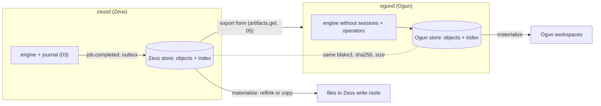
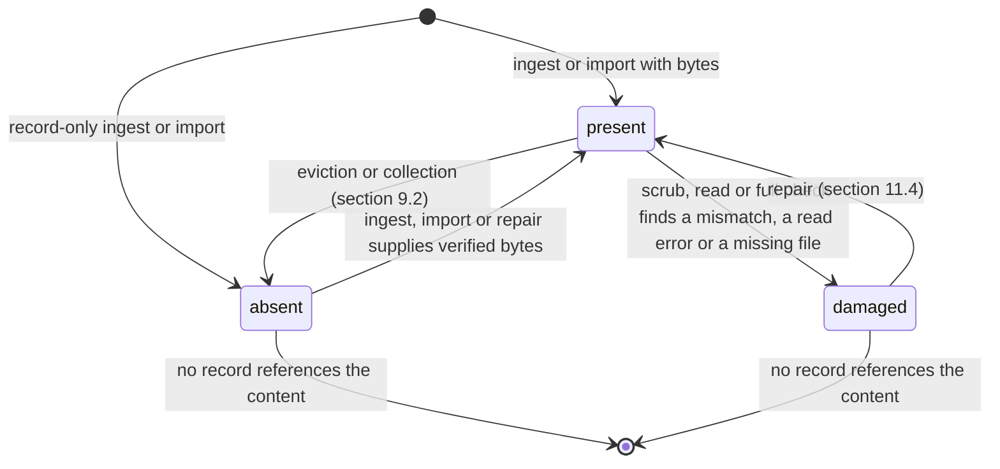
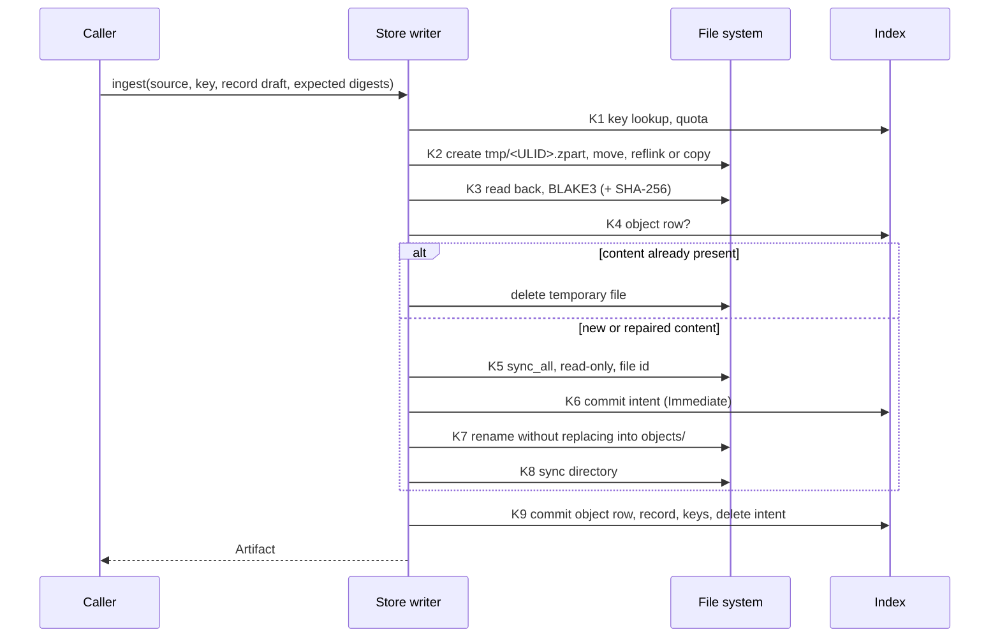
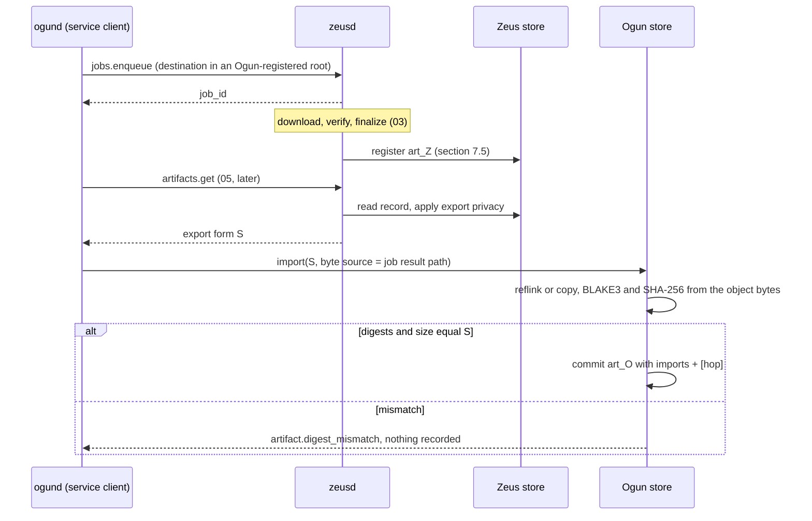

# 13. Artifacts and the content-addressed store

| | |
|---|---|
| Status | Draft 1 |
| Depends on | [00 conventions](00-conventions.md), [01 domain model](01-domain-model.md), [03 journal](03-journal-and-commit-protocol.md), [04 audit and provenance](04-audit-log-and-provenance.md) |
| Decided by | [ADR 0011](../adr/0011-ogun-built-on-zeus-core.md), decision 6 |
| Implemented by | A new `zeus-core` library crate, `zeus-artifact` (records, object store, index, ingest, import, materialization, collection, scrub), built on `zeus-types` (ids), `zeus-fs` (the `Filesystem` seam, write roots, OS marks) and `zeus-verify` (`DualHasher`, JCS). Embedded by `zeusd` (Zeus) and `ogund` (Ogun). |
| Schema | [`schema/artifact.v1.schema.json`](schema/artifact.v1.schema.json) |

## 1. Purpose

Zeus downloads files; Ogun, a second product built on `zeus-core` (ADR 0011), also produces files from operators and pipelines. Both need to say what a file **is** (its content), where it **came from** (origin, operation, inputs), whether it is **intact**, and how to hand it to the other product without losing that knowledge. This document defines the shared library format that answers those questions:

* the **artifact record**: an `art_` identifier plus content digests, provenance, lineage, verification state and retention, extending the 04 manifest file record;
* the **content-addressed object store** (CAS): an on-disk layout `objects/<algo>/<2 hex>/<2 hex>/<hex>` with a crash-safe ingest protocol in the style of 03, a metadata index with a single writer per store instance, reachability, garbage collection and quotas;
* **materialization**: how stored content becomes a user-visible file (reflink, hardlink, copy, with fallbacks);
* **import** of an artifact from another store instance, preserving content identity and provenance and recording the hop;
* **integrity verification and repair**, the deduplication guarantees, and what is deliberately out of scope.

Each product runs its own store instance. The content hash is the identity across products; `art_` ids are local to one store. The daemon methods that expose stores to clients are only named here (section 16.2); their API belongs to 05.

Research basis: `research.md` sections 4.1 and 4.5, and research 06, sections 2, 4, 7 and 9 (hash roles, the dedupe ladder, CAS and reflinks), which recommends BLAKE3 as the internal identity, SHA-256 as the interoperability hash, exact-content dedupe only, and no hardlinks by default.

## 2. Terminology

| Term | Meaning |
|---|---|
| Content | A finite byte sequence. Its identity is defined in section 3.3. |
| Object | One stored copy of a content, as an immutable file in `objects/`, named by its BLAKE3 digest. |
| Artifact | A record (`art_` id) that describes one content together with where it came from. Several artifacts may share one object. |
| Store, store instance | One directory holding `store.json`, `index.redb`, `objects/`, `tmp/` and `damaged/`, owned by exactly one process at a time (section 6.2). Identified by a `store_id`. |
| Owner | The process that holds a store open for writing: `zeusd` for the Zeus store, `ogund` for an Ogun store. |
| Index | The metadata database of one store (section 6). The only evidence of which objects and artifacts exist. |
| Ingest | Turning bytes into an object and a record (section 7). |
| Materialization | Making an object's content visible at a user path (section 8). The result is a **location**. |
| Location | A file outside the store that is believed to hold a content: a materialization, a finished download, an ingest source. A hint, never evidence. |
| Record-only artifact | An artifact whose object is `absent` in this store: the record keeps identity and provenance, the bytes live elsewhere or nowhere. |
| Export form | A record as it leaves the owner (API result or file), with the privacy reductions of section 14 applied. |
| Import | Creating a record in one store from another store's export form, with the content verified (section 10). |
| Protected | An object that collection and eviction must not remove (section 9.1). |
| Scrub | The periodic re-hash of present objects (section 11.2). |
| Intent | A durable index row written before a multi-step file operation so recovery can finish or undo it (section 12). |

## 3. Model

### 3.1 Entities



| Entity | Identity | Lives in | Mutable |
|---|---|---|---|
| Object | `(blake3, size)` | `objects/` plus a row in the index | Never: written once, read-only, deleted only by collection |
| Artifact record | `art_` id, local to its store | index | Only the members listed in section 4.1 |
| Location | `(blake3, path)` | index only | Re-recorded or dropped; never exported |
| Store manifest | `store_id` | `store.json` | Only by a format migration |

### 3.2 Store instances and products

1. A store instance belongs to one product. Zeus runs one instance; Ogun runs its own. Two products never open the same instance (ADR 0011 decision 6).
2. A product MAY run more than one instance (for example one per volume so that reflinks stay possible). Instances do not share objects or records; moving an artifact between them is an import (section 10), even inside one product.
3. `art_` ids are minted by the store library inside the owner (00 section 5.1 rule 1) and are unique within their store. The same content in two stores has two ids and the same digests.
4. `job_id` and `run_id` in a record are those of the producer (section 4.2). They identify a job only together with `producer.product`.

### 3.3 Content identity

1. The identity of a content is the pair **(BLAKE3-256 digest, size in bytes)**. BLAKE3 is used with its default 32-byte output, unkeyed (00 section 7 rule 4). It names objects (section 5.2).
2. The **SHA-256** digest of the same bytes is a required alias. Every record carries both (`blake3`, `sha256`), as the 04 manifest does. SHA-256 is what published checksums, `expected_sha256` (01 section 3.2), A2A artifacts and the PROV export (04 section 7.1) use.
3. Two records, in any stores of any product, describe the same content if and only if `blake3` and `size_bytes` are equal. Implementations MUST also compare `sha256`; agreement on BLAKE3 and size with disagreement on SHA-256 is evidence of a bug or a forged record and is reported as `artifact.digest_mismatch` (section 17).
4. No other function decides identity. Non-cryptographic checksums (CRC32C, xxh3) MAY be used as prefilters, never as the decision (research 06, section 4).
5. Digests are lowercase hexadecimal (00 section 6.4).

## 4. The artifact record

The record is the JSON object `Artifact` of [`artifact.v1.schema.json`](schema/artifact.v1.schema.json). It is a superset of the information in a 04 manifest file record (crosswalk in section 4.7) plus lineage, the producing operation, verification state, retention and import history.

### 4.1 Fields

| Field | Type | Mutable | Rule |
|---|---|---|---|
| `artifact_version` | `1` | no | Record format version (section 21). |
| `id` | `art_` id | no | Minted when the record is committed. Local to `store_id`. Never reused, including after the record is purged. |
| `store_id` | ULID | no | The store instance holding the record (section 5.3). |
| `state` | `active`, `deleted` | yes | `deleted` is a tombstone (section 9.4). |
| `created_at` | instant | no | When the record was committed in this store. For an import, the import time. |
| `deleted_at` | instant or null, optional | yes | Set when `state` becomes `deleted`. |
| `sha256`, `blake3` | hex | no | Digests of the content (section 3.3). |
| `size_bytes` | bytes | no | Size of the content. |
| `object` | CasObjectRef | `state` only | `algorithm` `blake3`, `digest` equal to `blake3`, `size_bytes` equal to `size_bytes`; `state` is the object row's state (section 6.4). |
| `name` | string or null | no | File name hint, sanitised as in 01 section 12.3, at most 255 UTF-8 bytes, never a path. Untrusted. |
| `media_type` | string or null | no | Detected from magic bytes. |
| `declared_media_type` | string or null | no | What the origin or caller declared, parameters stripped. Untrusted. |
| `origin` | object | no | Where the bytes came from (section 4.2). |
| `retrieved_at` | instant or null | no | Non-null exactly when `origin.kind` is `remote`: when the last byte was committed (S20), as in 04. |
| `produced_at` | instant or null | no | Non-null exactly when `origin.kind` is `derived`: when the operation finished. Both times are null for `local`. |
| `producer` | object | no | The product that created the record first (section 4.2). Preserved by imports. |
| `operation` | object | no | The operation that produced the bytes (section 4.2). |
| `parents` | list of ParentRef, at most 1024 | no | Inputs of the operation (section 4.3). Empty unless `origin.kind` is `derived`. |
| `job_id`, `run_id` | ids or null | no | The producer's job and workflow run (section 3.2 item 4). |
| `license` | 04 `license` object | by a human only | `{spdx, source, evidence_url?}` exactly as 04 section 3.3; `unknown` is a first-class value and MUST NOT be read as permissive. A change is audited (`artifact.updated`). |
| `quarantined` | boolean | no | 01 section 11.3. Set when the content is first recorded; preserved by every import. |
| `quarantine_reasons` | list, optional | no | Values of 01 `QuarantineReason`, when `quarantined`. |
| `verification` | object | `state`, `checked_at` | Section 4.4. |
| `retention` | `keep`, `evictable` | yes | Section 9.1. |
| `retain_until` | instant or null | yes | Section 9.1. |
| `imports` | list of ImportRecord, at most 8 | no | Import hops, oldest first; empty for records created natively in this store (section 10). |
| `privacy` | object, optional | no | Reductions already applied to the provenance fields (section 14). Absent means `url_query: sanitized`, `session_origin_included: true`. |
| `metadata` | object | no | At most 32 untrusted entries: keys of 1 to 256 characters without control characters, values a string of at most 1024 characters, an integer within 00 section 6.3 bounds, or a boolean. Zeus copies the job's `labels` here. |
| `audit` | `{chain_id, seq, hash}`, optional | no | Pointer to the holding product's audit record of the creation (Zeus: `file.finalized`, `file.converted` or `artifact.imported`). Not carried across imports. |

### 4.2 Origin, producer and operation

**Origin.** `origin.kind` is one of:

| Kind | Meaning | Members |
|---|---|---|
| `remote` | Retrieved from a URL by a download job. | `url`, `final_url`, `url_redacted`, `referrer` (optional), `session_origin`, `http` (optional). Each member is built by the same function that builds the 04 manifest record's `source` block, `session_origin` and `http` (04 section 3.3), so a record and a manifest line never disagree. URLs pass `redact_url` in mode `record` (00 section 8.2), never raw. A job from a private browser window is recorded as 04 section 3.4 rule 5 requires: `url` and `final_url` reduced to the origin plus `/`, `session_origin` null, no `referrer`. |
| `derived` | Produced by an operation from the `parents`. | none |
| `local` | A local file registered by a user or client (`zeus.ingest`). | none. The source path is never part of the record; it becomes a location (section 6.3). |

**Producer.** `{product, version, engine?, extension?, source_kind?}`: the product that created the record (`zeus`, `ogun`), its version, the `zeus-core` engine version, the extension version for browser handoffs, and who asked in the producer's vocabulary. For Zeus `source_kind` is a `SourceKind` of 01 section 3.3. Client ids are never recorded (04 section 8 keeps them out of provenance).

**Operation.** `{name, version, params_blake3, tool?}`:

1. `name` is `<product>.<operation>`, lowercase, dotted. `version` is the version of the code that implemented the operation (for operations implemented in `zeus-core`, the library version). `tool` names an external program that did the work.
2. `params_blake3` is the hex BLAKE3 of the JCS (00 section 7) of the operation's **parameter object**. Each operation defines that object. It MUST contain everything that, together with the parents, determines the output, and MUST NOT contain secrets, absolute paths or floating-point numbers; URLs in it pass `redact_url` in mode `record`. Two records with equal `operation` and equal parents are expected, not guaranteed, to have equal content.
3. Zeus defines these operations; Ogun registers `ogun.*` names in its own specification.

| Name | Produced when | Parameter object |
|---|---|---|
| `zeus.download` | A job completed (S80) | `{url, expected_sha256?, expected_size?}`: `url` is `spec.url` through `redact_url(record)`; the optional members are present when the JobSpec had them. |
| `zeus.ingest` | A client registered a local file (`artifacts.ingest`) | `{}` |
| `zeus.convert` | A conversion produced a file (08) | `{tool, version, args}`, with every path in `args` replaced by `{input}` or `{output}`. 08 may refine it. |

Test vectors (computed with the tools in `docs/spec/tools`): the parameter object `{"url":"https://portal.example.org/download/8841"}` gives `params_blake3` `4852fff11c69c70c264f10a094a8e4e2d5e088c49998ed337040349b2cb1ab16`; `{}` gives `6e46dd10defc9b56c29a6ec56b508c21f54c08192194e4df25bf36f0c9c3c279`.

### 4.3 Parents and lineage

1. A `ParentRef` is `{artifact_id, blake3, sha256, size_bytes, role}`. The digests and size identify the parent's content and are always present. `artifact_id` names a record **in the same store** and is null when the parent is known only by content (after an import, or when the input was never recorded in this store).
2. A non-null `artifact_id` MUST name a record that was committed before the child (active or tombstoned); otherwise the ingest fails with `artifact.lineage_invalid`. Edges by id therefore form a directed acyclic graph (invariant A8).
3. `role` is `input` (the default), `config` (a parameter file), `manifest` (see item 4) or a producer-defined role (lowercase `snake_case`).
4. An operation with more than 1024 inputs records a **manifest artifact**: a JSON Lines document of `ParentRef` objects, itself an artifact (`media_type` `application/x-ndjson`), named as the single parent with role `manifest`. Lineage walkers MAY expand it within the query bounds.
5. **Lineage queries** walk ancestors (parents) and descendants (children). A parent reference resolves to the record named by `artifact_id`, or, when that is null, to every record in this store with the same `blake3` and size (active or tombstoned); no match yields a content-only node. Because resolution by content can lead back to the start (an identity operation produces content equal to its input), walkers MUST keep a visited set. A query visits at most 64 levels and 10,000 nodes and reports `truncated` when it stops early.
6. **License of derived content.** An operation with a single input whose output is a lossless re-encoding of it (decompression, container change) copies the input's `license` object, as 04 does for converted files. Every other operation records `license` `unknown` unless it declares one.

### 4.4 Verification, quarantine and retention

`verification` is `{state, checked_at, basis}`:

| Member | Values | Meaning |
|---|---|---|
| `state` | `verified` | This product computed the digests from the content's bytes: at ingest (section 7.2), at finalization of a download (03 section 8.1, step F0), at import (section 10.2), or at the latest scrub (section 11.2). |
| | `unverified` | The digests were taken from another party without recomputation (a record-only import, `object_mode` `none`). |
| | `failed` | The stored object was found missing, unreadable or not matching (section 11.3). Then `object.state` is `damaged`. |
| `checked_at` | instant or null | When the bytes were last hashed by this product. Null only when `state` is `unverified`. |
| `basis` | `self` | The digests come from the producer's own hashing: they give identity ("these are the bytes received"), not correctness. |
| | `origin` | They also matched a digest the origin supplied (for example `Repr-Digest`). Zeus v1 never sets it: 01 treats `repr_digest` as informational. |
| | `expected` | They also matched a digest the requester supplied (`expected_sha256` of 01 section 3.2). |

`state` and `checked_at` describe the content, so the store keeps them on the object row and every record with that content shows the same values (section 6.3). `basis` belongs to the record and is preserved by imports. These rungs follow the trust ladder of research 06 (section 1).

`quarantined` and `quarantine_reasons` are copied from the job (01 section 11.3) when Zeus records a download and are never cleared by the store. A product applies its own quarantine rules on top (an importing product MAY add quarantine, never remove it).

`retention` and `retain_until` decide whether the object may be removed while the record is active (section 9.1).

### 4.5 Rules

1. **Fixed members.** After the commit that creates a record, only the members marked mutable in section 4.1 change. Every other correction is a new record.
2. **No secrets, no private paths.** A record never contains cookie names or values, `Authorization` material, lease ids, client ids, raw URL queries (only `redact_url` output), or absolute paths (00 section 8.1). Locations and intents, which hold paths, live in separate index rows and never leave the owner (section 14).
3. **Hashable.** Records contain no floating-point numbers and no integers outside 00 section 6.3 bounds, so JCS (00 section 7) applies to them unchanged.
4. **Size.** A serialised record is at most 256 KiB.
5. **Consistency.** `object.digest` equals `blake3`, `object.size_bytes` equals `size_bytes`; the time rule of section 4.1 (`retrieved_at` for `remote`, `produced_at` for `derived`, neither for `local`); `parents` empty unless `derived`; `deleted_at` set exactly when `state` is `deleted`; at most one `privacy` block. A record violating these is refused with `artifact.record_invalid`.
6. **Untrusted members.** `name`, `declared_media_type`, `origin.*` URLs and `http` values, `license.spdx` when its `source` is `declared`, and `metadata` originate from remote servers or callers. They are data, never instructions (01 section 12.1), and APIs that hand them to a model label them as untrusted (06).
7. **Unknown members.** Readers ignore unknown members (00 section 4.1 rule 7). A store rebuilds every record it commits from the members this document defines; unknown members of a received record survive only in the verbatim copy of section 10.2 step 8.

### 4.6 Examples

A browser handoff (the job of 01 section 3.1) recorded in the Zeus store. The store root is on a copy-on-write file system, so the object is present at no extra space cost (section 7.5):

```json validate=artifact.v1#/$defs/Artifact
{
  "artifact_version": 1,
  "id": "art_01M45NK2V7TQ8X3CZD5RWB9HME",
  "store_id": "01M2YVJ3K8W5D0QXNB7RT4CHAE",
  "state": "active",
  "created_at": "2026-10-05T09:17:12.640Z",
  "sha256": "eba4a8587ad422baa9bb314f660b11dfd73563c9af06c6c6ed6ec4bf2da2bc47",
  "blake3": "1e0f07a3c0beca17e28b2d889c3e78a743e9c931e3d5efbff76921fe028ce231",
  "size_bytes": 1288490188,
  "object": { "algorithm": "blake3", "digest": "1e0f07a3c0beca17e28b2d889c3e78a743e9c931e3d5efbff76921fe028ce231", "size_bytes": 1288490188, "state": "present" },
  "name": "dataset-v3.tar.zst",
  "media_type": "application/zstd",
  "declared_media_type": "application/zstd",
  "origin": {
    "kind": "remote",
    "url": "https://portal.example.org/download/8841",
    "final_url": "https://cdn.example.org/blobs/dataset-v3.tar.zst",
    "url_redacted": true,
    "referrer": "https://portal.example.org/datasets/v3",
    "session_origin": "https://portal.example.org",
    "http": { "status": 206, "etag": "\"5f3a9c-4c1d2e7b\"", "last_modified": "Tue, 29 Sep 2026 14:02:11 GMT", "date": "Mon, 05 Oct 2026 09:15:36 GMT", "repr_digest": null }
  },
  "retrieved_at": "2026-10-05T09:17:02.311Z",
  "produced_at": null,
  "producer": { "product": "zeus", "version": "0.1.0", "engine": "0.1.0", "extension": "0.1.0", "source_kind": "browser_handoff" },
  "operation": { "name": "zeus.download", "version": "0.1.0", "params_blake3": "4852fff11c69c70c264f10a094a8e4e2d5e088c49998ed337040349b2cb1ab16" },
  "parents": [],
  "job_id": "job_01M45NHJ2AHWMXT8JVJ7BEEJX7",
  "run_id": null,
  "license": { "spdx": "unknown", "source": "unknown" },
  "quarantined": false,
  "verification": { "state": "verified", "checked_at": "2026-10-05T09:17:12.610Z", "basis": "self" },
  "retention": "evictable",
  "retain_until": null,
  "imports": [],
  "metadata": {},
  "audit": { "chain_id": "chain_01M3TC5H007DRT2QA1P1NY311K", "seq": 7, "hash": "180a9271bfe48c75d6580e81535a1e359c5fb32549ac4385a1e67f9c70914c65" }
}
```

The conversion of 04 section 3.5 (`q3.csv.gz` decompressed to `q3.csv`) as a derived artifact. Its parent is the agent download `art_01M45SDP4G6YB0QW8ZK3NXJ7RT` shown in section 10.4; the license is copied by rule 6 of section 4.3:

```json validate=artifact.v1#/$defs/Artifact
{
  "artifact_version": 1,
  "id": "art_01M45SFV9A2HC5MRT7DKQ0WZ3N",
  "store_id": "01M2YVJ3K8W5D0QXNB7RT4CHAE",
  "state": "active",
  "created_at": "2026-10-05T10:21:00.400Z",
  "sha256": "f24f5ddf46354d10a2b2340f00bd9223e75c25a31b4328498f2fa98ebc55d096",
  "blake3": "c8bd1103e018465a8abdca368d62f6d3af1f434442b10cfa47d0aed9d527a803",
  "size_bytes": 4831838208,
  "object": { "algorithm": "blake3", "digest": "c8bd1103e018465a8abdca368d62f6d3af1f434442b10cfa47d0aed9d527a803", "size_bytes": 4831838208, "state": "present" },
  "name": "q3.csv",
  "media_type": "text/csv",
  "declared_media_type": null,
  "origin": { "kind": "derived" },
  "retrieved_at": null,
  "produced_at": "2026-10-05T10:21:00.000Z",
  "producer": { "product": "zeus", "version": "0.1.0", "engine": "0.1.0", "source_kind": "agent" },
  "operation": {
    "name": "zeus.convert",
    "version": "0.1.0",
    "params_blake3": "b2cdc08d6c8679fd667a9ab38d98f1750a9546c031cb09f1b849cefcdaf93d82",
    "tool": { "name": "gzip", "version": "1.13" }
  },
  "parents": [
    {
      "artifact_id": "art_01M45SDP4G6YB0QW8ZK3NXJ7RT",
      "blake3": "c3a07f73ec4e30b696bc8c5659e85461b00c76674eaeaa02ef12f6b8c83571ec",
      "sha256": "9218812567e906efb346546840f6145fc189148e5633d0737fee7402a3207f9a",
      "size_bytes": 1073741824,
      "role": "input"
    }
  ],
  "job_id": "job_01M45R71NCNH3W8EQ63TAFME4C",
  "run_id": "run_01M45KGHR0ED0WJDFXKG49029B",
  "license": { "spdx": "CC-BY-4.0", "source": "declared", "evidence_url": "https://files.example.com/exports/2026/LICENSE" },
  "quarantined": false,
  "verification": { "state": "verified", "checked_at": "2026-10-05T10:21:00.300Z", "basis": "self" },
  "retention": "evictable",
  "retain_until": null,
  "imports": [],
  "metadata": { "task": "quarterly-report" },
  "audit": { "chain_id": "chain_01M3TC5H007DRT2QA1P1NY311K", "seq": 10, "hash": "3e5368402c4a310121179fe76ccf4411c5dba812cd66779c45c9c9291bdfdaa7" }
}
```

(The parameter object of the conversion is `{"args":["--decompress","--stdout","{input}"],"tool":"gzip","version":"1.13"}`.)

The object reference of the first example on its own:

```json validate=artifact.v1#/$defs/CasObjectRef
{ "algorithm": "blake3", "digest": "1e0f07a3c0beca17e28b2d889c3e78a743e9c931e3d5efbff76921fe028ce231", "size_bytes": 1288490188, "state": "present" }
```

### 4.7 Crosswalk with the 04 manifest file record

The artifact record extends the 04 file record. Every 04 field has a place; a manifest line is the projection of one record, one location (for the path and the OS marks) and one audit pointer.

| 04 file record field | Artifact field | Rule |
|---|---|---|
| `record_type` (`file`) | none | The record carries `artifact_version` instead. |
| `path` | `name` plus a location | 04 stores a path relative to the write root; a record stores only the file name. The manifest writer takes the relative path from the location the line describes. |
| `size_bytes` | `size_bytes` | Same value. |
| `sha256`, `blake3` | `sha256`, `blake3` | Same values; `blake3` also names the object. |
| `media_type` | `media_type` | Same. |
| `declared_media_type` | `declared_media_type` | Same. |
| `source.kind` | `producer.source_kind` | Same value for product `zeus`. |
| `source.url`, `source.final_url`, `source.url_redacted`, `source.referrer` | `origin.url`, `origin.final_url`, `origin.url_redacted`, `origin.referrer` with `origin.kind` `remote` | Built by the same function. |
| `retrieved_at` | `retrieved_at` | Same (S20). |
| `session_origin` | `origin.session_origin` | Same; null when no session or when privacy excludes it. |
| `http` | `origin.http` | Same object. |
| `tools.zeus`, `tools.engine`, `tools.extension` | `producer.version`, `producer.engine`, `producer.extension` | For product `zeus`. |
| `converter_chain[i]` | one derived artifact per step | Step `i`'s `tool` and `version` become `operation.tool`, `args_digest` becomes `operation.params_blake3` (see open issue O9), `input_sha256` becomes `parents[0].sha256`, `output_sha256` becomes `sha256`. The chain is recovered by a lineage query. |
| `license` | `license` | Same object, same rules. |
| `run_id`, `job_id` | `run_id`, `job_id` | Same. |
| `quarantined` | `quarantined` | Same; the record adds `quarantine_reasons`. |
| `os_metadata` | the location's `os_metadata` | Marks belong to one file on disk, not to the content. |
| `derived_from` | `parents[].sha256` | Same digests. |
| `audit` | `audit` | Same shape; the manifest line points at the same record. |
| none | `id`, `store_id`, `state`, `created_at`, `deleted_at`, `object`, `name`, `origin.kind`, `produced_at`, `operation`, `parents` (with `artifact_id`, `role`, `blake3`, `size_bytes`), `verification`, `retention`, `retain_until`, `imports`, `privacy`, `metadata` | New in this document. |

## 5. On-disk layout

### 5.1 Store root

```text
<store>/
  store.json                 store manifest (section 5.3), written once
  store.lock                 advisory lock held by the owner (section 6.2)
  index.redb                 metadata index (section 6)
  objects/
    blake3/
      1e/
        0f/
          1e0f07a3c0beca17e28b2d889c3e78a743e9c931e3d5efbff76921fe028ce231
  tmp/
    <ULID>.zpart             ingests in progress (section 7.2)
  damaged/
    <digest>.<ULID>.damaged  objects that failed verification (section 11.3)
```

Nothing else is created under the root. `tmp/` MUST be on the same volume as `objects/` (it is inside the root), so the final rename of an ingest is atomic. The name suffix `.zpart` is the 00 section 3 convention for data in progress.

### 5.2 Object paths

For algorithm `a` and digest `d` (64 lowercase hexadecimal characters):

```text
object_path(a, d) = "objects/" + a + "/" + d[0..2] + "/" + d[2..4] + "/" + d
```

1. Version 1 has exactly one algorithm directory, `blake3`. The `<algo>` level exists so a later format can add another algorithm without moving existing objects.
2. The file name is the **full** digest, so an object can be verified and adopted from its name alone.
3. Two levels of 256 directories give 65,536 leaf directories: about 150 entries each at 10 million objects. Directories are created on first use.
4. Object paths are computed only from a digest that passed the `Hex256` pattern; no string from a caller, a record or a file name ever becomes part of a path inside the store.

### 5.3 Store manifest

`store.json` identifies the instance and fixes its format. It is written once at creation (temporary file, `sync_all`, rename without replacing, directory sync) and changed only by a format migration (section 21).

```json validate=artifact.v1#/$defs/StoreManifest
{
  "format": "zeus-artifact-store",
  "format_version": 1,
  "store_id": "01M2YVJ3K8W5D0QXNB7RT4CHAE",
  "created_at": "2026-09-20T07:30:00.120Z",
  "created_by": { "product": "zeus", "version": "0.1.0", "library": "zeus-artifact 0.1.0" },
  "object_algorithm": "blake3",
  "fanout": [2, 2],
  "index": "redb"
}
```

`store_id` is a bare ULID, distinct from the journal's `store_id` (03 section 4.1). The index repeats it; a mismatch on open is `artifact.store_corrupt`.

### 5.4 Location of the store and permissions

1. The store root MUST be on a local file system with working `fsync` semantics: not a network share, not removable media (03 open issue O4 explains why).
2. The store root MUST NOT lie inside any write root, and no write root may lie inside it: agents with file tools must not reach objects or the index (the rule 04 section 9 applies to the audit directory).
3. The store root SHOULD NOT lie inside a cloud-synchronised folder (OneDrive, Dropbox, iCloud Drive, Google Drive; `zeus-fs` detects them): sync clients upload private content, lock files and replace them with placeholders. Opening such a root fails with `artifact.store_location_unsuitable` unless a human configured an explicit override.
4. The store root SHOULD be on the volume of the main write roots, because reflinks only work within one volume (section 8.1).
5. Defaults: Zeus uses `<state>/store` (03 section 3.1); Ogun chooses its own.

| Item | Unix | Windows |
|---|---|---|
| Store root and every directory under it | `0700` | ACL granting only the owning user (inherited from the state directory when inside it); `FILE_ATTRIBUTE_NOT_CONTENT_INDEXED` on the root (SHOULD) |
| `store.json`, `store.lock`, `index.redb` | `0600` | same ACL |
| Files in `tmp/` | created `0600`, create-new and no-follow (`O_CREAT`, `O_EXCL`, `O_NOFOLLOW`) | `CREATE_NEW` with `FILE_FLAG_OPEN_REPARSE_POINT` |
| Objects | read-only: `0444` masked by the umask; the `0700` directories keep other users out | `FILE_ATTRIBUTE_READONLY`; collection clears it immediately before deleting |
| `damaged/` files | keep the object's mode | keep the attribute |

The store never follows a symbolic link, junction or other reparse point inside the root. It records the root's file identity when it opens the store and checks it again before every collection sweep; a reparse point found inside the root is `artifact.store_corrupt`.

### 5.5 Windows, long paths and case-insensitive file systems

1. **Long paths.** An object path is the root plus 86 characters (`/objects/blake3/xx/yy/` and 64 hex digits). Implementations MUST work when the full path exceeds the classic 260-character `MAX_PATH`: they MUST pass extended-length (`\\?\`) paths to Win32. Rust's `std::fs` does this automatically for absolute paths since Rust 1.58 (rust-lang/rust pull request 89174); code that calls Win32 directly (block cloning, alternate data streams, `ReplaceFileW`) MUST build the verbatim path itself, with backslashes only, because verbatim paths are not normalised.
2. **Case-insensitive file systems** (NTFS and APFS by default). Every name the store creates under `objects/` is lowercase hexadecimal (2 or 64 characters), constructed from the digest, so two distinct digests never collide by case. Listings (the full check of section 12) compare names byte for byte; an entry that is not exactly such a name is foreign: it is never served, it is reported, and it is moved to `damaged/`, never deleted.
3. **Reserved names.** Hex names cannot be Windows device names (`CON`, `NUL`, `COM1` and so on), never end in a dot or space, and are ASCII, so Unicode normalisation (APFS, NFC versus NFD) does not apply.
4. **Sharing violations.** Antivirus and indexers hold files open briefly. `ERROR_SHARING_VIOLATION` and `ERROR_LOCK_VIOLATION` during a rename or delete are `fs.busy` (01 section 8.3, rule A4) and are retried with the `fs.busy` budget; the intent of the operation (section 12) stays until it succeeds.
5. **Read-only attribute.** `DeleteFileW` refuses a read-only file; collection and damage handling clear `FILE_ATTRIBUTE_READONLY` immediately before deleting or moving an object, and do so only inside the store root.

## 6. The metadata index

### 6.1 Where it lives

The index is `index.redb`, a redb database inside the store root, reached through a trait (`ArtifactIndex`) so another backend with atomic, durable, multi-row transactions can replace it, exactly as 03 section 3.3 does for `JournalStore`. It is deliberately **not** a set of tables in the product's journal:

* the store is a `zeus-core` format shared by two products, and its directory must be self-contained (objects and index are backed up and moved together);
* artifact records live for years, while job records are pruned after 30 days (01 section 10);
* each product already has its own journal; neither may depend on the other's.

The cost is that no transaction spans the journal and the index. Where Zeus needs both (a finished download becoming an artifact) it uses the outbox pattern of 03 and 04: the journal holds a cursor, the index holds an idempotency key (section 7.5).

Every write transaction of the index MUST use `Durability::Immediate` (03 section 5.4 explains why `None` is unsafe).

### 6.2 Single-writer rule

1. **One owner process.** Exactly one process opens a store instance for writing. It acquires `store.lock` (an exclusive advisory lock: `LockFileEx` on Windows, `flock` or `fcntl` on Unix) and holds it for its lifetime, then opens `index.redb`, which redb itself refuses to open twice (`DatabaseAlreadyOpen`, 03 section 3.3). A second process fails with `artifact.store_locked` and changes nothing (invariant A10).
2. **One writer inside the owner.** Every mutation of the index and of `objects/`, `tmp/` and `damaged/` is performed by one writer task that executes operations one at a time, in arrival order; a multi-step operation (an ingest, a sweep step, a damage move) runs to completion before the next starts. Read transactions run concurrently with it and see committed state only.
3. **No other access.** Other processes, including other processes of the same product, MUST NOT open the index. They use the owner's API (section 16.2). They MAY read object files they were handed a path to, because objects never change; they MUST NOT write, rename or delete anything in the store.
4. **Offline tools.** A maintenance command (for example a full check) MAY open a store only by becoming its owner: it takes `store.lock` and fails if the owner runs.
5. **Leases.** While an operation reads an object outside the writer (a copy, a materialization), it holds an in-memory lease on the digest. The writer never deletes or moves a leased object. Leases need no persistence because only the owner can collect.

### 6.3 Tables

Logical layout; the redb encoding is an implementation choice behind `ArtifactIndex`.

| Table | Key | Value | Purpose |
|---|---|---|---|
| `meta` | `"store"` | `store_id`, `format_version`, `created_at`, counters `present_objects` and `present_bytes`, `last_gc_at`, the scrub cursor, `clean_shutdown` | Identity check against `store.json`; quota accounting (section 9.3). |
| `objects` | `blake3` | `sha256`, `size_bytes`, `state`, `created_at`, `checked_at`, `verification_state`, `last_access_at`, `refs` (active records with this content) | One row per known content. The source of truth for presence (invariant A4). |
| `by_sha256` | `sha256` | `blake3` | Lookup by the interoperability digest. |
| `artifacts` | `art_` id | the record (JSON, without the composed members `object.state`, `verification.state`, `verification.checked_at`) | Records. |
| `by_content` | `(blake3, art_ id)` | none | All records of one content: reference counting and lineage resolution. |
| `children` | `(parent blake3, child art_ id)` | `role` | Reverse lineage. |
| `by_job` | `(job_id, art_ id)` | none | Lookup by producing job. |
| `ingest_keys` | key (at most 128 characters) | `art_` id | Idempotent ingest (section 7.3). |
| `imports` | `(from store_id, from art_ id)` | local `art_` id | Idempotent import (section 10.2). |
| `import_sources` | local `art_` id | the received record, verbatim bytes | Evidence for `record_blake3` (section 10.2). |
| `locations` | `(blake3, path key)` | `path`, `mode` (`registered`, `reflink`, `hardlink`, `copy`), `file_id`, `size_bytes`, `mtime_ms`, `os_metadata`, `recorded_at` | Hints for repair and for the owner's own listings. The path key is case-folded on case-insensitive file systems (as 03 section 3.2 does for reservations). Never exported. |
| `intents` | ULID | `kind` (`ingest`, `delete`, `quarantine`, `materialize`) and its members (section 12) | Crash consistency of multi-step operations. |
| `gc` | `blake3` | `unreferenced_since` | Objects whose `refs` dropped to zero (section 9.2). |

The records returned by the store are composed: `object.state` comes from the object row, and so do `verification.state` and `verification.checked_at`, so every record of one content shows the same integrity status.

### 6.4 Object states



| State | File at `object_path` | Served | Meaning |
|---|---|---|---|
| `present` | yes, verified at `checked_at` | yes | The store holds the content. |
| `absent` | no | no | Not stored by policy: record-only, evicted or collected. Not an error. |
| `damaged` | no (moved to `damaged/`, or found missing) | no | The store expected the content and lost it. Repair is needed (section 11.4). |

## 7. Ingestion

### 7.1 Sources and modes

| Mode | Byte source | Rule |
|---|---|---|
| `move` | A file the caller hands over and gives up (for example an operator's output written on the store's volume) | Renamed into `tmp/`. Across volumes (`EXDEV`, `ERROR_NOT_SAME_DEVICE`) it falls back to `copy`. |
| `reflink` | A readable file on the store's volume | Cloned into `tmp/` (`FICLONE`; `clonefile` on APFS, whose destination must not exist; block cloning on ReFS). Shares extents, costs no space until either side changes. |
| `copy` | A readable file or a byte stream | Streamed into `tmp/`. A stream of unknown length is checked against the quota while it is written. |
| none | No bytes | A record-only artifact: object `absent`. |

**An ingest never hardlinks its source.** A hardlinked object would change whenever someone edits the source path, which breaks invariant A3.

### 7.2 Steps

For one ingest of content with expected digests `E` (optional), ingest key `k` (optional) and a record draft `R`:

| Step | Action | Durable after it? |
|---|---|---|
| K1 | **Admit.** If `k` is in `ingest_keys`, return that record and stop. Check quota and free space for `copy` and `move` (section 9.3), evicting first if needed; failing that, `artifact.quota_exceeded` or `fs.no_space`. | no |
| K2 | **Write.** Create `tmp/<ULID>.zpart` (create-new, no-follow) and fill it by the chosen mode. | no |
| K3 | **Hash.** Compute BLAKE3 and the size from the temporary file's own bytes, read back after the write completed (through the page cache is acceptable), never from the buffers that were written. Compute SHA-256 in the same pass, unless the caller supplied a trusted `(sha256, blake3, size)` triple that it computed itself in one pass over the same content (Zeus: the `verify_result` of 03 section 8.1 step F0); then equal BLAKE3 and size carry the SHA-256 over. If `E` is given and differs: `artifact.digest_mismatch`, delete the file, stop. | no |
| K4 | **Deduplicate.** Look up `blake3` in `objects`. Row `present`: delete the temporary file and continue at K9 with the existing object. Row `absent` or `damaged`, or no row: continue. | no |
| K5 | **Seal.** `sync_all` the temporary file (`F_FULLFSYNC` on macOS, 03 section 5.2 step C2), make it read-only, read its file identity. | data durable |
| K6 | **Intent.** Commit an `ingest` intent `{blake3, size_bytes, tmp name, file_id, record}` where `record` is the complete record to commit at K9. | yes |
| K7 | **Name.** Create the fan-out directories (on Unix, sync each parent of a newly created directory), then rename the temporary file to `object_path` **without replacing** (03 section 8.1 step F4 lists the calls). If the target exists (a file with no `present` row, left by an earlier crash): hash it; equal content: delete the temporary file and adopt it; different: move it to `damaged/` and retry the rename once. | yes (Windows write-through) |
| K8 | **Sync the directory** of the object (Unix). | yes |
| K9 | **Commit.** One transaction: for a new or repaired object the object row (`present`, `checked_at` = the K3 time, `verification_state` `verified`), for an existing object only its `refs`; the record (new `art_` id), `by_content`, `children`, `by_job`, `ingest_keys`, an optional `registered` location for the source, the counters, and deletion of the intent. A previously `absent` or `damaged` row becoming `present` is a repair (`artifact.object_repaired`, source `ingest`). | **yes** |

A record-only ingest runs K1 and K9 only. When the content has no object row, it creates one `absent`, with `verification_state` `verified` and the caller's check time when the caller hashed the bytes itself (as Zeus does at F0), else `unverified` with no `checked_at`. An existing row keeps its state; its `checked_at` advances when the caller's verified check is newer.



### 7.3 Deduplication and idempotency

1. **One object per content.** At most one object exists per BLAKE3 digest in a store (invariant A5). An ingest of content already present writes nothing to `objects/` (K4).
2. **Records are not deduplicated.** Two downloads of the same bytes from two URLs give two records with one object, so both provenances survive (research 06, section 7).
3. **Ingest keys.** A caller that may retry passes an ingest key of at most 128 characters, `<product>.<kind>:<value>` by convention (`zeus.job:job_01M45NHJ2AHWMXT8JVJ7BEEJX7`). The same key always returns the same record, whatever the bytes of the retry (the first commit wins). For daemon API calls, 05 derives the key from the client's `idempotency_key` (00 section 5.4).

### 7.4 Crash points

| Crash after | Index on reopen | Disk on reopen | Recovery (section 12) |
|---|---|---|---|
| K1 to K5 | unchanged | a file in `tmp/` | Deleted with the rest of `tmp/`. The caller retries. |
| K6 | `ingest` intent | file in `tmp/`, nothing at `object_path` | The temporary file's identity and size equal the intent's: finish K7 to K9. Otherwise drop the intent and the file. |
| K7 | intent | file at `object_path` | Identity and size equal the intent's: finish K8 and K9. On Unix the rename may not have survived without the directory sync: then the file is still in `tmp/` and the previous row applies. |
| K8 | intent | same | Finish K9. |
| K9 | committed | object present | Nothing. |

Recovery decides by file identity (`dev`+`ino`, or volume serial plus file index, as 03 section 6 step 5) and size, not by hashing: the bytes were hashed and synced before the intent was committed (K3 and K5 before K6), and a rename keeps the identity. A same-user attacker who rewrites the file in that window is the residual risk of 03 section 14; the next scrub detects it.

### 7.5 Registering Zeus downloads

Zeus turns every completed download into an artifact without touching the finalization protocol of 03:

1. **Consumer.** `zeusd` runs an outbox consumer over durable journal events with the cursor `meta.artifact_cursor` (03 section 4.1). It runs after the audit writer (`artifact_cursor` never exceeds `audit_cursor`), so the `file.finalized` audit record exists and its pointer goes into the record. It advances the cursor only after the index commit (at least once; idempotent by key). The journal never prunes events above the cursor (03 section 13).
2. **Per `job.completed` event:** ingest key `zeus.job:<job_id>`; the record is built from the job record, its `verify_result` and the event (operation `zeus.download`, origin per section 4.2, `name` the final file name, `metadata` the job's `labels`, `quarantined` and reasons from the job, `verification.basis` `expected` when `expected_sha256` matched, else `self`); the byte source is `result.path` with the trusted triple from `verify_result`.
3. **Mode,** by the store setting `ingest_downloads`:

| Value | Behaviour |
|---|---|
| `reflink_only` (Zeus default) | Reflink when the store and the file share a copy-on-write volume; otherwise record-only. A download never costs a second copy of its size by default. |
| `always` | Reflink, else copy if the quota allows, else record-only. |
| `never` | Record-only. |

4. **Changed file.** If the file at `result.path` no longer has the fingerprint recorded with `verify_result` (file identity, length, `mtime_ms`), or the object hashes differently at K3, the user changed or replaced it after finalization: the artifact is recorded record-only with the digests of `verify_result` (they describe what Zeus downloaded) and no location.
5. **Location.** A successful registration records `result.path` as a `registered` location.
6. Jobs that end `failed` or `canceled` produce no artifact. Conversions (08) register their outputs directly with operation `zeus.convert`.

## 8. Materialization

### 8.1 Modes and policy

| Mode | Result | Conditions |
|---|---|---|
| `reflink` | An independent file sharing extents with the object (copy-on-write). Edits to it never reach the object. | Same volume, and a file system with cloning: Btrfs and XFS (`FICLONE`), APFS (`clonefile`), ReFS (block cloning: cluster-aligned, under 4 GiB per call, a per-region reference limit). NTFS, ext4 and FAT have none. |
| `hardlink` | A second name for the object's file. Edits through it **change the object**. | Opt-in only. Same volume; the target root's OS-metadata mode is `off` (marks would be written onto the object); the result stays read-only; the file system's link limit is not reached (1023 links per file on NTFS). |
| `copy` | An independent full copy. | Always possible, subject to space. |

Symbolic links are never used: tools follow them and write through them, and Windows needs a privilege to create them.

The policy is an ordered list of modes, `materialize_modes`, default `[reflink, copy]`. `hardlink` is used only when the list names it. Scrub (section 11.2) detects an object changed through a hardlink and marks it `damaged`.

### 8.2 Steps

Materialization mirrors finalization (03 section 8.1) with the intent kept in the store index:

1. **Check.** The record is `active` and its object `present` (else `artifact.object_absent` or `artifact.object_damaged`). A quarantined artifact is materialized only when the product's policy explicitly allows it for this request (Zeus: an approval, 01 section 11.3); otherwise `policy.quarantine_blocked`. The product resolves the target inside a write root (01 section 12.3) and picks the final name with its overwrite policy (03 section 3.2 item 1).
2. **Lease** the object (section 6.2 item 5). If `checked_at` is older than `scrub_interval_ms`, re-verify it first (SHOULD), because `reflink` and `hardlink` do not read the bytes.
3. **Intent.** Commit a `materialize` intent in phase `prepare` with the temporary path `<final>.zpart` in the target directory and the final path.
4. **Produce** the temporary file with the first workable mode (section 8.3). `copy` hashes what it reads from the object; a mismatch is damage (section 11.3) and aborts the request.
5. **Mark** it with the OS provenance attributes of 04 section 6, according to the target root's mode and the record's origin URLs in `strict` redaction (04 section 6.1): a `remote` record gets the marks of its origin; a `derived` record gets `mark_only` marks when any ancestor it can resolve (section 4.3 item 5) has a `remote` origin; a `local` record gets none. 04 section 6.5 still applies.
6. **`sync_all`** the temporary file (not needed for `hardlink`).
7. **Commit** the intent's phase `rename` with the temporary file's identity (03 section 8.1 step F3).
8. **Rename without replacing** and sync the directory (03 section 8.1 steps F4 and F5).
9. **Commit** the location row (mode, identity, size, `mtime_ms`, `os_metadata`), update `last_access_at`, delete the intent; release the lease; audit `artifact.materialized`.

A crash leaves at most a `.zpart` file in the target directory and an intent; recovery applies the decision procedure of 03 section 8.2 with `T` the temporary path and `D` the final path (section 12).

### 8.3 Fallbacks

| Mode | Falls through to the next mode when | Fails the request when |
|---|---|---|
| `reflink` | The file system cannot clone (`EOPNOTSUPP`, `ENOTSUP`, `EINVAL` from `FICLONE`, `ERROR_NOT_SUPPORTED`, `ERROR_INVALID_FUNCTION`), the volumes differ (`EXDEV`, `ERROR_NOT_SAME_DEVICE`), or an alignment or reference limit of block cloning is hit | Permission denied, no space, or another error of 01 section 8.3 stage A |
| `hardlink` | The volumes differ, the link limit is reached (`EMLINK`, `ERROR_TOO_MANY_LINKS`), the file system has no hard links (FAT, exFAT), or a condition of section 8.1 does not hold | As above |
| `copy` | never (last resort) | As above |

When the list is exhausted without a workable mode the request fails with `artifact.materialize_unsupported`. The mode actually used is recorded in the location and in the audit record.

## 9. Reachability, garbage collection and quotas

### 9.1 Protection and reachability

Records are small and are the provenance; collection removes **objects**, never active records. An object is **protected** when any of these holds:

1. an active record with this content has `retention` `keep`;
2. an active record with this content has `retain_until` later than now;
3. the object is leased (section 6.2 item 5) or named by an intent (section 12);
4. the store setting `keep_lineage_inputs` is on and the object's content is a parent, transitively by `ParentRef` content, of a record that is protected by item 1 or 2.

An unprotected present object is either **evictable** (some active record references it, all with `retention` `evictable`) or **garbage** (`refs` is zero: every record of the content was deleted, or only an adopted orphan referenced it).

| `retention` | Object while the record is active |
|---|---|
| `keep` | Kept. Removed only after the record is deleted. |
| `evictable` | May be evicted under quota pressure (section 9.3), never before `retain_until`. The record stays and the object becomes `absent`. |

Recommended defaults: Zeus records downloads as `evictable` (the user's file is the primary copy); Ogun keeps what it produces (`keep`) and turns `keep_lineage_inputs` on. The product decides.

### 9.2 Collection protocol

Collection runs in the owner as writer operations, every `gc_interval_ms` and when quota pressure demands it.

1. **Mark.** In one read transaction, compute the protected set and the candidates: garbage objects whose `unreferenced_since` is older than `gc_grace_ms`, and, under quota pressure, evictable objects in least-recently-used order (`last_access_at`, then `created_at`).
2. **Announce.** Where the product keeps an audit log, append `artifact.gc_sweep` write-ahead (section 18) with the number of objects, their total size and the BLAKE3 of the JCS of the sorted digest list. If the audit log is unavailable, collection does not run (04 section 4.6 item 8: no deletion without a record).
3. **Sweep,** one object at a time as a writer operation: re-check that it is still unprotected and not leased; commit one transaction that sets the row `absent` (or deletes the row when `refs` is zero), updates the counters and inserts a `delete` intent; then clear the read-only attribute where needed, delete the file, sync the directory (Unix), and delete the intent.
4. Index first, file second: a crash between them leaves a `delete` intent that recovery finishes, and never a `present` row without its file (invariant A9).

Collection never touches files outside the store: locations, materializations and finished downloads are independent files (`reflink`, `copy`) or extra names (`hardlink`) and survive the object.

### 9.3 Quotas and eviction

1. `quota_bytes` bounds `present_bytes`: the sum of `size_bytes` of present objects plus the reserved sizes of ingests in progress plus the files in `damaged/`. It counts logical bytes; extents shared through reflinks are counted in full (open issue O6).
2. When `present_bytes` exceeds `evict_high_watermark`, collection evicts evictable objects until it is below `evict_low_watermark`.
3. An ingest that would exceed the quota (K1) first triggers eviction; if eviction cannot make room it fails with `artifact.quota_exceeded` (class `disk`, not retryable without human action). Zeus registration (section 7.5) falls back to record-only instead of failing.
4. Independently of the quota, a `copy` or `move` ingest is refused with `fs.no_space` when the volume's free space after the write would fall below `min_free_bytes`. A `reflink` ingest allocates no data blocks and skips this check.
5. `last_access_at` is updated when an object is materialized, read for an export or used for an import, at most once per `last_access_resolution_ms`, to bound index writes.

### 9.4 Deleting artifacts

1. Deleting a record sets `state` `deleted` and `deleted_at`, decrements `refs` and, when it reaches zero, records `unreferenced_since`. It is audited write-ahead (`artifact.deleted`). It never deletes a location, a materialization or a downloaded file.
2. A tombstone stays as long as a record of this store names it by `artifact_id` in `parents`, and at least `tombstone_retention_ms`; then the row and its index entries are purged. The `art_` id is never reused (00 section 5.1 rule 4).
3. Which clients may delete is decided by the product (05 for Zeus).

## 10. Import from another store

### 10.1 Export form

A record leaving its owner (an API result, an export file, the input of another product's import) is an **export form**: the stored record with the privacy reductions of section 14 applied and the resulting `privacy` block set. It never contains locations, intents, index internals or absolute paths. It carries the exporter's `object.state` and `verification` for information only.

### 10.2 Import procedure

Input: an export form `S` and, optionally, a byte source (any readable file or stream that the importer believes holds the content, for example the `result.path` of a job that Ogun enqueued into a root it registered with `files.roots.register`). The byte source needs no trust: the importer hashes it.

1. **Validate** `S` against `Artifact` and the rules of section 4.5. A newer `artifact_version` is `artifact.version_unsupported`; any other violation, or eight entries in `S.imports` already, is `artifact.record_invalid`.
2. **Idempotency.** If `(S.store_id, S.id)` is in `imports`: when the local record has the same `blake3`, `sha256` and `size_bytes`, return it unchanged; otherwise fail with `artifact.import_conflict`.
3. **Bytes.** If an object with `S.blake3` is already `present` here and its row's SHA-256 and size equal `S.sha256` and `S.size_bytes`: no transfer (`object_mode` `existing`). Else, with a byte source: ingest it (section 7.2) with modes `[reflink, copy]` (`move` only when the importer owns the source file), computing **both** digests from the object's bytes; the expected digests are `S`'s. A mismatch commits nothing and fails with `artifact.digest_mismatch`. Without a byte source: a record-only import (`object_mode` `none`); the object row is created `absent` with `verification_state` `unverified` and no `checked_at` when the store has never hashed this content, and is left as it is otherwise.
4. **Build** the local record from `S`: a new `id`, this `store_id`, `created_at` now, `state` `active`; the members of section 10.3 copied unchanged; `parents[].artifact_id` replaced by the local id when this store has imported that parent from the same source store (table `imports`), else null; `retention` and `retain_until` from the local policy; `verification` `{state, checked_at}` from this store's own hashing in step 3 (or `unverified`) with `basis` copied from `S`; `audit` omitted or set to this product's own record; `imports` = `S.imports` plus one new ImportRecord.
5. **ImportRecord**: `imported_at` now; `from` `{product, store_id: S.store_id, artifact_id: S.id}`, where `product` is the exporting product as the caller knows it from the channel (not necessarily `S.producer.product`: a record that Ogun imported from Zeus and exports again has producer `zeus` and exporter `ogun`); `via` `api` or `export_file`; `object_mode`; `verified` (true unless `none`); `record_blake3` = BLAKE3 of the JCS of `S` exactly as received.
6. **Commit** in the transaction of step K9: the record, the `imports` row, the verbatim bytes of `S` in `import_sources`.
7. **Audit** `artifact.imported` where the product keeps an audit log.
8. Unknown members of `S` are not carried into the local record; they remain in the verbatim copy.



### 10.3 What an import preserves

| Copied unchanged | Set by the importing store | Dropped |
|---|---|---|
| `sha256`, `blake3`, `size_bytes`, `name`, `media_type`, `declared_media_type`, `origin`, `retrieved_at`, `produced_at`, `producer`, `operation`, `parents` (except `artifact_id`), `job_id`, `run_id`, `license`, `quarantined`, `quarantine_reasons`, `verification.basis`, `privacy`, `metadata`, earlier `imports` | `id`, `store_id`, `state`, `created_at`, `object`, `verification.state` and `checked_at`, `retention`, `retain_until`, `parents[].artifact_id`, the new ImportRecord, `audit` | `deleted_at`, the exporter's `audit` pointer, unknown members |

Hash identity is therefore preserved by construction and checked by recomputation (invariant A6). `quarantined` survives every hop (invariant A15). The provenance members are claims of the exporting product, authenticated by the channel they came through (a `service` credential for Ogun, 05) and pinned by `record_blake3`.

### 10.4 Example

The Zeus export form of the agent download `q3.csv.gz`, as served to Ogun with the default export privacy for another product (section 14):

```json validate=artifact.v1#/$defs/Artifact
{
  "artifact_version": 1,
  "id": "art_01M45SDP4G6YB0QW8ZK3NXJ7RT",
  "store_id": "01M2YVJ3K8W5D0QXNB7RT4CHAE",
  "state": "active",
  "created_at": "2026-10-05T10:20:00.500Z",
  "sha256": "9218812567e906efb346546840f6145fc189148e5633d0737fee7402a3207f9a",
  "blake3": "c3a07f73ec4e30b696bc8c5659e85461b00c76674eaeaa02ef12f6b8c83571ec",
  "size_bytes": 1073741824,
  "object": { "algorithm": "blake3", "digest": "c3a07f73ec4e30b696bc8c5659e85461b00c76674eaeaa02ef12f6b8c83571ec", "size_bytes": 1073741824, "state": "present" },
  "name": "q3.csv.gz",
  "media_type": "application/gzip",
  "declared_media_type": "application/gzip",
  "origin": {
    "kind": "remote",
    "url": "https://files.example.com/exports/2026/q3.csv.gz",
    "final_url": "https://files.example.com/exports/2026/q3.csv.gz",
    "url_redacted": false,
    "session_origin": null,
    "http": { "status": 200, "etag": null, "last_modified": "Fri, 02 Oct 2026 06:00:00 GMT", "date": "Mon, 05 Oct 2026 10:02:12 GMT", "repr_digest": null }
  },
  "retrieved_at": "2026-10-05T10:19:41.000Z",
  "produced_at": null,
  "producer": { "product": "zeus", "version": "0.1.0", "engine": "0.1.0", "source_kind": "agent" },
  "operation": { "name": "zeus.download", "version": "0.1.0", "params_blake3": "b058007fd5c592f4b0afb2803d88cdd9db2a855d2d18924d46c43a388f84e4d5" },
  "parents": [],
  "job_id": "job_01M45R71NCNH3W8EQ63TAFME4C",
  "run_id": "run_01M45KGHR0ED0WJDFXKG49029B",
  "license": { "spdx": "CC-BY-4.0", "source": "declared", "evidence_url": "https://files.example.com/exports/2026/LICENSE" },
  "quarantined": false,
  "verification": { "state": "verified", "checked_at": "2026-10-05T10:19:52.300Z", "basis": "expected" },
  "retention": "evictable",
  "retain_until": null,
  "imports": [],
  "privacy": { "url_query": "dropped", "session_origin_included": false },
  "metadata": { "task": "quarterly-report" },
  "audit": { "chain_id": "chain_01M3TC5H007DRT2QA1P1NY311K", "seq": 9, "hash": "0895e39ca2a7caa5309e0bd9a7929dd2fb433ec07d07944cc15c58f45beb5c73" }
}
```

(`params_blake3` is the BLAKE3 of `{"expected_sha256":"9218812567e906efb346546840f6145fc189148e5633d0737fee7402a3207f9a","url":"https://files.example.com/exports/2026/q3.csv.gz"}`. The BLAKE3 of the JCS of this export form is `7d0e0061dfaf50b12b96f3cad4aece3fbf6a344ac46b0675a68bdde9e7e1f889`.)

The record Ogun's store commits after copying the bytes from the job's result path (its store is on another volume, so `copy`) and finding both digests equal:

```json validate=artifact.v1#/$defs/Artifact
{
  "artifact_version": 1,
  "id": "art_01M4A3B8XK5PRZ2W9D0NQ7TCGF",
  "store_id": "01M4A2ZQ8E5W3N7K1V0T6RJYXB",
  "state": "active",
  "created_at": "2026-10-06T08:00:07.410Z",
  "sha256": "9218812567e906efb346546840f6145fc189148e5633d0737fee7402a3207f9a",
  "blake3": "c3a07f73ec4e30b696bc8c5659e85461b00c76674eaeaa02ef12f6b8c83571ec",
  "size_bytes": 1073741824,
  "object": { "algorithm": "blake3", "digest": "c3a07f73ec4e30b696bc8c5659e85461b00c76674eaeaa02ef12f6b8c83571ec", "size_bytes": 1073741824, "state": "present" },
  "name": "q3.csv.gz",
  "media_type": "application/gzip",
  "declared_media_type": "application/gzip",
  "origin": {
    "kind": "remote",
    "url": "https://files.example.com/exports/2026/q3.csv.gz",
    "final_url": "https://files.example.com/exports/2026/q3.csv.gz",
    "url_redacted": false,
    "session_origin": null,
    "http": { "status": 200, "etag": null, "last_modified": "Fri, 02 Oct 2026 06:00:00 GMT", "date": "Mon, 05 Oct 2026 10:02:12 GMT", "repr_digest": null }
  },
  "retrieved_at": "2026-10-05T10:19:41.000Z",
  "produced_at": null,
  "producer": { "product": "zeus", "version": "0.1.0", "engine": "0.1.0", "source_kind": "agent" },
  "operation": { "name": "zeus.download", "version": "0.1.0", "params_blake3": "b058007fd5c592f4b0afb2803d88cdd9db2a855d2d18924d46c43a388f84e4d5" },
  "parents": [],
  "job_id": "job_01M45R71NCNH3W8EQ63TAFME4C",
  "run_id": "run_01M45KGHR0ED0WJDFXKG49029B",
  "license": { "spdx": "CC-BY-4.0", "source": "declared", "evidence_url": "https://files.example.com/exports/2026/LICENSE" },
  "quarantined": false,
  "verification": { "state": "verified", "checked_at": "2026-10-06T08:00:07.410Z", "basis": "expected" },
  "retention": "keep",
  "retain_until": null,
  "imports": [
    {
      "imported_at": "2026-10-06T08:00:07.410Z",
      "from": { "product": "zeus", "store_id": "01M2YVJ3K8W5D0QXNB7RT4CHAE", "artifact_id": "art_01M45SDP4G6YB0QW8ZK3NXJ7RT" },
      "via": "api",
      "object_mode": "copy",
      "verified": true,
      "record_blake3": "7d0e0061dfaf50b12b96f3cad4aece3fbf6a344ac46b0675a68bdde9e7e1f889"
    }
  ],
  "privacy": { "url_query": "dropped", "session_origin_included": false },
  "metadata": { "task": "quarterly-report" }
}
```

The import hop on its own:

```json validate=artifact.v1#/$defs/ImportRecord
{
  "imported_at": "2026-10-06T08:00:07.410Z",
  "from": { "product": "zeus", "store_id": "01M2YVJ3K8W5D0QXNB7RT4CHAE", "artifact_id": "art_01M45SDP4G6YB0QW8ZK3NXJ7RT" },
  "via": "api",
  "object_mode": "copy",
  "verified": true,
  "record_blake3": "7d0e0061dfaf50b12b96f3cad4aece3fbf6a344ac46b0675a68bdde9e7e1f889"
}
```

## 11. Integrity verification and repair

### 11.1 When bytes are hashed

| Occasion | What is hashed | On mismatch |
|---|---|---|
| Ingest (K3) | The temporary file's own bytes, read back | `artifact.digest_mismatch`; nothing is stored |
| Import (section 10.2 step 3) | The new object's bytes, both digests always | `artifact.digest_mismatch`; nothing is recorded |
| `copy` materialization or an export with bytes | What is read from the object | Damage (section 11.3); the request fails with `artifact.object_damaged` |
| Scrub (section 11.2) | Present objects, oldest `checked_at` first | Damage |
| Repair candidates (section 11.4) | The candidate file, fully | The candidate is rejected |
| Explicit verification (a product command) | Chosen objects | Damage |

Recovery never hashes (section 12); a full check of the store hashes only files whose row it cannot otherwise confirm.

### 11.2 Scrub

The owner runs a background scrub that re-hashes present objects whose `checked_at` is older than `scrub_interval_ms`, in `checked_at` order, at most `scrub_max_rate` bytes per second. BLAKE3 and the size are enough: the object is named by its BLAKE3, and the SHA-256 is bound to the same bytes. A match updates `checked_at` (and `verification.state` stays `verified`). A mismatch, a read error (`EIO`, `ERROR_CRC`) or a missing file is damage.

### 11.3 Damage

1. One transaction: the row becomes `damaged` with `verification_state` `failed`; a `quarantine` intent names the damaged-file name `damaged/<digest>.<ULID>.damaged`.
2. Rename the object file into `damaged/` (clearing the read-only attribute on Windows first); sync both directories (Unix); delete the intent. A missing file skips the rename.
3. Audit `artifact.object_damaged` with what was found (`mismatch`, `read_error`, `missing`).
4. Every record of the content now shows `object.state` `damaged` and `verification.state` `failed`. The records, their digests and their provenance are unchanged: the identity is still known; only this copy is lost.
5. Files in `damaged/` are never served and are deleted after `damaged_retention_ms`.

### 11.4 Repair

A `damaged` or `absent` object becomes `present` again only through bytes whose BLAKE3, SHA-256 and size equal the row's, ingested by section 7.2 (or section 10.2 step 3). Sources, in this order:

1. **Locations.** Every location of the content is a candidate. The file is hashed in full; locations are untrusted hints (users edit and replace files), so a fingerprint match alone is never enough.
2. **Re-import** from the store named in the last ImportRecord, when the product can reach it.
3. **Re-download** from the origin, only on an explicit user request (00 section 8.3 rule 6: no network without a user action): a normal job whose `expected_sha256` and `expected_size` are the record's. Possible only while a usable URL exists; the record holds only a redacted one (open issue O12).

A repair never changes a record's digests. Success is audited `artifact.object_repaired` with its source. Without a source the object stays `damaged` and the records stay intact.

## 12. Recovery when a store is opened

The owner runs these steps before serving any request. Each is idempotent, recovery never reads object content, and a crash during recovery followed by another recovery gives the same result (invariant A12).

| Step | Action |
|---|---|
| R1 | Acquire `store.lock` (`artifact.store_locked` if held). Read `store.json`; refuse a higher `format_version` (`artifact.version_unsupported`). Open the index (redb repairs it after an unclean shutdown; a failure that repair cannot fix is `artifact.store_corrupt`, and the store stays closed: unlike the journal, the index is not recreated empty, because records cannot be regenerated). Check that the index's `store_id` equals `store.json`'s and that the root's file identity matches. |
| R2 | Finish or undo every intent. `ingest`: section 7.4. `delete`: delete the file at `object_path` if it exists (the row already says `absent` or is gone), then drop the intent. `quarantine`: if the file is still at `object_path`, move it to its `damaged/` name, then drop the intent. `materialize` in phase `prepare`: delete the temporary file if it exists, drop the intent. `materialize` in phase `rename`: apply 03 section 8.2 with `T` the temporary path, `D` the final path and the recorded identity; a completed rename commits the location, a lost file drops the intent. |
| R3 | Delete every file left in `tmp/`. |
| R4 | Note whether the previous owner shut down cleanly (`clean_shutdown`), then set it to false; a clean shutdown sets it to true after the writer has drained. Counters need no repair: every commit that changes them is the commit that changes the rows they count. |
| R5 | Accept requests, then schedule collection and scrub, and, after an unclean shutdown, a full check in the background (SHOULD). |

A **full check** (also a product command) lists `objects/`: a file with a `present` row and the right size is accepted as is; a file whose row is `absent` or `damaged`, or that has no row, is hashed and either adopted (`present`; `refs` zero puts it in `gc`) or moved to `damaged/`; a foreign name is moved to `damaged/` (section 5.5 item 2); a `present` row without its file is damage (`missing`).

## 13. Deduplication guarantees and scope

Guarantees within one store instance:

1. At most one object per content (invariant A5); ingesting content that is already present costs one read of the source (to hash it) and no object write.
2. Deduplication is exact and whole-object, decided by equal size, equal BLAKE3 computed by the store from the bytes, and equal SHA-256. No prefilter, similarity measure or file name decides.
3. Records are never merged: identical bytes from different origins keep separate records sharing one object.
4. Materializations: `reflink` shares extents and costs no space until one side changes; `hardlink` shares the file; `copy` duplicates.

Across store instances there is no shared object: identical content in Zeus's and Ogun's stores is two objects with the same digests. On one copy-on-write volume, a `reflink` import still shares the extents physically.

Out of scope for this version, deliberately:

| Not in v1 | Why, and the direction |
|---|---|
| Chunk-level CAS and content-defined chunking (Gear, FastCDC) | Whole-file objects match an agent file layer whose clients expect plain files. The parameters in research 06 (sections 5 and 9) are the basis for a later chunked format (open issue O5). |
| BLAKE3 subtree (grain) chaining values, outboard trees and partial verification | Belongs with chunking and with the engine's grain hashing (03 open issue O8). |
| Delta encoding and transfer | Needs cooperating peers or chunk lists (research 06, section 6). |
| Compression or encryption of objects | Objects are stored as the exact bytes so reflinks and verification stay trivial (open issue O10). |
| Near-duplicate and semantic duplicate detection | Advisory only in research 06 (section 7) and never a reason to merge or delete. |
| Deduplicating users' files in place (`FIDEDUPERANGE`, replacing copies by links) | A file-organisation feature of the products (07, 08), not of the store. |
| Remote, shared or synchronised stores | Each product runs a local instance; transfer is import. |

## 14. Privacy

1. **Records hold no paths.** Absolute paths exist only in `locations` and `intents` rows, which never leave the owner and appear in no error, event or audit `data` except the audit `subject.path` that 04 already allows.
2. **URLs are redacted at creation.** Records are built with `redact_url` in mode `record`; the raw job URL stays in the journal only (00 section 8.2).
3. **Export privacy.** An export applies `privacy` and never makes a record less private than it is:

| Setting | Effect on the export form |
|---|---|
| `url_query: sanitized` | URLs as stored (`record` mode). |
| `url_query: dropped` | `origin.url`, `origin.final_url`, `origin.referrer` and `license.evidence_url` re-redacted in `strict` mode (00 section 8.2); `url_redacted` recomputed. |
| `session_origin_included: false` | `origin.session_origin` null. |

The resulting block is the stricter of the record's own `privacy` and the requested one. Defaults: exports to another product and to agent-kind clients use `url_query: dropped` and `session_origin_included: false` (the set of sites where the user has accounts is personal); a human trust surface MAY ask for `sanitized` and `true`. 05 fixes the parameters.

4. **Private-window downloads** are reduced at creation (section 4.2) and stay reduced in every export.
5. **Digests reveal membership.** Anyone holding a file can confirm that a record describes it. Exports contain digests by design, because they are the cross-product identity; a product that exports to third parties later needs keyed digests (open issue O10).
6. `name` and `metadata` are exported as recorded; they can contain personal data (open issue O8).
7. The canary test of 00 section 8.3 rule 4 extends to the store: `ZEUS-CANARY-` MUST NOT appear in `store.json`, in any record, in `import_sources`, or in any export.

## 15. Security considerations

| Threat | Mitigation |
|---|---|
| An agent with file tools tampers with objects or the index | The store root is outside every write root (section 5.4); file tools of 06 never reach it; owner-only permissions. |
| Path traversal through a digest, name or record | Object paths come only from validated hex digests (section 5.2 item 4); `name` never becomes a path inside the store; materialization targets are checked against the write roots by the product. |
| Symbolic links or junctions planted inside the store | Create-new and no-follow opens, root identity checks, refusal of reparse points (section 5.4). |
| A forged or buggy record claims the wrong digests | Imports recompute both digests from the bytes (section 10.2); identity needs BLAKE3, SHA-256 and size to agree (section 3.3). |
| Collision attacks on deduplication | Only 256-bit cryptographic digests decide, and two of them must agree (research 06, section 4). |
| Edits through a hardlink corrupt an object | Hardlink materialization is opt-in and read-only; ingest never hardlinks; scrub detects the change. |
| A quarantined file escapes through import or materialization | The flag survives every hop and repair (invariant A15); materialization needs the product's explicit permission. |
| Untrusted strings steer an agent | Section 4.5 rule 6; 06 labels them. |
| Storage exhaustion | Quotas, free-space floor, record and lineage limits (section 20), rate-limited scrub. |
| Existence oracle: a client learns that content is already stored | Deduplication and `object_mode` `existing` reveal it. Acceptable for a single-user local store; agents sharing one Zeus store can infer each other's downloads, so 05 scopes what agent clients may list. |
| Lost provenance after deletion | Deletion is a tombstone while referenced, audited write-ahead; the audit log is independent (04). |
| A same-user attacker rewrites objects and the index together | Not prevented, as for the journal (03 section 14) and the audit log (04 section 5). Scrub detects object edits that do not also rewrite the index. |

## 16. Interfaces

### 16.1 Library

The `zeus-artifact` crate exposes, informatively (the implementation fixes the exact signatures):

| Item | Purpose |
|---|---|
| `ArtifactStore::open(root, config, filesystem, clock, audit)` | Recovery (section 12), then the owner handle. |
| `ingest`, `ingest_record_only` | Section 7. |
| `import` | Section 10.2. |
| `export(art_id, privacy)` | Section 10.1 and 14. |
| `materialize(art_id, target, policy, allow_quarantined)` | Section 8. |
| `get`, `list` (filters: content, job, run, state), `lineage(art_id, direction, bounds)` | Reads. |
| `delete`, `set_retention`, `set_license` | Mutable members. |
| `collect_step`, `scrub_step`, `repair_from_file`, `full_check` | Sections 9, 11, 12. |
| `ArtifactIndex` trait (redb implementation) | Section 6, like `JournalStore`. |
| `Filesystem` (`zeus-fs`) | Extended with `reflink`, `hard_link`, `set_readonly` and an exclusive file lock; the crash-simulating `SimFs` of 03 section 12.3 must model them. |
| `AuditSink` (`zeus-verify`) | Receives the actions of section 18; a write-ahead action proceeds only after the sink confirms durability. |

The library contains no product policy: quotas, modes, retention defaults, privacy defaults and who may call what come from the embedding product.

### 16.2 Daemon methods

Zeus exposes its store through the daemon API with these methods, defined in a later section of 05 together with their parameters, permissions and rows in the method policy table: `artifacts.get`, `artifacts.list`, `artifacts.lineage`, `artifacts.ingest`. Every record they return is an export form. Ogun defines its own API.

## 17. Error codes

Namespace `artifact` (registered in 00 section 9.3). File-system failures use the `fs.*` codes of 01 section 8.2, classified by 01 section 8.3 stage A.

| Code | Class | Retryable | Meaning |
|---|---|---|---|
| `artifact.not_found` | `not_found` | no | No record with this id in this store. |
| `artifact.object_absent` | `not_found` | no | The content is not stored here (record-only, evicted, collected). |
| `artifact.object_damaged` | `integrity` | no | The object is damaged and awaits repair. |
| `artifact.digest_mismatch` | `integrity` | no | Bytes offered for ingest, import or repair do not match the expected digests, or a record's digests contradict each other. |
| `artifact.quota_exceeded` | `disk` | no | The ingest would exceed the quota even after eviction. |
| `artifact.store_locked` | `conflict` | no | Another process owns the store. |
| `artifact.version_unsupported` | `unsupported` | no | `format_version` or `artifact_version` is newer than this build. |
| `artifact.store_corrupt` | `internal` | no | The index cannot be opened or repaired, does not match `store.json`, or the root contains a reparse point. |
| `artifact.store_location_unsuitable` | `invalid_request` | no | The root is inside or contains a write root, is in a cloud-synchronised folder, or is not on a suitable local file system. |
| `artifact.record_invalid` | `invalid_request` | no | A supplied or received record violates the schema, the rules of section 4.5 or the limits of section 20. |
| `artifact.lineage_invalid` | `invalid_request` | no | A parent `artifact_id` does not name an earlier record of this store. |
| `artifact.import_conflict` | `conflict` | no | This source record was imported earlier with different digests. |
| `artifact.materialize_unsupported` | `unsupported` | no | No mode of the policy is workable for this target. |

Refusals by product policy use the existing codes (`policy.quarantine_blocked`, `policy.path_outside_roots`).

## 18. Audit actions

Products that keep a 04 audit log record these actions (04 section 4.4 points here). `subject.artifact_id` names the record; digests go in `data`.

| Action | When | Write-ahead | `data` |
|---|---|---|---|
| `artifact.imported` | An import committed | no | `from_product`, `from_store_id`, `from_artifact_id`, `blake3`, `sha256`, `size_bytes`, `object_mode`, `record_blake3` |
| `artifact.materialized` | A materialization committed (`subject.path` is the destination) | no | `mode`, `blake3`, `size_bytes`, `os_metadata` |
| `artifact.updated` | A mutable member changed by request (`license`, `retention`, `retain_until`) | no | `fields` (names only) |
| `artifact.deleted` | Before a record becomes a tombstone | **yes** | `blake3`, `reason` |
| `artifact.gc_sweep` | Before a sweep deletes objects | **yes** | `objects`, `bytes`, `digests_blake3`, `reason` (`unreferenced`, `quota`) |
| `artifact.object_damaged` | Damage was found (section 11.3) | no | `blake3`, `size_bytes`, `found` (`mismatch`, `read_error`, `missing`) |
| `artifact.object_repaired` | A `damaged` or `absent` object became `present` by repair | no | `blake3`, `source` (`location`, `import`, `refetch`, `ingest`) |

Registration of a Zeus download needs no action of its own: `file.finalized` already records it, and the record points at it.

## 19. Invariants

Each invariant is checkable by an automated test, stated with it. The deterministic simulation of 03 section 12.3 (`SimFs`, numbered I/O calls, a crash after each) drives the crash tests.

| ID | Invariant | How to test |
|---|---|---|
| A1 | **Named by its own bytes.** A file at `object_path(blake3, d)` whose row is `present` has BLAKE3 `d` and the row's size, and that digest was computed from the file's own bytes before the rename that named it. | A file system fake that corrupts written buffers: every ingest either fails `artifact.digest_mismatch` or yields a correctly named object; proptest over random content and modes. |
| A2 | **Atomic appearance.** An object path, and a materialization's final path, never exist with partial content. | Crash after every I/O call during ingest and materialization, plus a watcher that hashes the paths whenever they exist. |
| A3 | **Immutable objects.** No code path opens an object for writing; ingest never hardlinks a source. | The fake file system records open modes and link calls under `objects/`; assert none. |
| A4 | **The index is the evidence.** Only objects with a `present` row are served (materialized, exported, used as `existing`); a file without such a row is adopted only after hashing, by recovery from an intent or by the full check. | Plant files in `objects/` and `tmp/`; assert they are never served before adoption. |
| A5 | **One object per content, one record per key.** | Concurrent ingests of identical content with equal and with different keys: one object; one record per key; separate records for separate keys. |
| A6 | **Import identity.** A re-import of `(store_id, id)` returns the same local record; an imported record's `sha256`, `blake3` and `size_bytes` equal the source's and, unless `object_mode` is `none`, were recomputed from the bytes; a mismatch commits nothing. | Tamper with bytes, digests, sizes and record members between export and import. |
| A7 | **Fixed members.** Only the mutable members of section 4.1 change after creation. | Model test over random operation sequences comparing record snapshots. |
| A8 | **Lineage is a DAG by id and walks terminate.** Every non-null `ParentRef.artifact_id` names an earlier record of the same store; lineage queries stop within their bounds even when content resolution loops. | Proptest over random graphs including identity operations and imports. |
| A9 | **Collection is safe.** A protected or leased object is never deleted; an object file is deleted only after the commit that made its row `absent` or removed it; collection and deletion never touch a location. | Interleave collection with ingest, materialization, retention changes and deletion; crash at every step; check locations byte for byte. |
| A10 | **Single owner.** A second process opening the store fails with `artifact.store_locked` and changes nothing. | Two processes on one root. |
| A11 | **No secrets or paths in records.** Records, `store.json`, `import_sources` and exports contain no absolute path and no canary marker. | The canary run of 00 section 8.3 rule 4, extended to the store and every export mode. |
| A12 | **Recovery is idempotent and hash-free.** Running recovery twice, or crashing inside it, gives the same index and files; recovery reads no object content. | Byte-for-byte dumps after repeated recovery; the fake file system counts reads under `objects/`. |
| A13 | **Quota.** With a quota set, `present_bytes` never exceeds `quota_bytes` after a commit. | Random ingest sizes against small quotas. |
| A14 | **Verified means hashed here.** `verification.state` is `verified` only after this product hashed the content's bytes; a record-only import of content the store has never hashed is `unverified`. | Cover every ingest and import path. |
| A15 | **Quarantine survives.** A quarantined record stays quarantined through export, import, repair and re-registration; materializing it without the product's permission fails with `policy.quarantine_blocked`. | Round-trip a quarantined artifact through two stores. |

## 20. Limits and defaults

Limits (receivers reject larger values with `artifact.record_invalid`):

| Item | Limit |
|---|---|
| Serialised record | 256 KiB |
| `parents` | 1024 entries (more inputs: a manifest artifact, section 4.3 item 4) |
| `imports` | 8 hops |
| `metadata` | 32 entries; key 256 characters; string value 1024 characters |
| `name` | 255 UTF-8 bytes |
| Ingest key | 128 characters |
| Lineage query | 64 levels, 10,000 nodes |
| Object size | 2^53 - 1 bytes (00 section 6.3) |

Defaults (configurable by the product within the bounds):

| Parameter | Default | Bounds | Notes |
|---|---|---|---|
| `quota_bytes` | 10 % of the volume's capacity when the store is created, at least 1 GiB | 1 GiB to the capacity; unlimited only by explicit configuration | Logical bytes (section 9.3). |
| `evict_high_watermark`, `evict_low_watermark` | 90 %, 80 % of the quota | low below high | |
| `min_free_bytes` | the larger of 1 GiB and 5 % of the capacity | | `copy` and `move` only. |
| `gc_interval_ms` | 3,600,000 (1 h) | 60,000 to 604,800,000 | |
| `gc_grace_ms` | 86,400,000 (24 h) | 3,600,000 to 2,592,000,000 | |
| `scrub_interval_ms` | 2,592,000,000 (30 days) | 1 day to 365 days | |
| `scrub_max_rate` | 67,108,864 bytes per second (64 MiB/s) | 1 MiB/s to unlimited | |
| `damaged_retention_ms`, `tombstone_retention_ms` | 2,592,000,000 (30 days) each | 1 day to 365 days | |
| `last_access_resolution_ms` | 3,600,000 | 60,000 to 86,400,000 | |
| `materialize_modes` | `[reflink, copy]` | an ordered subset of `reflink`, `hardlink`, `copy` | `hardlink` opt-in. |
| `ingest_downloads` (Zeus) | `reflink_only` | `never`, `reflink_only`, `always` | Section 7.5. |
| `default_retention` | Zeus `evictable`; Ogun `keep` (informative) | `keep`, `evictable` | Section 9.1. |
| `keep_lineage_inputs` | Zeus off; Ogun on (informative) | | Section 9.1. |

## 21. Versioning and compatibility

1. Two versions, registered in 00 section 4.2: the **store format** (`store.json` `format_version`, covering the layout of section 5 and the index tables of section 6) and the **record format** (`artifact_version`). Both are 1.
2. Additive changes keep the versions: new optional record members, new operations, new roles, new error codes, new audit actions, new index tables that older readers do not need. Readers ignore unknown members (00 section 4.1 rule 7).
3. Breaking changes raise the version: changing a member's meaning or type, the object naming, the fan-out, the hashing rules, or an index layout that older readers would misread. A new object algorithm is a new `objects/<algo>/` directory and a new store format version.
4. A reader refuses a store or record with a higher version than it knows (`artifact.version_unsupported`) and never reads it partially (00 section 4.2). An importer refuses a newer record rather than dropping what it does not understand.
5. Store migrations are forward-only, as for the journal (03 section 4.2): copy `index.redb` and `store.json` to `*.v<old>.bak`, migrate in one index transaction, rewrite `store.json` last.
6. A change to this format affects two products: it needs a note in both repositories (ADR 0011, consequences).

## 22. Open issues

| # | Issue | Proposed direction |
|---|---|---|
| O1 | Ogun's own id prefixes (spec O-00) are not defined; records produced natively by Ogun may need run or pipeline ids other than `job_` and `run_`. | Add producer-scoped id members additively when O-00 lands. |
| O2 | No `artifact.*` events exist in the closed catalogue of 01 section 9, so clients cannot subscribe to store changes. | 05 decides whether `artifacts.*` changes are streamed; that needs new events in 01 and the state-machine event list. |
| O3 | `job.completed` and `JobView` do not carry the `art_` id, so a client finds the artifact of its job by `artifacts.list` with a job filter. | 05: add `artifact_id` to job views once registration is synchronous enough to report it. |
| O4 | The 04 manifest file record does not name the artifact it projects. | Add an optional `artifact_id` to the 04 file record (manifest v0 allows additive members). |
| O5 | Whole-file objects re-store every byte of a slightly changed large file. | A chunked object format (Gear with normalised chunking, BLAKE3 chunk ids, research 06) as store format 2, with whole-file identity unchanged. |
| O6 | Logical quota accounting over-counts reflinked objects and under-states physical sharing. | Query allocated sizes where the file system reports them; keep logical accounting as the bound. |
| O7 | Hardlink materialization remains exposed to in-place edits until the next scrub. | Keep it opt-in; consider re-verifying hardlinked objects at each materialization. |
| O8 | `name` and `metadata` may carry personal data into exports. | Add `name_included` and `metadata_included` to `privacy`. |
| O9 | 04 does not say which algorithm `ConverterStep.args_digest` uses; the crosswalk assumes BLAKE3 of the JCS of the arguments, as `params_blake3`. | Fix the algorithm in 04 section 3.3. |
| O10 | Plain digests in exports let a third party test whether a user holds a known file; objects are stored unencrypted. | Keyed digests for third-party exports and optional encryption at rest, designed together with any future sync (research 06 warns about keyed chunkers). |
| O11 | A product running one store per volume makes cross-volume moves imports. | Accept; reconsider if users ask for one logical store spanning volumes. |
| O12 | Re-download repair needs a URL that still works, but records keep only redacted URLs and the journal prunes jobs after 30 days. | Allow repair only while the job record exists, or let the user supply a URL. |
| O13 | The `SourceKind` of jobs enqueued by `service` clients (Ogun) is decided by 05 and 01, and `producer.source_kind` follows it. | Track the 05 decision. |
| O14 | Antivirus scanning on Windows can make ingest and scrub slow and cause sharing violations. | Measure; document an optional exclusion of the store root that a human sets. |
