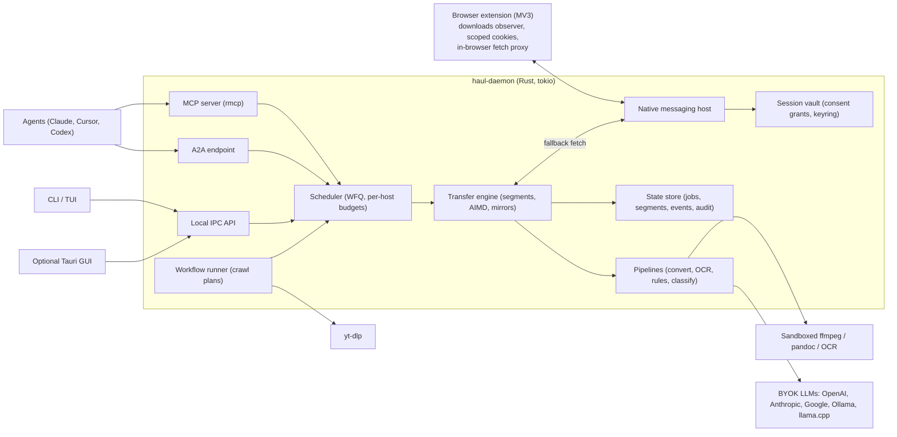
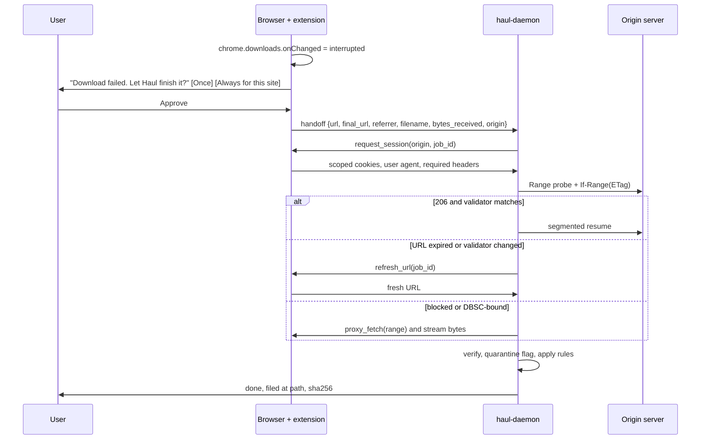

# Agentic Download and File Manager in Rust: Market, Demand, Engineering, and Product Research (October 2026)

The idea is worth building, but only as a narrow product: a local, open-source download engine that knows about browser sessions and is driven by agents, with MCP as its main interface. A general "IDM killer with AI" is the wrong shape, because classic download managers are crowded and cheap. The gap the evidence points to is specific. Agents and agentic browsers keep failing at the last step: getting a real file, from a logged-in session, onto disk, verified and filed.

## TL;DR

- **The opening is real but narrow.** Coding agents, browser-automation stacks and agentic browsers all have trouble with file downloads. Playwright MCP has repeated issues where a native download crashes the MCP connection or files land where the agent cannot reach them, and browser-use has several issues about downloads stuck on a remote browser host. Among the big open-source download managers, only Gopeed has added native MCP, and that is still in a 2.0 beta.
- **The hardest problem, and the moat, is session handoff from the browser.** Chrome 127 introduced app-bound encryption, which Google's Online Security Blog (Will Harris, July 2024) describes as encrypting "data tied to app identity… starting with cookies in Chrome 127." That broke cookie extraction by outside tools on Windows. Google's Keyword blog (Apr 10, 2026) says Device Bound Session Credentials (DBSC) entered "public availability for Windows users on Chrome 146," with short-lived session cookies issued only after "Chrome proving possession of the corresponding private key." So the dependable way to download from walled sessions is now an engine that cooperates with the browser: an extension plus native messaging, with an in-browser fetch fallback.
- **Recommendation: conditional go, as open core.** Spend 6 to 8 weeks on a cheap MVP: a Rust daemon, a browser extension that takes over failed downloads, and about 10 MCP tools. Aim for 1,000 GitHub stars and around 50 weekly active MCP users within 90 days. Charge later for team and compliance features (shared session policies, audit logs, provenance manifests), not for speed. If the signal is weak, pivot to an embeddable Rust crate plus MCP server aimed at agent builders.

## Table of Contents

1. Executive Summary
2. Market Opportunity (map, matrix, white space, sizing, pricing, timing)
3. Public Discourse and Demand Validation
4. Engineering and Mathematics of Downloading
5. Product Design
6. Risk Register
7. Final Recommendation and Cheap Experiments
8. Appendix: Formulas and Worked Examples

---

## 1. Executive Summary

| Question | Short answer | Confidence |
|---|---|---|
| Is the space empty? | No. Gopeed has an MCP endpoint in its 2.0 beta, and yt-dlp MCP servers exist. Nobody combines session handoff, safe file operations for agents, and provenance. | High |
| Is there demand? | Latent to moderate. The pain is well documented in agent-tool issue trackers, but few people ask for an "agentic download manager" by name. | Medium |
| Is the market large? | The download manager market itself is small and earns little. Next to it, web data and agent infrastructure is large and well funded. | Medium |
| Is the timing good? | Yes. MCP is the default tool protocol, A2A reached v1.0 under the Linux Foundation, and Chrome's cookie hardening breaks the old workflows. | High |
| Biggest risk | Scope creep: the idea contains about 12 products. After that, legal and terms-of-service exposure from logged-in scraping. | High |

**Position taken:** build "the download and file layer for agents" first. The GUI is optional and the scraping designer comes in phase 2. Session handoff, verification and auditability are the product.

---

## 2. Market Opportunity

### 2.1 Competitor map

#### Classic download managers

| Product | Stack / license | Notable traits | Monetization |
|---|---|---|---|
| Internet Download Manager (IDM) | Windows, proprietary | Segmented downloads, browser capture | $24.95 lifetime per PC, $11.95 per year\[1\] |
| Free Download Manager | Cross-platform freeware | Segmented HTTP, torrents, extension | Free |
| JDownloader 2 | Java, open source | Plugins for file hosters, link grabber | Donations, affiliates |
| aria2 (+ AriaNg, Motrix, Persepolis) | C++, GPL | HTTP/FTP/SFTP/BitTorrent/Metalink, JSON-RPC on port 6800\[2\]\[3\] | Free |
| Xtreme Download Manager | Java, open source | IDM-style capture | Free |
| AB Download Manager | Kotlin, Apache-2.0 | Queues, schedulers, extension; about 18.2k stars; Chrome extension lists 300,000 users\[4\]\[5\] | Free |
| Gopeed | Go + Flutter, GPLv3 | HTTP, BitTorrent, magnet, ed2k;\[6\] JS extensions; REST, CLI, webhooks; **MCP endpoint**; about 26.7k stars\[7\] | Free |
| DownThemAll | WebExtension | Bulk link selection in the browser | Free |
| yt-dlp + GUIs | Python | More than a thousand site extractors, HLS/DASH, `--cookies-from-browser`\[8\] | Free |
| wget / curl / rclone / qBittorrent / Transmission | Various | Scripting, WARC, cloud sync, torrents | Free |

#### Agentic browsers and browser-automation infrastructure

| Product | Relevance |
|---|---|
| Perplexity Comet | A Chromium agentic browser. Downloads are not a focus. |
| ChatGPT Atlas | Launched Oct 21, 2025.\[9\] A comparison article says its Agent Mode "cannot run code, download files, install extensions."\[10\] Two secondary sources report OpenAI shut Atlas down on Aug 9, 2026 and moved its features into ChatGPT and Codex (moderate confidence).\[11\] |
| Dia / Arc | A consumer AI browser |
| Browser Use | $17M seed announced March 23, 2025, led by Felicis' Astasia Myers, with Paul Graham, A Capital, Nexus Venture Partners, YC and SV Angel (TechCrunch; Browser Use blog). Its own issue tracker has download-handling bugs. |
| Playwright MCP | About 36.7k stars.\[12\] Download crashes keep recurring.\[13\]\[14\] |
| Browserbase | $40M Series B led by Notable Capital, with CRV and Kleiner Perkins, at a $300M post-money valuation (announced June 17, 2025); 1,000+ customers. Upstarts Media reported that "Browserbase's team of 30 has already reached more than $3 million in revenue." |
| Steel, Anchor, Hyperbrowser | Cloud browser APIs with persistent sessions |
| Firecrawl | $75M Series B led by Smash Capital (Sept 22, 2026). Launched "Alexandria" for agents.\[15\] |
| Apify, Crawl4AI | An actor marketplace with MCP; an open-source LLM crawler |

#### AI file managers and data tooling

This category is thin: AI renaming utilities, the reference Filesystem MCP server, and Hugging Face's `hf` CLI with the Rust `hf_xet` engine.\[16\] No widely adopted local product connects acquisition, verification, organization and provenance for agents. That is the opportunity, and also a warning: scripts may have been good enough so far.

### 2.2 Competitive feature matrix

Legend: ✅ yes, ◐ partial, ❌ no.

| Capability | IDM | JDownloader | aria2 | AB DM | Gopeed | yt-dlp | Playwright MCP | Browser Use | Firecrawl/Apify | **Proposed** |
|---|---|---|---|---|---|---|---|---|---|---|
| Segmented HTTP, resume | ✅ | ✅ | ✅ | ✅ | ✅ | ◐ | ❌ | ❌ | ❌ | ✅ |
| Browser capture extension | ✅ | ◐ | ◐ | ✅ | ✅ | ❌ | n/a | n/a | n/a | ✅ |
| Live session handoff | ◐ | ◐ | ❌ | ◐ | ◐ | ◐ (broken on Chrome 127+) | ✅ (in browser) | ✅ (in browser) | ◐ (cloud) | ✅ |
| Recover failed browser downloads | ◐ | ❌ | ❌ | ◐ | ◐ | ❌ | ❌ | ❌ | ❌ | ✅ (core) |
| HLS/DASH + muxing | ✅ | ✅ | ❌ | ◐ | ◐ | ✅ | ❌ | ❌ | ❌ | ✅ (via yt-dlp/ffmpeg) |
| Native MCP server | ❌ | ❌ | ❌ | ❌ | ✅ (beta) | ◐ (third-party) | ✅ | ◐ | ✅ | ✅ |
| A2A interface | ❌ | ❌ | ❌ | ❌ | ❌ | ❌ | ❌ | ❌ | ❌ | ✅ (phase 2) |
| Scraping workflows | ❌ | ◐ | ❌ | ❌ | ◐ | ❌ | ◐ | ✅ | ✅ | ✅ (phase 2) |
| Conversion pipeline | ❌ | ◐ | ❌ | ❌ | ◐ | ✅ | ❌ | ❌ | ◐ | ✅ |
| Rules, dedupe, LLM classification | ◐ | ◐ | ❌ | ◐ | ◐ | ❌ | ❌ | ❌ | ❌ | ✅ |
| Provenance manifest | ❌ | ❌ | ◐ (Metalink) | ❌ | ❌ | ◐ | ❌ | ❌ | ◐ | ✅ |
| Dry-run, audit, permission scopes | ❌ | ❌ | ❌ | ❌ | ◐ | ❌ | ◐ | ❌ | ◐ | ✅ |
| BYOK LLM routing | ❌ | ❌ | ❌ | ❌ | ❌ | ❌ | n/a | ✅ | ❌ | ✅ |
| Local-first | ✅ | ✅ | ✅ | ✅ | ✅ | ✅ | ✅ | ◐ | ❌ | ✅ |

### 2.3 Where the white space is

> **White space:** a local engine that (1) takes over the user's real browser session with consent, (2) finishes downloads that browsers and agents drop, (3) exposes everything as typed, idempotent, auditable MCP tools, and (4) writes a provenance record for every file. No current product does all four.

**Already well covered**, so don't make these the headline: raw speed (aria2, IDM, AB DM, Gopeed), media extraction (yt-dlp, which you should wrap), cloud scraping (Firecrawl, Apify, Browserbase), and cloud sync (rclone).

### 2.4 Sizing the opportunity

Market reports disagree by an order of magnitude. Treat all of these as directional.

| Source | Metric | Value |
|---|---|---|
| Mordor Intelligence | Web scraping market | $1.34B (2025) → $1.56B (2026) → $3.49B (2031), 17.39% CAGR\[17\] |
| Research and Markets (Feb 2026) | Web scraping market | $0.99B (2025) → $1.17B (2026) → $2.28B (2030)\[18\] |
| Research and Markets | "AI-driven web scraping" | $10.2B (2026).\[19\] Broad definition, low confidence. |
| Business Research Insights | Web scraping software | $14.95B (2026).\[20\] An outlier; ignore. |
| F5 Labs 2026 (via PromptCloud) | Scraper share of traffic | 10.2% of global web traffic after mitigation\[21\] |

**MCP signals:** Anthropic's own December 9, 2025 announcement donating MCP to the Agentic AI Foundation, as quoted by ChatForest and digitalapplied.com, reports "97M+ monthly SDK downloads across Python and TypeScript" and "more than 10,000 active public MCP servers." A May 24, 2026 snapshot counted 9,652 records in the official registry and 15,926 GitHub repositories tagged `mcp-server`. The official Rust SDK `rmcp` (3.x) implements the stable MCP 2026-07-28 specification.\[22\]

**Funding signals:**

| Company | Round | Date | Notes |
|---|---|---|---|
| Browserbase | $40M Series B, $300M post-money, led by Notable Capital with CRV and Kleiner Perkins | June 17, 2025 | 50M sessions in 2025 at the time;\[23\] Upstarts Media: "more than $3 million in revenue" with a team of 30 |
| Browser Use | $17M seed led by Felicis' Astasia Myers (Paul Graham, A Capital, Nexus, YC, SV Angel) | March 23, 2025 | 50k+ stars at the time\[24\] |
| Firecrawl | $14.5M Series A led by Nexus Venture Partners (Firecrawl blog, Aug 19, 2025; WOWTALE's Sept 2026 coverage also says $14.5M, while Dealroom reports $20.7M) | Aug 2025 | "more than 350,000 developers";\[25\] open-source project "crossing 48k stars" |
| Firecrawl | $75M Series B led by Smash Capital, with Altos, Nexus, YC, Freestyle, Offline Ventures | Sept 22, 2026 | Brad Twohig, Founder and Partner at Smash Capital (PR.com): "Over 1.5 million users build with Firecrawl" |

**TAM / SAM / SOM (my inference; not directly measured anywhere):**

| Layer | Reasoning | Estimate |
|---|---|---|
| TAM | Web data acquisition tooling, from the reports above | About $1B to $1.6B (2026) |
| SAM | Local, developer-run tooling that agents can operate. Mordor puts cloud at 67.45% of the market,\[17\] so assume 5% to 10% of TAM is local. | About $50M to $150M |
| SOM (3 years) | 50k to 200k OSS users × 2% to 4% paid × $60 to $120 per year | About $60k to $1M ARR |

**What this means:** a good business for a solo founder or small team, but not venture scale unless agent platforms embed it (the OEM pivot in Section 7).

**Segments, ranked by willingness to pay:** (1) ML/LLM data-curation teams (provenance, licensing), (2) agent developers, (3) OSINT, journalism and archival users, (4) researchers, (5) data hoarders, who bring the most volume and the least revenue and matter for distribution.

### 2.5 Who pays, for what, and how much

| Tier | What they pay for | Proposed price | Comparable |
|---|---|---|---|
| Free OSS core | Engine, CLI/TUI, extension, MCP, BYOK | $0 | aria2, Gopeed, AB DM |
| Pro | Encrypted sync of workflows and consent policies, premium templates | $5 to $8/month or $49 to $79 lifetime | IDM's $24.95 lifetime caps what "faster downloads" can earn\[1\] |
| Team | Shared workflows and policies (never shared credentials), central audit, provenance export | $15 to $25 per seat per month | Developer tool norms |
| Enterprise | SSO, domain policy engine, signed provenance, legal-hold archives | $10k to $50k per year | Data governance tools |
| OEM | Licensed Rust crate and daemon for agent platforms | Custom | Infrastructure support contracts |

Open core fits best. A closed-source tool that touches session cookies will rightly be distrusted. Default to BYOK and don't resell tokens. Never charge for speed or connection count.

### 2.6 Why now

| Driver | Change | Effect |
|---|---|---|
| MCP standardization | 10k+ servers, stateless 2026-07-28 spec, official Rust SDK | One interface reaches Claude, Cursor, ChatGPT, VS Code |
| A2A v1.0 | Donated by Google to the Linux Foundation in June 2025; official `a2a-rs` SDK\[26\]\[27\] | Other agents can delegate long download jobs as A2A Tasks\[28\] |
| Agentic browsers | Comet launched; Atlas reportedly shut down within a year | Browsers act, but downloads are left aside. A companion engine fills that gap. |
| Chrome app-bound encryption (127, July 2024) | Outside tools can't decrypt Chrome cookies on Windows\[29\]\[30\] | yt-dlp-style extraction breaks; extension handoff becomes the reliable path |
| DBSC GA (Chrome 146, Windows, April 2026) | Cookies tied to a TPM key and refreshed often\[31\]\[32\] | Exported cookies go stale quickly, so handoff has to be live |
| Manifest V3 | Blocking webRequest restricted; `chrome.downloads` remains | Capture works through the downloads API plus native messaging |
| Anti-bot escalation | About a tenth of traffic is scrapers; TLS fingerprinting is common | Non-browser clients get blocked more, so an in-browser fetch fallback is valuable |

---

## 3. Public Discourse and Demand Validation

**Method note:** the strongest citable evidence came from GitHub issue trackers. My searches did not turn up Reddit or Hacker News threads I could verify, so direct community validation is the first experiment in Section 7.

### 3.1 Pain themes with evidence

#### Theme A: agents cannot download files reliably

- **Playwright MCP #154 (Apr 2025):** a user asked for `browser_downloads_list` and `browser_download_get` tools, because downloaded files ended up in temp locations or as blobs the agent couldn't reach. A later commenter still couldn't find their files.\[33\]
- **Playwright MCP #1754:** on Windows, any download with a persistent profile crashed the server ("Connection closed -32000"). The reporter said they *needed* the persistent profile to stay logged in.\[13\] Login and download problems meet right there.
- **Playwright MCP #1768 (2026, v0.0.82):** clicking a `Content-Disposition: attachment` link killed the MCP connection. The issue cites five earlier closed download issues, so the problem keeps coming back.\[14\]
- **Playwright MCP #953 (Aug 2025):** a CSV saved under a numeric name, couldn't be opened and wasn't on disk, even though the same URL worked in a normal browser.\[34\]
- Playwright MCP release notes now include fixes such as detecting downloads through the download event "instead of guessing from net::ERR_ABORTED navigation errors".\[35\] The maintainers are actively working on it.
- **browser-use #3879, #3721, #3136, #1853:** remote browsers save files on the browser host, agents mark tasks as failed after the download actually succeeded, and users ask for a way to set the download path.\[36\]\[37\]\[38\]\[39\]

**What this shows:** agent stacks treat downloads as a side effect of browsing. In practice a download is a job with its own state, which is exactly what a download engine handles.

#### Theme B: cookies and logged-in sessions

- yt-dlp issues show `--cookies-from-browser chrome` failing with DPAPI errors and "Could not copy Chrome cookie database". GUIs built on yt-dlp, such as VidBee, inherit the same failures.\[40\]\[41\]\[42\]
- gallery-dl #4195: Chrome cookie extraction fails with "Permission denied", while Firefox and Edge work.\[43\]
- yt-dlp guides now say to "start with Firefox" or to export cookies.txt. A DEV post says the most popular cookie-export extension "was malware".\[29\]\[44\] That is a trust gap a vetted open-source extension can fill.

#### Theme C: failed, non-resumable downloads and expiring links

- A DEV Community post argues that browsers can't resume large downloads from expiring tokenized links, and works around this with wget or aria2 scripts that fetch a fresh link.\[45\] This is anecdotal.
- Hugging Face forum users complain about slow model downloads, and replies suggest `hf_xet` tuning or `aria2c -x16`.\[46\] Hugging Face is solving this inside its own tools.

#### Theme D: explicit requests for an "agentic download manager"

There is **no strong explicit demand** under that name. The closest signals come from the supply side: Gopeed shipping MCP and several small yt-dlp MCP servers appearing.

### 3.2 Existing MCP and agent download tools

| Tool | What it does | Signal | Assessment |
|---|---|---|---|
| Gopeed built-in MCP (2.0 beta) | Streamable HTTP `/mcp` with about 9 tools (resolve, create, list, pause, continue, delete, stats)\[47\]\[48\] | Gopeed has about 26.7k stars\[7\] | **Closest competitor.** No browser-session handoff, provenance or dry-run. |
| gopeed-mcp-server | Third-party wrapper with 10 tools\[48\]\[49\] | Archived and superseded | Shows someone wanted it enough to build it |
| kevinwatt/yt-dlp-mcp | Video, audio, subtitles, metadata\[50\] | About 285 stars\[50\] | Leading yt-dlp MCP; media only |
| Other yt-dlp MCPs | Various | 1 to 6 stars\[51\]\[52\]\[53\] | Hobby projects |
| Playwright MCP | Browser control with partial download handling | About 36.7k stars | Good at browsing, weak at downloading |
| Filesystem MCP | Read, write, list | Reference server | No acquisition logic |
| Apify MCP | Hosted downloader actors\[54\] | Commercial | Runs in the cloud; can't use local sessions |

### 3.3 Verdict on demand

**Latent to moderate. It is concentrated among agent builders and weak among mainstream download-manager users.**

For: specific, recurring bugs in the two most popular open-source agent browser stacks. Chrome's security changes breaking the main cookie workaround. Gopeed moving to MCP.

Against:
- **Upstream fixes.** If Playwright MCP ships solid download tools, the simple cases are covered.
- **Cloud vendors own the session.** Teams on Browserbase or Steel won't route through a desktop daemon.
- **Weak monetization.** The best paid benchmark is a $25 lifetime license.
- **Agents can write scripts.** A 30-line `curl` script covers the easy cases. The value has to come from sessions, verification and safety.
- **Scope.** Every one of the roughly 12 sub-features already has a specialist competitor.

---

## 4. Engineering and Mathematics of Downloading

### 4.1 Protocol and systems engineering

#### HTTP fundamentals

| Mechanism | Implementation notes |
|---|---|
| Probe with `Range: bytes=0-0` | Confirm `206` and `Content-Range`. Servers sometimes misreport `Accept-Ranges`. |
| `Range: bytes=a-b` | A `200` response means no range support; fall back to a single stream |
| `If-Range: <ETag/Last-Modified>` | A changed validator returns a full `200`; discard old segments |
| Weak ETags (`W/`) | Not safe for byte-range validation across sessions |
| Signed or expiring URLs | Store the *origin* that produced the URL, so the engine can request a fresh one and resume against the same ETag |
| `Content-Disposition` | Parse RFC 6266 `filename*` and sanitize the name |
| Compression | Send `Accept-Encoding: identity` for segmented downloads |

#### Throttling and protocol versions

- Many hosts throttle **per connection**, which is why segmenting helps. Others cap per IP or per account, where segmenting does nothing or gets you banned.
- **HTTP/2** multiplexes streams over one TCP connection, so a per-connection throttle covers all of them and one lost packet stalls every stream. For servers that throttle per connection, multiple HTTP/2 streams usually don't add up the way separate HTTP/1.1 connections do. This is inference from how the protocol works and varies by server.
- **HTTP/3 (QUIC)** keeps streams independent and survives network changes, but UDP is sometimes blocked. Keep a TCP fallback.
- Reuse keep-alive pools, TLS session resumption and TTL-respecting DNS caches. These matter most when downloading many small files.

#### Mirrors, state and integrity

| Concern | Approach |
|---|---|
| Metalink (RFC 5854) | Mirrors plus chunk hashes; choose mirrors with a bandit (4.3) |
| Preallocation | `fallocate` (Linux), `SetFileValidData` or sparse files (Windows), `F_PREALLOCATE` (macOS) |
| Journal | Segment bitmap, ETag, size, URL origin and session reference in redb or SQLite |
| Write ordering | `pwrite` the data, `fsync`, then commit the range. On restart, trust only committed ranges. |
| Final commit | `.part`, verify, `fsync`, atomic rename |
| Integrity | SHA-256 for the whole file. An optional Merkle tree lets you re-fetch a single bad chunk. |

**Content-defined chunking reference:** Hugging Face Xet uses chunks of about 64KB ("a 20GB file has 312,500 chunks").\[55\] `hf_xet` scales concurrency adaptively from 1 to 64 streams.\[56\] Use the `hf-xet` crate for Hub sources instead of rebuilding it.\[57\]

#### Streaming media and other sources

- HLS/DASH: fetch segments in parallel within a bounded window, then mux with ffmpeg `-c copy`. AES-128 HLS is fine when the session can reach the key. **Do not build DRM circumvention** (DMCA §1201).
- Run yt-dlp as a subprocess for extraction and let the Rust engine move the bytes.
- FTP/SFTP (`suppaftp`, `russh-sftp`), S3/GCS/Azure (`object_store`), Git LFS (batch API), BitTorrent (`librqbit`, later).

#### Politeness, proxies, fingerprints

- Follow `robots.txt` in crawl workflows (`texting_robots`). Use per-host token buckets. Treat `429`/`503` with `Retry-After` as orders.
- Set proxies (HTTP CONNECT, SOCKS5) per job. Never send cookies for one site through a proxy set up for another.
- **TLS fingerprints (JA3/JA4):** `rustls` doesn't look like a browser, so anti-bot systems may block it even with valid cookies. The legitimate fix is not spoofing. When the engine is blocked, **run the fetch inside the user's real browser** and stream it to the daemon. The user is still the one acting, and no controls are evaded.

### 4.2 Session and cookie handoff

| Method | Works in 2026? | Notes |
|---|---|---|
| Read the Chrome cookie DB from outside | **Mostly no** on Windows; fragile on Linux and macOS | Matches the yt-dlp breakage reports\[58\]\[59\] |
| Firefox cookie DB | Mostly yes | No exclusive lock, no process-bound encryption\[60\] |
| Extension `chrome.cookies` + native messaging | **Yes** | Scoped to an origin, with consent, over a local channel |
| CDP into a dedicated automation profile | Yes | For sessions the agent owns. Don't attach to the user's main profile without consent. |
| In-browser fetch proxy | Yes, always | Slowest, but it inherits the cookies, the TLS fingerprint and the DBSC binding |
| DBSC-bound sites | Short-lived cookies | Finish fast, ask the extension for refreshed cookies on `401`/`403`, or fall back to the proxy |

**What this means for the design:** the extension acts as a live **session oracle** the daemon can query again under a consent policy. It is not a one-time cookie export.

### 4.3 Mathematical and algorithmic models (details in Section 8)

| Model | Use |
|---|---|
| Bandwidth-delay product, Mathis | Why one connection underperforms; the ceiling per connection |
| Parallel saturation | Choosing N; stop when the marginal gain falls below a threshold |
| AIMD / gradient control | Adaptive segment count |
| UCB1 / Thompson sampling | Mirror selection |
| Max-min fairness / WFQ | Sharing bandwidth across jobs |
| Work stealing, hedged requests | Removing slow tail segments |
| EWMA / Kalman | Stable ETA |
| Backoff with full jitter; expected time under failure | Retry design; why resume matters |
| Little's Law | Queue capacity |
| Reed-Solomon; CDC collision bounds | Split files; dedup safety |

### 4.4 Rust implementation stack

| Layer | Crates | Notes |
|---|---|---|
| Runtime / HTTP | `tokio`, `hyper` 1.x, `reqwest` | `hyper` for precise control over ranges |
| HTTP/3 / TLS | `quinn` + `h3`; `rustls` + `rustls-platform-verifier` | Put HTTP/3 behind a feature flag; avoid OpenSSL |
| State | `redb` or `rusqlite` | Avoid `sled` for new work: its beta has dragged on (inference) |
| MCP | `rmcp` 3.x (official)\[22\] | stdio + Streamable HTTP |
| A2A | `a2a-rs` (official a2aproject) or `a2a-protocol-sdk` (independent)\[27\]\[61\] | Publish an Agent Card |
| Browser | `chromiumoxide`, `headless_chrome`; native messaging over stdio with length prefixes | |
| UI | `ratatui` TUI; optional `tauri` 2.x | Tauri uses the system WebView, so binaries stay small (inference) |
| Secrets / sandbox | `keyring`; `landlock`, `seccompiler`, macOS sandbox, Windows AppContainer | Sandbox converters most tightly |
| Hashing / parity | `sha2`, `blake3`, `reed-solomon-simd` | |
| Hugging Face | `hf-xet` | Official |
| Packaging | `cargo-dist`, winget, Homebrew, Scoop, AppImage/Flatpak | Code signing matters a lot here |

**Worth studying:** aria2 (segments, RPC), Gopeed (REST + MCP + extensions), AB Download Manager (UX and how the extension is split from the app), yt-dlp (extractors, cookies), `xet-core` (CDC, adaptive concurrency), Playwright MCP (tool design, workspace-root guardrails), `librqbit`.

**Benchmarks:** I found no reliable published comparison of memory or binary size against aria2 or IDM. Don't claim "lighter" without data. Publish a reproducible benchmark: idle RSS, RSS with 10 jobs, and 1GB throughput at 1, 4 and 16 segments.

### 4.5 Agent-specific engineering

| Principle | Rule |
|---|---|
| Jobs, not calls | `enqueue` returns a `job_id` immediately. Agents poll or subscribe; no MCP call blocks for minutes. |
| Idempotency | Every mutating tool takes an `idempotency_key` |
| Probe first | Size, ranges, MIME type, filename, and whether a session is needed, all before any bytes are written |
| Structured progress | `bytes_done`, `rate_ewma`, `eta_s`, `segments_active`, `last_error_class` |
| Verification | `verify` with an optional expected hash, plus a magic-byte vs MIME check |
| Dry run | Every move, rename, delete or convert returns a plan diff first |
| Scoped filesystem | Write roots only; deletes go to an app trash; no symlink escapes (Playwright MCP fixed this exact class of bug)\[35\] |
| Quarantine | Mark-of-the-Web / `com.apple.quarantine`; never auto-open |
| Prompt-injection hygiene | Label file content as untrusted data. Never follow instructions found in files, filenames or HTML. |
| Audit | Append-only, hash-chained log of tool calls, session use and file changes |

---

## 5. Product Design

### 5.1 Vision, positioning, names

**Vision:** "Your agents can find it. This makes sure they actually get it: verified, filed, and accounted for."

**Positioning:** the local download and file layer for AI agents. It works with your real browser, never steals cookies, and keeps a record of everything it does.

**Name candidates (check trademarks):** **Haul** (short, works as a verb), Courier, Tether, Ferry, Stash. This report uses **Haul** as the working name.

### 5.2 Personas and jobs to be done

| Persona | Top job | Current pain |
|---|---|---|
| Agent developer | "Get the file my agent found onto disk, verified" | Playwright MCP download crashes, files stranded on remote hosts |
| ML data curator | "Pull 40k PDFs across paginated pages, with license metadata and a manifest" | Ad-hoc scripts, no provenance |
| Researcher or journalist | "Get every attachment from this logged-in portal before access expires, with a chain of custody" | Manual clicking, expiring links |
| OSINT or archivist | "Capture files and pages as WARC with hashes" | Fragmented tools |
| Data hoarder | "Resume the 80GB file the browser keeps dropping" | No resume in the browser\[62\] |

### 5.3 Architecture

| Component | Key decisions |
|---|---|
| Daemon | A single process with local IPC. MCP over HTTP is opt-in, bound to localhost, with token auth. |
| Session vault | Stores consent grants, not cookies. Cookies are fetched on demand, held in memory for the job, then wiped. |
| Scheduler | WFQ across jobs, per-host token buckets, a global cap, quiet hours |
| Workflow runner | Declarative plans: start URLs, selectors, pagination (next link, page parameter, cursor API, infinite scroll in the browser), rate limits, filters, output rules. An LLM drafts the plan; a human or a policy approves it. |
| Pipelines | Sandboxed converters with no network, read-only input and write-only output |
| LLM routing | BYOK keys in the keyring. Small local models for classification, frontier models for drafting plans. Token budget caps. |

### 5.4 The key differentiator: "browser failed, hand it to the engine"

**Persistent retry policy:**

| Error class | Response |
|---|---|
| `transient_network`, `throttled` | Backoff with full jitter, capped at about 15 minutes; continues across reboots |
| `auth_expired`, `url_expired` | Refresh the session or URL up to N times, then ask the user |
| `blocked` | Switch to the in-browser proxy. If that fails, stop and report. **Never escalate to evasion.** |
| `permanent` (404, 451, size mismatch) | Stop and report |

**Consent grants:** Once (one job), Site (24 hours), Workflow (7 days, renewable), Never (block list). Every use of a session is logged with the origin, the job, the time and the caller.

### 5.5 MCP tool surface and event model

Keep the set small. Playwright MCP's own docs warn about the context cost of large tool schemas.\[12\]

| Tool | Key inputs | Outputs | Mutates? |
|---|---|---|---|
| `haul.probe` | `url`, `session_origin?` | size, ranges, ETag, MIME, filename, `requires_session` | No |
| `haul.enqueue` | `url(s)`, `dest_dir`, `expected_sha256?`, `priority?`, `session_origin?`, `idempotency_key`, `dry_run?` | `job_ids`, plan | Yes |
| `haul.status` / `haul.wait` | `job_id`, `timeout_s ≤ 60` | state, progress, ETA, error class | No |
| `haul.control` | `job_id`, pause/resume/cancel/reprioritize | new state | Yes |
| `haul.verify` | `job_id`, `expected_sha256?` | hash, detected MIME, match, quarantined | No |
| `haul.session.list` / `.request` | `origin`, `reason`, `scope` | metadata only, or `pending_user_approval` | Request asks the user |
| `haul.files.list` / `.organize` | `root`, `rules` or natural language, `dry_run` (default true) | files with provenance; plan diff | Organize: yes |
| `haul.convert` | `inputs`, `target_format`, `dry_run?` | outputs, tool versions | Yes |
| `haul.workflow.plan` / `.run` | goal, start URLs, constraints; `plan_id`, `approve_token` | plan for review; `run_id` | Run: yes |
| `haul.manifest.export` | `run_id`, format (JSONL, CSV, Croissant-style) | manifest path | No |

**Resources:** `haul://jobs/{id}`, `haul://runs/{id}/manifest`, `haul://audit/today`.

**Events:** `job.created`, `job.probed`, `job.progress` (about 1 Hz), `job.throttled`, `job.retry_scheduled`, `session.refresh_needed`, `job.completed`, `job.verified`, `job.quarantined`, `job.failed` (with `error_class` and a suggested next tool).

### 5.6 Prompt-to-workflow walkthrough

**Prompt (Claude Code with Haul MCP):** "From the conference portal I'm logged into, download every 2026 paper PDF, name them `{year}-{first_author}-{short_title}.pdf`, convert any DOCX to PDF, and give me a manifest with license info."

| Step | Agent action | Haul behavior |
|---|---|---|
| 1 | `session.request(origin, scope="workflow")` | The extension asks for consent; the user approves for 7 days |
| 2 | `workflow.plan(goal, start_urls)` | Fetches 1 to 2 pages; a BYOK model drafts selectors, `?page=N` pagination until no new items, PDF/DOCX filters, 1 request every 2 seconds |
| 3 | Shows the plan | Estimate: 1,240 files, 3.1GB, about 45 minutes at the politeness budget |
| 4 | `workflow.run(dry_run=true)` | First 50 URLs and filenames; flags 12 name collisions |
| 5 | `workflow.run(dry_run=false)` | Events stream; two expired signed URLs are refreshed through the extension |
| 6 | `convert(docx → pdf)` | Sandboxed converter |
| 7 | `manifest.export(jsonl)` | Each row: path, sha256, source_url, retrieved_at, session_origin, license (or "unknown"), converter |

### 5.7 Security, privacy, legal and ethics

#### Security and privacy

| Threat | Mitigation |
|---|---|
| Looks like an infostealer | Never reads the cookie DB. Access only through the extension, scoped to an origin, with consent. Signed, reproducible builds and a published threat model. |
| Malicious local process | User-only IPC permissions, per-client tokens, MCP HTTP off by default |
| Prompt injection | Untrusted-content labels; mutating tools require explicit parameters |
| Malware | Quarantine flags, no auto-execute, optional AV scan hook, archive-bomb limits |
| Path traversal / zip slip | Canonicalize paths; reject `..` and symlinks that leave the roots |
| Credential leakage to LLMs | Cookie values and keys never enter model context |
| Telemetry | Off by default |

#### Legal (general information, not legal advice)

| Topic | What it means here |
|---|---|
| CFAA (US) | *Van Buren* (2021) narrowed "exceeds authorized access". In *hiQ v. LinkedIn*, the Ninth Circuit found that scraping public data likely isn't access "without authorization", but hiQ later lost on breach of contract and settled in 2022. **Public data carries lower CFAA risk, but contract and ToS claims still apply.** |
| Logged-in scraping | Higher risk, because account holders have agreed to the ToS. *Meta v. Bright Data* (2024) turned partly on Bright Data scraping while logged out. Design Haul so the user is the actor, using their own access, at human pace, for their own use, with ToS warnings. |
| Copyright and DRM | Personal and research use rules vary by country. No redistribution features and no DRM circumvention (DMCA §1201, EU InfoSoc Art. 6). |
| GDPR / EU AI Act | Personal data needs a lawful basis and minimization. Training-data transparency duties make provenance manifests a selling point. |
| Bangladesh and others | Bangladesh has been moving toward a dedicated personal data protection law. Check its current status before localized marketing (low confidence). Apply minimization by default everywhere. |
| robots.txt | A norm and evidence of good faith. Honored by default; override only for origins the user owns. |

**Guardrails:** default-deny for sensitive categories (banking, health) unless the user opts in. Rate caps in templates. A clear notice about responsibility on first use of a walled session. No captcha-solving integrations in core.

### 5.8 MVP, roadmap, metrics, go-to-market, monetization

#### MVP (weeks 0 to 8)

| In | Later |
|---|---|
| Segmented HTTP(S), resume, If-Range, journal, verify | Torrent, ed2k |
| Chrome/Edge MV3 extension: handoff, cookie bridge, fetch fallback | Firefox, Safari |
| MCP: probe, enqueue, status, wait, control, verify, session.request, files.list | Workflow designer GUI |
| CLI + minimal TUI; yt-dlp passthrough; JSONL manifest | Tauri GUI, own extractors, C2PA |

#### Roadmap

| Phase | Deliverables |
|---|---|
| **0 to 3 months** | Engine, journal, verify; MV3 extension with handoff; 8 MCP tools; CLI/TUI; public alpha with benchmarks |
| **3 to 9 months** | Workflow runner (pagination, LLM-drafted plans); sandboxed conversion; rules, dedupe, LLM classification; A2A endpoint; Firefox; Pro sync |
| **9 to 18 months** | Team tier (shared policies, audit); signed provenance; S3, HF-native and torrent sources; optional GUI; enterprise policy engine and SSO |

#### Success metrics

| Phase | Metric | Target |
|---|---|---|
| 0 to 3 months | GitHub stars / weekly active MCP clients | 1,000 / 50 |
| 0 to 3 months | Handoff success on a 200-URL failure test set | ≥ 85% |
| 3 to 9 months | Monthly active installs / community workflows | 5,000 / 100 |
| 9 to 18 months | Paid Pro + Team seats / enterprise pilots | 300 to 1,000 / 1 to 3 |

#### Go-to-market and monetization

- Apache-2.0 for the engine and MCP server. The sync server and team console stay closed.
- Launch with a Show HN demo ("Playwright MCP clicked download; Haul finished it"), plus posts in r/DataHoarder, r/selfhosted, r/mcp and r/LocalLLaMA built on benchmarks.
- List in the official MCP registry, Smithery and PulseMCP. Ship through Homebrew, winget and Scoop.
- Offer adapters for Playwright MCP and browser-use ("on download, call `haul.enqueue`") and a Claude Code skill.
- Monetize in order: Pro sync (months 6 to 9), Team (month 12), Enterprise and OEM (month 15 onward).

---

## 6. Risk Register

| # | Risk | Likelihood | Impact | Mitigation |
|---|---|---|---|---|
| 1 | Scope creep | High | High | Hard MVP boundary; defer workflow designer and GUI |
| 2 | Playwright MCP / browser-use fix downloads upstream | Medium | Medium | Stay complementary (session-aware resume, verification, provenance); ship adapters |
| 3 | Gopeed adds browser handoff | Medium | High | Move faster on session bridge and safety; consider contributing upstream |
| 4 | Chrome restricts extension cookies or native messaging | Low to medium | High | Fetch fallback, Firefox, CDP automation profiles |
| 5 | DBSC breaks cookie handoff on key sites | Medium | Medium | The proxy-fetch path inherits the binding |
| 6 | Antivirus flags it as an infostealer | Medium | High | Never read cookie DBs; signed builds; submit to AV vendors |
| 7 | Legal action over user scraping | Low to medium | High | ToS warnings, rate caps, no evasion, user-as-actor design, an acceptable use policy |
| 8 | Weak monetization | High | Medium | Sell team, compliance and OEM, not speed |
| 9 | Prompt injection causes destructive file operations | Medium | High | Dry-run defaults, trash instead of delete, scoped roots, audit |
| 10 | Malware arrives through agent downloads | Medium | High | Quarantine, scanning hooks, no auto-open |
| 11 | MCP spec churn | Medium | Low | Official `rmcp`; conformance tests in CI |
| 12 | Solo maintainer burnout | High | High | Small scope, community workflows, early sponsorships |

---

## 7. Final Recommendation and Cheap Experiments

**Conditional GO**, scoped as "the session-aware download and file layer for agents". **NO-GO** on a full IDM replacement with a GUI, a visual scraping designer and A2A all at once.

**Why go:** the pain shows up in the issue trackers of the most-used agent browser tools. Chrome's cookie hardening favors designs that cooperate with an extension. MCP and A2A make distribution cheap. And the Rust ecosystem (`rmcp`, `hf-xet`, `tokio`/`hyper`, `redb`, `ratatui`, `tauri`) covers almost every layer.

**Why it could fail:** Playwright MCP fixes the problem upstream, Gopeed moves fast, cloud browser vendors own the sessions, and download-manager users don't pay.

### Validate first (each under 2 weeks)

| # | Experiment | Pass criterion |
|---|---|---|
| 1 | **Handoff demo:** an MV3 extension catches an interrupted Chrome download and a 500-line Rust binary resumes it with the right cookies | Works on 8 of 10 real failures (large Google Drive files, signed S3 links, a logged-in portal) |
| 2 | **MCP wrapper:** give `probe`, `enqueue`, `status` and `verify` to 10 Claude Code or Cursor users who reported Playwright MCP download issues | 5 or more still using it after 2 weeks without prompting |
| 3 | **Community post:** Show HN and r/DataHoarder with a 60-second video | 200+ upvotes or 300+ stars in week one |
| 4 | **Pricing page:** three tiers, each with a "notify me" button | ≥ 3% of visitors click Team or Enterprise |
| 5 | **Upstream check:** talk to the Gopeed and Playwright MCP maintainers | Find out whether they plan session handoff; if they do, pivot to an adapter or contribute |

### Pivots if the signal is weak

1. **Crate plus MCP server:** `haul-core` as an embeddable engine with session hooks for agent platforms.
2. **Provenance-first ML data acquisition:** manifests, licensing and reproducible dataset pulls only.
3. **Contribute upstream:** build the session bridge as a plugin for Gopeed or AB Download Manager.

---

## 8. Appendix: Formulas and Worked Examples

### 8.1 Bandwidth-delay product
`BDP = B × RTT`. This is how many bytes must be in flight to fill the link.
Example: 100 Mbps × 80 ms = **1 MB**. A connection limited to a 256 KB window tops out near 256 KB / 0.08 s ≈ 25.6 Mbps.

### 8.2 Mathis TCP model
`Throughput ≤ (MSS / RTT) × (1.22 / √p)`. Packet loss puts a ceiling on a single connection.
Example: MSS 1460 B, RTT 100 ms, p = 0.0001 → 116,800 bps × 1.22 / 0.01 ≈ **14.25 Mbps** per connection. CUBIC and BBR do better, so treat this as a conservative bound.

### 8.3 Parallel connections
`X(N) ≈ min(B_link, S_server, N × r(N))`. Stop adding connections when `X(N+1) − X(N) < ε` (for example 3%) or when the server answers with `429` or resets.
Example: 2 MB/s per-connection throttle, 25 MB/s link, 16 MB/s per-IP cap → gains stop at **N = 8**.

### 8.4 AIMD concurrency
Every T = 2 s: if throughput rose more than 5% with no errors, `N ← N + 1`. On `429`, `503`, a reset, or a throughput drop, `N ← max(1, ⌊N/2⌋)`. **Gradient variant:** if RTT goes above `RTT_min × (1 + γ)` while throughput stays flat, a queue is building, so reduce N.

### 8.5 Mirror selection (UCB1)
`i = argmax ( x̄_i + √(2 ln n / n_i) )`. Mostly use the fast mirrors while still testing the others. Thompson sampling is a good alternative.

### 8.6 Fairness
Max-min fairness gives equal shares, and leftover bandwidth moves to jobs that need it. WFQ: job j gets `B × w_j / Σw` (for example interactive = 4, background = 1). It is gated by a per-host token bucket (R_h, b_h).

### 8.7 Work stealing and hedging
An idle worker splits the active segment with the most bytes left (if more than about 4 MB remain) and takes the back half. **Hedging:** if a segment takes longer than the p95 time of similar segments, duplicate its remaining range and keep whichever finishes first. The p95 trigger keeps the extra bytes under about 5%.

### 8.8 ETA
EWMA: `r̂_t = α r_t + (1 − α) r̂_(t−1)`, `ETA = remaining / r̂`.
Example: 600 MB left at r̂ = 12 MB/s → **50 s**. With α = 0.2, a one-second spike to 40 MB/s only moves r̂ to 17.6 MB/s (ETA 34 s), so the ETA doesn't jump to 15 s.
Kalman: `P ← P + Q; K = P/(P + R); r̂ ← r̂ + K(r_t − r̂); P ← (1 − K)P`.

### 8.9 Backoff with full jitter
`sleep_n = uniform(0, min(cap, base × 2^n))`. With base 1 s and cap 900 s, the ceilings go 1, 2, 4, ... 512, 900. Expected attempts with per-try success q is `1/q` (q = 0.2 → 5).

### 8.10 Expected completion under failure
Failures arrive at Poisson rate λ, and the clean transfer time is T.
- Non-resumable: `E = (e^(λT) − 1)/λ`
- Resumable in chunks of c: `E ≈ (T/c)(e^(λc) − 1)/λ`

Example: λ = 1/hour, T = 2 hours → non-resumable **6.39 h**. Resumable with c = 0.1 h: 20 × 0.10517 = **2.10 h**. That gap is why journaling segments is the core of the product.

### 8.11 Chunk size
Efficiency is `E = (c/B)/(c/B + RTT)`, so you need `c ≥ (E/(1 − E)) × B × RTT`.
Example: 12.5 MB/s × 50 ms = 625 KB. For E = 0.95, c ≥ 19 × 625 KB ≈ **11.9 MB**. Default to 8 to 32 MB with dynamic splitting near the end.

### 8.12 Little's Law
`L = λW`. Example: 2 files/s arriving × 15 s each = **30 concurrent jobs**. Size the host budgets and file-descriptor limits to match.

### 8.13 Reed-Solomon parity
(k, m): any k of the k + m shards rebuild the file; overhead is m/k.
Example: k = 10, m = 2 (20% overhead), each shard failing with probability 0.02 → P(3 or more of 12 fail) ≈ 220 × 8×10⁻⁶ × 0.834 ≈ **0.15%**, compared with 18.3% for 10 shards and no parity.

### 8.14 Deduplication
A CDC boundary falls where `hash & mask == 0`, giving an expected chunk size of `2^k` (k = 16 → about 64 KB, close to Xet). Collision probability is `≈ n²/2^(b+1)`. With SHA-256 and 10¹² chunks, that's about 4×10⁻⁵¹. Bytes moved for a new version ≈ (1 − overlap) × size, so a 20GB checkpoint with 90% overlap moves about 2GB.

## Sources

1. [Internet Download Manager Registration](https://secure.internetdownloadmanager.com/buy_idm.html)
2. [aria2c XML RPC](https://github.com/muhammadmoazzam/aria2c-XML-RPC)
3. [aria2 — Free Open-Source CLI Download Manager (aria2c)](https://aria2.org/)
4. [GitHub - amir1376/ab-download-manager: A Download Manager that speeds up your downloads · GitHub](https://github.com/amir1376/ab-download-manager)
5. [AB Download Manager](https://chrome-stats.com/d/bbobopahenonfdgjgaleledndnnfhooj)
6. [GitHub - bhardwajRahul/gopeed: A modern download manager that supports all platforms. Built with Golang and Flutter. · GitHub](https://github.com/bhardwajRahul/gopeed)
7. [GitHub - GopeedLab/gopeed: A fast, modern download manager for HTTP, BitTorrent, Magnet, and ed2k. Cross-platform, built with Golang and Flutter. · GitHub](https://github.com/GopeedLab/gopeed)
8. [yt-dlp - ArchWiki](https://wiki.archlinux.org/title/Yt-dlp)
9. [The Browser Wars 2025: ChatGPT Atlas vs. Perplexity Comet vs. Chrome with Gemini — The Complete Analysis](https://sidsaladi.substack.com/p/the-browser-wars-2025-chatgpt-atlas)
10. [ChatGPT Atlas vs Perplexity Comet](https://cybernews.com/ai-tools/chatgpt-atlas-vs-perplexity-comet/)
11. [ChatGPT Atlas vs Perplexity Comet (2026)](https://aionx.co/ai-comparisons/chatgpt-atlas-vs-perplexity-comet/)
12. [Playwright MCP Server: Tools, Context Cost & CLI Trade-off (2026)](https://www.oodle.ai/guides/mcp/playwright)
13. [MCP server crashes when downloading files with persistent profile on Windows · Issue #1754 · microsoft/playwright-mcp](https://github.com/microsoft/playwright-mcp/issues/1754)
14. [browser\_click that triggers a native file download crashes the MCP server (Connection closed -32000) · Issue #1768 · microsoft/playwright-mcp](https://github.com/microsoft/playwright-mcp/issues/1768)
15. [Firecrawl Raises \$75M Series B; Launches Alexandria - PR.com](https://www.pr.com/press-release/979737)
16. [Download files from the Hub · Hugging Face](https://huggingface.co/docs/huggingface_hub/guides/download)
17. [Web Scraping Market Size, Growth Report, Share & Trends 2026 - 2031](https://www.mordorintelligence.com/industry-reports/web-scraping-market)
18. [Web Scraping Market Report 2026 - Research and Markets](https://www.researchandmarkets.com/reports/6227084/web-scraping-market-report)
19. [AI-Driven Web Scraping Market Report 2026 - Research and Markets](https://www.researchandmarkets.com/reports/6226892/ai-driven-web-scraping-market-report)
20. [Web Scraping Software Market Forecast & Size Insights 2026–2035](https://www.businessresearchinsights.com/market-reports/web-scraping-software-market-109339)
21. [Web Scraping Report 2026: Market Trends, Growth & Key Insights](https://www.promptcloud.com/blog/state-of-web-scraping-2026-report/)
22. [GitHub - modelcontextprotocol/rust-sdk: The official Rust SDK for the Model Context Protocol · GitHub](https://github.com/modelcontextprotocol/rust-sdk)
23. [Browserbase Raises \$40M Series B for AI Web Automation](https://aimmediahouse.com/ai-startups/browserbase-raises-40-million-series-b-as-demand-for-ai-web-automation-accelerates)
24. [Browser Use secures \$17M in seed funding to help AI agents navigate the web](https://dataphoenix.info/browser-use-secures-17m-in-seed-funding-to-help-ai-agents-navigate-the-web/)
25. [We just raised our Series A and shipped /v2](https://www.firecrawl.dev/blog/firecrawl-v2-series-a-announcement)
26. [GitHub - tomtom215/a2a-rust: Type-safe, async Rust SDK for the Agent2Agent (A2A) protocol, built to the final v1.0.0 spec — JSON-RPC, REST, WebSocket & gRPC for building interoperable AI agents](https://github.com/tomtom215/a2a-rust)
27. [GitHub - a2aproject/a2a-rs: A2A Rust SDK · GitHub](https://github.com/a2aproject/a2a-rs)
28. [car\_a2a - Rust](https://docs.rs/car-a2a/latest/car_a2a/)
29. [6 Ways to Get YouTube Cookies for yt-dlp in 2026 — Only 1 Works - DEV Community](https://dev.to/osovsky/6-ways-to-get-youtube-cookies-for-yt-dlp-in-2026-only-1-works-2cnb)
30. [Google enhances Chrome security on Windows with app-bound encryption to fight cookie theft](https://alternativeto.net/news/2024/8/google-enhances-chrome-security-on-windows-with-app-bound-encryption-to-fight-cookie-theft)
31. [Device Bound Session Credentials (DBSC) explained](https://www.corbado.com/blog/device-bound-session-credentials-dbsc)
32. [Chrome’s device-bound sessions make stolen login cookies harder to reuse](https://mlq.ai/news/chromes-device-bound-sessions-make-stolen-login-cookies-harder-to-reuse/)
33. [Feature request: add \`browser\_downloads\_list\`and \`browser\_download\_get\` tools to allow discovery and retrieval of downloaded documents](https://github.com/microsoft/playwright-mcp/issues/154)
34. [\[Question\] How to download csv file using playwright mcp? · Issue #953 · microsoft/playwright-mcp](https://github.com/microsoft/playwright-mcp/issues/953)
35. [Releases · microsoft/playwright-mcp](https://github.com/microsoft/playwright-mcp/releases)
36. [Bug: Downloads path not saving files in worker pod · Issue #3136 · browser-use/browser-use](https://github.com/browser-use/browser-use/issues/3136)
37. [Is there an official method to download files locally that were downloaded within browseruse's session? · Issue #1853 · browser-use/browser-use](https://github.com/browser-use/browser-use/issues/1853)
38. [Bug: Failing tasks due incorrect external file handling in code. · Issue #3721 · browser-use/browser-use](https://github.com/browser-use/browser-use/issues/3721)
39. [Feature Request: Support Download to Local from Remote Browser · Issue #3879 · browser-use/browser-use](https://github.com/browser-use/browser-use/issues/3879)
40. [error downloading from youtube - Could not copy Chrome cookie database. See https://github.com/yt-dlp/yt-dlp/issues/7271 · Issue #15867 · yt-dlp/yt-dlp](https://github.com/yt-dlp/yt-dlp/issues/15867)
41. [\[Bug\]: YouTube download fails: could not copy Chrome cookie database · Issue #205 · nexmoe/VidBee](https://github.com/nexmoe/VidBee/issues/205)
42. [\`--cookies-from-browser\`: WARNING: failed to decrypt with DPAPI / ERROR: 'NoneType' object has no attribute 'decode' · Issue #10927 · yt-dlp/yt-dlp](https://github.com/yt-dlp/yt-dlp/issues/10927)
43. [github.com](https://github.com/mikf/gallery-dl/issues/4195)
44. [yt-dlp "Sign in to confirm you're not a bot": Cookies Fix](https://jnzlab.io/posts/ytdlp-cookie-auth-guide/)
45. [DEV Community](https://dev.to/pchemguy/stop-letting-your-browser-fail-large-downloads-lk3)
46. [Download speed way too slow - Beginners - Hugging Face Forums](https://discuss.huggingface.co/t/download-speed-way-too-slow/169824)
47. [feat: add MCP support by monkeyWie · Pull Request #1471 · GopeedLab/gopeed](https://github.com/GopeedLab/gopeed/pull/1471)
48. [GitHub - Panda-Young/gopeed-mcp-server · GitHub](https://github.com/Panda-Young/gopeed-mcp-server)
49. [gopeed-mcp-server · PyPI](https://pypi.org/project/gopeed-mcp-server/0.3.1/)
50. [yt-dlp-mcp/CLAUDE.md at main · kevinwatt/yt-dlp-mcp](https://github.com/kevinwatt/yt-dlp-mcp/blob/main/CLAUDE.md)
51. [GitHub - yorickchan/mcp\_youtube\_dlp: A Model Context Protocol (MCP) server that provides tools for downloading YouTube videos and audio using yt-dlp. · GitHub](https://github.com/yorickchan/mcp_youtube_dlp)
52. [GitHub - Gtvar/yt-dlp-mcp](https://github.com/Gtvar/yt-dlp-mcp)
53. [GitHub - AgentX-ai/youtube-dlp-server: A Model Context Protocol (MCP) server that lets your AI interact with YouTube videos - extract video information, subtitles, and top comments without downloading. · GitHub](https://github.com/AgentX-ai/youtube-dlp-server)
54. [Reddit Media Downloader — MCP Data API for AI Agents MCP server · Apify](https://apify.com/khadinakbar/reddit-media-downloader/api/mcp)
55. [Storage](https://huggingface.co/docs/hub/en/storage-backends)
56. [Downloading models · Hugging Face](https://huggingface.co/docs/hub/en/models-downloading)
57. [hf-xet - crates.io: Rust Package Registry](https://crates.io/crates/hf-xet)
58. [Fix "Could not copy Chrome cookie database" in yt-dlp](https://yt-dlp.net/errors/could-not-copy-chrome-cookie-database)
59. [Fix "Permission denied" Reading Browser Cookies in yt-dlp](https://yt-dlp.net/errors/cookies-permission-denied)
60. [yt-dlp Cookies: --cookies-from-browser vs cookies.txt](https://yt-dlp.net/guides/cookies)
61. [a2a\_protocol\_sdk - Rust](https://docs.rs/a2a-protocol-sdk/latest/a2a_protocol_sdk/)
62. [post 1550290](https://forums.tomsguide.com/threads/need-help-downloading-large-files.357093/post-1550290)
